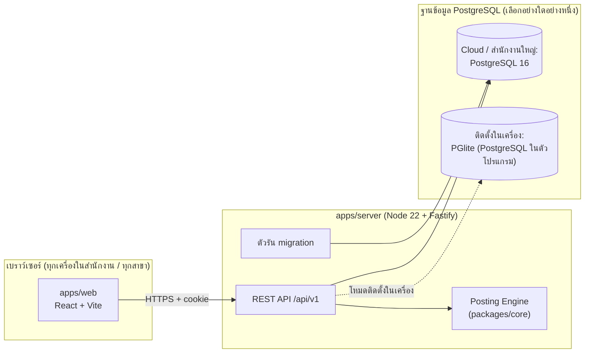

# สถาปัตยกรรม Buddy Account

## 1. ภาพรวม



## 2. การตัดสินใจหลัก (ADR)

| # | เรื่อง | ตัดสินใจ | เหตุผล |
|---|---|---|---|
| A1 | ฐานข้อมูล | **PostgreSQL ทุกโหมด** — Cloud ใช้ PostgreSQL 16, ติดตั้งในเครื่องใช้ **PGlite** (PostgreSQL 18 ที่ทำงานในตัวโปรแกรม Node ไม่ต้องติดตั้งเพิ่ม) | โค้ด SQL ชุดเดียว, numeric แม่นยำ, trigger/plpgsql ใช้ได้ทั้งสองโหมด — ทดสอบแล้วโหลด schema 77 ตารางเข้า PGlite ได้ใน 6 วินาที |
| A2 | โครงสร้างข้อมูล | ใช้แบบที่ออกแบบจากข้อมูลจริงของ Express (`db/spec/spec.py`) เป็นแหล่งเดียว แล้วสร้าง SQL + TypeScript types อัตโนมัติ | ทดสอบย้ายข้อมูลจริง 344,811 แถวแล้ว งบทดลองดุล ลูกหนี้ตรงทุกบาท |
| A3 | ภาษา/เฟรมเวิร์ก | TypeScript ทั้งระบบ, pnpm monorepo; server = Fastify + Kysely + Zod; web = React 18 + Vite + React Router + TanStack Query | type ปลอดภัยตั้งแต่ฐานข้อมูลถึงหน้าจอ |
| A4 | จำนวนเงิน | เก็บ `numeric(18,2)`, ปริมาณ `numeric(18,4)`; ฝั่ง TypeScript ใช้ decimal.js; ส่งผ่าน API เป็นข้อความ เช่น `"1234.50"` | ห้ามใช้ float กับเงิน |
| A5 | วันที่ | เก็บ ค.ศ. (`date`); หน้าจอแสดง/รับ พ.ศ. ตามค่าบริษัท `year_system` | ตรงกับ Express (ระบบปี พ.ศ./ค.ศ.) |
| A6 | บันทึก = ลงบัญชี | บันทึกเอกสารกับใบสำคัญในทรานแซกชันเดียว; แก้เอกสาร = ใบสำคัญเดิมถูกแทน; ยกเลิก = สถานะ C ไม่ลบ | ไม่ต้องมีเมนู "ลงบัญชีใหม่" ของ Express |
| A7 | หาบัญชี | ลำดับเดิมของ Express: ประเภทเอกสาร → แฟ้มหลัก → บัญชีมาตรฐาน → บัญชีพัก; บันทึกว่ามาจากชั้นไหนใน `gl_journal_line.resolved_from` | ตรงคู่มือบทที่ 10 และตรวจย้อนได้ |
| A8 | หลายบริษัท | ทุกตารางมี `company_id`; API ทุกเส้นรับบริษัทจาก session และกรองทุก query; มีชุดทดสอบว่าข้ามบริษัทไม่ได้ | ฐานข้อมูลเดียวหลายบริษัท/สาขา |
| A9 | ผู้ใช้/สิทธิ์ | รหัสผ่าน bcrypt, session cookie httpOnly; สิทธิ์ 7 ชนิดต่อเมนู (อ่าน เพิ่ม แก้ ลบ พิมพ์ อนุมัติ ยกเลิก) ตาม `sys_permission` | ตามบทที่ 23 |
| A10 | Migration | `db/migrations/NNNN_ชื่อ.sql` รันอัตโนมัติตอนเปิด server (ตาราง `sys_schema_migration`); ไฟล์แรก = schema ที่สร้างจาก spec | แก้โครงสร้าง = แก้ spec + เพิ่มไฟล์ migration คู่กัน |
| A11 | Audit | `sys_activity_log` เพิ่มได้อย่างเดียว (trigger ห้ามแก้/ลบ) | กรมสรรพากรกำหนดเก็บ log ≥ 2 ปี |
| A12 | ย้ายข้อมูล Express | `tools/express-import` อ่าน .DBF (cp874) โดยตรง | ลูกค้าเปลี่ยนจาก Express ได้ทันที |
| A14 | หลายลูกค้า (tenant) | `sys_tenant` อยู่เหนือบริษัท; บริษัท ผู้ใช้ กลุ่ม สังกัดลูกค้า; ADMIN ไม่มี tenant = ผู้ให้บริการ; ระงับลูกค้า = ตัด session ทันที; ถัดไปเปิด RLS ป้องกันชั้นที่สอง | ขาย/ให้บริการหลายลูกค้าบนระบบเดียวโดยข้อมูลไม่ปนกัน — ดู `docs/05_หลายลูกค้าและความปลอดภัย.md` |
| A13 | ออฟไลน์สาขา | เครื่องสาขา = Buddy Account ตัวเดียวกัน (PGlite) สำเนาบริษัทเดียว · ส่งคำขอให้สำนักงานใหญ่บันทึกซ้ำด้วยรหัสแถว/เลขที่เดิม · ดึงการเปลี่ยนแปลงจาก sync_change_log (แทนแบบ SQLite เดิม) | เสร็จ T7.8 — `docs/12_ออฟไลน์สาขา.md` |

## 3. โหมดการติดตั้ง

| โหมด | ฐานข้อมูล | ใช้เมื่อ | วิธีรัน |
|---|---|---|---|
| ติดตั้งในเครื่อง | PGlite เก็บในโฟลเดอร์ (เช่น `C:\BuddyAccount\data`) | สำนักงานเดียว ใช้แบบ Express; เครื่องอื่นใน LAN เปิดผ่านเบราว์เซอร์ `http://<ชื่อเครื่อง>:4100` | `BUDDY_DATA_DIR=C:\BuddyAccount\data` |
| Cloud / Server | PostgreSQL 16 | หลายสาขา ทำงานจากที่ไหนก็ได้ | `DATABASE_URL=postgres://…` |

ย้ายระหว่างสองโหมดได้ด้วยไฟล์สำรองข้อมูล (dump) ของ PostgreSQL

## 4. โครงสร้างโฟลเดอร์

```
buddy-account/
├─ apps/
│  ├─ server/          Fastify API, migration runner, โมดูลตามระบบงาน
│  └─ web/             หน้าจอ React (ธีมพาสเทล)
├─ packages/
│  └─ core/            กฎธุรกิจที่ไม่ขึ้นกับฐานข้อมูล: เงิน วันที่ พ.ศ. เลขผู้เสียภาษี ภาษี posting
├─ db/
│  ├─ spec/            spec.py (แหล่งเดียวของโครงสร้าง) gen.py seed.py
│  ├─ generated/       schema.sql, db-types.ts, พจนานุกรมข้อมูล (สร้างอัตโนมัติ ห้ามแก้มือ)
│  └─ migrations/      ไฟล์ migration ที่รันจริง
├─ tools/express-import/   ย้ายข้อมูลจาก Express (.DBF)
└─ docs/               แผน สเปก ผลวิเคราะห์คู่มือ Express
```

## 5. โมดูลฝั่ง server

แต่ละระบบงานเป็นโฟลเดอร์ใน `apps/server/src/modules/<ชื่อ>` มี `routes.ts` (รับ/ตรวจข้อมูลด้วย Zod) และ `service.ts` (ตรรกะ + SQL) ต่อกันแบบเดียวทุกโมดูล:

`auth` `company` `gl` (ผังบัญชี รอบบัญชี สมุดรายวัน ใบสำคัญ) `fs` (งบการเงิน) `report` `master` `doc` (เอกสารซื้อขายทุกชนิด) `tax` `bank` `inventory` `asset` `admin`

## 6. หน้าจอ (มาตรฐานเดียวทุกหน้า)

ตามโครงหน้าจอ Express (บทที่ 3) ที่ปรับให้ใช้บนเว็บ — ต้นแบบอยู่ใน Showcase (`D:\ACC-Program\_Analysis\07_Showcase`)

- **เมนูซ้าย** ตามลำดับระบบ Express, ค้นหาเมนูได้
- **แถบเครื่องมือ** เดียวกันทุกหน้า: เพิ่ม (Ins/F2) แก้ (F3) บันทึก (F9/Ctrl+S) ยกเลิก (Alt+C) ค้นหา (Alt+S) เรียกดู (Ctrl+L) พิมพ์ (Alt+P) ก่อนหน้า/ถัดไป (PgUp/PgDn) ออก (Esc)
- **Enter ไปช่องถัดไป**, ช่องรหัสกด F4/🔍 เปิดหน้าต่างค้นหา และเพิ่มรายการใหม่จากหน้าต่างค้นหาได้
- **รายการเอกสาร** คลิก/Enter เปิดได้ทุกแถว, ชี้เมาส์เห็นรายละเอียดย่อ
- ข้อมูลมากแยกเป็นแท็บ, ข้อมูลอ้างอิงเปิดเป็น popup
- ธีมพาสเทลเท่านั้น (ไม่มีโหมดมืด) ช่องกรอกมีเส้นขอบชัด
