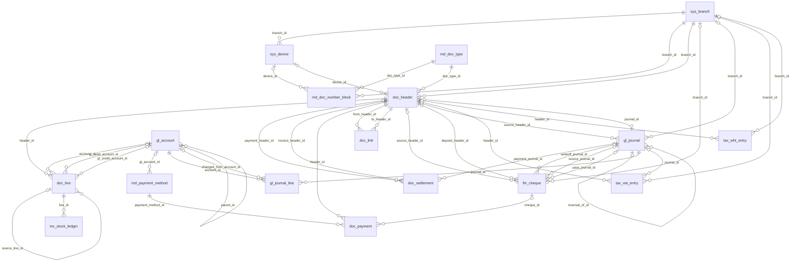
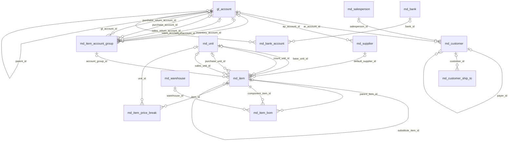
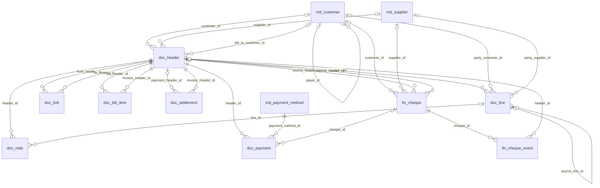
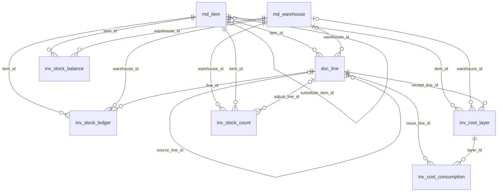
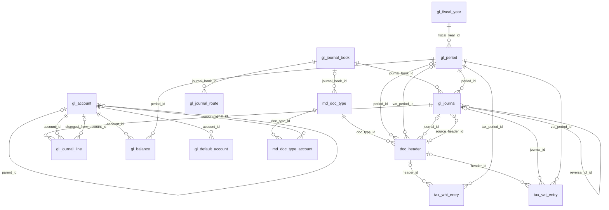
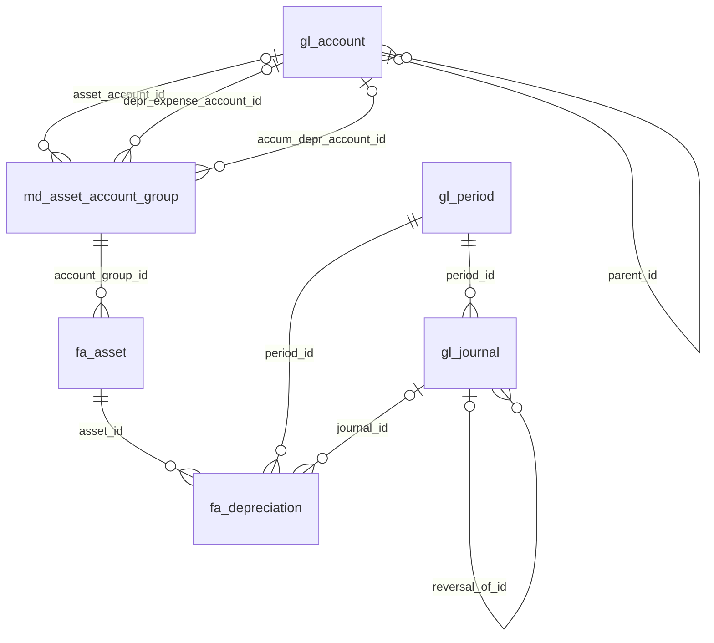
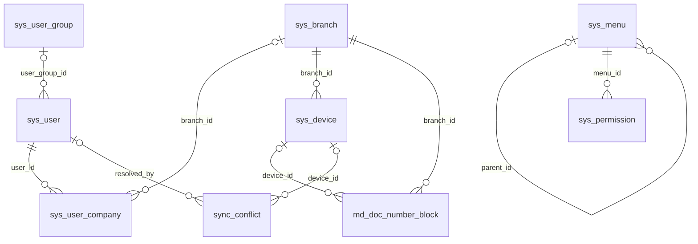

# ER Diagram — ระบบใหม่

> สร้างอัตโนมัติจาก spec.py · แสดงเฉพาะความสัมพันธ์ภายในกลุ่ม

## ภาพรวมแกนหลัก

## แฟ้มข้อมูลหลัก

## ขาย-ซื้อ-รับชำระ

## สินค้าคงคลัง

## บัญชีแยกประเภท-ภาษี

## ทรัพย์สินถาวร

## ผู้ใช้-สิทธิ์-ซิงก์

