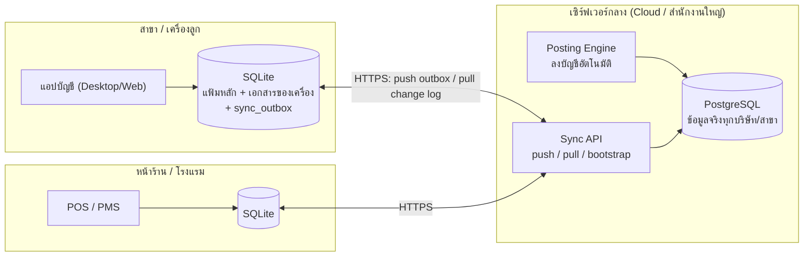

# ออกแบบฐานข้อมูลระบบบัญชี (ตามแบบโปรแกรม Express) — ออนไลน์ + ออฟไลน์

> ที่มา: แฟ้มข้อมูลจริงของ Express (`D:\ACC-Program\TESTRice` — 59 แฟ้ม .DBF, 1,931 ฟิลด์, ~345,000 ระเบียน) ร่วมกับผลวิเคราะห์คู่มือ (`_Analysis/01_หน้าจอ`)
> ฐานข้อมูล: **PostgreSQL** (เซิร์ฟเวอร์กลาง) + **SQLite** (เครื่องลูก ทำงานต่อได้เมื่อเน็ตดับ/ไฟดับ) ตารางและชื่อคอลัมน์เหมือนกันทั้งสองฝั่ง

## สรุปผล

| หัวข้อ | ผล |
|---|---|
| โครงสร้างใหม่ | 77 ตาราง · 1,438 คอลัมน์ (PostgreSQL) · 68 ตารางบนเครื่องลูก (SQLite) พร้อม trigger ซิงก์ |
| ครอบคลุม Express | ฟิลด์ที่มีข้อมูลทุกตัวมีปลายทางในระบบใหม่ (ดู `05_Mapping_Express_ไป_ระบบใหม่.csv`) |
| ทดลองย้ายข้อมูลจริงทั้งบริษัท | 344,811 แถว ใน ~45 วินาที — ใบสำคัญดุลทุกใบ (16,765), งบทดลองดุล, ลูกหนี้คงค้างตรง Express ทุกบาท (29,898,801.25) |
| กฎการลงบัญชีอัตโนมัติ | ลงบัญชีเอกสารจริง 15,382 ใบด้วยกฎที่ออกแบบ แล้วเทียบกับใบสำคัญที่ Express ลงไว้ — **ตรงทุกบัญชีทุกบาท 97.0%** |
| ออฟไลน์ | ทดสอบครบรอบ: ออกใบกำกับตอนไม่มีเน็ต → ส่งซ้ำไม่เกิดรายการซ้ำ → งวดถูกปิดระหว่างออฟไลน์ถูกจับเป็น conflict → แก้ข้อมูลชนกันถูกจับเป็น conflict |

## ไฟล์ในโฟลเดอร์นี้

| ไฟล์ | เนื้อหา |
|---|---|
| `00_README_ออกแบบฐานข้อมูล.md` | (ไฟล์นี้) ภาพรวม สถาปัตยกรรม หลักการออกแบบ |
| `01_Express_โครงสร้างเดิม.md` | พจนานุกรมข้อมูลของ Express ทุกแฟ้มทุกฟิลด์ + ตารางรหัส (RECTYP, POSOPR, TABTYP …) + ความสัมพันธ์ที่ตรวจกับข้อมูลจริง |
| `02_ER_Express.md` | ER Diagram ของ Express |
| `03_พจนานุกรมข้อมูล_ระบบใหม่.md` | ทุกตาราง ทุกคอลัมน์ของระบบใหม่ พร้อมฟิลด์ต้นทางใน Express |
| `04_ER_ระบบใหม่.md` | ER Diagram ระบบใหม่ 7 กลุ่ม |
| `05_Mapping_Express_ไป_ระบบใหม่.csv` | ตาราง mapping ฟิลด์ต่อฟิลด์ (เปิดด้วย Excel ได้) |
| `06_การเชื่อมต่อระบบบัญชี.md` | กลไกลงบัญชีอัตโนมัติ กฎ Dr/Cr ของเอกสารทุกชนิด และหลักฐานจากข้อมูลจริง |
| `07_ออฟไลน์และการซิงก์.md` | การทำงานเมื่อเน็ตดับ เลขที่เอกสาร การแก้ conflict |
| `08_ผลทดสอบการย้ายข้อมูล.md` | ผลการย้ายข้อมูล TESTRice การกระทบยอด และปัญหาคุณภาพข้อมูลที่พบ |
| `schema_postgres.sql` | DDL เซิร์ฟเวอร์ (ตาราง ดัชนี FK trigger view) |
| `schema_sqlite.sql` | DDL เครื่องลูก (ตาราง + trigger คิวออฟไลน์) |
| `seed_reference.sql` | ข้อมูลอ้างอิงกลาง (ชนิดตารางอ้างอิง นิยามค่าเริ่มต้น 51 ค่า) |
| `seed_company_template.sql` | แม่แบบต่อบริษัท: กฎการลงบัญชี 79 ข้อ เส้นทางสมุดรายวัน ความหมายช่องบัญชี |
| `tools/` | `spec.py` (ข้อกำหนดชุดเดียวที่สร้างทุกไฟล์), `gen.py`, `seed.py`, `migrate_express.py`, `posting_engine.py`, `sync_demo.py`, `validate_migration.py`, `run_all.sh` และผลทดสอบ `result_*` |

> **แก้โครงสร้างที่ `tools/spec.py` เท่านั้น** แล้วรัน `python3 tools/gen.py` — DDL ทั้งสองฝั่ง พจนานุกรม และ ER จะสร้างใหม่ให้ตรงกันเสมอ

---

## 1. สถาปัตยกรรม

- **ออนไลน์:** แอปทำงานกับ SQLite ในเครื่องเสมอ (เร็ว ไม่ขึ้นกับเน็ต) แล้วซิงก์เบื้องหลังทุกไม่กี่วินาที
- **ออฟไลน์:** แอปทำงานต่อได้ทันทีด้วยข้อมูลในเครื่อง เอกสารใหม่เข้าคิว `sync_outbox` และส่งขึ้นเมื่อเน็ตกลับ
- **ไฟดับ:** SQLite ใช้ WAL และบันทึกแบบ transaction เอกสารที่บันทึกแล้วจึงไม่หาย คิวที่ค้างส่งต่อหลังเปิดเครื่อง
- **ความจริงอยู่ที่เซิร์ฟเวอร์:** การลงบัญชี GL ยอดสต๊อก/ต้นทุน และทะเบียนภาษี คำนวณบนเซิร์ฟเวอร์ เครื่องลูกเก็บค่าพวกนี้ไว้อ่านเท่านั้น

## 2. หลักการออกแบบ (และต่างจาก Express อย่างไร)

| # | Express | ระบบใหม่ | เหตุผล |
|---|---|---|---|
| 1 | หนึ่งบริษัท = หนึ่งโฟลเดอร์ .DBF | ทุกตารางมี `company_id` (+ `branch_id` ในเอกสาร) | หลายบริษัท/หลายสาขา/หลายโรงแรมในฐานข้อมูลเดียว |
| 2 | คีย์คือรหัส (CUSCOD, DOCNUM) | PK เป็น **UUIDv7** + รหัสเดิมเป็น unique key | เครื่องลูกสร้างแถวตอนออฟไลน์ได้โดยไม่ชนกัน และแก้รหัสได้โดยไม่กระทบความสัมพันธ์ |
| 3 | หัวเอกสารแยกตามระบบ (ARTRN, APTRN, STTRN, OESO, POPR) แยกชนิดด้วย RECTYP | **`doc_header` ตารางเดียว** + `doc_class` (= ISRUN.DOCTYP) + `module` | ใช้กลไกเดียวในการออกเลข ซิงก์ ลงบัญชี อนุมัติ และ audit |
| 4 | บรรทัดของทุกเอกสารอยู่ใน STCRD | **`doc_line`** (+ `stock_effect` −1/0/+1, `movement_code` = POSOPR) | ตรงแนวเดิม และพิสูจน์แล้วว่าคำนวณยอดสต๊อกได้ตรง |
| 5 | ยอดสะสมรายงวดเก็บในแฟ้มหลัก (ARBAL, GLBAL, STLOC: 24–36 ช่อง) | ไม่เก็บในแฟ้มหลัก ใช้ **ledger + view/summary** (`gl_balance`, `inv_stock_balance`, `v_ar_outstanding`) | Express ต้องมีเมนู "คำนวณยอดใหม่" เพราะยอดเพี้ยน; ข้อมูลจริงพบ GLBAL ปีปัจจุบันว่าง และ STLOC ไม่ตรงอีก 1.25% |
| 6 | รอบบัญชี 24 งวดในแถวเดียว (ISPRD) | `gl_fiscal_year` + `gl_period` ไม่จำกัดปี | เปิดปีใหม่ไม่ต้อง "ประมวลผลสิ้นปี" เพื่อเลื่อนงวด |
| 7 | หาบัญชี 3 ชั้น: ISRUN → แฟ้มหลัก → ISINFO.ACCNUMnn → บัญชีพัก | **คงหลักเดิม** แต่ทำให้เป็นข้อมูล (`gl_posting_rule`, `md_doc_type_account.role`, `gl_default_account.role`) | ตรวจย้อนได้ว่าบัญชีมาจากชั้นไหน (`gl_journal_line.resolved_from`) |
| 8 | ค่าเริ่มต้น 244 ฟิลด์ใน ISINFO | `sys_setting` (key–value) + `sys_setting_def` | เพิ่มค่าใหม่ไม่ต้องแก้โครงสร้าง; ตั้งค่าเฉพาะสาขาได้ |
| 9 | ISTAB ตารางเดียวแยกด้วย TABTYP | ตารางที่ถูกอ้างถึงบ่อยแยกออก (`md_unit`, `md_warehouse`, `md_department`, `md_bank`) ที่เหลืออยู่ใน `md_lookup` | ได้ FK จริงในตารางสำคัญ |
| 10 | ลบแบบมีเครื่องหมาย `*` | soft delete (`deleted_at`) + `row_version` + `sys_activity_log` แบบเพิ่มได้อย่างเดียว | ซิงก์การลบได้; ตรงข้อกำหนดเก็บ log ≥ 2 ปีของกรมสรรพากร |
| 11 | ไม่มีแนวคิดอุปกรณ์ | `sys_device`, `md_doc_number_block`, `sync_*` | รองรับออฟไลน์อย่างปลอดภัย |

## 3. กลุ่มตาราง

| กลุ่ม | ตารางหลัก | แทนแฟ้ม Express |
|---|---|---|
| ระบบ/สิทธิ์ | `sys_company` `sys_branch` `sys_user` `sys_user_group` `sys_permission` `sys_menu` `sys_setting` `sys_activity_log` | ISINFO, ไฟล์ระบบรักษาความปลอดภัย (SC*) ISLOG |
| บัญชีแยกประเภท | `gl_account` `gl_fiscal_year` `gl_period` `gl_journal_book` `gl_journal` `gl_journal_line` `gl_balance` `gl_budget` `gl_template*` `gl_fs_*` | GLACC ISPRD GLJNL GLJNLIT GLBAL GLBUD GLTPL GLREP |
| การลงบัญชีอัตโนมัติ | `gl_default_account` `gl_posting_rule` `gl_journal_route` `md_doc_type_account` `md_item_account_group` | ISINFO.ACCNUMnn / *JNL, ISRUN.ACCNUMnn, ISACC |
| แฟ้มหลัก | `md_customer` `md_customer_ship_to` `md_supplier` `md_salesperson` `md_item` `md_item_bom` `md_item_price_break` `md_bank_account` `md_lookup` `md_note` `md_project` `md_serial` | ARMAS ARSHIP APMAS OESLM STMAS STBOM STPRI BKMAS ISTAB ARTRNRM JBMAS ISSN |
| ประเภทเอกสาร/เลขที่ | `md_doc_type` `md_payment_method` `md_doc_number_block` | ISRUN |
| เอกสาร | `doc_header` `doc_line` `doc_note` `doc_link` `doc_bill_item` `doc_settlement` `doc_payment` | ARTRN APTRN OESO/IT POPR/IT STTRN STCRD ARTRNRM ARBIL APBIL ARRCPIT APRCPIT ARRCPCQ APRCPCQ GLPTT/IT |
| การเงิน | `fin_cheque` `fin_cheque_event` `fin_bank_ledger` | BKTRN BKTRNIT |
| สินค้า | `inv_stock_ledger` `inv_cost_layer` `inv_cost_consumption` `inv_stock_balance` `inv_stock_count` | STCRD (ส่วนต้นทุน/ล็อต) STLOC STTAK |
| ภาษี | `tax_vat_entry` `tax_wht_entry` | ISVAT ISTAX |
| ทรัพย์สิน | `fa_asset` `fa_depreciation` `md_asset_account_group` | FAMAS ISACC(F) |
| ซิงก์ | `sys_device` `sync_change_log` `sync_inbox` `sync_conflict` `sync_outbox`* `sync_state`* | (ใหม่) — *เฉพาะเครื่องลูก |

## 4. สิ่งที่ค้นพบจากข้อมูลจริง (ดูจากคู่มืออย่างเดียวไม่รู้)

1. **POSOPR 3 = รับเข้าคลังปลายทาง และ 4 = จ่ายออกจากคลังต้นทาง** (สลับกับที่คาด) — ยืนยันกับยอด STLOC ได้ตรง 98.75%
2. **รหัสค่าใช้จ่าย/รายได้อื่นอยู่ในแฟ้มสินค้า** (STKTYP 5/4) และไม่กระทบสต๊อก บัญชีมาจากกลุ่มบัญชี (ISACC ช่อง 1)
3. **วิธีรับ/จ่ายเงินเก็บใน CHQNUM**: 2 ตัวแรกคือรหัสใน ISRUN (ZR/ZP) ตรง 100% — ส่วนที่จ่ายเป็นเงินสดเก็บที่หัวเอกสาร (CSHRCV/CSHPAY)
4. **ช่องบัญชีที่ประเภทเอกสาร (ISRUN.ACCNUM01–12) มีความหมายต่างกันตามชนิด** เช่น PP ช่อง 4 = เจ้าหนี้เงินสดย่อย, RR ช่อง 3 = บัญชีเจ้าหนี้แทน — ดูตารางใน `06_การเชื่อมต่อระบบบัญชี.md`
5. **ARTRNRM เก็บหมายเหตุของสินค้า/ผู้จำหน่ายด้วย** (ใช้รหัสแทนเลขที่เอกสาร) → `md_note`
6. **การตัดชำระบางรายการทำผ่านใบสำคัญ JV** (288 รายการ) → `doc_settlement.payment_journal_id`
7. **บางเอกสารมีแต่บรรทัดไม่มีหัว** เช่น ใบตรวจนับ TK และยอดยกมาสินค้ารายล็อต (DOCNUM ว่าง) → สร้างหัวเอกสารให้ตอนย้ายข้อมูล
8. **GLBAL ปีปัจจุบันว่าง** และช่อง "ปีก่อน" คือยอดของปีที่ไม่มีรายละเอียดใบสำคัญ → ใช้เป็นยอดยกมาต้นปีแรก (ดุลพอดี 0.00)

## 5. สิ่งที่ต้องตัดสินใจ / ตรวจยืนยันก่อนพัฒนา

| เรื่อง | สถานะ | ข้อเสนอ |
|---|---|---|
| เลขที่ใบกำกับภาษีตอนออฟไลน์ | ออกแบบเป็น "ชุดเลขต่อเครื่อง" (เช่น `IV-POS1-00001`) ใน `md_doc_number_block` | ควรยืนยันกับหลักเกณฑ์การออกใบกำกับภาษี (เล่ม/ชุดแยกตามจุดขาย) ก่อนใช้จริง |
| กฎลงบัญชีแบบ Perpetual | บริษัทตัวอย่างใช้ Periodic จึงยืนยันได้เฉพาะกฎ Periodic | ทดสอบกับข้อมูลบริษัทที่ใช้ Perpetual อีกชุด |
| เอกสารธนาคาร (BD BW BT BU BV BQ) | ข้อมูลตัวอย่างไม่มีใบสำคัญจากเอกสารเหล่านี้ | กฎตามคู่มือบทที่ 10/13 ทำเครื่องหมาย `is_assumed = true` ไว้ |
| ISRUN ช่อง 1 ของ RC/RS/RO (5150-01) | ข้อมูลจริงไม่ได้ใช้ช่องนี้ในใบสำคัญ | สอบถามผู้ใช้ Express ว่าตั้งไว้เพื่ออะไร |
| เอกสารที่อนุญาตตอนออฟไลน์ | ค่าเริ่มต้น: HS IV RE SO QT OU RL JU DP | ปรับใน `sys_setting` `sync.offline_allowed_doc_classes` |
| หลายสกุลเงิน | มี `currency`/`exchange_rate` ที่หัวเอกสาร แต่ Express ไม่มี | ถ้าโรงแรมรับเงินต่างประเทศ ต้องเพิ่มกฎลงกำไร/ขาดทุนอัตราแลกเปลี่ยน |

## 6. ใช้งานกับ Claude Code

1. ติดตั้ง PostgreSQL 14+ แล้วรัน `bash tools/run_all.sh <โฟลเดอร์ Express> "host=localhost user=postgres" acc_dev` — จะได้ฐานข้อมูลพร้อมข้อมูลจริงของบริษัทไว้พัฒนา
2. ให้ Claude Code อ่าน `00_README` + `03_พจนานุกรมข้อมูล` + `06_การเชื่อมต่อระบบบัญชี` + `07_ออฟไลน์และการซิงก์` + หน้าจอที่เกี่ยวข้องใน `_Analysis/01_หน้าจอ/` แล้วสร้างทีละโมดูล
3. ลำดับที่แนะนำ: แฟ้มหลัก → ประเภทเอกสาร/เลขที่ → Sync API + แอปเครื่องลูก → ระบบขาย (IV RE) → Posting Engine (ต่อยอดจาก `tools/posting_engine.py`) → ซื้อ → สินค้า/ต้นทุน → ภาษี → รายงาน
