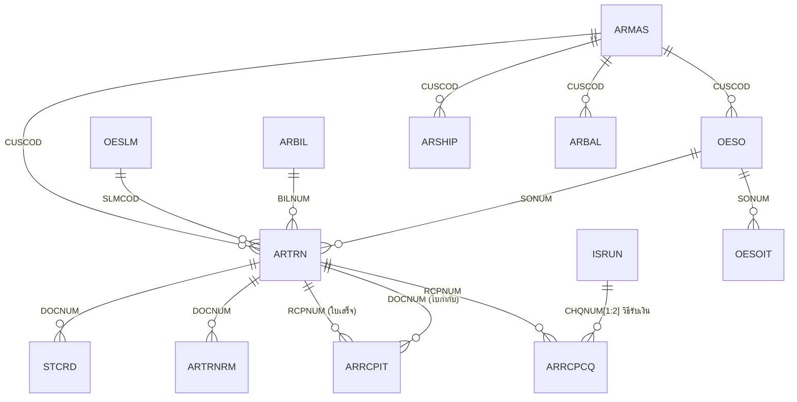
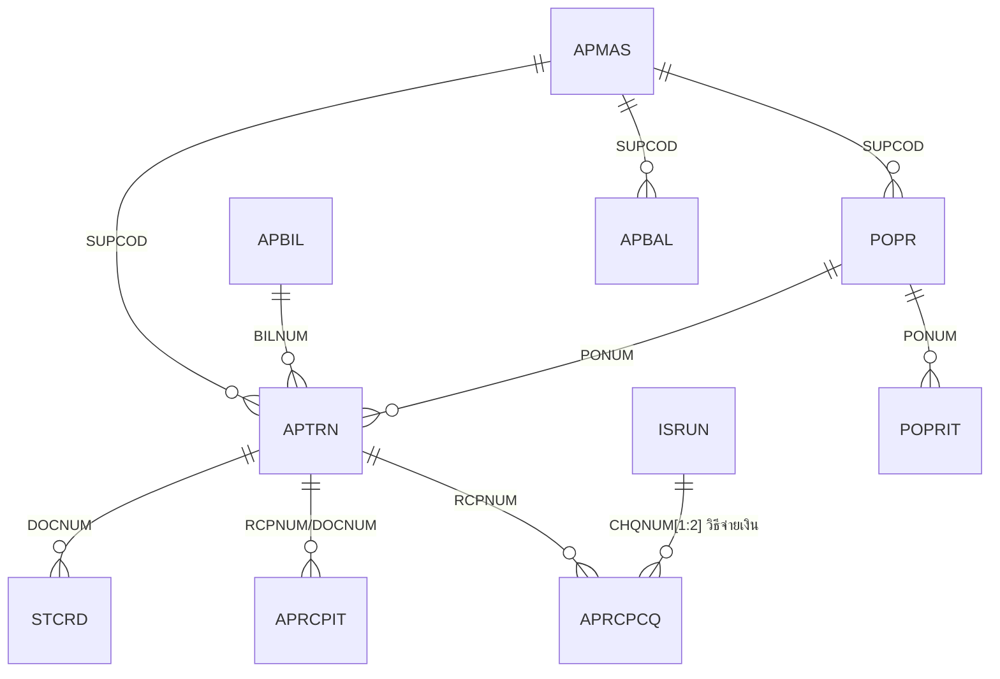
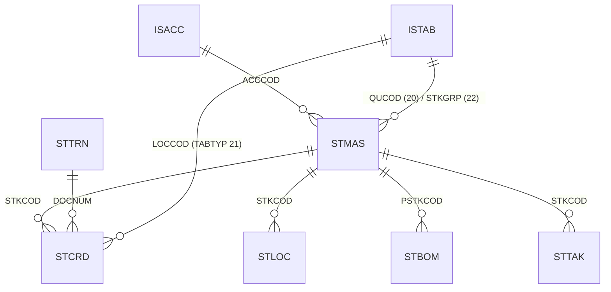
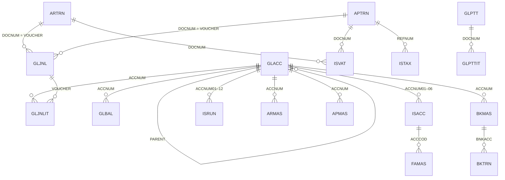

# ER Diagram — โปรแกรม Express (โครงสร้างเดิม)

> เส้นความสัมพันธ์ทั้งหมดตรวจกับข้อมูลจริงแล้ว (ดู % ใน 01_Express_โครงสร้างเดิม.md)

## ขายและลูกหนี้

## ซื้อและเจ้าหนี้

## สินค้า

## บัญชีแยกประเภท ภาษี การเงิน

