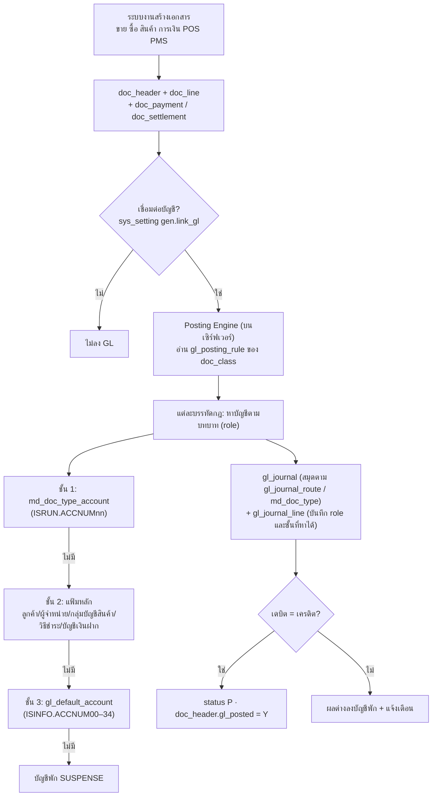

# การเชื่อมต่อระบบต่างๆ เข้าระบบบัญชี (ลงบัญชีอัตโนมัติ)

> ออกแบบตามคู่มือ Express บทที่ 10 และ**ยืนยันกับใบสำคัญจริง 15,382 ใบ** ของข้อมูล TESTRice: นำกฎในเอกสารนี้ไปลงบัญชีเอกสารทุกใบ แล้วเทียบกับใบสำคัญที่ Express ลงไว้ทีละบัญชี — **ตรงทุกบัญชีทุกบาท 97.0%** (อีก 2.4% ยอดรวมตรงแต่กระจายบัญชีต่าง เช่น ส่วนลด/ปัดเศษรายบรรทัด)
> ต้นแบบโค้ด: `tools/posting_engine.py` · ข้อมูลกฎ: `seed_company_template.sql` → ตาราง `gl_posting_rule`

## 1. ภาพรวม



**เมื่อไรลงบัญชี:** เครื่องลูกบันทึกเอกสารพร้อม `gl_posted = 'P'` (รอเซิร์ฟเวอร์) → เมื่อซิงก์เข้าเซิร์ฟเวอร์ Posting Engine สร้างใบสำคัญเลขเดียวกับเอกสาร (เหมือน Express ที่ GLJNL.VOUCHER = DOCNUM) → ใบสำคัญซิงก์กลับเครื่องลูกเพื่อดูรายงาน
**ยกเลิกเอกสาร:** ไม่ลบใบสำคัญ — สร้างใบสำคัญกลับรายการ (`gl_journal.reversal_of_id`) ในงวดที่ยังเปิด
**แก้เอกสารที่ลงบัญชีแล้ว:** กลับรายการเดิม + ลงใหม่ (Express ใช้ Alt+J ลงบัญชีใหม่)

## 2. บทบาทบัญชีมาตรฐาน 34 ตัว (ชั้นที่ 3) — `gl_default_account`

ลำดับตรงกับ `ISINFO.ACCNUM00–34` ของ Express · คอลัมน์ขวาคือบัญชีที่บริษัทตัวอย่างผูกไว้

| ช่อง | บทบาท (role) | ความหมาย | TESTRice |
|---|---|---|---|
| 00 | `CASH` | เงินสด | 1111-00 เงินสด |
| 02 | `AR` | ลูกหนี้การค้า | 1130-02 ลูกหนี้การค้า-ในประเทศ |
| 03 | `CHEQUE_RECEIVED` | เช็ครับลงวันที่ล่วงหน้า | 1130-02 ลูกหนี้การค้า-ในประเทศ |
| 04 | `INVENTORY` | สินค้าคงเหลือ | 1140-02 สินค้าคงเหลือ |
| 05 | `PREPAID_TAX` | ภาษีเงินได้ถูกหัก/จ่ายล่วงหน้า | 1151-02 ภาษีนิติบุคคลจ่ายล่วงหน้า(ภงด.51) |
| 06 | `INPUT_VAT` | ภาษีซื้อ | 1154-01 ภาษีชื้อ |
| 07 | `AP` | เจ้าหนี้การค้า | 2120-01 เจ้าหนี้การค้า-ในประเทศ |
| 08 | `CHEQUE_PAID` | เช็คจ่ายลงวันที่ล่วงหน้า | 2120-03 เช็คจ่ายล่วงหน้า |
| 09 | `WHT_PAYABLE` | ภาษีหัก ณ ที่จ่ายค้างจ่าย | 2132-02 ภาษีหัก ณ ที่จ่ายค้างจ่าย ภงด.3/53 |
| 10 | `OUTPUT_VAT` | ภาษีขาย | 2136-01 ภาษีขาย |
| 11 | `CASH_SALES` | ขายเงินสด | 4100-11 รายได้จากการขาย-Trading |
| 12 | `CREDIT_SALES` | ขายเงินเชื่อ | 4100-11 รายได้จากการขาย-Trading |
| 13 | `SALES_RETURN` | รับคืน/ลดหนี้ | 4100-30 รับคืน |
| 14 | `SALES_DISCOUNT` | ส่วนลดจ่าย | 4100-40 ส่วนลดจ่าย |
| 15 | `INTEREST_INCOME` | ดอกเบี้ยรับ | 4300-01 ดอกเบี้ยรับ |
| 16 | `BANK_INCOME` | รายได้จากธนาคาร | 4300-01 ดอกเบี้ยรับ |
| 17 | `COGS` | ต้นทุนขาย | 5110-00 ต้นทุนสินค้าเพื่อขาย |
| 18 | `PURCHASES` | ซื้อ (Periodic) | 5130-01 ซื้อวัตถุดิบ |
| 19 | `PURCHASE_RETURN` | ส่งคืน (Periodic) | 5130-03 ส่งคืนสินค้า |
| 20 | `PURCHASE_DISCOUNT` | ส่วนลดรับ | 5130-02 ส่วนลดรับ |
| 21 | `INTEREST_EXPENSE` | ดอกเบี้ยจ่าย | 6000-01 ดอกเบี้ยจ่าย-เงินกู้ |
| 22 | `BANK_CHARGE` | ค่าธรรมเนียมธนาคาร | 5360-04 ค่าธรรมเนียมธนาคาร |
| 23 | `RETAINED_EARNINGS` | กำไร(ขาดทุน)สะสม | 3200-00 กำไร(ขาดทุน)สะสม |
| 24 | `SUSPENSE` | บัญชีพัก | 9999-99 บัญชีพัก |
| 25 | `BAD_DEBT` | หนี้สูญ | 5390-02 หนี้สูญ |
| 26 | `OTHER_INCOME` | รายได้อื่น | 4300-06 รายได้อื่น ๆ |
| 27 | `OUTPUT_VAT_PENDING` | ภาษีขาย-รอเรียกเก็บ | 2136-02 ภาษีขาย-ยังไม่ถึงกำหนด |
| 28 | `INPUT_VAT_PENDING` | ภาษีซื้อ-ยังไม่ถึงกำหนด | 1154-02 ภาษีซื้อ-ยังไม่ถึงกำหนด |
| 29 | `OTHER_EXPENSE` | ค่าใช้จ่ายอื่น | 5380-06 ค่าใช้จ่ายเบ็ดเตล็ด |
| 30 | `DEPOSIT_PAID` | เงินมัดจำจ่าย | 1155-01 เงินมัดจำ สินค้า |
| 31 | `DEPOSIT_RECEIVED` | เงินมัดจำรับ | 2135-02 เงินมัดจำรับ-สินค้าอื่นๆ |
| 32 | `PETTY_CASH` | เงินสดย่อย | 1111-50 เงินสดย่อย |
| 33 | `INPUT_VAT_NONCLAIM` | ภาษีซื้อไม่ขอคืน | 5390-01 ภาษีซื้อไม่ขอคืน |
| 34 | `INPUT_VAT_UNCLAIMABLE` | ภาษีซื้อขอคืนไม่ได้ | 5390-01 ภาษีซื้อไม่ขอคืน |

## 3. ช่องบัญชีที่ประเภทเอกสาร (ชั้นที่ 1) — `md_doc_type_account.role`

Express มีช่องบัญชี 12 ช่องต่อประเภทเอกสาร (ISRUN.ACCNUM01–12) แต่คู่มือไม่ได้บอกว่าช่องไหนใช้ทำอะไร ตารางนี้ถอดจากการเทียบกับใบสำคัญจริง:

| หมวดเอกสาร | ช่อง → บทบาท |
|---|---|
| RR ซื้อเงินเชื่อ | ช่อง 3 → `AP` |
| CP ใบเพิ่มหนี้ (เจ้าหนี้) | ช่อง 3 → `AP` |
| DN ใบลดหนี้/ส่งคืน | ช่อง 3 → `AP` |
| HP ซื้อเงินสด / จ่ายเงินสดย่อย (PP) | ช่อง 3 → `ROUNDING` · ช่อง 4 → `CASH` |
| RE รับชำระหนี้ | ช่อง 3 → `ROUNDING` · ช่อง 6 → `ROUNDING` |
| PS จ่ายชำระหนี้ | ช่อง 2 → `ROUNDING` · ช่อง 5 → `ROUNDING` |
| AE จ่ายเงินมัดจำ/เงินทดรอง | ช่อง 1 → `DEPOSIT_PAID` · ช่อง 3 → `CASH` |
| AI รับเงินมัดจำ | ช่อง 3 → `DEPOSIT_RECEIVED` |
| HS ขายเงินสด | ช่อง 5 → `SALES` |
| OU เบิกใช้/เบิกผลิต | ช่อง 1 → `ISSUE_DEBIT` · ช่อง 2 → `ISSUE_CREDIT` |
| JU ปรับปรุงสินค้า | ช่อง 1 → `ADJ_DEBIT` · ช่อง 2 → `ADJ_CREDIT` |
| CA  | ช่อง 2 → `COST_ADJ` |
| BD ฝากเงินสด | ช่อง 2 → `CASH` |
| BW ถอนเงินสด | ช่อง 1 → `CASH` |
| QP  | ช่อง 1 → `CASH` |
| BU ดอกเบี้ยรับ | ช่อง 2 → `BANK_INCOME` |
| BV ดอกเบี้ยจ่าย/ค่าธรรมเนียม | ช่อง 1 → `BANK_EXPENSE` |
| BQ นำฝากเช็ค (เมื่อเช็คผ่าน) | ช่อง 2 → `BANK_CHARGE` |

## 4. บัญชีจากแฟ้มหลัก (ชั้นที่ 2)

| บทบาท | หาจาก |
|---|---|
| `AR` | `md_customer.ar_account_id` (เช่น ลูกหนี้ต่างประเทศ 1130-01) |
| `AP` | `md_supplier.ap_account_id` (เช่น ค่าจ้างภายนอกค้างจ่าย 2131-13) |
| `SALES` / `SALES_RETURN` | `md_item.account_group_id` → `md_item_account_group.sales_account_id` / `sales_return_account_id` |
| `PURCHASE` | Periodic: `purchase_account_id` · Perpetual: `inventory_account_id` · รหัสค่าใช้จ่าย (item_type 5): `inventory_account_id` (= บัญชีค่าใช้จ่าย) |
| `PURCHASE_RETURN` | `purchase_return_account_id` |
| `COGS` / `INVENTORY` | `cogs_account_id` / `inventory_account_id` |
| `PAYMENT` | `md_payment_method.gl_account_id` → ถ้าว่าง ใช้บัญชีของบัญชีเงินฝากในรายการโอน/เช็ค (`fin_cheque.bank_account_id → md_bank_account.gl_account_id`) → `CHEQUE_RECEIVED`/`CHEQUE_PAID` |
| `BANK` | `md_bank_account.gl_account_id` |

## 5. ยอดเงินที่ใช้ (amount_source)

| รหัส | ความหมาย |
|---|---|
| `H.net_amount` `H.vat_amount` | ยอดสุทธิ / ภาษีของหัวเอกสาร |
| `L.net_amount` | มูลค่าสุทธิรายบรรทัด (ก่อน VAT หลังเฉลี่ยส่วนลดท้ายบิล) = STCRD.NETVAL |
| `L.cost_amount` | ต้นทุนรายบรรทัด (คำนวณตอน post ตาม FIFO/ถัวเฉลี่ย) = STCRD.XTRNVAL |
| `H.deposit_used` | มัดจำที่หักจริง = (Σบรรทัด + VAT) − ยอดสุทธิ — ยอดสุทธิใน Express เป็นยอด**หลัง**หักมัดจำแล้ว |
| `H.net_minus_vat` | ยอดก่อนภาษีของเอกสารมัดจำ |
| `P.amount` | แต่ละบรรทัดวิธีชำระ (doc_payment) — ยอดลบคือรายการหัก เช่น ค่าธรรมเนียม ภาษีถูกหัก |
| `H.cash_rest` | ยอดที่เหลือหลังหักวิธีชำระทั้งหมด = เงินสด (Express เก็บที่ CSHRCV/CSHPAY) |
| `S.signed_amount` | ยอดตัดชำระรายใบ: ใบกำกับ/ใบเพิ่มหนี้ = บวก · ใบลดหนี้ = ลบ · ใบมัดจำ = ไม่ลงบัญชีลูกหนี้/เจ้าหนี้ (ลงผ่านวิธีชำระ "หักมัดจำ") |
| `S.vat_amount` | ภาษีเกณฑ์เงินสดที่ถึงกำหนดเมื่อรับ/จ่ายเงิน |

## 6. กฎการลงบัญชีตามชนิดเอกสาร

`D`/`C` = เดบิต/เครดิต · เงื่อนไข: `VAT_ACCRUAL` เกณฑ์สิทธิ, `VAT_CASH` เกณฑ์เงินสด (บริการ), `HAS_DEPOSIT` มีหักมัดจำ, `PERPETUAL_ONLY` เฉพาะบันทึกสินค้าแบบต่อเนื่อง

### IV — ขายเงินเชื่อ  ·  ยืนยันกับข้อมูลจริง **98.1%**

| # | เงื่อนไข | Dr/Cr | บทบาท | ยอด | คำอธิบาย |
|---|---|---|---|---|---|
| 1 |  | D | `AR` | `H.net_amount` | ลูกหนี้ (บัญชีของลูกค้า → บัญชีมาตรฐาน) |
| 2 |  | C | `SALES` | `L.net_amount` | ขาย (ประเภทเอกสาร ช่อง 5 → กลุ่มบัญชีสินค้า ช่อง 3 → ขายเชื่อ) |
| 3 | VAT_ACCRUAL | C | `OUTPUT_VAT` | `H.vat_amount` | ภาษีขาย |
| 4 | VAT_CASH | C | `OUTPUT_VAT_PENDING` | `H.vat_amount` | ภาษีขายรอเรียกเก็บ (บริการ เกณฑ์เงินสด) |
| 5 | HAS_DEPOSIT | D | `DEPOSIT_RECEIVED` | `H.deposit_used` | หักเงินมัดจำรับ = (รายการ+VAT) − ยอดสุทธิ |
| 6 | PERPETUAL_ONLY | D | `COGS` | `L.cost_amount` | ต้นทุนขาย (เฉพาะ Perpetual) |
| 7 | PERPETUAL_ONLY | C | `INVENTORY` | `L.cost_amount` | สินค้าคงเหลือ (เฉพาะ Perpetual) |

### HS — ขายเงินสด  ·  _ยังไม่มีข้อมูลยืนยัน (ตามคู่มือ)_

| # | เงื่อนไข | Dr/Cr | บทบาท | ยอด | คำอธิบาย |
|---|---|---|---|---|---|
| 1 |  | D | `CASH` | `H.net_amount` | เงินสด/วิธีรับเงิน |
| 2 |  | C | `SALES` | `L.net_amount` | ขายสด |
| 3 |  | C | `OUTPUT_VAT` | `H.vat_amount` | ภาษีขาย |

### DR — ใบเพิ่มหนี้ (ลูกหนี้)  ·  ยืนยันกับข้อมูลจริง **100.0%**

| # | เงื่อนไข | Dr/Cr | บทบาท | ยอด | คำอธิบาย |
|---|---|---|---|---|---|
| 1 |  | D | `AR` | `H.net_amount` | ลูกหนี้ |
| 2 |  | C | `SALES` | `L.net_amount` | ขาย |
| 3 |  | C | `OUTPUT_VAT` | `H.vat_amount` | ภาษีขาย |

### CN — ใบลดหนี้/รับคืน  ·  ยืนยันกับข้อมูลจริง **97.7%**

| # | เงื่อนไข | Dr/Cr | บทบาท | ยอด | คำอธิบาย |
|---|---|---|---|---|---|
| 1 |  | C | `AR` | `H.net_amount` | ลูกหนี้ |
| 2 |  | D | `SALES_RETURN` | `L.net_amount` | รับคืน (กลุ่มบัญชีสินค้า ช่อง 4 → รับคืน) |
| 3 |  | D | `OUTPUT_VAT` | `H.vat_amount` | ภาษีขาย |
| 4 | PERPETUAL_ONLY | D | `INVENTORY` | `L.cost_amount` | รับสินค้าคืนเข้าสต๊อก (Perpetual, return_to_stock) |
| 5 | PERPETUAL_ONLY | C | `COGS` | `L.cost_amount` | กลับต้นทุนขาย |

### AI — รับเงินมัดจำ  ·  ยืนยันกับข้อมูลจริง **100.0%**

| # | เงื่อนไข | Dr/Cr | บทบาท | ยอด | คำอธิบาย |
|---|---|---|---|---|---|
| 1 |  | D | `PAYMENT` | `P.amount` | วิธีรับเงิน (บัญชีของวิธีชำระ → บัญชีเงินฝากของรายการโอน) |
| 2 |  | D | `CASH` | `H.cash_rest` | ส่วนที่รับเป็นเงินสด |
| 3 |  | C | `DEPOSIT_RECEIVED` | `H.net_minus_vat` | เงินมัดจำรับ (ประเภทเอกสาร ช่อง 3 → มาตรฐาน) |
| 4 |  | C | `OUTPUT_VAT` | `H.vat_amount` | ภาษีขายของเงินมัดจำ |

### RE — รับชำระหนี้  ·  ยืนยันกับข้อมูลจริง **98.6%**

| # | เงื่อนไข | Dr/Cr | บทบาท | ยอด | คำอธิบาย |
|---|---|---|---|---|---|
| 1 |  | C | `AR` | `S.signed_amount` | ตัดลูกหนี้รายใบ (ใบลดหนี้ = ลบ, มัดจำไม่กระทบ) |
| 2 | VAT_CASH | D | `OUTPUT_VAT_PENDING` | `S.vat_amount` | โอนภาษีขายรอเรียกเก็บ |
| 3 | VAT_CASH | C | `OUTPUT_VAT` | `S.vat_amount` | เป็นภาษีขาย |
| 4 |  | D | `PAYMENT` | `P.amount` | วิธีรับเงิน (โอน เช็ค ค่าธรรมเนียม ภาษีถูกหัก อัตราแลกเปลี่ยน ส่วนขาดเกิน) |
| 5 |  | D | `CASH` | `H.cash_rest` | ส่วนที่รับเป็นเงินสด |

### OI — รายได้อื่น  ·  _ยังไม่มีข้อมูลยืนยัน (ตามคู่มือ)_

| # | เงื่อนไข | Dr/Cr | บทบาท | ยอด | คำอธิบาย |
|---|---|---|---|---|---|
| 1 |  | D | `PAYMENT` | `P.amount` | วิธีรับเงิน |
| 2 |  | C | `OTHER_INCOME` | `L.net_amount` | รายได้อื่น (กลุ่มบัญชีของรหัสรายได้) |
| 3 |  | C | `OUTPUT_VAT` | `H.vat_amount` | ภาษีขาย |

### RR — ซื้อเงินเชื่อ  ·  ยืนยันกับข้อมูลจริง **95.8%**

| # | เงื่อนไข | Dr/Cr | บทบาท | ยอด | คำอธิบาย |
|---|---|---|---|---|---|
| 1 |  | D | `PURCHASE` | `L.net_amount` | ซื้อ (Periodic: กลุ่มบัญชีสินค้า ช่อง 5 / Perpetual: ช่อง 1 / รหัสค่าใช้จ่าย: ช่อง 1) |
| 2 | VAT_ACCRUAL | D | `INPUT_VAT` | `H.vat_amount` | ภาษีซื้อ |
| 3 | VAT_CASH | D | `INPUT_VAT_PENDING` | `H.vat_amount` | ภาษีซื้อยังไม่ถึงกำหนด |
| 4 |  | C | `AP` | `H.net_amount` | เจ้าหนี้ (ประเภทเอกสาร ช่อง 3 → บัญชีของผู้จำหน่าย → มาตรฐาน) |
| 5 | HAS_DEPOSIT | C | `DEPOSIT_PAID` | `H.deposit_used` | หักเงินมัดจำจ่าย |

### HP — ซื้อเงินสด / จ่ายเงินสดย่อย (PP)  ·  ยืนยันกับข้อมูลจริง **96.5%**

| # | เงื่อนไข | Dr/Cr | บทบาท | ยอด | คำอธิบาย |
|---|---|---|---|---|---|
| 1 |  | D | `PURCHASE` | `L.net_amount` | ซื้อ/ค่าใช้จ่าย |
| 2 |  | D | `INPUT_VAT` | `H.vat_amount` | ภาษีซื้อ |
| 3 |  | C | `PAYMENT` | `P.amount` | วิธีจ่ายเงิน |
| 4 |  | C | `CASH` | `H.cash_rest` | ส่วนที่เหลือ: ประเภทเอกสาร ช่อง 4 (PP = เจ้าหนี้เงินสดย่อย) → เงินสด |

### CP — ใบเพิ่มหนี้ (เจ้าหนี้)  ·  ยืนยันกับข้อมูลจริง **66.7%**

| # | เงื่อนไข | Dr/Cr | บทบาท | ยอด | คำอธิบาย |
|---|---|---|---|---|---|
| 1 |  | D | `PURCHASE` | `L.net_amount` | ซื้อ |
| 2 |  | D | `INPUT_VAT` | `H.vat_amount` | ภาษีซื้อ |
| 3 |  | C | `AP` | `H.net_amount` | เจ้าหนี้ |

### DN — ใบลดหนี้/ส่งคืน  ·  ยืนยันกับข้อมูลจริง **87.0%**

| # | เงื่อนไข | Dr/Cr | บทบาท | ยอด | คำอธิบาย |
|---|---|---|---|---|---|
| 1 |  | D | `AP` | `H.net_amount` | เจ้าหนี้ |
| 2 |  | C | `PURCHASE_RETURN` | `L.net_amount` | ส่งคืน (กลุ่มบัญชีสินค้า ช่อง 6) |
| 3 |  | C | `INPUT_VAT` | `H.vat_amount` | ภาษีซื้อ |

### PS — จ่ายชำระหนี้  ·  ยืนยันกับข้อมูลจริง **98.6%**

| # | เงื่อนไข | Dr/Cr | บทบาท | ยอด | คำอธิบาย |
|---|---|---|---|---|---|
| 1 |  | D | `AP` | `S.signed_amount` | ตัดเจ้าหนี้รายใบ (ใบลดหนี้ = ลบ, มัดจำไม่กระทบ) |
| 2 | VAT_CASH | D | `INPUT_VAT` | `S.vat_amount` | ภาษีซื้อถึงกำหนด |
| 3 | VAT_CASH | C | `INPUT_VAT_PENDING` | `S.vat_amount` | โอนจากภาษีซื้อยังไม่ถึงกำหนด |
| 4 |  | C | `PAYMENT` | `P.amount` | วิธีจ่ายเงิน (โอน เช็คจ่าย ภาษีหัก ณ ที่จ่าย ค่าธรรมเนียม หักมัดจำ ส่วนขาดเกิน) |
| 5 |  | C | `CASH` | `H.cash_rest` | ส่วนที่จ่ายเป็นเงินสด |

### AE — จ่ายเงินมัดจำ/เงินทดรอง  ·  ยืนยันกับข้อมูลจริง **99.6%**

| # | เงื่อนไข | Dr/Cr | บทบาท | ยอด | คำอธิบาย |
|---|---|---|---|---|---|
| 1 |  | D | `DEPOSIT_PAID` | `H.net_minus_vat` | มัดจำ/เงินทดรองจ่าย (ประเภทเอกสาร ช่อง 1) |
| 2 |  | D | `INPUT_VAT` | `H.vat_amount` | ภาษีซื้อ |
| 3 |  | C | `PAYMENT` | `P.amount` | วิธีจ่ายเงิน |
| 4 |  | C | `CASH` | `H.cash_rest` | ส่วนที่เหลือ (ประเภทเอกสาร ช่อง 3 → เงินสด) |

### OE — ค่าใช้จ่ายอื่น  ·  ยืนยันกับข้อมูลจริง **98.9%**

| # | เงื่อนไข | Dr/Cr | บทบาท | ยอด | คำอธิบาย |
|---|---|---|---|---|---|
| 1 |  | D | `EXPENSE` | `L.net_amount` | ค่าใช้จ่าย (กลุ่มบัญชีของรหัสค่าใช้จ่าย ช่อง 1) |
| 2 |  | D | `INPUT_VAT` | `H.vat_amount` | ภาษีซื้อ |
| 3 |  | C | `PAYMENT` | `P.amount` | วิธีจ่ายเงิน (รวมภาษีหัก ณ ที่จ่าย ประกันสังคม) |
| 4 |  | C | `CASH` | `H.cash_rest` | ส่วนที่จ่ายเป็นเงินสด |

### OU — เบิกใช้/เบิกผลิต  ·  ยืนยันกับข้อมูลจริง **100.0%**

| # | เงื่อนไข | Dr/Cr | บทบาท | ยอด | คำอธิบาย |
|---|---|---|---|---|---|
| 1 |  | D | `ISSUE_DEBIT` | `L.cost_amount` | ประเภทเอกสาร ช่อง 1 (เช่น ค่าสินค้าตัวอย่าง/งานระหว่างทำ) |
| 2 |  | C | `ISSUE_CREDIT` | `L.cost_amount` | ประเภทเอกสาร ช่อง 2 (Periodic = ต้นทุนขาย, Perpetual = สินค้า) |

### JU — ปรับปรุงสินค้า  ·  _ยังไม่มีข้อมูลยืนยัน (ตามคู่มือ)_

| # | เงื่อนไข | Dr/Cr | บทบาท | ยอด | คำอธิบาย |
|---|---|---|---|---|---|
| 1 |  | D | `ADJ_DEBIT` | `L.cost_amount` | ปรับปรุงเพิ่ม: สินค้า / ประเภทเอกสาร ช่อง 1 |
| 2 |  | C | `ADJ_CREDIT` | `L.cost_amount` | ปรับปรุงเพิ่ม: ประเภทเอกสาร ช่อง 2 |

### VR — เบิกชดเชยเงินสดย่อย  ·  ยืนยันกับข้อมูลจริง **100.0%**

| # | เงื่อนไข | Dr/Cr | บทบาท | ยอด | คำอธิบาย |
|---|---|---|---|---|---|
| 1 |  | D | `PETTY_CASH_PAYABLE` | `H.net_amount` | เจ้าหนี้เงินสดย่อย |
| 2 |  | C | `PETTY_CASH` | `H.net_amount` | เงินสดย่อย/วิธีจ่าย |

### BD — ฝากเงินสด  ·  _ยังไม่มีข้อมูลยืนยัน (ตามคู่มือ)_

| # | เงื่อนไข | Dr/Cr | บทบาท | ยอด | คำอธิบาย |
|---|---|---|---|---|---|
| 1 |  | D | `BANK` | `H.net_amount` | บัญชีเงินฝาก (md_bank_account.gl_account) |
| 2 |  | C | `CASH` | `H.net_amount` | เงินสด (ประเภทเอกสาร ช่อง 2) |

### BW — ถอนเงินสด  ·  _ยังไม่มีข้อมูลยืนยัน (ตามคู่มือ)_

| # | เงื่อนไข | Dr/Cr | บทบาท | ยอด | คำอธิบาย |
|---|---|---|---|---|---|
| 1 |  | D | `CASH` | `H.net_amount` | เงินสด (ช่อง 1) |
| 2 |  | C | `BANK` | `H.net_amount` | บัญชีเงินฝาก |

### BT — โอนระหว่างบัญชี  ·  _ยังไม่มีข้อมูลยืนยัน (ตามคู่มือ)_

| # | เงื่อนไข | Dr/Cr | บทบาท | ยอด | คำอธิบาย |
|---|---|---|---|---|---|
| 1 |  | D | `BANK_TO` | `H.net_amount` | บัญชีปลายทาง |
| 2 |  | D | `BANK_CHARGE` | `H.charge` | ค่าธรรมเนียม |
| 3 |  | C | `BANK` | `H.amount` | บัญชีต้นทาง |

### BU — ดอกเบี้ยรับ  ·  _ยังไม่มีข้อมูลยืนยัน (ตามคู่มือ)_

| # | เงื่อนไข | Dr/Cr | บทบาท | ยอด | คำอธิบาย |
|---|---|---|---|---|---|
| 1 |  | D | `BANK` | `H.net_amount` | บัญชีเงินฝาก |
| 2 |  | D | `PREPAID_TAX` | `H.wht_amount` | ภาษีถูกหัก |
| 3 |  | C | `BANK_INCOME` | `H.amount` | ดอกเบี้ยรับ (ช่อง 2) |

### BV — ดอกเบี้ยจ่าย/ค่าธรรมเนียม  ·  _ยังไม่มีข้อมูลยืนยัน (ตามคู่มือ)_

| # | เงื่อนไข | Dr/Cr | บทบาท | ยอด | คำอธิบาย |
|---|---|---|---|---|---|
| 1 |  | D | `BANK_EXPENSE` | `H.amount` | ดอกเบี้ยจ่าย/ค่าธรรมเนียม (ช่อง 1) |
| 2 |  | C | `BANK` | `H.amount` | บัญชีเงินฝาก |

### BQ — นำฝากเช็ค (เมื่อเช็คผ่าน)  ·  _ยังไม่มีข้อมูลยืนยัน (ตามคู่มือ)_

| # | เงื่อนไข | Dr/Cr | บทบาท | ยอด | คำอธิบาย |
|---|---|---|---|---|---|
| 1 | ON_PASS | D | `BANK` | `H.net_amount` | เงินฝาก (เมื่อเช็คผ่าน) |
| 2 | ON_PASS | D | `BANK_CHARGE` | `H.charge` | ค่าธรรมเนียม (ช่อง 2) |
| 3 | ON_PASS | C | `CHEQUE_RECEIVED` | `H.amount` | เช็ครับล่วงหน้า |

## 7. ผลการตรวจกับใบสำคัญจริง (TESTRice)

```
class  vouchers  exact_match  same_total_diff_account
RR         5043      4830 ( 95.8%)     202   e.g. ['RR0000605', 'RR0000929', 'RO101/8016']
HP         4834      4664 ( 96.5%)     104   e.g. ['PP0000354', 'PP0000440', 'PP0000790']
PS         1613      1591 ( 98.6%)      20   e.g. ['PS112/8680', 'PS123/9794']
IV         1592      1561 ( 98.1%)      30   e.g. ['TI05ASIA001']
AE          979       975 ( 99.6%)       3   e.g. ['PA116/9093']
OE          912       902 ( 98.9%)       1   e.g. ['OE076/6782', 'OE084/7177.3', 'OE084/7177.4']
RE          287       283 ( 98.6%)       3   e.g. ['RE37/3640']
AI           46        46 (100.0%)       0   e.g. []
CN           43        42 ( 97.7%)       1   e.g. []
DN           23        20 ( 87.0%)       0   e.g. ['GR1003-0014', 'GRBKK869925', 'GR131000001']
DR            7         7 (100.0%)       0   e.g. []
CP            3         2 ( 66.7%)       0   e.g. ['CP192000084']
TOTAL 15382 exact 14923 (97.0%) same-total 364
account resolved by layer: {'2': 64978, '1': 5908, '3': 9398}
```
- `exact_match` = ทุกบัญชีในใบสำคัญตรงกับ Express ทุกบาท · `same_total_diff_account` = ยอดรวมตรงแต่กระจายบัญชีต่าง
- ตัวเลขชั้นที่หาบัญชีได้ (`account resolved by layer`) — ชั้น 2 (แฟ้มหลัก) เป็นส่วนใหญ่ ไม่มีรายการใดตกบัญชีพัก

## 8. การเชื่อมระบบอื่น (POS, PMS โรงแรม, ระบบเงินเดือน ฯลฯ)

ระบบภายนอก**ไม่เขียน gl_journal โดยตรง** ให้ส่งเป็นเอกสารผ่าน API แล้ว Posting Engine ลงบัญชีตามกฎเดียวกัน:

| ระบบต้นทาง | ส่งเป็น | หมายเหตุ |
|---|---|---|
| POS หน้าร้าน | `HS` ขายสด (+ `doc_payment` เงินสด/บัตร/QR) | ปิดกะ = สรุปเป็นใบเดียวต่อกะได้ |
| PMS โรงแรม — เช็คเอาท์จ่ายทันที | `HS` หรือ `IV` + `RE` | ห้องพัก/อาหาร/มินิบาร์ เป็นรหัสบริการ (`md_item.item_type = '2'`) ผูกกลุ่มบัญชีรายได้แต่ละประเภท |
| PMS — ค่าห้องค้างชำระ / City Ledger / Agent | `IV` (ลูกหนี้ = บริษัทหรือ Agent) แล้ว `RE` เมื่อรับเงิน | |
| PMS — เงินมัดจำการจอง | `AI` | หักมัดจำตอนออกใบกำกับ (`HAS_DEPOSIT`) |
| ระบบเงินเดือน | `OE` ค่าใช้จ่ายอื่น หรือ `JV` ผ่าน `gl_template` | หัก ณ ที่จ่าย/ประกันสังคมเป็นวิธีจ่าย (เหมือนข้อมูลจริง OE) |
| ธนาคาร (statement) | `fin_bank_ledger.statement_ref` | ใช้กระทบยอด ไม่สร้างใบสำคัญซ้ำ |

ทุกเอกสารจากระบบภายนอกต้องมี `doc_type_id` ของตัวเอง (เช่น prefix `HT` สำหรับ PMS) เพื่อแยกสมุดรายวัน ช่องบัญชีชั้นที่ 1 และสิทธิ์
