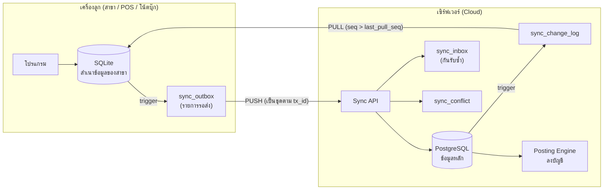

# ระบบออนไลน์ + ออฟไลน์ (เน็ตดับ / ไฟดับ) และการซิงก์ข้อมูล

> ต้นแบบที่ทดสอบแล้ว: `tools/sync_demo.py` (ผลใน `tools/result_sync.txt`) · ตาราง: `sync_outbox`, `sync_state` (เครื่องลูก SQLite) · `sync_change_log`, `sync_inbox`, `sync_conflict`, `sys_device`, `md_doc_number_block` (เซิร์ฟเวอร์ PostgreSQL)

## 1. สถาปัตยกรรม

**หลักการ:** เซิร์ฟเวอร์เป็นแหล่งความจริงหนึ่งเดียว (source of truth) · เครื่องลูกเก็บสำเนาเฉพาะข้อมูลที่ต้องใช้ของบริษัท/สาขาตัวเอง · เมื่อมีเน็ต โปรแกรมทำงานกับเซิร์ฟเวอร์โดยตรงหรือซิงก์ถี่ๆ (ทุก 5–30 วินาที) · เมื่อเน็ตดับ ทำงานกับ SQLite ต่อได้ทันที แล้วส่งขึ้นเมื่อเน็ตกลับมา

**ไฟดับ:** SQLite ใช้ `PRAGMA journal_mode=WAL` + `synchronous=FULL` ทุกเอกสารบันทึกใน transaction เดียว (หัว + บรรทัด + outbox) — ไฟดับกลางทางจะไม่มีเอกสารครึ่งใบ เปิดเครื่องใหม่ outbox ยังอยู่ครบ

## 2. ทำไมออกแบบแบบนี้ (เทียบ Express)

| ปัญหา | Express (DBF ในเครื่อง/แชร์ไดรฟ์) | ระบบใหม่ |
|---|---|---|
| รหัสแถวชนกันเมื่อสร้างหลายเครื่อง | ใช้เลขเอกสารเป็นคีย์ | `id` เป็น **UUIDv7** สร้างที่เครื่องไหนก็ไม่ชน |
| เลขที่เอกสาร/ใบกำกับภาษีซ้ำ | `ISRUN.DOCNUM` ตัวเดียว ต้องล็อกไฟล์ | **จองช่วงเลข** ให้แต่ละเครื่อง (`md_doc_number_block`) |
| แก้ข้อมูลเดียวกันพร้อมกัน | ล็อกระเบียน | `row_version` ตรวจชนกัน → `sync_conflict` |
| ลบข้อมูล | ลบระเบียน (ซิงก์ไม่ได้) | soft delete `deleted_at` |
| รู้ว่าอะไรเปลี่ยน | ไม่มี | `sync_change_log` (seq เพิ่มขึ้นเรื่อยๆ) + `origin_device_id` |
| ส่งซ้ำเมื่อเน็ตหลุดกลางทาง | — | `sync_inbox.idempotency_key` = id ของ outbox |

## 3. ขั้นตอน

### 3.1 ลงทะเบียนเครื่อง + Bootstrap (ครั้งแรก / ล้างเครื่อง)
1. ผู้ดูแลสร้าง `sys_device` (รหัสเครื่อง เช่น `POS1`, สาขา, ชนิด pos/desktop/mobile, กุญแจสาธารณะ)
2. เซิร์ฟเวอร์จองช่วงเลขเอกสารให้เครื่อง (`sync.block_size` ค่าเริ่มต้น 200 เลขต่อประเภทเอกสาร)
3. เครื่องลูกดาวน์โหลดข้อมูลหลัก **ครบตาม FK** (FK closure) — ทดสอบแล้ว 22 ตาราง เช่น ผังบัญชี 292, ลูกค้า 129, ผู้จำหน่าย 1,112, สินค้า 26,592, ประเภทเอกสาร 69, วิธีชำระ 75, งวดบัญชี 108 · **FK ขาดหลัง bootstrap = 0**
4. ระหว่าง bootstrap ตั้ง `sync_state.applying_remote = 1` เพื่อให้ trigger ไม่เขียน outbox (ทดสอบ: outbox = 0 หลัง bootstrap)
5. บันทึก `last_pull_seq` = seq ล่าสุดของเซิร์ฟเวอร์

### 3.2 ทำงานออฟไลน์
- บันทึกเอกสารตามปกติ เลขที่เอกสารรันจากช่วงที่จองไว้ เช่น `IV-POS1-00001`
- ตั้ง `sync_state.current_tx = id หัวเอกสาร` ก่อนบันทึก → trigger ใส่ `tx_id` เดียวกันให้หัว บรรทัด และการเลื่อนเลขที่ (ทดสอบ: 2 เอกสาร → outbox 6 แถว 2 tx + การใช้เลข)
- trigger UPDATE เขียน outbox **เฉพาะเมื่อ `row_version` เปลี่ยน** (กันแถวซ้ำ)
- เอกสารตั้ง `gl_posted = 'P'` — ยังไม่ลงบัญชี (ลงบนเซิร์ฟเวอร์เท่านั้น เพื่อใช้กฎและผังบัญชีชุดเดียว)

### 3.3 PUSH (เมื่อเน็ตกลับมา)
1. ส่ง outbox ที่ `status in (PENDING, SENT)` เรียงตาม `seq` จัดกลุ่มตาม `tx_id`
2. เซิร์ฟเวอร์ทำ **ทีละ tx ใน savepoint** — ทั้งเอกสารผ่านหรือไม่ผ่านพร้อมกัน (ไม่มีหัวไม่มีบรรทัด)
3. ก่อนใช้แต่ละแถว: ถ้า `idempotency_key` อยู่ใน `sync_inbox` แล้ว → ข้าม (DUP)
4. ตรวจ `base_version` = `row_version` ปัจจุบันบนเซิร์ฟเวอร์ → ไม่ตรง = `VERSION_MISMATCH`
5. trigger บนเซิร์ฟเวอร์ตรวจงวดปิด → `PERIOD_LOCKED`; ตรวจใบสำคัญสมดุล
6. สำเร็จ → `sync_inbox` + outbox = APPLIED · ไม่สำเร็จ → `sync_conflict` + outbox = CONFLICT
7. หลังรับเอกสาร Posting Engine ลงบัญชี แล้วใบสำคัญถูกส่งกลับทาง PULL

### 3.4 PULL
`select … from sync_change_log where company_id = ? and seq > last_pull_seq and origin_device_id is distinct from <เครื่องนี้>` → ใช้กับ SQLite โดยตั้ง `applying_remote = 1` → เลื่อน `last_pull_seq`

## 4. ผลทดสอบ (`result_sync.txt`)

| สถานการณ์ | ผล |
|---|---|
| Bootstrap | FK ขาด 0 · outbox 0 |
| ออก IV ออฟไลน์ 2 ใบ | outbox: doc_header 2, doc_line 2, เลขที่ 2 (2 tx) |
| Push ขณะงวดถูกปิด | applied 2 (การใช้เลขที่), conflict 4 = `PERIOD_LOCKED` — **เอกสารไม่เข้าครึ่งใบ** |
| เปิดงวด แล้ว push ใหม่ | applied 4 · บนเซิร์ฟเวอร์มี IV-POS1-00001/00002 ยอด 1,070.00 สถานะ P |
| จำลองเน็ตหลุดหลังส่ง → ส่งซ้ำทั้งหมด | applied 0 · **ข้ามเพราะเคยรับแล้ว 6** |
| สองเครื่องแก้เบอร์โทรลูกค้าคนเดียวกัน | conflict 1 = `VERSION_MISMATCH` (เก็บค่าที่เครื่องลูกส่งมาไว้ให้ตัดสิน) |
| Pull | ได้ 3 รายการที่เปลี่ยนจากที่อื่น (ไม่ดึงของตัวเองกลับ) |

## 5. กฎการชนกัน (conflict)

| ข้อมูล | กฎ |
|---|---|
| เอกสารใหม่ที่สร้างออฟไลน์ | ไม่มีทางชน (UUID + ช่วงเลขของเครื่อง) — ถ้าไม่ผ่านเพราะงวดปิด/วงเงิน → เข้าคิวให้ผู้มีสิทธิ์ตัดสิน |
| เอกสารที่ลงบัญชี/ตัดชำระแล้ว | **ห้ามแก้ออฟไลน์** — ต้องกลับรายการบนเซิร์ฟเวอร์ |
| แฟ้มหลัก (ลูกค้า สินค้า ราคา) | `VERSION_MISMATCH` → ค่าเริ่มต้น server ชนะ, ผู้ดูแลเลือก `KEEP_SERVER` / `KEEP_CLIENT` / `MERGE` ที่ `sync_conflict.resolution` |
| ยอดคงเหลือ (สต๊อก ลูกหนี้ เจ้าหนี้ GL) | **ไม่ซิงก์ยอด** — คำนวณจาก ledger เสมอ จึงไม่มีการชนกันของยอด |
| ผังบัญชี งวด ภาษี สิทธิ์ผู้ใช้ | แก้ได้บนเซิร์ฟเวอร์เท่านั้น เครื่องลูกอ่านอย่างเดียว |

## 6. นโยบายทางธุรกิจตอนออฟไลน์ (`sys_setting`)

| ค่าตั้ง | ค่าเริ่มต้น | ความหมาย |
|---|---|---|
| `sync.offline_allowed_doc_classes` | HS IV RE SO QT OU RL JU DP | ชนิดเอกสารที่ออกได้ตอนออฟไลน์ (ซื้อ/จ่ายเงิน/GL ต้องออนไลน์) |
| `sync.offline_days_allowed` | 7 | เกินกำหนดไม่ซิงก์ → ล็อกการออกเอกสารใหม่ |
| `sync.block_size` | 200 | จำนวนเลขที่จองต่อครั้ง; เหลือ < 20% ขอช่วงใหม่อัตโนมัติเมื่อออนไลน์ |
| สต๊อกติดลบ | ตามค่าตั้ง Express (`ISINFO`) | ออฟไลน์ตรวจจากยอดในเครื่อง + รายการที่ยังไม่ส่ง; อาจติดลบจริงบนเซิร์ฟเวอร์ → แจ้งเตือน ไม่ปฏิเสธเอกสาร |
| วงเงินลูกหนี้ | ตาม `md_customer.credit_limit` | ตรวจจากยอดล่าสุดที่ pull มา + ใบที่ออกออฟไลน์ |
| เข้าระบบออฟไลน์ | — | เก็บ hash รหัสผ่าน (argon2) + สิทธิ์ล่าสุดในเครื่อง; หมดอายุตาม `offline_days_allowed` |

## 7. เลขที่ใบกำกับภาษีกับกฎหมาย

ประมวลรัษฎากร ม.86/4 และประกาศอธิบดีฯ กำหนดให้ใบกำกับภาษีมีเลขที่เรียงลำดับ **แยกเล่ม/ชุดได้** — การให้แต่ละเครื่อง/จุดขายมีชุดเลขของตัวเอง (`series` เช่น `2569-POS1`) จึงทำได้ ควรแจ้งการใช้เครื่อง POS ตามระเบียบกรมสรรพากรสำหรับเครื่องบันทึกการเก็บเงิน และรายงานภาษีขายต้องเรียงตามชุด/เลขที่ภายในแต่ละชุด
_ข้อควรตรวจก่อนใช้งานจริง:_ ยืนยันรูปแบบเลขที่กับประกาศที่ใช้บังคับปัจจุบัน และการขออนุมัติใช้เครื่อง POS ของแต่ละสาขา

## 8. ความปลอดภัย

- เครื่องลงทะเบียนด้วยกุญแจ (`sys_device.public_key`) ส่งข้อมูลผ่าน HTTPS + token ผู้ใช้
- SQLite เข้ารหัสด้วย SQLCipher (ข้อมูลลูกค้า/ราคา/ยอดเงิน อยู่ในเครื่องสาขา)
- ระงับเครื่องที่หาย: `sys_device.status = 'I'` → push ถูกปฏิเสธ, ช่วงเลขที่ยังไม่ใช้ถูกยกเลิก (`status = 'X'`) และบันทึกเป็นเลขที่ยกเลิกในรายงานภาษี
- `sys_activity_log` เป็นแบบเพิ่มอย่างเดียว (append-only) บันทึกทั้งการกระทำบนเครื่องลูกและบนเซิร์ฟเวอร์
