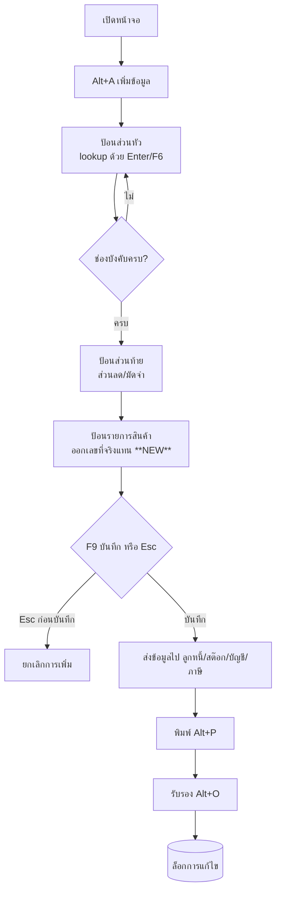
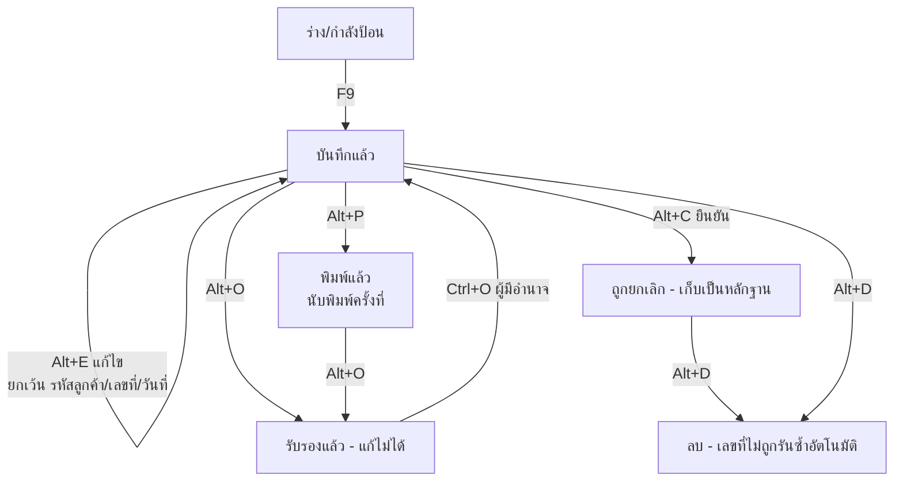
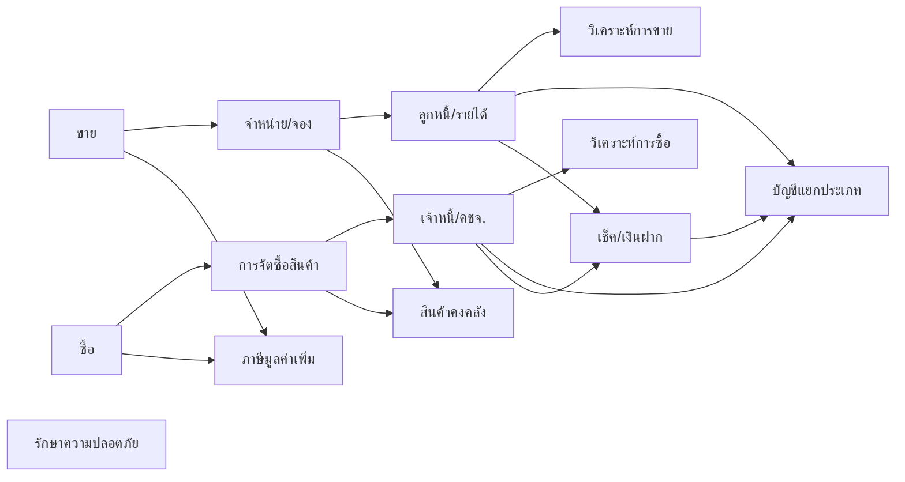

# บทที่ 3 รูปแบบและวิธีการใช้งานของโปรแกรม
> อ้างอิงคู่มือ หน้า 27–47 (PDF p.043–063) — หน้า 48 (PDF p.064) เป็นหน้าว่าง

## ภาพรวม
บทนี้อธิบาย "แบบแผนการใช้งานร่วม" (UI conventions) ที่ทุกหน้าจอของโปรแกรมใช้ซ้ำ ได้แก่ เมนูหลักแบบ Pull Down, โครงหน้าจอป้อนเอกสาร (หัวเอกสาร / รายการ / ท้ายเอกสาร + แท็บ), แถบเครื่องมือและคีย์ลัด, หน้าต่างค้นหา/เลือกข้อมูลหลัก (lookup), การเรียกดู/ค้นหาเอกสาร, การแก้ไข, การยกเลิก–ลบ–นำเลขที่กลับมาใช้, การพิมพ์แบบฟอร์ม, การรับรองเอกสาร (approval) และหน้าจอรายละเอียดแฟ้มข้อมูล (audit info)
นอกจากนี้อธิบายการเชื่อมโยงข้อมูลระหว่างระบบ (หลัก "แก้ที่เอกสารต้นทางเท่านั้น") และรายการแฟ้มข้อมูลหลักที่ต้องเตรียมก่อนเริ่มใช้งาน (หน้า 45–47)
ตัวอย่างที่คู่มือใช้ตลอดบทคือหน้าจอ "IV - ขายเงินเชื่อ" (เมนู ขาย > 4. ขายเงินเชื่อ)
สำหรับการออกแบบ ERP: ทุกข้อในบทนี้ควรถูกทำเป็น component/behaviour กลาง (shared framework) ไม่ใช่เขียนซ้ำทีละหน้าจอ

---

## UI conventions (ส่วนกลางที่ทุกหน้าจอใช้)

### 1. เมนูหลัก (หน้า 27–28)
- เมนูบนสุด: `1.ซื้อ  2.ขาย  3.การเงิน  4.สินค้า  5.บัญชี  6.รายงาน  7.เริ่มระบบ  8.อื่น ๆ` (ภาพหน้า 27)
- เป็น Pull Down Menu, เมนูย่อยซ้อนเป็นชั้น ๆ, เลือกด้วยเมาส์หรือ `<Enter>`; รายการเมนูมีเลข/ตัวอักษรนำหน้า (1–9, A, B …) ใช้เป็นปุ่มลัดในการเลือก [สันนิษฐาน]
- ตัวอย่างเมนูขาย (หน้า 27): 1. รับเงินมัดจำ, 2. ขายเงินสด, 3. ใบสั่งขาย, 4. ขายเงินเชื่อ, 5. บันทึกรายได้อื่น ๆ, 6. รายละเอียดลูกค้า, 7. รายละเอียดรายได้อื่น ๆ, 8. รายละเอียดพนักงานขาย, 9. ทะเบียนหมายเลขสินค้า, A. ใบเสนอราคา, B. คำนวณยอดลูกหนี้ใหม่
- กรอบสถานะกลางหน้าจอแสดง (หน้า 28): ชื่อบริษัท (จาก เริ่มระบบ 1.1 รายละเอียดกิจการ), ที่เก็บข้อมูล (Data Path) และ DB_ver, เวอร์ชั่น, S/N หมายเลขทะเบียนโปรแกรม, วันที่ทำการ (วันที่ที่ป้อนตอนเข้าโปรแกรม), รหัสผู้ใช้ (login)
- แถบสถานะล่างสุด: ชื่อบริษัท (Data Path) by รหัสผู้ใช้ … `รหัสเมนู` … `INS` `NUM` (ภาพหน้า 27)
- พื้นหลังเปลี่ยนได้: วางไฟล์ JPG ชื่อ `Express.JPG` ในโฟลเดอร์โปรแกรม; ภาพเล็กกว่าครึ่งหนึ่งของพื้นหลังจะวางซ้อน (Tile) ภาพใหญ่จะปรับสัดส่วนให้พอดี (หมายเหตุ หน้า 28)

### 2. โครงหน้าจอป้อนข้อมูลเอกสาร (หน้า 28–31)
ส่วนประกอบหน้าต่าง (รูปที่ 2 หน้า 29): ไตเติ้ลบาร์ (Title Bar มีรหัสระบบ เช่น "IV - ขายเงินเชื่อ"), ปุ่มปิด/ขยาย/ย่อ, แถบเครื่องมือ (Tools Bar), แท็บ (Tab), สกรอลล์บาร์ (Scroll Bar), Resize Grip
แบ่งเอกสารเป็น 3 ส่วน (รูปที่ 4 หน้า 31):
1. **ส่วนหัวเอกสาร** — ป้อนก่อนเสมอ
2. **ส่วนล่างของเอกสาร** (ยอดรวม/หัก/ภาษี) — ป้อนต่อจากส่วนหัว (บางหน้าจอไม่มี)
3. **ส่วนรายการของเอกสาร** (ตารางรายการสินค้า) — ป้อนเป็นลำดับสุดท้าย
- แท็บในส่วนรายการ (ตัวอย่างขายเงินเชื่อ): `รายการสินค้า <F8>`, `รายละเอียดอื่น <Ctrl+F8>` (บางภาพเป็น `รายการJob <Ctrl+F8>` หน้า 34), `รายการรับชำระ <F7>`, `รายการภาษีขาย <Ctrl+F7>`
- สลับแท็บ: `<F4>` แท็บถัดไป, `<F3>` แท็บก่อนหน้า (หน้า 43)

### 3. แถบเครื่องมือ (Tools Bar) และคีย์ลัด (หน้า 29–30, 43)
ไอคอนอาจต่างกันเล็กน้อยในแต่ละหน้าจอ; เอาเมาส์ชี้จะแสดง Tools Tip พร้อมคีย์ลัด (หน้า 29)

| # | ไอคอน/คำสั่ง | คีย์ลัด | หน้าที่ |
|---|---|---|---|
| 1 | เพิ่มข้อมูล | Alt+A | เริ่มเอกสาร/ระเบียนใหม่ |
| 2 | แก้ไขข้อมูล | Alt+E | เข้าโหมดแก้ไข |
| 3 | ยกเลิก (VOID) | Alt+C | ยกเลิกเอกสาร (เก็บไว้เป็นหลักฐาน สถานะ "ถูกยกเลิก") |
| 4 | ลบข้อมูล | Alt+D | ลบระเบียน/เอกสาร |
| 5 | ยกเลิกการเพิ่มหรือแก้ไขข้อมูล | Esc | ทิ้งการแก้ไขที่ยังไม่บันทึก |
| 6 | บันทึกข้อมูล | F9 | บันทึก |
| 7 | ไปยังข้อมูลแรก | Ctrl+Home | นำทาง |
| 8 | ไปยังข้อมูลก่อนหน้านี้ | Page Up | นำทาง |
| 9 | ไปยังข้อมูลถัดไป | Page Down | นำทาง |
| 10 | ไปที่ข้อมูลสุดท้าย | Ctrl+End | นำทาง |
| 11 | ค้นหาข้อมูล ▾ | Alt+S | ค้นหาเลขที่เอกสาร; เมนูย่อย: เรียกดูข้อมูล ตั้งแต่ต้น `<Ctrl+L>`, เรียกดูข้อมูล ตั้งแต่รายการนี้ `<Alt+L>`, เรียกดูข้อมูล โดยป้อนเงื่อนไข `<Alt+K>` (หน้า 30) |
| 12 | พิมพ์ ▾ | Alt+P (เมนูย่อย: Shift+Alt+P หน้า 40) | พิมพ์แบบฟอร์ม/รายงาน |
| 13 | Note | – | เพิ่มหมายเหตุของเอกสาร/หรือของรายการสินค้า |
| 14 | เข้าไปในส่วนของรายการสินค้า | F8 | โฟกัสตารางรายการ (โหมดเข้ากันได้กับเวอร์ชันเก่า) |
| 15 | S/O | F6 | เลือกรายการจากใบสั่งขายที่อ้างถึง |
| 16 | RE-JNL | Alt+J | สั่งให้ลงบัญชีใหม่ |
| 17 | รับรองเอกสารใบนี้ (OK) | Alt+O | approve |
| 18 | ยกเลิกการรับรองเอกสาร | Ctrl+O | un-approve |
| 19 | รับรองเอกสารเป็นช่วง | Alt+Shift+O | batch approve |

- ไอคอนที่มีลูกศรชี้ลง (▾) มีเมนูย่อย (หมายเหตุ หน้า 30)
- ระหว่างโหมดเพิ่ม/แก้ไข: ปุ่มเพิ่มจะยุบลง ปุ่มอื่นเป็นสีเทา เหลือเฉพาะ "ยกเลิกการเพิ่ม" และ "บันทึก" (หน้า 31) → state machine: `view` ↔ `add/edit`
- ไอคอน `OLD/NEW` ปรากฏในหน้าจอบางหน้า (กำหนดบริษัทใหม่ หน้า 51, กำหนดกลุ่มบัญชี หน้า 69, 82) — คู่มือช่วงนี้ไม่อธิบายความหมาย [สันนิษฐาน: สลับข้อมูลรุ่นเก่า/ใหม่ หรือแปลงรหัส]

**สรุปปุ่มลัดที่ใช้บ่อย (หน้า 43):** Alt+A เพิ่ม, Alt+E แก้ไข, Alt+C ยกเลิกเอกสาร, Alt+D ลบ, Alt+P พิมพ์แบบฟอร์ม/รายงาน, Alt+S ค้นหา, Ctrl+L เรียกดูตั้งแต่ต้น, Alt+L เรียกดูตั้งแต่ปัจจุบัน, Ctrl+Home ข้อมูลแรก, Ctrl+End ข้อมูลสุดท้าย, F4 แท็บถัดไป, F3 แท็บก่อนหน้า
**คีย์อื่นที่พบในบท:** Enter (ไปช่องถัดไป / เปิด lookup เมื่อช่องว่าง), F6 (เปิด lookup ของช่องที่มีแว่นขยาย, หน้า 32–33), Tab (ใน lookup = เรียงใหม่; ในหน้าจอเอกสาร = เปิดหน้ารายละเอียดแฟ้มข้อมูล หน้า 44–45), Ctrl+I (รายละเอียดแฟ้มข้อมูล), F5 (ทำงาน ในหน้าต่างรับรองเป็นช่วง), Esc (ออกจากส่วนรายการ / ออกจากหน้าจอ), คลิกขวาในตาราง = เมนู เพิ่ม/แก้ไข/ลบรายการ

### 4. พฤติกรรมการป้อนด้วยเมาส์ (หน้า 31–32, 35)
1. เพิ่มเอกสาร: หลัง Alt+A คลิกไปช่องที่ต้องการได้ทันที ไม่ต้องกด Enter ไล่
2. แก้ไขเอกสาร: ดับเบิลคลิกที่ช่องที่ต้องการแก้ได้เลย หรือ Alt+E ก่อน
3. เพิ่มรายการสินค้า: ดับเบิลคลิกบรรทัดว่างในตาราง หรือคลิกขวา > "เพิ่มข้อมูล"
4. ลบรายการสินค้า: คลิกขวาที่รายการ > "ลบข้อมูล"
5. Wheel Mouse เลื่อนรายการ/รายงานครั้งละ 3 บรรทัด
6. ดูรายงานด้วยเมาส์สะดวกกว่าคีย์บอร์ด
- ถ้าคลิกข้ามไปตารางสินค้าทั้งที่ส่วนหัวยังป้อนไม่ครบ โปรแกรมจะตรวจช่องบังคับและย้ายไปช่องที่ยังขาด (หมายเหตุ หน้า 35) → validation ของ header ก่อนเข้า detail

### 5. เลขที่เอกสารอัตโนมัติ (หน้า 32)
- ช่องเลขที่: ป้อนเองได้ หรือกด Enter ผ่าน → โปรแกรมแสดง `IV**NEW**` และจะออกเลขจริงเมื่อป้อนหัวเอกสารครบและเข้าสู่ส่วนรายการแล้ว
- รูปแบบเลขตัวอย่าง: `IV0000006` (prefix 2 ตัว + เลข 7 หลัก) — การกำหนดรูปแบบอยู่ที่ เริ่มระบบ > 4. กำหนดเลขที่เอกสาร (อ้างใน หน้า 59)

### 6. หน้าต่างค้นหา/เลือกข้อมูลหลัก (Lookup) (หน้า 32–36)
- ช่องที่มีไอคอนแว่นขยายข้างหลัง = ดึงข้อมูลจากฐานข้อมูลหลักได้ (รูป 5, 7)
- เปิดโดย: กด Enter ที่ช่องว่าง, กด F6, หรือคลิกแว่นขยาย
- พิมพ์อักษรนำบางส่วนของรหัส/ชื่อแล้ว Enter → ค้นหาแบบขึ้นต้นด้วย (prefix search)
- เรียงได้ 2 แบบ: ตามรหัส หรือ ตามชื่อ — ค่าเริ่มต้นมาจากเมนูกำหนดค่าเริ่มต้น (ค้นหาลูกค้า/ผู้จำหน่าย/สินค้า); คอลัมน์ที่เป็นคีย์เรียงจะมีแถบสีเข้มและเครื่องหมาย ▲ ที่หัวคอลัมน์
- เปลี่ยนการเรียง: ปุ่ม "เรียงใหม่ <Tab>" หรือกด Tab หรือคลิกหัวคอลัมน์
- ปุ่มใน lookup: `ตกลง`, `ยกเลิก`, `ค้นหา`, `เรียงใหม่ <Tab>`, `เพิ่ม <Alt+A>` (เพิ่มระเบียนหลักใหม่ทันที เช่น ลูกค้ารายใหม่), `แก้ไข <Alt+E>` (แก้ระเบียนหลัก) (หน้า 33)
- คอลัมน์ lookup ลูกค้า (หน้า 32–33): รหัส, ชื่อลูกค้า, ที่อยู่บรรทัด1, ที่อยู่บรรทัด2, ที่อยู่บรรทัด3 [สันนิษฐาน หัวคอลัมน์อ่านไม่ชัด], ตัวเลขท้ายแถว [ไม่ชัด]; อีกภาพ (หน้า 36): รหัส, ชื่อลูกค้า, สาขา#, ประเภทลูกค้า, ที่อยู่บรรทัด1
- คอลัมน์ lookup สินค้า (หน้า 34): รหัส, จำนวน (คงเหลือ) [สันนิษฐาน], รายละเอียด
- **Scroll bar แบบพิเศษ (หน้า 35–36):** ถ้ามีข้อมูลมากกว่า 100 รายการ สกรอลล์บาร์จะอยู่กึ่งกลางเสมอ (ปุ่มบน = เลื่อนขึ้น 1 บรรทัด, ถัดมา = ขึ้น 1 หน้า, ลง 1 หน้า, ลง 1 บรรทัด); ลากปุ่มกลางชนล่าง = ไปท้ายสุด (Ctrl+End), ชนบน = ไปต้น (Ctrl+Home) → หลักการ: อ่านข้อมูลทีละหน้า (paging/virtual scrolling) ไม่โหลดทั้งหมด; ใช้กับตารางรายการทุกหน้าจอ

### 7. การแก้ไขข้อมูล (หน้า 36–38)
- ส่วนหัว: ดับเบิลคลิกช่อง หรือ Alt+E แล้วคลิกช่อง (รูป 11)
- ส่วนรายการ: ดับเบิลคลิกรายการ → แก้ได้เฉพาะ จำนวน, ราคา/หน่วย, ส่วนลด, จำนวนเงิน; **แก้รหัสสินค้าหรือคลังสินค้าไม่ได้** ต้องลบทั้งบรรทัด (คลิกขวา > ลบ หรือ Alt+D) แล้วเพิ่มใหม่ (หน้า 37)
- ฟิลด์ที่แก้ไม่ได้หลังบันทึก: รหัสลูกค้า, เลขที่เอกสาร, วันที่เอกสาร — ต้องลบรายการสินค้าทั้งหมดก่อน (หน้า 38)
- ถ้าออกเอกสารให้ลูกค้า/บุคคลภายนอกแล้ว ไม่ควรแก้ ให้ออกใบลดหนี้/รับคืนสินค้าแทน (หน้า 38)
- โหมดเข้ากันได้กับเวอร์ชันเก่า: F8 เข้าตารางรายการ (มีแถบสีแดงคลุม 1 บรรทัด) แล้ว Alt+A เพิ่ม / Alt+E แก้ / Alt+D ลบรายการ (หมายเหตุ หน้า 38)

### 8. การเรียกดูและค้นหาเอกสาร (หน้า 38–39)
- Ctrl+L (เรียกดูตั้งแต่ต้น) / Alt+L (ตั้งแต่เอกสารปัจจุบัน) → ตารางรายการเอกสาร, ดับเบิลคลิกเพื่อเปิด
- Alt+S → dialog "ป้อนข้อมูลที่ต้องการค้นหา" ป้อนเลขที่ใบกำกับ แล้ว Enter
- กฎเติมศูนย์: ถ้าเลขที่ขึ้นต้นด้วย 0 ทั้งหมด ป้อนเฉพาะเลขท้ายได้ เช่น ป้อน `13` → ค้นหา `IV0000013`; ถ้าไม่ได้ขึ้นต้นด้วย 0 ต้องป้อนเต็ม

### 9. ยกเลิก / ลบ / นำเลขที่กลับมาใช้ (หน้า 39–40)
- ยกเลิก (Alt+C) → ยืนยัน "กรุณาเลือกตกลง เพื่อยืนยันให้ยกเลิกเอกสาร" → แสดงสถานะ **"ถูกยกเลิก"** มุมบนขวาของเอกสาร (รูป 17); เอกสารยังอยู่เป็นหลักฐาน
- เลขที่ที่ถูกยกเลิกนำกลับมาใช้ไม่ได้; เอกสารถัดไปรันต่อจากเลขที่ถูกยกเลิก (กรณีรันอัตโนมัติ)
- ถ้าต้องการนำเลขกลับมาใช้: ไปที่เอกสารที่ถูกยกเลิก แล้วลบ (Alt+D) → แต่ตัวรันเลขจะยังรันต่อจากเลขเดิม; ต้องป้อนเลขที่เดิมเองด้วยมือ

### 10. การพิมพ์เอกสาร (หน้า 40–42)
- คลิกลูกศรข้างไอคอนพิมพ์ (Shift+Alt+P) → เมนูชนิดแบบฟอร์ม (ตัวอย่างขายเงินเชื่อ หน้า 41):
  1. พิมพ์ใบกำกับสินค้า ▸ / 2. แก้ไขแบบทดสอบ / 3. พิมพ์แบบทดสอบ / 4. นำแบบทดสอบไปทับข้อ 1 / 5. นำข้อ 1 มาเป็นแบบทดสอบ / ฟอร์ม 12: 6. นำต้นฉบับมีเส้น มาเป็นแบบทดสอบ, 7. นำต้นฉบับไม่มีเส้น มาเป็นแบบทดสอบ / ฟอร์ม 15: 8. นำต้นฉบับมีเส้น…, 9. นำต้นฉบับไม่มีเส้น… / A. นำต้นฉบับพิมพ์ครึ่งหน้า มาเป็นแบบทดสอบ / B. นำต้นฉบับบิลเอ็กซ์เพรส มาเป็นแบบทดสอบ
  → แนวคิด: มี "ฟอร์มใช้งาน (ข้อ 1)" + "แบบทดสอบ (draft)" + ต้นฉบับมาตรฐานหลายชุด; แก้ draft แล้ว promote ทับฟอร์มจริงได้
- ฟอร์ม 12 = 12 ตัวอักษร/นิ้ว; ฟอร์ม 15 = 15 ตัวอักษร/นิ้ว (รายละเอียดมากกว่า เช่น ชื่อสินค้ายาวกว่า + พิมพ์ช่องคลัง)
- ต้นฉบับมีเส้น (ตีกรอบตาราง สำหรับกระดาษเปล่า) / ไม่มีเส้น (สำหรับฟอร์มพิมพ์สำเร็จ Pre-printed Form)
- แก้แบบฟอร์มได้ (ดูบทที่ 25)
- Alt+P (ฟอร์มหลัก/ฟอร์มที่ 1) → dialog "แสดงผลทาง": ◉ จอภาพ ○ เครื่องพิมพ์ ○ แฟ้มข้อมูล + OK/Cancel (หน้า 42); แฟ้มข้อมูลนำไปใช้ใน Excel/Word ได้

### 11. การรับรองเอกสาร (Approval) (หน้า 43–45)
- เอกสารที่รับรองแล้ว **แก้ไขไม่ได้** จนกว่าผู้มีอำนาจจะยกเลิกการรับรอง
- ระดับสิทธิ์ผู้รับรอง กำหนดใน บทที่ 5 (เรื่องทั่วไป ข้อ 5–7) และรายเอกสาร
- ถ้าตั้งค่าว่า "ต้องพิมพ์ก่อนจึงรับรองได้" แล้วพยายามรับรองก่อนพิมพ์ → เตือน "เอกสารยังไม่ถูกพิมพ์! กรุณาเลือกตกลง เพื่อยืนยันให้ทำรายการต่อไป" (ตกลง/ยกเลิก) — คือเตือนแต่ยอมให้ยืนยันได้
- รับรองเป็นช่วง → หน้าต่าง "กำหนดช่วงเพื่อรับรองเอกสาร" (ดูหน้าจอ S-UI-12); ถ้าจะรับรองทั้งหมด: เว้น "เลขที่เอกสารจาก" ว่าง และใส่ "ถึง" เป็น 9999999… แล้วกำหนดช่วงวันที่, กด ทำงาน <F5>
- ตรวจว่ารับรองแล้วหรือยัง: กด Tab หรือ Ctrl+I ที่หน้าเอกสาร → หน้ารายละเอียดแฟ้มข้อมูล (S-UI-13) แสดง "รับรองโดย" และวันที่

---

## หน้าจอ

### S-UI-01 เมนูหลักของโปรแกรม
- เมนู: (หน้าแรกหลังเข้าโปรแกรม)
- อ้างอิง: หน้า 27–28 (PDF p.043–044) — มีภาพหน้าจอ: ใช่
- ลักษณะ: menu bar แบบ pull-down + กรอบสถานะกลางจอ + status bar

| ส่วน/แท็บ | ฟิลด์ | ชนิดข้อมูล | บังคับ | ค่าเริ่มต้น/อ้างอิงจาก | คำอธิบาย/เงื่อนไข |
|---|---|---|---|---|---|
| กรอบสถานะ | ชื่อบริษัท | text (แสดงผล) | – | เริ่มระบบ 1.1 รายละเอียดกิจการ | |
| กรอบสถานะ | ที่เก็บข้อมูล (Data Path) / DB_ver | text (แสดงผล) | – | บริษัทที่เลือก | เช่น Z:\TEST DB_ver=1.94 |
| กรอบสถานะ | เวอร์ชั่น | text | – | ระบบ | |
| กรอบสถานะ | S/N | text | – | ระบบ | หมายเลขทะเบียนโปรแกรม |
| กรอบสถานะ | วันที่ทำการ | date | – | ป้อนตอนเข้าโปรแกรม | ต้องอยู่ในรอบบัญชี (บทที่ 4) |
| กรอบสถานะ | รหัสผู้ใช้ | text | – | login | |
| status bar | รหัสเมนู, INS, NUM | text | – | ระบบ | [สันนิษฐาน: "รหัสเมนู" = ช่องพิมพ์รหัสเมนูเพื่อกระโดดไปหน้าจอ] |

ปุ่ม/คำสั่ง: เมนู 1.ซื้อ … 8.อื่น ๆ
กฎทางธุรกิจ/เงื่อนไข: รูปพื้นหลัง Express.JPG (JPG เท่านั้น)
ผลทางบัญชี/สต๊อก: ไม่มี

### S-UI-02 โครงหน้าจอป้อนเอกสารมาตรฐาน (ตัวอย่าง: IV - ขายเงินเชื่อ)
- เมนู: ขาย > 4. ขายเงินเชื่อ (ใช้เป็นตัวอย่างโครงสร้างร่วม)
- อ้างอิง: หน้า 29, 31, 37, 40 (PDF p.045, 047, 053, 056) — มีภาพหน้าจอ: ใช่
- ลักษณะ: header (2 กล่อง ซ้าย=คู่ค้า, ขวา=เอกสาร) + แท็บ + grid รายการ + footer ยอดรวม
- หมายเหตุ: รายละเอียดฟิลด์เต็มของขายเงินเชื่ออยู่ในบทระบบขาย; ที่นี่บันทึกเฉพาะที่เห็นในภาพเพื่อเป็นแม่แบบ

| ส่วน/แท็บ | ฟิลด์ | ชนิดข้อมูล | บังคับ | ค่าเริ่มต้น/อ้างอิงจาก | คำอธิบาย/เงื่อนไข |
|---|---|---|---|---|---|
| หัว-ซ้าย | รหัสลูกค้า | lookup | ใช่ [สันนิษฐาน] | ลูกค้า | แสดงชื่อ/ที่อยู่ 3 บรรทัด/รหัสไปรษณีย์/โทร./Fax ใต้ช่อง; แก้ไม่ได้หลังบันทึก |
| หัว-ซ้าย | Bill to | lookup | ไม่ | ลูกค้า | ข้ามได้ตามค่าเริ่มต้นระบบขาย ข้อ 17 |
| หัว-ซ้าย | สาขา# | number | ไม่ | ลูกค้า | ค่า 0 ในตัวอย่าง |
| หัว-ซ้าย | อ้างอิง | text + lookup | ไม่ | – | |
| หัว-ขวา | แผนก | lookup | ไม่ | กำหนดแผนก | |
| หัว-ขวา | เลขที่เอกสาร | text | ใช่ | รันอัตโนมัติ (IV**NEW**) | แก้ไม่ได้หลังบันทึก |
| หัว-ขวา | วันที่ | date + lookup | ใช่ | วันที่ทำการ | แก้ไม่ได้หลังบันทึก |
| หัว-ขวา | ใบสั่งขาย | lookup | ไม่ | ใบสั่งขาย (SO) | F6 เรียกเลขที่ใบสั่งขาย |
| หัว-ขวา | (ปุ่ม) หมายเหตุของใบสั่งขาย | button | – | – | อยู่ข้างวันที่ [ข้อความอ่านไม่ชัด] |
| หัว-ขวา | เครดิต … วัน | number | ไม่ | ลูกค้า | 30 |
| หัว-ขวา | ครบกำหนด | date + lookup | – | วันที่ + เครดิต | |
| หัว-ขวา | พนักงานขาย | lookup | ไม่ | พนักงานขาย | แสดงชื่อพนักงานขายถัดไป |
| หัว-ขวา | เขตการขาย | lookup | ไม่ | ตารางเขตการขาย | |
| หัว-ขวา | ขนส่งโดย | lookup | ไม่ | ตารางขนส่ง [สันนิษฐาน] | |
| หัว-ขวา | ประเภทราคา | select | ใช่ | เรื่องทั่วไป ข้อ 3 | "2 - แยก VAT" |
| สถานะ | ถูกยกเลิก | label | – | – | แสดงมุมบนขวาเมื่อยกเลิก |
| แท็บ รายการสินค้า <F8> | No., รหัส, รายละเอียด, คลัง, จำนวน (+หน่วย), ราคา/หน่วย, ส่วนลด, F, จำนวนเงิน | grid | – | สินค้า/คลัง | รหัส/คลังแก้ไม่ได้ ต้องลบบรรทัด; คอลัมน์ "F" ไม่อธิบาย [สันนิษฐาน: flag ภาษี/ของแถม] |
| แท็บอื่น | รายละเอียดอื่น/รายการJob <Ctrl+F8>, รายการรับชำระ <F7>, รายการภาษีขาย <Ctrl+F7> | tabs | – | – | |
| ท้าย | สถานที่ส่งของ | lookup | ไม่ | – | |
| ท้าย | จำนวนเงิน | money (คำนวณ) | – | ผลรวมรายการ | |
| ท้าย | หักส่วนลด | text/money | ไม่ | – | ช่องข้อความส่วนลด + จำนวน [สันนิษฐาน รองรับ % ] |
| ท้าย | หักเงินมัดจำ | lookup + money | ไม่ | รับเงินมัดจำ | อ้างเลขที่มัดจำ เช่น AI0000001 |
| ท้าย | ภาษีมูลค่าเพิ่ม … % | number + money | – | เรื่องทั่วไป ข้อ 2 | 7.00 |
| ท้าย | จำนวนเงินรวมทั้งสิ้น | money (คำนวณ) | – | – | |

ปุ่ม/คำสั่ง: แถบเครื่องมือมาตรฐาน (ข้อ 3 ข้างต้น)
กฎทางธุรกิจ/เงื่อนไข: ลำดับป้อน หัว → ท้าย → รายการ; ระบบคำนวณยอดเงินอัตโนมัติ; Enter ผ่านช่องจำนวนเงิน = ขึ้นบรรทัดใหม่; บันทึก F9 หรือ Esc ออกจากส่วนรายการ แล้ว Esc อีกครั้ง → บันทึกและส่งข้อมูลไประบบที่เกี่ยวข้องทันที (หน้า 34)
ผลทางบัญชี/สต๊อก: (ตัวอย่างการเชื่อมโยง หน้า 45–47) ตั้งลูกหนี้รายตัว, ตัดสต๊อก, ลงสมุดรายวันขาย/บัญชีแยกประเภท, แฟ้มภาษีขาย, รายงานขายเงินเชื่อ — คู่มือบทนี้ไม่ระบุ Dr/Cr

### S-UI-03 แถบเครื่องมือ (Tools Bar)
- เมนู: ทุกหน้าจอป้อนข้อมูล
- อ้างอิง: หน้า 29–30 (PDF p.045–046) — มีภาพหน้าจอ: ใช่
- ลักษณะ: toolbar + tooltip + dropdown sub-menu
- ฟิลด์: ไม่มี — ดูตารางในหัวข้อ UI conventions ข้อ 3
ปุ่ม/คำสั่ง: 19 คำสั่งตามตาราง
กฎทางธุรกิจ/เงื่อนไข: โหมดเพิ่ม/แก้ → disable ทุกปุ่ม ยกเว้น ยกเลิกการเพิ่ม(Esc)/บันทึก(F9)
ผลทางบัญชี/สต๊อก: RE-JNL (Alt+J) = สั่งลงบัญชีใหม่ (สร้างรายการสมุดรายวันจากเอกสารซ้ำ)

### S-UI-04 หน้าต่างค้นหา/เลือกข้อมูลหลัก (Lookup)
- เมนู: เปิดจากช่องที่มีแว่นขยาย (Enter ที่ช่องว่าง / F6 / คลิก)
- อ้างอิง: หน้า 32–36 (PDF p.048–052) — มีภาพหน้าจอ: ใช่
- ลักษณะ: dialog list (grid หลายคอลัมน์ + ปุ่มล่าง)

| ส่วน/แท็บ | ฟิลด์ | ชนิดข้อมูล | บังคับ | ค่าเริ่มต้น/อ้างอิงจาก | คำอธิบาย/เงื่อนไข |
|---|---|---|---|---|---|
| ช่องค้นหา | ข้อความค้นหา (พิมพ์บนตาราง) | text | – | – | prefix ของคีย์ที่กำลังเรียง |
| grid ลูกค้า | รหัส, ชื่อลูกค้า, สาขา#, ประเภทลูกค้า, ที่อยู่บรรทัด1 (… บรรทัด2, 3) | grid | – | ลูกค้า | คอลัมน์ตามภาพหน้า 33, 36 |
| grid สินค้า | รหัส, (จำนวนคงเหลือ) [สันนิษฐาน], รายละเอียด | grid | – | สินค้า | หน้า 34 |

ปุ่ม/คำสั่ง: ตกลง, ยกเลิก, ค้นหา, เรียงใหม่ <Tab>, เพิ่ม <Alt+A>, แก้ไข <Alt+E>
กฎทางธุรกิจ/เงื่อนไข: เรียงตามรหัสหรือชื่อ (ค่าเริ่มต้นจากบทที่ 5); >100 รายการใช้ scroll แบบ paging
ผลทางบัญชี/สต๊อก: ไม่มี

### S-UI-05 หน้าต่างเรียกดูเอกสาร (Browse)
- เมนู: ค้นหาข้อมูล ▾ > เรียกดูข้อมูล ตั้งแต่ต้น (Ctrl+L) / ตั้งแต่รายการนี้ (Alt+L) / โดยป้อนเงื่อนไข (Alt+K)
- อ้างอิง: หน้า 30, 38–39 (PDF p.046, 054–055) — มีภาพหน้าจอ: ใช่
- ลักษณะ: dialog list

| ส่วน/แท็บ | ฟิลด์ | ชนิดข้อมูล | บังคับ | ค่าเริ่มต้น/อ้างอิงจาก | คำอธิบาย/เงื่อนไข |
|---|---|---|---|---|---|
| grid | เลขที่, รหัสลูกค้า, วันที่, ครบกำหนด, ชื่อลูกค้า | grid | – | เอกสาร | ตัวอย่างขายเงินเชื่อ |

ปุ่ม/คำสั่ง: ตกลง, ยกเลิก, ค้นหา; ดับเบิลคลิก = เปิดเอกสาร
กฎทางธุรกิจ/เงื่อนไข: Alt+K "โดยป้อนเงื่อนไข" — คู่มือบทนี้ไม่แสดงหน้าจอเงื่อนไข
ผลทางบัญชี/สต๊อก: ไม่มี

### S-UI-06 ป้อนข้อมูลที่ต้องการค้นหา (Alt+S)
- เมนู: ไอคอนค้นหาข้อมูล / Alt+S
- อ้างอิง: หน้า 39 (PDF p.055) — มีภาพหน้าจอ: ใช่
- ลักษณะ: dialog 1 ช่อง

| ส่วน/แท็บ | ฟิลด์ | ชนิดข้อมูล | บังคับ | ค่าเริ่มต้น/อ้างอิงจาก | คำอธิบาย/เงื่อนไข |
|---|---|---|---|---|---|
| – | เลขที่ใบกำกับ | text | ใช่ | prefix ของเอกสาร (เช่น "IV") | ป้อนเลขท้ายได้ถ้าส่วนที่เหลือเป็น 0 |

ปุ่ม/คำสั่ง: Enter, ปิด (X)
ผลทางบัญชี/สต๊อก: ไม่มี

### S-UI-07 ยืนยันการยกเลิกเอกสาร
- เมนู: ไอคอนยกเลิก (VOID) / Alt+C
- อ้างอิง: หน้า 39–40 (PDF p.055–056) — มีภาพหน้าจอ: ใช่
- ลักษณะ: message box "Express Accounting": "กรุณาเลือกตกลง เพื่อยืนยันให้ยกเลิกเอกสาร"
ปุ่ม/คำสั่ง: ตกลง, ยกเลิก
กฎทางธุรกิจ/เงื่อนไข: สถานะเอกสาร → "ถูกยกเลิก"; เลขที่ไม่ถูกนำกลับมาใช้; ลบเอกสารที่ถูกยกเลิกได้ด้วย Alt+D แต่ตัวรันเลขไม่ย้อน
ผลทางบัญชี/สต๊อก: ไม่ระบุในบทนี้ [สันนิษฐาน: กลับรายการลูกหนี้/สต๊อก/บัญชีที่เกิดจากเอกสาร]

### S-UI-08 เมนูชนิดแบบฟอร์ม (Print dropdown)
- เมนู: ลูกศรข้างไอคอนพิมพ์ / Shift+Alt+P
- อ้างอิง: หน้า 40–41 (PDF p.056–057) — มีภาพหน้าจอ: ใช่
- ลักษณะ: dropdown menu (รายการ 1–9, A, B ตามหัวข้อ 10)
กฎทางธุรกิจ/เงื่อนไข: ต่างกันไปในแต่ละหน้าจอ; ฟอร์ม 12/15 cpi, มีเส้น/ไม่มีเส้น, ครึ่งหน้า, บิลเอ็กซ์เพรส
ผลทางบัญชี/สต๊อก: ไม่มี

### S-UI-09 เลือกวิธีการแสดงผล (แสดงผลทาง)
- เมนู: ไอคอนพิมพ์ / Alt+P
- อ้างอิง: หน้า 41–42 (PDF p.057–058) — มีภาพหน้าจอ: ใช่
- ลักษณะ: dialog radio

| ส่วน/แท็บ | ฟิลด์ | ชนิดข้อมูล | บังคับ | ค่าเริ่มต้น/อ้างอิงจาก | คำอธิบาย/เงื่อนไข |
|---|---|---|---|---|---|
| แสดงผลทาง | จอภาพ / เครื่องพิมพ์ / แฟ้มข้อมูล | select (radio) | ใช่ | จอภาพ | แฟ้มข้อมูล = export ไปใช้ใน Excel/Word |

ปุ่ม/คำสั่ง: OK, Cancel
ผลทางบัญชี/สต๊อก: ไม่มี (แต่การพิมพ์ถูกบันทึกเป็น "ผู้พิมพ์/พิมพ์ครั้งที่" ใน S-UI-13 และเกี่ยวกับกฎพิมพ์ก่อนรับรอง)

### S-UI-10 ตัวอย่างแบบฟอร์ม ใบกำกับสินค้า/ใบกำกับภาษี (ผลพิมพ์ทางจอภาพ)
- เมนู: พิมพ์ > จอภาพ
- อ้างอิง: หน้า 42 (PDF p.058) — มีภาพ: ใช่
- ลักษณะ: report output

| ส่วน/แท็บ | ฟิลด์ | ชนิดข้อมูล | บังคับ | ค่าเริ่มต้น/อ้างอิงจาก | คำอธิบาย/เงื่อนไข |
|---|---|---|---|---|---|
| หัวกระดาษ | ชื่อบริษัท, ที่อยู่, โทร/FAX, เลขประจำตัวผู้เสียภาษี | text | – | รายละเอียดกิจการ (บทที่ 5) | |
| หัวกระดาษ | ชื่อแบบฟอร์ม "ใบกำกับสินค้า/ใบกำกับภาษี" | text | – | – | |
| หัวเอกสาร | ลูกค้า (รหัส ชื่อ ที่อยู่ โทร Fax), เลขที่ใบกำกับ, วันที่, เครดิต…วัน, ครบกำหนด, เลขที่ใบสั่งขาย, พนักงานขาย, เขตการขาย, อ้างอิง, ขนส่งโดย | text | – | เอกสาร | |
| รายการ | No., รหัสสินค้า/รายละเอียด, จำนวน, หน่วยละ, จำนวนเงิน | grid | – | รายการ | |

### S-UI-11 การรับรองเอกสาร (ยืนยัน/เตือนก่อนพิมพ์)
- เมนู: ไอคอนรับรองเอกสารใบนี้ / Alt+O; ยกเลิกรับรอง Ctrl+O
- อ้างอิง: หน้า 43–44 (PDF p.059–060) — มีภาพหน้าจอ: ใช่
- ลักษณะ: message box
กฎทางธุรกิจ/เงื่อนไข: ต้องมีระดับผู้ใช้ ≥ ระดับที่กำหนด (บทที่ 5); ถ้ากำหนด "พิมพ์ก่อนรับรอง" และยังไม่พิมพ์ → เตือน "เอกสารยังไม่ถูกพิมพ์! กรุณาเลือกตกลง เพื่อยืนยันให้ทำรายการต่อไป"; หลังรับรอง เอกสารแก้ไม่ได้
ผลทางบัญชี/สต๊อก: ไม่มี (เปลี่ยนสถานะ approve)

### S-UI-12 กำหนดช่วงเพื่อรับรองเอกสาร
- เมนู: ไอคอนรับรองเอกสารเป็นช่วง / Alt+Shift+O
- อ้างอิง: หน้า 44 (PDF p.060) — มีภาพหน้าจอ: ใช่
- ลักษณะ: dialog form + ตัวนับผล

| ส่วน/แท็บ | ฟิลด์ | ชนิดข้อมูล | บังคับ | ค่าเริ่มต้น/อ้างอิงจาก | คำอธิบาย/เงื่อนไข |
|---|---|---|---|---|---|
| ช่วง | เลขที่เอกสารจาก | text | ไม่ | prefix "IV" | ว่าง = ตั้งแต่ต้น |
| ช่วง | ถึง | text | ไม่ | "IV9999999…" | |
| ช่วง | วันที่จาก | date + lookup | ใช่ [สันนิษฐาน] | วันที่ทำการ | |
| ช่วง | ถึง (วันที่) | date + lookup | ใช่ [สันนิษฐาน] | วันที่ทำการ | |
| ผล | กำลังรับรอง | text (แสดงผล) | – | – | เลขที่ที่กำลังทำ |
| ผล | จำนวนที่รับรอง | number (แสดงผล) | – | 0 | |
| ผล | ไม่รับรอง | number (แสดงผล) | – | 0 | [สันนิษฐาน: เอกสารที่ไม่ผ่านเงื่อนไข เช่น ยังไม่พิมพ์] |

ปุ่ม/คำสั่ง: ทำงาน <F5>, ยกเลิก
ผลทางบัญชี/สต๊อก: ไม่มี

### S-UI-13 รายละเอียดแฟ้มข้อมูล (Record / Audit info)
- เมนู: กด Tab หรือ Ctrl+I ที่หน้าจอเอกสาร
- อ้างอิง: หน้า 44–45 (PDF p.060–061) — มีภาพหน้าจอ: ใช่
- ลักษณะ: dialog แสดงผลอย่างเดียว 4 กลุ่ม

| ส่วน/แท็บ | ฟิลด์ | ชนิดข้อมูล | บังคับ | ค่าเริ่มต้น/อ้างอิงจาก | คำอธิบาย/เงื่อนไข |
|---|---|---|---|---|---|
| แฟ้ม | แฟ้มข้อมูล | text | – | ระบบ | ARTRN (หัวเอกสารลูกหนี้) |
| แฟ้ม | แฟ้มย่อย [ชื่อป้ายอ่านไม่ชัด] | text | – | ระบบ | ARTRN2 [สันนิษฐาน: แฟ้มรายการ/บรรทัด] |
| แฟ้ม | ฟิลด์ดัชนี | text | – | ระบบ | RECTYP+DOCNUM (ประเภทเอกสาร + เลขที่) |
| แฟ้ม | แฟ้มฟอร์ม/รายงาน [ชื่อป้ายอ่านไม่ชัด] | text | – | ระบบ | ARIVC |
| สิทธิ์ | อ่านข้อมูล, เพิ่มข้อมูล, แก้ไข, ยกเลิก, ลบข้อมูล, พิมพ์รายงาน, รับรองเอกสาร | check (แสดงผล) | – | สิทธิ์ผู้ใช้ | สิทธิ์ของผู้ใช้ปัจจุบันบนหน้าจอนี้ [สันนิษฐาน] |
| ประวัติ | ผู้บันทึก + วันที่ | text + date | – | อัตโนมัติ | BIT9, 24/02/48 |
| ประวัติ | ผู้พิมพ์ + วันที่ | text + date | – | อัตโนมัติ | |
| ประวัติ | พิมพ์ครั้งที่ + เวลา | number + time | – | อัตโนมัติ | ใช้คุมการพิมพ์ซ้ำ |
| ประวัติ | รับรองโดย + วันที่ | text + date | – | อัตโนมัติ | BIT9, 21/03/48 |
| ตำแหน่ง | ระเบียนที่ / ข้อมูลทั้งหมด … รายการ | number | – | – | 16 / 20 |

ปุ่ม/คำสั่ง: ตกลง
ผลทางบัญชี/สต๊อก: ไม่มี — แต่บอกโครงสร้างตารางจริง: header/detail แยกแฟ้ม, คีย์ = RECTYP+DOCNUM (หลายประเภทเอกสารอยู่แฟ้มเดียวกัน)

---

## ลำดับการใช้งาน

### ก) การป้อนเอกสารใหม่ (pattern กลาง, หน้า 31–34)
1. เปิดเมนูหน้าจอ → กด เพิ่มข้อมูล (Alt+A)
2. ป้อนส่วนหัว (Enter/คลิก) — ช่องว่างกด Enter เพื่อเปิด lookup; เลขที่กด Enter ผ่าน = รันอัตโนมัติ
3. ป้อนส่วนท้าย (ส่วนลด, มัดจำ) ระบบคำนวณยอด
4. ป้อนรายการสินค้า: เลือกสินค้าจาก lookup → คลัง → จำนวน → ราคา/หน่วย → ส่วนลด → จำนวนเงิน (Enter = บรรทัดใหม่)
5. บันทึก F9 (หรือ Esc ออกจากรายการ + Esc) → ระบบออกเลขที่ + ส่งข้อมูลไประบบที่เกี่ยวข้อง
6. พิมพ์ (Alt+P) → รับรอง (Alt+O) ตามลำดับที่ตั้งค่า

### ข) วงจรสถานะเอกสาร (หน้า 36–40, 43–45)

หมายเหตุ: ความสัมพันธ์ระหว่าง "ยกเลิก" กับ "รับรองแล้ว" (ยกเลิกเอกสารที่รับรองแล้วได้หรือไม่) คู่มือไม่ระบุ [สันนิษฐาน: ต้องยกเลิกรับรองก่อน]

### ค) การเชื่อมโยงระบบ (หน้า 45–47)
ภาพรวม (รูป 26 "ภาพการทำงานรวมของระบบ"): ฝั่งขาย ขาย → จำหน่าย/จอง → ลูกหนี้/รายได้ → วิเคราะห์การขาย; ฝั่งซื้อ ซื้อ → การจัดซื้อสินค้า → เจ้าหนี้/คชจ. → วิเคราะห์การซื้อ; ตรงกลาง (ระบบที่รับข้อมูลจากทั้งสองฝั่ง): ภาษีมูลค่าเพิ่ม, สินค้าคงคลัง, บัญชีแยกประเภท, เช็ค/เงินฝาก, รักษาความปลอดภัย (ทิศทางลูกศรรายเส้นในภาพตีความได้ไม่แน่ชัด [สันนิษฐาน])

ตัวอย่างขายเงินเชื่อ (รูป 27): หน้าจอขายเงินเชื่อ → สมุดรายวันขาย, ตั้งลูกหนี้รายตัว, แฟ้มภาษีขาย, รายงานขายเงินเชื่อ (+ ลดสต๊อก, ผ่านบัญชีแยกประเภท, รายงานภาษี, วิเคราะห์การขายตามสินค้า/ลูกค้า/เดือน/ปี/เขต/พนักงาน หน้า 45)

## ข้อมูลที่เกี่ยวข้อง
- **DocumentHeader** (เช่น ARTRN): RECTYP (ประเภทเอกสาร), DOCNUM, วันที่, คู่ค้า, สถานะ (ปกติ/ถูกยกเลิก), approve_by/at, created_by/at, printed_by/at, print_count, print_time
- **DocumentLine** (เช่น ARTRN2 [สันนิษฐาน]): DOCNUM, ลำดับ, รหัสสินค้า, คลัง, จำนวน, หน่วย, ราคา, ส่วนลด, จำนวนเงิน
- **DocumentNote**: หมายเหตุของเอกสาร/ของรายการสินค้า (ไอคอน Note)
- **DocNumberSeries**: prefix + running number (ต่อประเภทเอกสาร) — ตัวรันไม่ย้อนเมื่อลบ
- **PrintForm**: ต่อประเภทเอกสาร — ฟอร์มใช้งาน, แบบทดสอบ, ต้นฉบับ (12/15 cpi, มี/ไม่มีเส้น, ครึ่งหน้า, บิลเอ็กซ์เพรส)
- **UserPermission**: ต่อผู้ใช้ × หน้าจอ: อ่าน/เพิ่ม/แก้ไข/ยกเลิก/ลบ/พิมพ์/รับรอง + ระดับผู้ใช้ 0–9
- แฟ้มข้อมูลหลักที่ต้องเตรียมก่อนใช้งาน (หน้า 47): กำหนดค่าเริ่มต้น, กำหนดตารางข้อมูล, ผังบัญชี, รายละเอียดสินค้า, รายละเอียดลูกค้า, รายละเอียดผู้จำหน่าย, รายละเอียดพนักงานขาย, รายละเอียดบัญชีเงินฝาก

## ข้อสังเกต
- หลัก "แก้ที่เอกสารต้นทางเท่านั้น" (หน้า 46): แก้/ลบที่หน้าจอขายเงินเชื่อ → ระบบแก้สมุดรายวัน ลูกหนี้รายตัว แฟ้มภาษีขายให้อัตโนมัติ; ถ้าแก้ที่ปลายทาง (เช่นสมุดรายวัน) ระบบอื่นจะไม่ถูกแก้ตาม → รายงานบัญชีกับลูกหนี้รายตัวไม่ตรงกัน. ERP ใหม่ควรล็อกรายการปลายทางที่สร้างจากเอกสารต้นทาง (read-only หรือแก้ผ่านต้นทางเท่านั้น) แทนการพึ่งวินัยผู้ใช้
- คู่มือเตือนว่าอย่าป้อนขายซ้ำในสมุดรายวันขาย หรือปรับลดสต๊อกเองหลังป้อนขายเงินเชื่อแล้ว (หน้า 46) → เหตุผลเดียวกัน
- การ "ลบ" เอกสารทำได้ (แม้หลังยกเลิก) — ด้านควบคุมภายในของไทย (ใบกำกับภาษีต้องเรียงเลข) ERP ใหม่อาจเลือกห้ามลบเอกสารที่ออกเลขแล้ว [ความเห็น]
- ชื่อป้ายบางช่องในหน้าจอรายละเอียดแฟ้มข้อมูล (S-UI-13) และหัวคอลัมน์บางตัวใน lookup อ่านไม่ชัดจากภาพสแกน ใส่ [สันนิษฐาน] ไว้
- Alt+P กับ Shift+Alt+P: หน้า 30 ระบุพิมพ์ = Alt+P; หน้า 40 ระบุเมนูย่อยพิมพ์ = Shift+Alt+P
- ความหมายของคอลัมน์ "F" ในตารางรายการ และไอคอน OLD/NEW ไม่ได้อธิบายในช่วงหน้านี้
- ภาพหน้าจอในบทใช้ปี พ.ศ. 2 หลัก (01/04/56, 21/03/48) ปะปนกันจากหลายเวอร์ชัน
