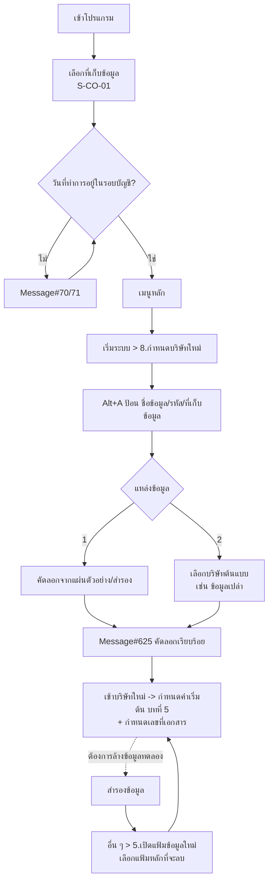

# บทที่ 4 กำหนดบริษัทใหม่
> อ้างอิงคู่มือ หน้า 49–56 (PDF p.065–072)

## ภาพรวม
บทนี้อธิบายการจัดการ "ที่เก็บข้อมูล" (company / database) แบบหลายบริษัท: โปรแกรมติดตั้งมาพร้อม 2 ชุดข้อมูล คือ "ข้อมูลทดสอบเวอร์ชั่น 1" (ตัวอย่างประกอบคู่มือ) และ "ข้อมูลเปล่าของเวอร์ชั่น 1" (มีเฉพาะโครงสร้าง/ฐานข้อมูลที่จำเป็น)
ผู้ใช้ควรสร้างที่เก็บข้อมูลใหม่สำหรับบริษัทตนเอง (ไม่ใช้ข้อมูลที่ติดตั้งมา เพื่อไม่ให้กระทบเมื่ออัพเดทโปรแกรม) ผ่านเมนู เริ่มระบบ > 8. กำหนดบริษัทใหม่ โดยคัดลอกจากแผ่นตัวอย่าง/สำรอง หรือจากบริษัทที่มีอยู่แล้ว
มี "รหัส" (กลุ่มบริษัท) สำหรับกำหนดสิทธิ์ผู้ใช้ว่าเข้าถึงบริษัทใดได้ และมีเมนู อื่น ๆ > 5. เปิดแฟ้มข้อมูลใหม่ สำหรับล้างข้อมูลในที่เก็บข้อมูลปัจจุบัน
การเข้าโปรแกรมต้องป้อน "วันที่ทำการ" ที่อยู่ในรอบบัญชีของข้อมูลนั้น

## หน้าจอ

### S-CO-01 เลือกที่เก็บข้อมูลเมื่อเข้าโปรแกรม
- เมนู: (แสดงอัตโนมัติเมื่อเรียกเข้าโปรแกรม)
- อ้างอิง: หน้า 49 (PDF p.065) — มีภาพหน้าจอ: ใช่
- ลักษณะ: หน้าต่างค้นหา/เลือก (lookup มาตรฐาน) ซ้อนบนเมนูหลัก

| ส่วน/แท็บ | ฟิลด์ | ชนิดข้อมูล | บังคับ | ค่าเริ่มต้น/อ้างอิงจาก | คำอธิบาย/เงื่อนไข |
|---|---|---|---|---|---|
| grid | ชื่อข้อมูล | text | – | ทะเบียนบริษัท | เช่น "1.ข้อมูลทดสอบเวอร์ชั่น 1", "Z.ข้อมูลเปล่าของเวอร์ชั่น 1" |
| grid | รหัส | text | – | ทะเบียนบริษัท | DATAT, DATAZ (เรียงด้วยคอลัมน์นี้ มี ▲) |
| grid | เก็บข้อมูล | text | – | ทะเบียนบริษัท | TEST, DAT |

ปุ่ม/คำสั่ง: ตกลง, ยกเลิก, ค้นหา, เรียงใหม่ <Tab>
กฎทางธุรกิจ/เงื่อนไข: รายการที่ผู้ใช้เห็นขึ้นกับสิทธิ์ตาม "รหัส" (กลุ่ม) [สันนิษฐาน — คู่มืออธิบายในหน้า 51–52]; หลังเลือกต้องป้อนวันที่ทำการ (S-CO-02)
ผลทางบัญชี/สต๊อก: ไม่มี

### S-CO-02 ตรวจวันที่ทำการกับรอบบัญชี (ข้อความ Message# 71 / 70)
- เมนู: ขั้นตอนเข้าโปรแกรม
- อ้างอิง: หน้า 50 (PDF p.066) — มีภาพหน้าจอ: ใช่
- ลักษณะ: message box (error)
- ข้อความ Message# 71 (สรุปจากภาพ): "เมื่อเริ่มเข้าโปรแกรม Express จะดึงวันที่ของเครื่องมาใส่ให้ก่อน • หากวันที่นี้ไม่ตรงกับวันจริงตามปฏิทิน ให้ออกจากโปรแกรม เพื่อไปตั้งวันที่และเวลาของเครื่องให้เรียบร้อยเสียก่อน • หากวันที่ถูกต้องแล้ว คุณจะต้องป้อนวันทำการให้อยู่ในงวดบัญชีของข้อมูลนี้" (บางคำอ่านไม่ชัด [สันนิษฐาน])
- ข้อความ Message# 70: "วันที่ไม่อยู่ในงวด งวดบัญชีของข้อมูลนี้จะอยู่ในช่วง 01/01/2545 - 31/12/2546"

| ส่วน/แท็บ | ฟิลด์ | ชนิดข้อมูล | บังคับ | ค่าเริ่มต้น/อ้างอิงจาก | คำอธิบาย/เงื่อนไข |
|---|---|---|---|---|---|
| เข้าโปรแกรม | วันที่ทำการ | date | ใช่ | วันที่ของเครื่อง | ต้องอยู่ในช่วงรอบบัญชีของที่เก็บข้อมูล |

ปุ่ม/คำสั่ง: ตกลง
กฎทางธุรกิจ/เงื่อนไข: ข้อมูลทดสอบตั้งรอบบัญชีปี 2548 ไว้ (หน้า 50) — ต้องป้อนวันที่ในปี 2548 จึงเข้าได้; ภาพ Message#70 แสดงช่วง 2 ปี (2545–2546) แสดงว่าข้อมูลหนึ่งชุดถือรอบบัญชีได้มากกว่า 1 ปี [สันนิษฐาน ดูบทกำหนดรอบบัญชี]
ผลทางบัญชี/สต๊อก: ไม่มี — แต่วันที่ทำการเป็นค่าเริ่มต้นของวันที่เอกสาร

### S-CO-03 กำหนดบริษัทใหม่ (ทะเบียนที่เก็บข้อมูล)
- เมนู: เริ่มระบบ > 8. กำหนดบริษัทใหม่
- อ้างอิง: หน้า 51–54 (PDF p.067–070) — มีภาพหน้าจอ: ใช่ (รูป 4, รูป 8)
- ลักษณะ: list/grid + toolbar (เพิ่ม, แก้ไข, ลบ, ยกเลิก, บันทึก, นำทาง 4 ปุ่ม, พิมพ์ ▾, OLD/NEW)

| ส่วน/แท็บ | ฟิลด์ | ชนิดข้อมูล | บังคับ | ค่าเริ่มต้น/อ้างอิงจาก | คำอธิบาย/เงื่อนไข |
|---|---|---|---|---|---|
| grid | ชื่อข้อมูล | text | ใช่ | – | ชื่อย่อบริษัท; ใส่ตัวเลขนำหน้าเพื่อเรียงบริษัทที่ใช้บ่อยไว้ต้น ๆ เช่น "1. บ. อัลติมา ปี48"; แก้ไขได้ภายหลัง; ใช้แยกแยะตอนเลือกเข้าโปรแกรมเท่านั้น (ชื่อบนเอกสารมาจากรายละเอียดกิจการ บทที่ 5) |
| grid | รหัส | text | ใช่ [สันนิษฐาน] | – | ชื่อกลุ่ม/ชื่อย่อ ใช้กำหนดสิทธิ์ผู้ใช้ เช่น GROUP_A, GROUP_B; หลายบริษัทใช้รหัสเดียวกันได้; แก้ไขได้ภายหลัง |
| grid | ที่เก็บข้อมูล | text | ใช่ | – | ชื่อโฟลเดอร์/ไดเรกทอรี ห้ามซ้ำ ยาวไม่เกิน 8 ตัวอักษร (อังกฤษ+ตัวเลข) ห้ามมีช่องว่าง เช่น ULTIMA48, SABAI48, KY48; **แก้ไขไม่ได้** |
| grid | วันที่ | date | – | อัตโนมัติ = วันที่สร้าง | **แก้ไขไม่ได้** |

ปุ่ม/คำสั่ง: เพิ่มข้อมูล (Alt+A), แก้ไขข้อมูล (Alt+E), ลบข้อมูล (Alt+D), ยกเลิก (Esc), บันทึก, นำทาง, พิมพ์, OLD/NEW [ความหมายไม่ระบุ], Esc = ออกจากหน้าจอ
กฎทางธุรกิจ/เงื่อนไข:
- Enter ผ่านช่องที่เก็บข้อมูล → เปิด S-CO-04 เลือกแหล่งข้อมูล
- แก้ไขได้เฉพาะ ชื่อบริษัท(ชื่อข้อมูล) และรหัส; ต้องการแก้ที่เก็บข้อมูล/วันที่ ต้องลบแล้วสร้างใหม่
- ลบ: ยืนยัน ตกลง/ยกเลิก — ลบเฉพาะชื่อในทะเบียน ไฟล์ในฮาร์ดดิสก์ยังอยู่ ต้องลบไดเรกทอรีเองด้วยคำสั่ง DOS (Del) (หมายเหตุ หน้า 54)
- ตัวอย่างสิทธิ์ (หน้า 51–52): บริษัท ก, ข = GROUP_A; ค, ง = GROUP_B; ผู้ใช้ที่ได้สิทธิ์ GROUP_A เข้าได้เฉพาะ ก และ ข (รายละเอียดอยู่หัวข้อ "การกำหนดระบบความปลอดภัย")
- หลังสร้างบริษัทใหม่ รหัสในตัวอย่างหน้า 54 เป็น DATAT (เหมือนต้นแบบ) [ข้อสังเกต: อาจคัดลอกรหัสมาจากบริษัทต้นแบบ]
ผลทางบัญชี/สต๊อก: ไม่มี (สร้างฐานข้อมูลใหม่)

### S-CO-04 เลือกแหล่งของข้อมูลที่จะดึงมาใช้
- เมนู: เริ่มระบบ > 8. กำหนดบริษัทใหม่ > (Enter หลังป้อนที่เก็บข้อมูล)
- อ้างอิง: หน้า 52–53 (PDF p.068–069) — มีภาพหน้าจอ: ใช่ (รูป 5)
- ลักษณะ: dialog radio

| ส่วน/แท็บ | ฟิลด์ | ชนิดข้อมูล | บังคับ | ค่าเริ่มต้น/อ้างอิงจาก | คำอธิบาย/เงื่อนไข |
|---|---|---|---|---|---|
| ตัวเลือก | 1. สร้างข้อมูลจากแผ่นตัวอย่าง (หรือแผ่นข้อมูลสำรอง) | select (radio) | ใช่ | ตัวเลือก 1 | คัดลอกฐานข้อมูลจากแผ่นดิสก์ เช่น แฟ้มหลัก (ผังบัญชี ลูกค้า-ผู้จำหน่าย สินค้า) ที่เตรียมไว้ |
| ตัวเลือก | 2. คัดลอกข้อมูลจากบริษัทที่มีอยู่ในเครื่อง | select (radio) | – | – | คัดลอกจากที่เก็บข้อมูลที่มีอยู่ เช่น "ข้อมูลเปล่าของเวอร์ชั่น 1" หรือบริษัทในเครือที่มีฐานลูกค้า/สินค้าเหมือนกัน |

ปุ่ม/คำสั่ง: ตกลง, ยกเลิก
กฎทางธุรกิจ/เงื่อนไข: เริ่มใช้งานครั้งแรกให้เลือกข้อ 2 แล้วเลือก "ข้อมูลเปล่าของเวอร์ชั่น 1"
ผลทางบัญชี/สต๊อก: ไม่มี

### S-CO-05 เลือกบริษัทต้นแบบที่จะคัดลอก
- เมนู: (ต่อจาก S-CO-04 ข้อ 2)
- อ้างอิง: หน้า 53 (PDF p.069) — มีภาพหน้าจอ: ใช่ (รูป 6)
- ลักษณะ: lookup list

| ส่วน/แท็บ | ฟิลด์ | ชนิดข้อมูล | บังคับ | ค่าเริ่มต้น/อ้างอิงจาก | คำอธิบาย/เงื่อนไข |
|---|---|---|---|---|---|
| grid | Company Name | text | – | ทะเบียนบริษัท | 1.ข้อมูลทดสอบเวอร์ชั่น 6, Z.ข้อมูลเปล่าของเวอร์ชั่น 6 |
| grid | Code | text | – | ทะเบียนบริษัท | DATAT, DATAZ |
| grid | Path | text | – | ทะเบียนบริษัท | TEST, DAT |

ปุ่ม/คำสั่ง: ตกลง, ยกเลิก, ค้นหา
กฎทางธุรกิจ/เงื่อนไข: คัดลอกจากข้อมูลเปล่าจะได้เฉพาะโครงสร้าง ไม่มีข้อมูล
ผลทางบัญชี/สต๊อก: ไม่มี

### S-CO-06 แจ้งผลการคัดลอก (Message# 625)
- อ้างอิง: หน้า 53 (PDF p.069) — มีภาพหน้าจอ: ใช่ (รูป 7)
- ลักษณะ: message box "คัดลอกข้อมูลจาก C:\test6\TEST -> C:\test6\MYDATA เรียบร้อย"
ปุ่ม/คำสั่ง: ตกลง / Enter
กฎทางธุรกิจ/เงื่อนไข: หลังเสร็จ บริษัทใหม่ปรากฏในรายการ (รูป 8: "2.บริษัท MYDATA จำกัด | DATAT | MYDATA | 21/03/48"); กด Esc ออก แล้วเริ่มป้อนข้อมูลในที่เก็บข้อมูลใหม่ได้ทันที (หน้า 55)

### S-CO-07 เปิดแฟ้มข้อมูลใหม่ (ล้างข้อมูลในที่เก็บข้อมูลปัจจุบัน)
- เมนู: อื่น ๆ > 5. เปิดแฟ้มข้อมูลใหม่
- อ้างอิง: หน้า 55–56 (PDF p.071–072) — มีภาพหน้าจอ: ใช่ (รูป 9)
- ลักษณะ: form คำเตือน + checklist

| ส่วน/แท็บ | ฟิลด์ | ชนิดข้อมูล | บังคับ | ค่าเริ่มต้น/อ้างอิงจาก | คำอธิบาย/เงื่อนไข |
|---|---|---|---|---|---|
| หัว | (แถบคำเตือน) "*** คำเตือน *** เมนูนี้ใช้สำหรับ 'ลบข้อมูล' ณ ที่เก็บข้อมูลปัจจุบันทิ้ง" | label | – | – | ข้อความอ่านได้ไม่ครบ [สันนิษฐาน] |
| หัว | ชื่อกิจการ | text (แสดงผล) | – | รายละเอียดกิจการ | บริษัท•เอ็กซ์เพรสซอฟท์แวร์กรุ๊ป•จำกัด |
| หัว | ข้อมูลปัจจุบันเก็บอยู่ที่ | text (แสดงผล) | – | Data Path | Z:\TEST |
| หัว | คำแนะนำ "คุณควรจะกด <ยกเลิก> เพื่อออกไป 'สำรองข้อมูล' เก็บไว้ให้เรียบร้อย ก่อนทำเปิดแฟ้มข้อมูลใหม่" | label | – | – | |
| แฟ้มที่ต้องการลบ (ลบแล้วกู้คืนไม่ได้) | ยอดยกมา ของทุกระบบ | check | – | ✓ (บังคับ เปลี่ยนไม่ได้) | |
| 〃 | รายการรายวันของทุกระบบ | check | – | ✓ (บังคับ เปลี่ยนไม่ได้) | |
| 〃 | ทะเบียนลูกค้า | check | ไม่ | ว่าง | |
| 〃 | ทะเบียนผู้จำหน่าย | check | ไม่ | ว่าง | |
| 〃 | พนักงานขาย | check | ไม่ | ว่าง | |
| 〃 | บัญชีเงินฝากธนาคาร | check | ไม่ | ว่าง | |
| 〃 | สินค้า | check | ไม่ | ว่าง | |
| 〃 | ทะเบียนหมายเลขสินค้า | check | ไม่ | ว่าง | (serial no.) |
| 〃 | ผังบัญชี | check | ไม่ | ว่าง | |
| 〃 | รายการทรัพย์สิน | check | ไม่ | ว่าง | |
| ท้าย | "สิ่งที่คุณต้องทำ หลังเปิดแฟ้มข้อมูลใหม่ คือ กำหนดค่าเริ่มต้นต่าง ๆ และ กำหนดเลขที่เอกสารใหม่" | label | – | – | |

ปุ่ม/คำสั่ง: ตกลง, ยกเลิก
กฎทางธุรกิจ/เงื่อนไข:
- ใช้เมื่อทดลองใช้แล้วจะเริ่มจริง หรือข้อมูลผิดพลาดมาก โดยไม่ต้องลบที่เก็บข้อมูล (ชื่อที่เก็บข้อมูลยังอยู่)
- 2 บรรทัดแรก (ยอดยกมา + รายการรายวันทุกระบบ) ถูกลบเสมอ
- ติ๊กแฟ้มหลักใด = ลบแฟ้มหลักนั้นด้วย (เช่น ติ๊ก "สินค้า" = ลบรายละเอียดสินค้าทั้งหมด); ไม่ติ๊ก = แฟ้มหลักยังอยู่ครบ
- กู้คืนไม่ได้ → ควรสำรองข้อมูลก่อน
ผลทางบัญชี/สต๊อก: ลบยอดยกมาและรายการรายวันของทุกระบบ (บัญชี สต๊อก ลูกหนี้ เจ้าหนี้ ฯลฯ) — เท่ากับ reset ยอดทั้งหมดเป็นศูนย์

## ลำดับการใช้งาน
1. เข้าโปรแกรม → เลือก "ข้อมูลทดสอบ" → ป้อนวันที่ทำการในรอบบัญชี (ปี 2548)
2. เริ่มระบบ > 8. กำหนดบริษัทใหม่ → Alt+A
3. ป้อน ชื่อข้อมูล, รหัส (กลุ่ม), ที่เก็บข้อมูล (≤8 ตัว ห้ามซ้ำ) → Enter
4. เลือกแหล่งข้อมูล: (1) แผ่นตัวอย่าง/สำรอง หรือ (2) คัดลอกจากบริษัทในเครื่อง → เลือก "ข้อมูลเปล่าของเวอร์ชั่น 1"
5. ระบบคัดลอก → Message#625 → ตกลง → Esc ออก
6. เข้าบริษัทใหม่ → ทำบทที่ 5 (กำหนดค่าเริ่มต้น) และกำหนดเลขที่เอกสาร
7. (ทางเลือก) เมื่อต้องการล้างข้อมูลทดลอง: สำรองข้อมูล → อื่น ๆ > 5. เปิดแฟ้มข้อมูลใหม่ → เลือกแฟ้มหลักที่จะลบ → ตกลง → กำหนดค่าเริ่มต้น/เลขที่เอกสารใหม่

## ข้อมูลที่เกี่ยวข้อง
- **CompanyRegistry** (ทะเบียนที่เก็บข้อมูล — ระดับระบบ ไม่อยู่ในฐานข้อมูลบริษัท): ชื่อข้อมูล, รหัส(กลุ่ม), ที่เก็บข้อมูล (path, unique), วันที่สร้าง
- **UserCompanyGroupAccess**: ผู้ใช้ ↔ รหัสกลุ่มบริษัท (n:m) — ผู้ใช้เห็นเฉพาะบริษัทในกลุ่มที่ได้สิทธิ์
- **CompanyDatabase** (ต่อบริษัท): มีแฟ้มหลัก (ลูกค้า, ผู้จำหน่าย, พนักงานขาย, บัญชีเงินฝาก, สินค้า, ทะเบียนหมายเลขสินค้า, ผังบัญชี, ทรัพย์สิน), ยอดยกมาทุกระบบ, รายการรายวันทุกระบบ, ค่าเริ่มต้น, รอบบัญชี, เลขที่เอกสาร
- **FiscalPeriod**: ช่วงรอบบัญชีของบริษัท — ใช้ validate วันที่ทำการ
- ความสัมพันธ์: CompanyRegistry 1:1 CompanyDatabase; CompanyRegistry n:1 CompanyGroup (รหัส)

## ข้อสังเกต
- สถาปัตยกรรมเดิมเป็น "1 บริษัท = 1 โฟลเดอร์ข้อมูล" และทำบริษัทแยกต่อปี (ตัวอย่างชื่อ "บ. อัลติมา ปี48", ULTIMA48) — ERP ใหม่อาจใช้ multi-tenant ใน DB เดียวแทน แต่ควรเก็บแนวคิด: คัดลอกแฟ้มหลักจากบริษัทต้นแบบ, กลุ่มบริษัทเพื่อกำหนดสิทธิ์, template ข้อมูลเปล่า
- ภาพหน้าจอปนหลายเวอร์ชัน: ข้อความบอก "เวอร์ชั่น 1" แต่ภาพหน้า 51, 53, 54 เขียน "เวอร์ชั่น 6"
- การลบบริษัทไม่ลบไฟล์จริง — ERP ใหม่ควรมี soft-delete/archive ที่ชัดเจน
- "เปิดแฟ้มข้อมูลใหม่" เป็นการลบถาวรโดยไม่มี undo — ควรบังคับ backup อัตโนมัติก่อน [ความเห็น]
- ข้อความ Message#71 บางคำอ่านไม่ชัดจากภาพสแกน
- รหัสของบริษัทใหม่ในรูป 8 เป็น DATAT เหมือนต้นแบบ ทั้งที่ขั้นตอนให้ป้อนรหัสเอง — ไม่ชัดว่าเป็นค่าที่ผู้เขียนป้อนหรือคัดลอกมา
