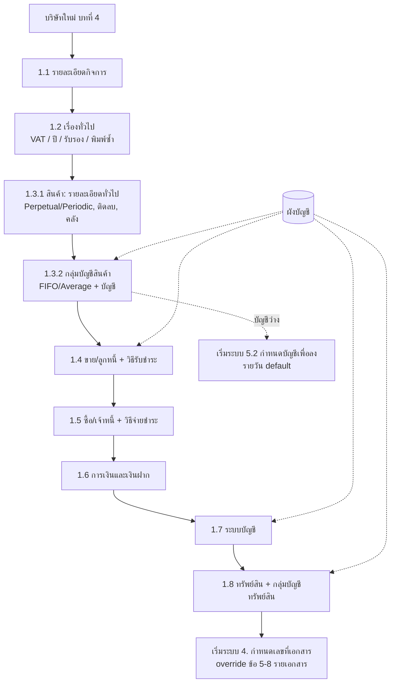
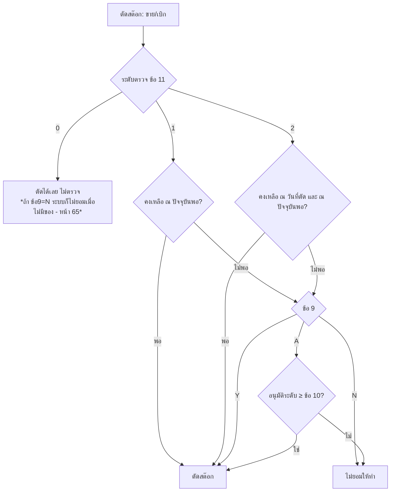
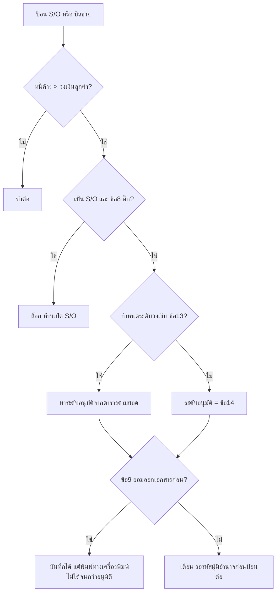

# บทที่ 5 กำหนดค่าเริ่มต้น
> อ้างอิงคู่มือ หน้า 57–82 (PDF p.073–098)

## ภาพรวม
กำหนดค่าที่จำเป็นต่อการทำรายการประจำวัน (ชื่อ/ที่อยู่บริษัทบนเอกสาร, วิธีบันทึกบัญชีสินค้า, วิธีคำนวณต้นทุน, นโยบายวงเงิน/อนุมัติ ฯลฯ) ที่เมนู เริ่มระบบ > 1. กำหนดค่าเริ่มต้นต่าง ๆ ซึ่งมีเมนูย่อยตามระบบงาน (ภาพเมนู หน้า 68):
1. รายละเอียดกิจการ / 2. เรื่องทั่วไป / 3. ระบบสินค้าคงเหลือ ▸ (1. รายละเอียดทั่วไป, 2. กำหนดกลุ่มบัญชีสินค้า) / 4. ระบบขายและลูกหนี้ ▸ / 5. ระบบซื้อและเจ้าหนี้ ▸ / 6. ระบบการเงิน และเงินฝากธนาคาร / 7. ระบบบัญชี / 8. ระบบทรัพย์สิน ▸
เมนู เริ่มระบบ ทั้งหมด: 1. กำหนดค่าเริ่มต้นต่าง ๆ ▸, 2. กำหนดตารางข้อมูล ▸, 3. กำหนดรอบบัญชี, 4. กำหนดเลขที่เอกสาร, 5. กำหนดการเชื่อมต่อบัญชี ▸, 6. ติดตั้งเครื่องพิมพ์ ▸, 7. กำหนดแผนก, 8. กำหนดบริษัทใหม่, 9. รายการข้อความ ▸, A. ล็อคงวด
หน้าจอค่าเริ่มต้นแบบ "ระเบียนเดียว" (single-record settings) ใช้แถบเครื่องมือย่อ 3 ปุ่ม: แก้ไข (Alt+E), บันทึก (F9), ยกเลิก (Esc); หน้าจอแบบตาราง/หลายระเบียน (กลุ่มบัญชีสินค้า, กลุ่มบัญชีทรัพย์สิน, วิธีรับ/จ่ายชำระ) ใช้แถบเครื่องมือเต็ม

**ระดับผู้ใช้ (ใช้ทั้งบท):** 0–4 = พนักงานทั่วไป, 5–8 = หัวหน้าแผนก, 9 = ผู้จัดการระบบ (หน้า 59, 74) — ช่อง "ขออนุมัติระดับ" ทั้งหมดอ้างอิงระดับนี้ (กำหนดระดับผู้ใช้ที่เมนูกำหนดระบบความปลอดภัย)

## หน้าจอ

### S-SET-01 รายละเอียดกิจการ
- เมนู: เริ่มระบบ > 1. กำหนดค่าเริ่มต้นต่าง ๆ > 1. รายละเอียดกิจการ
- อ้างอิง: หน้า 57 (PDF p.073) — มีภาพหน้าจอ: ใช่ (รูป 1)
- ลักษณะ: form (single record) ชื่อหน้าต่าง "กำหนดค่าเริ่มต้นต่างๆ รายละเอียดกิจการ"

| ส่วน/แท็บ | ฟิลด์ | ชนิดข้อมูล | บังคับ | ค่าเริ่มต้น/อ้างอิงจาก | คำอธิบาย/เงื่อนไข |
|---|---|---|---|---|---|
| – | 1. ชื่อบริษัท | text | ใช่ [สันนิษฐาน] | – | พิมพ์ที่หัวรายงานและฟอร์มเอกสาร (ต่างจาก "ชื่อข้อมูล" ในกำหนดบริษัทใหม่) |
| – | ที่อยู่ (2 บรรทัด) | text ×2 | ไม่ [สันนิษฐาน] | – | |
| – | 2. ชื่อภาษาอังกฤษ | text | ไม่ | – | |
| – | ที่อยู่ภาษาอังกฤษ (2 บรรทัด) | text ×2 | ไม่ | – | |
| – | 3. หมายเลขโทรศัพท์ | text | ไม่ | – | รวม FAX ในช่องเดียว เช่น "(02)217-3555 FAX:217-3588" |
| – | 4. ประเภทของกิจการ | select | ใช่ [สันนิษฐาน] | นิติบุคคล | ตัวเลือกอื่นไม่แสดง [สันนิษฐาน: บุคคลธรรมดา] |
| – | 5. เลขประจำตัวผู้เสียภาษี | text | ใช่ [สันนิษฐาน] | – | 13 หลัก เช่น 0105537095903 |
| – | 5.1 สาขา# | number | ใช่ | 0 | [สำนักงานใหญ่ = 0] |
| – | 5.2 ชื่อย่อสาขา | text | ไม่ | – | |
| – | 5.3 ยอมให้ เลขประจำตัวผู้เสียภาษี ในทะเบียนผู้จำหน่าย/ลูกค้า ว่างได้ | check | – | ไม่ติ๊ก | ไม่ติ๊ก = บังคับกรอกเลขผู้เสียภาษีในทะเบียนคู่ค้า [สันนิษฐาน] |
| – | 6. เลขทะเบียนการค้า | text | ไม่ | – | |

ปุ่ม/คำสั่ง: แก้ไข, บันทึก, ยกเลิก
กฎทางธุรกิจ/เงื่อนไข: ชื่อบริษัทในหน้านี้ใช้พิมพ์บนเอกสาร/รายงาน; ชื่อในเมนูกำหนดบริษัทใหม่ใช้แค่เลือกตอนเข้าโปรแกรม
ผลทางบัญชี/สต๊อก: ไม่มี

### S-SET-02 เรื่องทั่วไป
- เมนู: เริ่มระบบ > 1. กำหนดค่าเริ่มต้นต่าง ๆ > 2. เรื่องทั่วไป
- อ้างอิง: หน้า 58–60 (PDF p.074–076) — มีภาพหน้าจอ: ใช่ (รูป 2)
- ลักษณะ: form (single record)

| ส่วน/แท็บ | ฟิลด์ | ชนิดข้อมูล | บังคับ | ค่าเริ่มต้น/อ้างอิงจาก | คำอธิบาย/เงื่อนไข |
|---|---|---|---|---|---|
| – | 1. ระบบปีที่ใช้ | select | ใช่ | พุทธศักราช | ค.ศ. หรือ พ.ศ. สำหรับการป้อนปีในวันที่ |
| – | 2. อัตราภาษีมูลค่าเพิ่ม | number (%) | ใช่ | 7.00 | ใส่ให้อัตโนมัติตอนเปิดบิลขาย |
| – | 3. ประเภทราคาขาย | select (1/2) | ใช่ | 2 | [1=ราคารวมภาษี 2=ราคาไม่รวมภาษีมูลค่าเพิ่ม]; ถ้าขายทั้ง 2 แบบ ตั้งค่าหนึ่งแล้วแก้ตอนเปิดบิล |
| – | 4. เฉลี่ยภาษีซื้อหรือไม่ | select (Y/N/A) | ใช่ | N | [Y/N/A=ถามตอนเพิ่มเอกสาร] |
| – | อัตราที่ขอคืนได้ | number (%) | เมื่อ 4=Y/A [สันนิษฐาน] | 0.00 | |
| – | อัตราที่ขอคืนไม่ได้ | number (%) | เมื่อ 4=Y/A [สันนิษฐาน] | 0.00 | |
| – | 5. รับรองเอกสาร ต้องขออนุมัติระดับ | number (0–9) | ไม่ | ว่าง | [0หรือเว้นไว้=ไม่ต้องรับรองเอกสาร, หรือ 1-9] |
| – | 6. วิธีการพิมพ์ หรือรับรองเอกสาร | select (1/2/ว่าง) | ไม่ | 1 | [1=พิมพ์ก่อนรับรอง 2=รับรองก่อนพิมพ์ หรือเว้นไว้=อะไรก่อนก็ได้] |
| – | 7. พิมพ์เอกสารซ้ำ ต้องขออนุมัติระดับ | number (0–9) | ไม่ | ว่าง | [0หรือเว้นไว้=ไม่ต้องขออนุมัติ, หรือ 1-9] |
| – | 8. แยกประเภท VAT ที่รายการสินค้า | select (Y/N) | ไม่ | ว่าง | Y = ใบกำกับเดียวมีทั้งสินค้ามี VAT และยกเว้น VAT (เช่น สินค้าเกษตร) |
| – | ตั้งเวลาพักหน้าจอ (นาที) | number | ไม่ | – | มีในคำอธิบาย หน้า 59 แต่ไม่ปรากฏในภาพหน้าจอ |

ปุ่ม/คำสั่ง: แก้ไข, บันทึก, ยกเลิก
กฎทางธุรกิจ/เงื่อนไข:
- เฉลี่ยภาษีซื้อ (หน้า 58): สำหรับผู้ประกอบการที่มีทั้งกิจการที่ได้รับยกเว้นภาษีและเสีย VAT; ภาษีซื้อขอคืนได้บางส่วนตามสัดส่วนรายได้ปีก่อน เช่น ส่งออก 70% / ขายในประเทศ 30% → ขอคืนได้ 30%, ขอคืนไม่ได้ 70% (ตามตัวอย่างคู่มือ)
- ข้อ 5–8 กำหนดเฉพาะรายเอกสารได้อีกที่ เริ่มระบบ > 4. กำหนดเลขที่เอกสาร; เอกสารที่ไม่ได้กำหนดเฉพาะ ใช้ค่าในหน้านี้ (หมายเหตุ หน้า 59–60) → ลำดับการหาค่า: per-document-type override → global
- รับรองเอกสาร: เอกสารที่รับรองแล้วห้ามแก้โดยผู้ไม่มีอำนาจ
- พิมพ์ซ้ำ: กันพิมพ์ใบกำกับภาษีซ้ำเพื่อเรียกเก็บเงินซ้ำ — ต้องอนุมัติจากระดับที่กำหนด
ผลทางบัญชี/สต๊อก: กระทบการคำนวณ VAT ในเอกสาร (อัตรา, ราคารวม/แยก VAT, เฉลี่ยภาษีซื้อ → ส่วนภาษีซื้อที่ขอคืนไม่ได้ [สันนิษฐาน: ลงเป็นต้นทุน/ค่าใช้จ่าย])

### S-SET-03 ระบบสินค้าคงเหลือ — รายละเอียดทั่วไป
- เมนู: เริ่มระบบ > 1. กำหนดค่าเริ่มต้นต่าง ๆ > 3. ระบบสินค้าคงเหลือ > 1. รายละเอียดทั่วไป
- อ้างอิง: หน้า 60–67 (PDF p.076–083) — มีภาพหน้าจอ: ใช่ (รูป 3)
- ลักษณะ: form (single record) แบ่งกลุ่มเป็นกรอบ

| ส่วน/แท็บ | ฟิลด์ | ชนิดข้อมูล | บังคับ | ค่าเริ่มต้น/อ้างอิงจาก | คำอธิบาย/เงื่อนไข |
|---|---|---|---|---|---|
| รหัส/วิธี | 1. รูปแบบของรหัสสินค้า | text (mask) | ใช่ | 99-!!!!-!!!!!! | สัญลักษณ์ 9=ตัวเลข 0–9, X=ตัวเลข/ตัวอักษร/สัญลักษณ์, !=เหมือน X แต่แปลงอังกฤษตัวเล็กเป็นตัวใหญ่; อักขระอื่น (เช่น "-") เป็นตัวคั่นคงที่ [สันนิษฐาน] |
| รหัส/วิธี | 2. ค้นหาสินค้า | select | ใช่ | ตามรหัส | ตามรหัส / ตามชื่อ — ลำดับใน lookup |
| รหัส/วิธี | 3. วิธีคำนวณต้นทุน | label | – | "อยู่ในข้อ 2. กำหนดกลุ่มบัญชี" | กำหนดต่อกลุ่มบัญชีสินค้า (S-SET-04) |
| รหัส/วิธี | 4. บันทึกบ/ชสินค้าแบบ (บันทึกบัญชีสินค้าแบบ) | select | ใช่ | Perpetual | Perpetual (Y) / Periodic (N) |
| ทศนิยม | 5. ทศนิยมของราคาสินค้า | number (หลัก) | ใช่ | 3 | สูงสุด 4; 4 ตำแหน่ง → ราคาสูงสุด 9,999,999.9999; 3 ตำแหน่ง → 99,999,999.999 |
| ทศนิยม | 6. ทศนิยมของจำนวนสินค้า | number (หลัก) | ใช่ | 1 | สูงสุด 4; 4 ตำแหน่ง → 99,999.9999; 3 ตำแหน่ง → 999,999.999 |
| ทศนิยม | 7. ทศนิยมของตัวคูณเป็นหน่วยย่อย | number (หลัก) | ใช่ | 1 | วิธีเดียวกับทศนิยมจำนวน |
| หน่วย | 8. ปรับหน่วยนับรับ/จ่ายได้ | check | – | ✓ | ใช้ในเมนู สินค้า > 1. ลงประจำวันสินค้า (เบิกใช้ ปรับปรุง โอนย้าย) — ไม่เกี่ยวกับซื้อขาย |
| หน่วย | ปรับตัวคูณ | check | – | ✓ | ยอมให้เปลี่ยนตัวคูณตอนทำรายการรับจ่าย (เช่น "ห่อ" ที่มี 10 หรือ 100 ชิ้น) |
| สต๊อกติดลบ | 9. ยอดคงเหลือสินค้าติดลบได้ | select (Y/N/A) | ใช่ | Y | Y=ยอม, N=ไม่ยอม, A=ยอมเมื่อได้รับอนุมัติ |
| สต๊อกติดลบ | 10. ตัดสินค้าติดลบ ขออนุมัติระดับ | number (0–9) | เมื่อ 9=A | ว่าง | |
| สต๊อกติดลบ | 11. ระดับการตรวจสอบยอดสินค้าติดลบ | number (0–2) | ใช่ | 0 | 0=ไม่ตรวจ, 1=ตรวจยอด ณ ปัจจุบันก่อนตัด, 2=ตรวจเข้มงวด ทั้ง ณ วันที่ตัดและ ณ ปัจจุบัน |
| คลัง | 12. ยอมให้เก็บสินค้าได้ทุกคลัง | check | – | ✓ | ✓ = รับเข้าคลังใดก็ได้แม้ไม่ได้ผูกคลังกับสินค้า (ระบบสร้างคลังให้); ไม่ติ๊ก = เฉพาะคลังที่กำหนดไว้ |
| คลัง | 13. ตัดต้นทุนสินค้าแยกตามคลัง | check | – | ✓ | คำนวณต้นทุนเฉพาะคลังที่ตัดจ่าย |
| คลัง | 14. รหัสคลังสินค้าหลัก | lookup | ใช่ | 01 (สนญ.) | ตารางคลังสินค้า (เริ่มระบบ > 2. ตารางข้อมูล); ค่า default ในรายการรับ-จ่าย |
| รายงาน/เตือน | 15. แสดงหน่วยใหญ่/หน่วยย่อย ในรายงานสินค้าคงเหลือ | check | – | ไม่ติ๊ก | เช่น 15 ด้าม → "1 โหล 3 ด้าม" |
| รายงาน/เตือน | 16. แก้ไขราคาซื้อ/ขายล่าสุดได้ (ที่หน้าจอรายละเอียดสินค้า) | check | – | ไม่ติ๊ก | |
| รายงาน/เตือน | 17. ขาย/เบิกต่ำกว่าจุดสั่งซื้อ ให้เตือนทันทีหรือไม่ | check | – | ไม่ติ๊ก | เตือนเมื่อคงเหลือหลังขาย < จุดสั่งซื้อ (ทำให้ช้าลงเล็กน้อย) |
| อายุสินค้า | 18. กำหนดช่วงวิเคราะห์อายุสินค้า ช่วงที่ 1/2/3 | number ×3 (วัน) | ใช่ | 30 / 60 / 90 | นับจากวันที่ขายล่าสุด (สินค้าไม่เคลื่อนไหว) |
| ฟิลด์เพิ่มเติม | 19. ชื่อฟิลด์เพิ่มเติม — คอลัมน์: ใช้?, ชื่อภาษาไทย, ชื่อภาษาอังกฤษ | – | – | – | user-defined fields ในรายละเอียดสินค้า ใช้ในรายงาน/ฟอร์มได้ |
| 〃 | 20. วันที่1 | check + text + text | ไม่ | ✓ "วันหมดอายุ" / "Expire Date" | |
| 〃 | 21. วันที่2 | check + text + text | ไม่ | – | |
| 〃 | 22. ตัวเลข | check + text + text | ไม่ | – | |
| 〃 | 23. ข้อความ1 (4 ตัวอักษร) | check + text + text | ไม่ | – | |
| 〃 | 24. ข้อความ2 (4 ตัวอักษร) | check + text + text | ไม่ | – | |
| 〃 | 25. ข้อความ3 (15 ตัว) | check + text + text | ไม่ | – | |
| 〃 | 26. ข้อความ4 (30 ตัว) | check + text + text | ไม่ | – | |
| อื่น | 27. เปลี่ยนชื่อสินค้าในเอกสารรายการประจำวันสินค้า | check | – | ไม่ติ๊ก | ให้แก้ชื่อสินค้าในเอกสาร สินค้า > 1. ลงประจำวันสินค้า (เช่น ใส่เลขที่ใบสั่งผลิต) |
| อื่น | 28. ใช้รหัสบาร์โค้ดในรายละเอียดสินค้าหรือไม่ | check | – | ไม่ติ๊ก | คำอธิบายข้อนี้ไม่มีในช่วงหน้านี้ |

ปุ่ม/คำสั่ง: แก้ไข, บันทึก, ยกเลิก
กฎทางธุรกิจ/เงื่อนไข:
- ตัวอย่างโครงรหัส 99-!!!!-!!!!!! (14 ตัว): ตัวที่ 1–2 หมวดสินค้า (01 ซีพียู, 02 เมนบอร์ด, 03 แรม, 04 ฮาร์ดดิสก์, รด รายได้, คช ค่าใช้จ่าย), 4–7 ยี่ห้อ (INTL, ASUS, GIGA, HITC), 9–14 รุ่น (CL-600, P3-750, CUV4X, 6VX7) → 01-INTL-CL-600 = ซีพียู อินเทล ซิลิลอน 600 MHz (หน้า 61)
- สินค้าทั่วไป, สินค้าชุด, สินค้าบริการ, รายได้, ค่าใช้จ่าย อยู่ในแฟ้มเดียวกัน (แฟ้มสินค้า) → หมวดของรายได้/ค่าใช้จ่ายต้องไม่ซ้ำกับหมวดสินค้า (หมายเหตุ หน้า 60–61)
- ตัวคูณเป็นหน่วยย่อย: เช่น ปากกา 1 โหล = 12 ด้าม ซื้อ 1 โหล → สต๊อกเพิ่ม 12 ด้าม; สต๊อกเก็บในหน่วยเล็กสุด (หน้า 63, 66)
- ติดลบ: ถ้าตั้งข้อ 9 = N ระดับตรวจใด ๆ ก็ไม่ยอมตัดสต๊อกเมื่อไม่มีของ (หน้า 65); ระดับ 1 อาจติดลบได้ถ้าป้อนตัดสต๊อกย้อนหลัง; ระดับ 2 ตรวจทั้ง ณ วันที่ตัดและ ณ ปัจจุบัน
- ตัดต้นทุนแยกคลัง ตัวอย่าง FIFO (หน้า 65–66): รับ 01/06 คลัง01 10@100, 03/06 คลัง02 25@120, 04/06 คลัง01 15@140; จ่าย 07/06 คลัง01 15, 10/06 คลัง02 5
  - แยกคลัง: 07/06 = 10×100 + 5×140 = 1,700; 10/06 = 5×120 = 600
  - ไม่แยกคลัง: 07/06 = 10×100 + 5×120 = 1,600; 10/06 = 5×120 = 600
  - เหมาะกับธุรกิจฝากขาย/ก่อสร้าง ที่ต้องรู้มูลค่าคงเหลือรายคลัง
ผลทางบัญชี/สต๊อก (หน้า 62):
- **Perpetual** — ซื้อ: Dr สินค้า, Dr ภาษีซื้อ / Cr เงินสด/เช็คจ่าย; ขาย: Dr เงินสด/ลูกหนี้ / Cr ภาษีขาย, Cr รายได้จากการขาย และ Dr ต้นทุน / Cr สินค้า (ไม่ต้องทำงบต้นทุนขาย)
- **Periodic** — ซื้อ: Dr ซื้อ, Dr ภาษีซื้อ / Cr เงินสด/เช็คจ่าย; ขาย: Dr เงินสด/ลูกหนี้ / Cr ภาษีขาย, Cr รายได้จากการขาย (ไม่มีรายการต้นทุน); ต้นทุนขาย = สินค้าต้นงวด + ซื้อสุทธิ − สินค้าปลายงวด (จากการตรวจนับ)

### S-SET-04 กำหนดกลุ่มบัญชีสินค้า
- เมนู: เริ่มระบบ > 1. กำหนดค่าเริ่มต้นต่าง ๆ > 3. ระบบสินค้าคงเหลือ > 2. กำหนดกลุ่มบัญชีสินค้า
- อ้างอิง: หน้า 68–70 (PDF p.084–086) — มีภาพหน้าจอ: ใช่ (รูป 4 เมนู, รูป 5 หน้าจอ)
- ลักษณะ: form (หลายระเบียน, นำทางทีละระเบียน) + toolbar เต็ม (เพิ่ม, แก้ไข, ลบ, ยกเลิก, บันทึก, นำทาง, ค้นหา ▾, OLD/NEW)

| ส่วน/แท็บ | ฟิลด์ | ชนิดข้อมูล | บังคับ | ค่าเริ่มต้น/อ้างอิงจาก | คำอธิบาย/เงื่อนไข |
|---|---|---|---|---|---|
| หัว | รหัสกลุ่มบัญชี | text (≤4) | ใช่ | – | อักษรหรือตัวเลขไม่เกิน 4 ตัว เช่น ST01 |
| หัว | คำอธิบายไทย | text | ใช่ [สันนิษฐาน] | – | เช่น สินค้าสำเร็จรูป FIFO |
| หัว | คำอธิบายอังกฤษ | text | ไม่ | – | เช่น FinishGoods FIFO |
| หัว | วิธีคิดต้นทุนสินค้า | select | ใช่ | เข้าก่อนออกก่อน | เข้าก่อนออกก่อน (FIFO) / ถัวเฉลี่ย (Average) |
| บัญชีหลัก | บัญชีสินค้า | lookup (ผังบัญชี) | ใช่ [สันนิษฐาน] | – | 1140-02 สินค้าสำเร็จรูปคงเหลือ (วัตถุดิบใช้บัญชีวัตถุดิบคงเหลือ) |
| บัญชีหลัก | บ/ช ต้นทุนขาย | lookup (ผังบัญชี) | ใช่ [สันนิษฐาน] | – | 5110-00 ต้นทุนสินค้าเพื่อขาย |
| ถ้าต้องการกำหนดบัญชีขายหรือบัญชีรับคืนสินค้าของสินค้ากลุ่มนี้ | บ/ช ขายสินค้า | lookup | ไม่ | ว่าง → ใช้ เริ่มระบบ 5.2 | |
| 〃 | รับคืนสินค้า | lookup | ไม่ | ว่าง → ใช้ เริ่มระบบ 5.2 | |
| ถ้าบันทึกบัญชีแบบ Periodic และต้องการกำหนดบัญชีซื้อหรือส่งคืน | บ/ช ซื้อสินค้า | lookup | ไม่ | ว่าง → ใช้ เริ่มระบบ 5.2 | |
| 〃 | ส่งคืนสินค้า | lookup | ไม่ | ว่าง → ใช้ เริ่มระบบ 5.2 | |

ปุ่ม/คำสั่ง: เพิ่ม, แก้ไข, ลบ, ยกเลิก, บันทึก, ข้อมูลแรก/ก่อนหน้า/ถัดไป/สุดท้าย, ค้นหา ▾, OLD/NEW
กฎทางธุรกิจ/เงื่อนไข:
- กลุ่มบัญชีถูกผูกกับสินค้าแต่ละตัวที่ สินค้า > 2. รายละเอียดสินค้า
- บัญชีที่ปล่อยว่าง → ใช้บัญชี default จาก เริ่มระบบ > 5.2 กำหนดบัญชีเพื่อลงรายวัน (หน้า 70) → ลำดับหาบัญชี: กลุ่มบัญชีสินค้า → default
- ถ้าต้องการแยกบัญชีรายได้จากการขายตามประเภทสินค้า ต้องสร้างกลุ่มให้ครบทุกประเภท (หมายเหตุ หน้า 70)
- ตัวอย่างการคำนวณต้นทุน (ไม่แยกคลัง) หน้า 69–70: รับ 01/06 10@100, 03/06 25@120, จ่าย 07/06 15, รับ 08/06 15@140, จ่าย 10/06 10
  - FIFO: 07/06 = 10×100 + 5×120 = 1,600; 10/06 = 5×120 = 600 (ตามคู่มือ)
  - Average (moving): 07/06 ทุน/หน่วย = 4,000/35 = 114.2857 → ปัด 2 ตำแหน่ง 114.29; ต้นทุน = 15 × 114.29 = 1,714.35; คงเหลือ 20 ชิ้น 2,285.65; 08/06 รับ 15@140 → 35 ชิ้น 4,385.65 → 125.3042 → 125.30; 10/06 = 5 × 125.30 = 626.50 (ตามคู่มือ)
ผลทางบัญชี/สต๊อก: กำหนดบัญชีที่ใช้ลงรายวันอัตโนมัติ — Perpetual: ขาย Dr บ/ช ต้นทุนขาย / Cr บัญชีสินค้า; Cr บ/ช ขายสินค้า; รับคืน Dr รับคืนสินค้า; Periodic: ซื้อ Dr บ/ช ซื้อสินค้า, ส่งคืน Cr ส่งคืนสินค้า (ตามชื่อช่อง; คู่มือไม่เขียน Dr/Cr ของรับคืน/ส่งคืนตรง ๆ [สันนิษฐาน])

### S-SET-05 ระบบขายและลูกหนี้ — รายละเอียดทั่วไป
- เมนู: เริ่มระบบ > 1. กำหนดค่าเริ่มต้นต่าง ๆ > 4. ระบบขายและลูกหนี้ > (รายละเอียดทั่วไป) [ชื่อเมนูย่อยข้อ 1 สันนิษฐาน]
- อ้างอิง: หน้า 71–74 (PDF p.087–090) — มีภาพหน้าจอ: ใช่ (รูป 6)
- ลักษณะ: form (single record)

| ส่วน/แท็บ | ฟิลด์ | ชนิดข้อมูล | บังคับ | ค่าเริ่มต้น/อ้างอิงจาก | คำอธิบาย/เงื่อนไข |
|---|---|---|---|---|---|
| ทั่วไป | 1. ค้นหาลูกค้า | select | ใช่ | ตามชื่อ | ตามรหัส / ตามชื่อ |
| ทั่วไป | 2. เปลี่ยนชื่อสินค้าในบิลขายได้ | check | – | ✓ | เช่นขายราชการต้องใช้ชื่อตามใบสั่งซื้อ |
| ทั่วไป | 3. ปรับหน่วยนับขายได้ | check | – | ✓ | ขายได้หลายหน่วย (ขวด/ลัง) |
| ทั่วไป | ปรับตัวคูณได้ | check | – | ✓ | |
| ราคา | 4. แก้ไขราคาต่อหน่วยขายได้ | text (Y/N หรือ 0–9) | ใช่ | Y | "Y/N หรือ 0-9 (ระดับที่แก้ได้)"; ไม่อนุญาต → ข้ามช่องราคา ยกเว้นราคาเป็นศูนย์ (ไม่ได้ตั้งราคา) ยอมให้ป้อน |
| ราคา | 5. ขายต่ำกว่าทุนให้เตือนด้วย | check | – | ✓ | เตือนถ้าต้นทุนสูงกว่าราคาขาย; คู่มือแนะนำไม่ติ๊กถ้าไม่ต้องการให้ฝ่ายขายรู้ต้นทุน |
| รายการ | 6. ป้อนลำดับรายการสินค้าได้เอง | check | – | ไม่ติ๊ก | ✓ = แทรกรายการใหม่ในลำดับเดิมได้; ไม่ติ๊ก = ต่อท้ายเสมอ |
| ใบลดหนี้ | 7. วิธีการหักยอดใบลดหนี้/รับคืน | select | ใช่ | หักจากใบกำกับ | 1 = หักจากใบกำกับที่อ้างถึง (ลดยอดค้างในบิลทันที) / 2 = เก็บไว้หักตอนรับเงิน (นำไปหักบิลใดก็ได้ของลูกค้ารายเดียวกัน) |
| วงเงิน | 8. ล็อคเรื่องขายเกินวงเงินที่ S/O | check | – | ✓ | กันเปิดใบสั่งขายถ้าหนี้ค้างเกิน Credit Limit |
| วงเงิน | 9. ถ้าลูกค้าเกินวงเงิน จะยอมให้ออกเอกสารไปก่อน | check | – | ไม่ติ๊ก | ✓ = ออกบิลได้แต่พิมพ์ทางเครื่องพิมพ์ไม่ได้จนกว่าอนุมัติ; ไม่ติ๊ก = เตือนและรอรหัสผู้มีอำนาจก่อนป้อนต่อ |
| คลัง | 10. บังคับให้ป้อนคลังสินค้าที่ S/O | check | – | ไม่ติ๊ก | สำหรับหลายคลัง |
| ภาษี | 11. ภาระภาษีขาย (สินค้าบริการ) | select | ใช่ | เลือกได้ | เกณฑ์สิทธิ / เกณฑ์เงินสด / ให้ผู้ใช้เลือกเองตอนเปิดบิล |
| อายุหนี้ | 12. กำหนดช่วงวิเคราะห์อายุลูกหนี้ — เกินกำหนด (วัน) ช่วงที่ 1/2/3 | number ×3 | ใช่ | 7 / 15 / 30 | เปลี่ยนได้อีกตอนพิมพ์รายงาน |
| อายุหนี้ | ยังไม่ครบกำหนด (วัน) ช่วงที่ 1/2 | number ×2 | ใช่ | 30 / 60 | |
| วงเงิน | 13. กำหนดระดับวงเงินขายเชื่อ (ถ้าไม่คุมระดับวงเงิน ให้ป้อนเป็น 0) — แถว 1–5: วงเงินระดับ, จำนวนเงินไม่เกิน, ระดับที่อนุมัติได้ | grid 5 แถว (money + number 0–9) | ไม่ | 0.00 | เทียบยอดหนี้ค้างกับวงเงินในรายละเอียดลูกค้า |
| วงเงิน | 14. ขายเกินวงเงิน ขออนุมัติระดับ | number (0–9) | ไม่ | 9 | (จะใช้เมื่อไม่ได้กำหนดข้อ 13) |
| อื่น | 15. ห้ามแก้ใบสั่งขายในงวดที่ปิดแล้ว | check | – | ไม่ติ๊ก | ใช้ร่วมกับ ล็อคงวด |
| อื่น | 16. ดึงราคาขายจากใบเสนอราคา..เสมอ หากพบว่าเคยทำใบเสนอราคาไว้และอยู่ในกำหนดยืนราคา (ถ้าไม่ติ๊ก จะถามก่อน) | check | – | ไม่ติ๊ก | |
| อื่น | 17. ข้ามช่อง 'Bill to' หรือไม่? | check | – | ไม่ติ๊ก | เพิ่มความเร็วการป้อน |

ปุ่ม/คำสั่ง: แก้ไข, บันทึก, ยกเลิก
กฎทางธุรกิจ/เงื่อนไข — ตัวอย่างระดับวงเงิน (หน้า 74): ระดับ1 ≤20,000 อนุมัติระดับ 0; ระดับ2 ≤50,000 อนุมัติระดับ 5 → ลูกค้าเกินวงเงินแต่หนี้ค้าง <20,000 ผู้ใช้ทุกคนออกบิลได้ (ผู้ออกบิลรับผิดชอบเอง); ค้าง ≤50,000 ต้องได้รับอนุมัติระดับ 5; ≥50,000 ต้องได้รับอนุมัติระดับ >5 [ข้อสังเกต: ข้อความคู่มือไม่ชัดว่า "จำนวนเงิน" คือยอดหนี้ค้างรวมหรือส่วนที่เกินวงเงิน]
ผลทางบัญชี/สต๊อก: ภาระภาษีขายบริการ (เกณฑ์สิทธิ/เงินสด) กำหนดจังหวะรับรู้ภาษีขาย; วิธีหักใบลดหนี้กำหนดว่าลดยอดลูกหนี้รายบิลทันทีหรือเก็บเป็นเครดิตรอหัก

### S-SET-06 วิธีการรับชำระหนี้
- เมนู: เริ่มระบบ > 1. กำหนดค่าเริ่มต้นต่าง ๆ > 4. ระบบขายและลูกหนี้ > 2. วิธีการรับชำระหนี้ (คู่มือเขียน "เริ่มระบบ ข้อ 1.5.2" — ขัดกับเมนูที่ระบบขาย = 1.4 [ดูข้อสังเกต])
- อ้างอิง: หน้า 75–76 (PDF p.091–092) — มีภาพหน้าจอ: ใช่ (รูป 7)
- ลักษณะ: grid แก้ไขในตาราง (หลายระเบียน) + toolbar (เพิ่ม, แก้ไข, ลบ, ยกเลิก, บันทึก, นำทาง)

| ส่วน/แท็บ | ฟิลด์ | ชนิดข้อมูล | บังคับ | ค่าเริ่มต้น/อ้างอิงจาก | คำอธิบาย/เงื่อนไข |
|---|---|---|---|---|---|
| grid | No. [หัวคอลัมน์อ่านไม่ชัด] | text (2) | ใช่ | – | 01, 02, 03 … |
| grid | รหัส | text (2) | ใช่ | – | QR, CH, TR, TF, VS, DC, TX, EX |
| grid | คำอธิบายไทย | text | ใช่ | – | |
| grid | อังกฤษ | text | ไม่ | – | |
| grid | เช็ค? | Y/blank | ไม่ | – | Y = ต้องผ่านกระบวนการนำฝาก/ผ่านเช็คภายหลัง |
| grid | ธนาคาร | lookup (บัญชีเงินฝาก) | ไม่ | – | ใช้กับเงินโอน เช่น S1 |
| grid | เลขที่บัญชี | lookup (ผังบัญชี) | ไม่ | – | บัญชีที่ลงเมื่อรับชำระ |

ข้อมูลตัวอย่าง (รูป 7):
| No | รหัส | ไทย | อังกฤษ | เช็ค? | ธนาคาร | เลขที่บัญชี |
|---|---|---|---|---|---|---|
| 01 | QR | เช็ครับ | Cheque | Y | | 1130-02 |
| 02 | CH | รับเงินสด | Cash Received | | | 1111-00 |
| 03 | TR | เงินโอนเข้าบัญชี (NBD) | Bank Transfer | | S1 | |
| 04 | TF | ค่าธรรมเนียมการโอน | Bank charge | | | 5360-04 |
| 07 | VS | บัตร Visa | Visa Card | Y | | 1130-02 |
| 09 | DC | ส่วนลดเงินสด | Cash Discount | | | 4100-04 |
| 10 | TX | ภาษีถูกหัก ณ ที่จ่าย | Tax A/R | | | 1151-02 |
| 11 | EX | กำไรขาดทุนจากอัตราแลกเปลี่ยน | Exchange Rate P/L | | | 5370-07 |

ปุ่ม/คำสั่ง: เพิ่ม, แก้ไข, ลบ, ยกเลิก, บันทึก, นำทาง
กฎทางธุรกิจ/เงื่อนไข — 3 ลักษณะ (หน้า 75–76):
1. เช็ครับ/ตั๋วเงิน/บัตรเครดิต ที่ต้องนำฝากและรอผ่าน: เช็ค? = Y, เลขที่บัญชี = เช็ครับล่วงหน้าหรือบัญชีที่เกี่ยวข้อง
2. เงินโอนเข้าบัญชี: ป้อนรหัสธนาคาร (ให้ปรากฏใน statement), ไม่ต้องป้อนเลขที่บัญชี (ดึงจากรายละเอียดธนาคาร), เช็ค? ว่าง
3. อื่น ๆ (เสร็จในขั้นตอนเดียว เช่น เงินสด): ป้อนเฉพาะเลขที่บัญชี
ผลทางบัญชี/สต๊อก: รับชำระ: Dr [บัญชีของแต่ละวิธี: เช็ครับล่วงหน้า/เงินสด/เงินฝาก (ผ่านรหัสธนาคาร)/ค่าธรรมเนียม/ส่วนลดเงินสด/ภาษีถูกหัก ณ ที่จ่าย/กำไรขาดทุนอัตราแลกเปลี่ยน] / Cr ลูกหนี้ [สันนิษฐาน: ฝั่ง Cr ไม่ได้ระบุในบทนี้]

### S-SET-07 ระบบซื้อและเจ้าหนี้ — รายละเอียดทั่วไป
- เมนู: เริ่มระบบ > 1. กำหนดค่าเริ่มต้นต่าง ๆ > 5. ระบบซื้อและเจ้าหนี้ > (รายละเอียดทั่วไป)
- อ้างอิง: หน้า 76–77 (PDF p.092–093) — มีภาพหน้าจอ: ใช่ (รูป 8)
- ลักษณะ: form (single record)

| ส่วน/แท็บ | ฟิลด์ | ชนิดข้อมูล | บังคับ | ค่าเริ่มต้น/อ้างอิงจาก | คำอธิบาย/เงื่อนไข |
|---|---|---|---|---|---|
| – | 1. ค้นหาผู้จำหน่าย | select | ใช่ | ตามชื่อ | แนะนำตามชื่อ |
| – | 2. เปลี่ยนชื่อสินค้าในบิลซื้อได้ | check | – | ✓ | ให้ชื่อในใบสั่งซื้อตรงกับผู้จำหน่าย |
| – | 3. ปรับหน่วยนับซื้อได้ | check | – | ✓ | |
| – | ปรับตัวคูณได้ | check | – | ✓ | |
| – | 4. วิธีการหักยอดใบลดหนี้/ส่งคืน | select | ใช่ | เก็บไว้หักตอนจ่ายเงิน | 1 = หักจากใบรับที่อ้างถึง / 2 = เก็บไว้หักตอนจ่ายเงิน |
| – | 5. กำหนดช่วงวิเคราะห์อายุเจ้าหนี้ — เกินกำหนด (วัน) ช่วงที่ 1/2/3 | number ×3 | ใช่ | 15 / 30 / 60 | |
| – | ยังไม่ครบกำหนด (วัน) ช่วงที่ 1/2 | number ×2 | ใช่ | 30 / 60 | คำอธิบายหน้า 77 บอก "3 ช่วงเช่นเดียวกัน" แต่ภาพมี 2 ช่อง |
| – | 6. ห้ามแก้ใบสั่งซื้อในงวดที่ปิดแล้ว | check | – | ไม่ติ๊ก | |
| – | 7. ข้ามช่อง 'Bill be' หรือไม่? | check | – | ไม่ติ๊ก | |

ปุ่ม/คำสั่ง: แก้ไข, บันทึก, ยกเลิก
กฎทางธุรกิจ/เงื่อนไข: สมมาตรกับฝั่งขาย แต่ไม่มีเรื่องวงเงิน/อนุมัติราคา
ผลทางบัญชี/สต๊อก: วิธีหักใบลดหนี้/ส่งคืนกำหนดว่าลดยอดเจ้าหนี้รายบิลทันทีหรือเก็บรอหักตอนจ่าย

### S-SET-08 วิธีการจ่ายชำระหนี้
- เมนู: เริ่มระบบ > 1. กำหนดค่าเริ่มต้นต่าง ๆ > 5. ระบบซื้อและเจ้าหนี้ > 2. วิธีการจ่ายชำระหนี้ [เลขเมนูย่อยสันนิษฐาน]
- อ้างอิง: หน้า 77–78 (PDF p.093–094) — มีภาพหน้าจอ: ใช่ (รูป 9)
- ลักษณะ: grid หลายระเบียน (โครงเดียวกับ S-SET-06)

| ส่วน/แท็บ | ฟิลด์ | ชนิดข้อมูล | บังคับ | ค่าเริ่มต้น/อ้างอิงจาก | คำอธิบาย/เงื่อนไข |
|---|---|---|---|---|---|
| grid | No., รหัส, คำอธิบายไทย, อังกฤษ, เช็ค?, ธนาคาร, เลขที่บัญชี | ตาม S-SET-06 | – | – | หัวคอลัมน์อ่านไม่ชัด [สันนิษฐาน ว่าเหมือน S-SET-06] |

ข้อมูลตัวอย่าง: 01 QP เช็คจ่ายล่วงหน้า / Post Date Cheque / Y / C1 / 2120-02; 02 TS ภาษีหัก ณ ที่จ่าย / Witholding Tax / N / – / 2132-02; 03 TN เงินโอนถอนจาก S1 (TRN) / Bank Tx from Saving / N / S1 / –
กฎทางธุรกิจ/เงื่อนไข: ช่องเช็ค? ใช้ค่า Y/N (ฝั่งรับใช้ Y/ว่าง); ธนาคารของเช็คจ่ายเป็นรหัสสมุดเช็ค/บัญชี C1 [สันนิษฐาน]
ผลทางบัญชี/สต๊อก: จ่ายชำระ: Dr เจ้าหนี้ [สันนิษฐาน] / Cr บัญชีของวิธีจ่าย (เช็คจ่ายล่วงหน้า 2120-02, ภาษีหัก ณ ที่จ่ายค้างจ่าย 2132-02, เงินฝาก S1)

### S-SET-09 ระบบการเงินและเงินฝากธนาคาร
- เมนู: เริ่มระบบ > 1. กำหนดค่าเริ่มต้นต่าง ๆ > 6. ระบบการเงิน และเงินฝากธนาคาร
- อ้างอิง: หน้า 78–79 (PDF p.094–095) — มีภาพหน้าจอ: ใช่ (รูป 10)
- ลักษณะ: form (single record)

| ส่วน/แท็บ | ฟิลด์ | ชนิดข้อมูล | บังคับ | ค่าเริ่มต้น/อ้างอิงจาก | คำอธิบาย/เงื่อนไข |
|---|---|---|---|---|---|
| – | 1. ผ่านเช็คจ่ายทันที | check | – | ไม่ติ๊ก | ไม่ติ๊ก = ต้องทำรายการผ่านเช็คจ่ายอีกครั้งจึงตัดบัญชีเงินฝาก; ✓ = ตัดทันทีเมื่อจ่ายเช็ค |
| – | 2. รหัสธนาคารที่นำเช็คฝากเป็นประจำ | lookup (บัญชีเงินฝาก) | ไม่ | S1 (ออมทรัพย์ ธ.กรุงเทพ 444555) | default ตอนนำฝากเช็ค |
| ภาษีหัก ณ ที่จ่าย | 3. ยอดเงินขั้นต่ำที่จะต้องหักภาษี ณ ที่จ่าย | money | ไม่ | 1,000.00 | ป้อนยอดต่ำกว่านี้ตอนบันทึกใบรับรองหัก ณ ที่จ่าย → เตือน |
| ภาษีหัก ณ ที่จ่าย | 4. เลขที่บัตรประกันสังคม | text | ไม่ | – | พิมพ์ในหนังสือรับรองการหักภาษี ณ ที่จ่าย |
| ภาษีหัก ณ ที่จ่าย | 5. เลขใบอนุญาตกองทุนทดแทน | text | ไม่ | – | พิมพ์ในหนังสือรับรองฯ |

ปุ่ม/คำสั่ง: แก้ไข, บันทึก, ยกเลิก
ผลทางบัญชี/สต๊อก: ข้อ 1 ✓ → จ่ายเช็ค: Cr เงินฝากธนาคารทันที; ไม่ติ๊ก → Cr เช็คจ่ายล่วงหน้า (เช่น 2120-02) แล้วเมื่อผ่านเช็ค Dr เช็คจ่ายล่วงหน้า / Cr เงินฝาก [สันนิษฐาน จากโครง S-SET-08]

### S-SET-10 ระบบบัญชี
- เมนู: เริ่มระบบ > 1. กำหนดค่าเริ่มต้นต่าง ๆ > 7. ระบบบัญชี
- อ้างอิง: หน้า 79–81 (PDF p.095–097) — มีภาพหน้าจอ: ใช่ (รูป 11)
- ลักษณะ: form (single record) + ตารางย่อย 4 แถว

| ส่วน/แท็บ | ฟิลด์ | ชนิดข้อมูล | บังคับ | ค่าเริ่มต้น/อ้างอิงจาก | คำอธิบาย/เงื่อนไข |
|---|---|---|---|---|---|
| – | 1. รูปแบบของรหัสบัญชี | text (mask) | ใช่ | 9999-99 | สัญลักษณ์ 9 / X / ! เหมือนรหัสสินค้า; ผังบัญชีที่ติดตั้งมาใช้ 9999-99 — ศึกษาก่อนเปลี่ยน |
| – | 2. ลำดับเลขที่ใบสำคัญ | select | ใช่ | ป้อนเลขเอง | (เฉพาะเอกสารที่จะป้อนในสมุดรายวัน) 0=ป้อนเลขเอง, 1=YMMDDxx, 2=YMMxxxx, 3=YYMMxxxx, 4=YYMMDDxxx |
| รายการจ่ายเงินสดย่อย | 3–6. ข้อความ 1–4: ชื่อไทย, ชื่ออังกฤษ, เลขที่บัญชี | text + text + lookup (ผังบัญชี) | ไม่ | ตัวอย่าง: ค่าน้ำมันรถ/Gasoline/5200-09; ค่ารักษาพยาบาล/Attendance/5310-11; ค่าส่งไปรษณีย์/Postage/5200-08; ข้อความ 4 ว่าง | หัวคอลัมน์รายงานสมุดเงินสดย่อย; รายการอื่นรวมในคอลัมน์ "คชจ.อื่น ๆ" |

ปุ่ม/คำสั่ง: แก้ไข, บันทึก, ยกเลิก; แว่นขยายเลือกเลขที่บัญชี
กฎทางธุรกิจ/เงื่อนไข:
- ตัวอย่างลำดับเลขใบสำคัญ (บันทึก 30/06/43): แบบ 1 → 3063001, 3063002; แบบ 2 → 3060001, 3060002; แบบ 3 → 43060001; แบบ 4 → YYMMDDxxx (เช่น 430630001 [สันนิษฐาน]) (Y = เลขท้ายปี 1 หลัก, YY = 2 หลัก; คู่มือแนะนำแบบ 3)
- ข้อความเงินสดย่อยใช้เฉพาะพิมพ์รายงาน เปลี่ยนเลขบัญชีภายหลังไม่กระทบข้อมูลเดิม (หน้า 81)
- ตัวอย่างหัวรายงานเงินสดย่อย: ค่าเครื่องเขียน | ค่าน้ำมันรถ | ค่าล่วงเวลา | ค่ารับรอง | คชจ.อื่น ๆ
ผลทางบัญชี/สต๊อก: ไม่มี (รูปแบบรหัส/เลขใบสำคัญ/การจัดคอลัมน์รายงาน)

### S-SET-11 ระบบทรัพย์สินถาวร — รายละเอียดทั่วไป
- เมนู: เริ่มระบบ > 1. กำหนดค่าเริ่มต้นต่าง ๆ > 8. ระบบทรัพย์สิน > (รายละเอียดทั่วไป)
- อ้างอิง: หน้า 81–82 (PDF p.097–098) — มีภาพหน้าจอ: ใช่ (รูป 12)
- ลักษณะ: form (single record)

| ส่วน/แท็บ | ฟิลด์ | ชนิดข้อมูล | บังคับ | ค่าเริ่มต้น/อ้างอิงจาก | คำอธิบาย/เงื่อนไข |
|---|---|---|---|---|---|
| – | 1. รูปแบบของรหัสทรัพย์สิน | text (mask) | ใช่ | !!!!!!!!!!!!!! (14 ตัว) | สัญลักษณ์เหมือนรหัสสินค้า/บัญชี |
| – | 2. คิดค่าเสื่อมขณะบันทึกทรัพย์สิน | select | ใช่ | คิดทันที | คิดทันที / ยังไม่คิด — ตอนเริ่มระบบที่ต้องป้อนทรัพย์สินจำนวนมากให้ตั้ง "ยังไม่คิด" แล้วสั่งคำนวณทีเดียว จากนั้นเปลี่ยนเป็น "คิดทันที" |
| – | 3. คิดค่าเสื่อม | select | ใช่ | รายเดือน | รายเดือน / รายปี — ลงบัญชีค่าเสื่อมทุกเดือน หรือ ณ วันสิ้นปีครั้งเดียว |

ปุ่ม/คำสั่ง: แก้ไข, บันทึก, ยกเลิก
ผลทางบัญชี/สต๊อก: ความถี่การลงรายการค่าเสื่อมราคาในสมุดรายวัน (รายเดือน/รายปี)

### S-SET-12 กำหนดกลุ่มบัญชีทรัพย์สิน
- เมนู: เริ่มระบบ > 1. กำหนดค่าเริ่มต้นต่าง ๆ > 8. ระบบทรัพย์สิน > (กำหนดกลุ่มบัญชีทรัพย์สิน)
- อ้างอิง: หน้า 82 (PDF p.098) — มีภาพหน้าจอ: ใช่ (รูป 13)
- ลักษณะ: form หลายระเบียน + toolbar เต็ม (มี ค้นหา ▾, OLD/NEW)

| ส่วน/แท็บ | ฟิลด์ | ชนิดข้อมูล | บังคับ | ค่าเริ่มต้น/อ้างอิงจาก | คำอธิบาย/เงื่อนไข |
|---|---|---|---|---|---|
| หัว | รหัส | text | ใช่ | – | เช่น CARD [ความยาวสูงสุดไม่ระบุ] |
| หัว | คำอธิบายไทย | text | ใช่ [สันนิษฐาน] | – | ค่าเสื่อมราคา-ยานพาหนะ |
| หัว | คำอธิบายอังกฤษ | text | ไม่ | – | Depreciation on Vihicles |
| บัญชี | บัญชีทรัพย์สิน | lookup (ผังบัญชี) | ใช่ [สันนิษฐาน] | – | 1410-05 ยานพาหนะ |
| บัญชี | บ/ช ค่าเสื่อม (Dr.) | lookup (ผังบัญชี) | ใช่ [สันนิษฐาน] | – | 5340-05 ค่าเสื่อมราคา-ยานพาหนะ |
| บัญชี | ค่าเสื่อมสะสม (Cr.) | lookup (ผังบัญชี) | ใช่ [สันนิษฐาน] | – | 1420-05 ค่าเสื่อมราคาสะสม-ยานพาหนะ |

ปุ่ม/คำสั่ง: เพิ่ม, แก้ไข, ลบ, ยกเลิก, บันทึก, นำทาง, ค้นหา ▾, OLD/NEW
กฎทางธุรกิจ/เงื่อนไข: กลุ่ม (หมวด) เช่น อุปกรณ์สำนักงาน ยานพาหนะ อาคาร — ผูกให้ทรัพย์สินแต่ละตัว
ผลทางบัญชี/สต๊อก: ค่าเสื่อมราคา: **Dr บ/ช ค่าเสื่อม / Cr ค่าเสื่อมสะสม** (ระบุ Dr./Cr. บนหน้าจอ); บัญชีทรัพย์สิน = บัญชีราคาทุน

## ลำดับการใช้งาน
หลังสร้างบริษัทใหม่ (บทที่ 4) ให้ตั้งค่าตามลำดับเมนู (ข้อที่อ้างถึงกันต้องมีข้อมูลก่อน: ผังบัญชี, ตารางคลัง, บัญชีเงินฝาก):
1. รายละเอียดกิจการ → 2. เรื่องทั่วไป (ปี, VAT, ประเภทราคา, เฉลี่ยภาษีซื้อ, นโยบายรับรอง/พิมพ์)
3. ระบบสินค้าคงเหลือ: รายละเอียดทั่วไป (รูปแบบรหัส, Perpetual/Periodic, ทศนิยม, ติดลบ, คลัง) → กลุ่มบัญชีสินค้า (FIFO/Average + บัญชี)
4. ระบบขายและลูกหนี้: รายละเอียดทั่วไป (วงเงิน, ราคา, ใบลดหนี้, อายุหนี้) → วิธีรับชำระหนี้
5. ระบบซื้อและเจ้าหนี้: รายละเอียดทั่วไป → วิธีจ่ายชำระหนี้
6. ระบบการเงินและเงินฝาก (ผ่านเช็คทันที, ธนาคารนำฝาก, WHT)
7. ระบบบัญชี (รูปแบบรหัสบัญชี, เลขใบสำคัญ, คอลัมน์เงินสดย่อย)
8. ระบบทรัพย์สิน: รายละเอียดทั่วไป → กลุ่มบัญชีทรัพย์สิน

### ตรรกะตรวจสต๊อกติดลบตอนตัดจ่าย (ข้อ 9–11 ของ S-SET-03)

หมายเหตุ: การผสานข้อ 9 กับข้อ 11 ในผังนี้เป็นการตีความจากคำอธิบาย หน้า 64–65 [สันนิษฐาน]

### ตรรกะวงเงินลูกหนี้ (ข้อ 8, 9, 13, 14 ของ S-SET-05)

## ข้อมูลที่เกี่ยวข้อง
- **CompanyProfile** (1 ระเบียน): name_th, address_th1-2, name_en, address_en1-2, phone, business_type, tax_id, branch_no, branch_short_name, allow_blank_partner_taxid, trade_reg_no
- **GeneralSettings** (1 ระเบียน): year_system, vat_rate, price_type(1/2), avg_input_vat(Y/N/A), refundable_pct, nonrefundable_pct, approve_level, print_approve_order(1/2/blank), reprint_level, vat_type_per_line(Y/N), screen_saver_min
- **DocTypeSettings** (บท 4. กำหนดเลขที่เอกสาร): override approve_level / print_approve_order / reprint_level / vat_per_line ต่อประเภทเอกสาร → fallback GeneralSettings
- **InventorySettings** (1 ระเบียน): item_code_mask, item_search_by, posting_method(Perpetual/Periodic), price_dec, qty_dec, factor_dec, allow_unit_change_io, allow_factor_change, allow_negative(Y/N/A), negative_approve_level, negative_check_level(0-2), allow_any_warehouse, cost_by_warehouse, main_warehouse → Warehouse, show_big_small_unit, allow_edit_last_price, warn_below_reorder, aging_days[3], udf definitions (date1, date2, number, text1(4), text2(4), text3(15), text4(30) × {used, label_th, label_en}), allow_rename_item_in_ic_doc, use_barcode
- **ItemAccountGroup**: code(≤4), desc_th, desc_en, cost_method(FIFO/AVG), inventory_acct, cogs_acct, sales_acct?, sales_return_acct?, purchase_acct?, purchase_return_acct? → ChartOfAccount; Item n:1 ItemAccountGroup
- **ARSettings** (1 ระเบียน): customer_search_by, allow_rename_item, allow_unit_change, allow_factor_change, edit_price(Y/N/0-9), warn_below_cost, manual_line_order, credit_note_method(1/2), lock_so_over_limit, allow_doc_over_limit, require_wh_on_so, service_vat_basis(สิทธิ/เงินสด/เลือกได้), aging_overdue[3], aging_notdue[2], credit_tiers[5]{amount, approve_level}, over_limit_level, lock_so_closed_period, always_pull_quote_price, skip_bill_to
- **ReceiptMethod** / **PaymentMethod**: no, code, desc_th, desc_en, is_cheque, bank_code → BankAccount, gl_account → ChartOfAccount
- **APSettings** (1 ระเบียน): vendor_search_by, allow_rename_item, allow_unit_change, allow_factor_change, debit_note_method(1/2), aging_overdue[3], aging_notdue[2], lock_po_closed_period, skip_bill_be
- **FinanceSettings**: clear_cheque_immediately, default_deposit_bank → BankAccount, wht_min_amount, social_security_no, compensation_fund_license_no
- **GLSettings**: account_code_mask, voucher_numbering(0-4), petty_cash_columns[4]{label_th, label_en, gl_account}
- **FixedAssetSettings**: asset_code_mask, depreciate_on_entry(คิดทันที/ยังไม่คิด), depreciation_frequency(รายเดือน/รายปี)
- **AssetAccountGroup**: code, desc_th, desc_en, asset_acct, depreciation_expense_acct (Dr), accumulated_depreciation_acct (Cr); FixedAsset n:1 AssetAccountGroup
- **UserLevel**: 0–4 พนักงานทั่วไป, 5–8 หัวหน้าแผนก, 9 ผู้จัดการระบบ

## ข้อสังเกต
- หน้า 75 ระบุเมนูวิธีการรับชำระหนี้เป็น "เริ่มระบบ ข้อ 1.5.2" แต่โครงเมนู (หน้า 68) ระบบขายและลูกหนี้ = 1.4 และซื้อ/เจ้าหนี้ = 1.5 — น่าจะพิมพ์ผิด ควรเป็น 1.4.2 [สันนิษฐาน]
- ตัวอย่าง Average หน้า 70 พิมพ์ "15 x 114.49" แต่ผลลัพธ์ 1,714.35 = 15 × 114.29 → ตัวเลข 114.49 พิมพ์ผิด; ต้นทุนถัวเฉลี่ยปัดเศษตามทศนิยมราคาก่อนคูณ (ใช้ 114.29 ไม่ใช่ 114.2857) — ควรระบุนโยบายปัดเศษให้ชัดใน ERP ใหม่
- ตัวอย่างหน้า 69–70 อีกจุด: ตารางแสดงจ่ายวันที่ 10/06 จำนวน **10** ชิ้น (คงเหลือ 35 → 20) แต่การคำนวณใช้ **5** ชิ้น (FIFO 5×120 = 600, Average 5×125.30 = 626.50) — ถ้าจ่าย 10 จริง FIFO = 10×120 = 1,200 และ Average = 10×125.30 = 1,253.00 → ถ้าจะใช้ตัวอย่างนี้เป็น test case ต้องแก้ตัวเลขก่อน
- เรื่องทั่วไป: คำอธิบายมี "ตั้งเวลาพักหน้าจอ" แต่ภาพหน้าจอมีเพียงข้อ 1–8
- ระบบซื้อ: คำอธิบาย "ยังไม่ครบกำหนด 3 ช่วง" แต่ภาพมี 2 ช่อง (เหมือนฝั่งขาย)
- ระบบสินค้า ข้อ 4 ภาพเป็น dropdown (Perpetual) แต่คำอธิบายใช้ Y/N (Y=Perpetual, N=Periodic) — น่าจะเป็นค่าภายใน
- ข้อ 28 (บาร์โค้ด) และ ข้อ 16 แก้ราคาซื้อ-ขายล่าสุด มีคำอธิบายเฉพาะข้อ 16 (หน้า 67)
- ตารางระดับวงเงินขายเชื่อ: ไม่ชัดว่าเทียบ "ยอดหนี้ค้าง" หรือ "ส่วนที่เกินวงเงิน"
- Periodic: ระบบต้องให้กำหนดบัญชีซื้อ/ส่งคืนแยก; Perpetual ซื้อลงบัญชีสินค้าโดยตรง — ERP ใหม่ต้องรองรับทั้งสองโหมดในการสร้าง journal อัตโนมัติ
- การหาบัญชีแบบลำดับชั้น (กลุ่มบัญชีสินค้า → default เริ่มระบบ 5.2) และการหาค่าควบคุม (รายเอกสาร → ทั่วไป) เป็นรูปแบบที่ควรนำไปใช้
- บทที่ 5 จบที่หน้า 82; หน้า 83 เริ่มบทที่ 6 (กำหนดรอบบัญชีและตารางข้อมูล)
