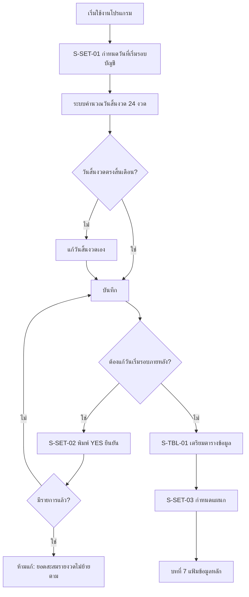

# บทที่ 6 การกำหนดรอบบัญชีและตารางข้อมูล
> อ้างอิงคู่มือ หน้า 83–92 (PDF p.099–108) — หน้า 92 (PDF p.108) เป็นหน้าว่าง

## ภาพรวม
- ก่อนเริ่มใช้งานต้องกำหนด **รอบระยะเวลาบัญชี** เพื่อให้โปรแกรมรู้วันเริ่ม–สิ้นสุดของงวด และ **ป้องกันการป้อนข้อมูลนอกรอบบัญชี** (หน้า 83)
- โปรแกรมเตรียมงวดไว้ **24 งวด** (ปีปัจจุบัน 12 + ปีใหม่ 12) ใช้งานต่อเนื่องได้ 2 ปีโดยยังไม่ต้องปิดบัญชี; รอบถัดไปกำหนดใหม่ในขั้นตอนปิดประมวลผลสิ้นปี (บทที่ 22) (หน้า 83)
- **ตารางข้อมูล** คือข้อมูลย่อย (lookup/code tables) ที่ใช้ประกอบการป้อนแฟ้มข้อมูลหลัก เช่น หน่วยนับ คลัง หมวดสินค้า ประเภทลูกค้า เขตการขาย ต้องเตรียมให้เรียบร้อยก่อนป้อนแฟ้มข้อมูลหลัก (หน้า 83, 85)
- **แผนก** ใช้วิเคราะห์ผลงานรายแผนก/ทีม และลงบัญชีแยกแผนกอัตโนมัติเมื่อผังบัญชีระบุให้แยกแผนก (หน้า 90–91)

## หน้าจอ

### S-SET-01 กำหนดรอบบัญชี
- เมนู: เริ่มระบบ > 3. รอบบัญชี (ชื่อเมนูอ้างจากหน้า 133 "เมนูเริ่มระบบข้อ 3 รอบบัญชี"; หน้า 83–84 ไม่ได้ระบุเลขเมนู)
- อ้างอิง: หน้า 84 (PDF p.100) — มีภาพหน้าจอ: ใช่ (รูปที่ 1)
- ลักษณะ: form — ช่องวันที่เริ่มรอบบัญชี + ตาราง 2 กลุ่มคอลัมน์ (รอบบัญชีปีปัจจุบัน / รอบบัญชีปีใหม่) งวด 1–24

| ส่วน/แท็บ | ฟิลด์ | ชนิดข้อมูล | บังคับ | ค่าเริ่มต้น/อ้างอิงจาก | คำอธิบาย/เงื่อนไข |
|---|---|---|---|---|---|
| Header | วันที่เริ่มรอบบัญชี | date | ใช่ [สันนิษฐาน] | ตัวอย่าง 01/01/2558 | วันเริ่มรอบระยะเวลาบัญชีที่ยื่นภาษี **ไม่ใช่วันเริ่มใช้โปรแกรม** (เช่น เริ่มใช้ มิ.ย. แต่รอบบัญชี ม.ค.–ธ.ค. ให้ใส่ 1 ม.ค.) |
| รอบบัญชีปีปัจจุบัน | งวด | number | – | 1–12 | อ่านอย่างเดียว [สันนิษฐาน] |
| รอบบัญชีปีปัจจุบัน | วันสิ้นงวด | date | – | คำนวณอัตโนมัติ (สิ้นเดือน) | แก้ไขได้สำหรับบริษัทที่วันสิ้นงวดไม่ใช่สิ้นเดือน |
| รอบบัญชีปีใหม่ | งวด | number | – | 13–24 | |
| รอบบัญชีปีใหม่ | วันสิ้นงวด | date | – | คำนวณอัตโนมัติ | หมายเหตุบนจอ: "วันสิ้นงวดที่ 24 สามารถกำหนดให้เลยไปได้ไม่จำกัด" |

ปุ่ม/คำสั่ง: แถบเครื่องมือ 3 ไอคอน — แก้ไข, บันทึก, ออก/ยกเลิก [สันนิษฐานจากรูปไอคอน]

กฎทางธุรกิจ/เงื่อนไข:
- เมื่อป้อนวันที่เริ่มรอบบัญชี โปรแกรมคำนวณวันสิ้นงวดทั้ง 24 งวดให้อัตโนมัติ (หน้า 84)
- วันสิ้นงวดแก้ไขได้ (กรณีไม่ใช่สิ้นเดือน) (หน้า 84)
- งวดที่ 24 ขยายวันสิ้นงวดได้ไม่จำกัด (หมายเหตุบนจอ หน้า 84)
- ห้ามป้อนรายการนอกเหนือรอบบัญชีที่กำหนด (หน้า 83)
- แก้วันที่เริ่มรอบบัญชี → แสดงหน้าจอเตือน S-SET-02 ต้องพิมพ์ "YES" เพื่อยืนยัน (หน้า 84–85)
- **ห้าม**แก้รอบบัญชีหลังเริ่มบันทึกรายการแล้ว เพราะยอดสะสมรายงวดที่เก็บไว้ (ยอดขายสินค้ารายตัว, ยอด Dr/Cr รายบัญชี ฯลฯ) จะไม่ถูกย้ายตามงวดที่แก้ (หน้า 85)

ผลทางบัญชี/สต๊อก: ไม่มีการลงบัญชี; เป็นตัวกำหนด bucket งวด (1–24) ที่ระบบใช้สะสมยอดเคลื่อนไหว

### S-SET-02 ยืนยันการแก้ไขวันที่เริ่มรอบบัญชี
- เมนู: เปิดอัตโนมัติจาก S-SET-01 เมื่อแก้วันที่เริ่มรอบบัญชี
- อ้างอิง: หน้า 85 (PDF p.101) — มีภาพหน้าจอ: ใช่ (รูปที่ 2)
- ลักษณะ: dialog เตือน

| ส่วน/แท็บ | ฟิลด์ | ชนิดข้อมูล | บังคับ | ค่าเริ่มต้น/อ้างอิงจาก | คำอธิบาย/เงื่อนไข |
|---|---|---|---|---|---|
| ข้อความ | "*** คำเตือนเรื่อง การแก้ไขวันเริ่มรอบบัญชี ***" (ข้อความเตือนหลายข้อ) | label | – | – | ภาพไม่ชัด อ่านได้บางส่วน: วันที่เริ่มรอบบัญชีควรตรงกับวันเริ่มใช้งาน/ปรับเปลี่ยนเมื่อมีการประมวลผลสิ้นปี; การแก้ไขมีผลต่อยอดคงเหลือ; หากไม่แน่ใจให้ปรึกษาฝ่ายบริการของบริษัทฯ [สันนิษฐาน — ภาพเบลอ] |
| ยืนยัน | ช่องยืนยัน | text | ใช่ | ว่าง | ต้องพิมพ์ `YES` ("หากคุณแน่ใจที่จะแก้ไข 'วันที่เริ่มรอบบัญชี' และเข้าใจวิธีปฏิบัติหลังจากนี้ดีแล้ว ให้ป้อน YES เพื่อยืนยัน") |

ปุ่ม/คำสั่ง: ตกลง, ยกเลิก
กฎทางธุรกิจ/เงื่อนไข: ยืนยันได้เฉพาะเมื่อพิมพ์ YES
ผลทางบัญชี/สต๊อก: –

### S-TBL-00 เมนูตารางข้อมูล (รายการตาราง)
- เมนู: เริ่มระบบ > 2. ตารางข้อมูล
- อ้างอิง: หน้า 86 (PDF p.102) — มีภาพหน้าจอ: ใช่ (รูปที่ 3)
- ลักษณะ: เมนูย่อย (list) รหัสตาราง–ชื่อ

| รหัสตาราง | ชื่อตาราง | ใช้ใน (ตามคู่มือ) |
|---|---|---|
| 01 | ชื่อธนาคาร | – (คู่มือไม่อธิบาย) |
| 20 | หน่วยนับ | สินค้า (มีช่องพิเศษ "อัตรา") หน้า 87 |
| 21 | คลังสินค้า | สินค้า/คลัง หน้า 87–88 |
| 22 | หมวดสินค้า | สินค้า/ค่าใช้จ่าย/รายได้อื่น หน้า 88 |
| 23 | ระดับสินค้า | สินค้าชุด (หน้า 106) |
| 40 | เขตการขาย | ลูกค้า/พนักงานขาย |
| 41 | ขนส่งโดย | ลูกค้า/ผู้จำหน่าย |
| 42 | เหตุผลการยกเลิกยอดสั่งขาย | – |
| 43 | เหตุผลการยกเลิกยอดสั่งซื้อ | – |
| 44 | สถานะใบเสนอราคา | – |
| 45 | ประเภทลูกค้า | ลูกค้า |
| 46 | ประเภทผู้จำหน่าย | ผู้จำหน่าย |
| 47 | ประเภทพนักงานขาย | พนักงานขาย |
| 52 | ประเภททรัพย์สิน (หัวหน้าต่างแสดง "52-หมวดทรัพย์สิน") | ทรัพย์สิน หน้า 89 |
| 53 | สถานะใบเบิก/ส ย่อย (สถานะใบเบิกเงินสดย่อย) | เงินสดย่อย หน้า 89 |
| 55 | หมวดภาษีหัก ณ ที่จ่าย | ผู้จำหน่าย/WHT หน้า 90 |
| 60 | เฟส | – (คู่มือไม่อธิบาย) |
| 61 | รหัสต้นทุน | – (คู่มือไม่อธิบาย) |

### S-TBL-01 หน้าจอตารางข้อมูล (รูปแบบมาตรฐาน — ใช้กับทุกตาราง)
- เมนู: เริ่มระบบ > 2. ตารางข้อมูล > (เลือกตาราง)
- อ้างอิง: หน้า 86–87 (PDF p.102–103) — มีภาพหน้าจอ: ใช่ (รูปที่ 4 หน่วยนับ, รูปที่ 5–9 ตารางอื่น)
- ลักษณะ: list/grid แก้ไขในตาราง (inline grid) + แถบเครื่องมือ

| ส่วน/แท็บ | ฟิลด์ | ชนิดข้อมูล | บังคับ | ค่าเริ่มต้น/อ้างอิงจาก | คำอธิบาย/เงื่อนไข |
|---|---|---|---|---|---|
| Grid | รหัส | text | ใช่ | – | ตัวอักษร/ตัวเลขสื่อความหมาย เช่น 'กล' = กล่อง, 'คร' = เครื่อง; ใช้อ้างอิงในหน้าจออื่น ๆ |
| Grid | ชื่อย่อไทย | text | ไม่ [สันนิษฐาน] | – | คำย่อภาษาไทย ใช้แสดงในแบบฟอร์ม/รายงาน |
| Grid | ชื่อย่อEng | text | ไม่ [สันนิษฐาน] | – | คำย่อภาษาอังกฤษ |
| Grid | ชื่อเต็มไทย | text | ไม่ [สันนิษฐาน] | – | ชื่อเต็มภาษาไทย |
| Grid | ชื่อเต็มEng | text | ไม่ [สันนิษฐาน] | – | ชื่อเต็มภาษาอังกฤษ (ใช้ในฟอร์ม/รายงานเฉพาะโปรแกรมชุดภาษาอังกฤษ) |
| Grid (เฉพาะ 20-หน่วยนับ) | อัตรา | number | ไม่ | 0.0 / 1.0 | ตัวคูณให้เป็นหน่วยย่อย เช่น โหล = 12.0 — เมื่อใช้กับสินค้าที่หน่วยเป็นโหล โปรแกรมคูณ 12 ก่อนเก็บเป็นหน่วยย่อย (หน้า 87) |
| Grid (21-คลังสินค้า, กำหนดแผนก) | คอลัมน์ขวาสุด (หัวคอลัมน์อ่านได้ว่า "แผนก" ) | text | – | – | [สันนิษฐาน] คู่มือไม่อธิบาย |

ปุ่ม/คำสั่ง: เพิ่ม, แก้ไข, ลบ, ยกเลิก/ออก, บันทึก, เลื่อนแรก/ก่อนหน้า/ถัดไป/สุดท้าย, พิมพ์ (dropdown), OLD/NEW (เปลี่ยนรหัส — ปรากฏบางตาราง เช่น 21, 22, 52, กำหนดแผนก)

กฎทางธุรกิจ/เงื่อนไข:
- เพิ่ม แก้ไข ลบรหัส หรือแก้คำอธิบายได้ตลอดเวลา (หน้า 87, 90)
- **ห้ามลบหรือแก้รหัส**ที่ถูกนำไปอ้างอิงในการเดินรายการแล้ว (หน้า 90)
- ตารางมาพร้อมข้อมูลตัวอย่างเริ่มต้น (หน้า 86)

ข้อมูลตัวอย่างในคู่มือ:
- 20-หน่วยนับ (หน้า 86): กล กล่อง Box 0.0 / คง ครั้ง Time 1.0 / คร เครื่อง Set 1.0 / ชด ชุด Set 1.0 / ชน ชิ้น Pieces 1.0 / ตว ตัว Pieces 1.0 / ผง แผง Pcs 1.0 / หบ หีบ Carton 0.0 / หล โหล Dozens 12.0 / หอ ห่อ Pack 0.0 / อน อัน Pieces 1.0
- 21-คลังสินค้า (หน้า 88): 01 สนญ. HO. คลังสำนักงานใหญ่ Head Office / 02 ขาย SAL คลังสำนักงานขาย Sale Office
- 22-หมวดสินค้า (หน้า 88): 01 ซีพียู CPU … 19 ยูพีเอส UPS, 20 Accessories, 50 ซอฟต์แวร์ Software (Original Software)
- 52-ประเภททรัพย์สิน (หน้า 89): CA รถ/ยานพาหนะ Vehicles, CO คอมพิวเตอร์และอุปกรณ์, EQ อุปกรณ์สำนักงาน, FU เฟอร์นิเจอร์ — แบ่งตามชนิดหรือตามสถานที่ (แผนก) ก็ได้
- 53-สถานะใบเบิกเงินสดย่อย (หน้า 89): 00 รอเคลียร์ Clearing / 99 เรียบร้อย Complete — ใช้กรณีเบิกโดยไม่มี/มีเอกสารไม่ครบ
- 55-หมวดภาษีหัก ณ ที่จ่าย (หน้า 90) แบ่งตามประเภทแบบยื่นภาษี: S03 ภงด.3 (แบบยื่นภาษีหัก ณ ที่จ่าย บุคคลธรรมดา) / S53 ภงด.53 (นิติบุคคล) / Z03 ถูกหัก(ไม่ยื่น) ภาษีถูกหัก ณ ที่จ่าย (บุคคลธรรมดา) / Z53 ถูกหัก(ไม่ยื่น) (นิติบุคคล)

ผลทางบัญชี/สต๊อก: ไม่มีโดยตรง — อัตราของหน่วยนับมีผลต่อการแปลงปริมาณเป็นหน่วยย่อยในสต๊อก

### S-SET-03 กำหนดแผนก
- เมนู: [สันนิษฐาน] เริ่มระบบ > กำหนดแผนก (คู่มือไม่ระบุเลขเมนู)
- อ้างอิง: หน้า 90–91 (PDF p.106–107) — มีภาพหน้าจอ: ใช่ (รูปที่ 10)
- ลักษณะ: list/grid รูปแบบเดียวกับตารางข้อมูล

| ส่วน/แท็บ | ฟิลด์ | ชนิดข้อมูล | บังคับ | ค่าเริ่มต้น/อ้างอิงจาก | คำอธิบาย/เงื่อนไข |
|---|---|---|---|---|---|
| Grid | รหัส | text | ใช่ | – | ตัวอย่าง ขาย1, ขาย2 — การตั้งรหัสแบบมีคำนำร่วมทำให้พิมพ์รายงานรวมได้ (เช่น ป้อน "ขาย*" ได้ทุกแผนกขาย) |
| Grid | ชื่อย่อไทย | text | – | – | สนญ, ลาดพร้าว |
| Grid | ชื่อย่อEng | text | – | – | HO, Ladprao |
| Grid | ชื่อเต็มไทย | text | – | – | แผนกขาย สนญ. |
| Grid | ชื่อเต็มEng | text | – | – | Head Office |
| Grid | คอลัมน์ขวาสุด (อ่านได้ "แผนก?") | text | – | – | [สันนิษฐาน] ไม่อธิบาย |

ปุ่ม/คำสั่ง: เพิ่ม, แก้ไข, ลบ, ยกเลิก, บันทึก, เลื่อน, พิมพ์, OLD/NEW

กฎทางธุรกิจ/เงื่อนไข:
- แผนกไม่จำเป็นต้องตรงโครงสร้างองค์กร อาจแบ่งเป็นทีมขาย/ศูนย์กำไร (หน้า 90)
- พิมพ์งบการเงินระบุแผนกได้ ใช้ wildcard เช่น `ขาย*` (หน้า 90)
- ใช้ในหน้าจอเดินรายการ เช่น เปิดบิลซื้อ บิลขาย รับชำระหนี้ จ่ายชำระหนี้ (หน้า 91)
- บางหน้าจอป้อนแผนกได้แต่ **ไม่มีผลทางบัญชี** เช่น ใบวางบิล ใบสั่งซื้อ ใบโอนย้ายสินค้าระหว่างคลัง (เพราะไม่ลงบัญชี) (หน้า 91)

ผลทางบัญชี/สต๊อก: ถ้าบัญชีย่อยในผังบัญชีกำหนด "แยกแผนก" ไว้ โปรแกรมลงบัญชีแยกแผนกให้อัตโนมัติ (หน้า 91)

## ลำดับการใช้งาน
1. กำหนดวันที่เริ่มรอบบัญชี (ตามรอบภาษีของบริษัท) → ตรวจ/แก้วันสิ้นงวด 1–24 → บันทึก
2. (ถ้าแก้ภายหลัง) ระบบเตือน → พิมพ์ YES → ตกลง — ต้องทำก่อนมีรายการเท่านั้น
3. เข้าเมนูเริ่มระบบ > 2. ตารางข้อมูล → เตรียมตารางย่อย (หน่วยนับ+อัตรา, คลัง, หมวดสินค้า, ระดับสินค้า, เขตการขาย, ขนส่งโดย, ประเภทลูกค้า/ผู้จำหน่าย/พนักงานขาย, หมวดภาษีหัก ณ ที่จ่าย ฯลฯ)
4. กำหนดแผนก
5. ไปบทที่ 7 กำหนดแฟ้มข้อมูลหลัก

## ข้อมูลที่เกี่ยวข้อง
- **FiscalPeriod** (งวดบัญชี 1–24: วันสิ้นงวด) ← อ้างอิงโดยทุกรายการ/ยอดสะสมรายงวด (สินค้า, บัญชี, ลูกค้า, ผู้จำหน่าย, เป้าการขาย)
- **CompanySetting.วันที่เริ่มรอบบัญชี**
- **LookupTable** (รหัสตาราง, รหัส, ชื่อย่อไทย, ชื่อย่อEng, ชื่อเต็มไทย, ชื่อเต็มEng, [อัตรา สำหรับหน่วยนับ]) — 18 ตาราง; อ้างอิงโดย Product, Customer, Supplier, Salesperson, Asset, PettyCash, WHT
- **Department** (รหัส, ชื่อย่อ/เต็ม ไทย/Eng) ← อ้างอิงโดยเอกสารซื้อ/ขาย/รับ/จ่ายชำระ; ใช้แยกยอดบัญชีเมื่อ Account.แยกแผนก = Y

## ข้อสังเกต
- ชื่อบทจริงคือ "การกำหนด**รอบบัญชี**และตารางข้อมูล" (ไม่ใช่ผังบัญชี — ผังบัญชีอยู่บทที่ 7)
- เก็บ 24 งวดพร้อมกันเพื่อให้ทำงานข้ามปีได้โดยยังไม่ปิดบัญชี — ระบบใหม่ควรออกแบบ period table แบบ rolling 2 ปี และ lock การแก้รอบเมื่อมีรายการ
- ยอดสะสมรายงวดถูกเก็บแบบ denormalized (period buckets) — นี่คือเหตุผลที่ห้ามแก้รอบบัญชี; ระบบใหม่อาจคำนวณจาก transaction แทนเพื่อลดความเสี่ยงนี้
- ตารางข้อมูลใช้โครงสร้างเดียวกันทั้งหมด (generic lookup) ยกเว้นหน่วยนับมี "อัตรา"
- ตาราง 01, 42–44, 60, 61 คู่มือไม่อธิบายรายละเอียดในบทนี้
- ภาพหน้าจอเตือน (รูปที่ 2) เบลอ อ่านข้อความเตือนได้ไม่ครบ
