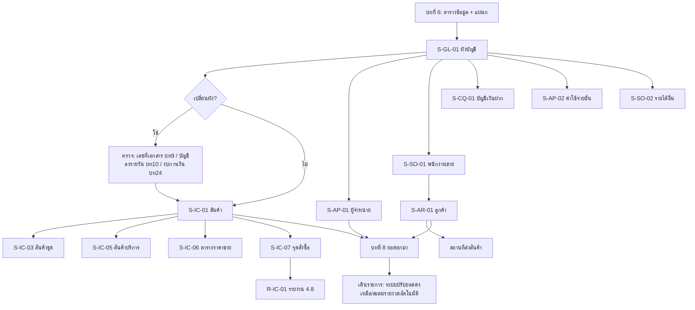

# บทที่ 7 การกำหนดแฟ้มข้อมูลหลัก
> อ้างอิงคู่มือ หน้า 93–138 (PDF p.109–154)

## ภาพรวม
- แฟ้มข้อมูลหลัก (master files) เป็นฐานข้อมูลที่จำเป็นต่อการป้อนรายการและผลการประมวลผล — เมื่อขายเชื่อ โปรแกรมตั้งลูกหนี้ บันทึกบัญชี และตัดสต๊อกให้อัตโนมัติจากข้อมูลในแฟ้มเหล่านี้ (หน้า 93)
- แฟ้มข้อมูลหลักทั้งหมด (หน้า 94): **ผังบัญชี, รายละเอียดสินค้า, สินค้าชุด, สินค้าบริการ, ผู้จำหน่าย, ลูกค้า, พนักงานขาย, บัญชีเงินฝาก, ค่าใช้จ่าย(อื่นๆ), รายได้(อื่นๆ)** และหน้าจอเสริมของสินค้า: ตารางราคาขาย, จุดสั่งซื้อ
- ข้อควรระวัง: เมื่อนำ master ไปใช้ในรายการแล้ว ไม่ควรย้อนแก้ เพราะการแก้ (เช่น หน่วยนับ ราคาขาย) **ไม่ย้อนไปแก้รายการซื้อ/ขายที่ทำไปแล้ว** (หน้า 93) — ยกเว้นการ "เปลี่ยนรหัส" ซึ่งระบบตามแก้ทุกรายการให้
- ทุกหน้าจอ master ใช้แถบเครื่องมือและฟังก์ชันร่วม: ค้นหา, หมายเหตุเพิ่มเติม, พิมพ์ซอง/สติ๊กเกอร์ (หน้า 95–97)

## นิยามฟิลด์ร่วม (ใช้หลายหน้าจอ) — หน้า 94
| ฟิลด์ | ค่า/รูปแบบ | กฎ |
|---|---|---|
| ประเภทราคา | 0 = ยกเว้นภาษี, 1 = ราคารวมภาษีแล้ว, 2 = ราคายังไม่รวมภาษี (แยก VAT) | ตัวอย่างราคา 100: ประเภท 0 → ไม่คำนวณ VAT; ประเภท 1 → VAT = 100×7/107 = 6.54; ประเภท 2 → VAT = 100×7/100 = 7 |
| ส่วนลด | จำนวนเงิน (1500.00), เปอร์เซ็นต์ (10%), ส่วนลดซ้อน (5+2%) | ป้อน `10+` แล้ว Enter โปรแกรมแปลงเป็น `10%` ให้อัตโนมัติ |
| ราคาขาย 1–5 | 5 ระดับราคา | แบ่งตามเครดิตลูกค้า (ราคา1 เงินสด, ราคา2 ทั่วไป) หรือตามประเภทลูกค้า (ตัวแทน/ประจำ/ปลีก) |

## ฟังก์ชันร่วมของหน้าจอแฟ้มข้อมูลหลัก

### S-MF-01 ค้นหาข้อมูลตามรหัส
- เมนู: ไอคอนค้นหาข้อมูล หรือ `<Alt+S>` ในทุกหน้าจอ master
- อ้างอิง: หน้า 95 (PDF p.111) — มีภาพหน้าจอ: ใช่ (รูปที่ 1 "ป้อนข้อมูลที่ต้องการค้นหา")
- ลักษณะ: dialog

| ส่วน/แท็บ | ฟิลด์ | ชนิดข้อมูล | บังคับ | ค่าเริ่มต้น/อ้างอิงจาก | คำอธิบาย/เงื่อนไข |
|---|---|---|---|---|---|
| – | รหัส(ลูกค้า/สินค้า/…) | text | ใช่ | – | ป้อนรหัสที่ต้องการ |

ปุ่ม/คำสั่ง: เมนูย่อยของไอคอนค้นหา (`<Ctrl+S>`) = ค้นหาตามชื่อ — ป้อนตัวอักษรขึ้นต้นบางส่วน กด Enter; ถ้าไม่พบตรงตัว โปรแกรมแจ้งไม่พบ แต่แสดงรายชื่อที่ขึ้นต้นด้วยตัวอักษรที่ป้อน (หน้า 95)
กฎทางธุรกิจ/เงื่อนไข: ใช้ได้ทุกหน้าจอ master (ผู้จำหน่าย ลูกค้า สินค้า ผังบัญชี ฯลฯ)

### S-MF-02 ป้อนหมายเหตุเพิ่มเติม
- เมนู: ไอคอน "เพิ่ม/แก้ไขหมายเหตุของเอกสาร" (Note) หรือ `<Alt+R>`
- อ้างอิง: หน้า 95–96 (PDF p.111–112) — มีภาพหน้าจอ: ใช่ (รูปที่ 2)
- ลักษณะ: dialog บรรทัดข้อความ แต่ละบรรทัดมีปุ่มแว่นขยาย (lookup)

| ส่วน/แท็บ | ฟิลด์ | ชนิดข้อมูล | บังคับ | ค่าเริ่มต้น/อ้างอิงจาก | คำอธิบาย/เงื่อนไข |
|---|---|---|---|---|---|
| – | บรรทัดหมายเหตุ 1..10 | text (+lookup) | ไม่ | – | สินค้า: 10 บรรทัด; ลูกค้า/ผู้จำหน่าย: 5 บรรทัด |

ปุ่ม/คำสั่ง: ตกลง (`<F9>` บันทึก), ยกเลิก (`<Esc>`), ลบบรรทัด, เพิ่มบรรทัด

### S-MF-03 พิมพ์รายชื่อลงซองจดหมาย/สติ๊กเกอร์
- เมนู: ไอคอนพิมพ์ (dropdown) บนหน้าจอ master
- อ้างอิง: หน้า 96–97 (PDF p.112–113) — มีภาพหน้าจอ: ใช่ (รูปที่ 3, 4)
- ลักษณะ: dropdown menu
- ตัวเลือก (จากหน้าจอลูกค้า): 1. ใบตรวจสอบรายละเอียด... [สันนิษฐาน—ภาพเล็ก], 2. จ่าหน้าซองจดหมาย, 3. พิมพ์ชื่อที่อยู่ลูกค้าลงสติ๊กเกอร์
- กฎ: ใช้ได้ 3 แฟ้ม — ลูกค้า, ผู้จำหน่าย, สินค้า (หน้า 97); ตัวอย่างผลพิมพ์ "กรุณาส่ง / คุณ… / บริษัท… / ที่อยู่ / รหัสไปรษณีย์"

### แถบเครื่องมือมาตรฐาน (ทุกหน้าจอ master)
เพิ่ม, แก้ไข (`<Alt+E>`), ลบ, ยกเลิก/ออก, บันทึก, รายการแรก/ก่อนหน้า/ถัดไป/สุดท้าย, ค้นหา (▼), พิมพ์ (▼), Note (`<Alt+R>`), OLD/NEW = เปลี่ยนรหัส (`<Ctrl+G>`)

---

## หน้าจอ — ผังบัญชี

### S-GL-01 กำหนดผังบัญชี
- เมนู: บัญชี > 2. ผังบัญชี
- อ้างอิง: หน้า 97–99 (PDF p.113–115) — มีภาพหน้าจอ: ใช่ (รูปที่ 5, 6, 7)
- ลักษณะ: tree (ซ้าย) + form (ขวา); ปุ่มเรียงลำดับเหนือ tree

| ส่วน/แท็บ | ฟิลด์ | ชนิดข้อมูล | บังคับ | ค่าเริ่มต้น/อ้างอิงจาก | คำอธิบาย/เงื่อนไข |
|---|---|---|---|---|---|
| Form | เลขที่บัญชี | text (masked) | ใช่ | รูปแบบจาก เริ่มระบบ 1.7 ระบบบัญชี | เช่น 1000-00; ควรสัมพันธ์กับหมวด ระดับ ประเภท |
| Form | ชื่อไทย | text | ใช่ [สันนิษฐาน] | – | ชื่อบัญชีภาษาไทย |
| Form | ชื่ออังกฤษ | text | ไม่ [สันนิษฐาน] | – | ชื่อบัญชีภาษาอังกฤษ |
| Form | บัญชีคุม | lookup | ใช่ ถ้าระดับ > 1 | ผังบัญชี | "เลขที่บัญชีคุมยอด" — บัญชีที่ไม่อยู่ระดับ 1 ต้องมีบัญชีคุมเสมอ |
| Form | ระดับบัญชี | number | ใช่ | 1 | เริ่มที่ 1 ลงไปตามลำดับ; บัญชีคุมต้องมีระดับสูงกว่า (ตัวเลขน้อยกว่า) บัญชีย่อยในกลุ่ม 1 ระดับ |
| Form | หมวดบัญชี | select | ใช่ | – | 1-สินทรัพย์, 2-หนี้สิน, 3-ทุนหรือส่วนของเจ้าของ, 4-รายได้, 5-ค่าใช้จ่าย |
| Form | ประเภท | select | ใช่ | – | 1-บัญชีคุม, 2-บัญชีย่อย [สันนิษฐานรหัส 2] |
| Form | แยกแผนก | check (Y/N) | ไม่ | N | Y = ลงบัญชีแยกแผนกอัตโนมัติ (บทที่ 6 หน้า 91) |
| Tree | รายการบัญชี | tree | – | – | ตัวอย่างระดับบนสุด: 1000-00 สินทรัพย์, 2000-00 หนี้สิน, 3000-00 ส่วนของผู้ถือหุ้น, 4000-00 รายได้, 5000-00 ค่าใช้จ่าย, 6000-00 ภาษีเงินได้นิติบุคคล, 9999-99 บัญชีพัก |

ปุ่ม/คำสั่ง: เรียงตามเลขที่บัญชี, เรียงตามชื่อบัญชี, แถบเครื่องมือมาตรฐาน, ไอคอน tree 3 ตัว (ขยาย/ยุบ/ย้อนกลับ [สันนิษฐาน]), OLD/NEW = เปลี่ยนรหัส `<Ctrl+G>`

กฎทางธุรกิจ/เงื่อนไข:
- ผู้แก้ไขควรเข้าใจระบบบัญชีของบริษัทอย่างดี (หมายเหตุ หน้า 98)
- โครงสร้างลำดับชั้น (รูปที่ 7): ระดับ1 สินทรัพย์ 1000-00 → ระดับ2 สินทรัพย์หมุนเวียน 1100-00 / สินทรัพย์ถาวร 1200-00 → ระดับ3 เงินสด 1110-00, ธนาคาร 1120-00, อาคาร 1210-00, ที่ดิน 1220-00, อุปกรณ์ 1230-00
- บัญชีคุมเก็บยอดรวมของบัญชีย่อยในกลุ่ม ใช้นำเสนองบการเงินแบบย่อ (หน้า 99)
- แก้เลขที่บัญชีได้ทันทีถ้ายังไม่ถูกใช้ในรายการ หรือไม่ใช่บัญชีคุม; ถ้าเป็นบัญชีคุม/ใช้แล้ว ต้องใช้ "เปลี่ยนรหัส" (S-GL-02) (หน้า 99)
- **ห้ามลบบัญชีคุม** จนกว่าจะลบบัญชีย่อยภายใต้ออกหมด; ตรวจสอบบัญชีย่อยได้จากรายงาน 5.5 รายละเอียดประกอบ (หน้า 100)
- หลังเปลี่ยนผังบัญชี ต้องตรวจเลขที่บัญชีใน: กำหนดเลขที่เอกสาร (บทที่ 9), กำหนดบัญชีเพื่อลงรายวัน (บทที่ 10), สร้างงบการเงิน (บทที่ 24) (หน้า 101)

ผลทางบัญชี/สต๊อก: เป็นโครงสร้างที่ทุกการลงบัญชีอ้างอิง; ยอดบัญชีคุม = ผลรวมบัญชีย่อย

### S-GL-02 เปลี่ยนเลขที่บัญชี
- เมนู: S-GL-01 > ไอคอน "เปลี่ยนรหัส" `<Ctrl+G>`
- อ้างอิง: หน้า 99–100 (PDF p.115–116) — มีภาพหน้าจอ: ใช่ (รูปที่ 8, 9)
- ลักษณะ: dialog

| ส่วน/แท็บ | ฟิลด์ | ชนิดข้อมูล | บังคับ | ค่าเริ่มต้น/อ้างอิงจาก | คำอธิบาย/เงื่อนไข |
|---|---|---|---|---|---|
| – | เลขที่บัญชี เดิม | text (read-only) | – | บัญชีที่เลือก | เช่น 1111-00 |
| – | เปลี่ยนเป็น | text (masked) | ใช่ | – | เลขที่บัญชีใหม่ |

ปุ่ม/คำสั่ง: ตกลง (`<F5>`), ยกเลิก
ผลทางบัญชี/สต๊อก: โปรแกรมตามแก้ **ทุกรายการ** ที่อ้างถึงเลขที่บัญชีเดิมให้เป็นเลขใหม่อัตโนมัติ (หน้า 100)

### R-GL-01 รายงานรายละเอียดประกอบ (ตัวอย่างใช้ตรวจก่อนลบบัญชีคุม)
- เมนู: รายงาน > 5.5 รายละเอียดประกอบ
- อ้างอิง: หน้า 100 (PDF p.116) — มีภาพหน้าจอ: ใช่ (รูปที่ 10, preview "TMP2")
- ลักษณะ: report preview — หัวรายงาน: ชื่อบริษัท, "รายละเอียดประกอบบัญชี 1000-00 สินทรัพย์", ณ วันที่, เลือกแผนก `*`, หน้า, วันที่พิมพ์
- คอลัมน์: เลขที่บัญชี, ชื่อบัญชี, ยอดคงเหลือ, ยอดเคลื่อนไหว; บรรทัดรวม "รวม n บัญชี"

---

## หน้าจอ — สินค้า

### S-IC-01 รายละเอียดสินค้า
- เมนู: สินค้า > 2. รายละเอียดสินค้า
- อ้างอิง: หน้า 101–105 (PDF p.117–121) — มีภาพหน้าจอ: ใช่ (รูปที่ 11, 12)
- ลักษณะ: header + tabs (4 แท็บ: รายละเอียด / คลังสินค้า `<F8>` / ล๊อตสินค้ายกมา `<F7>` / ฟิลด์เพิ่มเติม)

| ส่วน/แท็บ | ฟิลด์ | ชนิดข้อมูล | บังคับ | ค่าเริ่มต้น/อ้างอิงจาก | คำอธิบาย/เงื่อนไข |
|---|---|---|---|---|---|
| Header | รหัส | text (masked) | ใช่ | รูปแบบจาก เริ่มระบบ 1.3.1 รายละเอียดทั่วไป (ตัวอย่าง `99-!!!!-!!!!!!`) | เช่น 01-INTL-CL-600 |
| Header | บาร์โค้ด | text | ไม่ | – | คู่มือไม่อธิบาย |
| Header | ชื่อไทย | text(50) | ใช่ [สันนิษฐาน] | – | ยาว 50 ตัวอักษร |
| Header | ชื่ออังกฤษ | text(50) | ไม่ | – | ยาว 50 ตัวอักษร |
| รายละเอียด | หมวด | lookup | ไม่ [สันนิษฐาน] | ตาราง 22-หมวดสินค้า | แสดงชื่อหมวดข้างช่อง |
| รายละเอียด | กลุ่มบัญชี/ค (กลุ่มบัญชีสินค้า) | lookup | ใช่ [สันนิษฐาน] | เริ่มระบบ 1.3.2 กำหนดกลุ่มบัญชีสินค้า | กำหนดวิธีบันทึกบัญชีและวิธีคำนวณต้นทุน เช่น ST01 "( F-T ) สินค้าสำเร็จรูป FIFO" |
| รายละเอียด > หน่วยนับ | ย่อย | lookup | ใช่ | ตาราง 20-หน่วยนับ | หน่วยเล็กที่สุด (เช่น กล่อง, ด้าม) — สต๊อกเก็บเป็นหน่วยย่อย |
| รายละเอียด > หน่วยนับ | ใหญ่ + ตัวคูณให้เป็นหน่วยย่อย | lookup + number | ไม่ | – | เช่น หีบ = 10 กล่อง; ใช้ในรายงาน |
| รายละเอียด > หน่วยนับ | ซื้อ + ตัวคูณ | lookup + number | ไม่ | – | หน่วยที่ใช้ซื้อบ่อย; เปลี่ยนตอนเปิดบิลซื้อได้ ถ้าอนุญาตที่ เริ่มระบบ 1.5.1 |
| รายละเอียด > หน่วยนับ | ขาย + ตัวคูณ | lookup + number | ไม่ | – | หน่วยที่ใช้ขายบ่อย; เปลี่ยนตอนเปิดบิลขายได้ ถ้าอนุญาตที่ เริ่มระบบ 1.4.1 |
| รายละเอียด | สินค้าทดแทน | lookup | ไม่ | สินค้า | เตือนตอนเปิดบิลขายเมื่อสินค้าหมด และให้เลือกขายตัวทดแทน |
| รายละเอียด | ส/คติดลบได้? | select [Y,N,A] | ไม่ | – | Y = ยอมให้ติดลบ, N = ไม่ยอมทุกกรณี, A = ยอมได้เมื่อผู้มีอำนาจอนุมัติ |
| รายละเอียด | ราคาขาย 1–5 | money(3 ทศนิยม) | ไม่ | – | ดูนิยามราคาขาย 1–5 |
| รายละเอียด | บรรจุ/หีบห่อ | text | ไม่ | – | คู่มือไม่อธิบาย |
| รายละเอียด | ผู้จำหน่าย | lookup | ไม่ | ผู้จำหน่าย | อ้างอิงเท่านั้น (เช่น ผู้ให้ราคาดีที่สุด) ปล่อยว่างได้ |
| รายละเอียด | ประเภท VAT | select | ใช่ [สันนิษฐาน] | อัตราปกติ | อัตราปกติ / ได้รับยกเว้น VAT |
| รายละเอียด | ราคาทุนมาตรฐาน | money | ไม่ | – | ใช้เป็นต้นทุนเฉพาะเมื่อจ่ายสินค้าขณะสต๊อกไม่มี (ติดลบ); ขายปกติใช้ต้นทุนจากราคาซื้อ |
| รายละเอียด | หมายเหตุ | text | ไม่ | – | |
| รายละเอียด | ยอดคงเหลือ | number (read-only) | – | คำนวณ | ยกมา + รับ (ซื้อ/รับคืน/ผลิต) − จ่าย (ขาย/ส่งคืน/ตัดชำรุด) |
| รายละเอียด | ราคาต่อหน่วย | money (read-only) | – | คำนวณ | ต้นทุนต่อหน่วยของคงเหลือ |
| รายละเอียด | มูลค่าคงเหลือ | money (read-only) | – | คำนวณ | ต้นทุนรวมของคงเหลือ |
| คลังสินค้า <F8> | วันที่ซื้อล่าสุด | date (read-only) [สันนิษฐาน] | – | ระบบ | |
| คลังสินค้า <F8> | ราคาซื้อล่าสุด / หน่วย | money + lookup | – | ระบบ | |
| คลังสินค้า <F8> | ส่วนลดซื้อล่าสุด | text | – | ระบบ | |
| คลังสินค้า <F8> | จำนวนค้างรับ | number | – | ระบบ | (จากใบสั่งซื้อ [สันนิษฐาน]) |
| คลังสินค้า <F8> | วันที่ขายล่าสุด | date | – | ระบบ | |
| คลังสินค้า <F8> | ราคาขายล่าสุด / หน่วย | money + lookup | – | ระบบ | |
| คลังสินค้า <F8> | ส่วนลดขายล่าสุด | text | – | ระบบ | |
| คลังสินค้า <F8> | จำนวนค้างส่ง | number | – | ระบบ | (จากใบสั่งขาย [สันนิษฐาน]) |
| คลังสินค้า <F8> — grid | คลัง (รหัส+ชื่อย่อ) และยอดต่อคลัง | grid | – | ระบบสร้างคลังหลักอัตโนมัติเมื่อเพิ่มสินค้า | เพิ่มคลังอื่น: ดับเบิลคลิกบรรทัดว่าง |
| ล๊อตสินค้ายกมา <F7> | ยอดยกมารายล็อต | grid | – | – | สำหรับสินค้าที่คิดต้นทุนแบบเข้าก่อนออกก่อน (FIFO) — วิธีป้อนอยู่บทที่ 8 |
| ฟิลด์เพิ่มเติม | ฟิลด์ผู้ใช้กำหนด | ตามที่กำหนด | – | เริ่มระบบ 1.3.1 | แตกต่างตามการกำหนดของผู้ใช้ |

คลังสินค้า grid คอลัมน์ (หัวคอลัมน์ในภาพมืด อ่านไม่ออก — ค่าตัวอย่าง "01 สนญ. 10.0 33,000.00 16.0 3,375.000 54,000.00"): คลัง, ชื่อคลัง, [ยอดยกมา], [มูลค่ายกมา], ยอดคงเหลือ, [ราคาต่อหน่วย], [มูลค่าคงเหลือ], [ชั้นเก็บ] — [สันนิษฐาน ทั้งหมด]

ปุ่ม/คำสั่ง: แถบมาตรฐาน + Note + ไอคอน "CHECK" และ "RECAL COST" (คู่มือไม่อธิบาย — [สันนิษฐาน] ตรวจสอบ/คำนวณต้นทุนใหม่) + OLD/NEW เปลี่ยนรหัส

กฎทางธุรกิจ/เงื่อนไข:
- สินค้าติดลบควรใช้อย่างระมัดระวัง เพราะขณะติดลบไม่ทราบต้นทุนจริง (หน้า 102)
- ตัวอย่างหน่วย: แผ่นดิสก์ 1 หีบ = 10 กล่อง → หน่วยย่อย = กล่อง, หน่วยใหญ่ = หีบ, ตัวคูณ 10 (หน้า 103)

ผลทางบัญชี/สต๊อก: บัญชีที่ใช้ลงรายการของสินค้ามาจาก "กลุ่มบัญชีสินค้า" (เริ่มระบบ 1.3.2); ยอดคงเหลือ/ต้นทุน ปรับอัตโนมัติจากรายการรับ–จ่าย

### S-IC-02 เปลี่ยนรหัสสินค้า
- เมนู: สินค้า > 2 > ไอคอน "เปลี่ยนรหัส" `<Ctrl+G>`
- อ้างอิง: หน้า 105 (PDF p.121) — มีภาพหน้าจอ: ใช่ (รูปที่ 13, 14)
- ลักษณะ: dialog

| ส่วน/แท็บ | ฟิลด์ | ชนิดข้อมูล | บังคับ | ค่าเริ่มต้น/อ้างอิงจาก | คำอธิบาย/เงื่อนไข |
|---|---|---|---|---|---|
| – | รหัสสินค้า เดิม | text (read-only) | – | สินค้าปัจจุบัน | |
| – | เปลี่ยนเป็น | text (masked) | ใช่ | – | |

ปุ่ม/คำสั่ง: ตกลง (`<F5>`), ยกเลิก
กฎ: ถ้าสินค้ายังไม่เคยใช้ในรายการ แก้รหัสได้ทันทีด้วย "แก้ไขข้อมูล" `<Alt+E>`; ถ้าใช้แล้วต้องใช้หน้าจอนี้
ผลทางบัญชี/สต๊อก: ระบบตามแก้รหัสในทุกรายการ (บิลซื้อ บิลขาย ฯลฯ) อัตโนมัติ

### S-IC-03 รายละเอียดสินค้าชุด
- เมนู: สินค้า > 3. รายละเอียดสินค้าชุด
- อ้างอิง: หน้า 105–109 (PDF p.121–125) — มีภาพหน้าจอ: ใช่ (รูปที่ 15, 16)
- ลักษณะ: header + form + grid สินค้าประกอบ

| ส่วน/แท็บ | ฟิลด์ | ชนิดข้อมูล | บังคับ | ค่าเริ่มต้น/อ้างอิงจาก | คำอธิบาย/เงื่อนไข |
|---|---|---|---|---|---|
| Header | รหัส | text (masked) | ใช่ | รูปแบบเริ่มระบบ 1.3.1 | เช่น 80-PMTH-CL600 |
| Header | บาร์โค้ด | text | ไม่ | – | |
| Header | ชื่อไทย / ชื่ออังกฤษ | text(50) | ใช่/ไม่ | – | บรรทัดละ 50 ตัวอักษร |
| Form | ประเภท | select | ใช่ | – | 1=ชุดธรรมดา, 2=ชุดพิเศษ |
| Form | หมวดสินค้า | lookup | – | ตาราง 22 | เช่น 99 สินค้าชุด |
| Form | หน่วยนับ | lookup | – | ตาราง 20 | เช่น ชด ชุด |
| Form | ระดับสินค้า | lookup | – | ตาราง 23-ระดับสินค้า | ชุดที่ประกอบจากสินค้าทั่วไป = ระดับ 1 (เช่น "11 สินค้าประกอบ-ระดับ-1"); ชุดซ้อนชุดต้องใช้ระดับต่างกัน |
| Form | ราคาทุนมาตรฐาน | money | ไม่ | 0.00 | |
| Form | ราคาขาย 1–5 | money | ไม่ | – | ตัวอย่างราคา1 27,500 |
| Form | หมายเหตุ | text(50) | ไม่ | – | |
| Form | ประเภท VAT | select | – | ไม่ระบุ | ไม่ระบุ / อัตราปกติ / ได้รับยกเว้น |
| Form | สินค้าประกอบ … รายการ | number (read-only) | – | นับจาก grid | |
| Grid "รายการสินค้าประกอบ :- <F8>" | ที่ (ลำดับ) | number | ใช่ | – | ควรเริ่มที่ 1 (ตัวอย่างใช้ 10,20,30…); สูงสุด 999 รายการต่อ 1 ชุด |
| Grid | รหัสสินค้าประกอบ | lookup | ใช่ | สินค้า (เมนูสินค้า 2) | ต้องมีอยู่ในรายละเอียดสินค้าแล้ว |
| Grid | รายละเอียดสินค้า | text (read-only) | – | จากสินค้า | |
| Grid | จำนวน + หน่วย | number | ใช่ | – | |
| Grid | ราคาทุน | money | ไม่ | ราคาทุนมาตรฐานของสินค้าประกอบ | แก้ได้ |
| Grid | ราคาขาย | money | ไม่ | ราคาขายที่ 1 ของสินค้าประกอบ | แก้ได้ |
| Grid | ประเภท VAT | select | – | – | กล่าวในเนื้อหา (หน้า 108) แต่ไม่เห็นคอลัมน์ในภาพ [สันนิษฐาน] |

ปุ่ม/คำสั่ง: แถบมาตรฐาน, Note, ไอคอนระเบิด (ไม่อธิบาย), "COPY SET" = คัดลอกสินค้าชุด (S-IC-04), OLD/NEW

กฎทางธุรกิจ/เงื่อนไข:
- **ชุดธรรมดา (1)**: ไม่แยกขายส่วนประกอบได้; เมื่อขายชุด ทุกส่วนประกอบถูกตัดจำหน่าย; ฟอร์มพิมพ์แสดงเฉพาะรหัสชุด (หน้า 106)
- **ชุดพิเศษ (2)**: ขายเป็นชุดหรือเลือกขายเฉพาะบางรายการได้ขณะเปิดบิล (หน้า 106)
- ชุดธรรมดา: โปรแกรม **เฉลี่ยราคาทุน (ตอนซื้อ) และราคาขาย (ตอนขาย)** ให้ส่วนประกอบตามสัดส่วน (ราคา×จำนวน) — ตัวอย่างหน้า 108: A 1×10, B 2×20, C 1×30 รวม 80; ซื้อชุด 100 → A = 100×10/80 = 12.5, B = 100×40/80 = 50, C = 100×30/80 = 37.5; ราคาขายเฉลี่ยวิธีเดียวกันโดยใช้คอลัมน์ราคาขาย
- ถ้าราคาทุน/ราคาขายของส่วนประกอบเป็น 0.00 โปรแกรมใช้ราคาทุนมาตรฐานและราคาขายที่ 1 ของสินค้านั้นมาเฉลี่ยสัดส่วนแทน (หมายเหตุ หน้า 109)
- ชุดพิเศษ: ไม่เฉลี่ย; รายงานขายแสดงราคาขายที่รหัสชุด ส่วนประกอบไม่แสดงราคา; ถ้าไม่ได้ป้อนราคาขายที่ชุด จะใช้ราคาขายของส่วนประกอบในรายงานแทน (หน้า 109)
- ชุดซ้อนชุดต้องกำหนดระดับสินค้าต่างกัน (รูปที่ 15: ชุดจานช้อนเข้าชุดสดใส ระดับ 02 ← จาน 12", ชุดช้อนส้อม ระดับ 01 (← ช้อน, ส้อม), จาน 8")

ผลทางบัญชี/สต๊อก: ขายชุดธรรมดา → ตัดสต๊อกส่วนประกอบทุกตัว และกระจายรายได้/ต้นทุนตามสัดส่วน; ซื้อชุด → กระจายต้นทุนเข้าส่วนประกอบ

### S-IC-04 คัดลอกสินค้าชุด
- เมนู: S-IC-03 > ไอคอน "คัดลอกสินค้าชุด" (COPY SET)
- อ้างอิง: หน้า 109 (PDF p.125) — มีภาพหน้าจอ: ใช่ (รูปที่ 17, 18)
- ลักษณะ: dialog

| ส่วน/แท็บ | ฟิลด์ | ชนิดข้อมูล | บังคับ | ค่าเริ่มต้น/อ้างอิงจาก | คำอธิบาย/เงื่อนไข |
|---|---|---|---|---|---|
| – | รหัสสินค้าที่จะคัดลอก | text (read-only) | – | ชุดปัจจุบัน | |
| – | ตั้งรหัสใหม่เป็น | text | ใช่ | – | |

ปุ่ม/คำสั่ง: ตกลง (`<F5>`), ยกเลิก
ผล: สร้างชุดใหม่ที่มีรายละเอียดทุกอย่างเหมือนชุดเดิม ยกเว้นรหัส

### S-IC-05 รายละเอียดสินค้าบริการ
- เมนู: สินค้า > 4. รายละเอียดสินค้าบริการ
- อ้างอิง: หน้า 110–111 (PDF p.126–127) — มีภาพหน้าจอ: ใช่ (รูปที่ 19)
- ลักษณะ: form แบ่งกลุ่ม (header / รายละเอียด / ราคาขาย / บัญชี / ต้นทุนบริการ)

| ส่วน/แท็บ | ฟิลด์ | ชนิดข้อมูล | บังคับ | ค่าเริ่มต้น/อ้างอิงจาก | คำอธิบาย/เงื่อนไข |
|---|---|---|---|---|---|
| Header | รหัสสินค้า | text (masked) | ใช่ | รูปแบบเดียวกับสินค้า `99-!!!!-!!!!!!` | เช่น 93-4100-XX |
| Header | บาร์โค้ด | text | ไม่ | – | |
| Header | ชื่อไทย / ชื่ออังกฤษ | text(50) | ใช่/ไม่ | – | ไม่เกิน 50 ตัวอักษร |
| รายละเอียด | หมวดสินค้า | lookup | – | ตาราง 22 | เช่น บก สินค้าบริการ |
| รายละเอียด | หน่วยนับ | lookup | – | ตาราง 20 | เช่น คง ครั้ง |
| รายละเอียด | หมายเหตุ | text | ไม่ | – | |
| รายละเอียด | ประเภท VAT | select | – | ไม่ระบุ | |
| ราคา | ราคาขาย 1–5 | money | ไม่ | – | |
| บัญชี | บัญชีรายได้ | lookup | ใช่ [สันนิษฐาน] | ผังบัญชี | เครดิตเมื่อเปิดบิลขาย เช่น 4100-01 รายได้จากการขาย |
| บัญชี | บัญชีรับคืน | lookup | ไม่ | ผังบัญชี | เดบิตเมื่อเปิดใบลดหนี้; ว่าง = ใช้บัญชีรายได้แทน |
| ต้นทุนบริการ | ต้นทุนบริการต่อหน่วย | money | ไม่ | 0 | "(0=ไม่บันทึกบัญชี)" |
| ต้นทุนบริการ | Dr.บ/ช ต้นทุนบริการ | lookup | ถ้าต้นทุน>0 | ผังบัญชี | เช่น 5110-00 ต้นทุนสินค้าเพื่อขาย |
| ต้นทุนบริการ | Cr.บ/ช เงินเดือน/ค่าแรง | lookup | ถ้าต้นทุน>0 | ผังบัญชี | เช่น 5310-01 เงินเดือน |

ปุ่ม/คำสั่ง: แถบมาตรฐาน, Note, OLD/NEW
กฎทางธุรกิจ/เงื่อนไข: สินค้าบริการ **ไม่เกี่ยวกับระบบสต๊อก** (หน้า 110); ถ้าต้องการบันทึกต้นทุนค่าแรง ต้องป้อนทั้งต้นทุนต่อหน่วยและบัญชี 2 บัญชีให้ครบ มิฉะนั้นลงเฉพาะบัญชีรายได้ (หมายเหตุ หน้า 111)
ผลทางบัญชี/สต๊อก:
- เปิดบิลขาย: Cr บัญชีรายได้ (ฝั่งเดบิตเป็นลูกหนี้/เงินสดตามเอกสาร [สันนิษฐาน])
- ใบลดหนี้: Dr บัญชีรับคืน (หรือบัญชีรายได้ ถ้าว่าง)
- ถ้าต้นทุนบริการต่อหน่วย > 0: Dr ต้นทุนบริการ / Cr เงินเดือน/ค่าแรง (จำนวน = ต้นทุนต่อหน่วย × จำนวน [สันนิษฐาน])
- ไม่ตัดสต๊อก

### S-IC-06 ตารางราคาขาย
- เมนู: สินค้า > 5. ตารางราคาขาย
- อ้างอิง: หน้า 112–114 (PDF p.128–130) — มีภาพหน้าจอ: ใช่ (รูปที่ 20–23)
- ลักษณะ: header + "ตารางราคาหลัก" + grid "ตารางราคาเสริม <F8>"

| ส่วน/แท็บ | ฟิลด์ | ชนิดข้อมูล | บังคับ | ค่าเริ่มต้น/อ้างอิงจาก | คำอธิบาย/เงื่อนไข |
|---|---|---|---|---|---|
| Header | รหัสสินค้า + ชื่อไทย/อังกฤษ | lookup (read-only ชื่อ) | ใช่ | สินค้า | |
| Header | หน่วยย่อย | text (read-only) | – | จากสินค้า | |
| ตารางราคาหลัก | หน่วยขายเป็น | lookup | – | หน่วยขายของสินค้า | |
| ตารางราคาหลัก | ตัวคูณให้เป็นหน่วย | number | – | จากสินค้า | |
| ตารางราคาหลัก | ราคาที่ 1–5 | money | – | ราคาขาย 1–5 ในรายละเอียดสินค้า | |
| ราคาเสริม (grid) | หน่วยขาย (ปริมาณ + หน่วย) | number + lookup | ใช่ | – | ปริมาณขั้นต่ำ เช่น 10.0 ตัว ("ซื้อตั้งแต่ 10 ตัวขึ้นไป") |
| ราคาเสริม | ตัวคูณ | number | – | 1.0 | |
| ราคาเสริม | % | check (Y/ว่าง) | – | – | Y = ค่าที่ป้อนในราคาที่ 1–5 เป็นเปอร์เซ็นต์ส่วนลดจากราคาปกติ (เช่น 2.000 = ลด 2%) |
| ราคาเสริม | ราคาที่ 1–5 | money/percent | – | – | |
| ราคาเสริม | เริ่ม | date | – | – | วันเริ่มโปรโมชั่น |
| ราคาเสริม | สิ้นสุด | date | – | – | วันสิ้นสุดโปรโมชั่น |

ปุ่ม/คำสั่ง: แก้ไข, ยกเลิก, บันทึก, เลื่อน, ค้นหา, ไอคอนรายงาน, "Price Chang" (คู่มือไม่อธิบาย)
กฎทางธุรกิจ/เงื่อนไข: ใช้กำหนดเงื่อนไขราคาเพิ่ม — โปรโมชั่นช่วงเวลา, ส่วนลดตามปริมาณ, หน่วยขายอื่น (เช่น ขายเป็นโหล) (หน้า 112)
ตัวอย่าง (หน้า 112–114): 01-INTL-CL-600 ปกติ 7,500/7,900/8,400/8,500; ≥10 ตัว 7,000/7,400/7,900/8,000; ≥20 ตัว 6,800/7,200/7,700/7,800 ช่วง 08/06/43–16/06/43; 02-GIGA-6VX7 ≥15 ตัว ลด 2% ทุกระดับราคา ช่วง 25/06/43–30/06/43 (ภาพหน้าจอใช้ค่าต่างจากตาราง: 5.0 อัน, Y, 2.000, 01/02/47–10/02/47)

### S-IC-07 กำหนดจุดสั่งซื้อ
- เมนู: สินค้า > 8. กำหนดจุดสั่งซื้อ
- อ้างอิง: หน้า 114–116 (PDF p.130–132) — มีภาพหน้าจอ: ใช่ (รูปที่ 24)
- ลักษณะ: header + grid (ช่วงเวลา)

| ส่วน/แท็บ | ฟิลด์ | ชนิดข้อมูล | บังคับ | ค่าเริ่มต้น/อ้างอิงจาก | คำอธิบาย/เงื่อนไข |
|---|---|---|---|---|---|
| Header | รหัสสินค้า + ชื่อ | read-only | – | สินค้า | แสดงทุกสินค้าที่ป้อนไว้ในเมนูสินค้า 2 |
| Header | คลัง | read-only | – | คลังของสินค้า | กำหนดจุดสั่งซื้อแยกตามคลัง |
| Header | หน่วยนับ | read-only | – | – | |
| Header | ชั้นเก็บ | text | ไม่ | – | คู่มือไม่อธิบาย |
| Grid | เดือน/วัน | text (MM/DD) | ใช่ | – | วันที่เริ่มใช้ค่านี้; ก่อนวันนี้จะไม่มีการเตือน |
| Grid | จุดสั่งซื้อ | number | ใช่ | – | ยอดคงเหลือขั้นต่ำที่ต้องสั่งเพิ่ม |
| Grid | จำนวนสูงสุด | number | ไม่ | – | ยอดคงเหลือสูงสุด เตือนเมื่อเกิน (เงินทุนจม) |
| Grid | ซื้อครั้งละ | number | ไม่ | – | จำนวนสั่งเพิ่มเมื่อถึงจุดสั่งซื้อ |
| Grid | ยอดขายโครงการ | number | ไม่ | – | ปริมาณพิเศษที่คาดว่าต้องสั่งเพิ่ม (ประมูล, งานแสดงสินค้า) |

ปุ่ม/คำสั่ง: แก้ไข, ยกเลิก, บันทึก, เลื่อน, ค้นหา; ดับเบิลคลิกบรรทัดในตารางเพื่อป้อน
กฎทางธุรกิจ/เงื่อนไข: กำหนดได้หลายช่วงในปี (เช่น ปกติ 20 ตัว, ตั้งแต่ ธ.ค. 50 ตัว); การเตือน: เปรียบเทียบยอดคงเหลือกับจุดสั่งซื้อ หรือ ถ้ามียอดขายโครงการ เปรียบเทียบกับ (จุดสั่งซื้อ + ยอดขายโครงการ) (หมายเหตุ หน้า 116); พิมพ์ตรวจสอบได้ที่รายงาน 4.8.1

### R-IC-01 รายงานจุดสั่งซื้อ / สินค้าที่ถึงจุดสั่งซื้อ
- เมนู: รายงาน > 4. รายงานสินค้าคงคลัง > 8. จุดสั่งซื้อ (4.8.1 การกำหนดจุดสั่งซื้อ, 4.8.2 สินค้าที่ถึงจุดสั่งซื้อ แยกตามหมวดสินค้า, 4.8.3 … แยกตามผู้จำหน่าย, 4.8.4 สินค้าที่เหลือเกินจุดสูงสุด แยกตามหมวด)
- อ้างอิง: หน้า 116–117 (PDF p.132–133) — มีภาพหน้าจอ: ใช่ (รูปที่ 25)
- ลักษณะ: report-options (tree เมนูรายงานซ้าย + ตัวเลือกขวา)

| ส่วน/แท็บ | ฟิลด์ | ชนิดข้อมูล | บังคับ | ค่าเริ่มต้น/อ้างอิงจาก | คำอธิบาย/เงื่อนไข |
|---|---|---|---|---|---|
| ช่วงข้อมูล | สิ้นสุดวันที่ | date | ใช่ | – | |
| ช่วงข้อมูล | รหัสสินค้าจาก / ถึง | lookup | – | – | |
| ช่วงข้อมูล | คลังสินค้าจาก / ถึง | lookup | – | – | |
| ช่วงข้อมูล | หมวดสินค้าจาก / ถึง | lookup | – | – | |
| ช่วงข้อมูล | รหัสผู้จำหน่าย / ถึง | lookup | – | – | |
| ตัวเลือก | พิมพ์ประวัติซื้อ | check | – | ไม่เลือก | |
| การพิมพ์ | เริ่มพิมพ์หน้า / ถึง | number | – | 1 / 9,999 | |
| การพิมพ์ | จำนวนบรรทัด (บรรทัด/หน้า) | number | – | 39 | |

ปุ่ม/คำสั่ง: ออก, พิมพ์, แสดงจอ [สันนิษฐาน]
ต้นไม้เมนูรายงานที่เห็น: 1 รายงานลูกหนี้, 2 รายงานเจ้าหนี้, 3 รายงานเกี่ยวกับเช็ค, 4 รายงานสินค้าคงคลัง (1 รายงานสินค้าและวัตถุดิบ, 2 สินค้าคงเหลือ, 3 สรุปยอดเคลื่อนไหวสินค้า, 4 รายละเอียดสินค้า, 5 รายงานราคาขายสินค้า, 6 รายงานรายการประจำวันสินค้า, 7 รายงานสำหรับระบบเข้าก่อนออกก่อน, 8 จุดสั่งซื้อ, 9 สินค้าไม่เคลื่อนไหว, A สินค้าไม่มีการขาย), 5 รายงานบัญชี, 6 รายงานภาษี, 7 รายงานวิเคราะห์การขาย, 8 รายงานวิเคราะห์การซื้อ, 9 สร้างรายงานด้วยตนเอง

---

## หน้าจอ — ผู้จำหน่าย / ลูกค้า / พนักงานขาย

### S-AP-01 รายละเอียดผู้จำหน่าย
- เมนู: ซื้อ > 6. รายละเอียดผู้จำหน่าย
- อ้างอิง: หน้า 117–123 (PDF p.133–139) — มีภาพหน้าจอ: ใช่ (รูปที่ 26–29)
- ลักษณะ: header + tabs (5 แท็บ: รายละเอียด / ตารางสะสมยอดเงิน งวด 1-12 / ตารางสะสมยอดเงิน งวด 13-24 / รายการเช็คจ่ายที่ยังไม่ผ่านบัญชี / รายการบิลที่ค้างชำระ)

| ส่วน/แท็บ | ฟิลด์ | ชนิดข้อมูล | บังคับ | ค่าเริ่มต้น/อ้างอิงจาก | คำอธิบาย/เงื่อนไข |
|---|---|---|---|---|---|
| Header | รหัสผู้จำหน่าย | text | ใช่ | – | ตัวเลข/ตัวอักษร ควรค้นหาง่ายหรือสื่อประเภท (ประจำ/ชั่วคราว/ต่างประเทศ, เจ้าหนี้การค้า vs หนี้อื่น) |
| Header | คำนำหน้าชื่อ | lookup | ไม่ | – | บริษัท, ห้างหุ้นส่วน, ร้าน; ว่างได้ |
| Header | ชื่อ | text(60) | ใช่ | – | |
| รายละเอียด | ที่อยู่ (บรรทัด 1–2) | text(50) ×2 | ไม่ | – | 2 บรรทัด บรรทัดละ 50 (ภาพมีบรรทัดที่ 3 สั้น) |
| รายละเอียด | รหัสไปรษณีย์ | text | ไม่ | – | |
| รายละเอียด | โทรศัพท์ | text | ไม่ | – | |
| รายละเอียด | ชื่อผู้ติดต่อ | text | ไม่ | – | ผู้ติดต่อในการซื้อ |
| รายละเอียด | หมายเหตุ | text + lookup | ไม่ | – | |
| รายละเอียด | เลขประจำตัวผู้เสียภาษี | text(13) | ไม่ | – | ใช้ออกหนังสือรับรองหัก ณ ที่จ่าย |
| รายละเอียด | สาขา# | number | ไม่ | 0 | 0 = สำนักงานใหญ่, −1 = ว่าง/ไม่ระบุ, อื่น = ลำดับสาขา |
| รายละเอียด | ประเภทเงินได้ที่จ่าย | lookup | ไม่ | – | เช่น ค่านายหน้า ค่าจ้างทำของ ค่าโฆษณา; ว่างได้แล้วป้อนตอนออกหนังสือรับรอง |
| รายละเอียด | อัตราภาษีที่หัก | percent | ไม่ | 0.00 | ตามกฎหมาย ขึ้นกับประเภทเงินได้ |
| รายละเอียด | หมวดภาษีหัก ณ ที่จ่าย | lookup | ไม่ | ตาราง 55 | เช่น ภงด.1, ภงด.3, ภงด.53 |
| รายละเอียด | เงื่อนไขการหักภาษี | number | ไม่ | 1 | 1 = หักภาษี ณ ที่จ่าย; อื่น ๆ: ออกให้ตลอดไป / ออกให้ครั้งเดียว (รหัสค่า 2/3 ไม่ระบุ [สันนิษฐาน]) |
| รายละเอียด | ประเภทผู้จำหน่าย | lookup | ไม่ | ตาราง 46 | เช่น 00 ผู้จำหน่ายประจำ; ใช้แยกรายงานเจ้าหนี้/วิเคราะห์การซื้อ |
| รายละเอียด | เลขที่บัญชี | lookup | ใช่ [สันนิษฐาน] | ผังบัญชี | เช่น 2120-01 เจ้าหนี้การค้า; ใช้ลงสมุดรายวัน; แยกบัญชีต่อรายหรือใช้ร่วมก็ได้; ใส่บัญชีหนี้สินอื่น (ค่าใช้จ่ายค้างจ่าย, เงินกู้) ได้ |
| รายละเอียด | ประเภทราคา | select | – | 2 - แยก VAT | 0/1/2 (ดูนิยามร่วม) |
| รายละเอียด | ภาษีมูลค่าเพิ่ม | percent | – | 7.00 | |
| รายละเอียด | ขนส่งโดย | lookup | ไม่ | ตาราง 41 | |
| รายละเอียด | เครดิต (วัน) | number | ไม่ | – | แสดงอัตโนมัติเมื่อซื้อจากผู้จำหน่ายนี้ |
| รายละเอียด | เงื่อนไขการชำระเงิน | text + lookup | ไม่ | – | เช่น 2/10, n/30 — ไม่นำไปคำนวณ ใช้แสดงในฟอร์ม |
| รายละเอียด | ส่วนลด | text | ไม่ | – | ส่วนลดการค้าที่ได้รับ แสดงอัตโนมัติตอนซื้อ |
| รายละเอียด | วงเงินอนุมัติ | money | ไม่ | 0.00 | ซื้อเกินวงเงิน → เตือนขณะซื้อ |
| รายละเอียด | ยอดต้นปี | money (read-only) | – | จาก การเงิน 2.5 บันทึกรายการเจ้าหนี้คงค้าง-ยกมา | |
| รายละเอียด | วันที่บิลล่าสุด (วันที่ซื้อล่าสุด) | date (read-only) | – | ระบบ | แก้ไม่ได้ |
| รายละเอียด | ยอดคงเหลือ | money (read-only) | – | คำนวณ | ยกมา + ซื้อเชื่อ + เพิ่มหนี้ − ลดหนี้/ส่งคืน − จ่ายชำระ |
| รายละเอียด | เช็คจ่ายล่วงหน้า | money (read-only) | – | คำนวณ | ยอดเช็คจ่ายที่ยังไม่ผ่านบัญชี |
| งวด 1-12 / 13-24 | ยอดคงเหลือ, เช็คจ่ายล่วงหน้า | money (read-only) | – | – | |
| งวด 1-12 / 13-24 — grid "ตารางสะสมยอดเงิน (ใช้สำหรับออกรายงานสถานะเจ้าหนี้ จึงเป็นยอดรวม VAT)" | งวด, ซื้อสด, ซื้อเชื่อ, เพิ่มหนี้, ลดหนี้, จ่ายชำระหนี้ | grid read-only | – | ระบบ | |
| เช็คจ่ายที่ยังไม่ผ่านบัญชี — grid | วันที่, เลขที่เช็ค, ธนาคาร, จำนวนเงิน, ยอดคงเหลือ, สถานะเช็ค | grid read-only | – | ระบบ | เช็คที่จ่ายแต่ยังไม่ถูกตัดบัญชีจากธนาคาร |
| บิลที่ค้างชำระ — grid | [วันครบกำหนด], [เลขที่เอกสาร], วันที่, เลขที่บิล, จำนวนเงิน, ยอดคงเหลือ, อ้างอิง | grid read-only | – | ระบบ | หัวคอลัมน์ 2 ช่องแรกอ่านไม่ชัด [สันนิษฐาน]; ตัวอย่าง CP0000001, GR0000001, RR0000002 |

ปุ่ม/คำสั่ง: แถบมาตรฐาน, Note (หมายเหตุ 5 บรรทัด), พิมพ์ซอง/สติ๊กเกอร์, OLD/NEW
กฎทางธุรกิจ/เงื่อนไข: วงเงินอนุมัติ → เตือนเมื่อซื้อเกิน; เครดิต/ส่วนลด/ประเภทราคา เป็นค่า default ตอนเปิดเอกสารซื้อ
ผลทางบัญชี/สต๊อก: "เลขที่บัญชี" คือบัญชีเจ้าหนี้ที่ใช้ลงสมุดรายวันเมื่อมีรายการซื้อเชื่อ/จ่ายชำระ (ฝั่ง Cr เจ้าหนี้ เมื่อซื้อเชื่อ [สันนิษฐานรายละเอียด])

### S-AR-01 รายละเอียดลูกค้า
- เมนู: [ไม่ระบุในคู่มือ — สันนิษฐาน ขาย > รายละเอียดลูกค้า]
- อ้างอิง: หน้า 123–130 (PDF p.139–146) — มีภาพหน้าจอ: ใช่ (รูปที่ 30–35)
- ลักษณะ: header + tabs (7 แท็บ: รายละเอียด / ตารางสะสมยอดเงิน งวด 1-12 / ตารางสะสมยอดเงิน งวด 13-24 / เช็คที่ยังไม่ผ่านบัญชี / ประวัติเช็คคืน / บิลที่ค้างชำระ / สถานที่ส่งสินค้า)

| ส่วน/แท็บ | ฟิลด์ | ชนิดข้อมูล | บังคับ | ค่าเริ่มต้น/อ้างอิงจาก | คำอธิบาย/เงื่อนไข |
|---|---|---|---|---|---|
| Header | รหัสลูกค้า | text | ใช่ | – | สื่อประเภท (ทั่วไป/ตัวแทน/ปลีก/ส่ง) หรือเขต (ภาค/จังหวัด) หรือแยกลูกหนี้การค้า vs อื่น |
| Header | คำนำหน้าชื่อ | lookup | ไม่ | – | บริษัท/ห้างหุ้นส่วน/ร้าน |
| Header | ชื่อ | text(60) | ใช่ | – | |
| รายละเอียด | ที่อยู่ | text 3 บรรทัด (50, 50, 30) | ไม่ | – | |
| รายละเอียด | รหัสไปรษณีย์ | text | ไม่ | – | |
| รายละเอียด | โทรศัพท์ | text | ไม่ | – | ตัวอย่างรวม Fax ไว้ในช่องเดียว |
| รายละเอียด | ชื่อผู้ติดต่อ | text | ไม่ | – | |
| รายละเอียด | หมายเหตุ | text + lookup | ไม่ | – | เช่น "วางบิลทุกวันที่ 15 และ 30 ของเดือน" |
| รายละเอียด | สถานะ | select | – | Active | เห็นในภาพ ไม่อธิบาย (ค่าอื่น [สันนิษฐาน] Inactive) |
| รายละเอียด | เลขประจำตัวผู้เสียภาษี | text(13) | ไม่ | – | |
| รายละเอียด | สาขา# | number | ไม่ | 0 | 0 = สนญ., −1 = ว่าง |
| รายละเอียด | ประเภทลูกค้า | lookup | ไม่ | ตาราง 45 | เช่น 00 ลูกค้าประจำ |
| รายละเอียด | เลขที่บัญชี | lookup | ใช่ [สันนิษฐาน] | ผังบัญชี | เช่น 1130-01 ลูกหนี้การค้า |
| รายละเอียด | พนักงานขาย | lookup | ไม่ | พนักงานขาย | ผู้ดูแลลูกค้า ใช้สรุปยอดขายรายพนักงาน |
| รายละเอียด | เขตการขาย | lookup | ไม่ | ตาราง 40 | |
| รายละเอียด | ขนส่งโดย | lookup | ไม่ | ตาราง 41 | |
| รายละเอียด | เครดิต (วัน) | number | ไม่ | – | ใช้คำนวณวันครบกำหนดในบิลขายอัตโนมัติ |
| รายละเอียด | เงื่อนไขการชำระ | text + lookup | ไม่ | – | 2/10, n/30 (ไม่คำนวณ) |
| รายละเอียด | ตารางราคา | select | – | ราคาขายที่ 1 | เลือกราคาขาย 1–5 สำหรับลูกค้านี้ |
| รายละเอียด | ส่วนลด | text | ไม่ | – | แสดงทุกครั้งที่ขายให้ลูกค้านี้ |
| รายละเอียด | วงเงินอนุมัติ | money | ไม่ | – | ขายเกิน → เตือนทันทีขณะเปิดบิลขาย |
| รายละเอียด | ยอดต้นปี | money (read-only) | – | การเงิน 1.6 บันทึกรายการลูกหนี้คงค้าง-ยกมา | |
| รายละเอียด | วันที่บิลล่าสุด | date (read-only) | – | ระบบ | ใบกำกับ/บิลขายใบล่าสุด |
| รายละเอียด | ยอดคงเหลือ | money (read-only) | – | คำนวณ | ยกมา + ขายเชื่อ + เพิ่มหนี้ − ลดหนี้/รับคืน − รับชำระ |
| รายละเอียด | เช็ครับล่วงหน้า | money (read-only) | – | คำนวณ | เช็ครับที่ยังไม่ผ่านบัญชี |
| งวด 1-12 / 13-24 — grid | งวด, ขายสด, ขายเชื่อ, เพิ่มหนี้, ลดหนี้, รับชำระหนี้ | read-only | – | ระบบ | "ใช้สำหรับออกรายงานสถานะลูกหนี้ จึงเป็นยอดรวม VAT" |
| เช็คที่ยังไม่ผ่านบัญชี — grid | วันที่, เลขที่เช็ค, ธนาคาร (รหัส+ชื่อย่อ), จำนวนเงิน, ยอดคงเหลือ, สถานะเช็ค (รหัส+ชื่อ) | read-only | – | ระบบ | ตัวอย่าง 16/01/46 QR5668712 01 BBL 10,000.00 −1.00 01 รอเรียกเก็บ |
| ประวัติเช็คคืน — grid | วันที่, เลขที่เช็ค, ธนาคาร, จำนวนเงิน, ยอดคงเหลือ, สถานะเช็ค | read-only | – | ระบบ | เช็คที่ธนาคารปฏิเสธการจ่าย (เช็คเด้ง) |
| บิลที่ค้างชำระ — grid | [วันครบกำหนด], [เลขที่บิล], วันที่, พนักงานขาย, จำนวนเงิน, ยอดคงเหลือ, [อ้างอิง] | read-only | – | ระบบ | จำนวนเงิน = ยอดตามใบกำกับเต็ม; ยอดคงเหลือ = ยอดค้าง; หัวคอลัมน์บางช่องไม่ชัด |
| สถานที่ส่งสินค้า | ที่อยู่/โทรศัพท์/ผู้ติดต่อ/หมายเหตุ/เลขผู้เสียภาษี (ของลูกค้า) | read-only [สันนิษฐาน] | – | จากแท็บรายละเอียด | |
| สถานที่ส่งสินค้า — grid "รายการสถานที่ส่งสินค้า <Ctrl+F7>" | รหัส, ที่อยู่, โทร., ชื่อผู้ติดต่อ | grid แก้ไขได้ | – | – | รหัสสถานที่ส่ง เช่น "สบ01"; เลือกนำไปแสดงในใบกำกับภาษีได้ |

ปุ่ม/คำสั่ง: แถบมาตรฐาน, Note (5 บรรทัด), พิมพ์ (ใบตรวจสอบ/จ่าหน้าซอง/สติ๊กเกอร์), OLD/NEW; ลูกศร ◄► เลื่อนแท็บ
กฎทางธุรกิจ/เงื่อนไข:
- ค่าใน master (พนักงานขาย เขต ราคาขาย ฯลฯ) เป็นค่า default — เปลี่ยนได้ขณะทำเอกสาร (หมายเหตุ หน้า 127)
- ต้องบันทึกลูกค้าก่อน จึงเพิ่มสถานที่ส่งของได้ (หน้า 127)
- วงเงินอนุมัติ → เตือนขณะเปิดบิลขาย
ผลทางบัญชี/สต๊อก: "เลขที่บัญชี" = บัญชีลูกหนี้ที่ใช้ลงสมุดรายวัน (Dr ลูกหนี้ เมื่อขายเชื่อ [สันนิษฐานรายละเอียด])

### S-SO-01 รายละเอียดพนักงานขาย
- เมนู: ขาย > 8. รายละเอียดพนักงานขาย
- อ้างอิง: หน้า 130–133 (PDF p.146–149) — มีภาพหน้าจอ: ใช่ (รูปที่ 36, 37)
- ลักษณะ: header + tabs (รายละเอียดทั่วไป / กำหนดเป้าการขาย)

| ส่วน/แท็บ | ฟิลด์ | ชนิดข้อมูล | บังคับ | ค่าเริ่มต้น/อ้างอิงจาก | คำอธิบาย/เงื่อนไข |
|---|---|---|---|---|---|
| Header | รหัสพนักงานขาย | text | ใช่ | – | ตัวเลข/ตัวอักษร หรือชื่อย่อ |
| Header | ชื่อพนักงานขาย | text(45) | ใช่ | – | |
| รายละเอียดทั่วไป | ตำแหน่ง | text | ไม่ | – | |
| รายละเอียดทั่วไป | ประเภท | lookup | ไม่ | ตาราง 47 | ประจำ/ชั่วคราว |
| รายละเอียดทั่วไป | เขตการขาย | lookup | ไม่ | ตาราง 40 | ว่างได้ถ้าดูแลหลายเขต |
| รายละเอียดทั่วไป | อัตราค่าคอมฯ | percent | ไม่ | 0.00 | % คอมมิชชั่นเมื่อขายได้ |
| รายละเอียดทั่วไป | ที่อยู่ (3 บรรทัด) + รหัสไปรษณีย์ | text | ไม่ | – | |
| รายละเอียดทั่วไป | โทร. | text | ไม่ | – | |
| รายละเอียดทั่วไป | เลขประจำตัวผู้เสียภาษี | text | ไม่ | – | |
| รายละเอียดทั่วไป | เลขที่บัตรประกันสังคม | text | ไม่ | – | |
| กำหนดเป้าการขาย — grid | งวด 1–12 / เป้าการขาย, งวด 13–24 / เป้าการขาย, รวม | money | ไม่ | 0.00 | 24 เดือนนับจากวันเริ่มต้นใน เริ่มระบบ 3 รอบบัญชี; หมายเหตุบนจอ: "พิมพ์รายงานเปรียบเทียบกับยอดขายที่ เมนูรายงาน 774" |

ปุ่ม/คำสั่ง: แถบมาตรฐาน, OLD/NEW
ผลทางบัญชี/สต๊อก: ไม่มี — ใช้ในรายงานเปรียบเทียบเป้า vs ยอดขายจริง

---

## หน้าจอ — การเงิน / ค่าใช้จ่าย / รายได้อื่น

### S-CQ-01 รายละเอียดบัญชีเงินฝาก
- เมนู: การเงิน > 3.7 รายละเอียดบัญชีเงินฝาก
- อ้างอิง: หน้า 133–134 (PDF p.149–150) — มีภาพหน้าจอ: ใช่ (รูปที่ 38)
- ลักษณะ: form

| ส่วน/แท็บ | ฟิลด์ | ชนิดข้อมูล | บังคับ | ค่าเริ่มต้น/อ้างอิงจาก | คำอธิบาย/เงื่อนไข |
|---|---|---|---|---|---|
| – | รหัสบัญชี | text | ใช่ | – | เช่น C1 = กระแสรายวัน (Current Account) บัญชีที่ 1 |
| – | ชื่อบัญชีเงินฝาก | text | ใช่ [สันนิษฐาน] | – | ตามสมุดบัญชี |
| – | สาขา | text | ไม่ | – | |
| – | สมุดบัญชีเลขที่ | text | ไม่ | – | |
| – | ชื่อย่อ | text | ไม่ | – | ชื่อย่อธนาคาร เช่น BBL, TFB ใช้ในรายงาน/ฟอร์ม |
| – | เลขที่บัญชี | lookup | ใช่ | ผังบัญชี | ต้องสัมพันธ์กับประเภทบัญชี (ฝากประจำ → บัญชีเงินฝากประจำ) ใช้ลงสมุดรายวัน |

ปุ่ม/คำสั่ง: แถบมาตรฐาน, ค้นหา, พิมพ์ (พิมพ์รายการเคลื่อนไหวบัญชี R-CQ-01), ไอคอนถังขยะขวาสุด (ไม่อธิบาย)
กฎ: ใช้กับรายการฝาก-ถอน, รับ-จ่ายเช็ค, โอนเงินระหว่างบัญชี, โอนชำระหนี้
ผลทางบัญชี/สต๊อก: "เลขที่บัญชี" เป็นบัญชี Dr/Cr ในสมุดรายวันเมื่อมีรายการผ่านบัญชีเงินฝากนี้

### R-CQ-01 รายการเคลื่อนไหวบัญชีเงินฝาก (ตรวจกับ Bank Statement)
- เมนู: S-CQ-01 > ไอคอนพิมพ์เอกสาร
- อ้างอิง: หน้า 134 (PDF p.150) — มีภาพหน้าจอ: ใช่ (รูปที่ 39, preview "TMP3")
- ลักษณะ: report preview — หัว: ชื่อบริษัท, "รายการเคลื่อนไหวบัญชีธนาคาร" + ชื่อบัญชี, สมุดบัญชีเลขที่, เริ่มพิมพ์จากวันที่…ถึง…
- คอลัมน์: วันที่, MNE (รหัสย่อ), เลขที่, ยอดถอน, ยอดฝาก, ยอดคงเหลือ, สถานะเช็ค, หมายเหตุ; บรรทัดแรก "ยอดยกมา"

### S-AP-02 รายละเอียดค่าใช้จ่ายอื่นๆ
- เมนู: ซื้อ > 7. รายละเอียดค่าใช้จ่ายอื่นๆ
- อ้างอิง: หน้า 134–136 (PDF p.150–152) — มีภาพหน้าจอ: ใช่ (รูปที่ 40)
- ลักษณะ: header + tabs (รายละเอียด / ฟิลด์เพิ่มเติม)

| ส่วน/แท็บ | ฟิลด์ | ชนิดข้อมูล | บังคับ | ค่าเริ่มต้น/อ้างอิงจาก | คำอธิบาย/เงื่อนไข |
|---|---|---|---|---|---|
| Header | รหัสค่าใช้จ่าย | text (masked) | ใช่ | รูปแบบเดียวกับรหัสสินค้า `99-!!!!-!!!!!!` | เช่น 95-5200-02 |
| Header | บาร์โค้ด | text | ไม่ | – | |
| Header | ชื่อไทย / ชื่ออังกฤษ | text | ใช่/ไม่ | – | เช่น ค่าทำป้ายโฆษณา / Advertising Expenses |
| รายละเอียด | หมวดสินค้า | lookup | – | ตาราง 22 | เช่น คช ค่าใช้จ่ายอื่นๆ |
| รายละเอียด | หน่วยนับ | lookup | ไม่ | ตาราง 20 | |
| รายละเอียด | ประเภท VAT | select | – | ไม่ระบุ | อัตราปกติ / ได้รับยกเว้น VAT |
| รายละเอียด | จำนวนเงิน | money | ไม่ | 0.000 | ป้อนถ้าจ่ายเท่ากันทุกครั้ง; ว่างแล้วป้อนตอนบันทึก |
| รายละเอียด | หมายเหตุ | text | ไม่ | – | |
| รายละเอียด | บ/ช ค่าใช้จ่าย | lookup | ใช่ | ผังบัญชี | เช่น 5200-02 ค่าโฆษณา |
| ฟิลด์เพิ่มเติม | ฟิลด์ผู้ใช้กำหนด | – | – | – | |

ผลทางบัญชี/สต๊อก: เมื่อบันทึกในเมนู "บันทึกค่าใช้จ่ายอื่นๆ" → Dr บ/ช ค่าใช้จ่าย (ฝั่งเครดิตขึ้นกับเอกสาร — ไม่อยู่ในบทนี้) ; ไม่กระทบสต๊อก

### S-SO-02 รายละเอียดรายได้อื่นๆ
- เมนู: ขาย > 7. รายละเอียดรายได้อื่นๆ
- อ้างอิง: หน้า 136–138 (PDF p.152–154) — มีภาพหน้าจอ: ใช่ (รูปที่ 41)
- ลักษณะ: form แบ่งกลุ่ม (เหมือนสินค้าบริการ)

| ส่วน/แท็บ | ฟิลด์ | ชนิดข้อมูล | บังคับ | ค่าเริ่มต้น/อ้างอิงจาก | คำอธิบาย/เงื่อนไข |
|---|---|---|---|---|---|
| Header | รหัสรายได้ | text (masked) | ใช่ | รูปแบบเดียวกับรหัสสินค้า | เช่น 94-4100-02 |
| Header | บาร์โค้ด | text | ไม่ | – | |
| Header | ชื่อไทย / ชื่ออังกฤษ | text | ใช่/ไม่ | – | ค่าบริการซ่อมอุปกรณ์คอมพิวเตอร์ / Computer Repairing Service Charge |
| รายละเอียด | หมวดสินค้า | lookup | – | ตาราง 22 | เช่น รด รายได้อื่น ๆ |
| รายละเอียด | หน่วยนับ | lookup | ไม่ | ตาราง 20 | |
| รายละเอียด | ราคาขาย (ภาพ) / จำนวนเงิน (เนื้อหา) | money | ไม่ | 0.000 | ป้อนถ้ารับเท่ากันทุกครั้ง |
| รายละเอียด | ประเภท VAT | select | – | ไม่ระบุ | |
| รายละเอียด | หมายเหตุ | text | ไม่ | – | |
| บัญชี | บัญชีรายได้ | lookup | ใช่ | ผังบัญชี | เช่น 4100-02 รายได้จากการให้บริการ — เครดิตเมื่อบันทึกรายได้อื่น |
| บัญชี | บัญชีลดหนี้ (ภาพ) / บัญชีรับคืน (เนื้อหา) | lookup | ไม่ | ผังบัญชี | เดบิตเมื่อเปิดใบลดหนี้; ว่าง = ใช้บัญชีรายได้ |
| ต้นทุนบริการ | ต้นทุนบริการต่อหน่วย | money | ไม่ | 0 | 0 = ไม่บันทึกบัญชี |
| ต้นทุนบริการ | Dr.บ/ช ต้นทุนบริการ | lookup | ถ้าต้นทุน>0 | ผังบัญชี | |
| ต้นทุนบริการ | Cr.บ/ช เงินเดือน/ค่าแรง | lookup | ถ้าต้นทุน>0 | ผังบัญชี | |

กฎ: รหัสรายได้อื่นเหมือนสินค้าบริการ การลงบัญชีคล้ายกัน ต่างกันที่หน้าจอ "ขาย > 5. บันทึกรายได้อื่น ๆ" จะไม่เห็นรหัสสินค้าบริการ (หมายเหตุ หน้า 138)
ผลทางบัญชี/สต๊อก: Cr บัญชีรายได้; ลดหนี้ Dr บัญชีรับคืน/ลดหนี้; ถ้ามีต้นทุนบริการ Dr ต้นทุนบริการ / Cr เงินเดือน/ค่าแรง; ไม่กระทบสต๊อก

## ลำดับการใช้งาน
1. ตรวจ/ปรับผังบัญชี (S-GL-01) — หลังเปลี่ยนผังต้องตรวจเลขที่เอกสาร, บัญชีลงรายวัน, งบการเงิน
2. กำหนดสินค้า (S-IC-01) → สินค้าชุด (S-IC-03) → สินค้าบริการ (S-IC-05)
3. ตั้งตารางราคาขายพิเศษ (S-IC-06) และจุดสั่งซื้อ (S-IC-07) ตามต้องการ
4. กำหนดผู้จำหน่าย (S-AP-01), พนักงานขาย (S-SO-01), ลูกค้า (S-AR-01 — ต้องมีพนักงานขายก่อนเพื่อ lookup), สถานที่ส่งของ
5. กำหนดบัญชีเงินฝาก (S-CQ-01), ค่าใช้จ่ายอื่น (S-AP-02), รายได้อื่น (S-SO-02)
6. ป้อนยอดยกมา (บทที่ 8) → ระบบคำนวณยอดคงเหลือ/สะสมใน master อัตโนมัติ

## ข้อมูลที่เกี่ยวข้อง
- **Account** (เลขที่บัญชี PK, ชื่อไทย, ชื่ออังกฤษ, บัญชีคุม FK→Account, ระดับ, หมวด 1–5, ประเภท คุม/ย่อย, แยกแผนก) — self-reference 1:n
- **Product** (รหัส PK, บาร์โค้ด, ชื่อไทย/อังกฤษ, ชนิด [สินค้า/ชุด/บริการ/ค่าใช้จ่าย/รายได้อื่น — ใช้รูปแบบรหัสเดียวกัน; แยกด้วย prefix เช่น 80-, 93-, 94-, 95- [สันนิษฐาน]], หมวด FK, กลุ่มบัญชีสินค้า FK, หน่วยย่อย/ใหญ่/ซื้อ/ขาย + ตัวคูณ, สินค้าทดแทน FK→Product, ติดลบได้ Y/N/A, ราคาขาย1–5, บรรจุ, ผู้จำหน่าย FK, ประเภท VAT, ราคาทุนมาตรฐาน, หมายเหตุ, ยอด/ราคา/มูลค่าคงเหลือ)
  - **ProductWarehouse** (สินค้า, คลัง, ยอดยกมา, ยอดคงเหลือ, มูลค่า, ซื้อ/ขายล่าสุด, ค้างรับ/ค้างส่ง) 1:n
  - **ProductOpeningLot** (FIFO lot ยกมา) 1:n
  - **ProductExtraField** (ฟิลด์เพิ่มเติม) 1:n
  - **ProductSetComponent** (ชุด, ลำดับ, สินค้าประกอบ, จำนวน, หน่วย, ราคาทุน, ราคาขาย) — ชุด 1:n ≤999; ชุดมีประเภท 1/2 และระดับสินค้า
  - **ServiceAccounting** (บัญชีรายได้, บัญชีรับคืน, ต้นทุนบริการ/หน่วย, Dr ต้นทุน, Cr ค่าแรง) — สำหรับสินค้าบริการ/รายได้อื่น; ค่าใช้จ่ายอื่นมี บ/ช ค่าใช้จ่าย + จำนวนเงิน
  - **PriceSchedule** (สินค้า, หน่วยขาย-ปริมาณขั้นต่ำ, ตัวคูณ, เป็น%, ราคา1–5, เริ่ม, สิ้นสุด) 1:n
  - **ReorderPoint** (สินค้า, คลัง, ชั้นเก็บ, เดือน/วัน, จุดสั่งซื้อ, สูงสุด, ซื้อครั้งละ, ยอดขายโครงการ) 1:n
- **Supplier** (รหัส, คำนำหน้า, ชื่อ, ที่อยู่, ไปรษณีย์, โทร, ผู้ติดต่อ, หมายเหตุ, เลขผู้เสียภาษี, สาขา#, ประเภทเงินได้, อัตราหัก, หมวด WHT FK, เงื่อนไขการหักภาษี, ประเภทผู้จำหน่าย FK, บัญชีเจ้าหนี้ FK→Account, ประเภทราคา, %VAT, ขนส่งโดย FK, เครดิต, เงื่อนไขชำระ, ส่วนลด, วงเงิน, ยอดต้นปี, วันที่บิลล่าสุด, ยอดคงเหลือ, เช็คจ่ายล่วงหน้า)
  - **SupplierPeriodBalance** (งวด 1–24: ซื้อสด, ซื้อเชื่อ, เพิ่มหนี้, ลดหนี้, จ่ายชำระหนี้) — ยอดรวม VAT
  - views: เช็คจ่ายที่ยังไม่ผ่านบัญชี (← Cheque), บิลค้างชำระ (← Purchase docs)
- **Customer** (เหมือน Supplier + สถานะ, พนักงานขาย FK, เขตการขาย FK, ตารางราคา 1–5, เช็ครับล่วงหน้า; ไม่มีฟิลด์ WHT)
  - **CustomerPeriodBalance** (งวด 1–24: ขายสด, ขายเชื่อ, เพิ่มหนี้, ลดหนี้, รับชำระหนี้)
  - **CustomerShipTo** (รหัสสถานที่ส่ง, ที่อยู่, โทร, ผู้ติดต่อ) 1:n
  - views: เช็คที่ยังไม่ผ่านบัญชี, ประวัติเช็คคืน, บิลค้างชำระ
- **Salesperson** (รหัส, ชื่อ, ตำแหน่ง, ประเภท FK, เขต FK, %คอมฯ, ที่อยู่, โทร, เลขผู้เสียภาษี, เลขประกันสังคม) + **SalesTarget** (งวด 1–24, เป้า)
- **BankAccount** (รหัส, ชื่อ, สาขา, สมุดบัญชีเลขที่, ชื่อย่อ, บัญชี GL FK)
- ความสัมพันธ์หลัก: Customer→Account (ลูกหนี้), Supplier→Account (เจ้าหนี้), BankAccount→Account, Service/OtherIncome/OtherExpense→Account, Product→ProductAccountGroup→Account (กำหนดในเริ่มระบบ 1.3.2 — นอกบทนี้)

## ข้อสังเกต
- ยอดคงเหลือ/ยอดสะสมรายงวดใน master เป็น **ฟิลด์คำนวณที่ระบบเก็บไว้** (read-only) — ระบบใหม่ควรตัดสินใจว่าจะเก็บ cache หรือคำนวณจาก ledger
- ค่าใน master = default ของเอกสาร; แก้ master ภายหลังไม่ย้อนแก้เอกสารเก่า (ยกเว้นเปลี่ยนรหัสซึ่ง cascade ทุกรายการ)
- สินค้า/ชุด/บริการ/ค่าใช้จ่าย/รายได้อื่น ใช้ **รูปแบบรหัสเดียวกัน** และใช้ตาราง "หมวดสินค้า" ร่วมกัน → น่าจะเป็นตารางเดียวกันแยกชนิด [สันนิษฐาน]
- ความไม่สอดคล้องในคู่มือ:
  - หน้า 115 ข้อความว่าตัวอย่างเริ่ม "วันที่ 1 เดือน 6" แต่ภาพหน้าจอแสดง 02/01 และ 12/15
  - ตารางราคาขาย: ตัวอย่างในเนื้อหา (≥10/≥20 ตัว, 15 ตัว ลด 2%) ไม่ตรงกับภาพหน้าจอ (5.0 อัน, ราคา 3,800/3,750)
  - รายได้อื่น: ภาพใช้คำ "ราคาขาย" และ "บัญชีลดหนี้" แต่เนื้อหาใช้ "จำนวนเงิน" และ "บัญชีรับคืน"
  - ผู้จำหน่าย: เนื้อหาบอกที่อยู่ 2 บรรทัด แต่ภาพมีช่องบรรทัดที่ 3
- คู่มือไม่ระบุเมนูของหน้าจอลูกค้า และไม่อธิบายไอคอน CHECK / RECAL COST / Price Chang / ไอคอนระเบิด / ฟิลด์บาร์โค้ด / บรรจุหีบห่อ / ชั้นเก็บ
- หัวคอลัมน์บางตาราง (แท็บคลังสินค้า, บิลค้างชำระ) พื้นมืดอ่านไม่ได้ — ระบุเป็น [สันนิษฐาน]
- คู่มือไม่ได้ระบุบัญชีฝั่งตรงข้ามของการลงบัญชี (เช่น ฝั่ง Cr ของค่าใช้จ่ายอื่น) — อยู่ในบทเดินรายการ/บทที่ 10
