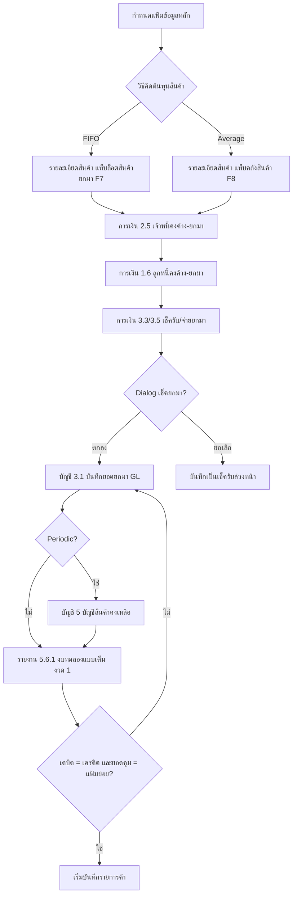

# บทที่ 8 การบันทึกยอดยกมาของระบบต่าง ๆ
> อ้างอิงคู่มือ หน้า 139–150 (PDF p.155–166)

## ภาพรวม
- หลังกำหนดแฟ้มข้อมูลหลักแล้ว ควรป้อน **ยอดยกมา** ของแต่ละระบบ (สินค้า, ลูกหนี้, เจ้าหนี้, เช็ค, บัญชี) ก่อนเริ่มบันทึกรายการค้า (หน้า 139)
- ป้อนรายการค้าก่อนแล้วย้อนมาป้อนยอดยกมาภายหลังก็ทำได้ แต่การป้อนยอดยกมาก่อนช่วยให้ประมวลผลฐานะการเงิน/ผลการดำเนินงานถูกต้อง (หน้า 139)
- ยอดยกมาของแฟ้มย่อย (ลูกหนี้รายตัว เจ้าหนี้รายตัว สินค้า) **รวมกันต้องเท่ากับยอดบัญชีคุมใน GL** เพื่อให้รายงานบัญชีกับรายงานแฟ้มหลักเทียบกันได้ (หน้า 148)
- วิธีป้อนยอดยกมาสินค้าขึ้นกับวิธีคิดต้นทุน: FIFO (ป้อนเป็นล็อต) หรือ Average (ป้อนรายคลัง) (หน้า 139)
- ยอดยกมาลูกหนี้/เจ้าหนี้ป้อนเป็น "เอกสาร" (ใบกำกับ/บิลซื้อ) ค้างชำระ ลงวันที่ก่อนวันเริ่มใช้โปรแกรม (หน้า 143, 145)

## หน้าจอ

### S-OB-01 รายละเอียดสินค้า – แท็บ ล็อตสินค้ายกมา <F7> (FIFO)
- เมนู: สินค้า > 2 รายละเอียดสินค้า > แท็บ ล็อตสินค้ายกมา <F7>
- อ้างอิง: หน้า 139–140 (PDF p.155–156) — มีภาพหน้าจอ: ใช่ (รูปที่ 1)
- ลักษณะ: header สินค้า + แท็บ (รายละเอียด / คลังสินค้า <F8> / ล็อตสินค้ายกมา <F7> / ฟิลด์เพิ่มเติม) + กล่องสรุปยอด + ตารางล็อต

| ส่วน/แท็บ | ฟิลด์ | ชนิดข้อมูล | บังคับ | ค่าเริ่มต้น/อ้างอิงจาก | คำอธิบาย/เงื่อนไข |
|---|---|---|---|---|---|
| Header | รหัส | text | ใช่ [สันนิษฐาน] | แฟ้มสินค้า | เช่น 01-INTL-CL-600 |
| Header | บาร์โค้ด | text | ไม่ | | |
| Header | ชื่อไทย | text | [สันนิษฐาน] | | |
| Header | ชื่ออังกฤษ | text | ไม่ [สันนิษฐาน] | | |
| ล็อตสินค้ายกมา | ยอดยกมา | number | - | คำนวณจากตาราง [สันนิษฐาน] | ภาพ: 10.0 |
| ล็อตสินค้ายกมา | มูลค่ายกมา | money | - | คำนวณจากตาราง [สันนิษฐาน] | ภาพ: 33,000.00 |
| ล็อตสินค้ายกมา | ยอดคงเหลือ | number | - | ระบบคำนวณ [สันนิษฐาน] | ภาพ: 16.0 |
| ล็อตสินค้ายกมา | มูลค่าคงเหลือ | money | - | ระบบคำนวณ [สันนิษฐาน] | ภาพ: 54,000.00 |
| ตารางล็อต | วันที่ | date | ใช่ | | วันที่ของล็อตที่ยกมา |
| ตารางล็อต | คลัง (รหัส+ชื่อย่อ) | lookup | ใช่ | แฟ้มคลังสินค้า | เช่น 01 สนญ. |
| ตารางล็อต | เลขที่เอกสาร | text | ใช่ | | ถ้าไม่ทราบล็อต ให้ใส่คำว่า "ยอดยกมา" |
| ตารางล็อต | (คอลัมน์ตัวเลข ค่า 1 ในภาพ) | number | - | | หัวคอลัมน์อ่านไม่ชัด [สันนิษฐาน: ลำดับ/อัตราส่วนหน่วย] |
| ตารางล็อต | จำนวนเดิม | number | ใช่ | | จำนวนที่ยกมา **คำนวณเป็นหน่วยนับย่อย** ก่อนป้อน (หัวคอลัมน์อ่านไม่ชัด [สันนิษฐาน]) |
| ตารางล็อต | มูลค่าเดิม | money | ใช่ | | มูลค่าต้นทุนรวมของล็อต = จำนวน × ราคาทุนต่อหน่วย |
| ตารางล็อต | จำนวน ปป. (ปรับปรุง) | number | ไม่ | ว่าง | ให้ปล่อยว่างตอนป้อนยกมา |
| ตารางล็อต | มูลค่า ปป. | money | ไม่ | ว่าง | ให้ปล่อยว่างตอนป้อนยกมา |

ปุ่ม/คำสั่ง: ดับเบิ้ลคลิก หรือ <Alt+A> เพื่อเพิ่มบรรทัดล็อต; ไอคอนบันทึกข้อมูล หรือคลิกบรรทัดว่างเพื่อบันทึก; toolbar มาตรฐาน (เพิ่ม/แก้ไข/ลบ/ยกเลิก/บันทึก/เลื่อนเรคคอร์ด/ค้นหา/พิมพ์) และไอคอน B/B, COST, OLD/NEW [สันนิษฐาน: ความหมายไม่ได้อธิบาย]
กฎทางธุรกิจ/เงื่อนไข:
- ใช้เฉพาะสินค้าที่คิดต้นทุนแบบ FIFO (ป้ายบนภาพ "(เฉพาะการคิดต้นทุนแบบ FIFO)") (หน้า 140)
- ถ้าไม่ทราบว่ายกมาจากล็อตใด ให้ป้อนบรรทัดเดียว เลขที่เอกสาร = "ยอดยกมา" และจำนวนเดิม = ยอดรวมทุกล็อต (หน้า 140)
- ตารางเดียวกันแสดงล็อตจากเอกสารจริงภายหลังด้วย (ภาพมี RR0000002, SR0000001, RR0000004)
ผลทางบัญชี/สต๊อก: สร้างล็อตต้นทุนยกมาสำหรับ FIFO; **ไม่ลง GL** — ต้องป้อนยอดยกมาทางบัญชีแยก (หน้า 142 หมายเหตุ) [สันนิษฐาน: ไม่ลงบัญชีอัตโนมัติ]

### S-OB-02 รายละเอียดสินค้า – แท็บ คลังสินค้า <F8> (Average)
- เมนู: สินค้า > 2 รายละเอียดสินค้า > แท็บ คลังสินค้า <F8>
- อ้างอิง: หน้า 141 (PDF p.157) — มีภาพหน้าจอ: ใช่ (รูปที่ 2)
- ลักษณะ: header สินค้า + แท็บ + กล่องข้อมูลซื้อ/ขายล่าสุด + ตารางยอดรายคลัง

| ส่วน/แท็บ | ฟิลด์ | ชนิดข้อมูล | บังคับ | ค่าเริ่มต้น/อ้างอิงจาก | คำอธิบาย/เงื่อนไข |
|---|---|---|---|---|---|
| คลังสินค้า | วันที่ซื้อล่าสุด | date | - | ระบบ [สันนิษฐาน] | ภาพ: 01/02/47 |
| คลังสินค้า | ราคาซื้อล่าสุด / หน่วย | money + lookup | - | ระบบ [สันนิษฐาน] | ภาพ: 3,400.000 / ตา [ตัวย่อหน่วย] |
| คลังสินค้า | ส่วนลดซื้อล่าสุด | text | - | | |
| คลังสินค้า | จำนวนค้างรับ | number | - | ระบบ [สันนิษฐาน] | |
| คลังสินค้า | วันที่ขายล่าสุด | date | - | ระบบ [สันนิษฐาน] | |
| คลังสินค้า | ราคาขายล่าสุด / หน่วย | money + lookup | - | | |
| คลังสินค้า | ส่วนลดขายล่าสุด | text | - | | |
| คลังสินค้า | จำนวนค้างส่ง | number | - | ระบบ [สันนิษฐาน] | |
| ตารางคลัง | คลัง (รหัส/ชื่อย่อ) | lookup | ใช่ | แฟ้มคลัง | เพิ่มรหัสคลังอื่นได้ถ้าไม่มีในตาราง |
| ตารางคลัง | ยอดยกมา | number | ใช่ | | จำนวนยกมา |
| ตารางคลัง | มูลค่ายกมา | money | ใช่ | | = จำนวน × ราคาทุนต่อหน่วย |
| ตารางคลัง | ยอดคงเหลือ | number | - | ระบบคำนวณ | |
| ตารางคลัง | ราคาต่อหน่วย | money | - | ระบบคำนวณ | ภาพ: 3,375.000 |
| ตารางคลัง | มูลค่าคงเหลือ | money | - | ระบบคำนวณ | |
| ตารางคลัง | ชั้นเก็บ | text | ไม่ | | |

ปุ่ม/คำสั่ง: ดับเบิ้ลคลิกที่คลัง หรือ <Alt+E> เพื่อแก้ไข; ไอคอนบันทึก; ไอคอนยกเลิกการเพิ่มหรือแก้ไข หรือ <Esc>
กฎทางธุรกิจ/เงื่อนไข: ใช้กับสินค้าคิดต้นทุนแบบ Average; ป้อนยอดยกมาแยกรายคลัง (หน้า 141)
ผลทางบัญชี/สต๊อก: ตั้งยอดสต๊อกยกมารายคลัง; ไม่ลง GL (ต้องป้อนยอดยกมาด้านบัญชี) — ถ้าใช้ระบบ Periodic ต้องบันทึกสินค้ายกมาที่ เมนูบัญชี ข้อ 5 บัญชีสินค้าคงเหลือ ด้วย (หน้า 142)

### S-OB-03 RR – ซื้อเงินเชื่อ (ยอดยกมา) / บันทึกรายการเจ้าหนี้คงค้าง-ยกมา
- เมนู: การเงิน > 2.5 บันทึกรายการเจ้าหนี้คงค้าง-ยกมา
- อ้างอิง: หน้า 142–144 (PDF p.158–160) — มีภาพหน้าจอ: ใช่ (รูปที่ 3)
- ลักษณะ: header (ผู้จำหน่าย ซ้าย / เอกสาร ขวา) + footer ยอดเงิน/ภาษี + แท็บ รายการจ่ายชำระ <F7> (ตารางการจ่าย)

| ส่วน/แท็บ | ฟิลด์ | ชนิดข้อมูล | บังคับ | ค่าเริ่มต้น/อ้างอิงจาก | คำอธิบาย/เงื่อนไข |
|---|---|---|---|---|---|
| Header | ผู้จำหน่าย | lookup | ใช่ | แฟ้มผู้จำหน่าย | แสดงชื่อ ที่อยู่ โทร. |
| Header | เลขที่บิล | text | ไม่ | | เลขที่ใบกำกับภาษี/เอกสารที่ผู้จำหน่ายออกให้ |
| Header | แผนก | lookup | ไม่ | แฟ้มแผนก (เริ่มระบบ 7) | ไม่มีให้กด <Enter> ผ่าน |
| Header | เลขที่เอกสาร | text | ใช่ | | เลขภายในที่กิจการกำหนดเอง ห้ามซ้ำกับเลขปีปัจจุบัน แนะนำใส่ปีนำหน้า เช่น RR43/9568 |
| Header | วันที่ | date | ใช่ | | ต้อง **ก่อน** วันเริ่มใช้โปรแกรม |
| Header | เครดิต (วัน) | number | - | รายละเอียดผู้จำหน่าย [สันนิษฐาน] | |
| Header | ครบกำหนด | date | - | คำนวณจากวันเครดิตในเมนูซื้อ 6 รายละเอียดผู้จำหน่าย | แก้ได้ |
| Header | ประเภทราคา | select | ใช่ | | 0=ยกเว้นภาษี, 1=รวมภาษีแล้ว, 2=ยังไม่รวมภาษี (ภาพ: "2 - แยก VAT") |
| Footer | หมายเหตุ | text+lookup | ไม่ | | |
| Footer | จำนวนเงิน | money | ใช่ | | ยอดค้างชำระ (รวม/ไม่รวมภาษีตามประเภทราคา) |
| Footer | หักส่วนลด | text + money | ไม่ | รายละเอียดผู้จำหน่าย | แก้ได้ |
| Footer | ยอดหลังหักส่วนลด | money | - | อัตโนมัติ | |
| Footer | ภาษีมูลค่าเพิ่ม (%) / จำนวนภาษี | number / money | - | อัตโนมัติ | ถ้าปัดเศษไม่ตรงบิล ให้ใส่อัตรา 0% แล้วป้อนจำนวนภาษีเอง |
| Footer | จำนวนเงินรวมทั้งสิ้น | money | - | อัตโนมัติ | ยอดสุทธิรวม VAT |
| Footer | ภาษีซื้อเกิดขึ้นแล้วเมื่อ | date | ไม่ | | ซื้อสินค้าทั่วไป = วันที่บิล (เกณฑ์สิทธิ); ค่าบริการ/ผ่อนชำระ ปล่อยว่าง (เกณฑ์เงินสด) |
| Footer | ภาระภาษีซื้อ | select | - | อัตโนมัติ | มีวันที่ = เกณฑ์สิทธิ; ว่าง = เกณฑ์เงินสด |
| รายการจ่ายชำระ <F7> | ภาระภาษีซื้อ, ใบรับวางบิล#, จำนวนเงินรวมทั้งสิ้น, ยอดชำระ/ลดหนี้, ยอดคงค้าง | display | - | ระบบ | เห็นในภาพ ไม่ได้อธิบายในคู่มือ |
| รายการจ่ายชำระ <F7> | ชำระเงินเรียบร้อย (Y), วันที่เรียบร้อย | check/date | - | ระบบ | เห็นในภาพ |
| รายการจ่ายชำระ grid | ใบจ่ายเงิน #, วันที่, วันที่จ่าย, ยอดจ่าย, วันที่เรียบร้อย | display | - | ใบจ่ายเงิน (PS) | |

ปุ่ม/คำสั่ง: toolbar มาตรฐาน + ไอคอนแว่นขยาย (lookup), ปุ่ม "แก้ไขยอดเงิน" ในแท็บรายการจ่ายชำระ, ไอคอนอื่น ๆ บน toolbar ไม่ได้อธิบาย
กฎทางธุรกิจ/เงื่อนไข:
- ป้อนรายเอกสารได้ถ้าทราบรายละเอียด; ถ้าไม่ทราบ ป้อนยอดรวมทั้งหมดของเจ้าหนี้รายนั้นเป็นเอกสารเดียว (หน้า 142)
- วันที่เอกสารต้องก่อนวันเริ่มใช้ เช่น เริ่ม 1 ม.ค. 2548 ต้องลงก่อน 1 ม.ค. 2548 (หน้า 143)
ผลทางบัญชี/สต๊อก: ตั้งยอดเจ้าหนี้รายตัว (AP subledger) และข้อมูลภาษีซื้อ (เกณฑ์สิทธิ/เงินสด); ไม่ตัด/เพิ่มสต๊อก; ยอดบัญชีเจ้าหนี้ใน GL ต้องป้อนแยกที่ S-OB-06 [สันนิษฐาน: เอกสารยกมาไม่ลง GL]

### S-OB-04 IV – ขายเงินเชื่อ (ยอดยกมา) / บันทึกรายการลูกหนี้คงค้าง-ยกมา
- เมนู: การเงิน > 1.6 บันทึกรายการลูกหนี้คงค้าง-ยกมา
- อ้างอิง: หน้า 144–147 (PDF p.160–163) — มีภาพหน้าจอ: ใช่ (รูปที่ 4)
- ลักษณะ: header (ลูกค้า ซ้าย / เอกสาร ขวา) + footer ยอดเงิน/ภาษี + แท็บ รายการรับชำระ <F7>

| ส่วน/แท็บ | ฟิลด์ | ชนิดข้อมูล | บังคับ | ค่าเริ่มต้น/อ้างอิงจาก | คำอธิบาย/เงื่อนไข |
|---|---|---|---|---|---|
| Header | รหัส (ลูกค้า) | lookup | ใช่ | แฟ้มลูกค้า (ขาย 6) | เลือกแล้วดึงพนักงานขาย เขตการขาย วันครบกำหนด %ส่วนลด อัตโนมัติ แก้ได้ |
| Header | แผนก | lookup | ไม่ | แฟ้มแผนก | |
| Header | เลขที่ (ใบกำกับ) | text | ใช่ | | ห้ามซ้ำเลขปีปัจจุบัน แนะนำใส่ปี เช่น IV4800001 (ภาพ IV42/2860) |
| Header | วันที่ | date | ใช่ | | ต้องก่อนวันเริ่มใช้โปรแกรม |
| Header | เครดิต (วัน) | number | - | แฟ้มลูกค้า | |
| Header | ครบ (กำหนด) | date | - | คำนวณ | |
| Header | พนักงานขาย | lookup | ไม่ | แฟ้มลูกค้า | |
| Header | เขตการขาย | lookup | ไม่ | แฟ้มลูกค้า | |
| Header | ขนส่ง | lookup | ไม่ | | เห็นในภาพ ไม่ได้อธิบาย |
| Header | ประเภท (ราคา) | select | ใช่ | | 0, 1, 2 เหมือน S-OB-03 |
| Footer | จำนวนเงิน / หักส่วนลด / ยอดหลังหักส่วนลด / ภาษีมูลค่าเพิ่ม % / จำนวนเงินรวมทั้งสิ้น | money | | | กฎเดียวกับ S-OB-03 (ปัดเศษ → 0% แล้วป้อนภาษีเอง) |
| Footer | ภาษีขายเกิดขึ้นแล้วเมื่อ | date | ไม่ | | ขายสินค้าทั่วไป = วันที่บิล; บริการ/ผ่อนชำระ ปล่อยว่าง |
| Footer | ภาระภาษี | select | - | อัตโนมัติ | เกณฑ์สิทธิ/เกณฑ์เงินสด |
| รายการรับชำระ <F7> | ภาระภาษีขาย, ใบวางบิล#, จำนวนเงินรวมทั้งสิ้น, ยอดชำระ/ลดหนี้, ยอดคงค้าง, คอมมิชชั่น | display | - | ระบบ | เห็นในภาพ |
| รายการรับชำระ grid | เลขที่ใบเสร็จ, วันที่, วันที่รับชำระ, จำนวนเงิน, วันที่เรียบร้อย | display | - | ใบเสร็จ (RE) | |
| รายการรับชำระ | ชำระเงินเรียบร้อย (Y), วันที่เรียบร้อย | check/date | - | | |

ปุ่ม/คำสั่ง: toolbar มาตรฐาน, ปุ่ม "แก้ไขยอดเงิน"
กฎทางธุรกิจ/เงื่อนไข: เหมือน S-OB-03 (ป้อนรายใบหรือยอดรวมเป็นใบเดียว; วันที่ต้องก่อนวันเริ่มใช้ เช่น เริ่ม 1 มิ.ย. 2547) (หน้า 145)
ผลทางบัญชี/สต๊อก: ตั้งยอดลูกหนี้รายตัว (AR subledger) + ข้อมูลภาษีขาย; ไม่ตัดสต๊อก; GL ป้อนแยก [สันนิษฐาน]

### S-OB-05 ทะเบียนเช็ครับ (ป้อนเช็คยกมา)
- เมนู: การเงิน > 3.3 ทะเบียนเช็ครับ (เช็คจ่าย: การเงิน > 3.5)
- อ้างอิง: หน้า 147–148 (PDF p.163–164) — มีภาพหน้าจอ: ใช่ (รูปที่ 5)
- ลักษณะ: form header + ส่วนสถานะ + ตารางเอกสารที่เกี่ยวข้อง <F8> + dialog ยืนยัน (รายละเอียดเต็มดูบทที่ 13)

| ส่วน/แท็บ | ฟิลด์ | ชนิดข้อมูล | บังคับ | ค่าเริ่มต้น/อ้างอิงจาก | คำอธิบาย/เงื่อนไข |
|---|---|---|---|---|---|
| Header | แผนก | lookup | ไม่ | | ถ้าแยกเช็คตามแผนก |
| Header | วันที่เช็ค | date | ใช่ | | วันที่บนเช็ค |
| Header | วันที่รับเช็ค | date | ใช่ | | ไม่จำเป็นต้องตรงวันที่เช็ค |
| Header | เลขที่เช็ค | text | ใช่ | | |
| Header | เช็คธนาคาร | lookup | ใช่ | แฟ้มธนาคาร | |
| Header | เช็คสาขา | text | ไม่ | | |
| Header | รหัสลูกค้า | lookup | ใช่ | แฟ้มลูกค้า | หลัง <Enter> จะมี dialog ถามว่าเป็นเช็คยกมาหรือไม่ |
| Header | จำนวนเงิน | money | ใช่ | | ตามหน้าเช็ค |
| Header | ผู้สั่งจ่าย | text | ไม่ | | |
| Header | หมายเหตุ | text | ไม่ | | |
| สถานะ | สถานะเช็ค, วันที่นำฝาก, เข้าบัญชี, วันที่ผ่านเช็ค, ค่าธรรมเนียม, เลขที่ใบสำคัญ | | - | ระบบ | เห็นในภาพ (ดูบทที่ 13) |

Dialog "Express Accounting": "กำลังบันทึกเช็คยกมาก่อนเริ่มใช้โปรแกรมใช่หรือไม่? • ถ้ากำลังจะบันทึกเช็ครับยกมา ให้ตอบตกลง • ถ้ากำลังจะบันทึกเช็คที่ได้รับจากลูกค้าล่วงหน้า ให้ตอบยกเลิก" ปุ่ม: ตกลง / ยกเลิก
กฎทางธุรกิจ/เงื่อนไข:
- ป้อนเช็ครับ/จ่ายที่ยังไม่ขึ้นเงิน ณ วันป้อนยอดยกมา เป็นรายใบ (หน้า 147)
- **ลูกหนี้ถูกตัดทันทีเมื่อบันทึกรับชำระด้วยเช็ค** แม้เช็คยังไม่ขึ้นเงิน ⇒ ถ้าป้อนเช็คยกมาแล้ว ห้ามรวมยอดเช็คนั้นในยอดยกมาลูกหนี้ซ้ำ (หน้า 147)
ผลทางบัญชี/สต๊อก: สร้างเช็คในทะเบียน (สถานะเริ่มต้น เช็คในมือ [สันนิษฐาน]); ยอดเช็ครับล่วงหน้าใน GL ป้อนที่ S-OB-06 (ภาพรูปที่ 6 มี 1130-02 เช็ครับลงวันที่ล่วงหน้า 10,000.00)

### S-OB-06 บันทึกยอดยกมา (ด้านบัญชี)
- เมนู: บัญชี > 3.1 บันทึกยอดยกมา
- อ้างอิง: หน้า 148–150 (PDF p.164–166) — มีภาพหน้าจอ: ใช่ (รูปที่ 6)
- ลักษณะ: list/grid แก้ไขได้ทั้งตาราง

| ส่วน/แท็บ | ฟิลด์ | ชนิดข้อมูล | บังคับ | ค่าเริ่มต้น/อ้างอิงจาก | คำอธิบาย/เงื่อนไข |
|---|---|---|---|---|---|
| Grid | เลขที่บัญชี | lookup | ใช่ | ผังบัญชี | เช่น 1111-00 |
| Grid | แผนก | lookup | ไม่ | แฟ้มแผนก | ระบุถ้ายอดยกมาแยกแผนก |
| Grid | ชื่อบัญชี | display | - | ผังบัญชี | |
| Grid | ยอดยกมา | money | ใช่ | | **เดบิต = บวก, เครดิต = ติดลบ** |

ปุ่ม/คำสั่ง: ไอคอนเพิ่มข้อมูล หรือ <Alt+A>; แว่นขยายเลือกเลขที่บัญชี; toolbar เลื่อนเรคคอร์ด/ค้นหา
กฎทางธุรกิจ/เงื่อนไข:
- **ไม่มีการตรวจสอบยอดดุล** เดบิต-เครดิต ⇒ ต้องพิมพ์งบทดลองแบบเต็ม (รายงาน 5.6.1) งวดที่ 1 ตรวจเอง (หน้า 150)
- ถ้ามีบัญชีมาก ให้ใช้ บัญชี ข้อ A คำนวณยอดเปลี่ยนแปลง งวด 1–24 เพื่อให้แสดงเลขที่บัญชีทุกบัญชีขึ้นมา (หน้า 149)
- ใช้ทั้งกรณีเริ่มต้นปี และเริ่มกลางปีแต่จะป้อนย้อนหลัง (เช่น เริ่ม 1 มิ.ย. 2547 ป้อน ม.ค.–พ.ค. ย้อนหลัง → ป้อนยอดคงเหลือ ณ สิ้นปี 2546) (หน้า 149)
- ถ้าเริ่มกลางปีและไม่ป้อนย้อนหลัง ป้อนยอดคงเหลือ ณ สิ้น พ.ค. ได้ แต่ห้ามป้อนรายการย้อนหลังซ้ำอีก (หน้า 150)
- ยอดรวมแฟ้มย่อยต้องเท่ากับยอดบัญชีคุม (หน้า 148)
- ระบบ Periodic: ต้องบันทึก บัญชี ข้อ 5 บัญชีสินค้าคงเหลือ เพิ่ม (ดูบทที่ 15) (หน้า 150)
ผลทางบัญชี/สต๊อก: ตั้งยอดยกมาของบัญชี GL (ยอดต้นงวด)

### S-OB-07 งบทดลองแบบเต็ม (ตรวจสอบยอดยกมา)
- เมนู: รายงาน > 5.6.1 งบทดลองแบบเต็ม
- อ้างอิง: หน้า 150 (PDF p.166) — มีภาพหน้าจอ: ใช่ (รูปที่ 7 พรีวิวรายงาน TMP)
- ลักษณะ: report preview

| ส่วน/แท็บ | ฟิลด์ | ชนิดข้อมูล | บังคับ | ค่าเริ่มต้น/อ้างอิงจาก | คำอธิบาย/เงื่อนไข |
|---|---|---|---|---|---|
| หัวรายงาน | ชื่อบริษัท, "งบทดลอง ณ วันที่", เลขที่บัญชีจาก…ถึง | - | - | | ภาพ: 1000-00 ถึง 9999-99 |
| คอลัมน์ | เลขที่บัญชี, แผนก, ชื่อบัญชี, ยอดยกมา เดบิต, ยอดยกมา เครดิต | - | - | | |
| ท้ายรายงาน | รวม n บัญชี / ยอดรวมเดบิต-เครดิต | - | - | | ต้องเท่ากัน |

ปุ่ม/คำสั่ง: พิมพ์, ค้นหา (ไอคอน)
ผลทางบัญชี: ไม่มี (รายงาน)

## ลำดับการใช้งาน
1. กำหนดแฟ้มข้อมูลหลักให้ครบ (สินค้า คลัง ลูกค้า ผู้จำหน่าย ธนาคาร ผังบัญชี)
2. ป้อนยอดยกมาสินค้า (FIFO → แท็บล็อต <F7>; Average → แท็บคลัง <F8>)
3. ป้อนเจ้าหนี้คงค้าง-ยกมา (การเงิน 2.5)
4. ป้อนลูกหนี้คงค้าง-ยกมา (การเงิน 1.6) — หักยอดที่ชำระด้วยเช็คยกมาออก
5. ป้อนเช็ครับ/จ่ายยกมา (การเงิน 3.3 / 3.5) ตอบ "ตกลง" ที่ dialog
6. ป้อนยอดยกมาบัญชี (บัญชี 3.1) ให้ยอดคุมตรงกับแฟ้มย่อย
7. (Periodic) บันทึกบัญชีสินค้าคงเหลือ (บัญชี 5)
8. พิมพ์งบทดลองแบบเต็มงวด 1 ตรวจดุล

## ข้อมูลที่เกี่ยวข้อง
- **Product** (สินค้า) 1:n **StockLot** (ล็อตสินค้ายกมา/ล็อตจากเอกสาร: วันที่ คลัง เลขที่เอกสาร จำนวนเดิม มูลค่าเดิม จำนวน ปป. มูลค่า ปป.)
- **Product** 1:n **ProductWarehouseBalance** (คลัง ยอดยกมา มูลค่ายกมา ยอดคงเหลือ ราคาต่อหน่วย มูลค่าคงเหลือ ชั้นเก็บ)
- **APInvoice** (RR, flag ยอดยกมา) n:1 Supplier; 1:n ใบจ่ายเงิน (PS) ผ่านรายการจ่ายชำระ; อ้างอิงใบรับวางบิล (BR)
- **ARInvoice** (IV, flag ยอดยกมา) n:1 Customer, SalesPerson, SalesArea; 1:n ใบเสร็จ (RE); อ้างอิงใบวางบิล (BI)
- **ChequeReceived/ChequePaid** n:1 Bank, Customer/Supplier (flag ยกมา)
- **GLOpeningBalance** (เลขที่บัญชี, แผนก, ยอดยกมา signed) n:1 Account, Department
- ทุกเอกสารยกมาอ้าง Department (optional)

## ข้อสังเกต
- คู่มือไม่ได้ระบุชัดว่าเอกสารลูกหนี้/เจ้าหนี้ยกมาลงสมุดรายวันหรือไม่ แต่การให้ป้อนยอด GL แยกและบอกว่ายอดแฟ้มย่อยต้อง "เท่ากับ" GL บ่งชี้ว่าไม่ลง GL [สันนิษฐาน] — ERP ใหม่ควรมี flag `is_opening` ที่ข้ามการ post
- ไม่มี validation ดุล Dr/Cr ในหน้าจอยกมา GL — ERP ใหม่ควรเพิ่มการตรวจดุลและการ reconcile ยอดคุม vs แฟ้มย่อยอัตโนมัติ
- เลขที่เอกสารยกมาต้องไม่ชนกับ running number ปีปัจจุบัน (คู่มือแนะนำใส่ปีนำหน้า)
- ปีในภาพเป็น พ.ศ. 2 หลัก (46/47/48/55/56) — ตัวอย่างไม่สอดคล้องกันระหว่างภาพ
- หัวคอลัมน์ตารางล็อต FIFO บนภาพอ่านได้ไม่ชัด ชื่อคอลัมน์ "จำนวนเดิม/มูลค่าเดิม" อนุมานจากข้อความ "จำนวน ปป./มูลค่า ปป." [สันนิษฐาน]
- หน้าจอเช็คยกมาใช้หน้าจอเดียวกับทะเบียนเช็ครับปกติ แยกด้วย dialog ยืนยันตอนป้อนรหัสลูกค้า
