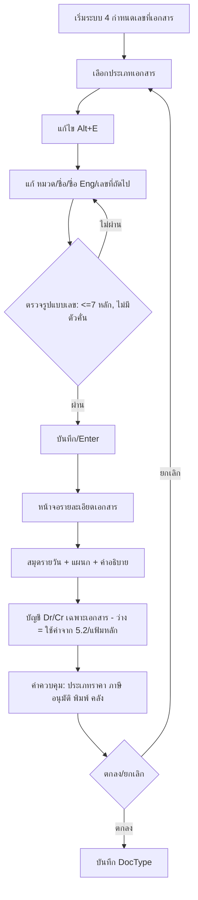

# บทที่ 9 กำหนดเลขที่เอกสาร
> อ้างอิงคู่มือ หน้า 151–154 (PDF p.167–170)

## ภาพรวม
- แต่ละระบบ (ซื้อ ขาย การเงิน ฯลฯ) แบ่งเป็นประเภทเอกสาร (หมวด) แต่ละประเภทมี running number ของตัวเอง (หน้า 151)
- กำหนด "เลขที่ถัดไป" เริ่มต้นได้ เพื่อให้ต่อเนื่องจากระบบเดิม แล้วโปรแกรมรันต่อให้อัตโนมัติ (หน้า 151)
- หน้าจอเดียวกันนี้ยังเป็นที่ตั้งค่า **ระดับเอกสาร** : สมุดรายวันที่จะลง, แผนก, คำอธิบายในสมุดรายวัน, บัญชี Dr/Cr เฉพาะเอกสาร, ประเภทราคา, อัตราภาษี, ภาระภาษี, การอนุมัติ, การพิมพ์, คลังที่ตัด (หน้า 153–154) — เป็นชั้น override ของการเชื่อมต่อบัญชี (บทที่ 10)

## หน้าจอ

### S-DN-01 กำหนดเลขที่เอกสาร (รายการประเภทเอกสาร)
- เมนู: เริ่มระบบ > 4 กำหนดเลขที่เอกสาร
- อ้างอิง: หน้า 152 (PDF p.168) — มีภาพหน้าจอ: ใช่ (รูปที่ 1, หน้าต่างชื่อ "Xpw")
- ลักษณะ: list (grid อ่านอย่างเดียว เลื่อนดูได้) + toolbar

| ส่วน/แท็บ | ฟิลด์ | ชนิดข้อมูล | บังคับ | ค่าเริ่มต้น/อ้างอิงจาก | คำอธิบาย/เงื่อนไข |
|---|---|---|---|---|---|
| Grid | หมวด | text(2) | ใช่ | ระบบ | รหัสหมวดเอกสาร (เช่น IV, HS); หมวดเดียวกันแยกย่อยได้หลายประเภท |
| Grid | ชื่อเอกสาร | text | ใช่ | | ภาษาไทย |
| Grid | ชื่อภาษาอังกฤษ | text | ไม่ | | ใช้กับ Express เวอร์ชั่นภาษาอังกฤษ |
| Grid | เลขที่ถัดไป (prefix) | text(2) | ใช่ | | prefix เลขที่เอกสาร |
| Grid | เลขที่ถัดไป (running) | text(7) | ใช่ | 0000001 | |
| Grid | แผนก | lookup | ไม่ | | หัวคอลัมน์อ่านไม่ชัด [สันนิษฐาน] |

ข้อมูลในภาพ (ส่วนที่มองเห็น, เรียงตามภาพ):

| หมวด | ชื่อเอกสาร | ชื่อภาษาอังกฤษ | Prefix | เลขที่ถัดไป |
|---|---|---|---|---|
| (ว่าง) | รหัสผู้จำหน่าย-สด | Supplier-cash | (สัญลักษณ์อ่านไม่ชัด) | 0000001 |
| (ว่าง) | รหัสลูกค้า-สด | Customer-cash | (สัญลักษณ์อ่านไม่ชัด) | 0000003 |
| AE | จ่ายเงินมัดจำ | Deposit Payment | AE | 0000002 |
| AI | รับเงินมัดจำ | Deposit Receive | AI | 0000003 |
| BD | ฝากเงินสดเข้าธนาคาร (DEP) | Cash Deposit | BD | 0000002 |
| BQ | ใบนำฝากเช็ค (DEQ) | Cheque Deposit | BQ | 0000002 |
| BQ | ใบขายลดเช็ค (SQR) | Discounting Cheque | SQ | 0000001 |
| BR | ใบรับวางบิล | A/P Bill Collection List | BR | 0000002 |
| BS | ใบวางบิล | A/R Bill Collection List | BI | 0000003 |
| BT | โอนเงินระหว่างธนาคาร (TRF) | Bank Transfer | BT | 0000002 |
| BU | รับดอกเบี้ยธนาคาร (DEP) | Interest Income | BU | 0000001 |
| BV | จ่ายค่าดอกเบี้ย (W/D) | Interest Expenses | BC | 0000001 |
| BV | จ่ายค่าธรรมเนียม (W/D) | Bank Charges | BV | 0000001 |
| BW | ถอนเงินสดจากธนาคาร (W/D) | Cash Withdrawal | BW | 0000001 |
| CA | เพิ่ม/ลดต้นทุนสินค้า | Cost Adjustment | CA | 0000002 |
| CA | ปรับค่าขนส่งสินค้า | Freight Adjustment | CF | 0000002 |
| CA | ปรับปรุงค่าประกันภัย | Insurance Adjustment | CI | 0000001 |
| CN | ใบลดหนี้/รับคืน | Sales Returns and Allowances | SR | 0000004 |
| CP | ใบเพิ่มหนี้(ของเจ้าหนี้) | A/P Credit Note | CP | 0000002 |
| DN | ใบลดหนี้/ส่งคืน | Purchase Returns and Allowance | GR | 0000002 |
| DP | จ่ายคชจ.จากเงินทดรองจ่ายย่อย | Disbursement from Petty Cash | DP | 0000001 |
| … | (รายการต่อจากนี้เลื่อนลงไม่ปรากฏในภาพ เช่น IV ขายเงินเชื่อ, HS ขายเงินสด ที่กล่าวในข้อความ) | | | |

ปุ่ม/คำสั่ง: toolbar — เพิ่ม, แก้ไข (<Alt+E>), ลบ, ยกเลิก, บันทึก, เลื่อนเรคคอร์ด (แรก/ก่อน/ถัดไป/สุดท้าย)
กฎทางธุรกิจ/เงื่อนไข:
- เลขที่ (ส่วนตัวเลข) ไม่เกิน **7 หลัก** (IV12345678 ไม่ได้, IV1234567 ได้) (หน้า 151)
- ห้ามมีเครื่องหมายคั่น (IV48/0001 ไม่ได้, IV4800001 ได้) (หน้า 151)
- เลขรันต่อเนื่องตลอด **ไม่ reset เมื่อขึ้นรอบบัญชีใหม่** (หน้า 151)
- เอกสารที่ชำระแล้วจะถูกลบทิ้งตอนปิดประมวลผลสิ้นปี ⇒ นำเลขกลับมาใช้ได้โดยแก้ "เลขที่ถัดไป" แต่ผู้เขียนไม่แนะนำ เพราะอาจชนกับเอกสารที่ยังค้าง (หน้า 152 หมายเหตุ)
- หมวดเดียวกันแยกหลายประเภทได้ เช่น IV แยก ขายเชื่อในประเทศ/ต่างประเทศ (หน้า 152)
ผลทางบัญชี/สต๊อก: ไม่มีโดยตรง

### S-DN-02 รายละเอียดเอกสาร (ตั้งค่าเอกสารแต่ละประเภท)
- เมนู: เริ่มระบบ > 4 กำหนดเลขที่เอกสาร > เลือกเอกสาร > แก้ไข (<Alt+E>) > บันทึก/<Enter>
- อ้างอิง: หน้า 153–154 (PDF p.169–170) — มีภาพหน้าจอ: ใช่ (รูปที่ 2 ตัวอย่างเอกสาร "ขายเงินเชื่อ")
- ลักษณะ: dialog form (ส่วนบน: ชื่อ/เลข/สมุดรายวัน, ส่วนกลาง: บัญชี Dr/Cr, ส่วนล่าง: ค่าควบคุม) — **ส่วนบัญชี Dr/Cr แตกต่างไปตามประเภทเอกสาร**

| ส่วน/แท็บ | ฟิลด์ | ชนิดข้อมูล | บังคับ | ค่าเริ่มต้น/อ้างอิงจาก | คำอธิบาย/เงื่อนไข |
|---|---|---|---|---|---|
| ส่วนบน | ชื่อเอกสาร | text | ใช่ | | เช่น ขายเงินเชื่อ |
| ส่วนบน | Eng. | text | ไม่ | | เช่น Credit Sales |
| ส่วนบน | เลขที่ถัดไป (prefix) | text(2) | ใช่ | | เช่น IV |
| ส่วนบน | เลขที่ถัดไป (เลข) | text(7) | ใช่ | 0000001 | เช่น ต่อจากระบบเดิมที่ 100 → IV0000101 |
| ส่วนบน | บันทึกบัญชี ลงสมุดรายวัน | lookup | ใช่ [สันนิษฐาน] | สมุดรายวัน (บัญชี 8) | ภาพ: 03 สมุดรายวันขาย |
| ส่วนบน | แผนก | lookup | ไม่ | แฟ้มแผนก | ถ้าระบุ ระบบเติมรหัสแผนกอัตโนมัติเมื่อป้อนเอกสารนี้ |
| ส่วนบน | คำอธิบายในสมุดรายวัน | text (expression) | ไม่ | | เป็นนิพจน์โปรแกรม เช่น `'ขายเชื่อให้ ' + (ARMAS->PRENAM - ' ' - ARMAS->CUSNAM)` ดึงชื่อลูกค้าจากเอกสาร |
| บัญชี | Dr. ลูกหนี้ | lookup | ไม่ | ว่างไว้ = ดึงเลขที่บัญชีในรายละเอียดลูกค้า | |
| บัญชี | (Dr.) เงินมัดจำรับล่วงหน้า | lookup | ไม่ | อ้างถึงเลขที่บัญชีในใบรับเงินมัดจำ | |
| บัญชี | Cr. ขายสินค้า | lookup | ไม่ | ว่าง = ใช้ค่ากำหนดบัญชีเพื่อลงรายวัน (5.2) | |
| บัญชี | (Cr.) ภาษีขาย | lookup | ไม่ | ว่าง = 5.2 | |
| บัญชี (Perpetual) | Dr. ต้นทุนขาย | lookup | ไม่ | อ้างถึงเลขที่บัญชีในสินค้าแต่ละรายการ | ป้าย: "ในกรณีที่บันทึกบัญชีสินค้าแบบ Perpetual จะมีการเพิ่มต้นทุนขาย และลดบัญชีสินค้า โดย" |
| บัญชี (Perpetual) | Cr. สินค้า | lookup | ไม่ | อ้างถึงเลขที่บัญชีในสินค้าแต่ละรายการ | |
| ส่วนล่าง | ประเภทราคา | text(1) | ไม่ | ค่าเริ่มต้นจาก เริ่มระบบ 1 กำหนดค่าเริ่มต้น | 0/1/2 [สันนิษฐาน ตามบทที่ 8] |
| ส่วนล่าง | อัตราภาษี | number | ไม่ | ค่าเริ่มต้น | ภาพ 0.00 |
| ส่วนล่าง | ภาระภาษีขาย (สินค้าบริการ) | select | ไม่ | ค่าเริ่มต้น | |
| ส่วนล่าง | รับรองเอกสาร ต้องขออนุมัติระดับ | number(1) | ไม่ | | 0=ไม่ต้องรับรองเอกสาร หรือ 1-9 |
| ส่วนล่าง | วิธีการพิมพ์ หรือรับรองเอกสาร | number(1) | ไม่ | | 1=พิมพ์ก่อนรับรอง หรือ 2=รับรองก่อนพิมพ์ |
| ส่วนล่าง | พิมพ์เอกสารซ้ำ ต้องขออนุมัติระดับ | number(1) | ไม่ | | 0=ไม่ต้องขออนุมัติ หรือ 1-9 |
| ส่วนล่าง | แยกประเภท VAT ที่รายการสินค้า | check (Y/N) | ไม่ | | |
| ส่วนล่าง | รหัสคลังสินค้าที่จะตัด | lookup | ไม่ | แฟ้มคลัง | |

ปุ่ม/คำสั่ง: ตกลง, ยกเลิก (<Esc> = ออกโดยไม่แก้ไข)
กฎทางธุรกิจ/เงื่อนไข:
- ค่าที่ตั้งในหน้าจอนี้มีผลเฉพาะเอกสารประเภทนั้น ไม่กระทบเอกสารอื่น (หน้า 154)
- "วิธีการบันทึกบัญชี" ไม่ต้องแก้ ระบบใช้บัญชีจาก เริ่มระบบ 5.2 กำหนดบัญชีเพื่อลงรายวัน อยู่แล้ว ยกเว้นต้องการระบุบัญชีเฉพาะเจาะจง (หน้า 154)
- ประเภทราคา อัตราภาษี ภาระภาษีขาย การอนุมัติ การพิมพ์ แยก VAT และคลังที่ตัด มีค่าตั้งต้นจากเมนูกำหนดค่าเริ่มต้น แต่ override รายประเภทเอกสารได้ (หน้า 154)
- หน้าจอจะแตกต่างกันตามระบบ (ซื้อเงินสด ซื้อเงินเชื่อ จ่าย/รับชำระหนี้) (หน้า 153)
ผลทางบัญชี/สต๊อก: กำหนดสมุดรายวัน + บัญชี Dr/Cr ที่ใช้เมื่อ post เอกสารประเภทนี้ (ตัวอย่างขายเงินเชื่อ: Dr ลูกหนี้ [+ Dr เงินมัดจำรับล่วงหน้า] / Cr ขายสินค้า, Cr ภาษีขาย; Perpetual: Dr ต้นทุนขาย / Cr สินค้า)

## ลำดับการใช้งาน
1. เข้า เริ่มระบบ > 4 กำหนดเลขที่เอกสาร
2. เลื่อนไปยังเอกสารที่ต้องการ > คลิกแก้ไข หรือ <Alt+E>
3. แก้ หมวด / ชื่อเอกสาร / ชื่อภาษาอังกฤษ / เลขที่ถัดไป
4. คลิกบันทึก หรือ <Enter> → เปิดหน้าจอรายละเอียดเอกสาร
5. ตั้งสมุดรายวัน แผนก คำอธิบาย บัญชีเฉพาะ และค่าควบคุม → ตกลง (หรือ ยกเลิก/<Esc>)

## ข้อมูลที่เกี่ยวข้อง
- **DocCategory** (หมวด) 1:n **DocType** (ชื่อเอกสาร, ชื่อ Eng, prefix, next_no)
- **DocType** n:1 **Journal** (สมุดรายวัน), n:1 **Department** (optional), n:1 **Warehouse** (คลังที่ตัด, optional)
- **DocType** 1:n **DocTypeAccountMap** (role เช่น AR, DEPOSIT_RCV, SALES, OUTPUT_VAT, COGS, INVENTORY → Account; ว่าง = fallback)
- DocType มีค่าควบคุม: price_type, vat_rate, vat_basis, approve_level, print_approve_order, reprint_approve_level, split_vat_per_line
- ทุกเอกสารธุรกรรม (IV, RR, RE, PS, BQ, BT ฯลฯ) อ้าง DocType เพื่อออกเลขและหาบัญชี

## ข้อสังเกต
- หมวด กับ prefix ไม่จำเป็นต้องเหมือนกัน (เช่น หมวด BS → prefix BI; หมวด CN → SR; หมวด DN → GR; หมวด BV มี 2 ประเภท prefix BC/BV; หมวด CA มี 3 ประเภท CA/CF/CI) ⇒ โครงสร้าง ERP ควรแยก category กับ prefix
- คู่มือหน้า 157 อ้างถึง "เมนู เริ่มระบบ 1.4" สำหรับกำหนดเลขที่เอกสาร แต่เมนูในภาพ (หน้า 155) คือ เริ่มระบบ 4 — ไม่สอดคล้อง
- เลข 7 หลัก ไม่ reset รายปี — ERP ใหม่อาจต้องรองรับรูปแบบที่มีปี/เดือน (ซึ่ง Express ห้าม)
- หัวคอลัมน์สุดท้ายของ grid (แผนก) และสัญลักษณ์ prefix ของ "รหัสผู้จำหน่าย-สด/รหัสลูกค้า-สด" อ่านไม่ชัด [สันนิษฐาน]
- คำอธิบายในสมุดรายวันเป็น expression แบบ xBase (ARMAS->PRENAM) ⇒ ERP ใหม่ควรมี template engine ที่อ้างฟิลด์ master ได้
