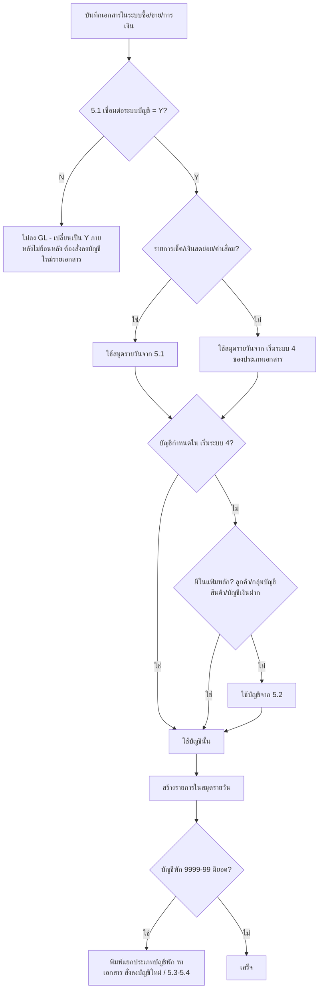

# บทที่ 10 กำหนดการเชื่อมต่อบัญชี
> อ้างอิงคู่มือ หน้า 155–158 (PDF p.171–174)

## ภาพรวม
- ระบบบัญชี (GL) รับข้อมูลจากระบบอื่น (ซื้อ ขาย รับ-จ่ายเงิน ฯลฯ) ผ่านการ "ผ่านรายการไปสมุดบัญชี" (หน้า 155)
- ปิดการเชื่อมต่อได้ เช่น ผังบัญชียังไม่สมบูรณ์ หรือใช้โปรแกรมคุมเฉพาะลูกหนี้/เจ้าหนี้/สต๊อก โดยสำนักงานบัญชีจัดการ GL เอง (หน้า 155)
- เมนู เริ่มระบบ > 5 กำหนดการเชื่อมต่อบัญชี มี 4 เมนูย่อย: 5.1 กำหนดการผ่านรายการไปสมุดบัญชี, 5.2 กำหนดบัญชีเพื่อลงรายวัน, 5.3 สั่งให้ระบบอื่นๆ ตรวจสอบการลงบัญชีใหม่, 5.4 สั่งให้ระบบอื่นๆ ลงบัญชีใหม่ (หน้า 155 รูปที่ 1)
- การหาเลขที่บัญชีตอน post มี **3 ชั้น**: (1) บัญชีเฉพาะประเภทเอกสาร (เริ่มระบบ 4) → (2) บัญชีในแฟ้มหลัก (ลูกค้า/ผู้จำหน่าย/กลุ่มบัญชีสินค้า/บัญชีเงินฝาก) → (3) บัญชี default (5.2) (หน้า 157)

## หน้าจอ

### S-GL-00 เมนูกำหนดการเชื่อมต่อบัญชี
- เมนู: เริ่มระบบ > 5 กำหนดการเชื่อมต่อบัญชี
- อ้างอิง: หน้า 155 (PDF p.171) — มีภาพหน้าจอ: ใช่ (รูปที่ 1)
- ลักษณะ: เมนู cascade
- เมนูเริ่มระบบทั้งหมด (จากภาพ): 1. กำหนดค่าเริ่มต้นต่าง ๆ ▸ / 2. กำหนดตารางข้อมูล ▸ / 3. กำหนดรอบบัญชี / 4. กำหนดเลขที่เอกสาร / **5. กำหนดการเชื่อมต่อบัญชี ▸** / 6. ติดตั้งเครื่องพิมพ์ ▸ / 7. กำหนดแผนก / 8. กำหนดบริษัทใหม่ / 9. รายการข้อความ ▸ / A. ล็อคงวด
- เมนูย่อย 5: 1. กำหนดการผ่านรายการไปสมุดบัญชี / 2. กำหนดบัญชีเพื่อลงรายวัน / 3. สั่งให้ระบบอื่นๆ ตรวจสอบการลงบัญชีใหม่ / 4. สั่งให้ระบบอื่นๆ ลงบัญชีใหม่

### S-GL-01 กำหนดการผ่านรายการไปสมุดบัญชี
- เมนู: เริ่มระบบ > 5.1 กำหนดการผ่านรายการไปสมุดบัญชี
- อ้างอิง: หน้า 156–157 (PDF p.172–173) — มีภาพหน้าจอ: ใช่ (รูปที่ 2)
- ลักษณะ: form (checkbox + กลุ่ม "รายการผ่านไปสมุดรายวัน" แต่ละบรรทัด = lookup รหัสสมุดรายวัน + ชื่อสมุด)

| ส่วน/แท็บ | ฟิลด์ | ชนิดข้อมูล | บังคับ | ค่าเริ่มต้น/อ้างอิงจาก | คำอธิบาย/เงื่อนไข |
|---|---|---|---|---|---|
| หลัก | เชื่อมต่อระบบบัญชี | check | - | ✓ (ในภาพ) | ไม่ติ๊ก = ไม่ส่งข้อมูลจากระบบอื่นไป GL |
| รายการผ่านไปสมุดรายวัน | ผ่านเช็คจ่าย | lookup สมุดรายวัน | ใช่ [สันนิษฐาน] | 01 สมุดรายวันจ่าย | |
| รายการผ่านไปสมุดรายวัน | ตัดเช็คจ่ายเกินเป็น คชจ. | lookup | | 01 สมุดรายวันจ่าย | |
| รายการผ่านไปสมุดรายวัน | ผ่านเช็ครับ | lookup | | 02 สมุดรายวันรับ | |
| รายการผ่านไปสมุดรายวัน | ตัดเช็ครับเกินเป็นรายได้ | lookup | | 02 สมุดรายวันรับ | |
| รายการผ่านไปสมุดรายวัน | ตัดยอดเช็ครับเป็นหนี้สูญ | lookup | | 01 สมุดรายวันจ่าย | |
| รายการผ่านไปสมุดรายวัน | เบิกชดเชยเงินสดย่อย | lookup | | 01 สมุดรายวันจ่าย | |
| รายการผ่านไปสมุดรายวัน | คิดค่าเสื่อมราคา | lookup | | 00 สมุดรายวันทั่วไป | |
| ท้ายจอ | ข้อความ | label | - | | "รายการนอกเหนือจากนี้ ไปกำหนดที่เมนู 'เริ่มระบบ/4.กำหนดเลขที่เอกสาร'" |

ปุ่ม/คำสั่ง: แก้ไข, บันทึก, ยกเลิก (toolbar 3 ไอคอน); แว่นขยายเรียกดูสมุดรายวันที่สร้างไว้ใน เมนูบัญชี ข้อ 8 สร้างสมุดรายวัน
กฎทางธุรกิจ/เงื่อนไข:
- ไม่ติ๊ก "เชื่อมต่อระบบบัญชี" ⇒ ไม่มีการเชื่อมต่อข้อมูลไป GL; ติ๊ก ⇒ นำข้อมูลจากเมนูต่าง ๆ ไปยังสมุดรายวันตามที่กำหนด (หน้า 156)
- **ถ้าทำรายการขณะตั้งเป็น 'N' แล้วเปลี่ยนเป็น 'Y' ภายหลัง ระบบจะไม่ลงบัญชีย้อนหลังให้** ต้องไปสั่งลงบัญชีใหม่ที่เอกสารแต่ละรายการเอง (หน้า 156 หมายเหตุ)
- หน้าจอนี้แสดงเฉพาะบางระบบ; ระบบอื่นมีสมุดรายวันกำหนดไว้แล้วที่ เริ่มระบบ 4 กำหนดเลขที่เอกสาร (คู่มือเขียน "เริ่มระบบ 1.4") (หน้า 157)
ผลทางบัญชี: กำหนด **สมุดรายวันปลายทาง** ของรายการที่ไม่ใช่เอกสารตามประเภทเอกสาร

### S-GL-02 กำหนดบัญชีเพื่อลงรายวัน (Default posting accounts)
- เมนู: เริ่มระบบ > 5.2 กำหนดบัญชีเพื่อลงรายวัน
- อ้างอิง: หน้า 157–158 (PDF p.173–174) — มีภาพหน้าจอ: ใช่ (รูปที่ 3)
- ลักษณะ: form แบ่งกลุ่ม (สินทรัพย์ / หนี้สิน / รายได้ / ค่าใช้จ่าย) ทุกช่องเป็น lookup เลขที่บัญชี

| ส่วน/แท็บ | ฟิลด์ | ชนิดข้อมูล | บังคับ | ค่าในภาพ | คำอธิบาย/เงื่อนไข |
|---|---|---|---|---|---|
| ทั่วไป | บัญชีกำไรสะสม | lookup | ใช่ [สันนิษฐาน] | 3200-00 | |
| ทั่วไป | บัญชีพัก | lookup | ใช่ | 9999-99 | ต้องสร้างในผังบัญชี; มียอด = มีปัญหาการลงบัญชี |
| สินทรัพย์ | เงินสด | lookup | | 1111-00 | |
| สินทรัพย์ | เงินสดย่อย | lookup | | 1111-50 | |
| สินทรัพย์ | ลูกหนี้ | lookup | | 1130-01 | ใช้เมื่อแฟ้มลูกค้าไม่ได้กำหนดบัญชี |
| สินทรัพย์ | เช็ครับล่วงหน้า | lookup | | 1130-02 | |
| สินทรัพย์ | สินค้า | lookup | | 1140-02 | |
| สินทรัพย์ | ภาษีนิติบุคคลจ่ายล่วงหน้า | lookup | | 1151-02 | |
| สินทรัพย์ | ภาษีซื้อ | lookup | | 1154-00 | |
| สินทรัพย์ | ภาษีซื้อยังไม่ถึงกำหนด | lookup | | 1155-00 | |
| สินทรัพย์ | เงินมัดจำจ่ายล่วงหน้า | lookup | | 1151-01 | |
| หนี้สิน | เจ้าหนี้ | lookup | | 2120-01 | |
| หนี้สิน | เช็คจ่ายล่วงหน้า | lookup | | 2120-02 | |
| หนี้สิน | ภาษีหัก ณ ที่จ่ายค้างจ่าย | lookup | | 2132-02 | |
| หนี้สิน | ภาษีขาย | lookup | | 2135-00 | |
| หนี้สิน | ภาษีขาย-รอเรียกเก็บ | lookup | | 2136-00 | |
| หนี้สิน | เงินมัดจำรับล่วงหน้า | lookup | | 2133-01 | |
| รายได้ | ขายสด | lookup | | 4100-01 | |
| รายได้ | ขายเชื่อ | lookup | | 4100-01 | |
| รายได้ | รับคืน | lookup | | 4100-03 | |
| รายได้ | ส่วนลดจ่าย | lookup | | 4100-04 | |
| รายได้ | ดอกเบี้ยรับ | lookup | | 4200-01 | |
| รายได้ | รายได้ธนาคาร | lookup | | 4200-08 | |
| รายได้ | รายได้อื่น ๆ | lookup | | 4200-08 | |
| ค่าใช้จ่าย | ต้นทุนขาย | lookup | | 5110-00 | |
| ค่าใช้จ่าย | ซื้อสินค้า | lookup | | 5130-01 | |
| ค่าใช้จ่าย | ส่งคืน | lookup | | 5130-03 | |
| ค่าใช้จ่าย | ส่วนลดรับ | lookup | | 5130-02 | |
| ค่าใช้จ่าย | ดอกเบี้ยจ่าย | lookup | | 5370-01 | |
| ค่าใช้จ่าย | คชจ.ธนาคาร | lookup | | 5360-04 | |
| ค่าใช้จ่าย | หนี้สูญ | lookup | | 5380-00 | |
| ค่าใช้จ่าย | คชจ. อื่นๆ | lookup | | 5370-06 | |
| ค่าใช้จ่าย | ภาษีซื้อไม่ขอคืน | lookup | | 5390-01 | |
| ค่าใช้จ่าย | ภาษีขอคืนไม่ได้ | lookup | | 5390-02 | |

ปุ่ม/คำสั่ง: แก้ไข, บันทึก, ยกเลิก; แว่นขยายเลือกเลขที่บัญชีจากผังบัญชี
กฎทางธุรกิจ/เงื่อนไข:
- ใช้เมื่อเลขที่บัญชีนั้น "ไม่มีแฟ้มข้อมูลหลัก" หรือแฟ้มหลักไม่ได้กำหนดบัญชี (หน้า 157)
- ถ้าแก้เลขที่บัญชีในผังบัญชีที่เกี่ยวข้องกับหน้าจอนี้ (เช่น กำไรสะสม เงินสด ภาษีซื้อ-ขาย) ต้องเข้ามาแก้ที่ 5.2 ให้ตรงด้วย (หน้า 158)
- บัญชีพัก: เทคนิคภายในเพื่อให้การลงบัญชีถูกต้อง ต้องสร้างไว้ในผัง และไม่ควรใช้บันทึกบัญชีใด ๆ; ถ้ามียอดคงเหลือ = มีปัญหา ให้พิมพ์แยกประเภทบัญชีพักหาเอกสารแล้วสั่งลงบัญชีใหม่ (หน้า 158)
ผลทางบัญชี: เป็นแหล่งบัญชีชั้นสุดท้าย (fallback) ของการ post ทุกระบบ

### S-GL-03 สั่งให้ระบบอื่นๆ ตรวจสอบการลงบัญชีใหม่ / S-GL-04 สั่งให้ระบบอื่นๆ ลงบัญชีใหม่
- เมนู: เริ่มระบบ > 5.3 / 5.4
- อ้างอิง: หน้า 155 (เมนู), 158 (PDF p.171, 174) — มีภาพหน้าจอ: ไม่ (เฉพาะชื่อเมนู)
- ลักษณะ: คำสั่ง batch [สันนิษฐาน] — คู่มืออ้างว่ารายละเอียดอยู่ใน บทที่ 21 การตรวจสอบข้อมูลและการแก้ไขปัญหา
ผลทางบัญชี: re-post เอกสารไป GL [สันนิษฐาน]

## ตาราง Mapping: ประเภทเอกสาร/รายการ → บัญชี GL

### A. ลำดับการหาเลขที่บัญชี (คู่มือหน้า 157)
| ลำดับ | แหล่ง | ใช้กับ |
|---|---|---|
| 1 | บัญชีที่ระบุใน **เริ่มระบบ 4 กำหนดเลขที่เอกสาร** (รายละเอียดเอกสาร) | ทุกบัญชีของเอกสารประเภทนั้น ถ้ากรอกไว้ |
| 2 | **แฟ้มข้อมูลหลัก**: รายละเอียดลูกค้า (ขาย 6) → บัญชีลูกหนี้; รายละเอียดสินค้า (สินค้า 2) → รหัสกลุ่มบัญชีสินค้า → เริ่มระบบ 1.3.2 กำหนดกลุ่มบัญชีสินค้า (เชื่อม 2 ชั้น); บัญชีเงินฝาก (การเงิน 3.7 → เลขที่บัญชี) [บทที่ 13]; ใบรับเงินมัดจำ → บัญชีมัดจำ [บทที่ 9] | |
| 3 | **เริ่มระบบ 5.2 กำหนดบัญชีเพื่อลงรายวัน** | ภาษีขาย รายได้จากการขาย ต้นทุนขาย ฯลฯ และ fallback ของลูกหนี้เมื่อแฟ้มลูกค้าไม่ได้กำหนด |

### B. Mapping ที่คู่มือระบุชัด (ไม่ใช่สันนิษฐาน)
| เอกสาร/รายการ | สมุดรายวัน | Dr | Cr | แหล่งอ้างอิง |
|---|---|---|---|---|
| IV ขายเงินเชื่อ (Perpetual) | 03 สมุดรายวันขาย (ตั้งที่เริ่มระบบ 4) | ลูกหนี้ (จากรายละเอียดลูกค้า → fallback 1130-01) | ภาษีขาย (2135-00), รายได้จากการขาย (ขายเชื่อ 4100-01) | หน้า 153, 157 |
| IV ขายเงินเชื่อ (ต้นทุน, Perpetual) | 03 | ต้นทุนขาย (5110-00 / อ้างบัญชีในสินค้าแต่ละรายการ) | สินค้าสำเร็จรูป (จากรายละเอียดสินค้า → กลุ่มบัญชีสินค้า 1.3.2 → fallback 1140-02) | หน้า 153, 157 |
| IV ขายเงินเชื่อ (หักมัดจำ) | 03 | เงินมัดจำรับล่วงหน้า (อ้างถึงบัญชีในใบรับเงินมัดจำ; default 2133-01) | – | หน้า 153 |
| ผ่านเช็คจ่าย | 01 สมุดรายวันจ่าย | – | – (บัญชีไม่ระบุในบทนี้) | หน้า 156 |
| ตัดเช็คจ่ายเกินเป็น คชจ. | 01 | – | – | หน้า 156 |
| ผ่านเช็ครับ | 02 สมุดรายวันรับ | – | – | หน้า 156 |
| ตัดเช็ครับเกินเป็นรายได้ | 02 | – | รายได้อื่นๆ (บทที่ 13 หน้า 249) | หน้า 156, 249 |
| ตัดยอดเช็ครับเป็นหนี้สูญ | 01 | – | – | หน้า 156 |
| เบิกชดเชยเงินสดย่อย | 01 | – | – | หน้า 156 |
| คิดค่าเสื่อมราคา | 00 สมุดรายวันทั่วไป | – | – | หน้า 156 |
| เช็คคืน → ลูกค้านำเงินสดมาเปลี่ยน (ผ่านเช็คเข้าบัญชีเงินฝาก CC ที่ผูก 1111-00) | ผ่านเช็ครับ (02) [สันนิษฐาน] | เงินสด | เช็ครับล่วงหน้า | บทที่ 13 หน้า 248 |

### C. Mapping ที่อนุมานจากชื่อช่องในหน้าจอ 5.2 และประเภทเอกสาร (บทที่ 9) — ทั้งหมดเป็น [สันนิษฐาน]
| Prefix | เอกสาร | Dr | Cr |
|---|---|---|---|
| HS | ขายเงินสด | เงินสด 1111-00 (หรือเช็ครับล่วงหน้า 1130-02) | ขายสด 4100-01, ภาษีขาย 2135-00; Perpetual: Dr ต้นทุนขาย 5110-00 / Cr สินค้า 1140-02 |
| IV (เกณฑ์เงินสด) | ขายเชื่อค่าบริการ/ผ่อนชำระ | ลูกหนี้ | รายได้, **ภาษีขาย-รอเรียกเก็บ 2136-00** (ย้ายเป็นภาษีขายเมื่อรับชำระ) |
| SR (หมวด CN) | ใบลดหนี้/รับคืน | รับคืน 4100-03, ภาษีขาย 2135-00; Perpetual: Dr สินค้า / Cr ต้นทุนขาย | ลูกหนี้ |
| AI | รับเงินมัดจำ | เงินสด/เช็ครับล่วงหน้า | เงินมัดจำรับล่วงหน้า 2133-01 (+ภาษีขาย ถ้ามี) |
| RE | รับชำระหนี้ (ใบเสร็จ) | เงินสด / เช็ครับล่วงหน้า 1130-02, ภาษีนิติบุคคลจ่ายล่วงหน้า (ถูกหัก ณ ที่จ่าย) 1151-02, ส่วนลดจ่าย 4100-04; ภาษีขาย-รอเรียกเก็บ 2136-00 | ลูกหนี้; ภาษีขาย 2135-00 |
| BI (หมวด BS) | ใบวางบิล | ไม่ลงบัญชี | |
| (ซื้อเงินสด) | ซื้อเงินสด | Perpetual: สินค้า 1140-02 / Periodic: ซื้อสินค้า 5130-01; ภาษีซื้อ 1154-00 | เงินสด / เช็คจ่ายล่วงหน้า 2120-02 |
| RR | ซื้อเงินเชื่อ | สินค้า 1140-02 หรือ ซื้อสินค้า 5130-01; ภาษีซื้อ 1154-00 (เกณฑ์สิทธิ) หรือ ภาษีซื้อยังไม่ถึงกำหนด 1155-00 (เกณฑ์เงินสด) | เจ้าหนี้ 2120-01 (จากรายละเอียดผู้จำหน่าย → fallback) |
| GR (หมวด DN) | ใบลดหนี้/ส่งคืน | เจ้าหนี้ | ส่งคืน 5130-03 (Periodic) หรือ สินค้า (Perpetual), ภาษีซื้อ |
| CP | ใบเพิ่มหนี้ (ของเจ้าหนี้) | ซื้อสินค้า/สินค้า, ภาษีซื้อ | เจ้าหนี้ |
| AE | จ่ายเงินมัดจำ | เงินมัดจำจ่ายล่วงหน้า 1151-01 (+ภาษีซื้อ) | เงินสด / เช็คจ่ายล่วงหน้า |
| BR | ใบรับวางบิล | ไม่ลงบัญชี | |
| PS | จ่ายชำระหนี้ | เจ้าหนี้; ภาษีซื้อ 1154-00 | เงินสด / เช็คจ่ายล่วงหน้า 2120-02, ภาษีหัก ณ ที่จ่ายค้างจ่าย 2132-02, ส่วนลดรับ 5130-02; ภาษีซื้อยังไม่ถึงกำหนด 1155-00 |
| BD | ฝากเงินสดเข้าธนาคาร (DEP) | เงินฝาก (บัญชีใน รายละเอียดบัญชีเงินฝาก) | เงินสด 1111-00 |
| BQ | ใบนำฝากเช็ค (DEQ) — ตอนนำฝาก | ไม่ลง (เปลี่ยนสถานะเท่านั้น, บทที่ 13 หน้า 239) | |
| BQ | ใบนำฝากเช็ค — ตอนผ่านเช็ค | เงินฝาก, คชจ.ธนาคาร 5360-04, ภาษีซื้อ (ของค่าธรรมเนียม), ภาษีถูกหัก ณ ที่จ่าย | เช็ครับล่วงหน้า 1130-02 |
| SQ (หมวด BQ) | ใบขายลดเช็ค (SQR) | เงินฝาก, ดอกเบี้ยจ่าย/คชจ.ธนาคาร | เช็ครับล่วงหน้า |
| BT | โอนเงินระหว่างธนาคาร (TRF) | เงินฝากบัญชีปลายทาง, คชจ.ธนาคาร 5360-04 | เงินฝากบัญชีต้นทาง |
| BU | รับดอกเบี้ยธนาคาร (DEP) | เงินฝาก, ภาษีนิติบุคคลจ่ายล่วงหน้า 1151-02 | รายได้ธนาคาร 4200-08 / ดอกเบี้ยรับ 4200-01 |
| BC (หมวด BV) | จ่ายค่าดอกเบี้ย (W/D) | ดอกเบี้ยจ่าย 5370-01 | เงินฝาก |
| BV | จ่ายค่าธรรมเนียม (W/D) | คชจ.ธนาคาร 5360-04 | เงินฝาก |
| BW | ถอนเงินสดจากธนาคาร (W/D) | เงินสด 1111-00 | เงินฝาก |
| – | ผ่านเช็คจ่าย (01) | เช็คจ่ายล่วงหน้า 2120-02 | เงินฝาก |
| – | ตัดเช็คจ่ายเกินเป็น คชจ. (01) | คชจ. อื่นๆ 5370-06 | เช็คจ่ายล่วงหน้า |
| – | ตัดเช็ครับเกินเป็นรายได้ (02) | เช็ครับล่วงหน้า / ลูกหนี้ | รายได้อื่น ๆ 4200-08 |
| – | ตัดยอดเช็ครับเป็นหนี้สูญ (01) | หนี้สูญ 5380-00 | เช็ครับล่วงหน้า |
| DP | จ่ายคชจ.จากเงินทดรองจ่ายย่อย | บัญชีค่าใช้จ่าย, ภาษีซื้อ | เงินสดย่อย 1111-50 |
| – | เบิกชดเชยเงินสดย่อย (01) | เงินสดย่อย 1111-50 (หรือ คชจ. ที่สะสม) | เงินสด / เงินฝาก |
| – | คิดค่าเสื่อมราคา (00) | ค่าเสื่อมราคา (จากแฟ้มสินทรัพย์) | ค่าเสื่อมราคาสะสม |
| CA / CF / CI | เพิ่ม/ลดต้นทุนสินค้า / ปรับค่าขนส่ง / ปรับค่าประกันภัย | สินค้า 1140-02 | ค่าขนส่ง/ค่าประกัน/เจ้าหนี้ (ไม่ระบุ) |
| – | ภาษีซื้อที่ไม่ขอคืน / ขอคืนไม่ได้ | ภาษีซื้อไม่ขอคืน 5390-01 / ภาษีขอคืนไม่ได้ 5390-02 | ภาษีซื้อ |
| – | ปิดบัญชีสิ้นปี | รายได้/ค่าใช้จ่าย | กำไรสะสม 3200-00 |
| – | รายการที่หาบัญชีไม่ได้/ไม่ดุล | บัญชีพัก 9999-99 | บัญชีพัก 9999-99 |

## ลำดับการใช้งาน
1. สร้างสมุดรายวัน (บัญชี 8) และผังบัญชีให้ครบ รวมบัญชีพัก
2. เริ่มระบบ 5.1: ติ๊ก "เชื่อมต่อระบบบัญชี" และเลือกสมุดรายวันของรายการเช็ค/เงินสดย่อย/ค่าเสื่อม
3. เริ่มระบบ 5.2: กำหนดบัญชี default ทุกช่อง
4. (ถ้าต้องการ) เริ่มระบบ 4: กำหนดสมุดรายวัน + บัญชีเฉพาะของแต่ละประเภทเอกสาร
5. กำหนดบัญชีในแฟ้มหลัก (ลูกค้า, กลุ่มบัญชีสินค้า 1.3.2, บัญชีเงินฝาก)
6. ทำรายการ → ระบบ post อัตโนมัติ; ตรวจบัญชีพัก ถ้ามียอดให้ใช้ 5.3/5.4 หรือสั่งลงบัญชีใหม่รายเอกสาร

## ข้อมูลที่เกี่ยวข้อง
- **GLLinkSetting** (singleton): link_enabled, journal_pass_cheque_paid, journal_overpaid_cheque_to_expense, journal_pass_cheque_received, journal_overreceived_cheque_to_income, journal_cheque_badDebt, journal_petty_cash_reimburse, journal_depreciation → **Journal**
- **DefaultPostingAccount** (singleton / key-value role→Account): 34 roles ตาม S-GL-02
- **DocType** (บทที่ 9) → Journal + DocTypeAccountMap (override ชั้น 1)
- **Customer**.ar_account, **Product** → **ProductAccountGroup** (เริ่มระบบ 1.3.2) → inventory/COGS/sales accounts, **BankAccount**.gl_account (ชั้น 2)
- **Journal** (สมุดรายวัน: 00 ทั่วไป, 01 จ่าย, 02 รับ, 03 ขาย …) 1:n **JournalEntry** 1:n **JournalLine** n:1 Account
- เอกสารทุกประเภทควรมี flag posted / link กับ JournalEntry เพื่อรองรับ "ลงบัญชีใหม่"

## ข้อสังเกต
- คู่มือให้ตัวอย่าง Dr/Cr ชัดเจนเพียง **ขายเงินเชื่อ (Perpetual)** เท่านั้น; mapping อื่นในตาราง C อนุมานจากชื่อช่องบัญชีในหน้าจอ 5.2 และชื่อเอกสาร [สันนิษฐาน] ต้องยืนยันกับบทของแต่ละระบบ (บท 11 ซื้อ, 12 ขาย, 13 ธนาคาร ฯลฯ)
- ความไม่สอดคล้อง: หน้า 157 บอกว่า "ต้นทุนขาย" มาจาก 5.2 แต่หน้าจอรายละเอียดเอกสาร (บทที่ 9) บอกว่า Dr ต้นทุนขาย "อ้างถึงเลขที่บัญชีในสินค้าแต่ละรายการ" ⇒ สันนิษฐานว่าสินค้ามีกลุ่มบัญชีที่ระบุ COGS ได้ และ 5.2 เป็น fallback
- ในภาพ ขายสดและขายเชื่อใช้บัญชีเดียวกัน (4100-01) และรายได้ธนาคาร/รายได้อื่นๆ ใช้ 4200-08 เดียวกัน — ระบบยอมให้ role หลาย role ชี้บัญชีเดียว
- คู่มือเรียกเมนูกำหนดเลขที่เอกสารว่า "เริ่มระบบ 1.4" (หน้า 157) ขัดกับเมนูจริง "เริ่มระบบ 4"
- การเปิด link ภายหลังไม่ re-post ย้อนหลังอัตโนมัติ — ERP ใหม่ควรมี batch re-post (เทียบ 5.4) และรายงานเอกสารที่ยังไม่ลงบัญชี
- 5.3/5.4 อธิบายในบทที่ 21 (นอกช่วงที่วิเคราะห์)
