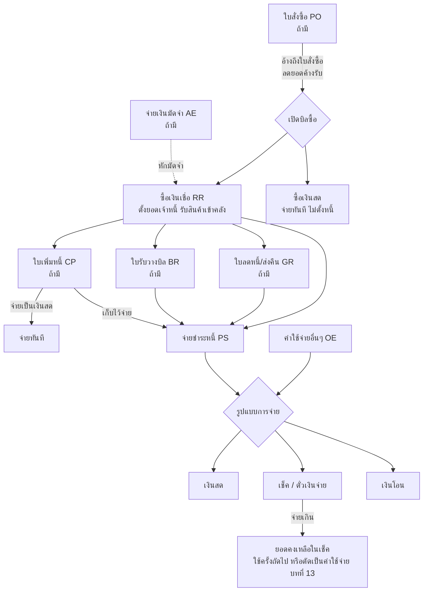
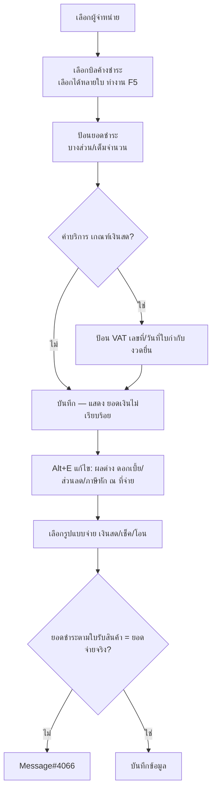

# บทที่ 11 การป้อนข้อมูลในระบบซื้อและเจ้าหนี้
> อ้างอิงคู่มือ หน้า 159–193 (PDF p.175–209) — หน้า 194 (PDF p.210) เป็นหน้าว่าง

## ภาพรวม
- ระบบซื้อและเจ้าหนี้ครอบคลุม: ใบสั่งซื้อ (PO) → เปิดบิลซื้อ (ซื้อเงินสด / ซื้อเงินเชื่อ) → (ซื้อเงินเชื่อ) ใบรับวางบิล, ใบลดหนี้/ส่งคืน, ใบเพิ่มหนี้ (ถ้ามี) → จ่ายชำระหนี้ (หน้า 159 แผนภาพ)
- เปิดบิลซื้อได้ทั้งแบบอ้างถึงใบสั่งซื้อ หรือไม่อ้างถึงก็ได้ (หน้า 159–160)
- ซื้อเงินสด = จบในขั้นตอนเดียว (จ่ายเงินสด/เช็คในบิลซื้อเลย ไม่ตั้งหนี้) ส่วนซื้อเงินเชื่อ = ตั้งยอดเจ้าหนี้รายตัว ต้องทำใบจ่ายชำระหนี้เมื่อครบกำหนด (หน้า 160, 171)
- มีเรื่องร่วมทุกหน้าจอ: ประเภทราคา (0/1/2), ส่วนลด, Bill be, ภาระภาษีซื้อ (เกณฑ์สิทธิ/เกณฑ์เงินสด) สำหรับค่าบริการ, หมายเหตุเพิ่มเติม, ของแถม, สินค้ายกเว้นภาษี, ภาษีหัก ณ ที่จ่าย (หน้า 160–161, 189–193)
- นอกจากนี้มีหน้าจอบันทึกเงินมัดจำจ่าย (AE) และค่าใช้จ่ายอื่นๆ (OE) สำหรับผู้ใช้ที่ไม่ชำนาญบัญชี (หน้า 168–171, 187–189)

### รหัสเอกสาร (prefix) ที่ปรากฏบนภาพหน้าจอ
| prefix | เอกสาร | ตัวอย่างเลขที่ | หน้า |
|---|---|---|---|
| PO | ใบสั่งซื้อ | PO0000001 | 165 |
| AE | จ่ายเงินมัดจำ | AE0000001 | 169 |
| RR | ซื้อเงินเชื่อ (ใบรับสินค้า/บิลซื้อ) | RR0000003 | 172 |
| CP | ใบเพิ่มหนี้ (ของเจ้าหนี้) | CP0000001 | 175 |
| GR | ใบลดหนี้/ส่งคืน | GR0000001 | 177 |
| BR | ใบรับวางบิล | BR0000001 | 180 |
| PS | จ่ายชำระหนี้ (ใบจ่ายเงิน) | PS0000003 | 182 |
| OE | บันทึกค่าใช้จ่ายอื่นๆ | OE0000001 | 187 |
| (ไม่ระบุ) | ซื้อเงินสด | — | 171 (ไม่มีภาพหน้าจอ) |

### ฟิลด์/แนวคิดร่วม (หน้า 160–161)
- **ประเภทราคา**: 0 = ราคาสินค้าได้รับการยกเว้นภาษี (ไม่คำนวณภาษี), 1 = ราคารวมภาษีแล้ว (100 บาท → VAT 6.54 = 100×7/107), 2 = ราคายังไม่รวมภาษี (100 บาท → VAT 7 = 100×7/100). บนหน้าจอแสดงเป็น dropdown เช่น "2 - แยก VAT", "0 - ไม่มี VAT"
- **ส่วนลด**: ป้อนเป็นจำนวนเงิน (1500.00) หรือเปอร์เซ็นต์ (10%) หรือส่วนลดซ้อน (5+2%); ป้อน "10" แล้ว Enter โปรแกรมเปลี่ยนเป็น 10% อัตโนมัติ [ข้อความคู่มือ: "ป้อนเป็น 10+ และกด Enter" — สันนิษฐานว่าหมายถึงป้อนตัวเลขแล้วโปรแกรมเติม %]
- **Bill be**: ใช้เมื่อติดต่อซื้อกับผู้จำหน่ายรายหนึ่ง แต่ใบกำกับภาษีออกในนามอีกสาขา/รหัสหนึ่ง — ช่อง "ผู้จำหน่าย" = รหัสที่ตั้งหนี้ (ใช้ในรายงานวิเคราะห์การซื้อ/รายงานเจ้าหนี้) ช่อง "Bill be" = รหัสตามใบกำกับภาษี ใช้แสดงผลตอนพิมพ์ใบรับของ (บิลซื้อ) และรายงานภาษีซื้อเท่านั้น
- **การพิมพ์แบบฟอร์ม**: คลิกไอคอนพิมพ์เอกสาร หรือ <Alt+P> หลังบันทึก เลือกพิมพ์ทางจอภาพ/เครื่องพิมพ์/แฟ้มข้อมูล (แก้แบบฟอร์มดูบทที่ 25) (หน้า 161)

## หน้าจอ

### S-PU-C1 หน้าต่างถามภาระภาษีซื้อ (เกณฑ์ภาษี)
- เมนู: ปรากฏอัตโนมัติในหน้าจอบิลซื้อ (เช่น ซื้อเงินเชื่อ)
- อ้างอิง: หน้า 161–163 (PDF p.177–179) — มีภาพหน้าจอ: ใช่ (รูปที่ 1, 2)
- ลักษณะ: dialog 2 ปุ่ม ข้อความ "ภาษีซื้อของสินค้าบริการในที่นี้เป็นแบบ"

| ส่วน/แท็บ | ฟิลด์ | ชนิดข้อมูล | บังคับ | ค่าเริ่มต้น/อ้างอิงจาก | คำอธิบาย/เงื่อนไข |
|---|---|---|---|---|---|
| dialog | เกณฑ์ภาษี | select (ปุ่ม) | ใช่ | — | เกณฑ์สิทธิ / เกณฑ์เงินสด |
| แท็บ รายการจ่ายชำระ <F7> (บนหน้าบิลซื้อ) | ภาระภาษีซื้อ | select | — | ค่าที่เลือกใน dialog | แสดง "เกณฑ์เงินสด"/"เกณฑ์สิทธิ"; มีปุ่ม "แก้ไขยอดเงิน" |
| 〃 | ใบรับวางบิล# | text | — | — | อ้างอิงใบรับวางบิล (ภาพแสดง "~") |
| 〃 | จำนวนเงินรวมทั้งสิ้น / ยอดชำระ/ลดหนี้ / ยอดคงค้าง / ภาษีหัก ณ ที่จ่าย | money | — | คำนวณ | สรุปสถานะการชำระของบิล |
| 〃 | ชำระเงินเรียบร้อย | check (Y) | — | ระบบ | Y เมื่อชำระครบ |
| 〃 | วันที่เรียบร้อย | date | — | ระบบ | วันที่ชำระครบ |
| 〃 grid | ใบจ่ายเงิน # / วันที่ / วันที่จ่าย / ยอดจ่าย / วันที่เรียบร้อย | — | — | จาก PS | ประวัติการจ่ายชำระที่ผูกกับบิลนี้ |

ปุ่ม/คำสั่ง: เกณฑ์สิทธิ, เกณฑ์เงินสด; แก้ไขเกณฑ์ภายหลังด้วยไอคอน "ลงบัญชีใหม่" (dialog จะขึ้นมาถามอีกครั้ง) (หน้า 163)
กฎทางธุรกิจ/เงื่อนไข:
- ถามเฉพาะเมื่อ **สินค้ารายการแรก** ในเอกสารเป็นสินค้าบริการ (หมายเหตุ หน้า 162)
- เกณฑ์สิทธิ: ภาษีซื้อเกิดในวันที่ตามใบกำกับภาษีซื้อ; เกณฑ์เงินสด: ภาษีเกิดเมื่อจ่ายชำระหนี้/ค่างวด (หน้า 161)
ผลทางบัญชี/สต๊อก: กำหนดจังหวะการรับรู้ภาษีซื้อ — เกณฑ์เงินสด ภาษีซื้อรับรู้ตอนจ่ายชำระ (ดู S-PU-07c) [การพักบัญชีภาษีซื้อยังไม่ถึงกำหนด — สันนิษฐาน]

### S-PU-C2 ป้อนหมายเหตุเพิ่มเติม
- เมนู: ไอคอน "เพิ่ม/แก้ไขหมายเหตุของเอกสาร" หรือ <Alt+R> ในทุกหน้าจอป้อนข้อมูลรายวัน
- อ้างอิง: หน้า 163–164 (PDF p.179–180) — มีภาพหน้าจอ: ใช่ (รูปที่ 3, 4)
- ลักษณะ: dialog รายการบรรทัดข้อความ แต่ละบรรทัดมีปุ่มแว่นขยาย

| ส่วน/แท็บ | ฟิลด์ | ชนิดข้อมูล | บังคับ | ค่าเริ่มต้น/อ้างอิงจาก | คำอธิบาย/เงื่อนไข |
|---|---|---|---|---|---|
| ระดับเอกสาร | หมายเหตุบรรทัดที่ 1..n | text (lookup) | ไม่ | — | คู่มือบอก "ได้ทั้งหมดอีก 5 บรรทัด" แต่ภาพแสดง 10 ช่อง [ไม่สอดคล้อง] |
| ระดับรายการสินค้า | หมายเหตุบรรทัดที่ 1..10 | text (lookup) | ไม่ | — | หมายเหตุต่อรายการสินค้า 10 บรรทัด |

ปุ่ม/คำสั่ง: ตกลง, ยกเลิก (<Esc>), ลบบรรทัด, เพิ่มบรรทัด
กฎทางธุรกิจ/เงื่อนไข: หมายเหตุรายสินค้าเพิ่มได้หลังบันทึกรายการสินค้านั้นแล้ว และเลื่อนเคอร์เซอร์ไปที่รายการนั้นก่อนคลิกไอคอน (หมายเหตุ หน้า 164)
ผลทางบัญชี/สต๊อก: ไม่มี

### S-PU-01 ใบสั่งซื้อ (PO)
- เมนู: ซื้อ > 3 ใบสั่งซื้อ
- อ้างอิง: หน้า 164–168 (PDF p.180–184) — มีภาพหน้าจอ: ใช่ (รูปที่ 5, 6, 7)
- ลักษณะ: header (ซ้าย: ผู้จำหน่าย / ขวา: เอกสาร) + แท็บ 3 แท็บ (grid) + footer ยอดรวม; title bar "PO - ใบสั่งซื้อ"

| ส่วน/แท็บ | ฟิลด์ | ชนิดข้อมูล | บังคับ | ค่าเริ่มต้น/อ้างอิงจาก | คำอธิบาย/เงื่อนไข |
|---|---|---|---|---|---|
| header ซ้าย | ผู้จำหน่าย | lookup | ใช่ [สันนิษฐาน] | ทะเบียนผู้จำหน่าย | ค้นด้วยแว่นขยาย เรียงตามรหัสหรือชื่อตามที่ตั้งในเริ่มระบบ 1.5.1; แสดงชื่อ ที่อยู่ รหัสไปรษณีย์ โทร. ใต้ช่อง |
| header ซ้าย | Bill be | lookup | ไม่ | ทะเบียนผู้จำหน่าย | ดูแนวคิดร่วม |
| header ซ้าย | สาขา# | number | ไม่ | 0 | สาขาของผู้จำหน่าย [สันนิษฐาน] |
| header ซ้าย | อ้างอิง | text (lookup) | ไม่ | — | คู่มือเรียก "หมายเหตุ" ข้อความอ้างอิงในใบสั่ง (ภาพ: "ส่งของทันที") |
| header ขวา | แผนก | lookup | ไม่ | ตารางแผนก (เริ่มระบบ ข้อ 7) | Enter ผ่านได้ถ้าไม่แยกแผนก |
| header ขวา | เลขที่ใบสั่งซื้อ | text | ใช่ | running อัตโนมัติ | Enter ผ่าน = ให้เครื่องลำดับเลข หรือป้อนเอง |
| header ขวา | วันที่ | date | ใช่ | — | วันที่ใบสั่งซื้อ |
| header ขวา | เครดิต (วัน) | number | ไม่ | ทะเบียนผู้จำหน่าย | แก้ได้ |
| header ขวา | รับของวันที่ | date | ไม่ | — | วันที่ผู้จำหน่ายนัดส่งของ |
| header ขวา | กำหนดวันรับของที่สินค้า? | check (Y/N) | ไม่ | N | Y = ให้ใส่วันที่รับของในแต่ละรายการสินค้า |
| header ขวา | ขนส่งโดย | lookup | ไม่ | — | วิธีขนส่ง |
| header ขวา | ประเภทราคา | select 0/1/2 | ใช่ | — | ดูแนวคิดร่วม |
| ปุ่ม header | ปรับปรุงยอดค้างรับใหม่ | button | — | — | ปรากฏบนภาพ; คู่มือไม่อธิบาย |
| แท็บ รายการสินค้า <F8> grid | No. / รหัส / ร(รายละเอียด) / คลัง / จำนวน + หน่วย / ราคาต่อหน่วย / ส่วนลด / F / จำนวนเงิน | — | — | — | รหัสสินค้า lookup (เรียงตามเริ่มระบบ 1.3.1, พิมพ์ 1–2 อักษรนำหน้าเพื่อกรอง); จำนวนป้อนเป็นหน่วยใหญ่หรือย่อยได้; จำนวนเงิน = จำนวน × ราคา/หน่วย − ส่วนลด; คอลัมน์ "F" ไม่อธิบาย |
| footer | สถานที่ส่งของ | lookup | ไม่ | — | ถ้าให้ส่งที่อื่นที่ไม่ใช่ที่อยู่ปกติ |
| footer | จำนวนเงิน | money | — | คำนวณ | รวมรายการ |
| footer | หักส่วนลด | text(สูตร) | ไม่ | ทะเบียนผู้จำหน่าย | ส่วนลดการค้ารวมเอกสาร |
| footer | ยอดหลังหักส่วนลด | money | — | คำนวณ | |
| footer | ภาษีมูลค่าเพิ่ม (%) + ยอด | number + money | — | 7.00 | ปล่อยยอดว่าง โปรแกรมคำนวณให้ |
| footer | จำนวนเงินรวมทั้งสิ้น | money | — | คำนวณ | |
| แท็บ รายการแสดงยอดสินค้าค้างรับ <Ctrl+F8> grid | (No) / รหัส / ร / จำนวน / ค้างรับ / วันที่รับ / Y / F / ยกเลิก / เหตุผล | — | — | — | หน้าที่ 2 ของรายการสินค้า แสดงยอดค้างรับ จำนวนที่ยกเลิก วันที่ยกเลิก |
| 〃 | ยกเลิก | number | ไม่ | 0.0 | ดับเบิลคลิกเพื่อป้อนจำนวนที่ยกเลิก (บางส่วนหรือทั้งหมด) |
| 〃 | วันที่ยกเลิก | date | ไม่ | ระบบเสนอ | ป้อนวันที่ยกเลิกกับผู้จำหน่าย |
| 〃 | เหตุผล | lookup | ไม่ | ตารางข้อมูล (เริ่มระบบ ข้อ 2) | เหตุผลการยกเลิก เช่น สินค้าขาดตลาด, ผู้จำหน่ายขึ้นราคา |
| แท็บ รายการสินค้าที่รับแล้ว <F7> grid | รหัส / รายละเอียด / เลขที่เอกสาร / No. / คลัง / จำนวน / ราคา/หน่วย / ส่วนลด | — | — | จาก RR | แสดงใบรับสินค้า (บิลซื้อ) ที่รับตามใบสั่งซื้อนี้ (read-only) |

ปุ่ม/คำสั่ง (toolbar ร่วมทุกเอกสาร ตามภาพ): ใหม่, แก้ไข, VOID [สันนิษฐานจากไอคอน], ลบ, ยกเลิก, บันทึก, เลื่อนแรก/ก่อน/ถัดไป/สุดท้าย, ค้นหา, พิมพ์ (<Alt+P>), Note (หมายเหตุ <Alt+R>), ไอคอน P/O และ OK อื่นๆ [ไม่ได้อธิบายในบทนี้]
กฎทางธุรกิจ/เงื่อนไข:
- PO เก็บยอดสั่งซื้อและยอดค้างรับ; เมื่อบันทึกรับสินค้า (ซื้อเงินสด/ซื้อเงินเชื่อ) อ้างถึง PO ระบบลดยอดค้างรับ (หน้า 164)
- ยกเลิกยอดสั่งซื้อรายบรรทัดได้ ไม่ต้องยกเลิกทั้งเอกสาร เพื่อเก็บประวัติและวิเคราะห์เหตุผล (หน้า 167)
- รายงาน: 1.3.A รายงานสินค้าถูกยกเลิก แยกตามเหตุผล (หน้า 168); 2.3 รายงานสินค้าค้างรับ แยกตามสินค้า/ใบสั่งซื้อ/ผู้จำหน่าย (หน้า 168)
ผลทางบัญชี/สต๊อก: ไม่ลงบัญชี ไม่กระทบสต๊อก (เป็นเอกสารสั่งซื้อ) [สันนิษฐาน — คู่มือไม่กล่าวถึงการลงบัญชี]; ปรับยอด "ค้างรับ"

### S-PU-02 จ่ายเงินมัดจำ (AE)
- เมนู: ซื้อ > 1 จ่ายเงินมัดจำ
- อ้างอิง: หน้า 168–171 (PDF p.184–187) — มีภาพหน้าจอ: ใช่ (รูปที่ 8, 9, 10)
- ลักษณะ: header + แท็บ (grid คำอธิบาย/จำนวนเงิน) + footer ยอด + ส่วนการชำระเงิน + grid ชำระโดยอื่นๆ; title "AE - จ่ายเงินมัดจำ"

| ส่วน/แท็บ | ฟิลด์ | ชนิดข้อมูล | บังคับ | ค่าเริ่มต้น/อ้างอิงจาก | คำอธิบาย/เงื่อนไข |
|---|---|---|---|---|---|
| header ซ้าย | ผู้จำหน่าย | lookup | ใช่ [สันนิษฐาน] | ทะเบียนผู้จำหน่าย | เหมือน PO |
| header ซ้าย | Bill be / สาขา# | lookup / number | ไม่ | — | |
| header ซ้าย | เลขที่บิล | text | ไม่ | — | เลขที่ใบกำกับภาษีที่ผู้จำหน่ายออกเมื่อรับมัดจำ |
| header ซ้าย | ลวท. | date | ไม่ | — | วันที่ตามใบกำกับภาษี |
| header ซ้าย | หมายเหตุ | text (lookup) | ไม่ | — | เช่น "จ่ายเงินมัดจำล่วงหน้า 30%" |
| header ขวา | แผนก | lookup | ไม่ | — | |
| header ขวา | ใบจ่ายเงินมัดจำ | text | ใช่ | running อัตโนมัติ | |
| header ขวา | วันที่ | date | ใช่ | — | |
| header ขวา | ครบกำหนด (วัน) + ครบกำหนด (วันที่) | number + date | ไม่ | — | สำหรับสัญญาจ่ายล่วงหน้า ตรวจว่าจ่ายตามกำหนด |
| header ขวา | ประเภทราคา | select 0/1/2 | ใช่ | — | |
| แท็บ รายการสินค้า <F8> grid | No. / คำอธิบาย / จำนวนเงิน | text / money | ใช่ | — | หลายบรรทัดได้ (เช่น มัดจำแยกตามสินค้า); <Esc> เพื่อออก |
| แท็บอื่น | รายการตัดเงินมัดจำ <Ctrl+F8>, รายการภาษีซื้อ <Ctrl+F7>, รายการภาษีหัก ณ ที่จ่าย <Ctrl+F10> | tab | — | — | คู่มือไม่อธิบายเนื้อหา |
| footer | จำนวนเงิน / ภาษีมูลค่าเพิ่ม % + ยอด / จำนวนเงินรวมทั้งสิ้น | money | — | คำนวณ | VAT คำนวณอัตโนมัติ |
| ส่วนชำระ | เงินสด | money | — | = ยอดรวม | ค่าเริ่มต้น = จ่ายเป็นเงินสด |
| ส่วนชำระ | ชำระโดยอื่นๆ (ด้านล่าง) | money | — | ผลรวม grid | |
| ส่วนชำระ | ภาษีหัก ณ ที่จ่าย (ปุ่ม+ยอด) | button + money | — | S-PU-C4 | |
| ส่วนชำระ | ยอดจ่ายจริง | money | — | คำนวณ | |
| grid ชำระโดยอื่นๆ <F7> | ชำระโดยอื่นๆ / ลงวันที่ / ธนาคาร / จำนวนเงิน / ยอดคงเหลือ / ยอดชำระ | — | — | วิธีชำระ (เริ่มระบบ 1.5.2) | ดับเบิลคลิกเลือกวิธีชำระ (S-PU-C6) |

ปุ่ม/คำสั่ง: toolbar มาตรฐาน + บันทึก
กฎทางธุรกิจ/เงื่อนไข: จ่ายเงินสดบางส่วน + เช็คส่วนที่เหลือได้ แต่ "จำนวนเงินรวมทั้งสิ้น" ต้องเท่ากับ "ยอดจ่ายจริง" เสมอ (หน้า 171); มัดจำที่บันทึกไว้จะถูกเสนอให้หักในบิลซื้อ (ช่อง หักมัดจำ) (หน้า 174)
ผลทางบัญชี/สต๊อก: [สันนิษฐาน] Dr เงินมัดจำจ่าย/เงินจ่ายล่วงหน้า, Dr ภาษีซื้อ / Cr เงินสด หรือ เช็คจ่ายล่วงหน้า (2120-02), Cr ภาษีหัก ณ ที่จ่าย (2132-02) — รหัสบัญชี 2120-02, 2132-02 ปรากฏในหน้าต่างเลือกวิธีชำระ (รูปที่ 10)

### S-PU-03 ซื้อเงินเชื่อ (RR) / ซื้อเงินสด
- เมนู: ซื้อ > 4 ซื้อเงินเชื่อ (ซื้อเงินสด: เมนูซื้อ ไม่ระบุข้อ — หน้าจอคล้ายกัน คู่มืออธิบายเฉพาะซื้อเงินเชื่อ)
- อ้างอิง: หน้า 171–174 (PDF p.187–190) และ 162, 190 — มีภาพหน้าจอ: ใช่ (รูปที่ 1, 11, 12, 38)
- ลักษณะ: header + แท็บ 5 แท็บ + footer ยอดรวม; title "RR - ซื้อเงินเชื่อ"

| ส่วน/แท็บ | ฟิลด์ | ชนิดข้อมูล | บังคับ | ค่าเริ่มต้น/อ้างอิงจาก | คำอธิบาย/เงื่อนไข |
|---|---|---|---|---|---|
| header ซ้าย | ผู้จำหน่าย | lookup | ใช่ [สันนิษฐาน] | ทะเบียนผู้จำหน่าย (1.5.1) | แสดงชื่อ ที่อยู่ โทร./Fax |
| header ซ้าย | Bill be / สาขา# | lookup / number | ไม่ | — | |
| header ซ้าย | เลขที่บิล | text | ไม่ | — | เลขที่ใบกำกับภาษีของผู้จำหน่าย |
| header ซ้าย | ลวท. | date | ไม่ | — | วันที่ใบกำกับภาษี; ภาพมีช่องเล็กต่อท้าย (งวดภาษี เช่น 03/58) [สันนิษฐาน] |
| header ซ้าย | หมายเหตุ | text (lookup) | ไม่ | — | |
| header ขวา | แผนก | lookup | ไม่ | — | |
| header ขวา | เลขที่ใบรับสินค้า | text | ใช่ | running อัตโนมัติ (RR) | |
| header ขวา | วันที่ | date | ใช่ | — | |
| header ขวา | อ้างถึงใบสั่งซื้อ | lookup | ไม่ | PO ของผู้จำหน่ายนี้ | เลือกจากหน้าต่าง (S-PU-03a) ดึงรายการมาให้อัตโนมัติ |
| header ขวา | ปุ่ม หมายเหตุของใบสั่งซื้อ | button | — | PO | ดูหมายเหตุของ PO ที่อ้างถึง |
| header ขวา | เครดิต (วัน) | number | ไม่ | ทะเบียนผู้จำหน่าย | |
| header ขวา | ครบกำหนด | date | — | คำนวณ = วันที่ + เครดิต | |
| header ขวา | ขนส่งโดย | lookup | ไม่ | — | |
| header ขวา | ประเภทราคา | select 0/1/2 | ใช่ | — | |
| แท็บ รายการสินค้า <F8> grid | No. / รหัส / ร(รายละเอียด) / คลัง / จำนวน + หน่วย / ราคาต่อหน่วย / ส่วนลด / F / จำนวนเงิน | — | — | — | รหัส lookup (1.3.1); คลัง = คลังที่รับเข้า; จำนวนเงิน = จำนวน × ราคา − ส่วนลด; ขึ้นบรรทัดใหม่อัตโนมัติ |
| แท็บ | รายละเอียดอื่น <Ctrl+F8> | tab | — | — | ภาพหน้า 173 แสดงเป็น "รายการJob <Ctrl+F8>" — คู่มือไม่อธิบาย |
| แท็บ รายการจ่ายชำระ <F7> | ภาระภาษีซื้อ, ใบรับวางบิล#, ยอดชำระ/ลดหนี้, ยอดคงค้าง, ชำระเงินเรียบร้อย, วันที่เรียบร้อย + grid ใบจ่ายเงิน | — | — | — | ดู S-PU-C1 |
| แท็บ | รายการภาษีซื้อ <Ctrl+F7>, รายการภาษีหัก ณ ที่จ่าย <Ctrl+F10> | tab | — | — | |
| footer | จำนวนเงิน | money | — | คำนวณ | |
| footer | หักส่วนลด | text(สูตร) + money | ไม่ | ทะเบียนผู้จำหน่าย | ส่วนลดการค้า แก้ได้ |
| footer | หักเงินมัดจำ | lookup (AE) + money | ไม่ | AE ของผู้จำหน่าย | ถ้ามี AE ค้าง ระบบถามว่าจะนำมาหักหรือไม่ (ตกลง/ยกเลิก) |
| footer | แยกยอดเงิน 0.00 %= ... / 7.00 %= ... | money | — | คำนวณ | แสดงเมื่อเอกสารมีทั้งสินค้ายกเว้นภาษีและสินค้ามีภาษี (รูปที่ 38) |
| footer | ภาษีมูลค่าเพิ่ม % + ยอด | number + money | — | 7.00 | ปล่อยยอดว่าง ระบบคำนวณ |
| footer | จำนวนเงินรวมทั้งสิ้น | money | — | คำนวณ | |

ปุ่ม/คำสั่ง: toolbar มาตรฐาน, บันทึก, ลงบัญชีใหม่ (แก้เกณฑ์ภาษี), เพิ่ม/แก้ไขหมายเหตุ <Alt+R>, พิมพ์ <Alt+P>
กฎทางธุรกิจ/เงื่อนไข:
- ราคาต่อหน่วยทศนิยมไม่รู้จบ (เช่น 3 ชิ้น 10 บาท): ป้อนจำนวน 3 เว้นราคาและส่วนลด ป้อนจำนวนเงิน 10 → ระบบคำนวณราคาต่อหน่วยกลับ (หมายเหตุ หน้า 174)
- ราคาต่อหน่วย = 0 → ถามของแถม (S-PU-C3)
- สินค้ายกเว้นภาษี (กำหนดที่เมนูสินค้า ข้อ 2 ค่าในช่อง ประเภท VAT) → คำนวณ VAT เฉพาะสินค้ามีภาษี (หน้า 190)
- ซื้อเงินสด: บันทึกตัดจ่ายเงินสดทันที ไม่ตั้งยอดเจ้าหนี้ (หน้า 171)
ผลทางบัญชี/สต๊อก:
- สต๊อก: รับสินค้าเข้าคลังที่ระบุ (นัยจาก "คลัง ป้อนคลังที่ต้องการจะรับสินค้ารายการนี้เข้า" หน้า 174); ลดยอดค้างรับของ PO ที่อ้างถึง (หน้า 164)
- เจ้าหนี้: ซื้อเงินเชื่อ ตั้งยอดเจ้าหนี้รายตัวตาม "ผู้จำหน่าย" (ไม่ใช่ Bill be) (หน้า 161, 171)
- [สันนิษฐาน] ซื้อเงินเชื่อ: Dr สินค้า/ซื้อ, Dr ภาษีซื้อ (หรือภาษีซื้อยังไม่ถึงกำหนดถ้าเกณฑ์เงินสด) / Cr เจ้าหนี้การค้า, Cr เงินมัดจำจ่าย (ถ้าหักมัดจำ); ซื้อเงินสด: Cr เงินสด/เช็ค แทนเจ้าหนี้

### S-PU-03a หน้าต่างเลือกใบสั่งซื้อ (อ้างถึงใบสั่งซื้อ)
- เมนู: คลิกแว่นขยายช่อง "อ้างถึงใบสั่งซื้อ" ในบิลซื้อ
- อ้างอิง: หน้า 173 (PDF p.189) — มีภาพหน้าจอ: ใช่ (รูปที่ 12)
- ลักษณะ: dialog list

| ส่วน/แท็บ | ฟิลด์ | ชนิดข้อมูล | บังคับ | ค่าเริ่มต้น/อ้างอิงจาก | คำอธิบาย/เงื่อนไข |
|---|---|---|---|---|---|
| list | ใบสั่งซื้อ# / วันที่ / อ้างอิง / วันที่รับ | — | — | PO ของผู้จำหน่ายที่เลือก | ภาพแสดงเฉพาะ PO ที่ยังค้างรับ [สันนิษฐาน] |

ปุ่ม/คำสั่ง: ตกลง, ยกเลิก, ค้นหา
กฎทางธุรกิจ/เงื่อนไข: ลดการป้อนซ้ำและความผิดพลาดที่ข้อมูลไม่ตรงกับ PO
ผลทางบัญชี/สต๊อก: —

### S-PU-04 ใบเพิ่มหนี้ เจ้าหนี้ (CP)
- เมนู: การเงิน > 2.2 (ใบเพิ่มหนี้)
- อ้างอิง: หน้า 175–177 (PDF p.191–193) — มีภาพหน้าจอ: ใช่ (รูปที่ 13–16)
- ลักษณะ: header + แท็บ 4 แท็บ + footer; title "CP - ใบเพิ่มหนี้(ของเจ้าหนี้)"

| ส่วน/แท็บ | ฟิลด์ | ชนิดข้อมูล | บังคับ | ค่าเริ่มต้น/อ้างอิงจาก | คำอธิบาย/เงื่อนไข |
|---|---|---|---|---|---|
| header ซ้าย | ผู้จำหน่าย / Bill be / สาขา# | lookup | ใช่ | — | ผู้จำหน่ายที่จะเพิ่มหนี้ |
| header ซ้าย | อ้างถึงใบเพิ่มหนี้ | text | ไม่ | — | เลขที่ใบกำกับภาษี (ใบเพิ่มหนี้) ที่ผู้จำหน่ายออก |
| header ซ้าย | ลวท. | date | ไม่ | — | คู่มือเรียก "วันที่ของภาษีซื้อ" |
| header ซ้าย | หมายเหตุ | text (lookup) | ไม่ | — | |
| header ขวา | แผนก | lookup | ไม่ | — | |
| header ขวา | เลขที่ใบเพิ่มหนี้ | text | ใช่ | running อัตโนมัติ (CP) | |
| header ขวา | วันที่ | date | ใช่ | — | |
| header ขวา | เลขที่ใบรับสินค้า | lookup | ใช่ [สันนิษฐาน] | RR ที่ยังค้างชำระของผู้จำหน่ายนี้ | หลังเลือก แสดง dialog มูลค่าเดิม (S-PU-04a) |
| header ขวา | ประเภทราคา | select | ใช่ | — | |
| แท็บ รายการสินค้า <F8> grid | No. / รหัส / รายละเอียด / คลัง / จำนวน + หน่วย / ราคาต่อหน่วย / จำนวนเงิน | — | — | จาก RR | |
| แท็บอื่น | รายการจ่ายชำระ <F7>, รายการภาษีซื้อ <Ctrl+F7>, รายการภาษีหัก ณ ที่จ่าย <Ctrl+F10> | tab | — | — | |
| footer | มูลค่าของสินค้าหรือบริการ ตามใบกำกับภาษีเดิม | money | — | จาก RR | ใช้พิมพ์ในแบบฟอร์ม |
| footer | จำนวนเงิน / หักส่วนลด / ยอดหลังหักส่วนลด / ภาษีมูลค่าเพิ่ม % / จำนวนเงินรวมทั้งสิ้น | money | — | คำนวณ | |

#### S-PU-04a dialog มูลค่าสินค้าตามใบกำกับภาษีเดิม (รูปที่ 14)
- ฟิลด์: "มูลค่าของสินค้าหรือบริการตามใบกำกับภาษีเดิม (เพื่อใช้พิมพ์ในแบบฟอร์ม)" money; ปุ่ม ตกลง, ยกเลิก

#### S-PU-04b เลือกรายการที่จะเพิ่มหนี้ + ป้อนรายละเอียดสินค้าที่จะเพิ่มหนี้ (รูปที่ 15)
- list: No. / รหัสสินค้า / ซื้อ(จำนวน+หน่วย) / เพิ่มหนี้ / หน่วยละ / F / ชื่อสินค้า; ปุ่ม ทำงาน <F5>; รายการที่เลือกมีเครื่องหมายสามเหลี่ยม
- dialog รายละเอียด: รหัสสินค้า (lookup), รายละเอียด, ออกจากคลัง (lookup + ชื่อคลัง), จำนวน + หน่วย (lookup), หน่วยละ, จำนวนเงิน; ปุ่ม ตกลง, ยกเลิก
- จำนวน และ หน่วยละ จะป้อนหรือไม่ก็ได้; จำนวนเงิน = ยอดที่จะเพิ่มหนี้ของสินค้านั้น (หน้า 177)

#### S-PU-04c dialog "ยอดใบเพิ่มหนี้ใบนี้จะปฏิบัติอย่างไร?" (รูปที่ 16)
- ปุ่ม: จ่ายเป็นเงินสด / เก็บไว้จ่าย ตอนจ่ายชำระหนี้

ปุ่ม/คำสั่ง: เลือกรายการ แล้ว <Enter>, ทำงาน <F5> เพื่อบันทึก
กฎทางธุรกิจ/เงื่อนไข: ใช้เมื่อผู้จำหน่ายเปิดราคาต่ำไปแล้วออกเอกสารเพิ่มหนี้ (หน้า 175); ระบุรหัสสินค้าเพื่อให้วิเคราะห์การซื้อสมบูรณ์
ผลทางบัญชี/สต๊อก: เพิ่มต้นทุนสินค้าที่ระบุ แต่ **ไม่รับสินค้าเข้าสต๊อก** (หน้า 176); เพิ่มยอดเจ้าหนี้ หรือจ่ายเงินสดทันทีตามตัวเลือก; [สันนิษฐาน] Dr สินค้า(ต้นทุน), Dr ภาษีซื้อ / Cr เจ้าหนี้ (หรือ Cr เงินสด)

### S-PU-05 ใบลดหนี้/ส่งคืนสินค้า (GR)
- เมนู: การเงิน > 2.3
- อ้างอิง: หน้า 177–179 (PDF p.193–195) — มีภาพหน้าจอ: ใช่ (รูปที่ 17–21)
- ลักษณะ: header + แท็บ 5 แท็บ + footer; title "GR - ใบลดหนี้/ส่งคืน"

| ส่วน/แท็บ | ฟิลด์ | ชนิดข้อมูล | บังคับ | ค่าเริ่มต้น/อ้างอิงจาก | คำอธิบาย/เงื่อนไข |
|---|---|---|---|---|---|
| header ซ้าย | ผู้จำหน่าย / Bill be / สาขา# | lookup | ใช่ | — | ผู้จำหน่ายที่เปิดใบลดหนี้ |
| header ซ้าย | อ้างถึงใบลดหนี้ | text | ไม่ | — | เลขที่ใบลดหนี้ของผู้จำหน่าย |
| header ซ้าย | ลวท. | date | ไม่ | — | วันที่ของภาษีซื้อ |
| header ซ้าย | หมายเหตุ | text | ไม่ | — | |
| header ขวา | แผนก | lookup | ไม่ | — | |
| header ขวา | เลขที่ใบลดหนี้ | text | ใช่ | running (GR) | |
| header ขวา | วันที่ | date | ใช่ | — | |
| header ขวา | เลขที่ใบรับสินค้า (คู่มือ: เลขที่ใบรับส/ค) | lookup | ใช่ [สันนิษฐาน] | RR ที่ยังค้างชำระ | ถ้า RR ถูกจ่ายชำระแล้ว ต้องพิมพ์เลขที่เอง |
| header ขวา | ประเภทราคา | select | ใช่ | — | |
| แท็บ รายการสินค้า <F8> grid | No. / รหัส / ร / คลัง / จำนวน + หน่วย / ราคาต่อหน่วย / ส่วนลด / F / R / จำนวนเงิน | — | — | — | R = Y เมื่อส่งคืนสินค้า [สันนิษฐานจากภาพ] |
| แท็บอื่น | รายละเอียดอื่น <Ctrl+F8>, รายการจ่ายชำระ <F7>, รายการตัดกับบิลซื้อ <Shift+F7>, รายการภาษีซื้อ <Ctrl+F7> | tab | — | — | |
| footer | มูลค่าของสินค้าหรือบริการ ตามใบกำกับภาษีเดิม | money | — | RR | |
| footer | จำนวนเงิน / หักส่วนลด / ยอดหลังหักส่วนลด / ภาษีมูลค่าเพิ่ม % / จำนวนเงินรวมทั้งสิ้น | money | — | คำนวณ | |

#### S-PU-05a เลือกรายการที่จะลดหนี้หรือส่งคืน (รูปที่ 19, 21)
- list: No / รหัสสินค้า / ซื้อ(จำนวน+หน่วย) / ลดหนี้/ส่งคืน / หน่วยละ / F / ชื่อสินค้า; checkbox เลือก; ช่อง "ถูกเลือก n รายการ"; ปุ่ม ทำงาน <F5>, ยกเลิก, ค้นหา

#### S-PU-05b ป้อนรายละเอียดสินค้าที่จะลดหนี้หรือส่งคืน (รูปที่ 20)
| ฟิลด์ | ชนิด | คำอธิบาย |
|---|---|---|
| ส่งคืนสินค้า ? | check Y/N | Y = ส่งคืนสินค้าด้วย, N = แค่ลดหนี้ |
| รหัสสินค้า | lookup | |
| ออกจากคลัง | lookup | + ชื่อคลัง |
| รายละเอียด | text | |
| จำนวน + หน่วย + X (อัตราแปลงหน่วย) | number + lookup + number | อัตราแปลง [สันนิษฐาน] |
| หน่วยละ | money | |
| ส่วนลด | text | |
| จำนวนเงิน | money | |
| ส่งของแถมคืน ? | check Y/N (ว่าง=N) | |
ปุ่ม: ตกลง, ยกเลิก

กฎทางธุรกิจ/เงื่อนไข: ใช้เมื่อผู้จำหน่ายเปิดราคาสูงเกิน หรือสินค้าผิดสเปค (หน้า 177)
ผลทางบัญชี/สต๊อก (หน้า 179):
- N (ลดหนี้อย่างเดียว): ไม่ตัดสต๊อก; ปรับลดต้นทุนสินค้าตามยอดลดหนี้; ลดยอดหนี้ค้างชำระกับผู้จำหน่าย
- Y (ส่งคืน): ตัดสินค้าออกจากสต๊อก + ลดยอดหนี้ค้างชำระ
- [สันนิษฐาน] Dr เจ้าหนี้ / Cr สินค้า (หรือส่งคืน/ลดหนี้), Cr ภาษีซื้อ

### S-PU-06 ใบรับวางบิล (BR)
- เมนู: การเงิน > 2.1
- อ้างอิง: หน้า 180–181 (PDF p.196–197) — มีภาพหน้าจอ: ใช่ (รูปที่ 22–24)
- ลักษณะ: header + แท็บเดียว (grid) + footer ยอดรวม; title "BR - ใบรับวางบิล"

| ส่วน/แท็บ | ฟิลด์ | ชนิดข้อมูล | บังคับ | ค่าเริ่มต้น/อ้างอิงจาก | คำอธิบาย/เงื่อนไข |
|---|---|---|---|---|---|
| header ซ้าย | รหัสผู้ (จำหน่าย) | lookup | ใช่ | ทะเบียนผู้จำหน่าย | |
| header ซ้าย | เงื่อนไขการชำระเงิน | text (lookup) | ไม่ | ทะเบียนผู้จำหน่าย | ดึงมาอัตโนมัติ |
| header ซ้าย | หมายเหตุ | text (lookup) | ไม่ | — | |
| header ขวา | แผนก | lookup | ไม่ | — | |
| header ขวา | เลขที่ใบรับวางบิล | text | ใช่ | running (BR) | |
| header ขวา | วันที่ | date | ใช่ | — | |
| header ขวา | วันที่นัดจ่ายเงิน | date | ไม่ | — | วันที่นัดผู้จำหน่ายมารับเช็ค; ไม่ทราบให้เว้นว่าง |
| แท็บ รายการที่รับวางบิล <F8> grid | ใบรับสินค้า# / วันที่ / ครบกำหนด / เลขที่บิล / จำนวนเงิน / (ค้างชำระ) / (…) | — | — | RR ที่เลือก | 2 คอลัมน์ท้ายอ่านหัวไม่ชัด (ค่า 32,100.00 และ 0.00) [สันนิษฐาน: ค้างชำระ/ชำระแล้ว] |
| footer | จำนวนเงินรวมทั้งสิ้น | money | — | คำนวณ | |

#### S-PU-06a เลือกเอกสารที่จะรับวางบิล (รูปที่ 23–24)
- list: (เลือก) / ใบรับสินค้า# / บิลเลขที่ / วันที่ / ครบกำหนด / จำนวนเงิน / ชำระแล้ว / ค้างชำระ / แผนก
- เรียงตามวันที่ครบกำหนด (ค่าเริ่มต้น); <Tab> เปลี่ยนเรียงตามบิลเลขที่
- ดับเบิลคลิกเพื่อเลือก (เครื่องหมายสามเหลี่ยม) เลือกได้มากกว่า 1 ฉบับ; ช่อง "ถูกเลือก n รายการ"
- ปุ่ม: ทำงาน <F5>, ยกเลิก, ค้นหา, เรียงใหม่ <Tab>

กฎทางธุรกิจ/เงื่อนไข: แสดงเฉพาะใบรับสินค้าที่ยังค้างชำระของผู้จำหน่ายนี้ (หน้า 181); ใช้พิมพ์รายงานใบรับวางบิลเรียงตามวันที่นัดจ่าย เพื่อประมาณการเงินสดจ่าย (หน้า 180)
ผลทางบัญชี/สต๊อก: ไม่ลงบัญชี [สันนิษฐาน]; ผูกเลขใบรับวางบิลกับบิลซื้อ (แสดงในช่อง ใบรับวางบิล# ของ RR/PS)

### S-PU-07 จ่ายชำระหนี้ (PS)
- เมนู: การเงิน > 2.4
- อ้างอิง: หน้า 182–186 (PDF p.198–202) — มีภาพหน้าจอ: ใช่ (รูปที่ 25–33)
- ลักษณะ: header + แท็บ 4 แท็บ (grid บิล) + ส่วน VAT/ใบกำกับ + ส่วนชำระเงิน + grid ชำระโดยอื่นๆ; title "PS - จ่ายชำระหนี้"

| ส่วน/แท็บ | ฟิลด์ | ชนิดข้อมูล | บังคับ | ค่าเริ่มต้น/อ้างอิงจาก | คำอธิบาย/เงื่อนไข |
|---|---|---|---|---|---|
| header ซ้าย | ผู้จำหน่าย / Bill be / สาขา# | lookup | ใช่ | — | แสดงชื่อ โทร |
| header ซ้าย | หมายเหตุ | text (lookup) | ไม่ | — | |
| header ขวา | แผนก | lookup | ไม่ | — | |
| header ขวา | เลขที่ใบจ่ายเงิน | text | ใช่ | running (PS) | |
| header ขวา | วันที่ทำเอกสาร | date | ใช่ | — | ไม่จำเป็นต้องเป็นวันเดียวกับวันจ่ายจริง |
| header ขวา | วันที่จ่ายเงิน | date | — | = วันที่ทำเอกสาร | **ป้อนไม่ได้ตอนสร้างครั้งแรก**; แก้ภายหลังด้วย แก้ไขข้อมูล <Alt+E> |
| header ขวา | ข้อความสถานะ "ยอดเงินไม่เรียบร้อย" | label | — | ระบบ | เตือนเมื่อยังไม่ป้อนรูปแบบการจ่าย |
| แท็บ รายการบิลที่จ่ายชำระ <F8> grid | ใบรับสินค้า# / วันที่ / ใบรับวางบิล# / เลข(ที่บิล) / จำนวนเงิน / ยอดคงค้าง / ยอดจ่าย | — | — | RR ค้างชำระ | เลือกได้หลายใบกำกับในใบจ่ายเงิน 1 ใบ |
| แท็บอื่น | รายละเอียดเช็คเพิ่มเติม <Ctrl+F8>, รายการภาษีซื้อ <Ctrl+F7>, รายการภาษีหัก ณ ที่จ่าย <Ctrl+F10> | tab | — | — | |
| ส่วนกลาง | VAT(กรณีจ่ายค่าบริการ) | money | — | คำนวณ | ภาษีซื้อเกณฑ์เงินสด |
| ส่วนกลาง | เลขที่บิล / ลวท. / ยื่นงวด | text / date / text(MM/YY) | — | — | ใบกำกับภาษีค่าบริการ |
| ส่วนกลาง | ยอดชำระตามใบรับสินค้า | money | — | ผลรวมยอดจ่าย | |
| ส่วนชำระ | ดอกเบี้ยจ่าย | money | ไม่ | 0 | ผลต่าง: จ่ายล่าช้า |
| ส่วนชำระ | เงินสด | money | — | — | |
| ส่วนชำระ | ชำระโดยอื่นๆ (ด้านล่าง) | money | — | ผลรวม grid | |
| ส่วนชำระ | ส่วนลดเงินสดรับ | money | ไม่ | — | ผลต่าง: จ่ายเร็ว |
| ส่วนชำระ | ภาษีหัก ณ ที่จ่าย (ปุ่ม + ยอด) | button + money | ไม่ | S-PU-C4 | |
| ส่วนชำระ | ยอดจ่ายจริง | money | — | คำนวณ | |
| grid ชำระโดยอื่นๆ <F7> | ชำระโดยอื่นๆ / ลงวันที่ / ธนาคาร / จำนวนเงิน / ยอดคงเหลือ / ยอดชำระ | — | — | วิธีชำระ (1.5.2) | ดับเบิลคลิก → S-PU-C6 |

#### S-PU-07a เลือกรายการที่จะจ่ายชำระหนี้ (รูปที่ 26)
- list: (เลือก) / ใบรับสินค้า# / ใบวางบิล# / เลขที่บิล / จำนวนเงิน / ยอดคงค้าง / ยอดชำระ / วันที่ / ครบกำหนด / แผนก
- ปุ่ม: ทำงาน <F5>, ยกเลิก, ค้นหา, เรียงใหม่ <Tab>; ถูกเลือก n รายการ

#### S-PU-07b ป้อนยอดเงินที่จ่ายชำระ (รูปที่ 27)
- ฟิลด์: ยอดชำระ (money, ค่าเริ่มต้น = ยอดคงค้าง; ป้อนบางส่วนหรือเต็มจำนวน); ปุ่ม ตกลง, ยกเลิก

#### S-PU-07c ป้อนยอดเงินที่จ่ายชำระ — กรณีค่าบริการเกณฑ์เงินสด (หมายเหตุ หน้า 183)
- ฟิลด์: ยอดชำระ, ภาษีมูลค่าเพิ่ม (คำนวณอัตโนมัติ แก้ได้), เลขที่ใบกำกับภาษี, วันที่ใบกำกับภาษี (date lookup), ยื่นรวมในงวด (MM/YY), ยื่นเพิ่มเติม (check); ปุ่ม ตกลง, ยกเลิก

#### S-PU-07d เลือกเช็คจ่ายที่เหลือจากครั้งก่อน (รูปที่ 31)
- list: เลขที่เช็ค / วันที่ / จำนวนเงิน / ยอดคงเหลือ / รหัสผู้จำหน่าย; ปุ่ม ตกลง, ยกเลิก, ค้นหา
- เรียกโดยคลิกแว่นขยาย (หรือ Enter) ในช่องเลขที่เช็คโดยไม่ป้อนเลข

ปุ่ม/คำสั่ง: แก้ไขข้อมูล <Alt+E>, ทำงาน <F5>, บันทึกข้อมูล, ยกเลิกการเพิ่มหรือแก้ไขข้อมูล <Esc>
กฎทางธุรกิจ/เงื่อนไข:
- รูปแบบการจ่าย: (1) เงินสด — <Alt+E> แล้ว Enter มาช่องเงินสด ป้อนยอด บันทึก; (2) เช็ค — ดับเบิลคลิก grid เลือก "เช็คจ่ายล่วงหน้า" ป้อนเลขที่เช็ค วันที่เช็ค รหัสธนาคาร จำนวนเงิน (หลายเช็คได้; ถ้าเช็คเดียวกด <Esc>); (3) อื่นๆ — ตั๋วเงินจ่ายเหมือนเช็ค; เงินโอน (กำหนดในเริ่มระบบ 1.5.2) ระบุเพียงวันที่โอนและยอดในช่องยอดชำระ (หน้า 184–185)
- ผสมเงินสด+อื่นๆ ได้ แต่ "ยอดชำระตามใบรับสินค้า" ต้องเท่ากับ "ยอดจ่ายจริง" เสมอ (หน้า 185)
- เช็ค/ตั๋วที่จ่ายเกินยอด → เกิด "ยอดคงเหลือในเช็คจ่าย" ใช้ชำระผู้จำหน่ายรายเดิมครั้งถัดไปได้ (ตัวอย่าง 33,000 − 32,100 = 900) หรือตัดเป็นค่าใช้จ่าย (บทที่ 13) (หน้า 185–186)
- ผลต่าง (ดอกเบี้ยจ่าย / ภาษีหัก ณ ที่จ่าย / ส่วนลดเงินสดรับ) ต้องป้อนก่อนเลือกรูปแบบการจ่าย ป้อนผ่าน <Alt+E> หลังบันทึก; ระบบเตือน Message#4066 "ยอดชำระตามใบรับสินค้าไม่เท่ากับยอดจ่ายจริง" กด ตกลง แล้วค่อยเลือกรูปแบบการจ่าย (หน้า 186)
- ตัวอย่างภาพ: ยอดชำระ 1,605 = เงินสด 1,560 + ภาษีหัก ณ ที่จ่าย 45 (รูปที่ 29)
ผลทางบัญชี/สต๊อก: ลดยอดหนี้ค้างชำระตามบิลที่เลือก; ปรับสถานะ "ชำระเงินเรียบร้อย" ใน RR (รูปที่ 2); รับรู้ภาษีซื้อเกณฑ์เงินสด ณ วันจ่าย (หน้า 161); [สันนิษฐาน] Dr เจ้าหนี้, Dr ดอกเบี้ยจ่าย / Cr เงินสด, Cr เช็คจ่ายล่วงหน้า (2120-02), Cr ภาษีหัก ณ ที่จ่าย (2132-02), Cr ส่วนลดเงินสดรับ; ค่าบริการเกณฑ์เงินสด: Dr ภาษีซื้อ / Cr ภาษีซื้อยังไม่ถึงกำหนด

### S-PU-08 บันทึกค่าใช้จ่ายอื่นๆ (OE)
- เมนู: ซื้อ > 5
- อ้างอิง: หน้า 187–189 (PDF p.203–205) — มีภาพหน้าจอ: ใช่ (รูปที่ 34–36)
- ลักษณะ: header + แท็บ 3 แท็บ + footer + ส่วนชำระ + grid ชำระโดยอื่นๆ; title "OE - บันทึกค่าใช้จ่ายอื่นๆ"

| ส่วน/แท็บ | ฟิลด์ | ชนิดข้อมูล | บังคับ | ค่าเริ่มต้น/อ้างอิงจาก | คำอธิบาย/เงื่อนไข |
|---|---|---|---|---|---|
| header ซ้าย | ผู้จำหน่าย | lookup | ไม่ | — | ค่าใช้จ่ายเล็กน้อยไม่ต้องระบุ |
| header ซ้าย | Bill be / สาขา# | lookup / number | ไม่ | — | |
| header ซ้าย | เลขที่บิล / ลวท. | text / date | ไม่ | — | ใบกำกับภาษีที่ได้รับ |
| header ซ้าย | คำอธิบาย | text (lookup) | ไม่ | — | |
| header ขวา | แผนก | lookup | ไม่ | — | |
| header ขวา | เลขที่เอกสาร | text | ใช่ | running (OE) | |
| header ขวา | วันที่ | date | ใช่ | — | |
| header ขวา | ประเภทราคา | select 0/1/2 | ใช่ | — | ภาพ: "0 - ไม่มี VAT" |
| แท็บ รายการสินค้า <F8> grid | No. / รหัส / รายละเอียด / แผนก / จำนวนเงิน | lookup / text / lookup / money | — | ทะเบียนรหัสค่าใช้จ่าย | แผนกระดับบรรทัด: ระบุเพื่อแยกบัญชีตามแผนก หรือ Enter ผ่านเป็นยอดรวม |
| แท็บอื่น | รายการภาษีซื้อ <Ctrl+F7>, รายการภาษีหัก ณ ที่จ่าย <Ctrl+F10> | tab | — | — | |
| footer | จำนวนเงิน / ภาษีมูลค่าเพิ่ม % / จำนวนเงินรวมทั้งสิ้น | money | — | คำนวณ | |
| ส่วนชำระ | ดอกเบี้ยจ่าย / เงินสด / ชำระโดยอื่นๆ / ส่วนลดเงินสด / ภาษีหัก ณ ที่จ่าย / ยอดจ่ายจริง | money | — | ค่าเริ่มต้น = เงินสด | |
| grid ชำระโดยอื่นๆ <F7> | ชำระโดยอื่นๆ / ลงวันที่ / ธนาคาร / จำนวนเงิน / ยอดคงเหลือ / ยอดชำระ | — | — | — | |

กฎทางธุรกิจ/เงื่อนไข: จำนวนเงินรวมทั้งสิ้น = ยอดจ่ายจริง เสมอ (หน้า 189); เหมาะกับผู้ไม่ชำนาญบัญชี ให้โปรแกรมลงบัญชีให้ (หน้า 187)
ผลทางบัญชี/สต๊อก: ลงบัญชีอัตโนมัติ (หน้า 187); [สันนิษฐาน] Dr ค่าใช้จ่ายตามรหัสค่าใช้จ่าย (แยกแผนกได้), Dr ภาษีซื้อ / Cr เงินสด/เช็ค/ภาษีหัก ณ ที่จ่าย; ไม่ตั้งเจ้าหนี้

### S-PU-C3 ถามรายการของแถม
- เมนู: ปรากฏเมื่อไม่ป้อนราคาต่อหน่วย หรือป้อน 0.00 ในหน้าจอที่มีรายการสินค้า
- อ้างอิง: หน้า 189–190 (PDF p.205–206) — มีภาพหน้าจอ: ใช่ (รูปที่ 37)
- ลักษณะ: dialog "ไม่ได้ป้อนราคา... เป็นรายการแถมใช่หรือไม่?"

ปุ่ม/คำสั่ง: ป้อนใหม่ (ป้อนราคาใหม่), ของแถม (ผู้จำหน่ายแถมให้), ไม่ใช่ (ไม่ถือเป็นของแถม — เช่น รอผู้จำหน่ายแจ้งราคาภายหลัง)
ผลทางบัญชี/สต๊อก: ของแถมรับเข้าสต๊อกมูลค่า 0 [สันนิษฐาน]

### S-PU-C4 ป้อนรายละเอียดภาษีหัก ณ ที่จ่าย
- เมนู: ปุ่ม "ภาษีหัก ณ ที่จ่าย" ในหน้าจอรายการจ่าย (AE, PS, OE ฯลฯ)
- อ้างอิง: หน้า 191–193 (PDF p.207–209) — มีภาพหน้าจอ: ใช่ (รูปที่ 39, 40)
- ลักษณะ: form 2 คอลัมน์ (กลุ่มหลัก + "กลุ่ม 2" สำหรับประเภทเงินได้ที่ 2)

| ส่วน/แท็บ | ฟิลด์ | ชนิดข้อมูล | บังคับ | ค่าเริ่มต้น/อ้างอิงจาก | คำอธิบาย/เงื่อนไข |
|---|---|---|---|---|---|
| หนังสือรับรอง | เล่มที่/เลขที่ | text | ใช่ (ถ้าพิมพ์ฟอร์ม) | — | |
| 〃 | วันที่ออกหนังสือรับรอง | date | | — | |
| 〃 | ยื่นภาษีรวมในงวดที่ | text MM/YY | | — | เดือนที่ยื่น |
| 〃 | ยื่นเพิ่มเติม (พิมพ์แยก?) | check | ไม่ | — | |
| 〃 | เลขที่เอกสารภายใน / วันที่เอกสารภายใน | text / date | — | เอกสารต้นทาง (เช่น PS0000003) | |
| 〃 | แผนก | lookup | ไม่ | — | |
| ผู้ถูกหัก | รหัสเจ้าหนี้/ผู้ถูกหัก | lookup | | ผู้จำหน่าย/ลูกค้า | ดึงชื่อ ที่อยู่ อัตโนมัติ |
| 〃 | คำนำหน้าชื่อ | lookup | ไม่ | — | |
| 〃 | ชื่อ / ที่อยู่ | text | | ทะเบียน | |
| 〃 | เลขประจำตัวผู้เสียภาษี / สาขา# | text / number | | ทะเบียน | |
| กลุ่ม 1 (และ กลุ่ม 2) | ประเภทเงินได้ที่จ่าย | lookup | ใช่ | ตารางประเภทเงินได้ (S-PU-C5) | |
| 〃 | จำนวนเงินที่จะคำนวณภาษี | money | | — | |
| 〃 | อัตราที่หัก | number % | | ตามประเภทเงินได้ | |
| 〃 | เงื่อนไขการหักภาษี | select | | ตามประเภทเงินได้ | 1 = ภาษีหัก ณ ที่จ่าย (หักจากผู้มีเงินได้); 2 = ออกให้ตลอดไป (บริษัทออกภาษีให้ — เงินเดือน); 3 = ออกให้ครั้งเดียว (เงินงวดสุดท้ายตอนลาออก) |
| 〃 | จำนวนเงินที่จ่าย | money | | — | |
| 〃 | ภาษีที่หักไว้ | money | — | คำนวณ = จำนวนเงิน × อัตรา | |
| แบบยื่น | หมวดภาษีหัก ณ ที่จ่าย | lookup | | ตามประเภทเงินได้ | เช่น S02 = แบบยื่น ภงด.2 |
| 〃 | กลุ่ม | text | ไม่ | — | สำหรับแบบ ภงด.2 เท่านั้น |
| เงินเดือน | เงินสะสมเข้ากองทุนประกันสังคม | money | ไม่ | — | ยอดหักจากเงินเดือนพนักงาน |
| 〃 | เงินสะสมจ่ายเข้ากองทุนสำรองเลี้ยงชีพ | money | ไม่ | — | |

ปุ่ม/คำสั่ง: ตกลง, ยกเลิก; พิมพ์ใบรับรองการหักภาษี (ไอคอนพิมพ์ใบรับรองฯ; ถ้ามีหลายรายการต้องเลื่อนไปยังรายการก่อนพิมพ์) (หน้า 193)
กฎทางธุรกิจ/เงื่อนไข:
- รายละเอียดใช้เพื่อพิมพ์ ภงด.3 / ภงด.53; ถ้าไม่พิมพ์ฟอร์มอาจบันทึกเพียงยอดภาษี (หมายเหตุ หน้า 192)
- ป้อนได้ 2 อัตรา (กลุ่ม 2) สำหรับเงินได้ 2 ประเภท (หมายเหตุ หน้า 193)
- เมื่อกดตกลง ยอดภาษีถูกนำไปใส่ช่อง "ภาษีหัก ณ ที่จ่าย" ของหน้าจอหลักอัตโนมัติ (หน้า 193)
ผลทางบัญชี/สต๊อก: [สันนิษฐาน] Cr ภาษีหัก ณ ที่จ่ายค้างจ่าย (2132-02 ตามรูปที่ 10/36)

### S-PU-C5 เลือกประเภทเงินได้
- อ้างอิง: หน้า 192 (PDF p.208) — มีภาพหน้าจอ: ใช่ (รูปที่ 40)
- ลักษณะ: list + ปุ่ม ตกลง, ยกเลิก, เพิ่ม <Alt+A>
- รายการตัวอย่าง: "1.เงินเดือน ;tS01,c1", "1.ค่าจ้าง ;tS01,c1", "1.โบนัส ;tS01,c1", "2.ค่านายหน้า ;tS01,c1,r3 จ่ายบุคคลธรรมดา", "2.ค่านายหน้า ;tS53,c1,r3 จ่ายนิติบุคคล", "4(ก).ค่าดอกเบี้ย", "4(ข)1.1เงินปันผลกิจการ30%", "4(ข)1.2…25%", "4(ข)1.3…20%"
- กฎ: รหัสพิเศษท้ายรายการ t = type (แบบ ภงด.), c = condition (เงื่อนไขการหัก), r = rate (อัตรา%) — เลือกแล้วระบบเติม หมวด/เงื่อนไข/อัตรา ให้ (หน้า 192)

### S-PU-C6 เลือกวิธีชำระ (ชำระโดยอื่นๆ)
- อ้างอิง: หน้า 171, 184, 189 (PDF p.187, 200, 205) — มีภาพหน้าจอ: ใช่ (รูปที่ 10, 30, 36)
- ลักษณะ: list: รหัส / รายละเอียด / (สมุดบัญชี เช่น C1, S1) [สันนิษฐาน] / เลขที่บัญชี
- ตัวอย่าง: QP = เช็คจ่ายล่วงหน้า (C1, 2120-02); TS = ภาษีหัก ณ ที่จ่าย (2132-02); TN = เงินโอนถอนจาก S1 (TRN) (S1)
- ปุ่ม: ตกลง, ยกเลิก, ค้นหา
- กำหนดวิธีชำระที่เริ่มระบบ 1.5.2 วิธีการจ่ายชำระหนี้ (หน้า 185)

## ลำดับการใช้งาน
1. (ถ้ามี) จ่ายเงินมัดจำ (AE) — ซื้อ > 1
2. (ถ้ามี) ทำใบสั่งซื้อ (PO) — ซื้อ > 3; ติดตามยอดค้างรับ / ยกเลิกยอดสั่งซื้อรายบรรทัด
3. เปิดบิลซื้อ: ซื้อเงินสด หรือ ซื้อเงินเชื่อ (RR) — ซื้อ > 4; อ้างถึง PO ได้; หักมัดจำ AE ได้; เลือกเกณฑ์ภาษีถ้าเป็นค่าบริการ
4. ซื้อเงินสด → จบ
5. ซื้อเงินเชื่อ → (ถ้ามี) ใบรับวางบิล (BR, การเงิน 2.1), ใบเพิ่มหนี้ (CP, การเงิน 2.2), ใบลดหนี้/ส่งคืน (GR, การเงิน 2.3)
6. จ่ายชำระหนี้ (PS, การเงิน 2.4): เลือกบิล → ป้อนยอดจ่าย → (ผลต่าง/ภาษีหัก ณ ที่จ่าย) → รูปแบบการจ่าย (เงินสด/เช็ค/โอน) → บันทึก
7. ค่าใช้จ่ายอื่นๆ ที่ไม่ใช่ซื้อสินค้า → OE (ซื้อ > 5)

## ข้อมูลที่เกี่ยวข้อง
- **Vendor (ผู้จำหน่าย)** — อ่านจากทุกหน้าจอ: รหัส, ชื่อ, ที่อยู่, รหัสไปรษณีย์, โทร/Fax, สาขา#, เลขผู้เสียภาษี, เครดิต(วัน), ส่วนลดการค้า, เงื่อนไขการชำระเงิน (เมนูรายละเอียดผู้จำหน่าย / เริ่มระบบ 1.5.1)
- **PurchaseOrder (PO) + POLine** — POLine เก็บ จำนวนสั่ง, ค้างรับ, วันที่รับ, จำนวนยกเลิก, วันที่ยกเลิก, เหตุผลยกเลิก (→ ตารางเหตุผล เริ่มระบบ 2)
- **PurchaseInvoice / ReceivingReport (RR) + RRLine** — อ้าง PO (n:1), อ้าง AE ที่หักมัดจำ, เกณฑ์ภาษี (สิทธิ/เงินสด), สถานะชำระเรียบร้อย; RRLine อ้าง POLine และ Product, Warehouse
- **Deposit (AE)** — ใบจ่ายมัดจำ ผูกกับ RR ที่หักมัดจำ
- **DebitNote (CP) / CreditNote-Return (GR)** — อ้าง RR (n:1); GRLine มี flag ส่งคืน (Y/N), ส่งของแถมคืน
- **BillingReceipt (BR) + BRLine** — 1 BR : n RR
- **Payment (PS) + PSLine (บิลที่จ่าย) + PaymentMethodLine (ชำระโดยอื่นๆ)** — PSLine อ้าง RR; PaymentMethodLine อ้าง PaymentMethod (QP/TS/TN…) และ Cheque (เลขที่, วันที่, ธนาคาร, จำนวน, ยอดคงเหลือ)
- **Cheque (เช็คจ่าย)** — ยอดคงเหลือใช้ข้าม PS ได้ของผู้จำหน่ายเดียวกัน
- **OtherExpense (OE) + OELine** — อ้าง ExpenseCode, Department
- **WHTCertificate (ภาษีหัก ณ ที่จ่าย)** — อ้างเอกสารภายใน (PS/AE/OE), ผู้ถูกหัก, IncomeType (t/c/r), สูงสุด 2 กลุ่มเงินได้
- **PurchaseVAT (รายการภาษีซื้อ)** — จากทุกเอกสาร; รายงานภาษีซื้อใช้ Bill be
- **Remarks** — หมายเหตุระดับเอกสาร และระดับรายการ (10 บรรทัด)
- ตารางอ้างอิง: Product (ประเภท VAT ยกเว้น/ไม่ยกเว้น), Warehouse, Department, Unit, PaymentMethod (1.5.2), IncomeType, ShippingMethod, CancelReason

## ข้อสังเกต
- คู่มือไม่ระบุคู่บัญชี Dr/Cr ที่ลงอัตโนมัติ ทั้งหมดที่ใส่ใน "ผลทางบัญชี" จึงเป็น [สันนิษฐาน] ยกเว้นข้อความเรื่อง ตั้งหนี้/ตัดสต๊อก/ปรับต้นทุน/ลดยอดค้างรับ ซึ่งมาจากคู่มือ
- ซื้อเงินสดไม่มีภาพหน้าจอและไม่ระบุเลขข้อเมนู (คู่มือบอกว่าคล้ายซื้อเงินเชื่อ)
- คอลัมน์ "ร" ในตารางสินค้าแสดงตัวอักษรแรกของรายละเอียด (เช่น เม, รา, ค่, ชิ) — น่าจะเป็นคอลัมน์ "รายละเอียด" ที่ถูกย่อ [สันนิษฐาน]; คอลัมน์ "F" และ "R" ไม่มีคำอธิบาย
- หมายเหตุเพิ่มเติมระดับเอกสาร: ข้อความว่า 5 บรรทัด แต่ภาพมี 10 ช่อง
- คู่มือบรรยายช่อง "หมายเหตุ" ของ PO ว่าเป็น "ใบสั่งขาย" (พิมพ์ผิด) และช่องหักส่วนลดใน RR ว่าดึงจาก "รายละเอียดลูกค้า" (น่าจะหมายถึงผู้จำหน่าย)
- ปุ่ม "ปรับปรุงยอดค้างรับใหม่" (PO) และแท็บ "รายการตัดเงินมัดจำ" (AE), "รายการตัดกับบิลซื้อ <Shift+F7>" (GR), "รายละเอียดเช็คเพิ่มเติม" (PS) ปรากฏบนภาพแต่ไม่มีคำอธิบาย
- ภาพ RR หน้า 173 มีแท็บ "รายการJob <Ctrl+F8>" ต่างจากภาพอื่นที่เป็น "รายละเอียดอื่น <Ctrl+F8>" (ต่างรุ่นภาพ)
- เมนูอ้างอิงรายงาน: 1.3.A รายงานสินค้าถูกยกเลิก แยกตามเหตุผล; 2.3 รายงานสินค้าค้างรับ (เมนูรายงาน)
- ข้อดีเชิงออกแบบ: แยก "ผู้จำหน่ายที่ตั้งหนี้" กับ "Bill be (ผู้ออกใบกำกับ)"; ยกเลิก PO รายบรรทัดพร้อมเหตุผล; ภาษีซื้อเกณฑ์เงินสดสำหรับค่าบริการ; เช็คจ่ายเกินคงเหลือใช้ต่อได้; ตารางประเภทเงินได้มี metadata t/c/r
