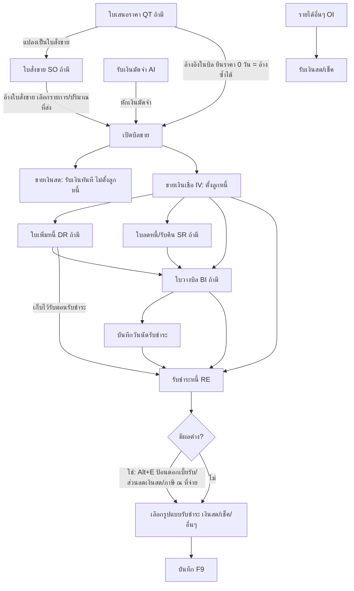

# บทที่ 12 การป้อนข้อมูลระบบขายและลูกหนี้
> อ้างอิงคู่มือ หน้า 195–234 (PDF p.211–250)

## ภาพรวม
- บทนี้อธิบายการป้อนเอกสารประจำวันของระบบขายและระบบลูกหนี้ ได้แก่ ใบเสนอราคา (QT) ใบสั่งขาย (SO) รับเงินมัดจำ (AI) ขายเงินสด/ขายเงินเชื่อ (IV) ใบเพิ่มหนี้ (DR) ใบลดหนี้/รับคืน (SR) ใบวางบิล (BI) บันทึกวันนัดรับชำระ รับชำระหนี้ (RE) และบันทึกรายได้อื่นๆ (OI) (หน้า 195–196)
- ลำดับหลัก: ใบเสนอราคา (ถ้ามี) → ใบสั่งขาย (ถ้ามี) → เปิดบิลขาย → แยกเป็นขายเงินสด หรือขายเงินเชื่อ → (ใบวางบิล / ใบลดหนี้-รับคืน / ใบเพิ่มหนี้ ถ้ามี) → รับชำระหนี้ (แผนภาพ หน้า 195)
- ขายเงินสด = เสร็จสิ้นในขั้นตอนเดียว (รับเงินสด/เช็คในวันขาย ไม่ตั้งลูกหนี้) ส่วนขายเงินเชื่อ = ตั้งลูกหนี้รายตัว แล้วต้องทำรับชำระหนี้ภายหลัง (หน้า 196, 211)
- มีแนวคิดร่วมทุกเอกสาร: ประเภทราคา (0/1/2), ส่วนลดแบบจำนวนเงิน/เปอร์เซ็นต์/ซ้อน, Bill to, ภาระภาษีขาย (เกณฑ์สิทธิ/เกณฑ์เงินสด), หมายเหตุเพิ่มเติม, การพิมพ์ฟอร์ม, รายการของแถม, สินค้ายกเว้นภาษี (หน้า 196–200, 233–234)

## แนวคิดร่วม (ใช้กับทุกหน้าจอในบท)

| แนวคิด | รายละเอียดตามคู่มือ | หน้า |
|---|---|---|
| ประเภทราคา | 0 = ราคาสินค้าได้รับยกเว้นภาษี (ไม่คำนวณภาษี), 1 = ราคารวมภาษีแล้ว (VAT = ราคา×7/107 เช่น 100 → 6.54), 2 = ราคายังไม่รวมภาษี (VAT = ราคา×7/100 เช่น 100 → 7) บนหน้าจอเป็น dropdown แสดงเช่น "2 - แยก VAT" | 196 |
| ส่วนลด | ป้อนเป็นจำนวนเงิน (1500.00) หรือเปอร์เซ็นต์ (10%) หรือส่วนลดซ้อน (5+2%) ; ป้อน "10+" โปรแกรมเปลี่ยนเป็น 10% อัตโนมัติ | 196 |
| Bill to | ใช้เมื่อออกใบกำกับในนามลูกค้ารายหนึ่ง แต่เรียกเก็บเงินจากอีกรายหนึ่ง (เช่น เปิดบิลในนามสาขา เก็บเงินสำนักงานใหญ่) → รหัสลูกค้า = ผู้ถูกตั้งหนี้ (ใช้ในรายงานวิเคราะห์ขาย/ลูกหนี้), Bill to = ใช้แสดงบนใบกำกับภาษีที่พิมพ์และรายงานภาษีขายเท่านั้น | 197 |
| ลูกค้าขาจร | สร้างรายละเอียดลูกค้าโดยให้โปรแกรมรันรหัสให้ (เมนูขาย ข้อ 6 รายละเอียดลูกค้า ปล่อยช่องรหัสว่างแล้ว Enter) ; เมื่อปิดประมวลผลสิ้นปี ระบบลบลูกค้าประเภทนี้ทิ้งเอง | 197 |
| ภาระภาษีขาย | สำหรับผู้ให้บริการ/ขายผ่อนชำระ เลือก เกณฑ์สิทธิ (ภาษีเกิดวันเดียวกับวันที่ในบิล) หรือ เกณฑ์เงินสด (ภาษีเกิดเมื่อรับชำระหนี้/ค่างวด) ; กำหนดตายตัวหรือให้เลือกตอนเปิดใบกำกับได้ที่ เมนูเริ่มระบบ 1.4.1 รายละเอียดทั่วไป ; โปรแกรมถามเฉพาะสินค้าประเภทบริการ ; ตรวจย้อนหลังได้ที่แท็บ รายการรับชำระ (ช่อง ภาระภาษีขาย) ; ถ้าเลือกผิดให้คลิกไอคอน ลงบัญชีใหม่ โปรแกรมจะถามเกณฑ์ใหม่ | 197–199 |
| การพิมพ์ฟอร์ม | ไอคอน พิมพ์เอกสาร หรือ <Alt+P> พิมพ์ทางจอภาพ/เครื่องพิมพ์/แฟ้มข้อมูล (การแก้ฟอร์มดูบทที่ 25) | 199 |
| หมายเหตุเพิ่มเติม | ระดับเอกสาร: ไอคอน เพิ่ม/แก้ไขหมายเหตุของเอกสาร หรือ <Alt+R> ; ระดับรายการสินค้า: เลือกรายการในแท็บ รายการสินค้า <F8> แล้ว <Alt+R> (ต้องบันทึกรายการก่อน) ได้รายการละ 10 บรรทัด | 199–200 |
| ตรวจยอดคงเหลือ | <Shift+F4> ป้อนรหัสสินค้า คลัง วันที่ → แสดงยอดคงเหลือ ณ วันนั้น | 215 |
| ของแถม | ถ้าไม่ป้อนราคาต่อหน่วย (0.00) โปรแกรมถาม "ไม่ได้ป้อนราคา... เป็นรายการแถมใช่หรือไม่?" ปุ่ม ป้อนใหม่ / ของแถม / ไม่ใช่ (ไม่ใช่ = ขาย/เสนอราคา 0 โดยไม่ถือเป็นของแถม) | 233 |
| สินค้ายกเว้นภาษี | กำหนดยกเว้นภาษีที่ เมนูสินค้า ข้อ 2 รายละเอียดสินค้า ; ในบิลโปรแกรมคิด VAT เฉพาะสินค้าที่มีภาษี ; footer แสดง "แยกยอดเงิน 0.00 %=" และ "7.00 %=" แยกฐานภาษี ; การแสดงบรรทัดแยกต้องตั้งที่ เมนูเริ่มระบบ ข้อ 4 กำหนดเลขที่เอกสาร → บรรทัด แยกประเภท VAT. ที่รายการสินค้า = Y | 233–234 |

## หน้าจอ

### S-SL-01 Dialog เลือกภาระภาษีขาย
- เมนู: แสดงอัตโนมัติขณะบันทึกบิลขายสินค้าบริการ (เมื่อตั้งให้เลือกภาระภาษีได้)
- อ้างอิง: หน้า 197–199 (PDF p.213–215) — มีภาพหน้าจอ: ใช่ (รูปที่ 1, 2)
- ลักษณะ: dialog ข้อความ "ภาษีขายของสินค้าบริการในที่นี้เป็นแบบ"

| ส่วน/แท็บ | ฟิลด์ | ชนิดข้อมูล | บังคับ | ค่าเริ่มต้น/อ้างอิงจาก | คำอธิบาย/เงื่อนไข |
|---|---|---|---|---|---|
| dialog | ภาระภาษีขาย | select (ปุ่ม) | ใช่ | - | เกณฑ์สิทธิ / เกณฑ์เงินสด ; บันทึกลงช่อง ภาระภาษีขาย ในแท็บ รายการรับชำระ ของบิล |

ปุ่ม/คำสั่ง: เกณฑ์สิทธิ, เกณฑ์เงินสด
กฎทางธุรกิจ/เงื่อนไข: ถามเฉพาะสินค้าบริการ (หน้า 198) ; แก้ไขโดยไอคอน ลงบัญชีใหม่ (หน้า 199)
ผลทางบัญชี/สต๊อก: กำหนดจังหวะรับรู้ภาษีขาย — เกณฑ์สิทธิ ณ วันที่บิล, เกณฑ์เงินสด ณ วันรับชำระ (หน้า 197)

### S-SL-02 Dialog ป้อนหมายเหตุเพิ่มเติม
- เมนู: ไอคอน เพิ่ม/แก้ไขหมายเหตุของเอกสาร หรือ <Alt+R> ในทุกหน้าจอเอกสาร
- อ้างอิง: หน้า 199–200 (PDF p.215–216) — มีภาพหน้าจอ: ใช่ (รูปที่ 3, 4)
- ลักษณะ: dialog บรรทัดข้อความหลายบรรทัด แต่ละบรรทัดมีปุ่มแว่นขยาย

| ส่วน/แท็บ | ฟิลด์ | ชนิดข้อมูล | บังคับ | ค่าเริ่มต้น/อ้างอิงจาก | คำอธิบาย/เงื่อนไข |
|---|---|---|---|---|---|
| รายการ | บรรทัดหมายเหตุ (1..n) | text + lookup | ไม่ | lookup ข้อความมาตรฐาน [สันนิษฐาน] | ระดับเอกสาร "อีก 5 บรรทัด" ตามข้อความ (หน้า 199) แต่ภาพหน้าจอแสดง 10 บรรทัด ; ระดับรายการสินค้าได้ 10 บรรทัด (หน้า 200) |

ปุ่ม/คำสั่ง: ตกลง, ยกเลิก, ลบบรรทัด, เพิ่มบรรทัด
กฎทางธุรกิจ/เงื่อนไข: หมายเหตุรายการสินค้าทำได้หลังบันทึกรายการสินค้านั้นแล้ว (หน้า 200)
ผลทางบัญชี/สต๊อก: ไม่มี

### S-QT-01 ใบเสนอราคา (QT - ใบเสนอราคา)
- เมนู: ระบบขาย > ข้อ A ใบเสนอราคา
- อ้างอิง: หน้า 200–203 (PDF p.216–219) — มีภาพหน้าจอ: ใช่ (รูปที่ 5)
- ลักษณะ: header ซ้าย (ลูกค้า) + header ขวา (เอกสาร) + 3 แท็บ (รายการสินค้า <F8> / รายการแสดงยอดสินค้าค้างส่ง <Ctrl+F8> / รายการสินค้าที่ส่งแล้ว <F7>) + ตาราง + footer ยอดรวม

| ส่วน/แท็บ | ฟิลด์ | ชนิดข้อมูล | บังคับ | ค่าเริ่มต้น/อ้างอิงจาก | คำอธิบาย/เงื่อนไข |
|---|---|---|---|---|---|
| Header ซ้าย | รหัสลูกค้า | lookup | ใช่ [สันนิษฐาน] | ข้อมูลลูกค้า (เมนูรายละเอียดลูกค้า) | แสดงชื่อ ที่อยู่ รหัสไปรษณีย์ โทร. ใต้ช่อง ; เรียงตามรหัส/ชื่อตาม เมนูเริ่มระบบ 1.4.1 |
| Header ซ้าย | Bill to | lookup | ไม่ | ลูกค้า | ดูแนวคิด Bill to |
| Header ซ้าย | สาขา# | number | ไม่ | 0 | สาขาของลูกค้า [สันนิษฐาน: ใช้เลขสาขาตามใบกำกับภาษี] |
| Header ซ้าย | อ้างอิง | text + lookup | ไม่ | - | ข้อความ/หมายเหตุอ้างอิง เช่น "เหลือล็อตสุดท้าย ก่อนปรับราคา" |
| Header ขวา | แผนก | lookup | ไม่ | ตารางแผนก | ใช้เมื่อแยกแผนก |
| Header ขวา | เลขที่ใบเสนอราคา | text | ใช่ | running อัตโนมัติ (เช่น QT0000001) | Enter ผ่าน = เลขอัตโนมัติ หรือป้อนเอง |
| Header ขวา | วันที่ | date | ใช่ | - | วันที่ใบเสนอราคา |
| Header ขวา | กำหนดยืนราคา | number (วัน) | ไม่ | - | จำนวนวันยืนราคา ; 0 = ไม่กำหนด |
| Header ขวา | ครบกำหนดวันที่ | date | - | คำนวณ = วันที่ + กำหนดยืนราคา | คำนวณอัตโนมัติ |
| Header ขวา | พนักงานขาย | lookup | ไม่ | พนักงานขายที่ผูกกับลูกค้า | แสดงชื่อพนักงานข้างช่อง |
| Header ขวา | สถานะเอกสาร | lookup | ไม่ | ตารางสถานะ (เช่น 10 = รอการตัดสินใจ) | ใช้ติดตามใบเสนอราคา ผ่านรายงาน |
| Header ขวา | ประเภทราคา | select | ใช่ | 0/1/2 | ดูแนวคิดร่วม |
| Header ขวา | (ปุ่ม) ปรับปรุงยอดค้างส่งใหม่ | button | - | - | ไม่มีคำอธิบายในคู่มือ [สันนิษฐาน: คำนวณยอดค้างส่งใหม่] |
| Grid | No., รหัส, รายละเอียด, จำนวน (+หน่วย), ราคาต่อหน่วย, ส่วนลด, F, จำนวนเงิน | grid | - | สินค้า / ตารางราคาขายลูกค้า | ดูคำอธิบายด้านล่าง |
| Footer | จำนวนเงิน | money | - | ผลรวมรายการ | |
| Footer | หักส่วนลด | text (จำนวน/%) | ไม่ | ส่วนลดจากรายละเอียดลูกค้า | |
| Footer | ยอดหลังหักส่วนลด | money | - | คำนวณ | |
| Footer | ภาษีมูลค่าเพิ่ม (%) + จำนวน | number + money | - | 7.00 | ปล่อยจำนวนว่างให้คำนวณเอง |
| Footer | จำนวนเงินรวมทั้งสิ้น | money | - | คำนวณ | |
| Footer | แปลงเป็น SO# | text (readonly) [สันนิษฐาน] | - | - | แสดงเลข SO ที่แปลงไป |

รายละเอียดคอลัมน์ตาราง (หน้า 202–203):
- รหัส: Enter → รายการสินค้าเรียงตามรหัส/ชื่อตาม เมนูเริ่มระบบ 1.3.1 ; พิมพ์ 1–2 ตัวอักษรนำหน้าเพื่อกรอง
- จำนวน: เลือกหน่วยนับใหญ่หรือหน่วยนับย่อยได้
- ราคา/หน่วย: ดึงจากตารางราคาขายใน เมนูขาย ข้อ 6 รายละเอียดลูกค้า
- ส่วนลด: จำนวนเงินหรือ %
- จำนวนเงิน = จำนวน × ราคา/หน่วย − ส่วนลด
- F: ไม่มีคำอธิบาย [สันนิษฐาน: flag ของแถม/ยกเว้นภาษี]

ปุ่ม/คำสั่ง: toolbar มาตรฐาน (เพิ่ม/แก้ไข/ยกเลิก/ลบ/... ดูบทที่ 3) ; ไอคอน แปลงเป็นใบสั่งขาย (ไอคอน QT→S/O) ; พิมพ์เอกสาร <Alt+P> ; หมายเหตุ <Alt+R>
กฎทางธุรกิจ/เงื่อนไข:
- แปลงเป็นใบสั่งขาย: เลือกใบเสนอราคา → ไอคอน แปลงเป็นใบสั่งขาย → ป้อนเลขที่/วันที่สั่งขาย (หน้า 203)
- กำหนดยืนราคา = 0 → เมื่อนำไปอ้างในบิลขาย ระบบไม่ตัดใบเสนอราคาออก ใช้อ้างซ้ำได้ (เหมาะทำเป็นแม่แบบบิลประจำ) ; ใช้ได้เฉพาะใบเสนอราคาของลูกค้าที่กำลังเปิดบิล (หน้า 203)
ผลทางบัญชี/สต๊อก: ไม่มี (ไม่ลงบัญชี ไม่ตัดสต๊อก) [สันนิษฐาน — คู่มือไม่กล่าวถึงการลงบัญชี]

### S-SO-01 ใบสั่งขาย (SO - ใบสั่งขาย)
- เมนู: ระบบขาย > ข้อ 3 ใบสั่งขาย
- อ้างอิง: หน้า 204–208 (PDF p.220–224) — มีภาพหน้าจอ: ใช่ (รูปที่ 6–9)
- ลักษณะ: header + 3 แท็บ (รายการสินค้า <F8> / รายการแสดงยอดสินค้าค้างส่ง <Ctrl+F8> / รายการสินค้าที่ส่งแล้ว <F7>) + footer

| ส่วน/แท็บ | ฟิลด์ | ชนิดข้อมูล | บังคับ | ค่าเริ่มต้น/อ้างอิงจาก | คำอธิบาย/เงื่อนไข |
|---|---|---|---|---|---|
| Header ซ้าย | รหัสลูกค้า | lookup | ใช่ [สันนิษฐาน] | ลูกค้า (ค้นหาตาม 1.4.1 หัวข้อ 'ค้นหาลูกค้า') | |
| Header ซ้าย | Bill to | lookup | ไม่ | ลูกค้า | |
| Header ซ้าย | สาขา# | number | ไม่ | 0 | |
| Header ซ้าย | อ้างอิง | text + lookup | ไม่ | - | |
| Header ขวา | แผนก | lookup | ไม่ | แผนก | |
| Header ขวา | ใบสั่งขาย # | text | ใช่ | running (SO0000004) | |
| Header ขวา | วันที่ | date | ใช่ | - | |
| Header ขวา | เครดิต (วัน) | number | ไม่ | จากรายละเอียดลูกค้า | แก้ได้ |
| Header ขวา | ส่งของวันที่ | date | ไม่ | = วันที่เอกสาร | แก้ได้ |
| Header ขวา | กำหนดวันส่งของที่สินค้า? | check (Y/N) | ไม่ | - | Y = ให้ระบุวันส่งของรายสินค้า |
| Header ขวา | พนักงานขาย | lookup | ไม่ | จากรายละเอียดลูกค้า | |
| Header ขวา | เขตการขาย | lookup | ไม่ | จากรายละเอียดลูกค้า | |
| Header ขวา | ขนส่งโดย | lookup | ไม่ | ตารางขนส่ง | |
| Header ขวา | ประเภทราคา | select | ใช่ | 0/1/2 | |
| Header ขวา | ปรับปรุงยอดค้างส่งใหม่ (ปุ่ม) | button | - | - | [สันนิษฐาน] |
| แท็บรายการสินค้า | No., รหัส, ร (?), คลัง, จำนวน (+หน่วย), ราคาต่อหน่วย, ส่วนลด, F, จำนวนเงิน | grid | - | - | คลัง = คลังที่จะจ่ายสินค้า |
| แท็บค้างส่ง <Ctrl+F8> | No., รหัส, รฯ, จำนวน (+หน่วย), ค้างส่ง, วันที่ส่ง, ร, F, ยกเลิก, เหตุผล [สันนิษฐาน: หัวคอลัมน์สุดท้ายอ่านไม่ชัด] | grid | - | - | ดับเบิ้ลคลิก ยกเลิก เพื่อป้อนจำนวนที่ยกเลิก → วันที่ยกเลิก → เหตุผล |
| แท็บส่งแล้ว <F7> | รหัส, ร, เลขที่เอกสาร (IV), วันที่, No., คลัง, จำนวน (+หน่วย), ราคา/หน่วย | grid (readonly) | - | บิลขายที่อ้าง SO | ตรวจว่าส่งตามใบกำกับใบใด |
| Footer | สถานที่ส่งของ | lookup | ไม่ | สถานที่ส่งของในรายละเอียดลูกค้า | |
| Footer | จำนวนเงิน / หักส่วนลด / ยอดหลังหักส่วนลด / ภาษีมูลค่าเพิ่ม % / จำนวนเงินรวมทั้งสิ้น | money | - | คำนวณ | |
| Footer | แปลงมาจาก | text (readonly) [สันนิษฐาน] | - | เลข QT ต้นทาง | |

ปุ่ม/คำสั่ง: toolbar มาตรฐาน ; พิมพ์ <Alt+P> ; หมายเหตุ <Alt+R>
กฎทางธุรกิจ/เงื่อนไข:
- สั่งขายเกินสต๊อก → Message#4106 "คำเตือน! สินค้าในคลัง ณ วันที่ส่งของ เหลือน้อยกว่ายอดที่สั่งขาย / ยอดคงเหลือสินค้าขณะนี้ = x / ยอดสั่งขายมากกว่ายอดคงเหลือ = y" (หน้า 206) — เป็นการเตือน [สันนิษฐาน: ไม่บล็อก]
- ยกเลิกยอดสั่งขาย: ไม่ต้องยกเลิกทั้งเอกสาร ให้ยกเลิกรายบรรทัด (บางส่วน/ทั้งจำนวน) พร้อมวันที่และเหตุผล (เหตุผลกำหนดจาก เมนูตารางข้อมูล) เพื่อเก็บประวัติ ; รายงาน เมนูรายงาน 1.3.B–1.3.E แยกตามเหตุผล (หน้า 207)
- ยอดค้างส่ง: เมนูรายงาน 1.3 (แยกตามสินค้า/ใบสั่งขาย/ลูกค้า) หรือแท็บค้างส่ง (หน้า 207)
ผลทางบัญชี/สต๊อก: ไม่ลงบัญชี ไม่ตัดสต๊อก ; เก็บยอดสั่ง/ค้างส่ง [สันนิษฐาน: เป็นยอดจอง (committed) ใช้ในรายงาน]

### S-AI-01 รับเงินมัดจำ (AI - รับเงินมัดจำ)
- เมนู: ระบบขาย > ข้อ 1 รับเงินมัดจำ
- อ้างอิง: หน้า 208–211 (PDF p.224–227) — มีภาพหน้าจอ: ใช่ (รูปที่ 10–12)
- ลักษณะ: header + 3 แท็บ (รายการสินค้า <F8> / รายการตัดเงินมัดจำ <Ctrl+F8> / รายการภาษีขาย <Ctrl+F7>) + grid คำอธิบาย + footer ยอด + ส่วนรับชำระ (เงินสด/ชำระโดยอื่นๆ)

| ส่วน/แท็บ | ฟิลด์ | ชนิดข้อมูล | บังคับ | ค่าเริ่มต้น/อ้างอิงจาก | คำอธิบาย/เงื่อนไข |
|---|---|---|---|---|---|
| Header ซ้าย | รหัสลูกค้า | lookup | ใช่ | ลูกค้า | |
| Header ซ้าย | Bill to | lookup | ไม่ | ลูกค้า | |
| Header ซ้าย | สาขา# | number | ไม่ | 0 | |
| Header ซ้าย | พนักงานขาย | lookup | ไม่ | - | Enter ผ่านได้ |
| Header ขวา | แผนก | lookup | ไม่ | | |
| Header ขวา | ใบรับเงินมัดจำ | text | ใช่ | running (AI0000001) | |
| Header ขวา | วันที่ | date | ใช่ | | |
| Header ขวา | เครดิต (วัน) | number | ไม่ | 0 | |
| Header ขวา | ครบกำหนด | date | ไม่ | คำนวณ | ใช้ตรวจว่าลูกค้าตัดสินใจซื้อเกินกำหนดหรือไม่ |
| Header ขวา | ประเภทราคา | select | ใช่ | 0/1/2 | ต้องตรงกับบิลขายที่จะนำมัดจำไปหัก |
| Grid | No., คำอธิบาย, จำนวนเงิน | grid | ใช่ | - | เช่น "รับเงินมัดจำล่วงหน้า 10% สำหรับคอมพิวเตอร์ 1 ชุด" ; หลายรายการได้ ; Esc ออกจากการบันทึกรายการ |
| Footer | อ้างอิง | text + lookup | ไม่ | | |
| Footer | จำนวนเงิน / ภาษีมูลค่าเพิ่ม (%) / จำนวนเงินรวมทั้งสิ้น | money | - | คำนวณ | ปล่อย VAT ว่างให้คำนวณ |
| รับชำระ | เงินสด | money | - | = ยอดรวม (ค่าเริ่มต้นถือว่ารับเงินสด) | |
| รับชำระ | ชำระโดยอื่นๆ (ด้านล่าง) | money | - | ผลรวม grid ชำระโดยอื่นๆ | |
| รับชำระ | ภาษีถูกหัก ณ ที่จ่าย | money | ไม่ | | |
| รับชำระ | ยอดชำระจริง | money | - | คำนวณ | ต้องเท่ากับจำนวนเงินรวมทั้งสิ้นเสมอ |
| Grid ชำระโดยอื่นๆ <F7> | ชำระโดยอื่นๆ (เลขที่เช็ค), ลงวันที่, ธนาคาร (รหัส+ชื่อ), จำนวนเงิน, ยอดคงเหลือ, ยอดชำระ | grid | - | ดับเบิ้ลคลิก → S-PM-01 | |

ปุ่ม/คำสั่ง: toolbar มาตรฐาน + ไอคอนเพิ่มท้าย toolbar [สันนิษฐาน: ไอคอนรับชำระ]
กฎทางธุรกิจ/เงื่อนไข: ประเภทราคาของ AI และบิลขายที่หักมัดจำต้องเหมือนกัน (หน้า 210) ; รับเงินสดบางส่วน + เช็คส่วนที่เหลือได้ (หน้า 211)
ผลทางบัญชี/สต๊อก: [สันนิษฐาน] Dr เงินสด/เช็ครับ (ตามบัญชีของวิธีชำระ) / Cr เงินรับล่วงหน้า(มัดจำ) + Cr ภาษีขาย — คู่มือไม่ระบุคู่บัญชี ; มีแท็บรายการภาษีขาย แสดงว่ามีการบันทึกภาษีขาย ณ วันรับมัดจำ

### S-PM-01 Dialog เลือกวิธีรับชำระ (ชำระโดยอื่นๆ)
- เมนู: ดับเบิ้ลคลิกที่ grid ชำระโดยอื่นๆ ในหน้ารับเงินมัดจำ / รับชำระหนี้ / รายได้อื่นๆ / [สันนิษฐาน: ขายเงินสด]
- อ้างอิง: หน้า 210–211, 228 (PDF p.226–227, 244) — มีภาพหน้าจอ: ใช่ (รูปที่ 12, 35)
- ลักษณะ: list dialog

| ส่วน/แท็บ | ฟิลด์ | ชนิดข้อมูล | บังคับ | ค่าเริ่มต้น/อ้างอิงจาก | คำอธิบาย/เงื่อนไข |
|---|---|---|---|---|---|
| list | รหัส | text | - | ตารางวิธีชำระ | ตัวอย่าง QR เช็ครับ 1130-02, CH รับเงินสด 1111-00, TR เงินโอนเข้าบัญชี (NBD) [S1], TF ค่าธรรมเนียมการโอน 5360-04, VS บัตร Visa 1130-02, DC ส่วนลดเงินสด 4100-04, TX ภาษีถูกหัก ณ ที่จ่าย 1151-02, EX กำไรขาดทุนจากอัตราแลกเปลี่ยน 5370-07 |
| list | รายละเอียด | text | - | | |
| list | (คอลัมน์ที่ 3 เช่น S1) | text | - | | หัวคอลัมน์อ่านไม่ชัด [สันนิษฐาน: รหัสบัญชีเงินฝากธนาคาร] |
| list | เลขที่บัญชี | text | - | ผังบัญชี | บัญชี GL ที่ใช้ลงบัญชี |

ปุ่ม/คำสั่ง: ตกลง, ยกเลิก, ค้นหา
กฎทางธุรกิจ/เงื่อนไข: เช็ค → ป้อนเลขที่เช็ค วันที่เช็ค รหัสธนาคาร จำนวนเงิน ; บัตรเครดิต ใช้วิธีเดียวกับเช็ค ; เงินโอน → ระบุเพียงวันที่โอนและยอดเงินในช่อง ยอดชำระ (หน้า 210, 228)
ผลทางบัญชี/สต๊อก: แต่ละวิธีชำระผูกกับบัญชี GL (คอลัมน์ เลขที่บัญชี) → ใช้เป็นฝั่ง Dr ของการรับเงิน [สันนิษฐาน]

### S-IV-01 ขายเงินเชื่อ (IV - ขายเงินเชื่อ)
- เมนู: ระบบขาย > ข้อ 4 ขายเงินเชื่อ
- อ้างอิง: หน้า 211–217, 233–234 (PDF p.227–233, 249–250) — มีภาพหน้าจอ: ใช่ (รูปที่ 1, 2, 13–17, 42)
- ลักษณะ: header + 4 แท็บ (รายการสินค้า <F8> / รายละเอียดอื่น <Ctrl+F8> / รายการรับชำระ <F7> / รายการภาษีขาย <Ctrl+F7>) + grid + footer
- หมายเหตุ: หน้าจอขายเงินสดคล้ายกัน คู่มืออธิบายเฉพาะขายเงินเชื่อ (หน้า 211)

| ส่วน/แท็บ | ฟิลด์ | ชนิดข้อมูล | บังคับ | ค่าเริ่มต้น/อ้างอิงจาก | คำอธิบาย/เงื่อนไข |
|---|---|---|---|---|---|
| Header ซ้าย | รหัสลูกค้า | lookup | ใช่ | ลูกค้า | ผู้ถูกตั้งหนี้ |
| Header ซ้าย | Bill to | lookup | ไม่ | ลูกค้า | ชื่อบนใบกำกับ/รายงานภาษีขาย |
| Header ซ้าย | สาขา# | number | ไม่ | 0 | |
| Header ซ้าย | อ้างอิง | text + lookup | ไม่ | | |
| Header ขวา | แผนก | lookup | ไม่ | | |
| Header ขวา | เลขที่เอกสาร (เลขที่ใบกำกับ) | text | ใช่ | running (IV0000007; ใหม่แสดง IV**NEW**) | |
| Header ขวา | วันที่ | date | ใช่ | | วันที่ใบกำกับภาษี |
| Header ขวา | ใบสั่งขาย | lookup | ไม่ | SO ของลูกค้านี้ | เปิด S-IV-02 |
| Header ขวา | (ปุ่ม) หมายเหตุของใบสั่งขาย | button | - | SO | [สันนิษฐาน: ดูหมายเหตุของ SO ที่อ้าง] |
| Header ขวา | เครดิต (วัน) | number | ไม่ | รายละเอียดลูกค้า | |
| Header ขวา | ครบกำหนด | date | - | = วันที่ + เครดิต (คำนวณอัตโนมัติ) | |
| Header ขวา | พนักงานขาย | lookup | ไม่ | รายละเอียดลูกค้า | ใช้ดูยอดขายแยกพนักงาน |
| Header ขวา | เขตการขาย | lookup | ไม่ | รายละเอียดลูกค้า | วิเคราะห์ยอดขายตามเขต |
| Header ขวา | ขนส่งโดย | lookup | ไม่ | ตารางขนส่ง | พิมพ์บนฟอร์มใบกำกับ |
| Header ขวา | ประเภทราคา | select | ใช่ | 0/1/2 | |
| แท็บรายการสินค้า <F8> | No., รหัส, ร, คลัง, จำนวน (+หน่วย), ราคาต่อหน่วย, ส่วนลด, F, จำนวนเงิน | grid | ใช่ | | หลังบันทึกบรรทัดแรก ระบบขึ้นบรรทัดใหม่อัตโนมัติ ; Esc จบการป้อน |
| แท็บรายละเอียดอื่น <Ctrl+F8> | (ไม่มีภาพ) | - | - | - | ไม่อธิบายในบทนี้ |
| แท็บรายการรับชำระ <F7> | ภาระภาษีขาย (select: เกณฑ์สิทธิ/เกณฑ์เงินสด), ใบวางบิล#, จำนวนเงินรวมทั้งสิ้น, ยอดชำระ/ลดหนี้, ยอดคงค้าง, คอมมิชชั่น, ชำระเงินเรียบร้อย (Y/N), วันที่เรียบร้อย, ปุ่ม แก้ไขยอดเงิน ; grid: เลขที่ใบเสร็จ, วันที่, วันที่รับชำระ, จำนวนเงิน, วันที่เรียบร้อย | mixed (readonly ส่วนใหญ่) | - | ระบบ | ประวัติการรับชำระของบิล (รูปที่ 2) |
| แท็บรายการภาษีขาย <Ctrl+F7> | (ไม่มีภาพ) | - | - | - | |
| Footer | สถานที่ส่งของ | lookup | ไม่ | รายละเอียดลูกค้า | |
| Footer | จำนวนเงิน | money | - | ผลรวม | |
| Footer | หักส่วนลด | text | ไม่ | ส่วนลดในรายละเอียดลูกค้า | |
| Footer | หักเงินมัดจำ | lookup (AI) + money | ไม่ | ใบรับเงินมัดจำของลูกค้า | Enter ผ่าน → ถามว่าจะนำมัดจำมาหักหรือไม่ (ตกลง/ยกเลิก) |
| Footer | แยกยอดเงิน 0.00 %= / 7.00 %= | money | - | คำนวณ | แสดงเมื่อตั้ง แยกประเภท VAT = Y (สินค้ายกเว้นภาษี) |
| Footer | ภาษีมูลค่าเพิ่ม % + จำนวน | money | - | 7.00 | ปล่อยว่างให้คำนวณ |
| Footer | จำนวนเงินรวมทั้งสิ้น | money | - | คำนวณ | |

คอลัมน์ grid รายการสินค้า (หน้า 215–216): รหัส (lookup เรียงตาม 1.3.1, กรอง 1–2 ตัวอักษร) ; คลัง ; จำนวน (หน่วยใหญ่/ย่อย) ; ราคา/หน่วย จากตารางราคาลูกค้า ; หน่วยนับที่ขายและตัวคูณ (แก้ได้ถ้าตั้งที่ 1.4.1 เช่น ชิ้น/โหล) ; ส่วนลด ; จำนวนเงิน = จำนวน × ราคา/หน่วย − ส่วนลด

ปุ่ม/คำสั่ง: toolbar มาตรฐาน ; ไอคอน ลงบัญชีใหม่ ; พิมพ์ <Alt+P> ; หมายเหตุ <Alt+R> ; <Shift+F4> ตรวจยอดคงเหลือ
กฎทางธุรกิจ/เงื่อนไข:
- อ้างใบสั่งขาย (S-IV-02/03/04) ลดการป้อนซ้ำและความผิดพลาด (หน้า 213)
- ขายต่ำกว่าทุน (ทุนซื้อหรือต้นทุนผลิต) → Message#4653 "คำเตือน! ขายสินค้าต่ำกว่าทุน... รายการที่ [n] รหัสสินค้า [...] ราคาขาย x ราคาทุน y ขาดทุน z" — เตือนเท่านั้น ยังเปิดบิลได้ (หน้า 216)
- ขายเชื่อเกินวงเงินอนุมัติ → หน้าจอถามรหัสผ่านผู้มีอำนาจอนุมัติ ; วงเงินที่ผู้ใช้แต่ละระดับอนุมัติได้กำหนดที่ เมนูเริ่มระบบ 1.4.1 รายละเอียดทั่วไป หน้าที่ 2 (หน้า 217) — ไม่มีภาพหน้าจอ
- มัดจำ: ประเภทราคาต้องตรงกับ AI (หน้า 210)
ผลทางบัญชี/สต๊อก (หน้า 211): ขายเงินเชื่อ → ตั้งยอดลูกหนี้รายตัว ; ขายเงินสด → บันทึกรับเงินสด/เช็ครับทันที ไม่ตั้งลูกหนี้ ; ตัดสต๊อกจากคลังที่ระบุ (หน้า 214 "เลือกคลังสินค้าที่จะตัดสต๊อก") ; [สันนิษฐาน] Dr ลูกหนี้การค้า / Cr ขาย + Cr ภาษีขาย (เกณฑ์สิทธิ) หรือ Cr ภาษีขายรอเรียกเก็บ (เกณฑ์เงินสด) ; หักมัดจำ → Dr เงินรับล่วงหน้า [สันนิษฐาน]

### S-IV-02 Dialog เลือกใบสั่งขาย
- เมนู: คลิกแว่นขยายช่อง ใบสั่งขาย ในหน้าขาย
- อ้างอิง: หน้า 213 (PDF p.229) — มีภาพหน้าจอ: ใช่ (รูปที่ 14)
- ลักษณะ: list dialog

| ส่วน/แท็บ | ฟิลด์ | ชนิดข้อมูล | บังคับ | ค่าเริ่มต้น/อ้างอิงจาก | คำอธิบาย/เงื่อนไข |
|---|---|---|---|---|---|
| list | ใบสั่งขาย, วันที่, อ้างอิง, ส่งที่, วันที่ส่ง, จำนวนเงิน, พนักงาน.. | grid | - | SO ทั้งหมดของลูกค้าที่อ้างถึง | |

ปุ่ม/คำสั่ง: ตกลง, ยกเลิก, ค้นหา
กฎทางธุรกิจ/เงื่อนไข: แสดงเฉพาะ SO ของลูกค้านั้น [สันนิษฐาน: เฉพาะที่ยังค้างส่ง]
ผลทางบัญชี/สต๊อก: ไม่มี

### S-IV-03 เลือกรายการจากใบสั่งขาย
- เมนู: Enter เลือก SO ใน S-IV-02
- อ้างอิง: หน้า 213–214 (PDF p.229–230) — มีภาพหน้าจอ: ใช่ (รูปที่ 15)
- ลักษณะ: multi-select list

| ส่วน/แท็บ | ฟิลด์ | ชนิดข้อมูล | บังคับ | ค่าเริ่มต้น/อ้างอิงจาก | คำอธิบาย/เงื่อนไข |
|---|---|---|---|---|---|
| list | รหัสสินค้า, คลัง, สั่ง (+หน่วย), ค้าง, จะส่ง, ชื่อสินค้า | grid | - | รายการ SO | ที่เลือกแล้วมีสามเหลี่ยมนำหน้า |
| footer | ถูกเลือก n รายการ | number | - | | |

ปุ่ม/คำสั่ง: ทำงาน <F5>, ยกเลิก, ค้นหา, เลือกทุกรายการ <F6>
กฎทางธุรกิจ/เงื่อนไข: เลือกรายการ → S-IV-04 ; ส่งบางส่วนได้
ผลทางบัญชี/สต๊อก: ลดยอดค้างส่งของ SO [สันนิษฐาน]

### S-IV-04 Dialog ป้อนปริมาณที่จะส่ง
- อ้างอิง: หน้า 214 (PDF p.230) — มีภาพหน้าจอ: ใช่ (รูปที่ 16)
- ลักษณะ: form dialog

| ส่วน/แท็บ | ฟิลด์ | ชนิดข้อมูล | บังคับ | ค่าเริ่มต้น/อ้างอิงจาก | คำอธิบาย/เงื่อนไข |
|---|---|---|---|---|---|
| form | ชื่อสินค้า | text (readonly) | - | สินค้า | |
| form | ตัดจากคลัง | lookup | ใช่ | คลังใน SO | แสดงชื่อคลัง |
| form | ปริมาณที่ส่ง + หน่วย × ตัวคูณ | number | ใช่ | ยอดค้าง | ส่งบางส่วนได้ |
| form | ราคาต่อหน่วย | money | ใช่ | จาก SO | |
| form | ส่วนลด | text | ไม่ | | |
| form | เป็นของแถม | check [Y,N, ว่างไว้=N] | ไม่ | N | |

ปุ่ม/คำสั่ง: ตกลง, ยกเลิก

### S-DR-01 ใบเพิ่มหนี้ (DR - ใบเพิ่มหนี้(ลูกหนี้))
- เมนู: ระบบการเงิน > 1.3 ใบเพิ่มหนี้
- อ้างอิง: หน้า 217–220 (PDF p.233–236) — มีภาพหน้าจอ: ใช่ (รูปที่ 18–21)
- ลักษณะ: header + 4 แท็บ (รายการสินค้า <F8> / รายละเอียดอื่น <Ctrl+F8> / รายการรับชำระ <F7> / รายการภาษีขาย <Ctrl+F7>) + grid + footer

| ส่วน/แท็บ | ฟิลด์ | ชนิดข้อมูล | บังคับ | ค่าเริ่มต้น/อ้างอิงจาก | คำอธิบาย/เงื่อนไข |
|---|---|---|---|---|---|
| Header ซ้าย | รหัสลูกค้า, Bill to, สาขา#, อ้างอิง | lookup/text | รหัสลูกค้า ใช่ | ลูกค้า | |
| Header ขวา | แผนก | lookup | ไม่ | | |
| Header ขวา | เลขที่ใบเพิ่มหนี้ | text | ใช่ | running (DR0000001) | |
| Header ขวา | วันที่ | date | ใช่ | | |
| Header ขวา | เลขที่ใบกำกับ | lookup | ใช่ [สันนิษฐาน] | ใบกำกับที่ยังค้างชำระของลูกค้า | หลังเลือก → dialog มูลค่าตามใบกำกับเดิม ; ดึงพนักงานขาย เขตการขาย มาให้ |
| Header ขวา | พนักงานขาย, เขตการขาย, ประเภทราคา | lookup/select | - | จากใบกำกับ | |
| Grid | No., รหัส, รายละเอียด, คลัง, จำนวน (+หน่วย), ราคาต่อหน่วย, จำนวนเงิน | grid | - | รายการในใบกำกับที่อ้าง | |
| Footer | มูลค่าของสินค้าหรือบริการ ตามใบกำกับภาษีเดิม | money | - | จาก dialog | เพื่อพิมพ์ในแบบฟอร์ม |
| Footer | จำนวนเงิน / หักส่วนลด / ยอดหลังหักส่วนลด / ภาษีมูลค่าเพิ่ม % / จำนวนเงินรวมทั้งสิ้น | money | - | คำนวณ | |

Dialog ย่อย:
- มูลค่าของสินค้าหรือบริการตามใบกำกับภาษีเดิม (เพื่อใช้พิมพ์ในแบบฟอร์ม): money ; ตกลง/ยกเลิก (รูปที่ 19)
- เลือกรายการที่จะเพิ่มหนี้: No., รหัสสินค้า, ส่งไป, เพิ่มหนี้, หน่วยละ, F, ชื่อสินค้า ; ถูกเลือก n รายการ ; ทำงาน <F5>, ยกเลิก (รูปที่ 20)
- ป้อนรายละเอียดสินค้าที่เพิ่มหนี้: รหัสสินค้า (lookup), รายละเอียด, เข้าคลัง (lookup), จำนวน + หน่วย, หน่วยละ, จำนวนเงิน ; ตกลง/ยกเลิก (รูปที่ 20)
- "ยอดใบเพิ่มหนี้ใบนี้จะปฏิบัติอย่างไร?": ปุ่ม รับเป็นเงินสด / เก็บไว้รับ ตอนรับชำระหนี้ (รูปที่ 21)

ปุ่ม/คำสั่ง: toolbar มาตรฐาน ; ทำงาน <F5> บันทึกรายการ
กฎทางธุรกิจ/เงื่อนไข: ใช้เมื่อเปิดบิลราคาต่ำเกินไป ; ใส่รหัสสินค้าเพื่อให้รายงานวิเคราะห์การขายสมบูรณ์ ; จำนวนและราคา/หน่วยจะป้อนหรือไม่ก็ได้ ส่วน จำนวนเงิน ป้อนยอดที่จะเพิ่มหนี้ (หน้า 219)
ผลทางบัญชี/สต๊อก: เพิ่มยอดลูกหนี้เท่านั้น ไม่มีการตัดจ่ายสต๊อก (หน้า 219) ; ถ้าเลือก รับเป็นเงินสด = รับเงินทันที, เก็บไว้รับ = รวมเก็บกับบิลอื่นตอนรับชำระหนี้ (หน้า 219–220) ; [สันนิษฐาน] Dr ลูกหนี้ (หรือเงินสด) / Cr ขาย + Cr ภาษีขาย

### S-SR-01 ใบลดหนี้/รับคืนสินค้า (SR - ใบลดหนี้/รับคืน)
- เมนู: ระบบการเงิน > 1.4 ลดหนี้/รับคืนสินค้า
- อ้างอิง: หน้า 220–222 (PDF p.236–238) — มีภาพหน้าจอ: ใช่ (รูปที่ 22–26)
- ลักษณะ: header + แท็บ (รายการสินค้า <F8> / รายละเอียดอื่น <Ctrl+F8> / รับชำระด้วยใบเสร็จ <F7> / ตัดกับบิลขาย <Shift+F7> / ภาษีขาย <Ctrl+F7> / ภาษีหัก ณ ที่... [ตัดขอบ]) + grid + footer

| ส่วน/แท็บ | ฟิลด์ | ชนิดข้อมูล | บังคับ | ค่าเริ่มต้น/อ้างอิงจาก | คำอธิบาย/เงื่อนไข |
|---|---|---|---|---|---|
| Header ซ้าย | รหัสลูกค้า, Bill to, สาขา#, อ้างอิง | lookup/text | รหัสลูกค้า ใช่ | | |
| Header ขวา | แผนก | lookup | ไม่ | | |
| Header ขวา | เลขที่ใบลดหนี้ | text | ใช่ | running (SR0000003) | |
| Header ขวา | วันที่ | date | ใช่ | | |
| Header ขวา | เลขที่ใบกำกับ | lookup | ใช่ [สันนิษฐาน] | ใบกำกับค้างชำระของลูกค้า | → dialog มูลค่าตามใบกำกับเดิม ; ดึงพนักงานขาย เขตการขาย |
| Header ขวา | พนักงานขาย, เขตการขาย, ประเภทราคา | | - | จากใบกำกับ | |
| Grid | No., รหัส, ร, คลัง, จำนวน (+หน่วย), ราคาต่อหน่วย, ส่วนลด, F, R, จำนวนเงิน | grid | - | | R = Y เมื่อรับคืนสินค้า [สันนิษฐาน] |
| Footer | มูลค่าของสินค้าหรือบริการ ตามใบกำกับภาษีเดิม | money | - | dialog | |
| Footer | จำนวนเงิน / หักส่วนลด / ยอดหลังหักส่วนลด / ภาษีมูลค่าเพิ่ม % / จำนวนเงินรวมทั้งสิ้น | money | - | คำนวณ | |

Dialog ย่อย:
- มูลค่าของสินค้าหรือบริการตามใบกำกับภาษีเดิม (รูปที่ 23)
- เลือกรายการที่จะลดหนี้หรือรับคืน: No., รหัสสินค้า, ส่งไป, ลดหนี้/รับคืน, หน่วยละ, F, ชื่อสินค้า ; ถูกเลือก n รายการ ; ทำงาน <F5>, ยกเลิก, ค้นหา (รูปที่ 24, 26)
- ป้อนรายละเอียดสินค้าที่ลดหนี้หรือรับคืน: รับคืนสินค้า? [Y=รับคืนสินค้าด้วย N=แค่ลดหนี้], รหัสสินค้า, เข้าคลัง, รายละเอียด, จำนวน + หน่วย × ตัวคูณ, หน่วยละ, ส่วนลด, จำนวนเงิน, รับของแถมคืน? [Y,N, ว่างไว้=N] ; ตกลง/ยกเลิก (รูปที่ 25)

กฎทางธุรกิจ/เงื่อนไข (หน้า 222):
- ลดเฉพาะยอดหนี้ → ตอบ N, ปล่อย จำนวน/ราคา/ส่วนลด ว่าง ป้อนเฉพาะ จำนวนเงิน
- รับคืนสินค้า → ตอบ Y ป้อนจำนวนที่รับคืน ตรวจจำนวนเงิน
- เลือกครบแล้ว <F5> บันทึก
ผลทางบัญชี/สต๊อก: N = ลดยอดหนี้ลูกค้าเท่านั้น ไม่นำสินค้าเข้าสต๊อก ; Y = รับสินค้ากลับเข้าสต๊อก (คลังที่ระบุ) และลดยอดหนี้ (หน้า 222) ; [สันนิษฐาน] Dr รับคืน/ส่วนลดจ่าย + Dr ภาษีขาย / Cr ลูกหนี้ ; แท็บ "ตัดกับบิลขาย" และ "รับชำระด้วยใบเสร็จ" บ่งชี้ว่า SR ถูกใช้หักกับบิลหรือถูกตัดในใบเสร็จ (SR ปรากฏในรายการวางบิล/รับชำระ หน้า 224, 226) [สันนิษฐาน]

### S-BI-01 ใบวางบิล (BI - ใบวางบิล)
- เมนู: ระบบการเงิน > 1.1 ใบวางบิล
- อ้างอิง: หน้า 223–224 (PDF p.239–240) — มีภาพหน้าจอ: ใช่ (รูปที่ 27, 28)
- ลักษณะ: header + แท็บเดียว รายการที่วางบิล <F8> + grid + footer ยอดรวม

| ส่วน/แท็บ | ฟิลด์ | ชนิดข้อมูล | บังคับ | ค่าเริ่มต้น/อ้างอิงจาก | คำอธิบาย/เงื่อนไข |
|---|---|---|---|---|---|
| Header ซ้าย | รหัสลูกค้า | lookup | ใช่ | ลูกค้า | แสดงชื่อ และข้อความเงื่อนไขวางบิล เช่น "วางบิลเฉพาะวันที่ 30 ของเดือน (ก่อน 11:00น.)" [สันนิษฐาน: มาจากรายละเอียดลูกค้า] |
| Header ซ้าย | เงื่อนไขการชำระเงิน | text + lookup | ไม่ | รายละเอียดลูกค้า | |
| Header ซ้าย | หมายเหตุ | text + lookup | ไม่ | | |
| Header ขวา | แผนก | lookup | ไม่ | | |
| Header ขวา | เลขที่ใบวางบิล | text | ใช่ | running (BI0000001) | |
| Header ขวา | วันที่ | date | ใช่ | | |
| Header ขวา | วันที่ไปวางบิล | date | ไม่ | | อาจคนละวันกับวันที่เอกสาร |
| Header ขวา | วันที่นัดรับเงิน | date | ไม่ | | ไม่ทราบให้เว้นว่าง ป้อนภายหลังที่ S-BI-02 |
| Grid | ใบกำกับ#, วันที่, ครบกำหนด, … , จำนวนเงิน, ชำระแล้ว [สันนิษฐาน], ค้างชำระ [สันนิษฐาน] | grid | - | S-BI-01a | หัวคอลัมน์ในภาพอ่านไม่ชัด อนุมานจาก dialog เลือกเอกสาร |
| Footer | จำนวนเงินรวมทั้งสิ้น | money | - | ผลรวม | |

Dialog ย่อย "เลือกเอกสารที่จะวางบิล" (รูปที่ 28): ใบกำกับ#, วันที่, ครบกำหนด, จำนวนเงิน, ชำระแล้ว, ค้างชำระ, แผนก, พนักงานขาย ; ปุ่ม ทำงาน <F5>, ยกเลิก, ค้นหา, เรียงใหม่ <Tab> ; ถูกเลือก n รายการ ; แสดง IV, SR, DR ที่ค้างชำระ ; ดับเบิ้ลคลิกเพื่อเลือก (สามเหลี่ยม) เลือกได้มากกว่า 1 ฉบับ
กฎทางธุรกิจ/เงื่อนไข: ทำหลังขายเงินเชื่อ ก่อนรับชำระ (หน้า 223) ; รายงาน 1.6.2 ใบวางบิลเรียงตามวันนัดรับเงิน ใช้จัดพนักงานเก็บเงิน (หน้า 225)
ผลทางบัญชี/สต๊อก: ไม่ลงบัญชี [สันนิษฐาน] ; ใบกำกับที่วางบิลแล้วแสดงเลข ใบวางบิล# ในแท็บรับชำระของบิลขายและในใบเสร็จ

### S-BI-02 บันทึกวันนัดรับชำระเงิน
- เมนู: ระบบการเงิน > 1.2 บันทึกวันนัดรับชำระเงิน
- อ้างอิง: หน้า 224–225 (PDF p.240–241) — มีภาพหน้าจอ: ใช่ (รูปที่ 29)
- ลักษณะ: list ใบวางบิล + dialog ป้อนวันที่นัด

| ส่วน/แท็บ | ฟิลด์ | ชนิดข้อมูล | บังคับ | ค่าเริ่มต้น/อ้างอิงจาก | คำอธิบาย/เงื่อนไข |
|---|---|---|---|---|---|
| list | เลขที่ใบวางบิล, วันที่, …, จำนวนเงิน | grid | - | ใบวางบิล | |
| dialog ป้อนวันที่นัด | วันที่นัดชำระ | date | ใช่ | | |

ปุ่ม/คำสั่ง: ทำงาน <F5>, ยกเลิก, ค้นหา ; dialog ตกลง/ยกเลิก
ผลทางบัญชี/สต๊อก: ไม่มี

### S-RE-01 รับชำระหนี้ (RE - รับชำระหนี้)
- เมนู: ระบบการเงิน > 1.5 รับชำระหนี้
- อ้างอิง: หน้า 225–230 (PDF p.241–246) — มีภาพหน้าจอ: ใช่ (รูปที่ 30–38)
- ลักษณะ: header + 3 แท็บ (รายการบิลที่รับชำระ <F8> / รายละเอียดเช็คเพิ่มเติม <Ctrl+F8> / รายการภาษีขาย-กรณีเกณฑ์เงินสด <Ctrl+F7>) + grid บิล + ส่วนรับชำระ + grid ชำระโดยอื่นๆ <F7>

| ส่วน/แท็บ | ฟิลด์ | ชนิดข้อมูล | บังคับ | ค่าเริ่มต้น/อ้างอิงจาก | คำอธิบาย/เงื่อนไข |
|---|---|---|---|---|---|
| Header ซ้าย | รหัสลูกค้า | lookup | ใช่ | | |
| Header ซ้าย | Bill to, สาขา# | lookup/number | ไม่ | | |
| Header ซ้าย | อ้างอิง | text + lookup | ไม่ | | |
| Header ซ้าย | พนักงานขาย | lookup | ไม่ | | ผู้รับชำระหนี้ |
| Header ขวา | แผนก | lookup | ไม่ | | |
| Header ขวา | เลขที่ใบเสร็จ | text | ใช่ | running (RE0000001) | |
| Header ขวา | วันที่ใบเสร็จ | date | ใช่ | | ไม่จำเป็นต้องตรงวันรับเงิน |
| Header ขวา | วันที่รับชำระ | date | ใช่ | | วันรับเงินจริง |
| Header ขวา | ป้ายสถานะ "ยอดเงินไม่เรียบร้อย" | label | - | ระบบ | แสดงเมื่อยังไม่ระบุรูปแบบรับชำระ (รูปที่ 33) |
| Grid บิล <F8> | ใบกำกับ#, วันที่, ใบวางบิล#, พนัก(งาน), จำนวนเงิน, ยอดคงค้าง, ยอดชำระ | grid | - | S-RE-01a | |
| กลาง | VAT(กรณีรับค่าบริการ) | money | - | | |
| กลาง | ยอดชำระตามใบกำกับ | money | - | ผลรวมยอดชำระ | |
| รับชำระ | ดอกเบี้ยรับ | money | ไม่ | | ผลต่างรับมากกว่าหนี้ |
| รับชำระ | เงินสด | money | - | | ดับเบิ้ลคลิกเพื่อป้อนยอดเงินสด |
| รับชำระ | ชำระโดยอื่นๆ (ด้านล่าง) | money | - | ผลรวม grid | |
| รับชำระ | ภาษี ณ ที่จ่าย | money | ไม่ | | ภาษีถูกหัก |
| รับชำระ | ส่วนลดเงินสด | money | ไม่ | | ผลต่างรับน้อยกว่าหนี้ |
| รับชำระ | ยอดชำระจริง | money | - | คำนวณ | ต้องเท่ากับ ยอดชำระตามใบกำกับ |
| Grid ชำระโดยอื่นๆ <F7> | ชำระโดยอื่นๆ (รหัสวิธี/เลขที่เช็ค), ลงวันที่, ธนาคาร, จำนวนเงิน, ยอดคงเหลือ, ยอดชำระ | grid | - | S-PM-01 | |

Dialog ย่อย:
- S-RE-01a เลือกรายการที่จะรับชำระหนี้ (รูปที่ 31): เลขที่เอกสาร, ครบกำหนด, ใบวางบิล, จำนวนเงิน, ยอดคงค้าง, ยอดชำระ ; ทำงาน <F5>, ยกเลิก, ค้นหา, เรียงใหม่ <Tab> ; ถูกเลือก n รายการ ; แสดง IV/SR/DR ค้างชำระ
- S-RE-01b ป้อนยอดเงินที่รับชำระ (รูปที่ 32): ยอดชำระ (ชำระบางส่วนหรือเต็มได้) ; กรณีบริการ/ค่างวดเกณฑ์เงินสด มีช่อง ภาษีมูลค่าเพิ่ม (คำนวณให้ก่อน แก้ได้)
- S-RE-01c เลือกเช็คที่มียอดคงเหลือ (รูปที่ 36): เลขที่เช็ค, วันที่, จำนวนเงิน, ยอดคงเหลือ, รหัสลูกค้า ; ตกลง/ยกเลิก/ค้นหา

ปุ่ม/คำสั่ง: toolbar ; บันทึกข้อมูล <F9> ; แก้ไขข้อมูล <Alt+E> ; ทำงาน <F5> ; มีไอคอนพิมพ์ 2 ตัว [สันนิษฐาน: ใบเสร็จ/ใบกำกับ]
กฎทางธุรกิจ/เงื่อนไข:
- ใบเสร็จ 1 ใบ รับชำระได้หลายใบกำกับ (หน้า 227)
- หลังเลือกบิลแล้ว ระบบเตือนหากยังไม่เลือกรูปแบบรับชำระ (รูปที่ 33)
- เงินสด: ดับเบิ้ลคลิกช่อง เงินสด ป้อนยอด แล้ว <F9> ; เช็ค: ดับเบิ้ลคลิก grid → เลือก เช็ครับ → ป้อนเลขที่เช็ค วันที่ รหัสธนาคาร จำนวนเงิน ; หลายเช็คได้ ; บัตรเครดิตเหมือนเช็ค ; เงินโอน ระบุวันที่โอนและยอด (หน้า 227–228)
- เงินสดบางส่วน + เช็คส่วนที่เหลือได้ ; ยอดชำระตามใบกำกับ ต้องเท่ากับ ยอดชำระจริง เสมอ (หน้า 228)
- เช็คมูลค่ามากกว่าหนี้: ยอดคงเหลือในเช็ค (เช่น 60,000 − 53,500 = 6,500) นำไปรับชำระครั้งถัดไปของลูกค้ารายเดิมได้ โดยกดแว่นขยายที่ช่อง ชำระโดยอื่นๆ (ไม่ต้องป้อนเลขเช็ค) (หน้า 228–229) ; หรือตัดยอดคงเหลือเป็นรายได้ (บทที่ 13)
- ผลต่าง (ลูกค้าจ่ายช้าเสียค่าปรับ/ดอกเบี้ย, ให้ส่วนลด, ถูกหัก ณ ที่จ่าย): ต้องป้อนก่อนเลือกรูปแบบรับชำระ ; หลังเลือกบิลและบันทึกแล้ว คลิก แก้ไขข้อมูล <Alt+E> ป้อน ดอกเบี้ยรับ (รับเกิน) / ส่วนลดเงินสด (รับขาด) / ภาษี ณ ที่จ่าย ; บันทึก <F9> → Message#4025 "ยอดชำระตามใบกำกับ ไม่เท่ากับยอดชำระจริง" กด ตกลง แล้วจึงเลือกรูปแบบรับชำระ (หน้า 229–230)
ผลทางบัญชี/สต๊อก: ตัดยอดลูกหนี้ค้างชำระรายใบ (หน้า 225) ; ภาษีขายเกณฑ์เงินสดเกิด ณ วันรับชำระ (หน้า 197) ; [สันนิษฐาน] Dr เงินสด/เช็ครับ (บัญชีตามวิธีชำระ เช่น 1111-00 / 1130-02) + Dr ส่วนลดเงินสด (4100-04) + Dr ภาษีถูกหัก ณ ที่จ่าย (1151-02) / Cr ลูกหนี้การค้า + Cr ดอกเบี้ยรับ

### S-OI-01 บันทึกรายได้อื่นๆ (OI - บันทึกรายได้อื่นๆ)
- เมนู: ระบบขาย > ข้อ 5 รายได้อื่นๆ
- อ้างอิง: หน้า 230–233 (PDF p.246–249) — มีภาพหน้าจอ: ใช่ (รูปที่ 39, 40)
- ลักษณะ: header + 2 แท็บ (รายการสินค้า <F8> / รายการภาษีขาย <Ctrl+F7>) + grid + footer + ส่วนรับชำระ

| ส่วน/แท็บ | ฟิลด์ | ชนิดข้อมูล | บังคับ | ค่าเริ่มต้น/อ้างอิงจาก | คำอธิบาย/เงื่อนไข |
|---|---|---|---|---|---|
| Header ซ้าย | รหัสลูกค้า | lookup | ไม่ | | รายได้เล็กน้อย Enter ผ่านได้ |
| Header ซ้าย | Bill to, สาขา# | | ไม่ | | |
| Header ซ้าย | คำอธิบาย | text + lookup | ไม่ | | |
| Header ขวา | แผนก | lookup | ไม่ | | |
| Header ขวา | เลขที่เอกสาร | text | ใช่ | running (OI0000001) | |
| Header ขวา | วันที่ | date | ใช่ | | |
| Header ขวา | ประเภทราคา | select | ใช่ | 0/1/2 | |
| Grid | No., รหัส (รหัสรายได้), รายละเอียด, แผนก, จำนวนเงิน | grid | ใช่ | ตารางรหัสรายได้ | แผนก ระดับบรรทัด: ป้อนเพื่อแยกบัญชีตามแผนก หรือ Enter ผ่านเพื่อบันทึกเป็นรายได้รวม |
| Footer | จำนวนเงิน / ภาษีมูลค่าเพิ่ม % / จำนวนเงินรวมทั้งสิ้น | money | - | คำนวณ | |
| รับชำระ | ดอกเบี้ยรับ, เงินสด, ชำระโดยอื่นๆ (ด้านล่าง), ภาษี ณ ที่จ่าย, ส่วนลดเงินสด, ยอดชำระจริง | money | - | ค่าเริ่มต้นรับเงินสด | |
| Grid ชำระโดยอื่นๆ <F7> | ชำระโดยอื่นๆ, ลงวันที่, ธนาคาร, จำนวนเงิน, ยอดคงเหลือ, ยอดชำระ | grid | - | S-PM-01 | |

กฎทางธุรกิจ/เงื่อนไข: รายได้ไม่ปกติ (เช่น ค่าซ่อมคอมพิวเตอร์) แยกจากรายได้ขายสินค้า ; ค่าเริ่มต้นรับเงินสด ; เช็คทำเหมือนรับชำระหนี้ ; จำนวนเงินรวมทั้งสิ้นต้องเท่ากับยอดชำระจริง (หน้า 230–233)
ผลทางบัญชี/สต๊อก: บันทึกบัญชีรายได้อื่น (แยกแผนกได้) [สันนิษฐาน] Dr เงินสด/เช็ครับ / Cr รายได้อื่น (บัญชีตามรหัสรายได้) + Cr ภาษีขาย ; ไม่ตั้งลูกหนี้ [สันนิษฐาน]

### S-CS-01 ขายเงินสด
- เมนู: ระบบขาย > ขายเงินสด [สันนิษฐาน: เลขข้อเมนูไม่ระบุในบทนี้]
- อ้างอิง: หน้า 195–196, 211 (PDF p.211–212, 227) — มีภาพหน้าจอ: ไม่
- ลักษณะ: คล้าย S-IV-01 ("รายละเอียดของหน้าจอขายเงินสดและขายเงินเชื่อจะคล้ายกัน") [สันนิษฐาน: มีส่วนรับชำระแบบเดียวกับ AI/OI]
ผลทางบัญชี/สต๊อก: บันทึกรับเงินสดหรือเช็ครับทันที ไม่ตั้งลูกหนี้ (หน้า 211) ; ตัดสต๊อก [สันนิษฐาน]

### ข้อความเตือนของระบบ (Message)
| รหัส | ข้อความ | เกิดที่ | หน้า |
|---|---|---|---|
| 4106 | คำเตือน! สินค้าในคลัง ณ วันที่ส่งของ เหลือน้อยกว่ายอดที่สั่งขาย (แสดงยอดคงเหลือ/ส่วนเกิน) | ใบสั่งขาย | 206 |
| 4653 | คำเตือน! ขายสินค้าต่ำกว่าทุน (รายการที่, รหัสสินค้า, ราคาขาย, ราคาทุน, ขาดทุน) — เตือนอย่างเดียว | บิลขาย | 216 |
| 4025 | ยอดชำระตามใบกำกับ ไม่เท่ากับยอดชำระจริง | รับชำระหนี้ | 230 |
| - | ไม่ได้ป้อนราคา... เป็นรายการแถมใช่หรือไม่? (ป้อนใหม่/ของแถม/ไม่ใช่) | QT/SO/IV | 233 |
| - | ขอรหัสผ่านผู้มีอำนาจอนุมัติ เมื่อขายเชื่อเกินวงเงิน (ไม่มีภาพ) | บิลขายเงินเชื่อ | 217 |
| - | ถามจะนำใบรับเงินมัดจำมาหักหรือไม่ (ตกลง/ยกเลิก) | บิลขาย ช่องหักเงินมัดจำ | 215 |
| - | ยอดใบเพิ่มหนี้ใบนี้จะปฏิบัติอย่างไร? (รับเป็นเงินสด/เก็บไว้รับ ตอนรับชำระหนี้) | ใบเพิ่มหนี้ | 219–220 |

## ลำดับการใช้งาน
1. (ถ้ามี) ทำใบเสนอราคา → ติดตามด้วยสถานะเอกสาร/กำหนดยืนราคา
2. (ถ้ามี) แปลงใบเสนอราคาเป็นใบสั่งขาย หรือเปิดใบสั่งขายใหม่ → ติดตามยอดค้างส่ง/ยกเลิกยอดสั่ง
3. (ถ้ามี) รับเงินมัดจำ
4. เปิดบิลขาย: ขายเงินสด (รับเงินทันที จบ) หรือ ขายเงินเชื่อ (อ้าง SO/QT ได้, หักมัดจำได้, เลือกภาระภาษีสำหรับบริการ)
5. (ถ้ามี) ใบเพิ่มหนี้ / ใบลดหนี้-รับคืน อ้างใบกำกับเดิม
6. (ถ้ามี) ใบวางบิล → บันทึกวันนัดรับชำระ
7. รับชำระหนี้: เลือกใบกำกับ/DR/SR ค้าง → ระบุยอด → ป้อนผลต่าง (ถ้ามี) → เลือกรูปแบบรับชำระ (เงินสด/เช็ค/อื่นๆ) → บันทึก F9
8. รายได้อื่นๆ บันทึกแยกต่างหาก (รับเงินทันที)

## ข้อมูลที่เกี่ยวข้อง
- Customer (ลูกค้า): รหัส ชื่อ ที่อยู่ โทร/แฟกซ์ สาขา# เครดิต(วัน) วงเงินอนุมัติ พนักงานขาย เขตการขาย ขนส่ง ส่วนลด ตารางราคาขาย สถานที่ส่งของ เงื่อนไขการชำระเงิน ข้อความวางบิล [สันนิษฐาน] — อ่านโดยทุกเอกสาร
- Product (สินค้า): รหัส ชื่อ หน่วยนับใหญ่/ย่อย ตัวคูณ ยกเว้นภาษี ราคาทุน ; StockBalance (ยอดคงเหลือต่อคลังต่อวันที่)
- Warehouse (คลัง), Department (แผนก), Salesman (พนักงานขาย), SalesArea (เขตการขาย), Shipping (ขนส่ง), DocStatus (สถานะเอกสาร QT), CancelReason (เหตุผลยกเลิกสั่งขาย), IncomeCode (รหัสรายได้), PaymentMethod (วิธีชำระ → บัญชี GL), Bank (ธนาคาร)
- SalesDoc header (QT/SO/AI/IV/CS/DR/SR/OI): ประเภทเอกสาร เลขที่ วันที่ ลูกค้า Bill to สาขา# แผนก พนักงาน เขต ประเภทราคา ส่วนลด VAT% ยอดต่างๆ อ้างอิง ภาระภาษีขาย ; ความสัมพันธ์ QT→SO (แปลง), SO→IV (อ้าง), AI→IV (หักมัดจำ), IV→DR/SR (อ้างใบกำกับ)
- SalesDocLine: สินค้า/รหัสรายได้ คลัง จำนวน หน่วย ตัวคูณ ราคา ส่วนลด จำนวนเงิน ของแถม วันส่ง(SO) ค้างส่ง ยกเลิก+วันที่+เหตุผล รับคืน(R) อ้าง SO line
- DocNote: หมายเหตุระดับเอกสาร (หลายบรรทัด) และระดับรายการ (10 บรรทัด)
- ARInvoice/Outstanding: ยอดคงค้างต่อเอกสาร (IV/DR/SR) ใบวางบิล# ชำระเรียบร้อย(Y/N) วันที่เรียบร้อย คอมมิชชั่น
- BillingNote (BI) + BillingLine (ใบกำกับที่วางบิล) + วันที่ไปวางบิล วันที่นัดรับเงิน
- Receipt (RE) + ReceiptLine (เอกสารที่รับชำระ ยอดชำระ VAT เกณฑ์เงินสด) + ReceiptPayment (เงินสด/เช็ค/อื่นๆ) + ผลต่าง (ดอกเบี้ยรับ ส่วนลดเงินสด ภาษี ณ ที่จ่าย)
- ChequeReceived: เลขที่เช็ค วันที่ ธนาคาร จำนวนเงิน ยอดคงเหลือ ลูกค้า — ใช้ซ้ำข้ามใบเสร็จได้
- OutputVAT (ภาษีขาย): จาก IV/AI/DR/SR/OI/RE(เกณฑ์เงินสด)

## ข้อสังเกต
- คู่มือไม่ระบุคู่บัญชี Dr/Cr ของแต่ละเอกสารอย่างชัดเจน ระบุเพียง ขายสด=บันทึกรับเงินทันที, ขายเชื่อ=ตั้งลูกหนี้, DR=เพิ่มลูกหนี้ไม่ตัดสต๊อก, SR=ลดหนี้ (Y รับสินค้าเข้าสต๊อก) และตารางวิธีชำระ→เลขที่บัญชี ; คู่บัญชีที่เขียนไว้ทั้งหมดเป็น [สันนิษฐาน]
- ข้อขัดกัน: หมายเหตุระดับเอกสาร ข้อความว่า "อีก 5 บรรทัด" แต่ภาพหน้าจอแสดง 10 บรรทัด (หน้า 199)
- เลขเมนูไม่สม่ำเสมอ: ใบเสนอราคา = เมนูขาย ข้อ A (ตัวอักษร) ; ขายเงินสดไม่ระบุเลขข้อ ; เอกสารลูกหนี้ (BI, DR, SR, RE) อยู่ "เมนูการเงิน 1.x" ไม่ใช่เมนูขาย
- ภาพรายได้อื่นๆ แสดง จำนวนเงินรวมทั้งสิ้น 749.00 แต่ ยอดชำระจริง 700.00 ขณะที่เงินสด 749.00 (รูปที่ 39–40) — น่าจะเป็นความคลาดเคลื่อนของภาพในคู่มือ
- คอลัมน์ F และ ร/รฯ ในตารางรายการสินค้าไม่มีคำอธิบายในบทนี้ ; หัวคอลัมน์บางตาราง (ใบวางบิล, แท็บค้างส่ง, คอลัมน์ที่ 3 ของตารางวิธีชำระ) อ่านไม่ชัด
- ปุ่ม "ปรับปรุงยอดค้างส่งใหม่" (QT/SO) และ "หมายเหตุของใบสั่งขาย" (IV) ไม่มีคำอธิบาย
- แท็บ รายละเอียดอื่น <Ctrl+F8> และ รายการภาษีขาย <Ctrl+F7> ไม่มีภาพเนื้อหา
- ตัวอย่างวันที่ในภาพปนกันหลายปี (พ.ศ. 46–58) — ข้อมูลตัวอย่างเท่านั้น
- ข้อเสนอสำหรับ ERP: เอกสารทุกประเภทใช้โครงเดียวกัน (header ลูกค้า/เอกสาร + lines + totals + payment block) เหมาะทำ base document model เดียวกันแยกด้วย doc_type
