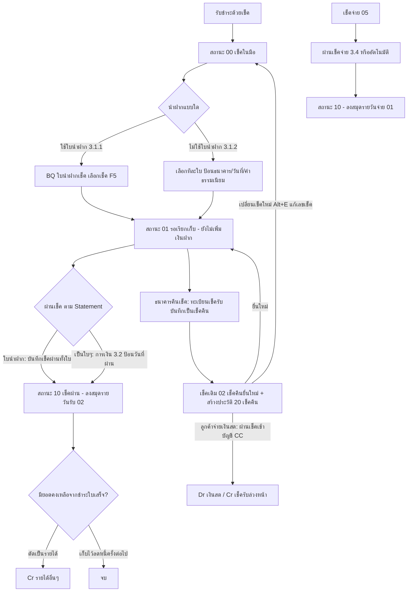

# บทที่ 13 บันทึกการเคลื่อนไหวบัญชีเงินฝาก
> อ้างอิงคู่มือ หน้า 235–249 (PDF p.251–265; PDF p.266 เป็นหน้าว่าง)

## ภาพรวม
- ครอบคลุมรายการประจำวันของบัญชีเงินฝาก: ฝากเงินสด, ถอนเงินสด, โอนระหว่างบัญชี 2 บัญชี, รายได้ธนาคาร (ดอกเบี้ย), ค่าใช้จ่ายธนาคาร (ค่าธรรมเนียม/ภาษีที่ธนาคารหัก), ถอนเงินสดโดยใช้เช็ค (หน้า 235)
- ระบบเช็คมีวงจรสถานะ: รับเช็ค → **เช็คในมือ (00)** → นำฝาก → **รอเรียกเก็บ (01)** → ผ่านเช็ค → **เช็คผ่าน (10)**; ยอดเงินฝากจะเพิ่มเฉพาะตอน "ผ่านเช็ค" เท่านั้น (หน้า 238–239)
- รองรับเช็คคืน/เช็คยกเลิก, การยื่นใหม่, การเปลี่ยนเป็นเงินสด, ตัดยอดคงเหลือในเช็คเป็นรายได้อื่น และการพิมพ์เช็ค (หน้า 245–249)
- เมนูหลัก: การเงิน > 3 ธนาคาร: 1 บันทึกเช็คนำฝาก ▸ (1 ใช้ใบนำฝาก ▸ / 2 ไม่ใช้ใบนำฝาก (นำฝากเช็คเป็นใบๆ)), 2 บันทึกเช็คผ่าน, 3 ทะเบียนเช็ครับ, 4 ผ่านเช็คจ่าย, 5 ทะเบียนเช็คจ่าย, 6 บันทึกการเคลื่อนไหวบัญชีเงินฝาก ▸, 7 รายละเอียดบัญชีเงินฝาก (หน้า 239 รูปที่ 4)

## ตารางสถานะเช็ค (หน้า 239)
| ประเภท | รหัสสถานะ | ความหมาย |
|---|---|---|
| เช็ครับ | 00 | เช็คในมือ |
| เช็ครับ | 01 | รอเรียกเก็บ |
| เช็ครับ | 02 | เช็คคืนยื่นใหม่ |
| เช็ครับ | 10 | เช็คผ่าน |
| เช็ครับ | 20 | เช็คคืน |
| เช็ครับ | 21 | ตัดหนี้สูญ |
| เช็คจ่าย | 02 | เช็คคืนยื่นใหม่ |
| เช็คจ่าย | 05 | เช็คจ่าย |
| เช็คจ่าย | 10 | เช็คผ่าน |
| เช็คจ่าย | 20 | เช็คคืน |

(ข้อความหน้า 238 บอกว่าเช็คจ่ายมี 2 ลักษณะ 'เช็คจ่าย' และ 'เช็คผ่าน' เพราะไม่ต้องนำฝาก แต่ตารางแสดง 4 สถานะ)

## หน้าจอ

### S-BK-01 รายละเอียดบัญชีเงินฝาก
- เมนู: การเงิน > 3.7 รายละเอียดบัญชีเงินฝาก
- อ้างอิง: หน้า 236 (รูปที่ 1, ป้ายภาพผิดเป็น "หน้าจอการฝากเงินสด"), หน้า 247–248 (รูปที่ 20) (PDF p.252, 263–264) — มีภาพหน้าจอ: ใช่
- ลักษณะ: form (master)

| ส่วน/แท็บ | ฟิลด์ | ชนิดข้อมูล | บังคับ | ค่าเริ่มต้น/อ้างอิงจาก | คำอธิบาย/เงื่อนไข |
|---|---|---|---|---|---|
| หลัก | รหัสบัญชี | text | ใช่ | | อักษรย่อตามต้องการ เช่น C1, S1, CC |
| หลัก | ชื่อบัญชีเงินฝาก | text | ใช่ [สันนิษฐาน] | | ควรสื่อความหมาย เช่น "กระแสรายวัน ธ.กรุงเทพ 111222", "ลูกค้านำเงินสดมาชำระหนี้แทนเช็คคืน" |
| หลัก | สาขา | text | ไม่ | | |
| หลัก | สมุดบัญชีเลขที่ | text | ไม่ | | เลขบัญชีธนาคาร เช่น 123-0-111222 (บัญชีเงินสด CC ให้ปล่อยว่าง) |
| หลัก | ชื่อย่อ | text | ไม่ | | เช่น กBBLราชเทวี |
| หลัก | เลขที่บัญชี | lookup | ใช่ | ผังบัญชี | บัญชี GL ที่ผูก เช่น 1112-01 เงินฝากกระแสรายวัน; บัญชี CC ผูก 1111-00 เงินสด |

ปุ่ม/คำสั่ง: toolbar มาตรฐาน (เพิ่ม แก้ไข ลบ ยกเลิก บันทึก เลื่อนเรคคอร์ด ค้นหา พิมพ์)
กฎทางธุรกิจ/เงื่อนไข: ใช้ "บัญชีเงินฝาก" หลอกที่ผูกกับบัญชีเงินสด เพื่อรับเงินสดแทนเช็คคืน (หน้า 247)
ผลทางบัญชี: เป็นแหล่งเลขที่บัญชี GL ของเงินฝาก (ชั้นแฟ้มหลัก)

### S-BK-02 ฝากเงินสด (BD – DEP)
- เมนู: การเงิน > 3.6.1 ฝากเงินสด
- อ้างอิง: หน้า 235–236 (PDF p.251–252) — มีภาพหน้าจอ: ไม่ (ภาพที่ปรากฏเป็นหน้าจอรายละเอียดบัญชีเงินฝาก)
- ลักษณะ: form

| ส่วน/แท็บ | ฟิลด์ | ชนิดข้อมูล | บังคับ | ค่าเริ่มต้น/อ้างอิงจาก | คำอธิบาย/เงื่อนไข |
|---|---|---|---|---|---|
| หลัก | แผนก | lookup | ไม่ | | |
| หลัก | เลขที่ | text | ใช่ | running number (กด <Enter> ผ่าน) | ป้อนเองได้ |
| หลัก | วันที่ | date | ใช่ | | วันที่ฝาก |
| หลัก | หมายเหตุ | text | ไม่ | | |
| หลัก | ฝากเข้าบัญชี | lookup | ใช่ | รายละเอียดบัญชีเงินฝาก | |
| หลัก | จำนวนเงิน | money | ใช่ | | |

ผลทางบัญชี: Dr เงินฝาก (บัญชีในรายละเอียดบัญชีเงินฝาก) / Cr เงินสด [สันนิษฐาน — คู่มือไม่ระบุ]

### S-BK-03 BT – โอนเงินระหว่างธนาคาร (TRF)
- เมนู: การเงิน > 3.6.3 โอนเงินระหว่างบัญชี
- อ้างอิง: หน้า 236–237 (PDF p.252–253) — มีภาพหน้าจอ: ใช่ (รูปที่ 2)
- ลักษณะ: form

| ส่วน/แท็บ | ฟิลด์ | ชนิดข้อมูล | บังคับ | ค่าเริ่มต้น/อ้างอิงจาก | คำอธิบาย/เงื่อนไข |
|---|---|---|---|---|---|
| หลัก | แผนก | lookup | ไม่ | | |
| หลัก | เลขที่ | text | ใช่ | running (BT0000001) | <Enter> ผ่านเพื่อรันอัตโนมัติ |
| หลัก | วันที่ | date | ใช่ | | |
| หลัก | โอนจากบัญชี | lookup | ใช่ | รายละเอียดบัญชีเงินฝาก | แสดงชื่อบัญชี เช่น S1 ออมทรัพย์ ธ.กรุงเทพ 444555 |
| หลัก | โอนเข้าบัญชี | lookup | ใช่ | รายละเอียดบัญชีเงินฝาก | |
| หลัก | จำนวนเงินที่โอน | money | ใช่ | | |
| หลัก | ค่าธรรมเนียม | money | ไม่ | 0.00 | ถ้าธนาคารหักค่าธรรมเนียม |
| หลัก | รวมเงินที่โอนออกทั้งสิ้น | money | - | อัตโนมัติ = โอน + ค่าธรรมเนียม | |

ปุ่ม/คำสั่ง: บันทึก → ยืนยัน "ตกลง"
ผลทางบัญชี: Dr เงินฝากปลายทาง (จำนวนที่โอน), Dr คชจ.ธนาคาร (ค่าธรรมเนียม) / Cr เงินฝากต้นทาง (รวมทั้งสิ้น) [สันนิษฐาน]

### S-BK-04 ทะเบียนเช็ครับ
- เมนู: การเงิน > 3.3 ทะเบียนเช็ครับ
- อ้างอิง: หน้า 238 (รูปที่ 3), 245 (รูปที่ 15), 248 (รูปที่ 21) (PDF p.254, 261, 264) — มีภาพหน้าจอ: ใช่
- ลักษณะ: header form + ส่วนสถานะ + grid เอกสารที่เกี่ยวข้อง <F8> + toolbar มีไอคอนคำสั่งพิเศษ

| ส่วน/แท็บ | ฟิลด์ | ชนิดข้อมูล | บังคับ | ค่าเริ่มต้น/อ้างอิงจาก | คำอธิบาย/เงื่อนไข |
|---|---|---|---|---|---|
| Header | วันที่เช็ค | date | ใช่ | | |
| Header | เลขที่เช็ค | text | ใช่ | | เช่น QR1234567 |
| Header | เช็คธนาคาร | lookup | ใช่ | แฟ้มธนาคาร | รหัส + ชื่อธนาคาร |
| Header | เช็คสาขา | text | ไม่ | | |
| Header | รหัสลูกค้า | lookup | ใช่ | แฟ้มลูกค้า | |
| Header | ผู้สั่งจ่าย | text | ไม่ | ชื่อลูกค้า [สันนิษฐาน] | |
| Header | หมายเหตุ | text+lookup | ไม่ | | |
| Header | แผนก | lookup | ไม่ | | |
| Header | วันที่รับเช็ค | date | ใช่ | | |
| Header | จำนวนเงิน | money | ใช่ | | |
| สถานะ | สถานะเช็ค (รหัส+ชื่อ) | select | - | ระบบ | ดูตารางสถานะ |
| สถานะ | วันที่นำฝาก | date | - | ระบบ (จากการนำฝาก) | |
| สถานะ | เข้าบัญชี | lookup | - | ระบบ | รหัสบัญชีเงินฝาก |
| สถานะ | วันที่ผ่านเช็ค | date | - | ระบบ | |
| สถานะ | ยอดคงเหลือจากชำระใบเสร็จ | money | - | ระบบ | เช็คมากกว่าหนี้ → มียอดคงเหลือ |
| สถานะ | ยอดที่ตัดเป็นรายได้ | money | - | ระบบ | |
| สถานะ | เลขที่ใบนำฝาก | text | - | ระบบ | |
| สถานะ | ค่าธรรมเนียม | money | - | | |
| สถานะ | เลขที่ใบสำคัญ | text | - | ระบบ | เช่น RE0000007 |
| Grid รายการเอกสารที่เกี่ยวข้อง <F8> | ใบเสร็จ# <F8>, วันที่, วันชำระ, จำนวนเงิน, ยอดชำระ | display | - | ใบเสร็จรับเงิน | หัวคอลัมน์อ่านไม่ชัดบางส่วน [สันนิษฐาน] |

ปุ่ม/คำสั่ง: toolbar มาตรฐาน + ไอคอน **บันทึกประวัติเช็คใบนี้เป็นเช็คคืน**, ไอคอน **ตัดยอดคงเหลือเป็นรายได้**, ไอคอนอื่น (S/O ฯลฯ) ไม่ได้อธิบาย
กฎทางธุรกิจ/เงื่อนไข:
- รับเช็คครั้งแรก สถานะ = เช็คในมือ; นำฝาก = เช็ครอเรียกเก็บ; ผ่าน = เช็คผ่าน (หน้า 238)
- เช็ครับมูลค่าเกินหนี้ → ยอดคงเหลือ นำไปลดหนี้ครั้งต่อไปได้ หรือตัดเป็นรายได้อื่น (หน้า 248)
ผลทางบัญชี: ดู S-BK-11, S-BK-12

### S-BK-05 BQ – ใบนำฝากเช็ค (DEQ)
- เมนู: การเงิน > 3.1 บันทึกเช็คนำฝาก > 1 ใช้ใบนำฝาก > ใบนำฝากเช็ค (DEQ) (ตัวเลือกอีกตัว: ใบขายลดเช็ค (SQR))
- อ้างอิง: หน้า 239–243 (PDF p.255–259) — มีภาพหน้าจอ: ใช่ (รูปที่ 5, 6, 8, 11)
- ลักษณะ: header + แท็บ (รายการที่นำฝาก <F8> / รายการภาษีซื้อ <Ctrl+F7> / รายการภาษีหัก ณ ที่จ่าย <Ctrl+F10>) + footer ยอดเงิน

| ส่วน/แท็บ | ฟิลด์ | ชนิดข้อมูล | บังคับ | ค่าเริ่มต้น/อ้างอิงจาก | คำอธิบาย/เงื่อนไข |
|---|---|---|---|---|---|
| Header | เข้าบัญชี | lookup | ใช่ | รายละเอียดบัญชีเงินฝาก | ธนาคารที่จะนำฝากเช็คทั้งหมด (แสดงชื่อ+เลขบัญชี) |
| Header | สถานะ | display | - | 01 รอเรียกเก็บ | ป้ายสถานะมุมขวาบนด้วย |
| Header | หมายเหตุ | text+lookup | ไม่ | | |
| Header | แผนก | lookup | ไม่ | | |
| Header | เลขที่ใบนำฝาก | text | ใช่ | running (BQ0000001) | |
| Header | วันที่นำฝาก | date | ใช่ | | |
| Header | วันที่ผ่าน | date | - | | ภาพแสดงค่า 16/01/47 |
| รายการที่นำฝาก <F8> | เลขที่เช็ค, วันที่, ธนาคาร (รหัส+ชื่อ), สาขา, จำนวนเงิน | grid | ใช่ | เลือกจากเช็คสถานะเช็คในมือ | |
| รายการภาษีซื้อ <Ctrl+F7> | (ไม่ได้แสดง) | grid | | | สำหรับ VAT ของค่าธรรมเนียม [สันนิษฐาน] |
| รายการภาษีหัก ณ ที่จ่าย <Ctrl+F10> | (ไม่ได้แสดง) | grid | | | |
| Footer | ใบกำกับภาษีซื้อ# | text | ไม่ | | <Enter> ผ่าน — ใช้กับขายลดเช็คเท่านั้น |
| Footer | ลวท. | date | ไม่ | | <Enter> ผ่าน — ใช้กับขายลดเช็คเท่านั้น |
| Footer | ยอดรวม | money | - | อัตโนมัติ | |
| Footer | หัก ค่าธรรมเนียม | money | ไม่ | | ถ้าธนาคารหัก |
| Footer | ภาษีมูลค่าเพิ่ม (ของค่าธรรมเนียม) | money | ไม่ | | |
| Footer | หักภาษี ณ ที่จ่ายไว้ | money | ไม่ | | |
| Footer | เงินเข้าบัญชีสุทธิ | money | - | อัตโนมัติ | |

ปุ่ม/คำสั่ง: toolbar มาตรฐาน + VOID [สันนิษฐาน], พิมพ์ใบนำฝาก (แบบฟอร์ม), **บันทึกเช็คผ่าน (ทั้งใบนำฝาก)** (ไอคอน PASS), ไอคอน PASS อีกตัว/RE-JNL/TAX [สันนิษฐาน: ยกเลิกผ่าน/ลงบัญชีใหม่/ภาษี]
กฎทางธุรกิจ/เงื่อนไข:
- นำฝากเช็คหลายใบพร้อมกัน ป้อนวันที่และธนาคารครั้งเดียว พิมพ์ใบนำฝากได้ (หน้า 240)
- การนำฝาก **ไม่เพิ่มยอดเงินฝาก** จนกว่าจะสั่งผ่านเช็ค (หน้า 239)
- **ผ่านเช็คได้ทั้งใบนำฝากเท่านั้น** เลือกผ่านเฉพาะบางเช็คไม่ได้ (หน้า 242, 243)
ผลทางบัญชี: ตอนนำฝาก — เปลี่ยนสถานะเช็ค 00 → 01 เท่านั้น; ตอนผ่าน (ทั้งใบ) — สถานะ → 10, ลงสมุดรายวันรับ (02 ตาม 5.1): Dr เงินฝาก, คชจ.ธนาคาร, ภาษีซื้อ, ภาษีถูกหัก ณ ที่จ่าย / Cr เช็ครับล่วงหน้า [สันนิษฐาน]

### S-BK-06 เลือกเช็คเข้าใบนำฝาก
- เมนู: เปิดจาก S-BK-05 หลังป้อน header
- อ้างอิง: หน้า 241 (PDF p.257) — มีภาพหน้าจอ: ใช่ (รูปที่ 7)
- ลักษณะ: dialog list (multi-select)

| ส่วน/แท็บ | ฟิลด์ | ชนิดข้อมูล | บังคับ | ค่าเริ่มต้น/อ้างอิงจาก | คำอธิบาย/เงื่อนไข |
|---|---|---|---|---|---|
| Grid | วันที่ (sort ▲), รหัสธนาคาร, ชื่อธนาคาร, เลขที่เช็ค, จำนวนเงิน, นำฝากบัญชี, วันที่นำฝาก, เช็คสาขา | display | - | เช็ครับ | |
| Footer | ถูกเลือก n รายการ | number | - | | |

ปุ่ม/คำสั่ง: ทำงาน <F5>, ยกเลิก, ค้นหา, เรียงใหม่ <Tab>; ดับเบิ้ลคลิกเพื่อเลือก (แสดงสามเหลี่ยมหน้ารายการ)

### S-BK-07 บันทึกเช็คนำฝาก – ไม่ใช้ใบนำฝาก (นำฝากเช็คเป็นใบๆ)
- เมนู: การเงิน > 3.1 > 2 ไม่ใช้ใบนำฝาก
- อ้างอิง: หน้า 242 (PDF p.258) — มีภาพหน้าจอ: ใช่ (รูปที่ 9 list, รูปที่ 10 dialog "ป้อนรายละเอียดการผ่านเช็ค")
- ลักษณะ: list + dialog

| ส่วน/แท็บ | ฟิลด์ | ชนิดข้อมูล | บังคับ | ค่าเริ่มต้น/อ้างอิงจาก | คำอธิบาย/เงื่อนไข |
|---|---|---|---|---|---|
| List | วันที่, ธนาคาร, เลขที่เช็ค, จำนวนเงิน, นำฝากบัญชี, วันที่นำฝาก, เช็คสาขา | display | - | เช็คสถานะเช็ครับ (เช็คในมือ) | |
| Dialog | ธนาคารที่นำฝาก | lookup | ใช่ | รายละเอียดบัญชีเงินฝาก | |
| Dialog | วันที่นำฝาก | date | ใช่ | | |
| Dialog | จำนวนเงิน | money | - | จากเช็ค (อ่านอย่างเดียว) | |
| Dialog | ค่าธรรมเนียม | money | ไม่ | 0.00 | เช่น เช็คต่างจังหวัด |

ปุ่ม/คำสั่ง: ดับเบิ้ลคลิกเลือกเช็ค → dialog ตกลง/ยกเลิก; ทำงาน <F5> บันทึก; ยกเลิก; ค้นหา; เรียงใหม่ <Tab>
กฎทางธุรกิจ/เงื่อนไข: เหมาะเมื่อนำฝากไม่มากและไม่ต้องพิมพ์ใบนำฝาก; ผ่านเช็คแบบนี้ต้องใช้เมนู 3.2 (หน้า 242–243)
ผลทางบัญชี: สถานะ 00 → 01; ไม่ลงบัญชี

### S-BK-08 บันทึกเช็คผ่าน (เช็ครับที่นำฝากเป็นใบๆ)
- เมนู: การเงิน > 3.2 บันทึกเช็คผ่าน
- อ้างอิง: หน้า 243–244 (PDF p.259–260) — มีภาพหน้าจอ: ใช่ (รูปที่ 12 list, รูปที่ 13 dialog "ป้อนวันที่ผ่าน")
- ลักษณะ: list + dialog

| ส่วน/แท็บ | ฟิลด์ | ชนิดข้อมูล | บังคับ | ค่าเริ่มต้น/อ้างอิงจาก | คำอธิบาย/เงื่อนไข |
|---|---|---|---|---|---|
| List | ลงวันที่, รหัสธนาคาร, เช็ค ธ., เลขที่เช็ค, จำนวนเงิน, นำฝากบัญชี (รหัส+ชื่อย่อ), วันที่นำฝาก, เช็คสาขา | display | - | เช็คที่ยังไม่ผ่าน | |
| Dialog ป้อนวันที่ผ่าน | วันที่ผ่าน | date | ใช่ | | ตามใบแจ้งยอด (Statement) |

ปุ่ม/คำสั่ง: ดับเบิ้ลคลิกเลือก; ทำงาน <F5> → dialog ตกลง/ยกเลิก; ค้นหา; เรียงใหม่ <Tab>
กฎทางธุรกิจ/เงื่อนไข: ถ้าเช็คยังไม่ได้นำฝาก ระบบจะแสดง dialog แบบ S-BK-07 ให้ป้อนข้อมูลนำฝากก่อน; ถ้านำฝากแล้ว แสดงข้อมูลนำฝากอัตโนมัติ (หน้า 244)
ผลทางบัญชี: สถานะ → เช็คผ่าน (10); ลงสมุดรายวันรับ (02): Dr เงินฝาก (+คชจ.ธนาคาร) / Cr เช็ครับล่วงหน้า [สันนิษฐาน]

### S-BK-09 ผ่านเช็คจ่าย
- เมนู: การเงิน > 3.4 ผ่านเช็คจ่าย (อัตโนมัติ: ตั้งที่ เริ่มระบบ 1.6 ระบบการเงินและเงินฝากธนาคาร)
- อ้างอิง: หน้า 244–245 (PDF p.260–261) — มีภาพหน้าจอ: ใช่ (รูปที่ 14)
- ลักษณะ: list + dialog วันที่ผ่าน

| ส่วน/แท็บ | ฟิลด์ | ชนิดข้อมูล | บังคับ | ค่าเริ่มต้น/อ้างอิงจาก | คำอธิบาย/เงื่อนไข |
|---|---|---|---|---|---|
| List | วันที่ (sort ▲), เลขที่เช็ค, จำนวนเงิน, ตัดจากบัญชี (รหัส+ชื่อย่อ), วันที่ผ่าน, จ่ายให้ | display | - | เช็คจ่าย | หัวคอลัมน์บางส่วนอ่านไม่ชัด [สันนิษฐาน] |
| Dialog | วันที่ผ่านเช็ค | date | ใช่ | | ตาม Bank Statement |

ปุ่ม/คำสั่ง: ทำงาน <F5>, ยกเลิก, ค้นหา, เรียงใหม่ <Tab>
กฎทางธุรกิจ/เงื่อนไข: กำหนดให้ผ่านอัตโนมัติเมื่อถึงวันที่ในเช็คได้ (เริ่มระบบ 1.6) หรือผ่านเอง (หน้า 244)
ผลทางบัญชี: สถานะ 05 → 10; ลงสมุดรายวันจ่าย (01): Dr เช็คจ่ายล่วงหน้า / Cr เงินฝาก [สันนิษฐาน]

### S-BK-10 บันทึกเช็คยกเลิก/เช็คคืน (ชุด dialog)
- เมนู: การเงิน > 3.3 ทะเบียนเช็ครับ > ค้นหาเช็ค > ไอคอน "บันทึกประวัติเช็คใบนี้เป็นเช็คคืน"
- อ้างอิง: หน้า 245–247 (PDF p.261–263) — มีภาพหน้าจอ: ใช่ (รูปที่ 15–19)
- ลักษณะ: dialog ยืนยัน → dialog ป้อนรายละเอียดของเช็คคืน → message

| ส่วน/แท็บ | ฟิลด์ | ชนิดข้อมูล | บังคับ | ค่าเริ่มต้น/อ้างอิงจาก | คำอธิบาย/เงื่อนไข |
|---|---|---|---|---|---|
| Confirm | "กรุณาเลือกตกลง เพื่อยืนยันให้บันทึกประวัติเป็นเช็คคืนไว้" | - | - | | ตกลง/ยกเลิก |
| ป้อนรายละเอียดของเช็คคืน | วันที่คืน | date | ใช่ | | วันที่ธนาคารคืนเช็ค |
| ป้อนรายละเอียดของเช็คคืน | เหตุผล | lookup | ใช่ [สันนิษฐาน] | รายการข้อความ | ภาพ: "02.โปรดติดต่อผู้สั่งจ่าย"; คู่มือว่าแสดงชื่อลูกค้าให้อัตโนมัติ |
| Message#7024 | ข้อความ | - | - | | "โปรแกรมได้บันทึกประวัติเช็คยกเลิก/เช็คคืน เก็บไว้เรียบร้อยแล้ว สำหรับเช็คใบเดิม จะถูกเปลี่ยนสถานะเป็น 'เช็คคืนยื่นใหม่' เพื่อรอทำรายการต่อไป / หมายเหตุ: ถ้ามีการเปลี่ยนเป็นเช็คใบใหม่ ให้กด <Alt+E> เพื่อแก้ไขเลขที่เช็คใบนี้ซึ่งมีสถานะเป็น 'เช็คคืนยื่นใหม่' ได้เลย" |

กฎทางธุรกิจ/เงื่อนไข:
- หลังบันทึก: เช็คเดิม → สถานะ **02 เช็คคืนยื่นใหม่**, และระบบสร้างเช็คเลขเดียวกันอีก 1 ใบ สถานะ **20 เช็คคืน** (เก็บประวัติ) (หน้า 246–247 รูปที่ 19)
- ทางเลือกต่อไป: (1) ลูกค้าเติมเงินพอ → นำเช็คใบเดิม (02) ผ่านเข้าธนาคารใหม่ตามขั้นตอนปกติ; (2) ลูกค้าเปลี่ยนเช็คใหม่ → แก้เลขที่เช็คของใบสถานะ 02 (<Alt+E>); (3) ลูกค้าจ่ายเงินสด → ดู S-BK-11 (หน้า 247)
- ประวัติเช็คคืนใช้ควบคุม/วิเคราะห์เครดิตลูกค้า (หน้า 247)
ผลทางบัญชี: ไม่ระบุว่าลงบัญชีตอนบันทึกเช็คคืน [สันนิษฐาน: ไม่ลง]

### S-BK-11 กรณีลูกค้านำเงินสดมาเปลี่ยนแทนเช็คคืน
- เมนู: (1) การเงิน 3.7 สร้างบัญชีเงินฝาก CC ผูก 1111-00; (2) การเงิน 3.2 บันทึกเช็คผ่าน → ดับเบิ้ลคลิกเช็ค → ป้อนธนาคาร = CC
- อ้างอิง: หน้า 247–248 (PDF p.263–264) — มีภาพหน้าจอ: ใช่ (รูปที่ 20)
- ลักษณะ: ใช้หน้าจอ S-BK-01 + S-BK-08
ผลทางบัญชี (คู่มือระบุ): **Dr เงินสด / Cr เช็ครับล่วงหน้า**

### S-BK-12 ตัดยอดคงเหลือในเช็คเป็นรายได้อื่น ๆ
- เมนู: การเงิน > 3.3 ทะเบียนเช็ครับ > เลือกเช็ค > ไอคอน "ตัดยอดคงเหลือเป็นรายได้"
- อ้างอิง: หน้า 248–249 (PDF p.264–265) — มีภาพหน้าจอ: ใช่ (รูปที่ 21 toolbar, รูปที่ 22 confirm)
- ลักษณะ: คำสั่ง + confirm "กรุณาเลือกตกลง เพื่อยืนยันให้ตัดยอดคงเหลือเป็นรายได้" (ตกลง/ยกเลิก)
กฎทางธุรกิจ/เงื่อนไข: ใช้เมื่อเช็คมีมูลค่ามากกว่าหนี้ ("ยอดคงเหลือจากชำระใบเสร็จ" > 0) และไม่ต้องการนำไปลดหนี้ครั้งต่อไป (หน้า 248)
ผลทางบัญชี (คู่มือระบุ): นำยอดผลต่างไปบันทึกในสมุดรายวันเป็น **รายได้อื่นๆ** แสดงในรายการเดียวกับรายการผ่านเช็ครับ (หน้า 249) — Dr เช็ครับล่วงหน้า/เงินฝาก [สันนิษฐาน] / Cr รายได้อื่นๆ (4200-08 ตาม 5.2)

### S-BK-13 ทะเบียนเช็คจ่าย / พิมพ์เช็ค
- เมนู: การเงิน > 3.5 ทะเบียนเช็คจ่าย
- อ้างอิง: หน้า 238, 249 (PDF p.254, 265) — มีภาพหน้าจอ: ไม่
- ลักษณะ: form (คล้ายทะเบียนเช็ครับ [สันนิษฐาน])
ปุ่ม/คำสั่ง: เลือกเลขที่เช็ค → ไอคอนพิมพ์เอกสาร หรือ <Alt+P> พิมพ์เช็ค; แก้แบบฟอร์มดูบทที่ 25
กฎทางธุรกิจ/เงื่อนไข: เช็คจ่ายไม่ต้องผ่านขั้นนำฝาก สถานะหลัก เช็คจ่าย → เช็คผ่าน (หน้า 238)

## ลำดับการใช้งาน
1. ตั้งบัญชีเงินฝากใน การเงิน 3.7 (ผูกเลขที่บัญชี GL)
2. รายการเงินฝากทั่วไป: การเงิน 3.6.x (ฝากเงินสด, โอนเงิน ฯลฯ)
3. เช็ครับ: รับชำระด้วยเช็ค (สถานะ 00) → นำฝาก (3.1 ใช้/ไม่ใช้ใบนำฝาก; สถานะ 01) → ผ่านเช็คตาม Statement (ใบนำฝาก: ปุ่มบันทึกเช็คผ่านทั้งใบ; เป็นใบๆ: 3.2) → สถานะ 10, เงินฝากเพิ่ม
4. เช็คคืน: ทะเบียนเช็ครับ → บันทึกเป็นเช็คคืน → ยื่นใหม่ / เปลี่ยนเลขเช็ค / รับเงินสดผ่านบัญชี CC
5. เช็คเกินหนี้: ทะเบียนเช็ครับ → ตัดยอดคงเหลือเป็นรายได้
6. เช็คจ่าย: พิมพ์เช็คจาก 3.5 → ผ่านเช็คจ่าย 3.4 (หรืออัตโนมัติ)

## ข้อมูลที่เกี่ยวข้อง
- **BankAccount** (รหัสบัญชี, ชื่อ, สาขา, สมุดบัญชีเลขที่, ชื่อย่อ, gl_account) n:1 Account
- **Bank** (รหัสธนาคาร + ชื่อ) — ธนาคารของเช็ค
- **ChequeReceived** (วันที่เช็ค, เลขที่, bank, สาขา, customer, ผู้สั่งจ่าย, จำนวนเงิน, วันที่รับ, สถานะ, วันที่นำฝาก, deposit_account, วันที่ผ่าน, ค่าธรรมเนียม, ยอดคงเหลือ, ยอดตัดเป็นรายได้, เลขที่ใบนำฝาก, เลขที่ใบสำคัญ) n:1 Customer, Bank, BankAccount; n:m Receipt (RE) ผ่านรายการเอกสารที่เกี่ยวข้อง; 1:n ChequeReturnHistory (วันที่คืน, เหตุผล)
- **ChequePaid** (เลขที่, วันที่, จำนวนเงิน, ตัดจากบัญชี, จ่ายให้, วันที่ผ่าน, สถานะ) n:1 BankAccount, Supplier/Payee
- **ChequeDepositSlip** BQ/SQ (เลขที่, วันที่นำฝาก, วันที่ผ่าน, เข้าบัญชี, สถานะ, ยอดรวม, ค่าธรรมเนียม, VAT, WHT, สุทธิ, ใบกำกับภาษีซื้อ#, ลวท.) 1:n ChequeReceived; 1:n InputVATLine, 1:n WHTLine
- **BankTransaction** BD/BW/BT/BU/BC/BV (เลขที่, วันที่, แผนก, หมายเหตุ, from_account, to_account, จำนวนเงิน, ค่าธรรมเนียม, รวม)
- **ChequeStatus** (lookup: 00,01,02,05,10,20,21)
- ทุกการผ่านเช็คสร้าง JournalEntry ตามสมุดรายวันใน GLLinkSetting (บทที่ 10)

## ข้อสังเกต
- คู่มือระบุผลบัญชีชัดเพียง 2 กรณี: รับเงินสดแทนเช็คคืน (Dr เงินสด / Cr เช็ครับล่วงหน้า) และตัดยอดคงเหลือเป็นรายได้อื่นๆ; ผลบัญชีอื่น [สันนิษฐาน] ตามบัญชีใน 5.2
- ภาพรูปที่ 1 (หน้า 236) ป้ายว่า "หน้าจอการฝากเงินสด" แต่เป็นหน้าจอรายละเอียดบัญชีเงินฝาก — ไม่มีภาพหน้าจอฝากเงินสดจริง
- เมนู 3.6 มีเมนูย่อย ▸ คู่มือกล่าวถึงเฉพาะ 3.6.1 ฝากเงินสด และ 3.6.3 โอนเงินระหว่างบัญชี; รายการอื่น (ถอนเงิน รับดอกเบี้ย จ่ายค่าธรรมเนียม) อนุมานจากประเภทเอกสาร BW/BU/BC/BV ในบทที่ 9 [สันนิษฐาน]
- การแก้ปัญหาเช็คคืนใช้ "บัญชีเงินฝากหลอก" ผูกบัญชีเงินสด — workaround; ERP ใหม่ควรมีคำสั่ง "รับเงินสดแทนเช็คคืน" โดยตรง
- ผ่านเช็คได้ทั้งใบนำฝากเท่านั้น — ข้อจำกัดที่ ERP ใหม่อาจปรับให้ผ่านรายใบได้
- ตารางสถานะเช็คจ่ายแสดง 4 สถานะ ขณะที่ข้อความบอก 2 สถานะ
- ชื่อคอลัมน์บางคอลัมน์ใน list (หัวตารางพื้นเข้ม) อ่านไม่ชัด
