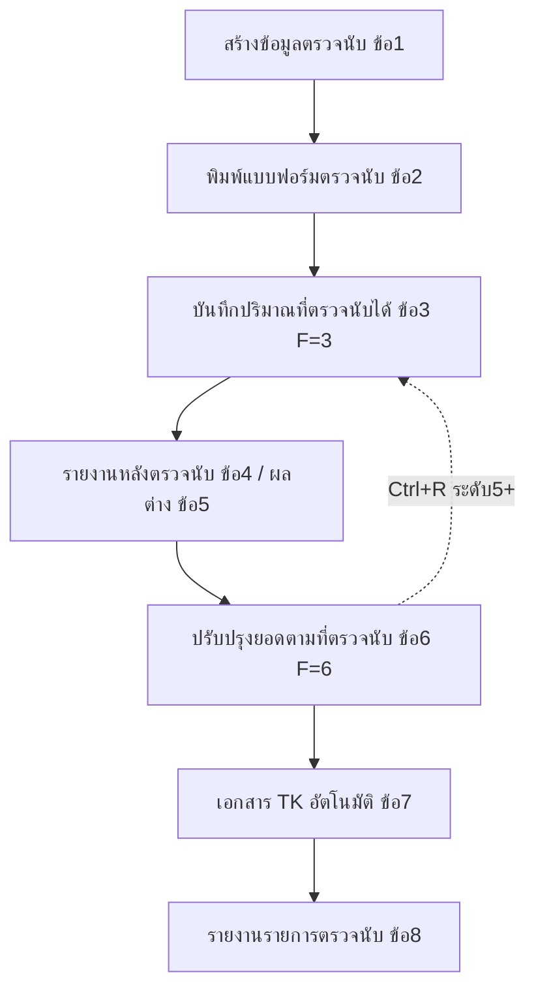
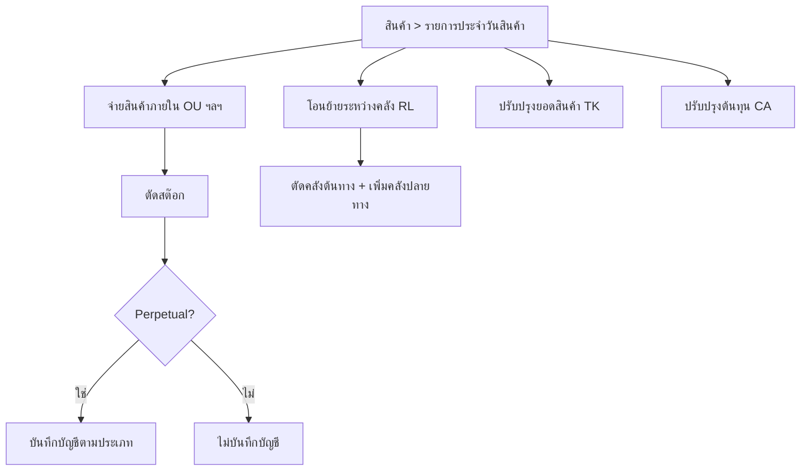

# บทที่ 14 การบันทึกรายการประจำวันสินค้า
> อ้างอิงคู่มือ หน้า 251–266 (PDF p.267–282)

## ภาพรวม
- บันทึกรายการสินค้าที่ไม่ได้เกิดจากการซื้อ-ขายตามปกติ เช่น การให้สินค้าตัวอย่าง, ตัดสต๊อกสินค้าชำรุด, การตรวจนับสต๊อก (หน้า 251)
- เมนู สินค้า > 1. รายการประจำวันสินค้า มีเมนูย่อย 4 กลุ่ม: จ่ายสินค้าภายใน, โอนย้ายระหว่างคลัง, ปรับปรุงยอดสินค้า, ปรับปรุงต้นทุนสินค้า (หน้า 251)
- วิธีเพิ่ม/แก้ไข/ลบ/ยกเลิกข้อมูลใช้แบบเดียวกับที่อธิบายในบทที่ 3 (หน้า 251)
- นอกจากนี้มี ทะเบียนหมายเลขสินค้า (Serial/รับประกัน/ประวัติบริการ) (หน้า 257–260) และ รายการตรวจนับสินค้า (สินค้า > 6) 8 เมนูย่อย (หน้า 260–266)
- เอกสารทุกตัวในกลุ่มนี้เป็นรูปแบบ header + ตารางรายการ + ยอดรวม และมีแถบเครื่องมือมาตรฐานด้านบน

## หน้าจอ

### S-IC-01 จ่ายสินค้าใช้ภายใน (OU)
- เมนู: สินค้า > 1. รายการประจำวันสินค้า > จ่ายสินค้าภายใน > จ่ายสินค้าใช้ภายใน
- อ้างอิง: หน้า 252–253 (PDF p.268–269) — มีภาพหน้าจอ: ใช่ (รูปที่ 1)
- ลักษณะ: header + ตารางรายการ + footer (จำนวนเงิน) ; คำนำหน้าเลขที่เอกสาร "OU" (ตัวอย่าง OU0000001)

| ส่วน/แท็บ | ฟิลด์ | ชนิดข้อมูล | บังคับ | ค่าเริ่มต้น/อ้างอิงจาก | คำอธิบาย/เงื่อนไข |
|---|---|---|---|---|---|
| Header | เลขที่เอกสาร | text | ใช่ [สันนิษฐาน] | กด Enter ผ่าน = รันเลขอัตโนมัติ | เลขที่เอกสารการจ่ายสินค้าใช้ภายใน |
| Header | วันที่ | date | ใช่ [สันนิษฐาน] | — | วันที่เบิกสินค้าใช้ภายใน (มีปุ่มแว่นขยาย) |
| Header | สำหรับแผนก | lookup | ไม่ [สันนิษฐาน] | ตารางแผนก | แผนกที่เบิกสินค้าใช้ภายใน |
| Header | หมายเหตุ | text (lookup ข้อความ) | ไม่ | — | ข้อความ/หมายเหตุของการจ่ายครั้งนี้ |
| ตาราง | No. | number | อัตโนมัติ | ลำดับอัตโนมัติ | ลำดับรายการสินค้า |
| ตาราง | รหัส | lookup | ใช่ | แฟ้มข้อมูลหลักสินค้า | รหัสสินค้าที่เบิกใช้ |
| ตาราง | รายละเอียด | text | ไม่ [สันนิษฐาน] | — | ตัวอย่าง "เบิกใช้ในแผนกซ่อม" |
| ตาราง | คลัง | lookup | ใช่ | ตารางคลังสินค้า | คลังที่ตัดสต๊อกออก |
| ตาราง | จำนวน (+หน่วย) | number | ใช่ | — | จำนวนที่เบิกออก; ถ้าสินค้ากำหนดให้ปรับหน่วยนับได้ กด Enter แล้วเปิด S-IC-05 |
| ตาราง | ราคาต่อหน่วย | money | อัตโนมัติ | วิธีคำนวณต้นทุน (FIFO, Average) | โปรแกรมแสดงราคาทุนต่อหน่วยให้อัตโนมัติ |
| ตาราง | จำนวนเงิน | money | อัตโนมัติ | จำนวน × ราคา/หน่วย | |
| Footer | จำนวนเงิน | money | อัตโนมัติ | ผลรวมตาราง | |

ปุ่ม/คำสั่ง: แถบเครื่องมือมาตรฐาน (เพิ่ม, แก้ไข, ลบ, ยกเลิก, บันทึก, เลื่อนรายการแรก/ก่อนหน้า/ถัดไป/สุดท้าย, ค้นหา, พิมพ์ ฯลฯ) [สันนิษฐานจากไอคอน]; ไอคอนบันทึกข้อมูลเมื่อป้อนครบ (หน้า 253)

กฎทางธุรกิจ/เงื่อนไข:
- ป้อนได้หลายรายการต่อเอกสาร (หน้า 253)
- ราคาทุนขึ้นกับวิธีคำนวณต้นทุนที่กำหนดไว้ (FIFO, Average) (หน้า 253)

ผลทางบัญชี/สต๊อก (หน้า 253):
- ตัดสต๊อกสินค้าออกจากคลังที่ระบุ
- กรณีบันทึกบัญชีสินค้าแบบ Perpetual: Dr วัสดุสำนักงานใช้ไป / Cr สินค้าคงเหลือ [ด้านเครดิตสันนิษฐาน]
- กรณี Periodic: ไม่มีการบันทึกบัญชีใด ๆ

### S-IC-02 จ่ายวัตถุดิบเพื่อผลิต
- เมนู: สินค้า > 1 > จ่ายสินค้าภายใน > จ่ายวัตถุดิบเพื่อผลิต
- อ้างอิง: หน้า 251, 253 (PDF p.267, 269) — มีภาพหน้าจอ: ไม่
- ลักษณะ: เหมือน S-IC-01 (คู่มือระบุว่าเมนูย่อยในจ่ายสินค้าภายในทำงานคล้ายกัน ต่างกันที่การบันทึกบัญชี)

ผลทางบัญชี/สต๊อก: ตัดสต๊อก; Perpetual: Dr งานระหว่างทำ / Cr สินค้าคงเหลือ [ด้านเครดิตสันนิษฐาน]; Periodic: ไม่บันทึกบัญชี (หน้า 253)

### S-IC-03 จ่ายสินค้าเป็นตัวอย่าง
- เมนู: สินค้า > 1 > จ่ายสินค้าภายใน > จ่ายสินค้าเป็นตัวอย่าง
- อ้างอิง: หน้า 251, 253 — มีภาพหน้าจอ: ไม่
- ลักษณะ: เหมือน S-IC-01

ผลทางบัญชี/สต๊อก: ตัดสต๊อก; Perpetual: Dr ค่าใช้จ่าย-เบิกสินค้าเป็นตัวอย่าง / Cr สินค้าคงเหลือ [ด้านเครดิตสันนิษฐาน]

### S-IC-04 ตัดสินค้าชำรุด
- เมนู: สินค้า > 1 > จ่ายสินค้าภายใน > ตัดสินค้าชำรุด
- อ้างอิง: หน้า 251, 253 — มีภาพหน้าจอ: ไม่
- ลักษณะ: เหมือน S-IC-01

ผลทางบัญชี/สต๊อก: ตัดสต๊อก; Perpetual: Dr ต้นทุนสินค้าเพื่อขาย / Cr สินค้าคงเหลือ [ด้านเครดิตสันนิษฐาน]

### S-IC-05 ป้อนหน่วยนับที่รับ/จ่าย (dialog)
- เมนู: เปิดจากช่องจำนวนในตารางของเอกสารสินค้า (กด Enter)
- อ้างอิง: หน้า 253 (PDF p.269) — มีภาพหน้าจอ: ใช่ (รูปที่ 2)
- ลักษณะ: dialog

| ส่วน/แท็บ | ฟิลด์ | ชนิดข้อมูล | บังคับ | ค่าเริ่มต้น/อ้างอิงจาก | คำอธิบาย/เงื่อนไข |
|---|---|---|---|---|---|
| — | หน่วยย่อยนับเป็น | text (แสดงผล) | — | ข้อมูลสินค้า | ตัวอย่าง "อัน" |
| — | หน่วยที่รับ/จ่ายเป็น | lookup | ใช่ | ตารางหน่วยนับ | |
| — | ตัวคูณเป็นหน่วยย่อย | number | ใช่ | 1.0 | อัตราส่วน/หน่วยหลัก |

ปุ่ม/คำสั่ง: ตกลง, ยกเลิก
กฎทางธุรกิจ/เงื่อนไข: แสดงเฉพาะเมื่อสินค้ากำหนดให้ปรับหน่วยนับรับ-จ่ายได้และกำหนดให้ปรับตัวคูณได้ (หน้า 253)

### S-IC-06 โอนย้ายระหว่างคลัง (RL)
- เมนู: สินค้า > 1 > โอนย้ายระหว่างคลัง
- อ้างอิง: หน้า 254 (PDF p.270) — มีภาพหน้าจอ: ใช่ (รูปที่ 3)
- ลักษณะ: header + ตารางรายการ ; คำนำหน้าเลขที่ "RL" (RL0000001)

| ส่วน/แท็บ | ฟิลด์ | ชนิดข้อมูล | บังคับ | ค่าเริ่มต้น/อ้างอิงจาก | คำอธิบาย/เงื่อนไข |
|---|---|---|---|---|---|
| Header | คลังต้นทาง | lookup | ใช่ | ตารางคลัง | คลังที่โอนสินค้าออก (แสดงชื่อคลัง) |
| Header | คลังปลายทาง | lookup | ใช่ | ตารางคลัง | คลังที่รับสินค้าเข้า |
| Header | สำหรับแผนก | lookup | ไม่ [สันนิษฐาน] | ตารางแผนก | |
| Header | หมายเหตุ | text | ไม่ | — | ตัวอย่าง "เพื่อตั้งโชว์หน้าร้าน" |
| Header | เลขที่เอกสาร | text | ใช่ | รันอัตโนมัติ [สันนิษฐาน] | |
| Header | วันที่ | date | ใช่ | — | |
| ตาราง | No. | number | อัตโนมัติ | | |
| ตาราง | รหัส | lookup | ใช่ | สินค้า | |
| ตาราง | รายละเอียด | text | ไม่ | | |
| ตาราง | จำนวน (+หน่วย) | number | ใช่ | | ไม่มีคอลัมน์ราคา/จำนวนเงิน |

ผลทางบัญชี/สต๊อก: ตัดสต๊อกจากคลังต้นทาง และเพิ่มยอดที่คลังปลายทาง (หน้า 254); คู่มือไม่กล่าวถึงการบันทึกบัญชี

### S-IC-07 ปรับปรุงจากการตรวจนับ (TK)
- เมนู: สินค้า > 1 > ปรับปรุงยอดสินค้า > ปรับปรุงจากการตรวจนับ
- อ้างอิง: หน้า 254–255 (PDF p.270–271) — มีภาพหน้าจอ: ใช่ (รูปที่ 4)
- ลักษณะ: header + ตาราง + footer ; คำนำหน้า "TK"

| ส่วน/แท็บ | ฟิลด์ | ชนิดข้อมูล | บังคับ | ค่าเริ่มต้น/อ้างอิงจาก | คำอธิบาย/เงื่อนไข |
|---|---|---|---|---|---|
| Header | สำหรับแผนก | lookup | ไม่ | ตารางแผนก | |
| Header | หมายเหตุ | text | ไม่ | | |
| Header | เลขที่เอกสาร | text | ใช่ | | |
| Header | วันที่ | date | ใช่ | | |
| ตาราง | No., รหัส, รายละเอียด, คลัง | lookup/text | ใช่ | | |
| ตาราง | จำนวน | number | ใช่ | | ลดยอด = ติดลบ, เพิ่มยอด = บวก |
| ตาราง | ราคาต่อหน่วย | money | เงื่อนไข | | ลดยอด: โปรแกรมแสดงราคาทุนตามวิธีคำนวณต้นทุน; เพิ่มยอด: ผู้ใช้ต้องป้อนเอง |
| ตาราง | จำนวนเงิน | money | อัตโนมัติ | | |
| Footer | ปรับต้นทุนโดยโปรแกรม | money | อัตโนมัติ | | ตัวอย่าง 0.00 |
| Footer | จำนวนเงิน | money | อัตโนมัติ | | ผลรวม (อาจติดลบ) |

ผลทางบัญชี/สต๊อก: ปรับเพิ่ม/ลดยอดสต๊อกตามเครื่องหมายจำนวน; คู่มือไม่ระบุคู่บัญชี

### S-IC-08 ปรับปรุงเพิ่ม/ลดสินค้า
- เมนู: สินค้า > 1 > ปรับปรุงยอดสินค้า > ปรับปรุงเพิ่ม/ลดสินค้า
- อ้างอิง: หน้า 255 — มีภาพหน้าจอ: ไม่
- ลักษณะ: เหมือน S-IC-07 [สันนิษฐาน]; ข้อมูลที่ต้องป้อนคือ วันที่และเลขที่เอกสาร รายการสินค้า คลัง จำนวน (ลด=ติดลบ) ราคา/หน่วย (หน้า 255)

### S-IC-09 รับสำเร็จรูปจากการผลิต
- เมนู: สินค้า > 1 > ปรับปรุงยอดสินค้า > รับส/คสำเร็จรูปจากการผลิต
- อ้างอิง: หน้า 255 — มีภาพหน้าจอ: ไม่
- ลักษณะ: เหมือน S-IC-07 [สันนิษฐาน] (คู่มือระบุเพียงชื่อเมนู)

### S-IC-10 เพิ่ม/ลดต้นทุนสินค้า (CA)
- เมนู: สินค้า > 1 > ปรับปรุงต้นทุนสินค้า > เพิ่ม/ลดต้นทุนสินค้า
- อ้างอิง: หน้า 255–257 (PDF p.271–273) — มีภาพหน้าจอ: ใช่ (รูปที่ 5)
- ลักษณะ: header + ตาราง + footer ; คำนำหน้า "CA"

| ส่วน/แท็บ | ฟิลด์ | ชนิดข้อมูล | บังคับ | ค่าเริ่มต้น/อ้างอิงจาก | คำอธิบาย/เงื่อนไข |
|---|---|---|---|---|---|
| Header | สำหรับแผนก | lookup | ไม่ | | |
| Header | หมายเหตุ | text | ไม่ | | ตัวอย่าง "ปรับค่าขนส่ง เป็นต้นทุนสินค้า" |
| Header | เลขที่เอกสาร, วันที่ | text, date | ใช่ | | |
| ตาราง | No., รหัส, รายละเอียด, คลัง | | ใช่ | | |
| ตาราง | สำหรับล็อต | lookup | เงื่อนไข | เอกสารรับสินค้า (เช่น RR0000001 ลำดับ 2) | บังคับเมื่อสินค้าใช้ FIFO = เลขที่ใบกำกับ/บิลซื้อที่รับสินค้าเข้า; Average ไม่ต้องป้อน |
| ตาราง | วันที่ | date | อัตโนมัติ [สันนิษฐาน] | วันที่ของล็อต | |
| ตาราง | จำนวนเงิน | money | ใช่ | | มูลค่าต้นทุนทั้งหมดที่เพิ่ม/ลด |
| Footer | จำนวนเงิน | money | อัตโนมัติ | | |

กฎทางธุรกิจ/เงื่อนไข (หน้า 256–257):
- FIFO: จำนวนเงิน = (ราคาทุนใหม่ − ราคาทุนเดิม) × จำนวนในล็อต เช่น (12 − 10) × 200 = 400
- Average: ป้อนมูลค่ารวมที่ปรับ โปรแกรมเฉลี่ยให้กับสินค้าคงเหลือทั้งหมด
- ใช้กับต้นทุนนำเข้า (ค่าระวาง, ค่าธรรมเนียมศุลกากร), การปรับราคาเพื่อแข่งขัน, อัตราแลกเปลี่ยน

### S-IC-11 ปรับปรุงค่าประกันภัย / ปรับค่าขนส่งสินค้า
- เมนู: สินค้า > 1 > ปรับปรุงต้นทุนสินค้า > ปรับปรุงค่าประกันภัย / ปรับค่าขนส่งสินค้า
- อ้างอิง: หน้า 255–256 — มีภาพหน้าจอ: ไม่
- ลักษณะ: เหมือน S-IC-10 [สันนิษฐาน]

### S-IC-12 ทะเบียนหมายเลขสินค้า
- เมนู: คู่มือไม่ระบุเส้นทางเมนู (หัวข้ออยู่ในบทนี้) [สันนิษฐาน: เมนูสินค้า]
- อ้างอิง: หน้า 257–258 (PDF p.273–274) — มีภาพหน้าจอ: ใช่ (รูปที่ 6)
- ลักษณะ: form (2 กลุ่ม) + ตารางประวัติบริการด้านล่าง

| ส่วน/แท็บ | ฟิลด์ | ชนิดข้อมูล | บังคับ | ค่าเริ่มต้น/อ้างอิงจาก | คำอธิบาย/เงื่อนไข |
|---|---|---|---|---|---|
| ส่วนบน | หมายเลขสินค้า | text | ใช่ [สันนิษฐาน] | | Serial Number เช่น S/N222000111 |
| ส่วนบน | หมายเลขเครื่อง | lookup | ไม่ | หมายเลขสินค้าอื่น [สันนิษฐาน] | อ้างอิงเครื่องหลัก เช่น Pentium III 600 |
| ส่วนบน | รหัสอ้างอิง | lookup | ไม่ | สินค้า [สันนิษฐาน] | รหัสสื่อความหมาย เช่น CDROM ASUS 48X |
| ส่วนกลาง | หมวดสินค้า | lookup | ไม่ | ตารางหมวดสินค้า | |
| ส่วนกลาง | รายละเอียด | text | ไม่ | | ชื่อ/คำอธิบายสินค้า |
| ส่วนกลาง | วันที่ขาย | date | ไม่ | | |
| ส่วนกลาง | วันที่หมดประกัน | date | ไม่ | | |
| ส่วนกลาง | รหัสลูกค้า | lookup | ไม่ | ลูกค้า | แสดงชื่อลูกค้า |
| ส่วนกลาง | ผู้ขาย | lookup | ไม่ | พนักงานขาย | |
| ตารางประวัติ | วันที่ | date | | | วันที่ลูกค้านำมาซ่อม/บำรุง/เปลี่ยนอะไหล่ (ดับเบิลคลิกเพื่อเพิ่ม) |
| ตารางประวัติ | ผู้บริการ | text/lookup [สันนิษฐาน] | | | พนักงานผู้ให้บริการ |
| ตารางประวัติ | รายการ | text | | | รายการอะไหล่/ข้อมูลบริการ |

ปุ่ม/คำสั่ง: แถบเครื่องมือ (เพิ่ม, แก้ไข, ลบ, ยกเลิก, บันทึก, เลื่อนรายการ, ค้นหา, พิมพ์เอกสาร ▾, พิมพ์รายงาน)
ผลทางบัญชี/สต๊อก: ไม่มี (ทะเบียนข้อมูลเท่านั้น)

### S-IC-13 พิมพ์ใบรับประกันสินค้า (บัตรรับประกัน)
- เมนู: ลูกศรชี้ลงข้างไอคอนพิมพ์เอกสาร > พิมพ์เอกสาร (ในหน้าทะเบียนหมายเลขสินค้า)
- อ้างอิง: หน้า 259 (PDF p.275) — มีภาพหน้าจอ: ใช่ (รูปที่ 7)
- ลักษณะ: เอกสารพิมพ์ — หัวบริษัท + "บัตรรับประกัน" แสดง หมายเลขสินค้า, หมายเลขเครื่อง, รหัสอ้างอิง, หมวดสินค้า, วันที่ขาย, วันที่หมดประกัน, รหัสลูกค้า, ชื่อลูกค้า, ที่อยู่, รายละเอียด, ผู้ขาย
- เงื่อนไข: พิมพ์ได้หลังบันทึกข้อมูลครบแล้ว

### S-IC-14 รายงานประวัติการให้บริการ
- เมนู: ลูกศรข้างไอคอนพิมพ์เอกสาร > พิมพ์รายงาน > 1 พิมพ์รายงาน (จอภาพ/เครื่องพิมพ์/แฟ้มข้อมูล)
- อ้างอิง: หน้า 259–260 (PDF p.275–276) — มีภาพหน้าจอ: ใช่ (รูปที่ 8)
- ลักษณะ: report ("ทะเบียนสินค้า เรียงตามหมายเลขสินค้า") คอลัมน์: หมายเลขสินค้า, หมายเลขเครื่อง, รหัสอ้างอิง, หมวดสินค้า, รายละเอียด, วันที่ขาย, วันที่หมดประกัน, รหัส(ลูกค้า) + บรรทัดประวัติ วันที่/ผู้บริการ/รายการ

### S-IC-15 สร้างข้อมูลเพื่อการตรวจนับ (dialog)
- เมนู: สินค้า > 6. รายการตรวจนับสินค้า > 1. สร้างข้อมูลตรวจนับ
- อ้างอิง: หน้า 260–262 (PDF p.276–278) — มีภาพหน้าจอ: ใช่ (รูปที่ 9–10)
- ลักษณะ: dialog เงื่อนไข

| ส่วน/แท็บ | ฟิลด์ | ชนิดข้อมูล | บังคับ | ค่าเริ่มต้น/อ้างอิงจาก | คำอธิบาย/เงื่อนไข |
|---|---|---|---|---|---|
| — | ลบข้อมูลเดิม ก่อนสร้าง | select (Y/N) | ใช่ | Y | ครั้งแรกตอบ Y/N ก็ได้; ครั้งต่อไปควร Y เพื่อลบข้อมูลนับครั้งก่อน (ไม่กระทบยอดคงเหลือจริง) |
| — | คลังสินค้า จาก…ถึง | lookup | ใช่ | ตารางคลัง | เลือกได้คลังเดียวหรือหลายคลัง |
| — | รหัสสินค้า จาก…ถึง | lookup | ใช่ | สินค้า | |
| — | วันที่ที่จะตรวจนับ | date | ใช่ | | วันที่หยุดทำรายการเพื่อนับจริง (ไม่ใช่วันที่ป้อน) ; ถ้านับหลายวันให้ใช้วันสุดท้าย |
| กำหนดเงื่อนไข | ตรวจนับครั้งสุดท้ายก่อนวันที่ | date | ไม่ | | กรองสินค้าที่นับไปแล้วในครั้งก่อนออก |
| กำหนดเงื่อนไข | เฉพาะเคลื่อนไหวหลังวันที่ | date | ไม่ | | นับเฉพาะสินค้าที่มีการเคลื่อนไหวหลังวันที่นี้ |

ปุ่ม/คำสั่ง: ตกลง, ยกเลิก
กฎทางธุรกิจ/เงื่อนไข: ต้องไม่มีการเดินรายการระหว่างช่วงตรวจนับ (หน้า 262); ขั้นตอนที่จำเป็นคือข้อ 1, 3, 6 ส่วนข้ออื่นเป็นตัวช่วย (หน้า 261)

### S-IC-16 พิมพ์แบบฟอร์มเพื่อตรวจนับ
- เมนู: สินค้า > 6 > 2. พิมพ์แบบฟอร์มเพื่อตรวจนับ
- อ้างอิง: หน้า 262 — มีภาพหน้าจอ: ไม่
- ลักษณะ: report แสดงรหัสสินค้าทั้งหมดตามเงื่อนไขจากข้อ 1 สำหรับใช้จดจำนวนนับจริง

### S-IC-17 บันทึกยอดตรวจนับ (เรียงตามรหัสสินค้า / เรียงตามชั้นเก็บ+รหัสสินค้า)
- เมนู: สินค้า > 6 > 3. บันทึกปริมาณที่ตรวจนับได้ > 1. เรียงตามรหัสสินค้า | 2. เรียงตามชั้นเก็บ+รหัสสินค้า
- อ้างอิง: หน้า 262–264 (PDF p.278–280) — มีภาพหน้าจอ: ใช่ (รูปที่ 11–12)
- ลักษณะ: header (คลัง) + ตารางแก้ไขได้

| ส่วน/แท็บ | ฟิลด์ | ชนิดข้อมูล | บังคับ | ค่าเริ่มต้น/อ้างอิงจาก | คำอธิบาย/เงื่อนไข |
|---|---|---|---|---|---|
| Header | คลังสินค้า | แสดงผล | — | จากข้อ 1 | เปลี่ยนคลังด้วย <Page Down> |
| ตาราง | รหัสสินค้า | แสดงผล | — | | |
| ตาราง | ชื่อสินค้า | แสดงผล | — | | |
| ตาราง | วันที่นับ | date | — | วันที่ตรวจนับ | |
| ตาราง | หน่วยใหญ่ | number | ไม่ | −1 | ใช้ได้เมื่อสินค้ากำหนดหน่วยใหญ่+ตัวคูณ |
| ตาราง | หน่วยย่อย | number | ใช่ | −1 | ดับเบิลคลิกเพื่อป้อนยอดนับ |
| ตาราง | F | แสดงผล (สถานะ) | — | 1 | 3 = ป้อนยอดนับแล้ว; 6 = ปรับปรุงยอดแล้ว (ข้อ 6) |

กฎทางธุรกิจ/เงื่อนไข (หน้า 264):
- −1 = ยังไม่ตรวจนับ/ให้คงยอดเดิม (ห้ามป้อนยอดติดลบ)
- นับไม่พบให้ป้อน 0
- ป้อนแยกตามรหัสและคลังให้ถูกต้อง

### S-IC-18 พิมพ์รายงานหลังตรวจนับ
- เมนู: สินค้า > 6 > 4
- อ้างอิง: หน้า 264 (PDF p.280) — มีภาพหน้าจอ: ใช่ (รูปที่ 13)
- ลักษณะ: report "รายงานสอบทานยอดตรวจนับสินค้า" แยกตามคลัง: รหัสสินค้า, ชื่อสินค้า, ชั้นเก็บ, ยอดตรวจนับ (หน่วยใหญ่, หน่วยย่อย), รวม n สินค้า

### S-IC-19 พิมพ์รายงานผลต่างจากการตรวจนับ
- เมนู: สินค้า > 6 > 5
- อ้างอิง: หน้า 265 — มีภาพหน้าจอ: ไม่
- ลักษณะ: report เปรียบเทียบยอดคงเหลือในโปรแกรมก่อนนับ กับยอดนับใหม่ และผลต่าง

### S-IC-20 ปรับปรุงยอดสินค้าตามที่ตรวจนับ (dialog)
- เมนู: สินค้า > 6 > 6
- อ้างอิง: หน้า 265 (PDF p.281) — มีภาพหน้าจอ: ใช่ (รูปที่ 14)
- ลักษณะ: dialog

| ส่วน/แท็บ | ฟิลด์ | ชนิดข้อมูล | บังคับ | ค่าเริ่มต้น/อ้างอิงจาก | คำอธิบาย/เงื่อนไข |
|---|---|---|---|---|---|
| — | คลังสินค้า จาก…ถึง | lookup | ใช่ | ตารางคลัง | |
| — | รหัสสินค้า จาก…ถึง | lookup | ใช่ | สินค้า | |

ปุ่ม/คำสั่ง: ตกลง, ยกเลิก
กฎทางธุรกิจ/เงื่อนไข: ต้องพิมพ์รายงานหลังตรวจนับ/ผลต่างก่อนทำข้อนี้; หลังทำ ช่อง F เปลี่ยนเป็น 6
ผลทางบัญชี/สต๊อก: สร้างเอกสารปรับปรุงจากการตรวจนับ (TK) อัตโนมัติ ให้ยอดคงเหลือ ณ วันที่นับเท่ากับยอดนับ

### S-IC-21 ปรับปรุงรายการตรวจนับ (TK อัตโนมัติ)
- เมนู: สินค้า > 6 > 7
- อ้างอิง: หน้า 265–266 (PDF p.281–282) — มีภาพหน้าจอ: ใช่ (รูปที่ 15)
- ลักษณะ: header + ตาราง + footer เหมือน S-IC-07 (No., รหัส, รายละเอียด, คลัง, จำนวน, ราคาต่อหน่วย, จำนวนเงิน; ปรับต้นทุนโดยโปรแกรม, จำนวนเงิน)
- กฎ: แม้ยอดปรับเป็น 0 โปรแกรมก็สร้างรายการไว้ เพราะต้องปรับยอด ณ วันนับให้เท่ายอดนับเสมอ แม้มีการแก้ข้อมูลย้อนหลัง (หน้า 266)

### S-IC-22 รายงานรายการตรวจนับ
- เมนู: สินค้า > 6 > 8
- อ้างอิง: หน้า 266 — มีภาพหน้าจอ: ไม่
- ลักษณะ: report แสดงการปรับปรุงยอดคงเหลือที่เกิดจากการตรวจนับ

## ลำดับการใช้งาน
1. รายการจ่ายภายใน/โอนคลัง/ปรับยอด/ปรับต้นทุน: เปิดเมนู > เพิ่ม > ป้อน header > ป้อนรายการสินค้า > บันทึก > ระบบตัด/เพิ่มสต๊อก (+บันทึกบัญชีถ้า Perpetual)
2. ตรวจนับ: ข้อ 1 สร้างข้อมูล > (ข้อ 2 พิมพ์แบบฟอร์ม) > ข้อ 3 ป้อนยอดนับ (F=3) > (ข้อ 4, 5 รายงาน) > ข้อ 6 ปรับปรุงยอด (F=6, สร้าง TK) > ข้อ 7 ดูเอกสาร > ข้อ 8 รายงาน
3. ย้อนกลับเมื่อบันทึกยอดนับผิดหลังข้อ 6: เข้าข้อ 3 เลื่อนไปรายการ กด <Ctrl+R> (ผู้ใช้ระดับ 5 ขึ้นไป) F เปลี่ยน 6 → 3 แล้วแก้ไข (หน้า 266)

## ข้อมูลที่เกี่ยวข้อง
- StockDoc (header): ประเภทเอกสาร (OU/…/RL/TK/CA), เลขที่, วันที่, แผนก, หมายเหตุ, คลังต้นทาง/ปลายทาง (RL), ยอดรวม, ปรับต้นทุนโดยโปรแกรม
- StockDocLine: เลขที่เอกสาร, ลำดับ, รหัสสินค้า, รายละเอียด, คลัง, จำนวน, หน่วย, ตัวคูณ, ราคาต่อหน่วย, จำนวนเงิน, ล็อตอ้างอิง (CA)
- Product, Warehouse, Department, Unit (อ่าน); CostLot (FIFO) อ้างจากเอกสารรับ
- SerialRegister + SerialServiceHistory; อ้าง Customer, Salesperson, ProductCategory
- StockCount: คลัง, สินค้า, วันที่นับ, หน่วยใหญ่, หน่วยย่อย, F(สถานะ 1/3/6), ชั้นเก็บ → สร้าง StockDoc TK
- GL Journal (เฉพาะ Perpetual)

## ข้อสังเกต
- คู่มือระบุเฉพาะบัญชีด้านที่ลงต่างกัน (เดบิต) ของจ่ายสินค้าภายใน ด้านเครดิตสันนิษฐานว่าเป็นสินค้าคงเหลือ
- ไม่ระบุคำนำหน้าเลขที่เอกสารของ จ่ายวัตถุดิบ/ตัวอย่าง/ชำรุด/ปรับเพิ่มลด/รับสำเร็จรูป
- หัวคอลัมน์ตารางบางจอพิมพ์ไม่ชัด อ่านจากภาพขยาย (No., รหัส, รายละเอียด, คลัง, จำนวน, ราคาต่อหน่วย, จำนวนเงิน)
- เมนูของทะเบียนหมายเลขสินค้าไม่ระบุในคู่มือ
- สิทธิ์ผู้ใช้ระดับ 5 ขึ้นไปสำหรับ Ctrl+R (คืนสถานะตรวจนับ)
