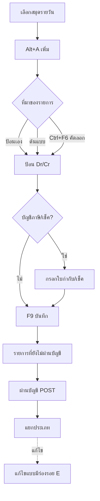
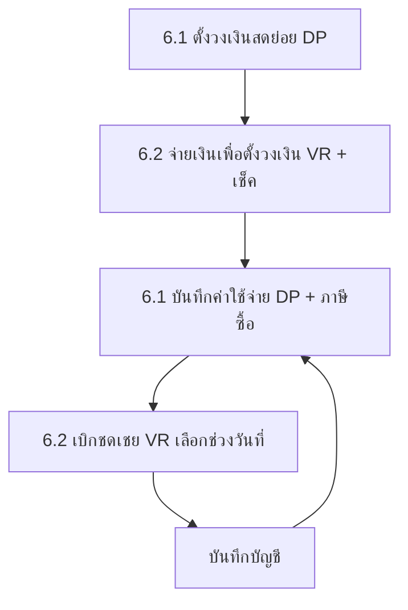

# บทที่ 15 การป้อนข้อมูลในระบบบัญชี
> อ้างอิงคู่มือ หน้า 267–291 (PDF p.283–307; PDF p.308 เป็นหน้าว่าง)

## ภาพรวม
- ระบบบัญชีรับรายการที่ผ่านมาจากระบบอื่น (ซื้อ ขาย การเงิน สินค้า) โดยอัตโนมัติ ผู้ใช้จึงแทบไม่ต้องบันทึกสมุดรายวันเอง ยกเว้นรายการปรับปรุง เช่น ปิดบัญชีภาษีมูลค่าเพิ่มประจำเดือน รายได้ค้างรับ ค่าใช้จ่ายค้างจ่าย หรือการปรับปรุงรายการที่ผ่านไปแยกประเภทแล้ว (หน้า 267)
- การป้อนในสมุดรายวันโดยตรง **ไม่เชื่อม** ไปยังระบบลูกหนี้ เจ้าหนี้ สินค้า (ตั้งลูกหนี้/เจ้าหนี้รายตัว หรือตัดสต๊อกไม่ได้) (หน้า 267)
- เนื้อหาบท: ต้นแบบวิธีการบันทึก, สมุดรายวัน (รวมแท็บเช็ค/ภาษี), การอ้างอิงต้นแบบ, การคัดลอกใบสำคัญ, การผ่านรายการไปแยกประเภท (Express 1.5), การแก้ไข/ลบ, แก้ไขแบบมีร่องรอย, สร้างสมุดรายวัน, เงินสดย่อย, บัญชีสินค้าคงเหลือ (Periodic), ยอดปีที่แล้ว, งบประมาณ
- เมนูบัญชี (รูปที่ 18 หน้า 282): 1 ลงประจำวัน, 2 ผังบัญชี, 3 ยอดยกมา/ยอดปีที่แล้ว, 4 งบประมาณ, 5 บัญชีสินค้าคงเหลือ, 6 เงินสดย่อย, 7 ต้นแบบวิธีการบันทึก, 8 สร้างสมุดรายวัน, 9 สร้างงบการเงิน, A คำนวณยอดเปลี่ยนแปลง, B รายการทรัพย์สิน

## หน้าจอ

### S-GL-01 ต้นแบบวิธีการบันทึก
- เมนู: บัญชี > 7. ต้นแบบวิธีการบันทึก
- อ้างอิง: หน้า 267–269 (PDF p.283–285) — มีภาพหน้าจอ: ใช่ (รูปที่ 1)
- ลักษณะ: header + ตารางรายการย่อย (รายการย่อย <F8>)

| ส่วน/แท็บ | ฟิลด์ | ชนิดข้อมูล | บังคับ | ค่าเริ่มต้น/อ้างอิงจาก | คำอธิบาย/เงื่อนไข |
|---|---|---|---|---|---|
| Header | รหัส | text | ใช่ | — | ควรสื่อความหมาย ภาษาอังกฤษ เช่น EXPENSE |
| Header | รายละเอียด | text | ใช่ [สันนิษฐาน] | — | เช่น "ต้นแบบ บันทึกค่าใช้จ่ายประจำเดือน" |
| ตาราง | บัญชี | lookup | ใช่ | ผังบัญชี | เลขที่บัญชีเดบิต/เครดิต |
| ตาราง | แผนก | lookup | ไม่ | ตารางแผนก | ว่างได้ถ้าไม่แยกแผนก |
| ตาราง | คำอธิบาย | text | ไม่ | — | เช่น "จ่ายค่าใช้จ่ายค่าน้ำ" |
| ตาราง | DR/CR | select | ใช่ | — | 0 = เดบิต (DR), 1 = เครดิต (CR); บนจอแสดง Dr./Cr. |
| ตาราง | (ช่องติ๊ก) | check [สันนิษฐาน] | — | — | ไม่มีคำอธิบายในคู่มือ |
| ตาราง | จำนวนเงิน | money | ไม่ | 0.00 | ว่างไว้ได้ ผู้ใช้จะป้อนเมื่อนำต้นแบบไปใช้ |

ปุ่ม/คำสั่ง: เพิ่ม, แก้ไข, ลบ, ยกเลิก, บันทึก, เลื่อนรายการ, ค้นหา [สันนิษฐานจากไอคอน]
กฎทางธุรกิจ/เงื่อนไข: ใช้ได้กับสมุดรายวันเท่านั้น (ไม่ใช้ในเมนูซื้อ ขาย รับ-จ่ายเงิน); รองรับ Compound Entry (หลายบัญชีเดบิต/เครดิต) (หน้า 268–269)
ผลทางบัญชี/สต๊อก: ไม่มี (เป็นแม่แบบ)

### S-GL-02 สมุดรายวัน (JV – สมุดรายวันทั่วไป และเล่มอื่น)
- เมนู: บัญชี > 1. ลงประจำวัน > (1. รายการที่ยังไม่ผ่านบัญชี | 2. รายการที่ผ่านบัญชีแล้ว — เฉพาะ 1.5) > สมุดรายวันทั่วไป / จ่าย / รับ / ขาย / ซื้อ / เล่มที่สร้างเพิ่ม
- อ้างอิง: หน้า 269–270, 278–279 (PDF p.285–286, 294–295) — มีภาพหน้าจอ: ใช่ (รูปที่ 2, 3, 12, 14)
- ลักษณะ: header + แท็บ 6 แท็บ (แต่ละแท็บเป็นตาราง) + footer รวม

| ส่วน/แท็บ | ฟิลด์ | ชนิดข้อมูล | บังคับ | ค่าเริ่มต้น/อ้างอิงจาก | คำอธิบาย/เงื่อนไข |
|---|---|---|---|---|---|
| Header | เลขที่ใบสำคัญ | text + lookup | ใช่ | Enter = รันเลขอัตโนมัติ (ตั้งที่ เริ่มระบบ 1.7 ระบบบัญชี) | แว่นขยาย = เลือกต้นแบบ; Ctrl+F6 = คัดลอกใบสำคัญอื่น |
| Header | วันที่ | date | ใช่ | — | |
| Header | รายละเอียด | text (lookup ข้อความ) | ไม่ [สันนิษฐาน] | — | เช่น "ปรับปรุงภาษีมูลค่าเพิ่มประจำเดือน" |
| Header | อ้างอิง | text | ไม่ | — | ปรากฏในจอสมุดรายวันขาย/จอแก้ไขแบบมีร่องรอย (หน้า 277, 279) |
| แท็บ รายการที่เดบิท/เครดิต <Alt+E> | เลขที่บัญชี | lookup | ใช่ | ผังบัญชี | |
| 〃 | แผนก | lookup | ไม่ | แผนก | |
| 〃 | คำอธิบาย | text | ไม่ | — | |
| 〃 | เดบิต | money | อย่างใดอย่างหนึ่ง | — | ป้อนติดลบ = สลับไปอีกด้าน |
| 〃 | เครดิต | money | อย่างใดอย่างหนึ่ง | — | <F2> = คำนวณผลต่างให้ดุล |
| แท็บ เช็คจ่าย <F7> | ตารางเช็ค | grid | เงื่อนไข | — | ดับเบิลคลิกเปิด S-GL-04 |
| แท็บ เช็ครับ <Ctrl+F7> | ตารางเช็ค | grid | เงื่อนไข | — | |
| แท็บ ภาษีซื้อ <F8> | ตารางใบกำกับ | grid | เงื่อนไข | — | ดับเบิลคลิกเปิด S-GL-03 |
| แท็บ ภาษีขาย <Ctrl+F8> | ตารางใบกำกับ | grid | เงื่อนไข | — | คอลัมน์ (ภาพไม่ชัด): ยื่นรวมในงวด, ใบกำกับภาษี วันที่/เลขที่, แผนก, คำอธิบาย, มูลค่าสินค้า, จำนวนภาษี, มูลค่าอัตราศูนย์ [สันนิษฐาน] |
| แท็บ ภาษีหัก ณ ที่จ่าย <Ctrl+F10> | ตาราง | grid | เงื่อนไข | — | คู่มือบทนี้ไม่อธิบายรายละเอียด |
| Footer | รวม (เดบิต, เครดิต) | money | อัตโนมัติ | — | ต้องเท่ากันจึงผ่านบัญชีได้ [สันนิษฐาน] |

ปุ่ม/คำสั่ง: เพิ่ม <Alt+A>, แก้ไข <Alt+E>, ลบข้อมูล <Alt+D> (ลบบรรทัด แสดงเครื่องหมาย '*'), ยกเลิก, บันทึก <F9>, เลื่อนรายการ, ค้นหา, พิมพ์, ผ่านบัญชีรายการนี้, เลือกรายการผ่านบัญชี, แก้ไขแบบมีร่องรอย (ปรับปรุงรายการ), <F2> คำนวณยอดผลต่าง, <Ctrl+F6> คัดลอกใบสำคัญ

กฎทางธุรกิจ/เงื่อนไข:
- เมื่ออ้างเลขที่บัญชีที่เป็นภาษีซื้อ ภาษีขาย เช็ครับล่วงหน้า เช็คจ่ายล่วงหน้า หลังบันทึก โปรแกรมจะเปิดหน้าจอให้กรอกรายละเอียด; ถ้ายกเลิก (Esc) จะบันทึกบัญชีแต่ไม่ผ่านไปแฟ้มภาษี/ทะเบียนเช็ค (หน้า 271)
- มีใบกำกับ/เช็คหลายใบ: ดับเบิลคลิกในตารางของแท็บนั้นเพื่อเพิ่มใบถัดไป (หน้า 272, 274)
- Express 1.5 (รองรับประกาศกรมสรรพากรฉบับที่ 63): รายการยังไม่ผ่านแยกประเภททันที ต้องตรวจแล้วสั่งผ่าน; ผ่านแล้วแก้ไม่ได้ ต้องทำใบสำคัญปรับปรุงหรือ "แก้ไขแบบมีร่องรอย" (หน้า 276, 279)
- แก้ไขเลขที่บัญชี/จำนวนเงินได้ตลอดก่อนผ่าน (หน้า 278)
- ลบใบสำคัญ: ถ้าป้อนตรงในสมุดรายวันลบได้ทันที; ถ้ามาจากระบบอื่น การลบไม่ลบเอกสารต้นทาง (เช่น ใบกำกับขายเงินเชื่อ) ทำให้รายงานบัญชีกับรายงานวิเคราะห์ขาย/ลูกหนี้ไม่ตรงกัน (หน้า 278)

ผลทางบัญชี/สต๊อก: บันทึกรายการ Dr/Cr ตามที่ป้อนลงสมุดรายวัน → ผ่านแยกประเภทเมื่อสั่ง POST (1.5) ; ข้อมูลแท็บภาษี → แฟ้มภาษีซื้อ/ขาย ; แท็บเช็ค → ทะเบียนเช็ค
ตัวอย่าง (หน้า 269–270): Dr 2135-00 ภาษีขาย 21,480.02 / Cr 1154-00 ภาษีซื้อ 11,043.39, Cr 2137-00 เจ้าหนี้กรมสรรพากร 10,436.63

### S-GL-03 ป้อนรายละเอียดรายการภาษีซื้อ (จากสมุดรายวัน)
- เมนู: เปิดอัตโนมัติหลังบันทึกบรรทัดบัญชีภาษีซื้อ หรือดับเบิลคลิกแท็บภาษีซื้อ
- อ้างอิง: หน้า 271–272 (PDF p.287–288) — มีภาพหน้าจอ: ใช่ (รูปที่ 4)
- ลักษณะ: dialog (ภาษีขายใช้จอคล้ายกัน)

| ส่วน/แท็บ | ฟิลด์ | ชนิดข้อมูล | บังคับ | ค่าเริ่มต้น/อ้างอิงจาก | คำอธิบาย/เงื่อนไข |
|---|---|---|---|---|---|
| — | เลขที่ใบกำกับภาษี | text | ใช่ [สันนิษฐาน] | — | ใบที่ออกให้ลูกค้า/ได้รับจากผู้จำหน่าย |
| — | วันที่ใบกำกับภาษี | date | ใช่ | — | |
| — | ยื่นภาษีรวมในงวดที่ | text (MM/YY) | ใช่ | งวดของวันที่ | ได้รับใบกำกับล่าช้าเลือกงวดถัดไปได้ |
| — | ยื่นเพิ่มเติม (พิมพ์แยก?) | check (Y) | ไม่ | ว่าง | Y = แยกเป็นรายงานเพิ่มเติม |
| — | เลขที่เอกสารภายใน | text | — | เลขที่ใบสำคัญ | |
| — | วันที่เอกสารภายใน | date | — | วันที่ใบสำคัญ | |
| — | เป็นรายการของแผนก | lookup | ไม่ | แผนก | แยกการยื่น VAT ตามแผนก |
| — | เลขที่ออกใหม่ | text | ไม่ | ว่าง | สรรพากรให้ลำดับเลขใหม่; ลำดับภายหลังได้ในแฟ้มภาษีซื้อ (บทที่ 16) |
| ภาษีซื้อที่ขอคืนได้ | มูลค่าสินค้า, จำนวนภาษี | money | — | จำนวนเงินจากบรรทัดบัญชี | |
| ภาษีซื้อที่ขอคืนไม่ได้ | มูลค่าสินค้า, จำนวนภาษี | money | — | 0.00 | ใบกำกับไม่สมบูรณ์/ไม่เข้าหลักเกณฑ์ |
| มูลค่าสินค้าหรือบริการ | อัตราศูนย์ | money | — | 0.00 | กรณียกเว้น/อัตรา 0% |
| — | คำนำหน้าชื่อ | lookup | ไม่ | | |
| — | ชื่อผู้ขาย/ผู้ให้บริการ (คำอธิบาย) | text | ไม่ | | แสดงในรายงานภาษี |
| — | เลขประจำตัวผู้เสียภาษี | text | ไม่ | | |
| — | สาขา# | number | ไม่ | 0 | 0 = สำนักงานใหญ่ |
| — | หมายเหตุ | text | ไม่ | | |

ปุ่ม/คำสั่ง: ตกลง, ยกเลิก (Esc)
ผลทางบัญชี/สต๊อก: เขียนลงแฟ้มภาษีซื้อ (หรือแฟ้มภาษีขาย)

### S-GL-04 ป้อนรายละเอียดเช็คจ่าย (/เช็ครับ)
- เมนู: เปิดหลังอ้างเลขที่บัญชีเช็คจ่ายล่วงหน้า หรือดับเบิลคลิกแท็บเช็คจ่าย/เช็ครับ
- อ้างอิง: หน้า 273–274 (PDF p.289–290) — มีภาพหน้าจอ: ใช่ (รูปที่ 6)
- ลักษณะ: dialog

| ส่วน/แท็บ | ฟิลด์ | ชนิดข้อมูล | บังคับ | ค่าเริ่มต้น/อ้างอิงจาก | คำอธิบาย/เงื่อนไข |
|---|---|---|---|---|---|
| — | เช็คเลขที่ | text | ใช่ | — | |
| — | ลงวันที่ | date | ใช่ | — | วันที่หน้าเช็ค |
| — | เช็คธนาคาร | lookup | ใช่ | รหัสธนาคาร/สมุดบัญชี | แสดงชื่อบัญชีธนาคาร |
| — | รหัสผู้จำหน่าย (/ลูกค้า) | lookup | ไม่ | ผู้จำหน่าย/ลูกค้า | |
| — | จ่ายให้ | text | ไม่ | — | |
| — | จำนวนเงิน | money | — | จากบรรทัดบัญชี (อัตโนมัติ) | |
| — | หมายเหตุ | text | ไม่ | — | |
| — | เช็คของแผนก | lookup | ไม่ | แผนก | Enter ผ่านได้ |

ปุ่ม/คำสั่ง: ตกลง, ยกเลิก
ผลทางบัญชี/สต๊อก: เขียนทะเบียนเช็คจ่าย/รับ

### S-GL-05 เลือกต้นแบบวิธีการบันทึก (lookup)
- เมนู: สมุดรายวัน > เพิ่ม > แว่นขยายที่ช่องเลขที่ใบสำคัญ
- อ้างอิง: หน้า 274–275 (PDF p.290–291) — มีภาพหน้าจอ: ใช่ (รูปที่ 7)
- ลักษณะ: list (รหัส, รายละเอียด) ตัวอย่าง CASHSALE, CREDIT, DEPRE, EXPENSE, INCOME, PURCHASE
- ปุ่ม: ตกลง, ยกเลิก, ค้นหา
- ผล: นำบัญชีจากต้นแบบมาเติมตาราง จากนั้นป้อนเลขที่ใบสำคัญ วันที่ แล้วบันทึก

### S-GL-06 คัดลอกรายการจากใบสำคัญอื่น (lookup)
- เมนู: สมุดรายวัน > เพิ่ม > ช่องเลขที่ใบสำคัญ กด <Ctrl+F6>
- อ้างอิง: หน้า 275–276 — มีภาพหน้าจอ: ใช่ (รูปที่ 8)
- ลักษณะ: list คอลัมน์: เลขที่, วันที่, รายละเอียด (แสดงใบสำคัญจากทุกระบบ เช่น BD, BT, CA, JU, JV, OU, TK)
- ปุ่ม: ตกลง, ยกเลิก, ค้นหา
- ผล: คัดลอกบรรทัดบัญชีมา แล้วป้อนเลขที่/วันที่ใหม่

### S-GL-07 เลือกรายการผ่านบัญชี (POST)
- เมนู: บัญชี > 1 > 1. รายการที่ยังไม่ผ่านบัญชี > เลือกสมุด > ไอคอน "เลือกรายการผ่านบัญชี" (หรือไอคอน "ผ่านบัญชีรายการนี้" สำหรับใบเดียว)
- อ้างอิง: หน้า 276–278 (PDF p.292–294) — มีภาพหน้าจอ: ใช่ (รูปที่ 9–11)
- ลักษณะ: dialog

| ส่วน/แท็บ | ฟิลด์ | ชนิดข้อมูล | บังคับ | ค่าเริ่มต้น/อ้างอิงจาก | คำอธิบาย/เงื่อนไข |
|---|---|---|---|---|---|
| — | ใบสำคัญจาก | text | ไม่ | ว่าง | |
| — | ถึง | text | ไม่ | "zzzz…" | |
| — | วันที่จาก | date | ใช่ | ต้นเดือน | |
| — | ถึง | date | ใช่ | สิ้นเดือน | |

ปุ่ม/คำสั่ง: ทำงาน, ยกเลิก
กฎทางธุรกิจ/เงื่อนไข: ผ่าน (POST) ใบสำคัญของสมุดรายวันทุกเล่มในช่วงที่กำหนด; แสดงตัวนับ "กำลังผ่านเอกสาร" และจำนวนที่มีปัญหาใน "ไม่ผ่าน" (เช่น ยอดไม่ดุล) (หน้า 277–278)
ผลทางบัญชี/สต๊อก: ย้ายใบสำคัญจากสถานะยังไม่ผ่าน → ผ่านแยกประเภทแล้ว

### S-GL-08 แก้ไขแบบมีร่องรอย (ปรับปรุงรายการ)
- เมนู: บัญชี > 1 > 2. รายการที่ผ่านบัญชีแล้ว > เลือกสมุด > ไอคอน "แก้ไขแบบมีร่องรอย (ปรับปรุงรายการ)"
- อ้างอิง: หน้า 279 (PDF p.295) — มีภาพหน้าจอ: ใช่ (รูปที่ 13–14)
- ลักษณะ: จอเดียวกับ S-GL-02
- กฎ: ป้อนบรรทัดปรับปรุงเพิ่ม บันทึกแล้วบรรทัดที่แก้มีตัวอักษร 'E' นำหน้าเลขที่บัญชี; ถ้าผิดจากระบบอื่น (เช่น ราคาขายผิด) ต้องเปิดใบลดหนี้แทน
- ผลทางบัญชี: เพิ่มบรรทัดปรับปรุงในใบสำคัญเดิม (ตัวอย่าง E Dr 2137-00 80.02 / E Cr 2135-00 80.02)

### S-GL-09 สร้างสมุดรายวัน
- เมนู: บัญชี > 8. สร้างสมุดรายวัน
- อ้างอิง: หน้า 280–281 (PDF p.296–297) — มีภาพหน้าจอ: ใช่ (รูปที่ 15)
- ลักษณะ: list/grid แก้ไขได้ (มี 5 เล่มตั้งต้น)

| ส่วน/แท็บ | ฟิลด์ | ชนิดข้อมูล | บังคับ | ค่าเริ่มต้น/อ้างอิงจาก | คำอธิบาย/เงื่อนไข |
|---|---|---|---|---|---|
| ตาราง | รหัส | text | ใช่ | ต่อจากเดิม 05, 06… | 00 ทั่วไป, 01 จ่าย, 02 รับ, 03 ขาย, 04 ซื้อ |
| ตาราง | ชื่อย่อ | text(≤6) | ใช่ | — | เช่น "งสย่อย" |
| ตาราง | รายละเอียด-T | text | ใช่ | — | ชื่อไทย เช่น สมุดรายวันเงินสดย่อย |
| ตาราง | รายละเอียด-E | text | ไม่ | — | ชื่ออังกฤษ เช่น General Journal |
| ตาราง | รหัสนำหน้า | text | ใช่ | — | JV, PV, RV, SV, UV; ห้ามซ้ำ |
| ตาราง | ต้นแบบ | lookup | ไม่ | ต้นแบบวิธีการบันทึก | แสดงต้นแบบอัตโนมัติเมื่อป้อนในเล่มนี้ |

กฎ: ไม่ควรแก้ไข/ลบ 5 เล่มตั้งต้น เพราะระบบซื้อ/ขายเชื่อมอยู่ (หน้า 280); เล่มใหม่ปรากฏใน บัญชี > 1 ลงประจำวัน (รูปที่ 17)

### S-GL-10 รายละเอียดเพิ่มเติม (การรับรองเอกสาร/อนุมัติพิมพ์ซ้ำ)
- เมนู: หลังบันทึกข้อมูลสมุดรายวันใหม่ใน S-GL-09
- อ้างอิง: หน้า 281 (PDF p.297) — มีภาพหน้าจอ: ใช่ (รูปที่ 16)
- ลักษณะ: dialog

| ส่วน/แท็บ | ฟิลด์ | ชนิดข้อมูล | บังคับ | ค่าเริ่มต้น/อ้างอิงจาก | คำอธิบาย/เงื่อนไข |
|---|---|---|---|---|---|
| — | ชื่อเอกสาร | text | — | ชื่อสมุด | |
| — | รับรองเอกสาร ต้องขออนุมัติระดับ | number | ไม่ | ว่าง | 0 = ไม่ต้องรับรอง, 1–9 = ระดับผู้ใช้ |
| — | วิธีการพิมพ์ หรือรับรองเอกสาร | select | ไม่ | ว่าง | 1 = พิมพ์ก่อนรับรอง, 2 = รับรองก่อนพิมพ์ |
| — | พิมพ์เอกสารซ้ำ ต้องขออนุมัติระดับ | number | ไม่ | ว่าง | 0 = ไม่ต้อง, 1–9 |
| — | ลำดับรายการเดบิท/เครดิตเอง | check (Y) | ไม่ | ว่าง | Y = ลำดับตามที่ป้อน |

ปุ่ม: ตกลง, ยกเลิก ; ระดับผู้ใช้กำหนดในบทที่ 23

### S-GL-11 บันทึกการจ่ายเงินสดย่อย (DP)
- เมนู: บัญชี > 6. เงินสดย่อย > 1. บันทึกการจ่ายเงินสดย่อย
- อ้างอิง: หน้า 282–287 (PDF p.298–303) — มีภาพหน้าจอ: ใช่ (รูปที่ 19, 20, 22, 23)
- ลักษณะ: header (2 กล่อง) + 3 แท็บ + footer ยอดรวม

| ส่วน/แท็บ | ฟิลด์ | ชนิดข้อมูล | บังคับ | ค่าเริ่มต้น/อ้างอิงจาก | คำอธิบาย/เงื่อนไข |
|---|---|---|---|---|---|
| Header | ประเภท | lookup | ใช่ [สันนิษฐาน] | ฐานข้อมูลประเภทเงินสดย่อย | เช่น วงเงินสดย่อย, วัสดุสิ้นเปลือง; ใช้ทำรายงานแยกประเภท |
| Header | สถานะ | lookup | ไม่ | ฐานข้อมูลสถานะ | เช่น 00 รอเคลียร์, 99 เรียบร้อย, ยังขาดใบเสร็จ |
| Header | หมายเหตุ | text | ไม่ | — | |
| Header | เลขที่ | text | ใช่ | — | prefix DP |
| Header | วันที่ | date | ใช่ | — | |
| Header | ใบเบิก | text (แสดงผล) | — | — | เลขใบเบิกชดเชยเมื่อเบิกแล้ว |
| แท็บ รายการที่จ่าย <F8> | เลขที่บัญชี, แผนก, ชื่อบัญชี, รายละเอียด, จำนวนเงิน | lookup/text/money | ใช่ | ผังบัญชี | ตั้งวงเงิน: บัญชีเงินสด/เงินสดย่อย; จ่าย: บัญชีค่าใช้จ่าย (หลายบรรทัดได้) |
| แท็บ รายการภาษีซื้อ <Ctrl+F7> | ใบกำกับ (ยื่นรวมในงวด, วันที่, เลขที่, …, มูลค่า, ภาษี) | grid | ไม่ | — | ดับเบิลคลิกป้อนใบกำกับ (S-GL-03) [หัวคอลัมน์บางส่วนสันนิษฐาน] |
| แท็บ รายการภาษีหัก ณ ที่จ่าย <Ctrl+F10> | — | grid | ไม่ | — | ไม่มีรายละเอียด |
| Footer | ยอดรวม | money | อัตโนมัติ | — | |

กฎทางธุรกิจ/เงื่อนไข: การตั้งวงเงินในเมนูนี้ยังไม่มียอดเงินใช้ได้จนกว่าจะทำ "การจ่ายเงินเพื่อตั้งวงเงินสดย่อย"; การจ่ายค่าใช้จ่ายด้วยเงินสดย่อยยังไม่บันทึกบัญชี (หน้า 284, 287)
ผลทางบัญชี/สต๊อก: ไม่มีการบันทึกบัญชีจนกว่าจะเบิกชดเชย (หน้า 287)

### S-GL-12 เลือกเอกสารที่จะเบิกชดเชย (dialog)
- เมนู: บัญชี > 6 > 2. เบิกชดเชยเงินสดย่อย > เพิ่ม (หลังป้อนเลขที่ วันที่ คำอธิบาย)
- อ้างอิง: หน้า 285 (PDF p.301) — มีภาพหน้าจอ: ใช่ (รูปที่ 21)
- ฟิลด์: ใบสำคัญจาก…ถึง (text, ค่าเริ่ม ว่าง…"zzzzzzzzzz"), วันที่จาก…ถึง (date, บังคับ) ; ปุ่ม ทำงาน, ยกเลิก
- กฎ: ใช้ทั้งการจ่ายเงินเพื่อตั้งวงเงิน (ระบุวันที่ตั้งวงเงิน) และเบิกชดเชย (ระบุช่วงวันที่ค่าใช้จ่าย); ต้องยังไม่มีการจ่ายค่าใช้จ่ายใดในเมนู 6.1 ก่อนจ่ายตั้งวงเงิน

### S-GL-13 เบิกชดเชยเงินสดย่อย (VR)
- เมนู: บัญชี > 6 > 2. เบิกชดเชยเงินสดย่อย
- อ้างอิง: หน้า 285, 287 (PDF p.301, 303) — มีภาพหน้าจอ: ใช่ (รูปที่ 24)
- ลักษณะ: header + ตารางรายการ (ดึงอัตโนมัติ) + ตารางเช็คด้านล่าง

| ส่วน/แท็บ | ฟิลด์ | ชนิดข้อมูล | บังคับ | ค่าเริ่มต้น/อ้างอิงจาก | คำอธิบาย/เงื่อนไข |
|---|---|---|---|---|---|
| Header | คำอธิบาย | text | ไม่ | — | |
| Header | เลขที่ | text | ใช่ | — | prefix VR |
| Header | วันที่ | date | ใช่ | — | |
| ตารางบน | เลขที่บัญชี, แผนก, ชื่อบัญชี, รายละเอียด, จำนวนเงิน | แสดงผล | — | จาก DP ในช่วงที่เลือก | |
| ตารางบน | รวม | money | อัตโนมัติ | — | |
| — | ยอดเงินที่เบิกชดเชย | money | อัตโนมัติ | — | |
| ตารางเช็ค | เบิกชดเชยโดย <F7> (เลขที่เช็ค), ลงวันที่, ธนาคาร, ยอดเช็ค [สันนิษฐาน], หมายเหตุ | grid | เงื่อนไข | ทะเบียนธนาคาร | ดับเบิลคลิกป้อนรายละเอียดเช็ค ได้หลายใบ; ถ้าจ่ายเงินสดไม่ต้องป้อน |

ผลทางบัญชี/สต๊อก: บันทึกบัญชีเมื่อเบิกชดเชย — Dr บัญชีค่าใช้จ่าย (+ภาษีซื้อ) / Cr เงินสดหรือเช็คธนาคาร [คู่บัญชีสันนิษฐาน]; จ่ายตั้งวงเงิน — Dr เงินสดย่อย / Cr เงินสด/ธนาคาร [สันนิษฐาน]

### S-GL-14 บัญชีสินค้าคงเหลือ (Periodic)
- เมนู: บัญชี > 5. บัญชีสินค้าคงเหลือ
- อ้างอิง: หน้า 287–289 (PDF p.303–305) — มีภาพหน้าจอ: ใช่ (รูปที่ 25–26)
- ลักษณะ: form + ตารางงวด 12 งวด (2 คอลัมน์คู่)

| ส่วน/แท็บ | ฟิลด์ | ชนิดข้อมูล | บังคับ | ค่าเริ่มต้น/อ้างอิงจาก | คำอธิบาย/เงื่อนไข |
|---|---|---|---|---|---|
| Header | เลขที่บัญชี | lookup | ใช่ | ผังบัญชี | เช่น 1140-02 สินค้าสำเร็จรูปคงเหลือ |
| Header | แผนก | lookup | ไม่ | แผนก | |
| Header | ยอดยกมาปีปัจจุบัน | money | ใช่ | — | ต้องเท่ากับยอดยกมาที่ป้อนในระบบบัญชี (บทที่ 8) |
| ตาราง | งวด | number | — | 1–12 | |
| ตาราง | คงเหลือปลายงวด | money | — | — | ยอดคงเหลือแต่ละเดือน |

ปุ่ม/คำสั่ง: เพิ่ม, แก้ไข, ลบ, ยกเลิก, บันทึก, เลื่อนรายการ, ค้นหา, "คำนวณยอดคงเหลือ จากระบบสินค้า <F5>"
กฎ: ใช้กับการบันทึกบัญชีสินค้าแบบ Periodic ซึ่งไม่บันทึกบัญชีสินค้าในสมุดรายวัน ต้องป้อนยอดตรวจนับ/ยอดจากรายงานสินค้าคงเหลือ เพื่อทำงบการเงิน

### S-GL-15 คำนวณยอดคงเหลือ จากระบบสินค้า (dialog)
- เมนู: S-GL-14 > ไอคอน หรือ <F5>
- อ้างอิง: หน้า 289 (PDF p.305) — มีภาพหน้าจอ: ใช่ (รูปที่ 27)
- ฟิลด์: งวดบัญชี (number; 0 = คำนวณยอดยกมา, −1 = ทุกงวด) ; ปุ่ม ทำงาน, ยกเลิก
- กฎ: −1 → งวดที่ยังไม่มีรายการจะได้ยอดเท่างวดสุดท้ายที่เคลื่อนไหว (เช่น ข้อมูลถึงเดือน 6 → งวด 7–12 = ยอดงวด 6) ต้องคำนวณใหม่เมื่อสิ้นเดือนถัดไป

### S-GL-16 ยอดปีที่แล้ว
- เมนู: บัญชี > 3.2 ยอดปีที่แล้ว
- อ้างอิง: หน้า 289–290 (PDF p.305–306) — มีภาพหน้าจอ: ใช่ (รูปที่ 28)
- ลักษณะ: form + ตารางงวด

| ส่วน/แท็บ | ฟิลด์ | ชนิดข้อมูล | บังคับ | ค่าเริ่มต้น/อ้างอิงจาก | คำอธิบาย/เงื่อนไข |
|---|---|---|---|---|---|
| Header | เลขที่บัญชี | lookup | ใช่ | ผังบัญชี (บัญชีย่อยเท่านั้น) | |
| Header | แผนก | lookup | ไม่ | | |
| ตาราง | งวด (1–12, ปิด, รวม) | — | — | | |
| ตาราง | เดบิต, เครดิต | money | — | 0.00 | ยอดเคลื่อนไหวของปีที่แล้วแต่ละงวด |
| ด้านขวา | ยอดยกมาปีที่แล้ว | money | ไม่ | | ยอดยกมาของปีที่แล้ว (ไม่ใช่ปีปัจจุบัน) |
| ด้านขวา | ยอดยกมาปีปัจจุบัน | money | แสดงผล [สันนิษฐาน] | | |

ใช้ทำงบการเงินเปรียบเทียบ (บทที่ 24)

### S-GL-17 งบประมาณ
- เมนู: บัญชี > 4. งบประมาณ
- อ้างอิง: หน้า 290–291 (PDF p.306–307) — มีภาพหน้าจอ: ใช่ (รูปที่ 29)
- ลักษณะ: form + ตารางงวด 12 งวด + รวม

| ส่วน/แท็บ | ฟิลด์ | ชนิดข้อมูล | บังคับ | ค่าเริ่มต้น/อ้างอิงจาก | คำอธิบาย/เงื่อนไข |
|---|---|---|---|---|---|
| Header | เลขที่บัญชี | lookup | ใช่ | ผังบัญชี | เช่น 5200-05 ค่าขนส่ง |
| Header | แผนก | lookup | ไม่ | | |
| ตาราง | งวด | number | — | 1–12 | |
| ตาราง | งบประมาณ | money | — | | ป้อนเอง |
| ตาราง | ปีปัจจุบัน | money | แสดงผล [สันนิษฐาน] | ยอดจริง | |
| ตาราง | ปีที่แล้ว | money | แสดงผล [สันนิษฐาน] | ยอดปีที่แล้ว | |

## ลำดับการใช้งาน
1. (ครั้งแรก) สร้างต้นแบบวิธีการบันทึก / สร้างสมุดรายวันเพิ่ม + ตั้งค่าการรับรองเอกสาร
2. บันทึกสมุดรายวัน: เลือกเล่ม > Alt+A > เลขที่ (Enter อัตโนมัติ, หรือเลือกต้นแบบ, หรือ Ctrl+F6 คัดลอก) > วันที่ รายละเอียด > บรรทัด Dr/Cr (F2 ปิดยอด) > ป้อนรายละเอียดภาษี/เช็คถ้าเกี่ยวข้อง > F9 บันทึก
3. (1.5) ตรวจสอบ > ผ่านบัญชี (ใบเดียว หรือเลือกช่วง) > แก้ไขภายหลังด้วยแบบมีร่องรอยหรือใบสำคัญปรับปรุง
4. เงินสดย่อย: 6.1 ตั้งวงเงิน > 6.2 จ่ายเงินตั้งวงเงิน (เช็ค) > 6.1 บันทึกค่าใช้จ่าย (+ภาษีซื้อ) > 6.2 เบิกชดเชย (บันทึกบัญชี)
5. Periodic: ป้อน/คำนวณบัญชีสินค้าคงเหลือรายงวด ก่อนทำงบการเงิน; ยอดปีที่แล้ว/งบประมาณเพื่อเปรียบเทียบ

## ข้อมูลที่เกี่ยวข้อง
- JournalBook (รหัส, ชื่อย่อ, ชื่อ T/E, รหัสนำหน้า, ต้นแบบ, ระดับรับรอง, วิธีพิมพ์/รับรอง, ระดับพิมพ์ซ้ำ, ลำดับเอง)
- JournalVoucher (เล่ม, เลขที่, วันที่, รายละเอียด, อ้างอิง, สถานะผ่านบัญชี) → JournalLine (บัญชี, แผนก, คำอธิบาย, เดบิต, เครดิต, ธง E/*)
- JournalTemplate → TemplateLine (บัญชี, แผนก, คำอธิบาย, DR/CR, จำนวนเงิน)
- InputVAT / OutputVAT (ผูกกับใบสำคัญ) ; ChequePayable / ChequeReceivable (ผูกกับใบสำคัญ)
- PettyCashVoucher DP (ประเภท, สถานะ, ใบเบิก) → PettyCashLine; PettyCashReimburse VR → อ้าง DP หลายใบ + เช็ค
- InventoryBalanceGL (บัญชี, แผนก, ยอดยกมา, ยอดคงเหลือ 12 งวด) ; PriorYearBalance (บัญชี, แผนก, Dr/Cr 12 งวด+ปิด, ยกมา) ; Budget (บัญชี, แผนก, 12 งวด)
- ChartOfAccounts, Department, Bank, Vendor, Customer (อ่าน)

## ข้อสังเกต
- Brief ระบุ "closing" ในบทนี้ แต่คู่มือช่วง PDF 283–308 ไม่มีหัวข้อการปิดบัญชีสิ้นงวด/สิ้นปี มีเพียงตัวอย่างใบสำคัญปิดภาษีมูลค่าเพิ่มประจำเดือน
- หัวคอลัมน์ตารางแท็บภาษีและตารางเช็คในจอ VR ภาพไม่ชัด ระบุ [สันนิษฐาน]
- คู่บัญชีของเงินสดย่อยไม่ระบุในคู่มือ
- ฟีเจอร์ "ยังไม่ผ่านบัญชี/ผ่านบัญชีแล้ว" มีเฉพาะ Express 1.5 (อ้างประกาศกรมสรรพากรฉบับที่ 63)
- หน้า 285 คู่มืออ้าง "วันที่ 03/06/43" แต่ภาพแสดง 03/01/48 (น่าจะเป็นความคลาดเคลื่อนของคู่มือ)
