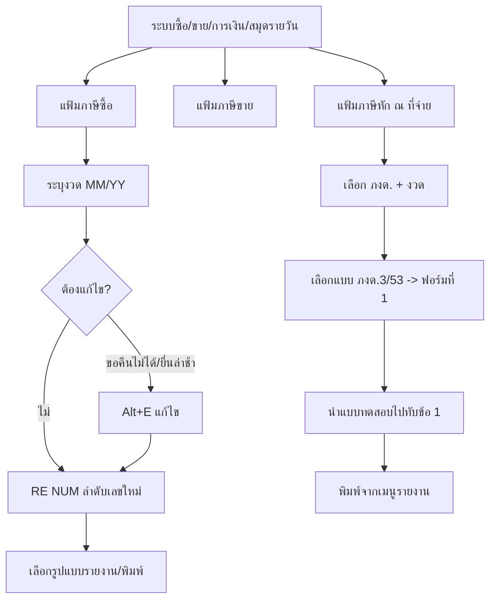

# บทที่ 16 การป้อนข้อมูลในระบบภาษี
> อ้างอิงคู่มือ หน้า 293–305 (PDF p.309–321; PDF p.322 เป็นหน้าว่าง)

## ภาพรวม
- ระบบภาษีแบ่งเป็น 2 ระบบหลัก: ภาษีมูลค่าเพิ่ม (ภาษีซื้อ/ภาษีขาย) และภาษีเงินได้หัก ณ ที่จ่าย (หน้า 293)
- ภาษีซื้อ/ขายเกิดจากการบันทึกในระบบต่าง ๆ (ซื้อ-ขายเงินสด/เชื่อ, รับ/จ่ายชำระหนี้กรณีเกณฑ์เงินสด, สมุดรายวัน) แล้วผ่านไปแฟ้มภาษีซื้อ/ขายโดยอัตโนมัติ (หน้า 293)
- ภาษีหัก ณ ที่จ่าย (ภงด.3 บุคคลธรรมดา / ภงด.53 นิติบุคคล) เกิดจากการจ่ายชำระหนี้/จ่ายค่าใช้จ่าย แล้วผ่านไปแฟ้มภาษีหัก ณ ที่จ่ายอัตโนมัติ (หน้า 293)
- หน้าที่ของบทนี้คือการตรวจสอบ/แก้ไขรายการพิเศษ (ภาษีขอคืนไม่ได้, ยื่นล่าช้า/เพิ่มเติม, ลำดับเลขใหม่, เลือกแบบรายงาน/ฟอร์ม ภงด.) (หน้า 293–294)
- เมนู การเงิน > 4. ภาษีมูลค่าเพิ่ม (1 แฟ้มภาษีซื้อ, 2 แฟ้มภาษีขาย) และ การเงิน > 5. ภาษีหัก ณ ที่จ่าย

## หน้าจอ

### S-TX-01 ป้อนงวดที่ต้องการดูข้อมูล (ภาษีซื้อ/ภาษีขาย)
- เมนู: การเงิน > 4. ภาษีมูลค่าเพิ่ม > 1. แฟ้มภาษีซื้อ (หรือ 2. แฟ้มภาษีขาย)
- อ้างอิง: หน้า 294, 300 (PDF p.310, 316) — มีภาพหน้าจอ: ใช่ (รูปที่ 2, 9)
- ลักษณะ: dialog

| ส่วน/แท็บ | ฟิลด์ | ชนิดข้อมูล | บังคับ | ค่าเริ่มต้น/อ้างอิงจาก | คำอธิบาย/เงื่อนไข |
|---|---|---|---|---|---|
| — | ดูเฉพาะรายการที่ยื่นรวมในงวด | text [MM/YY] | ไม่ | งวดปัจจุบัน [สันนิษฐาน] | ว่าง = ดูทุกงวด |

ปุ่ม/คำสั่ง: ตกลง, ยกเลิก

### S-TX-02 แฟ้มภาษีซื้อ
- เมนู: การเงิน > 4 > 1. แฟ้มภาษีซื้อ (หลัง S-TX-01)
- อ้างอิง: หน้า 295 (PDF p.311) — มีภาพหน้าจอ: ใช่ (รูปที่ 3)
- ลักษณะ: list/grid แบบหลายหน้าจอ (เลื่อนไปหน้าที่ 2 และ 3 ทางขวา)

| ส่วน/แท็บ | ฟิลด์ | ชนิดข้อมูล | บังคับ | ค่าเริ่มต้น/อ้างอิงจาก | คำอธิบาย/เงื่อนไข |
|---|---|---|---|---|---|
| หน้า 1 | ยื่นรวมในงวด | text MM/YY | — | จากเอกสารต้นทาง | |
| หน้า 1 | ใบกำกับภาษี: วันที่, เลขที่ | date, text | — | | เลขที่ใบกำกับที่ได้รับ |
| หน้า 1 | เอกสารภายใน: วันที่, เลขที่ | date, text | — | | เช่น RR, HP, CP, GR, AE, DP |
| หน้า 1 | แผนก | lookup | — | | |
| หน้า 1 | รายการ | text | — | | เช่น ซื้อเชื่อจาก, ซื้อสดจาก, ลดหนี้/ส่งคืน, จ่ายเงินมัดจำ |
| หน้า 1 | ภาษีขอคืนได้: มูลค่า, ภาษี | money | — | | |
| หน้า 2–3 | ภาษีขอคืนไม่ได้ (มูลค่า, ภาษี), มูลค่าสินค้าอัตราภาษีศูนย์, เลขที่เอกสารภายใน, หมายเหตุ | money/text | — | | ตามคำบรรยายหน้า 295 |

ปุ่ม/คำสั่ง: เพิ่ม, แก้ไขข้อมูล <Alt+E>, ลบ, ยกเลิก, บันทึก, เลื่อนรายการ, ค้นหา, พิมพ์ ▾ (เมนูรูปแบบรายงาน S-TX-05), RE NUM ▾ (ลำดับเลขที่ออกใหม่ S-TX-04), ค้นหา/ซูม [สันนิษฐานจากไอคอน]
กฎทางธุรกิจ/เงื่อนไข: ข้อมูลผ่านมาจากระบบอื่นโดยอัตโนมัติ ผู้ใช้เพียงตรวจสอบ (หน้า 294)

### S-TX-03 ป้อนรายละเอียดรายการภาษีซื้อ (แก้ไข)
- เมนู: แฟ้มภาษีซื้อ > เลือกรายการ > ไอคอนแก้ไขข้อมูล หรือ <Alt+E>
- อ้างอิง: หน้า 295–298 (PDF p.311–314) — มีภาพหน้าจอ: ใช่ (รูปที่ 4)
- ลักษณะ: dialog (ฟิลด์เดียวกับ S-GL-03 ในบทที่ 15)

| ส่วน/แท็บ | ฟิลด์ | ชนิดข้อมูล | บังคับ | ค่าเริ่มต้น/อ้างอิงจาก | คำอธิบาย/เงื่อนไข |
|---|---|---|---|---|---|
| — | เลขที่ใบกำกับภาษี | text | ใช่ | | ที่ได้รับจากผู้จำหน่าย |
| — | วันที่ใบกำกับภาษี | date | ใช่ | | |
| — | ยื่นภาษีรวมในงวดที่ | text MM/YY | ใช่ | | ได้รับใบกำกับล่าช้า ระบุงวดที่ต้องการได้ |
| — | ยื่นเพิ่มเติม (พิมพ์แยก?) | check (Y) | ไม่ | | Y = แยกรายงานเพิ่มเติม; ว่าง = รวมรายงานประจำเดือน |
| — | เลขที่เอกสารภายใน / วันที่เอกสารภายใน | text / date | — | เอกสารต้นทาง | |
| — | เป็นรายการของแผนก | lookup | ไม่ | | แยกการยื่นตามแผนก |
| — | เลขที่ออกใหม่ | text | ไม่ | | ใช้เมื่อเลขใบกำกับไม่ต่อเนื่อง; สั่งลำดับใหม่ภายหลังได้ |
| ภาษีซื้อที่ขอคืนได้ | มูลค่าสินค้า, จำนวนภาษี | money | — | | |
| ภาษีซื้อที่ขอคืนไม่ได้ | มูลค่าสินค้า, จำนวนภาษี | money | — | | ย้ายยอดมาที่นี่เมื่อใบกำกับไม่สมบูรณ์/ไม่เข้าหลักเกณฑ์ |
| มูลค่าสินค้าหรือบริการ | อัตราศูนย์ | money | — | | |
| — | คำนำหน้าชื่อ | lookup | ไม่ | | |
| — | ชื่อผู้ขาย/ผู้ให้บริการ | text | ไม่ | | แสดงในรายงานภาษี |
| — | เลขประจำตัวผู้เสียภาษี | text | ไม่ | | |
| — | สาขา# | number | ไม่ | 0 | 0 = สำนักงานใหญ่ |
| — | หมายเหตุ | text | ไม่ | | |

ปุ่ม/คำสั่ง: ตกลง, ยกเลิก
กฎทางธุรกิจ/เงื่อนไข:
- ภาษีซื้อที่ขอคืนไม่ได้: แก้ไขย้ายตัวเลขมูลค่าและภาษีจาก "ขอคืนได้" ไปคอลัมน์ "ภาษีขอคืนไม่ได้" (หน้า 295)
- การยื่นภาษีซื้อเพิ่มเติม: แก้ไขช่อง ยื่นภาษีรวมในงวด เป็นเดือนอื่นที่ไม่ใช่งวดของใบกำกับ (หน้า 297)
ผลทางบัญชี/สต๊อก: แก้ไขเฉพาะแฟ้มภาษีซื้อ (คู่มือไม่กล่าวถึงการปรับบัญชีแยกประเภท)

### S-TX-04 ลำดับเลขที่ออกใหม่
- เมนู: แฟ้มภาษีซื้อ > ลูกศรข้างไอคอน RE NUM > 1 หรือ 2
- อ้างอิง: หน้า 296–297 (PDF p.312–313) — มีภาพหน้าจอ: ใช่ (รูปที่ 5–6)
- ลักษณะ: เมนูเลือก 2 แบบ + dialog

ตัวเลือก:
1. ลำดับเลขที่ออกใหม่ เรียงตามวันที่ได้รับใบกำกับภาษี ตามประกาศกรมสรรพากรฉบับที่ 89 เริ่ม 29 เม.ย. 2542 (วันที่เอกสารภายใน)
2. ลำดับเลขที่ออกใหม่ เรียงตามวันที่ในใบกำกับภาษี ตามประกาศเก่า ก่อนวันที่ 29 เม.ย. 2542 (วันที่ใบกำกับภาษี + เลขที่ภายใน)

| ส่วน/แท็บ | ฟิลด์ | ชนิดข้อมูล | บังคับ | ค่าเริ่มต้น/อ้างอิงจาก | คำอธิบาย/เงื่อนไข |
|---|---|---|---|---|---|
| — | ลำดับเลขที่ออกใหม่ ของแผนก | lookup | ใช่ | * | * = ไม่แยกแผนก; ใส่รหัสแผนกเพื่อลำดับแยกแต่ละแผนก |

ปุ่ม/คำสั่ง: ตกลง, ยกเลิก
กฎทางธุรกิจ/เงื่อนไข: รูปแบบเลข MM/9999999 (เดือน 2 หลัก/ลำดับ) เช่น 01/0000001; มีผลเฉพาะการแสดงในรายงานภาษีซื้อ ไม่เปลี่ยนเลขที่ใบกำกับจริง (หน้า 296–297)

### S-TX-05 เลือกรูปแบบรายงานภาษีซื้อ
- เมนู: แฟ้มภาษีซื้อ > ลูกศรข้างไอคอนพิมพ์
- อ้างอิง: หน้า 298–299 (PDF p.314–315) — มีภาพหน้าจอ: ใช่ (รูปที่ 7)
- ลักษณะ: เมนู report-options
- รายการ: 1 พิมพ์รายงานภาษีซื้อ ▸; 2 แก้ไขแบบทดสอบ; 3 พิมพ์แบบทดสอบ; 4 นำแบบทดสอบไปทับข้อ 1; 5 นำข้อ 1 มาเป็นแบบทดสอบ; 6 รายงานต้นฉบับมาตรฐาน; 7 รายงานต้นฉบับแบบแยกขอคืนได้, ขอคืนไม่ได้; 8 รายงานต้นฉบับแยกซื้อสด/เชื่อ; 9 พิมพ์รายงานว่าไม่มีรายการ; A รายงานต้นฉบับแบบแยก 10,7%; B รายงานต้นฉบับแบบแยก 10,7% และขอคืนไม่ได้; C รายงานต้นฉบับแยกซื้อสด/เชื่อ 10,7%; D พิมพ์รายงานว่าไม่มีรายการ 10,7%; E รายงานต้นฉบับ ไม่มีรายการ; F รายงานต้นฉบับ ไม่มีรายการ 10,7%
- กฎ: แยกตามประเภทบิล (ซื้อเงินสด, ซื้อเงินเชื่อ, ใบลดหนี้/ส่งคืน, จ่ายเงินมัดจำ) ได้ (หน้า 298)

### S-TX-06 แฟ้มภาษีขาย
- เมนู: การเงิน > 4 > 2. แฟ้มภาษีขาย (หลัง S-TX-01)
- อ้างอิง: หน้า 299–300 (PDF p.315–316) — มีภาพหน้าจอ: ใช่ (รูปที่ 8–10)
- ลักษณะ: list/grid

| ส่วน/แท็บ | ฟิลด์ | ชนิดข้อมูล | บังคับ | ค่าเริ่มต้น/อ้างอิงจาก | คำอธิบาย/เงื่อนไข |
|---|---|---|---|---|---|
| ตาราง | ยื่นรวมในงวด | text MM/YY | — | | |
| ตาราง | ใบกำกับภาษี: วันที่, เลขที่ | date, text | — | | เช่น IV, HS, OI, SR, AI, DR, HI |
| ตาราง | แผนก | lookup | — | | |
| ตาราง | รายการ | text | — | | เช่น ขายเชื่อให้, ขายสดให้, ลดหนี้/รับคืน, รับเงินมัดจำจาก, เพิ่มหนี้, รายได้อื่น ๆ |
| ตาราง | มูลค่าสินค้าหรือบริการ | money | — | | |
| ตาราง | จำนวนเงินภาษี | money | — | | |
| ด้านขวา | มูลค่าสินค้าหรือบริการอัตราภาษีศูนย์, หมายเหตุ | money/text | — | | เลื่อนหน้าจอไปทางขวา |

ปุ่ม/คำสั่ง: เพิ่ม, แก้ไขข้อมูล <Alt+E>, ลบ, ยกเลิก, บันทึก, เลื่อนรายการ, ค้นหา, พิมพ์ ▾ (S-TX-08)

### S-TX-07 ป้อนรายละเอียดรายการภาษีขาย (แก้ไข/ยื่นเพิ่มเติม)
- เมนู: แฟ้มภาษีขาย > ไอคอนแก้ไขข้อมูล หรือ <Alt+E>
- อ้างอิง: หน้า 301–302 (PDF p.317–318) — มีภาพหน้าจอ: ใช่ (รูปที่ 11)
- ลักษณะ: dialog

| ส่วน/แท็บ | ฟิลด์ | ชนิดข้อมูล | บังคับ | ค่าเริ่มต้น/อ้างอิงจาก | คำอธิบาย/เงื่อนไข |
|---|---|---|---|---|---|
| — | เลขที่ใบกำกับภาษี | text | ใช่ | | ที่ออกให้ลูกค้า |
| — | วันที่ใบกำกับภาษี | date | ใช่ | | |
| — | ยื่นภาษีรวมในงวดที่ | text MM/YY | ใช่ | | ลืมนำส่งในงวดปกติ ระบุงวดใหม่ได้ |
| — | ยื่นเพิ่มเติม (พิมพ์แยก?) | check (Y) | ไม่ | | |
| — | เลขที่เอกสารภายใน / วันที่เอกสารภายใน | text / date | — | | |
| — | เป็นรายการของแผนก | lookup | ไม่ | | |
| ภาษีขายปกติ | มูลค่าสินค้า, จำนวนภาษี | money | — | | ภาษีที่ออกตามใบกำกับ |
| มูลค่าสินค้าหรือบริการ | อัตราศูนย์ | money | — | | |
| — | คำนำหน้าชื่อ | lookup | ไม่ | | |
| — | ชื่อผู้ซื้อ/ผู้รับบริการ (คำอธิบาย) | text | ไม่ | | เช่น ขายเงินเชื่อให้-ลูกค้า |
| — | เลขประจำตัวผู้เสียภาษี | text | ไม่ | | |
| — | สาขา# | number | ไม่ | 0 | 0 = สำนักงานใหญ่ |
| — | หมายเหตุ | text | ไม่ | | |

ปุ่ม/คำสั่ง: ตกลง, ยกเลิก

### S-TX-08 เลือกรูปแบบรายงานภาษีขาย
- เมนู: แฟ้มภาษีขาย > ลูกศรข้างไอคอนพิมพ์
- อ้างอิง: หน้า 302 (PDF p.318) — มีภาพหน้าจอ: ใช่ (รูปที่ 12)
- รายการ: 1 พิมพ์รายงานภาษีขาย ▸; 2 แก้ไขแบบทดสอบ; 3 พิมพ์แบบทดสอบ; 4 นำแบบทดสอบไปทับข้อ 1; 5 นำข้อ 1 มาเป็นแบบทดสอบ; 6 รายงานต้นฉบับมาตรฐาน; 7 รายงานต้นฉบับอัตราศูนย์; 8 รายงานต้นฉบับแยกขายสด/เชื่อ; 9 พิมพ์รายงานว่าไม่มีรายการ; A รายงานต้นฉบับแบบแยก 10,7%; B รายงานต้นฉบับแบบแยก 10,7,0%; C รายงานต้นฉบับแยกขายสด/เชื่อ 10,7%; D พิมพ์รายงานว่าไม่มีรายการ 10,7%; E รายงานต้นฉบับ ไม่มีรายการ; F รายงานต้นฉบับ ไม่มีรายการ 10,7%

### S-TX-09 ป้อนงวดที่ต้องการดูข้อมูล + เลือกแบบ ภงด.
- เมนู: การเงิน > 5. ภาษีหัก ณ ที่จ่าย
- อ้างอิง: หน้า 303 (PDF p.319) — มีภาพหน้าจอ: ใช่ (รูปที่ 13–14)
- ลักษณะ: dialog + lookup

| ส่วน/แท็บ | ฟิลด์ | ชนิดข้อมูล | บังคับ | ค่าเริ่มต้น/อ้างอิงจาก | คำอธิบาย/เงื่อนไข |
|---|---|---|---|---|---|
| — | ภ.ง.ด. | lookup | ใช่ | ตารางแบบ ภงด. | S03 แบบยื่นภาษีหัก ณ ที่จ่าย (บุคคลธรรมดา), S53 (นิติบุคคล), Z03 ภาษีถูกหัก ณ ที่จ่าย (บุคคลธรรมดา), Z53 (นิติบุคคล) |
| — | ดูเฉพาะรายการที่ยื่นรวมในงวด | text MM/YY | ไม่ | | ว่าง = ทุกงวด |

ปุ่ม/คำสั่ง: ตกลง ; lookup: ตกลง, ยกเลิก, ค้นหา

### S-TX-10 แฟ้มภาษีหัก ณ ที่จ่าย
- เมนู: การเงิน > 5 (หลัง S-TX-09)
- อ้างอิง: หน้า 304 (PDF p.320) — มีภาพหน้าจอ: ใช่ (รูปที่ 15)
- ลักษณะ: list/grid

| ส่วน/แท็บ | ฟิลด์ | ชนิดข้อมูล | บังคับ | ค่าเริ่มต้น/อ้างอิงจาก | คำอธิบาย/เงื่อนไข |
|---|---|---|---|---|---|
| ตาราง | ยื่นรวมในงวด | text MM/YY | — | | |
| ตาราง | ใบรับรองการหักภาษี: วันที่, เลขที่ | date, text | — | | |
| ตาราง | ผู้ถูกหักภาษี | text | — | | |
| ตาราง | (คอลัมน์ที่ถูกเมนูบัง) | — | — | | ไม่ทราบ [สันนิษฐาน] |
| ตาราง | ยอดภาษีหัก ณ ที่จ่าย: ยอดจ่าย, หักไว้ | money | — | | |

ปุ่ม/คำสั่ง: เพิ่ม, แก้ไข, ลบ, ยกเลิก, บันทึก, เลื่อนรายการ, ค้นหา, พิมพ์ ▾, ค้นหา/ซูม, พิมพ์ใบหักภาษี ▾
เมนูพิมพ์: 1 พิมพ์แบบยื่น ภงด. ▸; 2 แก้ไขแบบทดสอบ; 3 พิมพ์แบบทดสอบ; 4 นำแบบทดสอบไปทับข้อ 1; 5 นำข้อ 1 มาเป็นแบบทดสอบ; 6 รายงานต้นฉบับ ภงด.3; 7 รายงานต้นฉบับ ภงด.53

### S-TX-11 Which form? (เลือกฟอร์มที่จะทับ)
- เมนู: แฟ้มภาษีหัก ณ ที่จ่าย > เมนูพิมพ์ > ข้อ 6 หรือ 7
- อ้างอิง: หน้า 304–305 (PDF p.320–321) — มีภาพหน้าจอ: ใช่ (รูปที่ 16)
- ฟิลด์: ฟอร์มที่ (number spinner, เลือก 1) ; ปุ่ม OK, Cancel
- กฎ: ยืนยันการทับแบบทดสอบ แล้วไปข้อ 4 นำแบบทดสอบไปทับข้อ 1 เพื่อใช้แบบฟอร์ม ภงด. ที่เลือกในเมนูรายงานภาษี (หน้า 305)
- แก้ไขแบบฟอร์มใบรับรองการหักภาษี: เมนูพิมพ์ใบหักภาษี > 2 แก้ไขแบบทดสอบ (รายละเอียดในบทที่ 25) (หน้า 305)

## ลำดับการใช้งาน
1. ภาษีซื้อ: การเงิน > 4.1 > ระบุงวด > ตรวจรายการ > แก้ไข (Alt+E) กรณีขอคืนไม่ได้/ยื่นล่าช้า > RE NUM ลำดับเลขใหม่ > เลือกรูปแบบรายงานและพิมพ์
2. ภาษีขาย: การเงิน > 4.2 > ระบุงวด > ตรวจ > แก้ไขยื่นเพิ่มเติม > พิมพ์รายงาน
3. ภาษีหัก ณ ที่จ่าย: การเงิน > 5 > เลือก ภงด. + งวด > ตรวจ > เลือกแบบ ภงด.3/53 (ข้อ 6/7) > เลือกฟอร์ม 1 > ข้อ 4 นำแบบทดสอบไปทับข้อ 1 > พิมพ์จากเมนูรายงาน

## ข้อมูลที่เกี่ยวข้อง
- InputVAT: งวดยื่น, เลข/วันที่ใบกำกับ, เลข/วันที่เอกสารภายใน, แผนก, รายการ, ขอคืนได้ (มูลค่า/ภาษี), ขอคืนไม่ได้ (มูลค่า/ภาษี), อัตราศูนย์, ยื่นเพิ่มเติม, เลขที่ออกใหม่, ชื่อ/TaxID/สาขา, หมายเหตุ — อ้างเอกสารต้นทาง (RR/HP/CP/GR/AE/DP/JV)
- OutputVAT: งวดยื่น, เลข/วันที่ใบกำกับ, เอกสารภายใน, แผนก, รายการ, มูลค่า, ภาษี, อัตราศูนย์, ยื่นเพิ่มเติม, ชื่อ/TaxID/สาขา, หมายเหตุ — อ้าง IV/HS/SR/AI/DR/OI/HI
- WHTRecord: ประเภท ภงด. (S03/S53/Z03/Z53), งวดยื่น, เลข/วันที่ใบรับรอง, ผู้ถูกหักภาษี, ยอดจ่าย, ภาษีหักไว้
- WHTFormType (รหัส, รายละเอียด) ; ReportTemplate (ต้นฉบับ/แบบทดสอบ)
- Department (การแยกยื่นและลำดับเลขต่อแผนก)

## ข้อสังเกต
- หัวคอลัมน์ภาษีซื้อหน้า 2–3 ไม่มีภาพ อ้างจากคำบรรยาย
- คอลัมน์กลางของแฟ้มภาษีหัก ณ ที่จ่ายถูกเมนูบัง ไม่ทราบชื่อ
- คู่มือไม่อธิบายหน้าจอแก้ไขรายการภาษีหัก ณ ที่จ่ายรายตัว และไม่กล่าวถึง ภงด.1 นอกจากชื่อ
- รายงาน "10,7%" อ้างอิงอัตราภาษีหลายอัตรา (10% / 7%) ของยุคนั้น
- การแก้ไขในแฟ้มภาษีไม่ระบุว่ากระทบรายการบัญชีหรือไม่
