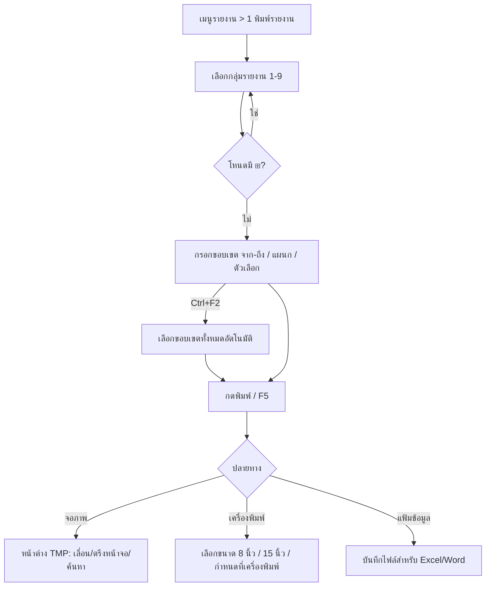

# บทที่ 17 การพิมพ์รายงาน
> อ้างอิงคู่มือ หน้า 307–314 (PDF p.323–330)

## ภาพรวม
- หลังป้อนข้อมูลในรอบวัน/สัปดาห์/เดือน ผู้ใช้พิมพ์รายงานเพื่อตรวจสอบ ส่งผู้บริหาร หรือส่งส่วนราชการ (หน้า 307)
- รายงานแบ่งเป็นหัวข้อหลัก: ลูกหนี้, เจ้าหนี้, เช็ค, สินค้าคงคลัง, บัญชี, ภาษี, วิเคราะห์การขาย, วิเคราะห์การซื้อ (หน้า 307) และในต้นไม้เมนูมีข้อ 9 สร้างรายงานด้วยตนเอง (ภาพหน้า 310)
- การอ้างถึงรายงานใช้รูปแบบ "เมนูหลัก.เมนูย่อย" เช่น 8.1 = เมนูรายงาน ข้อ 8 รายงานวิเคราะห์การซื้อ > 1 รายงานประวัติการซื้อ (หน้า 308)
- หน้าจอรายงานเป็นแบบเดียวกันทุกตัว: ต้นไม้รายงานด้านซ้าย + แบบฟอร์มขอบเขต (filter) ด้านขวา + ปุ่มพิมพ์ → เลือกปลายทาง (จอภาพ/เครื่องพิมพ์/แฟ้มข้อมูล) (หน้า 309–311)
- รายงานบางตัวข้อมูลคล้ายกันแต่จุดประสงค์ต่าง เช่น 1.4.3 ขายเงินเชื่อแยกตามลูกค้า (ยอดรวมต่อบิล) กับ 7.1.1 ประวัติการขายแยกตามลูกค้า (ราคาสินค้าที่ขาย) (หน้า 307)
- การแก้ไขแบบฟอร์มรายงาน: เมนูรายงาน 9.2 สร้าง/แก้ไขรายงาน (ดูบทที่ 25) ยกเว้นงบการเงิน (เมนูบัญชี ข้อ 9 สร้างงบการเงิน, บทที่ 24) และรายงานภาษี (เมนูการเงิน ข้อ 4 ภาษีมูลค่าเพิ่ม / ข้อ 5 ภาษีหัก ณ ที่จ่าย) (หน้า 314)

## หน้าจอ

### S-RP-01 หน้าจอเลือกรายงานและขอบเขตรายงาน (Xpw)
- เมนู: รายงาน > 1 พิมพ์รายงาน > [ประเภทรายงาน] > [รายงานย่อย] (หน้า 309)
- อ้างอิง: หน้า 309–310 (PDF p.325–326) — มีภาพหน้าจอ: ใช่ (รูปที่ 1, 2); ภาพเพิ่มเติมหน้า 336, 339, 342, 344
- ลักษณะ: หน้าต่าง 2 ส่วน — ซ้าย: ต้นไม้รายงาน (โหนดที่มีรายงานย่อยมีเครื่องหมาย ⊞; รายงานที่เลือกได้คือโหนดปลายที่ไม่มี ⊞) ขวา: ชื่อรายงาน (รหัส + ชื่อ เช่น "141. ขายเงินเชื่อ (ใบกำกับสินค้า) / เรียงตามเลขที่") และกลุ่มกรอบขอบเขต 3 กลุ่ม: (1) ช่วงข้อมูล จาก–ถึง (2) ตัวเลือก (checkbox) (3) การแบ่งหน้า; แถบเครื่องมือด้านบน 3 ปุ่ม

ตัวอย่างขอบเขต — รายงาน 141 ขายเงินเชื่อ / เรียงตามเลขที่ (หน้า 309):

| ส่วน/แท็บ | ฟิลด์ | ชนิดข้อมูล | บังคับ | ค่าเริ่มต้น/อ้างอิงจาก | คำอธิบาย/เงื่อนไข |
|---|---|---|---|---|---|
| ช่วงข้อมูล | เลขที่เอกสารจาก … ถึง | text | ไม่ | ถึง = ค่าสูงสุด (แสดงเป็นอักษร "ฯฯฯ…") | ว่าง = ตั้งแต่ต้น |
| ช่วงข้อมูล | วันที่จาก … ถึง | date (lookup ปฏิทิน) | ใช่ [สันนิษฐาน] | 01/03/48 – 31/03/48 (ตัวอย่าง) | ช่วงวันที่เอกสาร |
| ช่วงข้อมูล | รหัสลูกค้าจาก … ถึง | lookup ลูกค้า | ไม่ | ถึง = รหัสลูกค้าสุดท้าย | ทั้งหมด: ปล่อย "จาก" ว่าง, "ถึง" = รหัสสุดท้าย (หน้า 309–310) |
| ช่วงข้อมูล | รหัสพนักงานขายจาก … ถึง | lookup พนักงานขาย | ไม่ | ถึง = รหัสสุดท้าย (ตัวอย่าง "อารี") | |
| ช่วงข้อมูล | เลือกแผนก | text (pattern) | ไม่ | `*` | รองรับ wildcard: `*` = ทุกแผนก, `A*` = ขึ้นต้นด้วย A, `?A*` = ตัวที่ 2 เป็น A (หน้า 310) |
| ตัวเลือก | พิมพ์รายละเอียด | check | ไม่ | ติ๊ก | พิมพ์บรรทัดรายการสินค้าใต้แต่ละเอกสาร |
| การแบ่งหน้า | เริ่มพิมพ์หน้า … ถึง | number | ไม่ | 1 – 9,999 | |
| การแบ่งหน้า | จำนวนบรรทัด (บรรทัด/หน้า) | number | ไม่ | 39 | |

ตัวอย่างขอบเขต — รายงาน 1B สถานะลูกหนี้ (หน้า 310):

| ส่วน/แท็บ | ฟิลด์ | ชนิดข้อมูล | บังคับ | ค่าเริ่มต้น/อ้างอิงจาก | คำอธิบาย/เงื่อนไข |
|---|---|---|---|---|---|
| ช่วงข้อมูล | สำหรับงวดบัญชี | number | ใช่ [สันนิษฐาน] | 3 (ตัวอย่าง) | งวดบัญชี 1–24 [สันนิษฐาน] |
| ช่วงข้อมูล | รหัสลูกค้าจาก … ถึง | lookup ลูกค้า | ไม่ | ถึง = รหัสสุดท้าย | |
| ช่วงข้อมูล | ประเภทลูกค้า จาก … ถึง | lookup ประเภทลูกค้า | ไม่ | | |
| ช่วงข้อมูล | เขตการขายจาก … ถึง | lookup เขตการขาย | ไม่ | | |
| ช่วงข้อมูล | รหัสพนักงานขายจาก … ถึง | lookup พนักงานขาย | ไม่ | | |
| ตัวเลือก | พิมพ์ลูกค้าที่ยอดเป็น 0 | check | ไม่ | ไม่ติ๊ก | |
| การแบ่งหน้า | เริ่มพิมพ์หน้า … ถึง / จำนวนบรรทัด | number | ไม่ | 1–9,999 / 39 | |

ปุ่ม/คำสั่ง:
- แถบเครื่องมือ: ปิด (ไอคอน ⊗), เริ่มพิมพ์รายงาน (ไอคอนเครื่องพิมพ์ หรือ `<F5>`), ไอคอนที่ 3 (รูปซองจดหมาย/หน้าจอ — คู่มือไม่อธิบาย [สันนิษฐาน])
- `<Ctrl+F2>` ในช่องใด ๆ ของขอบเขต = เลือกขอบเขตข้อมูลทั้งหมดอัตโนมัติ (หน้า 310)
- ไอคอนแว่นขยายข้างช่อง = ค้นหา/เลือกรหัส

กฎทางธุรกิจ/เงื่อนไข:
- โหนดที่ยังมีรายงานย่อย (⊞) เลือกพิมพ์ไม่ได้ ต้องเลือกโหนดปลาย (หน้า 309)
- ช่องแผนกใช้รูปแบบ wildcard `*` และ `?` (หน้า 310)
ผลทางบัญชี/สต๊อก: ไม่มี (อ่านอย่างเดียว)

### S-RP-02 เลือกรูปแบบในการพิมพ์รายงาน (ปลายทาง)
- เมนู: แสดงหลังกดเริ่มพิมพ์ใน S-RP-01
- อ้างอิง: หน้า 311 (PDF p.327) — มีภาพหน้าจอ: ใช่ (รูปที่ 3)
- ลักษณะ: dialog กลุ่ม radio + ปุ่ม OK / Cancel

| ส่วน/แท็บ | ฟิลด์ | ชนิดข้อมูล | บังคับ | ค่าเริ่มต้น/อ้างอิงจาก | คำอธิบาย/เงื่อนไข |
|---|---|---|---|---|---|
| แสดงผลทาง | จอภาพ | select (radio) | ใช่ | เลือกไว้ | แสดงบนจอเพื่อตรวจสอบก่อนพิมพ์ลงกระดาษ |
| แสดงผลทาง | เครื่องพิมพ์ | select (radio) | | | ต้องเตรียมกระดาษก่อน → แสดง S-RP-03 |
| แสดงผลทาง | แฟ้มข้อมูล | select (radio) | | | บันทึกเป็นไฟล์ข้อมูลเพื่อใช้ใน Microsoft Excel, Word ฯลฯ |

ปุ่ม/คำสั่ง: OK, Cancel

### S-RP-03 เลือกขนาดตัวอักษร (ขนาดกระดาษ)
- เมนู: แสดงเมื่อเลือกปลายทาง "เครื่องพิมพ์"
- อ้างอิง: หน้า 311–312 (PDF p.327–328) — มีภาพหน้าจอ: ใช่ (รูปที่ 4)
- ลักษณะ: dialog radio + ปุ่ม

| ส่วน/แท็บ | ฟิลด์ | ชนิดข้อมูล | บังคับ | ค่าเริ่มต้น/อ้างอิงจาก | คำอธิบาย/เงื่อนไข |
|---|---|---|---|---|---|
| เลือกขนาดตัวอักษร | ลงกระดาษ 8 นิ้ว | select (radio) | ใช่ | | โปรแกรมบีบตัวอักษรให้เล็กลง |
| เลือกขนาดตัวอักษร | ลงกระดาษ 15 นิ้ว | select (radio) | | เลือกไว้ (ในภาพ) | ตัวอักษรใหญ่ขึ้น |
| เลือกขนาดตัวอักษร | กำหนดขนาดตัวอักษรที่เครื่องพิมพ์เอง | select (radio) | | | ใช้ขนาดตามที่ตั้งที่เครื่องพิมพ์ |

ปุ่ม/คำสั่ง: ตกลง, ยกเลิก
กฎทางธุรกิจ/เงื่อนไข: รายงานที่กว้างมาก จะไม่มีตัวเลือก "ลงกระดาษ 8 นิ้ว" (เหลือ 15 นิ้ว และกำหนดเองที่เครื่องพิมพ์) (หน้า 312)

### S-RP-04 หน้าต่างแสดงรายงานทางจอภาพ (TMPn)
- เมนู: ผลลัพธ์เมื่อเลือกปลายทาง "จอภาพ"
- อ้างอิง: หน้า 312–314 (PDF p.328–330) — มีภาพหน้าจอ: ใช่ (รูปที่ 5–7)
- ลักษณะ: หน้าต่างข้อความ (text viewer) ชื่อ TMP2/TMP3/TMP4; แถบเครื่องมือ 3 ไอคอน (พิมพ์, พิมพ์ [สันนิษฐาน: ตั้งค่า/พิมพ์ซ้ำ], ค้นหา–กล้องส่องทางไกล); แถบสถานะ Row / Col; หัวรายงาน = ชื่อบริษัท, ชื่อรายงาน, ขอบเขตที่เลือก; ท้ายรายงาน ">>>> จบรายงาน <<<<"

| ส่วน/แท็บ | ฟิลด์ | ชนิดข้อมูล | บังคับ | ค่าเริ่มต้น/อ้างอิงจาก | คำอธิบาย/เงื่อนไข |
|---|---|---|---|---|---|
| หัวรายงาน | ชื่อบริษัท, ชื่อรายงาน, วันที่จาก–ถึง, ขอบเขตอื่น | text | - | จาก S-RP-01 | |
| ตัวอย่าง 1B สถานะลูกหนี้ | ชื่อลูกค้า, ยอดหนี้ยกมา, ยอดขาย, เพิ่มหนี้, ลดหนี้/รับคืน | money | - | | จัดกลุ่มตามประเภทลูกค้า มีรวมต่อกลุ่ม (จำนวนราย) และรวมทั้งสิ้น (หน้า 312) |

ปุ่ม/คำสั่ง:
- ตรึงหน้าจอ (freeze pane): คลิกปุ่มซ้ายสุดของแถบเลื่อนแนวนอนแล้วลากไปทางขวา = ตรึงคอลัมน์; คลิกปุ่มเหนือแถบเลื่อนแนวตั้งแล้วลากลง = ตรึงแถว (หน้า 312–313)
- กดอักษร `L` แล้วลากแถบเพื่อล็อกหน้าจอ (ทั้งแนวตั้งและแนวนอน) แล้วกด `<Enter>` (หน้า 314)

## แคตตาล็อกรายงาน (เท่าที่คู่มือช่วงหน้านี้แสดง)
หมายเหตุ: คู่มือบทนี้ไม่ได้แจกแจงรายงานครบทุกตัวและไม่ได้ให้ขอบเขตของทุกรายงาน รายการด้านล่างรวบรวมจากตารางหน้า 308 และต้นไม้เมนูในภาพหน้า 309, 310, 336, 339, 342, 344 เท่านั้น ช่อง "ตัวกรอง" ที่ไม่ปรากฏในภาพระบุ "ไม่แสดงในคู่มือ"

### ก. ตารางแนะนำรายงาน (หน้า 308)
| ข้อมูลที่แสดง | เมนูรายงาน |
|---|---|
| ยอดซื้อประจำวัน แบบละเอียด (แสดงเลขที่เอกสารการซื้อ) | 8.1 รายงานประวัติการซื้อ |
| ยอดซื้อประจำวัน แบบสรุป | 8.2 รายงานสรุปยอดซื้อ |
| ยอดขายประจำวัน แบบละเอียด (แสดงเลขที่เอกสารขาย) | 7.1 รายงานประวัติการขาย |
| ยอดขายประจำวัน แบบสรุป | 7.6 รายงานสรุปยอดขาย |
| รายงานสินค้าและวัตถุดิบ (แจกแจงรับ-จ่าย) | 4.1.1 หรือ 4.1.5 ขึ้นกับว่ากำหนดตัดต้นทุนแยกตามคลังหรือไม่ |
| รายงานสินค้าคงเหลือ | 4.2.1 หรือ 4.2.7 ขึ้นกับว่ากำหนดตัดต้นทุนแยกตามคลังหรือไม่ |
| ลูกหนี้คงค้าง แบบละเอียด (เอกสารค้างชำระ) | 1.A.2 รายงานลูกหนี้คงค้าง ณ วันที่ แบบละเอียด |
| ลูกหนี้คงค้าง แบบสรุป | 1.A.1 รายงานลูกหนี้คงค้าง ณ วันที่ แบบสรุป |
| เจ้าหนี้คงค้าง แบบละเอียด | 2.A.2 รายงานเจ้าหนี้คงค้าง ณ วันที่ แบบละเอียด |
| เจ้าหนี้คงค้าง แบบสรุป | 2.A.1 รายงานเจ้าหนี้คงค้าง ณ วันที่ แบบสรุป |
| ภาษีมูลค่าเพิ่ม ทั้งภาษีซื้อและภาษีขาย | 6.1 รายงานภาษีมูลค่าเพิ่ม |
| เช็ครับ/เช็คจ่าย เรียงตามวันที่ | 3.5 รายงานเช็ครับเรียงตามวันที่รับเช็ค หรือ 3.A รายงานเช็ครับ(sic)เรียงตามวันที่ออกเช็ค |

### ข. ต้นไม้เมนูรายงาน
| รหัส | ชื่อรายงาน (ตามภาพ) | ตัวกรอง/ขอบเขต | อ้างอิง |
|---|---|---|---|
| 1 | รายงานลูกหนี้ | (กลุ่ม) | หน้า 309 |
| 1.1 | รับเงินมัดจำ (⊞ มีรายงานย่อย ไม่แสดง) | ไม่แสดงในคู่มือ | 309 |
| 1.2 | ขายเงินสด (บิลเงินสด) (⊞) | ไม่แสดงในคู่มือ | 309 |
| 1.3 | ใบสั่งขาย (⊞) | ไม่แสดงในคู่มือ | 309 |
| 1.4 | ขายเงินเชื่อ (ใบกำกับสินค้า) | — | 309 |
| 1.4.1 (141) | เรียงตามเลขที่ | เลขที่เอกสาร, วันที่, รหัสลูกค้า, รหัสพนักงานขาย (จาก–ถึง), เลือกแผนก, พิมพ์รายละเอียด, เริ่มพิมพ์หน้า, จำนวนบรรทัด | 309, 336 |
| 1.4.2 | เรียงตามวันที่ | ไม่แสดงในคู่มือ | 309 |
| 1.4.3 | แยกตามลูกค้า | ไม่แสดงในคู่มือ | 309, 307 |
| 1.4.4 | แยกตามพนักงานขาย | ไม่แสดงในคู่มือ | 309 |
| 1.4.5 | แยกตามเขตการขาย พนักงานขาย | ไม่แสดงในคู่มือ | 309 |
| 1.4.6 | แยกตามเขตการขาย ลูกค้า | ไม่แสดงในคู่มือ | 309 |
| 1.4.7 | ถึงกำหนดเก็บเงิน แยกตามลูกค้า | ไม่แสดงในคู่มือ | 309 |
| 1.4.8 | ถึงกำหนดเก็บเงิน แยกตามพนักงานขาย | ไม่แสดงในคู่มือ | 309 |
| 1.4.9 | ถึงกำหนดเก็บเงิน เรียงตามเลขที่เอกสาร [ข้อความถูกตัดในภาพ] | ไม่แสดงในคู่มือ | 309 |
| 1.4.A | ใบยืนยันยอดลูกหนี้ | ไม่แสดงในคู่มือ | 309 |
| 1.5 | รายได้อื่น ๆ (⊞) | ไม่แสดงในคู่มือ | 309 |
| 1.6 | ใบวางบิล (⊞) | ไม่แสดงในคู่มือ | 309 |
| 1.7 | ใบเพิ่มหนี้ (⊞) | ไม่แสดงในคู่มือ | 309 |
| 1.8 | ใบลดหนี้/รับคืนสินค้า (⊞) | ไม่แสดงในคู่มือ | 309 |
| 1.9 | การรับชำระหนี้ (⊞) | ไม่แสดงในคู่มือ | 309 |
| 1.A | ลูกหนี้คงค้าง ณ วันที่ (⊞: 1.A.1 แบบสรุป, 1.A.2 แบบละเอียด ตามหน้า 308) | ไม่แสดงในคู่มือ | 308–309 |
| 1.B | สถานะลูกหนี้ | สำหรับงวดบัญชี, รหัสลูกค้า, ประเภทลูกค้า, เขตการขาย, รหัสพนักงานขาย (จาก–ถึง), พิมพ์ลูกค้าที่ยอดเป็น 0, เริ่มพิมพ์หน้า, จำนวนบรรทัด | 310 |
| 1.C | วิเคราะห์อายุหนี้ (บิลค้างรับ) (⊞) | ไม่แสดงในคู่มือ | 310 |
| 1.D | รายการเคลื่อนไหวลูกหนี้ | ไม่แสดงในคู่มือ | 310 |
| 1.E | ลูกหนี้เกินวงเงิน | ไม่แสดงในคู่มือ | 310 |
| 1.F | รายละเอียดลูกค้า (⊞) | ไม่แสดงในคู่มือ | 310 |
| 1.G | ใบเสนอราคา (⊞) | ไม่แสดงในคู่มือ | 310 |
| 1.H | ตรวจสอบข้อมูลระบบขาย | ไม่แสดงในคู่มือ | 310 |
| 2 | รายงานเจ้าหนี้ | (กลุ่ม) | 339 |
| 2.1 | จ่ายเงินมัดจำ (⊞) | ไม่แสดงในคู่มือ | 339 |
| 2.2 | ซื้อเงินสด (⊞) | ไม่แสดงในคู่มือ | 339 |
| 2.3 | ใบสั่งซื้อ (⊞) | ไม่แสดงในคู่มือ | 339 |
| 2.4 | ซื้อเงินเชื่อ (ใบรับสินค้า) | — | 339 |
| 2.4.1 (241) | เรียงตามเลขที่ | เลขที่เอกสาร, วันที่, รหัสผู้จำหน่าย (จาก–ถึง), เลือกแผนก, พิมพ์รายละเอียด, เริ่มพิมพ์หน้า, จำนวนบรรทัด | 339 |
| 2.4.2 | เรียงตามวันที่ | ไม่แสดงในคู่มือ | 339 |
| 2.4.3 | แยกตามผู้จำหน่าย | ไม่แสดงในคู่มือ | 339 |
| 2.4.4 | ถึงกำหนดจ่ายเงิน แยกตามผู้จำหน่าย | ไม่แสดงในคู่มือ | 339 |
| 2.4.5 | ถึงกำหนดจ่ายเงิน เรียงตามวันที่ซื้อ | ไม่แสดงในคู่มือ | 339 |
| 2.4.6 | ใบยืนยันยอดเจ้าหนี้ | ไม่แสดงในคู่มือ | 339 |
| 2.5 | ค่าใช้จ่ายอื่น ๆ (⊞) | ไม่แสดงในคู่มือ | 339 |
| 2.6 | ใบรับวางบิล (⊞) | ไม่แสดงในคู่มือ | 339 |
| 2.7 | ใบเพิ่มหนี้ (⊞) | ไม่แสดงในคู่มือ | 339 |
| 2.8 | ใบลดหนี้/ส่งคืนสินค้า (⊞) | ไม่แสดงในคู่มือ | 339 |
| 2.9 | จ่ายชำระหนี้ (⊞) | ไม่แสดงในคู่มือ | 339 |
| 2.A | เจ้าหนี้คงค้าง ณ วันที่ (⊞: 2.A.1 แบบสรุป, 2.A.2 แบบละเอียด) | ไม่แสดงในคู่มือ | 308, 339 |
| 2.B | สถานะเจ้าหนี้ | ไม่แสดงในคู่มือ | 339 |
| 2.C | วิเคราะห์อายุหนี้ (บิลค้างจ่าย) (⊞) | ไม่แสดงในคู่มือ | 339 |
| 2.D | รายการเคลื่อนไหวเจ้าหนี้ | ไม่แสดงในคู่มือ | 339 |
| 2.E | ซื้อเกินวงเงิน | ไม่แสดงในคู่มือ | 339 |
| 2.F | รายละเอียดผู้จำหน่าย/เจ้าหนี้ | ไม่แสดงในคู่มือ | 339 |
| 2.G | ตรวจสอบข้อมูลระบบซื้อ | ไม่แสดงในคู่มือ | 339 |
| 3 | รายงานเกี่ยวกับเช็ค (ย่อย: 3.5, 3.A ตามหน้า 308; อื่นไม่แสดง) | ไม่แสดงในคู่มือ | 308, 310 |
| 4 | รายงานสินค้าคงคลัง (ย่อย: 4.1.1, 4.1.5, 4.2.1, 4.2.7 ตามหน้า 308) | ไม่แสดงในคู่มือ | 308 |
| 5 | รายงานบัญชี | (กลุ่ม) | 342 |
| 5.1 | ผังบัญชี | ไม่แสดงในคู่มือ | 342 |
| 5.2 | สมุดรายวัน | — | 342 |
| 5.2.1 (521) | เรียงตามวันที่ | สมุดรายวันจาก–ถึง (lookup), วันที่จาก–ถึง, เริ่มพิมพ์หน้า, จำนวนบรรทัด | 342 |
| 5.2.2 | เรียงเลขที่ใบสำคัญ | ไม่แสดงในคู่มือ [สันนิษฐาน: เหมือน 521] | 342 |
| 5.2.3 | เรียงตามเลขที่บัญชี | ไม่แสดงในคู่มือ | 342 |
| 5.3 | สรุปยอดเคลื่อนไหว | ไม่แสดงในคู่มือ | 342 |
| 5.4 | แยกประเภท | ไม่แสดงในคู่มือ | 342 |
| 5.5 | รายละเอียดประกอบ | ไม่แสดงในคู่มือ | 342 |
| 5.6 | งบทดลอง (⊞) | ไม่แสดงในคู่มือ | 342 |
| 5.7 | รายการงบประมาณ | ไม่แสดงในคู่มือ | 342 |
| 5.8 | กระดาษทำการ (⊞) | ไม่แสดงในคู่มือ | 342 |
| 5.9 | งบการเงิน | ไม่แสดงในคู่มือ | 342 |
| 5.A | ตรวจสอบข้อมูล | — | 344 |
| 5.A.1 (5A1) | รายการที่เลขบัญชีไม่ถูกต้อง | เริ่มพิมพ์หน้า, จำนวนบรรทัด (เท่านั้น) | 344 |
| 5.A.2 | ใบสำคัญที่ยอดไม่ได้ดุลย์ | ไม่แสดงในคู่มือ | 344 |
| 5.A.3 | รายงานการแก้ไขปรับปรุงรายการ | ไม่แสดงในคู่มือ | 344 |
| 5.A.4 | งบกำไรขาดทุน (⊞) | ไม่แสดงในคู่มือ | 344 |
| 5.B | รายการทรัพย์สิน (⊞) | ไม่แสดงในคู่มือ | 342 |
| 5.C | เงินสดย่อย (⊞) | ไม่แสดงในคู่มือ | 342 |
| 6 | รายงานภาษี (6.1 รายงานภาษีมูลค่าเพิ่ม) | ไม่แสดงในคู่มือ | 308 |
| 7 | รายงานวิเคราะห์การขาย (7.1 ประวัติการขาย, 7.1.1 แยกตามลูกค้า, 7.6 สรุปยอดขาย) | ไม่แสดงในคู่มือ | 307–308 |
| 8 | รายงานวิเคราะห์การซื้อ (8.1 ประวัติการซื้อ, 8.2 สรุปยอดซื้อ) | ไม่แสดงในคู่มือ | 308 |
| 9 | สร้างรายงานด้วยตนเอง (9.2 สร้าง/แก้ไขรายงาน) | - | 310, 314 |

### ค. แบบรายงานตัวอย่าง (คอลัมน์ผลลัพธ์)
- 1B รายงานสถานะลูกหนี้ (หน้า 312): ชื่อลูกค้า | ยอดหนี้ยกมา | ยอดขาย | เพิ่มหนี้ | ลดหนี้/รับคืน — กลุ่มตามประเภทลูกค้า, รวมกลุ่ม (n ราย), รวมทั้งสิ้น
- 141 รายงานใบกำกับสินค้า เรียงตามเลขที่ (หน้า 336): เลขที่ | วันที่ | ลูกค้า | พนักงานขาย | V | ส่วนลด | มูลค่าสินค้า | VAT.; บรรทัดรายละเอียด: ลำดับ รหัสสินค้า รายละเอียด | จำนวน | ราคาต่อหน่วย | ส่วนลด | จำนวนเงิน; บรรทัด "ตัดใบรับมัดจำ# AI…" แสดงยอดหักมัดจำ
- 241 รายงานใบรับสินค้า เรียงตามเลขที่ (หน้า 340): เลขที่ | วันที่ | ผู้จำหน่าย | เลขที่บิล | V | ส่วนลด | มูลค่าสินค้า | VAT. | รวมทั้งสิ้น | ครบกำหนด | ใบสั่งซื้อ; ย่อย: จำนวน, ราคาต่อหน่วย, ส่วนลด, จำนวนเงิน; รวม n ใบ
- 521 รายงานสมุดรายวัน เรียงตามวันที่ (หน้า 343): เลขที่บัญชี | แผนก | ชื่อบัญชี | คำอธิบาย | เดบิต | (เครดิต); หัวใบสำคัญ: วันที่ เลขที่ คำอธิบาย; บรรทัดเช็ค (เช็ค#, วันที่, ธนาคาร); รวมต่อใบสำคัญ

## ลำดับการใช้งาน
1. เมนูรายงาน > 1 พิมพ์รายงาน → เลือกประเภทรายงาน (กลุ่ม 1–9)
2. ขยายต้นไม้จนถึงรายงานปลาย (ไม่มี ⊞)
3. กรอกขอบเขต (จาก–ถึง, แผนก, ตัวเลือก) หรือกด Ctrl+F2 เพื่อเลือกทั้งหมด
4. คลิกไอคอนพิมพ์หรือ F5
5. เลือกปลายทาง: จอภาพ / เครื่องพิมพ์ / แฟ้มข้อมูล
6. ถ้าเครื่องพิมพ์ → เลือกขนาดกระดาษ 8"/15"/กำหนดเอง
7. ถ้าจอภาพ → ดู ตรึงหน้าจอ ค้นหา และสั่งพิมพ์ต่อได้

## ข้อมูลที่เกี่ยวข้อง
- ReportDefinition (รหัสเมนู เช่น 141, ชื่อ, กลุ่ม, parent, ประเภทโหนด) — 1:n → ReportFilterField
- ReportFilterField (label, type, from/to, default, lookup)
- อ่านข้อมูลจาก: เอกสารขาย/ซื้อ (ใบกำกับ, ใบรับสินค้า), ลูกค้า/ประเภทลูกค้า/เขตการขาย/พนักงานขาย, ผู้จำหน่าย, สมุดรายวัน/ผังบัญชี, แผนก, งวดบัญชี
- PrintJob/Output (ปลายทาง: screen/printer/file, ขนาดกระดาษ, หน้าเริ่ม–สิ้นสุด, บรรทัดต่อหน้า)

## ข้อสังเกต
- OCR ไม่มีสำหรับหน้าในช่วงนี้ ข้อมูลทั้งหมดอ่านจากภาพ
- คู่มือบทนี้ให้รายละเอียดขอบเขตเพียง 2 รายงาน (141, 1B); เพิ่มเติมจากบทที่ 21: 241, 521, 5A1 — รายงานอื่นไม่มีขอบเขตในช่วงหน้านี้
- กลุ่ม 3, 4, 6, 7, 8 ไม่มีภาพต้นไม้ขยาย รู้เฉพาะรหัสที่ตารางหน้า 308 อ้างถึง
- ตารางหน้า 308 แถวสุดท้ายเขียน "3.A รายงานเช็ครับเรียงตามวันที่ออกเช็ค" น่าจะหมายถึงเช็คจ่าย [สันนิษฐาน]
- ปลายทาง "แฟ้มข้อมูล" ไม่ระบุนามสกุลไฟล์/รูปแบบ
- รูปแบบหน้าจอขอบเขตใช้ซ้ำได้ทั้งระบบ (generic report parameter form) — เหมาะกับการออกแบบ ERP แบบ metadata-driven
