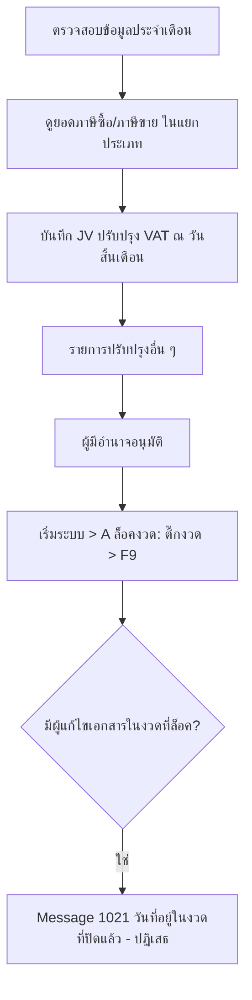

# บทที่ 18 สิ่งที่ต้องปฏิบัติในทุก ๆ สิ้นเดือน
> อ้างอิงคู่มือ หน้า 315–318 (PDF p.331–334)

## ภาพรวม
- Express ทำงานแบบ Online Processing: ระบบเชื่อมโยงกันอัตโนมัติ รายงานและงบการเงินดูได้ทันทีหลังบันทึก จึง **ไม่จำเป็นต้องปิดบัญชีทุกเดือน** (หน้า 315)
- สิ่งที่ต้องทำเองทุกเดือน: บันทึกรายการปรับปรุง เช่น ปรับปรุงภาษีมูลค่าเพิ่มประจำเดือน หรือรายการปรับปรุงอื่น ๆ (หน้า 315)
- หลังตรวจสอบและอนุมัติแล้ว ควร **ล็อคงวด** เพื่อป้องกันการแก้ไขข้อมูลที่ส่งราชการ/ผู้บริหารแล้ว (หน้า 315–317)

## หน้าจอ

### S-ME-01 สมุดรายวันทั่วไป (JV) — ใช้บันทึกปรับปรุงภาษีมูลค่าเพิ่มประจำเดือน
- เมนู: บัญชี > 1 ลงประจำวัน > สมุดรายวันทั่วไป [สันนิษฐาน — คู่มือหน้านี้ระบุเพียง "บันทึกโดยตรงในสมุดรายวัน"; เมนูบัญชีข้อ 1 ลงประจำวัน ปรากฏในภาพหน้า 346]
- อ้างอิง: หน้า 315–316 (PDF p.331–332) — มีภาพหน้าจอ: ใช่ (รูปที่ 1)
- ลักษณะ: header + แท็บ + ตารางรายการ + footer รวม; แถบเครื่องมือมาตรฐานเอกสาร

| ส่วน/แท็บ | ฟิลด์ | ชนิดข้อมูล | บังคับ | ค่าเริ่มต้น/อ้างอิงจาก | คำอธิบาย/เงื่อนไข |
|---|---|---|---|---|---|
| Header | เลขที่ใบสำคัญ | text + lookup | ใช่ [สันนิษฐาน] | ตัวอย่าง JV5013101 | |
| Header | วันที่ | date | ใช่ [สันนิษฐาน] | 31/01/48 (สิ้นเดือน) | ลงวันสิ้นเดือนที่ปรับปรุง |
| Header | รายละเอียด | text + lookup (คำอธิบายมาตรฐาน) | ไม่ [สันนิษฐาน] | "ปรับปรุงภาษีมูลค่าเพิ่มประจำเดือน" | |
| แท็บ รายการที่เดบิท/เครดิต <Alt+E> | เลขที่บัญชี | lookup ผังบัญชี | ใช่ | | |
| แท็บ รายการที่เดบิท/เครดิต | แผนก | lookup แผนก | ไม่ | | |
| แท็บ รายการที่เดบิท/เครดิต | คำอธิบาย | text | ไม่ | | |
| แท็บ รายการที่เดบิท/เครดิต | เดบิท | money | | | |
| แท็บ รายการที่เดบิท/เครดิต | เครดิต | money | | | |
| Footer | รวม (เดบิท / เครดิต) | money (คำนวณ) | - | | ต้องเท่ากัน [สันนิษฐาน] |

แท็บอื่นบนหน้าจอ (ไม่ได้อธิบายในบทนี้): เช็คจ่าย <F7>, เช็ครับ <Ctrl+F7>, ภาษีซื้อ <F8>, ภาษีขาย <Ctrl+F8>, ภาษีหัก ณ ที่จ่าย <Ctrl+F10>

ปุ่ม/คำสั่ง (ไอคอนแถบเครื่องมือ): ใหม่, แก้ไข, คัดลอก [สันนิษฐาน], ลบ, ยกเลิก, บันทึก, เลื่อนแรก/ก่อน/ถัดไป/สุดท้าย, ค้นหา, พิมพ์, Note, ไอคอนอื่น (MATE/DESC, OK, ยางลบ, อนุมัติ OK) [ความหมายไม่ระบุในบทนี้]
กฎทางธุรกิจ/เงื่อนไข: ยอดภาษีซื้อ/ภาษีขายที่ใช้ปรับปรุง ตรวจสอบได้จากแยกประเภทบัญชีภาษีซื้อและภาษีขาย ณ วันสิ้นเดือน (หน้า 316)
ผลทางบัญชี/สต๊อก (ตัวอย่างในภาพ):
- Dr 2135-00 (ภาษีขาย [สันนิษฐาน]) 21,480.02
- Cr 1154-00 (ภาษีซื้อ [สันนิษฐาน]) 11,043.39
- Cr 2137-00 (ภาษีค้างจ่าย/เจ้าหนี้กรมสรรพากร [สันนิษฐาน]) 10,436.63
- กรณีภาษีซื้อ > ภาษีขาย จะได้ยอดเงินภาษีที่ได้รับคืนแทน (หน้า 315)

### S-ME-02 ล็อคงวด
- เมนู: เริ่มระบบ > A ล็อคงวด (หน้า 316)
- อ้างอิง: หน้า 316–317 (PDF p.332–333) — มีภาพหน้าจอ: ใช่ (รูปที่ 2)
- ลักษณะ: ฟอร์ม + ตาราง 2 กลุ่มคอลัมน์ (รอบบัญชีปีปัจจุบัน งวด 1–12 / รอบบัญชีปีใหม่ งวด 13–24) คล้ายหน้าจอ "กำหนดรอบบัญชี"; แถบเครื่องมือ: แก้ไข, บันทึก, ปิด

| ส่วน/แท็บ | ฟิลด์ | ชนิดข้อมูล | บังคับ | ค่าเริ่มต้น/อ้างอิงจาก | คำอธิบาย/เงื่อนไข |
|---|---|---|---|---|---|
| Header | วันที่เริ่มรอบบัญชี | date (แสดงอย่างเดียว [สันนิษฐาน]) | - | จากการกำหนดรอบบัญชี เช่น 01/01/2547 | |
| รอบบัญชีปีปัจจุบัน | ล็อคงวด (1–12) | check | ไม่ | ไม่ติ๊ก | ติ๊กงวดที่ต้องการล็อค |
| รอบบัญชีปีปัจจุบัน | วันสิ้นงวด | date (แสดงอย่างเดียว) | - | จากรอบบัญชี | |
| รอบบัญชีปีใหม่ | ล็อคงวด (13–24) | check | ไม่ | ไม่ติ๊ก | |
| รอบบัญชีปีใหม่ | วันสิ้นงวด | date (แสดงอย่างเดียว) | - | จากรอบบัญชี | |

ปุ่ม/คำสั่ง: แก้ไข, บันทึก (<F9>), ปิด
กฎทางธุรกิจ/เงื่อนไข:
- ติ๊กงวด เช่นงวด 6 เมื่อบันทึกเดือนมิถุนายนเรียบร้อย แล้วบันทึก (F9) (หน้า 317)
- เมื่อมีผู้พยายามแก้ไข/เปลี่ยนแปลงข้อมูลบัญชีในงวดที่ล็อค โปรแกรมแจ้งเตือนและไม่ยอมให้เปลี่ยนแปลง (หน้า 317)
- ล็อคได้เป็นรายงวดแยกกัน (ไม่จำเป็นต้องต่อเนื่อง [สันนิษฐาน])
ผลทางบัญชี/สต๊อก: ไม่มีการลงบัญชี; เป็นการควบคุม (period lock) ทุกเอกสารที่วันที่อยู่ในงวดที่ล็อค

### S-ME-03 ข้อความเตือนงวดที่ปิดแล้ว (Message# 1021)
- เมนู: แสดงเมื่อบันทึก/แก้ไขเอกสารที่วันที่อยู่ในงวดที่ล็อค (ตัวอย่างหน้าจอ IV ขายเงินเชื่อ)
- อ้างอิง: หน้า 318 (PDF p.334) — มีภาพหน้าจอ: ใช่ (รูปที่ 3)
- ลักษณะ: dialog ข้อความ "วันที่อยู่ในงวดที่ปิดแล้ว" + ปุ่ม ตกลง

| ส่วน/แท็บ | ฟิลด์ | ชนิดข้อมูล | บังคับ | ค่าเริ่มต้น/อ้างอิงจาก | คำอธิบาย/เงื่อนไข |
|---|---|---|---|---|---|
| Message | ข้อความ | text | - | "วันที่อยู่ในงวดที่ปิดแล้ว" | Message# 1021 |

ปุ่ม/คำสั่ง: ตกลง

## ลำดับการใช้งาน
1. ตรวจสอบข้อมูลที่ป้อนในเดือนให้ครบถ้วนถูกต้อง (หน้า 315)
2. ดูยอดภาษีซื้อ/ภาษีขายจากแยกประเภท ณ วันสิ้นเดือน
3. บันทึกสมุดรายวันทั่วไปปรับปรุงภาษีมูลค่าเพิ่ม และรายการปรับปรุงอื่น
4. ขออนุมัติ แล้วเข้าเมนูเริ่มระบบ > A ล็อคงวด ติ๊กงวด > บันทึก (F9)
5. การแก้ไขเอกสารในงวดนั้นภายหลังจะถูกปฏิเสธ (Message 1021)

## ข้อมูลที่เกี่ยวข้อง
- FiscalPeriod (เลขงวด 1–24, วันสิ้นงวด, is_locked) — n:1 FiscalYear/AccountingCycle (วันที่เริ่มรอบบัญชี)
- JournalVoucher (เลขที่ใบสำคัญ, วันที่, รายละเอียด, สมุดรายวัน) — 1:n JournalLine (เลขที่บัญชี, แผนก, คำอธิบาย, เดบิท, เครดิต)
- ทุกเอกสาร (ขาย ซื้อ การเงิน JV) ตรวจวันที่กับ FiscalPeriod.is_locked ก่อนบันทึก/แก้ไข/ลบ

## ข้อสังเกต
- ตัวเลขเดบิทแถวแรกในภาพอ่านได้ไม่ชัด (21,400.02 หรือ 21,480.02) แต่ยอดรวมเท่ากับ 21,480.02 ทั้งสองฝั่ง จึงใช้ 21,480.02
- ชื่อบัญชี 2135-00 / 1154-00 / 2137-00 ไม่ปรากฏในภาพ (คำอธิบายบรรทัดเป็น "ปรับปรุงภาษีมูลค่าเพิ่มประจำเดือน" ทั้งหมด) ชื่อบัญชีที่ใส่ไว้เป็นการสันนิษฐาน
- คู่มือไม่ได้ระบุว่าสามารถปลดล็อคงวดได้หรือไม่ / ใครมีสิทธิ์ (ภาพแสดงว่าแก้ไข checkbox ได้ จึงน่าจะปลดล็อคได้โดยเอาเครื่องหมายออก [สันนิษฐาน])
- ภาพหน้าจอ Message 1021 ใช้วันที่ 02/09/58 ในขณะที่ตัวอย่างล็อคงวดใช้ปี 2547–2548 (ภาพคนละชุดข้อมูล)
