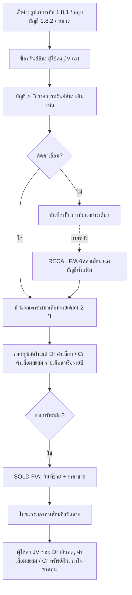

# บทที่ 19 ระบบทรัพย์สินถาวร
> อ้างอิงคู่มือ หน้า 319–326 (PDF p.335–342)

## ภาพรวม
- ทรัพย์สินถาวรต่างจากบัญชีทรัพย์สินอื่นตรงที่มีการเสื่อมสภาพ และนำค่าเสื่อมมาบันทึกเป็นค่าใช้จ่ายได้ (หน้า 319)
- ผู้ใช้บันทึกทะเบียนทรัพย์สินทั้งหมด โปรแกรมคำนวณค่าเสื่อมราคาและบันทึกบัญชีให้อัตโนมัติ (หน้า 319)
- การซื้อทรัพย์สิน และการขาย/จำหน่าย ผู้ใช้ต้องลงบัญชีในสมุดรายวันเอง; โปรแกรมลงเฉพาะค่าเสื่อมราคา (หน้า 325–326)
- ตัวอย่างข้อมูล: บริษัท Express Software Group มีเครื่องคอมพิวเตอร์ 3 เครื่อง และรถกระบะ 1 คัน (หน้า 319)
- ข้อมูลพื้นฐานที่ต้องกำหนดก่อน: รูปแบบรหัส (เมนูเริ่มระบบ 1.8.1 รายละเอียดทั่วไป), กลุ่มบัญชีทรัพย์สิน (เมนูเริ่มระบบ 1.8.2), ตารางข้อมูลประเภทหรือหมวดทรัพย์สิน (หน้า 320–321)

## หน้าจอ

### S-FA-01 รายการทรัพย์สิน (ทะเบียนทรัพย์สินถาวร)
- เมนู: บัญชี > B รายการทรัพย์สิน (หน้า 319, 325; ภาพเมนูหน้า 346)
- อ้างอิง: หน้า 320–323 (PDF p.336–339) — มีภาพหน้าจอ: ใช่ (รูปที่ 1, 2, 3)
- ลักษณะ: master form — header (รหัส/ชื่อ) + 2 แท็บ: "รายละเอียด" (3 กลุ่มกรอบ) และ "ค่าเสื่อมรายเดือน" (ตาราง 12 งวด × 2 ปี + กรอบสรุปวิธีคิด)

| ส่วน/แท็บ | ฟิลด์ | ชนิดข้อมูล | บังคับ | ค่าเริ่มต้น/อ้างอิงจาก | คำอธิบาย/เงื่อนไข |
|---|---|---|---|---|---|
| Header | รหัส | text | ใช่ | รูปแบบตามเมนูเริ่มระบบ 1.8.1 | ตัวอย่าง COMP1-P166MX, HILUX; แก้ด้วยการแก้ไขปกติไม่ได้ ต้องใช้ "เปลี่ยนรหัสทรัพย์สิน" (หน้า 324) |
| Header | ชื่อไทย | text | ใช่ [สันนิษฐาน] | | รายละเอียดภาษาไทย |
| Header | อังกฤษ | text | ไม่ | | รายละเอียดภาษาอังกฤษ |
| รายละเอียด (กรอบ 1) | หมวด | lookup หมวดทรัพย์สิน | ใช่ [สันนิษฐาน] | ตารางข้อมูลประเภททรัพย์สิน | แสดงชื่อหมวดข้างช่อง เช่น CO คอมพิวเตอร์และอุปกรณ์, CA ยานพาหนะ |
| รายละเอียด (กรอบ 1) | กลุ่มบัญชี | lookup กลุ่มบัญชีทรัพย์สิน | ใช่ [สันนิษฐาน] | เมนูเริ่มระบบ 1.8.2 | กำหนดวิธีลงบัญชี (บัญชีค่าเสื่อม/ค่าเสื่อมสะสม) เช่น OEQ0 ค่าเสื่อมราคา-อุปกรณ์สำนักงาน, CAR0 ค่าเสื่อมราคา-ยานพาหนะ |
| รายละเอียด (กรอบ 1) | เลขทะเบียน | text | ไม่ | | Serial Number — ลำดับเองหรือใช้เลขที่ติดมากับทรัพย์สิน |
| รายละเอียด (กรอบ 1) | แผนก | lookup แผนก | ไม่ | | ถ้าไม่มีกด Enter ผ่าน |
| รายละเอียด (กรอบ 2) | คิดค่าเสื่อม? | check | - | ติ๊ก | ไม่ติ๊ก = ไม่คิดค่าเสื่อม (เช่น ที่ดิน หรือยังไม่ต้องการคิด) |
| รายละเอียด (กรอบ 2) | วันที่ซื้อ | date + lookup | ใช่ [สันนิษฐาน] | | |
| รายละเอียด (กรอบ 2) | ราคาทุน | money | ใช่ [สันนิษฐาน] | | ราคาซื้อ |
| รายละเอียด (กรอบ 2) | ราคาซาก | money | ใช่ | | ต้องมียอดคงเหลือในบัญชีทรัพย์สินอย่างน้อย 1 บาทเสมอ; ใช้กันส่วนที่เกินเพดานกฎหมาย (ดูกฎ) |
| รายละเอียด (กรอบ 2) | วิธีคิดค่าเสื่อม | select | ใช่ | วิธีเส้นตรง | 2 วิธี: วิธีเส้นตรง, วิธีลดยอด |
| รายละเอียด (กรอบ 2) | วันที่เริ่มใช้ | date + lookup | ใช่ [สันนิษฐาน] | = วันที่ซื้อ (ปกติ) | เริ่มคิดค่าเสื่อมตั้งแต่วันนี้ (เช่น เครื่องจักรที่ต้องติดตั้งก่อน) |
| รายละเอียด (กรอบ 2) | อายุการใช้งาน (ปี) | number | ใช่ [สันนิษฐาน] | | ตามกฎหมายอนุญาต เช่น 5 ปี (20%), 20 ปี (5%) |
| รายละเอียด (กรอบ 2) | อัตรา (%) | number(%) | ใช่ [สันนิษฐาน] | สัมพันธ์กับอายุ [สันนิษฐาน: 100/อายุ] | อัตราค่าเสื่อมต่อปี |
| รายละเอียด (กรอบ 3) | คิดค่าเสื่อม (รอบ) | select | ใช่ | รายเดือน | รายเดือน = คำนวณและลงบัญชีทุกเดือน; รายปี = ลงบัญชีปีละครั้ง |
| รายละเอียด (กรอบ 3) | ค่าเสื่อมสะสมยกมา | money | ไม่ | 0 | ใช้เมื่อไม่ได้เริ่มใช้โปรแกรมในปีแรกของทรัพย์สิน: ป้อนค่าเสื่อมสะสมจากปีก่อน ๆ เอง; โปรแกรมคำนวณเฉพาะปีปัจจุบันและปีถัดไป |
| รายละเอียด (กรอบ 3) | ค่าเสื่อมที่คำนวณเอง | money | ไม่ | 0 | กรณีเริ่มใช้โปรแกรมระหว่างปี: ค่าเสื่อมตั้งแต่ต้นปีถึงวันเริ่มใช้โปรแกรม |
| รายละเอียด (กรอบ 3) | คำนวณเองถึงวันที่ | date + lookup | ไม่ | | วันที่ที่ค่าเสื่อมคำนวณเองครอบคลุมถึง (ในปีปัจจุบัน) |
| รายละเอียด (กรอบ 3) | ค่าเสื่อมเบื้องต้น | money (คำนวณ) | - | | ค่าเสื่อมต่อปีที่โปรแกรมคำนวณ เช่น (40,000−1)/5 = 7,999.80 |
| รายละเอียด (กรอบ 3) | วันที่ขาย | date (แสดงอย่างเดียว [สันนิษฐาน]) | - | ว่าง | เติมจาก S-FA-03 |
| รายละเอียด (กรอบ 3) | ราคาขาย | money (แสดงอย่างเดียว [สันนิษฐาน]) | - | 0.00 | เติมจาก S-FA-03 |
| รายละเอียด (กรอบ 3) | กำไร/ขาดทุน | money (คำนวณ) | - | 0.00 | [สันนิษฐาน: ราคาขาย − มูลค่าตามบัญชี] |
| ค่าเสื่อมรายเดือน | ตาราง: งวด (1–12, รวม) / ปีปัจจุบัน / ปีถัดไป | grid money (คำนวณ, อ่านอย่างเดียว) | - | โปรแกรมคำนวณหลังบันทึก | แสดงค่าเสื่อมรายงวดของ 2 ปี (หน้า 322) |
| ค่าเสื่อมรายเดือน | วิธีคิดค่าเสื่อม / อัตรา / มูลค่าต้นงวด | แสดงอย่างเดียว | - | | มูลค่าต้นงวด เช่น 40,000.00 |

ปุ่ม/คำสั่ง (แถบเครื่องมือ): ใหม่, แก้ไข, ลบ, ยกเลิก/ปิด, บันทึก, เลื่อนแรก/ก่อน/ถัดไป/สุดท้าย, ค้นหา (dropdown), พิมพ์ (dropdown), Note, **SOLD F/A = บันทึกขายทรัพย์สิน** (หน้า 325), **REJNL = ลงบัญชีใหม่ทั้งแฟ้ม** [สันนิษฐานจากไอคอน; คำสั่งปรากฏในหน้า 324], **RECAL F/A = คิดค่าเสื่อม+ลงบัญชีทั้งแฟ้ม** (tooltip หน้า 324), เปลี่ยนรหัสทรัพย์สิน (ไอคอน — ตำแหน่งไม่ระบุ)

กฎทางธุรกิจ/เงื่อนไข:
- ราคาซากต้องมีอย่างน้อย 1 บาท (หน้า 321)
- ทรัพย์สินที่ถูกจำกัดการคำนวณค่าเสื่อมตามกฎหมาย (เช่น รถยนต์นั่งเกิน 1 ล้านบาท): ราคาทุนป้อนตามจริง (1,500,000) ส่วนที่เกิน (500,000) ป้อนในราคาซาก → โปรแกรมคิดค่าเสื่อมจากฐาน 1,000,000 (หน้า 323)
- วิธีคิดค่าเสื่อม: วิธีเส้นตรง / วิธีลดยอด (หน้า 321)
- สูตรที่คู่มือให้: ค่าเสื่อมราคา = ((ราคาซื้อ − ราคาซาก) / อายุการใช้งาน) × จำนวนวันที่ใช้งานในปีนั้น (หน้า 326) [สันนิษฐาน: หารด้วยจำนวนวันในปี]
- การคำนวณเริ่มที่ "วันที่เริ่มใช้" ไม่ใช่วันที่ซื้อ (หน้า 321)
- คำนวณค่าเสื่อมเฉพาะปีปัจจุบันและปีถัดไป (หน้า 321)
- รหัสทรัพย์สินแก้ไม่ได้หลังบันทึก ยกเว้นผ่านคำสั่งเปลี่ยนรหัส (หน้า 324)

ผลทางบัญชี/สต๊อก:
- (อัตโนมัติ) ทุกงวด/ปี ตามรอบ "คิดค่าเสื่อม": Dr ค่าเสื่อมราคา / Cr ค่าเสื่อมราคาสะสม — บัญชีตาม "กลุ่มบัญชี" (หน้า 326); ตัวอย่างในสมุดรายวันหน้า 343: ใบสำคัญ FA48010001 "คิดค่าเสื่อมสินทรัพย์ถาวร" 31/01/48: Dr 5340-03 ค่าเสื่อมราคา-อุปกรณ์สำนักงาน, Dr 5340-05 ค่าเสื่อมราคา-ยานพาหนะ / Cr 1420-03 ค่าเสื่อมราคาสะสม-อุปกรณ์สำนักงาน, Cr 1420-05 ค่าเสื่อมราคาสะสม-ยานพาหนะ
- (ผู้ใช้บันทึกเอง) ซื้อทรัพย์สิน: Dr ทรัพย์สิน / Cr เงินสด/เจ้าหนี้
- (ผู้ใช้บันทึกเอง) ขายทรัพย์สิน: Dr เงินสด, Dr ค่าเสื่อมราคาสะสม / Cr ทรัพย์สิน (ราคาทุน), Cr/Dr กำไร-ขาดทุนจากการจำหน่ายทรัพย์สิน (ผลต่าง)

### S-FA-02 เปลี่ยนรหัสหมวดทรัพย์สิน (เปลี่ยนรหัสทรัพย์สิน)
- เมนู: ไอคอน "เปลี่ยนรหัสทรัพย์สิน" ในหน้าจอรายการทรัพย์สิน
- อ้างอิง: หน้า 324–325 (PDF p.340–341) — มีภาพหน้าจอ: ใช่ (รูปที่ 5)
- ลักษณะ: dialog

| ส่วน/แท็บ | ฟิลด์ | ชนิดข้อมูล | บังคับ | ค่าเริ่มต้น/อ้างอิงจาก | คำอธิบาย/เงื่อนไข |
|---|---|---|---|---|---|
| - | รหัสทรัพย์สิน เดิม | text (อ่านอย่างเดียว) | - | รหัสปัจจุบัน | |
| - | เปลี่ยนเป็น | text | ใช่ | | รหัสใหม่ |

ปุ่ม/คำสั่ง: ตกลง, ยกเลิก
ผลทางบัญชี/สต๊อก: ไม่ระบุ (เปลี่ยนรหัสอ้างอิง [สันนิษฐาน: cascade ไปยังข้อมูลค่าเสื่อม])

### S-FA-03 บันทึกขายทรัพย์สิน
- เมนู: บัญชี > B รายการทรัพย์สิน > เลือกรหัส > ไอคอน SOLD F/A "บันทึกขายทรัพย์สิน"
- อ้างอิง: หน้า 325–326 (PDF p.341–342) — มีภาพหน้าจอ: ใช่ (รูปที่ 6, 7)
- ลักษณะ: dialog

| ส่วน/แท็บ | ฟิลด์ | ชนิดข้อมูล | บังคับ | ค่าเริ่มต้น/อ้างอิงจาก | คำอธิบาย/เงื่อนไข |
|---|---|---|---|---|---|
| - | วันที่ขาย | date + lookup | ใช่ | | ตัวอย่าง 30/06/2548 |
| - | ราคาขาย | money | ใช่ [สันนิษฐาน] | | ตัวอย่าง 550,000.00 |

ปุ่ม/คำสั่ง: ตกลง, ยกเลิก
กฎทางธุรกิจ/เงื่อนไข: การบันทึกขายทำให้การคำนวณค่าเสื่อมสิ้นสุด ณ วันที่ขาย **แต่ไม่บันทึกบัญชีการจำหน่ายใด ๆ** — ต้องบันทึกรายการขายในสมุดรายวันเอง (หน้า 325)
ผลทางบัญชี/สต๊อก: โปรแกรมคำนวณและลงค่าเสื่อมถึงวันที่ขายอัตโนมัติ (Dr ค่าเสื่อมราคา / Cr ค่าเสื่อมราคาสะสม) (หน้า 326)

### S-FA-04 คำสั่งคำนวณยอดค่าเสื่อมราคาและลงบัญชีใหม่ (คำสั่งบนแถบเครื่องมือ)
- เมนู: ไอคอนในหน้าจอรายการทรัพย์สิน (รูปที่ 4)
- อ้างอิง: หน้า 324 (PDF p.340) — มีภาพหน้าจอ: ใช่ (เฉพาะแถบเครื่องมือ)
- ลักษณะ: คำสั่ง (ไม่มีฟอร์ม)

| ส่วน/แท็บ | ฟิลด์ | ชนิดข้อมูล | บังคับ | ค่าเริ่มต้น/อ้างอิงจาก | คำอธิบาย/เงื่อนไข |
|---|---|---|---|---|---|
| คำสั่ง | คิดค่าเสื่อม-ลงบัญชีทั้งแฟ้ม | action | - | | คำนวณยอดค่าเสื่อมราคาและลงบัญชีใหม่ทุกรหัสทรัพย์สิน |
| คำสั่ง | ลงบัญชีใหม่ทั้งแฟ้ม | action | - | | บันทึกบัญชีในสมุดรายวันสำหรับค่าเสื่อมที่คำนวณไว้แล้วแต่ยังไม่ผ่านไปยังระบบบัญชี — ไม่คำนวณค่าเสื่อมใหม่ |

กฎทางธุรกิจ/เงื่อนไข: ใช้กรณีตอนป้อนข้อมูลไม่ได้ติ๊ก "คิดค่าเสื่อม" ไว้ เมื่อข้อมูลครบแล้วจึงสั่งคำนวณ (หน้า 324)
ผลทางบัญชี/สต๊อก: สร้าง/สร้างใหม่ ใบสำคัญค่าเสื่อม (Dr ค่าเสื่อมราคา / Cr ค่าเสื่อมราคาสะสม)

## ลำดับการใช้งาน
1. ตั้งค่าเริ่มระบบ: 1.8.1 รูปแบบรหัส, 1.8.2 กลุ่มบัญชีทรัพย์สิน, ตารางหมวดทรัพย์สิน
2. ซื้อทรัพย์สิน → บันทึก JV เอง (Dr ทรัพย์สิน / Cr เงินสด/เจ้าหนี้)
3. บัญชี > B รายการทรัพย์สิน → เพิ่มรหัส กรอกรายละเอียด ค่าเสื่อม บันทึก
4. โปรแกรมคำนวณตารางค่าเสื่อมรายเดือน 2 ปี และลงบัญชีอัตโนมัติ (หรือสั่ง RECAL / REJNL ภายหลัง)
5. เมื่อขาย → SOLD F/A ป้อนวันที่ขาย/ราคาขาย → โปรแกรมลงค่าเสื่อมถึงวันขาย
6. บันทึก JV ขายเอง (ตัดทรัพย์สิน ค่าเสื่อมสะสม รับเงิน และกำไร/ขาดทุน)

ตัวอย่างคู่มือ (หน้า 325–326): ทรัพย์สิน A ซื้อ 1,000 ราคาซาก 1; สิ้นปีแรกโปรแกรมลง Dr ค่าเสื่อม 200 / Cr ค่าเสื่อมสะสม 200; กลางปีที่ 2 ขายได้ 750 → โปรแกรมลงค่าเสื่อมถึงวันขาย 100; ผู้ใช้ลง Dr เงินสด 750, Dr ค่าเสื่อมสะสม 300 / Cr ทรัพย์สิน 1,000, Cr กำไรจากการจำหน่ายทรัพย์สิน 50

## ข้อมูลที่เกี่ยวข้อง
- FixedAsset (รหัส, ชื่อไทย, ชื่ออังกฤษ, หมวด, กลุ่มบัญชี, เลขทะเบียน, แผนก, คิดค่าเสื่อม, วันที่ซื้อ, ราคาทุน, ราคาซาก, วิธีคิดค่าเสื่อม, วันที่เริ่มใช้, อายุการใช้งาน, อัตรา, รอบคิดค่าเสื่อม, ค่าเสื่อมสะสมยกมา, ค่าเสื่อมที่คำนวณเอง, คำนวณเองถึงวันที่, ค่าเสื่อมเบื้องต้น, วันที่ขาย, ราคาขาย, กำไร/ขาดทุน)
  - -> AssetCategory หมวด (n:1), -> AssetAccountGroup กลุ่มบัญชี (n:1), -> Department (n:1)
  - 1:n -> AssetDepreciationSchedule (งวด 1–12, ปีปัจจุบัน, ปีถัดไป)
- AssetAccountGroup (รหัส เช่น OEQ0, CAR0; ชื่อ; บัญชีค่าเสื่อม; บัญชีค่าเสื่อมสะสม [สันนิษฐาน]) — กำหนดที่เมนูเริ่มระบบ 1.8.2
- JournalVoucher ประเภท FA (เลขที่ เช่น FA48010001) สร้างอัตโนมัติจากการคิดค่าเสื่อม

## ข้อสังเกต
- ตัวอย่าง COMP1-P166MX: ค่าเสื่อมเบื้องต้น 7,999.80/ปี แต่ตารางค่าเสื่อมรายเดือนรวมปีละ 6,399.84 (งวดละ ~507–543) ตัวเลขไม่สอดคล้องกันและคู่มือไม่อธิบาย (อาจคิดจากยอดคงเหลือหลังหักค่าเสื่อมสะสมยกมา 15,999.60 ÷ อายุที่เหลือ [สันนิษฐาน])
- ค่าเสื่อมรายเดือนแตกต่างตามจำนวนวันในเดือน (542.06 / 507.09 / 524.58) แสดงว่าคำนวณรายวัน
- สูตรในหน้า 326 เขียนไม่ครบ (ไม่มีตัวหารจำนวนวันในปี)
- ไม่มีรายละเอียดสูตรวิธีลดยอด
- ตำแหน่งไอคอน "เปลี่ยนรหัสทรัพย์สิน" และความหมายของไอคอน REJNL ไม่ระบุชัดในภาพ (มีเพียง tooltip ของ RECAL F/A และ SOLD F/A)
- คู่มือไม่ระบุว่ามีการตัดจำหน่ายบางส่วน การโอนย้ายแผนก หรือการตีราคาใหม่ — ไม่มีในระบบนี้ตามที่คู่มือกล่าว
