# บทที่ 20 การจัดเรียงข้อมูลและสำรองข้อมูล
> อ้างอิงคู่มือ หน้า 327–334 (PDF p.343–350)

## ภาพรวม
- การปิด-เปิดเครื่องขณะอยู่ในหน้าจอโปรแกรมอาจทำให้การเชื่อมโยงข้อมูลระหว่างระบบเสียหายและข้อมูลอัพเดทไม่ครบ → ต้องสั่ง **จัดเรียงข้อมูล** ใหม่ (หน้า 327)
- ใช้แก้ปัญหายอดคงเหลือไม่ถูกต้อง เช่น สินค้าคงเหลือ, ยอดลูกหนี้-เจ้าหนี้คงค้าง, มูลค่าซื้อ-ขายในรายงาน (หน้า 327)
- ควร **สำรองข้อมูล** สม่ำเสมอเพื่อป้องกันข้อมูลสูญหาย (ไวรัส, อุปกรณ์เสื่อม) และ **นำข้อมูลสำรองมาใช้** เมื่อเกิดความเสียหาย (หน้า 327, 333)
- เมนูทั้งหมดอยู่ใต้ อื่น ๆ > 1 จัดการแฟ้มข้อมูล: 1 สำรองข้อมูล, 2 ทดสอบข้อมูลสำรอง, 3 นำข้อมูลสำรองมาใช้, 4 แสดงแฟ้มจากข้อมูลสำรอง, 5 ตรวจรายละเอียดของแผ่น, 6 จัดเรียงข้อมูล (ภาพหน้า 328)

## หน้าจอ

### S-DM-01 ระบบจัดการแฟ้มข้อมูล (จัดเรียงข้อมูล)
- เมนู: อื่น ๆ > 1 จัดการแฟ้มข้อมูล > 6 จัดเรียงข้อมูล (หน้า 327 เขียนว่า "เมนูอื่น 1.6")
- อ้างอิง: หน้า 327–329 (PDF p.343–345) — มีภาพหน้าจอ: ใช่ (รูปที่ 1–3)
- ลักษณะ: dialog — ที่เก็บข้อมูล + ชื่อบริษัท + รายการแฟ้ม (list, highlight ตามระบบที่เลือก) + checkbox ระบบทางขวา + ตัวเลือกด้านล่าง

| ส่วน/แท็บ | ฟิลด์ | ชนิดข้อมูล | บังคับ | ค่าเริ่มต้น/อ้างอิงจาก | คำอธิบาย/เงื่อนไข |
|---|---|---|---|---|---|
| - | ที่เก็บข้อมูล | text (path) | - | path ข้อมูลบริษัทปัจจุบัน เช่น Z:\.\TEST | |
| - | (ชื่อบริษัท) | text แสดงอย่างเดียว | - | | เช่น บริษัท เอ็กซ์เพรสซอฟท์แวร์กรุ๊ป จำกัด |
| แฟ้มข้อมูล | รายการแฟ้ม (ชื่อไฟล์ + คำอธิบาย) | list | - | | แฟ้มของระบบที่เลือกถูก highlight (ดูรายชื่อแฟ้มในส่วนข้อมูลที่เกี่ยวข้อง) |
| ระบบ | ระบบซื้อ | check | | | |
| ระบบ | ระบบขาย | check | | ติ๊ก (ในภาพ) | |
| ระบบ | ระบบสินค้า | check | | | |
| ระบบ | ระบบการเงิน | check | | | |
| ระบบ | ระบบบัญชี | check | | | |
| ตัวเลือก | PACK ข้อมูล | check | ไม่ | ไม่ติ๊ก | เคลียร์ข้อมูลที่ถูกลบทิ้ง (ไม่ใช้งานแต่ยังค้างในระบบ) |
| ตัวเลือก | ซ่อมแซมข้อมูล | check | ไม่ | ไม่ติ๊ก | ใช้เมื่อพบข้อมูลผิดเพี้ยน เช่น อักขระแปลก ! @ # $ % ^ & * ในรายการซื้อ/ขาย หรือหน้าจอรายละเอียดลูกค้า/สินค้า |

ปุ่ม/คำสั่ง: ทุกระบบ (ติ๊กทุกระบบ), ตั้งค่าใหม่ (ล้างการเลือก [สันนิษฐาน]), ทำงาน, เลิก
กฎทางธุรกิจ/เงื่อนไข:
- เลือกจัดเรียงเฉพาะระบบได้ถ้าทราบว่าขณะปิดเครื่องทำงานในระบบใด; ถ้าไม่แน่ใจให้เลือกทุกระบบ (หน้า 328)
- เมื่อเลือกทุกแฟ้ม โปรแกรมจัดเรียงทีละระบบและแสดงความคืบหน้า เสร็จแล้วแจ้ง "เรียบร้อย" (Message# 5619) (หน้า 329)
ผลทางบัญชี/สต๊อก: ไม่สร้างรายการบัญชีใหม่; สร้าง index/ยอดสะสมของแต่ละระบบใหม่ให้ตรงกับรายการ [สันนิษฐาน — คู่มือระบุเพียง "อัพเดทข้อมูลให้ทุกระบบงาน"]

### S-DM-02 สำรองข้อมูล
- เมนู: อื่น ๆ > 1 จัดการแฟ้มข้อมูล > 1 สำรองข้อมูล (หน้า 330)
- อ้างอิง: หน้า 329–333 (PDF p.345–349) — มีภาพหน้าจอ: ใช่ (รูปที่ 4–8)
- ลักษณะ: dialog ฟอร์ม + รายการแฟ้ม + แถบความคืบหน้า + สรุปผล

| ส่วน/แท็บ | ฟิลด์ | ชนิดข้อมูล | บังคับ | ค่าเริ่มต้น/อ้างอิงจาก | คำอธิบาย/เงื่อนไข |
|---|---|---|---|---|---|
| - | ที่เก็บต้นทาง | text (path) | - | path ข้อมูลบริษัทปัจจุบัน | |
| - | ที่เก็บปลายทาง | text (path) + ปุ่ม … | ใช่ | | เลือกไดร์ฟ/โฟลเดอร์ (ปุ่ม …) |
| - | A: | select (radio) | ไม่ | | เลือกไดร์ฟ A: (ฟลอปปี้) [สันนิษฐาน] |
| - | ชื่อแฟ้มข้อมูลสำรอง | text | ใช่ | เช่น 20150901-express.5 | แนะนำรูปแบบ YYYYMMDD-xxxxx.5 (xxxxx = ชื่อบริษัท) |
| - | จำนวนแผ่นที่ต้องใช้ (แผ่น) | number (คำนวณ) | - | 0 | |
| แฟ้มข้อมูล | รายการไฟล์ที่จะสำรอง (path เต็ม) | list | - | ทุกไฟล์ในที่เก็บต้นทาง | |
| สรุป | จำนวนแฟ้ม, ขนาด (ไบท์), ชื่อบริษัท | แสดงอย่างเดียว | - | เช่น 78 แฟ้ม 893,421 ไบท์ | |
| ความคืบหน้า | กำลังสำรองข้อมูล + progress bar | แสดงอย่างเดียว | - | | |
| ผลลัพธ์ | สำรองข้อมูล เรียบร้อย n แฟ้ม, ไบท์, เวลาที่ใช้ | แสดงอย่างเดียว | - | | เช่น 78 แฟ้ม 926,275 ไบท์ 00:00:03 |

ปุ่ม/คำสั่ง: … (เลือกปลายทาง), เริ่มสำรอง, ยกเลิก, เรียบร้อย (หลังเสร็จ)
- Dialog ยืนยัน (รูปที่ 6): "สำรองข้อมูลจากที่เก็บข้อมูล Z:\.\TEST ไปเก็บที่แฟ้มข้อมูลสำรองชื่อ E:\20150901 express.5" — ปุ่ม ตกลง / ยกเลิก
กฎทางธุรกิจ/เงื่อนไข:
- โปรแกรม **บีบอัด** ข้อมูลลงสื่อที่เลือก (หน้า 331)
- แนวปฏิบัติ: ใช้สื่อภายนอก (Thumb Drive, External HDD); สำรองทุกวันหลังเลิกงาน; แยกชุดตามวันที่ ไม่เขียนทับ; เก็บสื่อในที่เหมาะสม (ไม่ร้อน ชื้น ใกล้สนามแม่เหล็ก) และจดรายละเอียด (ชื่อไฟล์, ผู้สำรอง) บนซอง (หน้า 329, 333)

### S-DM-03 ทดสอบข้อมูลสำรอง
- เมนู: อื่น ๆ > 1 จัดการแฟ้มข้อมูล > 2 ทดสอบข้อมูลสำรอง (หน้า 332)
- อ้างอิง: หน้า 332 (PDF p.348) — มีภาพหน้าจอ: ไม่
- ลักษณะ: dialog [สันนิษฐาน]

| ส่วน/แท็บ | ฟิลด์ | ชนิดข้อมูล | บังคับ | ค่าเริ่มต้น/อ้างอิงจาก | คำอธิบาย/เงื่อนไข |
|---|---|---|---|---|---|
| - | แฟ้มข้อมูลสำรอง | text (path) + ปุ่ม … | ใช่ | | เลือกไฟล์สำรองที่บันทึกไว้ |

ปุ่ม/คำสั่ง: …, ตกลง
กฎทางธุรกิจ/เงื่อนไข: ถ้าสื่อมีปัญหา แสดงข้อความ เช่น "พบเครื่องหมายจบแฟ้มที่ไม่สมบูรณ์", "Can't reading drive E:" → ต้องสำรองใหม่; ถ้าไม่มีปัญหา แสดงจำนวนไฟล์และพื้นที่ดิสก์ที่ใช้ (หน้า 332)

### S-DM-04 นำข้อมูลสำรองมาใช้
- เมนู: อื่น ๆ > 1 จัดการแฟ้มข้อมูล > 3 นำข้อมูลสำรองมาใช้ (หน้า 333)
- อ้างอิง: หน้า 333–334 (PDF p.349–350) — มีภาพหน้าจอ: ใช่ (รูปที่ 9, 10)
- ลักษณะ: dialog

| ส่วน/แท็บ | ฟิลด์ | ชนิดข้อมูล | บังคับ | ค่าเริ่มต้น/อ้างอิงจาก | คำอธิบาย/เงื่อนไข |
|---|---|---|---|---|---|
| - | แฟ้มข้อมูลสำรอง | text (path) + ปุ่ม … | ใช่ | | เช่น E:\express.5 หรือ YYYYMMDD-xxxxx.5 |
| - | ที่เก็บข้อมูล | text (path) | ใช่ | path บริษัทปัจจุบัน เช่น Z:\.\TEST | ที่ที่จะคลายข้อมูลลงไป (เขียนทับ) |
| แฟ้มข้อมูล | รายการแฟ้ม | list | - | | |

ปุ่ม/คำสั่ง: …, คลายข้อมูล, ยกเลิก
กฎทางธุรกิจ/เงื่อนไข: ถ้าเกิดข้อผิดพลาดเกี่ยวกับสื่อ (เช่น "General reading drive E:", "พบเครื่องหมายจบแฟ้มที่ไม่สมบูรณ์") ให้ใช้ชุดสำรองก่อนหน้า (หน้า 334)
ผลทางบัญชี/สต๊อก: ข้อมูลทั้งหมดในที่เก็บข้อมูลถูกแทนที่ด้วยข้อมูลจากชุดสำรอง [สันนิษฐาน: เขียนทับ]

## ลำดับการใช้งาน
จัดเรียงข้อมูล:
1. อื่น ๆ > 1 > 6 จัดเรียงข้อมูล → เลือกระบบ (หรือทุกระบบ) → เลือก PACK/ซ่อมแซมถ้าต้องการ → ทำงาน → "เรียบร้อย"

สำรองและกู้คืน:
1. อื่น ๆ > 1 > 1 สำรองข้อมูล → เลือกปลายทาง ตั้งชื่อ YYYYMMDD-ชื่อบริษัท.5 → เริ่มสำรอง → ยืนยัน → เรียบร้อย
2. อื่น ๆ > 1 > 2 ทดสอบข้อมูลสำรอง → เลือกไฟล์ → ตกลง
3. เก็บสื่อไว้ในที่ปลอดภัย จดรายละเอียด
4. เมื่อข้อมูลเสียหาย: อื่น ๆ > 1 > 3 นำข้อมูลสำรองมาใช้ → เลือกไฟล์ → คลายข้อมูล

```mermaid
flowchart TD
  subgraph sg1["จัดเรียง"]
    R1[ปิด-เปิดเครื่องผิดปกติ / ยอดคงเหลือไม่ตรง] --> R2[อื่น ๆ > 1.6 จัดเรียงข้อมูล]
    R2 --> R3[เลือกระบบ ซื้อ/ขาย/สินค้า/การเงิน/บัญชี หรือ ทุกระบบ]
    R3 --> R4[ตัวเลือก PACK / ซ่อมแซมข้อมูล]
    R4 --> R5[ทำงาน] --> R6[Message 5619 เรียบร้อย]
  end
  subgraph sg2["สำรองและกู้คืน"]
    B1[อื่น ๆ > 1.1 สำรองข้อมูล] --> B2[เลือกปลายทาง + ชื่อ YYYYMMDD-xxxxx.5]
    B2 --> B3[เริ่มสำรอง > ยืนยัน] --> B4[บีบอัด + แสดงผล n แฟ้ม / ไบท์ / เวลา]
    B4 --> B5[อื่น ๆ > 1.2 ทดสอบข้อมูลสำรอง]
    B5 --> B6{มีข้อผิดพลาด?}
    B6 -- ใช่ --> B1
    B6 -- ไม่ --> B7[จัดเก็บสื่อ]
    B7 -.ข้อมูลเสียหาย.-> C1[อื่น ๆ > 1.3 นำข้อมูลสำรองมาใช้]
    C1 --> C2[เลือกแฟ้มสำรอง + ที่เก็บข้อมูล] --> C3[คลายข้อมูล]
  end
```

## ข้อมูลที่เกี่ยวข้อง
- Company/DataPath (ที่เก็บข้อมูล, ชื่อบริษัท)
- BackupSet (ชื่อแฟ้มสำรอง, ที่เก็บปลายทาง, จำนวนแฟ้ม, ขนาด, เวลาที่ใช้, วันที่, ผู้สำรอง)
- รายชื่อแฟ้มข้อมูล (DBF) ที่ปรากฏในภาพ — สะท้อนโครงสร้างตารางของ Express:
  - ระบบซื้อ (AP): APRCPCQ.DBF แฟ้มรายการใบจ่ายเงิน(เช็คจ่าย), APRCPIT.DBF แฟ้มรายการใบจ่ายเงิน(ใบรับส/ค), APTRN.DBF แฟ้มซื้อสด/ใบรับส.ค./ใบลดหนี้
  - ระบบขาย (AR): ARBAL.DBF แฟ้มสะสมยอดลูกหนี้, ARBIL.DBF แฟ้มใบวางบิล, ARMAS.DBF แฟ้มข้อมูลลูกค้า, ARRCPCQ.DBF แฟ้มรายการใบเสร็จ(เช็ครับ), ARRCPIT.DBF แฟ้มรายการใบเสร็จ(ใบกำกับ), ARSHIP.DBF แฟ้มสถานที่ส่งของ, ARTRN.DBF แฟ้มบิลขายสด/ใบกำกับ/ใบลดหนี้, ARTRNRM.DBF แฟ้มรายการคำอธิบายเพิ่มเติม
  - ระบบการเงิน (BK): BKMAS.DBF แฟ้มบัญชีเงินฝากธนาคาร, BKTRN.DBF แฟ้มรายการเคลื่อนไหวธนาคาร, BKTRNIT.DBF แฟ้มรายการเคลื่อนไหวธนาคาร
  - อื่น ๆ (เห็นในรายการสำรอง): GLREPTMP.DBF, GLTPL.DBF, GLTPLIT.DBF, ISACC.DBF, ISFIXCOD.DBF, ISINFO.DBF, ISPRD.DBF, ISREP.DBF, ISRUN.DBF, ISSN.DBF, ISSNIT.DBF, ISTAB.DBF, ISTXS02/03/53 (.RF1/.RR1), ISVATP.RR1, ISVATS.RR1, OEQTQT (.RT1/.RX1), POPRPO (.RT1/.RX1) — ความหมายไม่ระบุในคู่มือ [สันนิษฐาน: GL = บัญชีแยกประเภท, IS = ข้อมูลระบบ/ตั้งค่า, OE = ใบเสนอราคา/สั่งขาย, PO = ใบสั่งซื้อ]

## ข้อสังเกต
- เมนู อื่น ๆ ในภาพหน้า 328 (มี "9 คำสั่งพิเศษ", "C ลงทะเบียนโปรแกรม", "About Express Accounting") ต่างจากภาพหน้า 330/333 (มี "9 เครื่องคิดเลข", "A โอนข้อมูล", "About xpw...") — ภาพจากคนละเวอร์ชัน
- เมนูย่อย 4 แสดงแฟ้มจากข้อมูลสำรอง และ 5 ตรวจรายละเอียดของแผ่น ปรากฏในภาพแต่ไม่มีคำอธิบาย
- ปุ่ม "ตั้งค่าใหม่" ในหน้าจอจัดเรียงไม่มีคำอธิบาย
- คู่มือไม่ระบุว่าต้องให้ผู้ใช้อื่นออกจากโปรแกรมก่อนจัดเรียง/กู้คืนหรือไม่
- ข้อความ error ใช้ทั้ง "Can't reading drive E:" (หน้า 332) และ "General reading drive E:" (หน้า 334)
- สำหรับ ERP ใหม่: ฟังก์ชันจัดเรียงข้อมูล (rebuild index/ยอดสะสม) สะท้อนว่า Express เก็บยอดสะสม (ARBAL ฯลฯ) แยกจากรายการ — ควรออกแบบให้ยอดสะสมคำนวณใหม่ได้จากรายการ (rebuildable)
