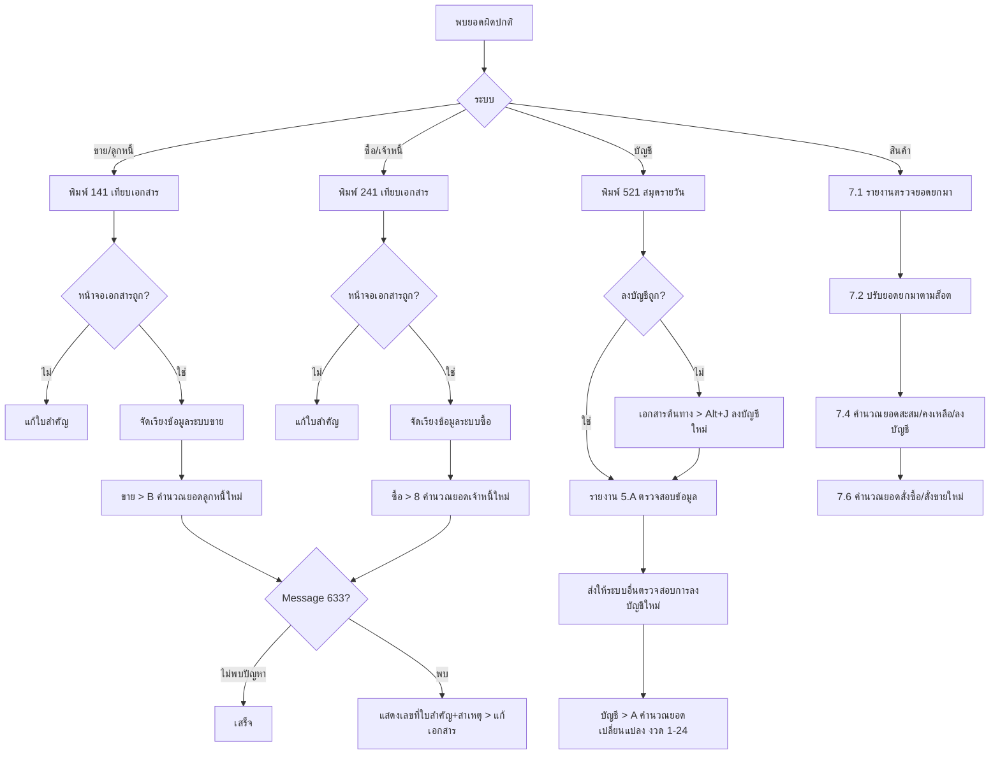

# บทที่ 21 การตรวจสอบข้อมูลและการแก้ไขปัญหา
> อ้างอิงคู่มือ หน้า 335–349 (PDF p.351–365); หน้า 350 (PDF p.366) เป็นหน้าว่าง

## ภาพรวม
- ข้อผิดพลาดยังเกิดได้จาก: การป้อนข้อมูลผิด (จำนวน ราคา), การทำงานผิดขั้นตอน (เช่น ลบเอกสารขายเชื่อในสมุดรายวันโดยตรงแต่ไม่ลบเอกสารต้นทาง), ความชำรุดของเครื่อง/ไฟดับ (หน้า 335)
- บทนี้แนะนำขั้นตอนตรวจสอบรายระบบ: ขาย/ลูกหนี้, ซื้อ/เจ้าหนี้, บัญชี, สินค้า และเครื่องมือ "คำนวณยอดใหม่" (recalculate) ของแต่ละระบบ (หน้า 335–349)
- เครื่องมือคำนวณยอดใหม่: คำนวณยอดลูกหนี้ใหม่, คำนวณยอดเจ้าหนี้ใหม่, ลงบัญชีใหม่ (Alt+J), ส่งให้ระบบอื่นตรวจสอบการลงบัญชีใหม่, คำนวณยอดเปลี่ยนแปลง (บัญชี), ซ่อมแซมระบบสินค้า (5 เมนูย่อย)

## หน้าจอ

### S-CK-01 คำนวณยอดลูกหนี้ใหม่
- เมนู: ขาย > B คำนวณยอดลูกหนี้ใหม่ (หน้า 337)
- อ้างอิง: หน้า 337–338 (PDF p.353–354) — มีภาพหน้าจอ: ใช่ (รูปที่ 3, 4, 5)
- ลักษณะ: dialog (ชื่อหน้าต่าง "คำนวณยอดลูกหนี้") + แถบความคืบหน้า

| ส่วน/แท็บ | ฟิลด์ | ชนิดข้อมูล | บังคับ | ค่าเริ่มต้น/อ้างอิงจาก | คำอธิบาย/เงื่อนไข |
|---|---|---|---|---|---|
| - | รหัสลูกค้าจาก | lookup ลูกค้า | ไม่ | รหัสลูกค้ารายแรก | ว่าง = ตั้งแต่รายแรก |
| - | ถึง | lookup ลูกค้า | ไม่ | รหัสลูกค้ารายสุดท้าย | |
| - | ตรวจสอบการตัดยอดมัดจำ และรายได้อื่นๆ (ควรตรวจอย่างน้อยเดือนละครั้ง) | check | ไม่ | ติ๊ก (ในภาพ) | ตรวจว่ามีเงินมัดจำที่ถูกนำไปตัดยอดในบิลขายแล้วแต่ยังคงค้างอยู่ในระบบ |
| - | ปรับปรุงบิลขายที่โอนข้อมูลแล้วเกิด Error (E) ยอดชำระ/ลดหนี้ ผิด | check | ไม่ | ไม่ติ๊ก | ปรับปรุงบิลขายที่ถูกรับชำระแล้วแต่ยังแสดงยอดค้าง (จากการโอนข้อมูลไม่สมบูรณ์) — ใช้เฉพาะเมื่อมีการโอนข้อมูล |
| ความคืบหน้า | progress bar (ป้าย เช็ครับ ฯลฯ) | แสดงอย่างเดียว | - | | |

ปุ่ม/คำสั่ง: คำนวณ
กฎทางธุรกิจ/เงื่อนไข:
- ใช้เมื่อไฟดับ/ปิดเครื่องระหว่างเปิดบิลขาย ทำให้ยอดบิลไม่ตรงมูลค่าที่บันทึก, รายการสินค้าในบิลหาย, หรือยอดขายเชื่อไม่ไปตั้งหนี้ลูกค้า (หน้า 337)
- พบปัญหา → แสดงเลขที่ใบสำคัญและสาเหตุ ให้ไปแก้ที่เอกสาร; ไม่พบ → Message# 633 "คำนวณยอดใหม่เสร็จสิ้น" (หน้า 338)
ผลทางบัญชี/สต๊อก: อัพเดทยอดลูกหนี้คงค้างให้ถูกต้อง (ยอดสะสมลูกหนี้) — ไม่ระบุว่าสร้างรายการบัญชี

### S-CK-02 คำนวณยอดเจ้าหนี้ใหม่
- เมนู: ซื้อ > 8 คำนวณยอดเจ้าหนี้ใหม่ (หน้า 341)
- อ้างอิง: หน้า 340–342 (PDF p.356–358) — มีภาพหน้าจอ: ใช่ (รูปที่ 8, 9, 10)
- ลักษณะ: dialog (ชื่อ "คำนวณยอดเจ้าหนี้") — โครงสร้างเดียวกับ S-CK-01

| ส่วน/แท็บ | ฟิลด์ | ชนิดข้อมูล | บังคับ | ค่าเริ่มต้น/อ้างอิงจาก | คำอธิบาย/เงื่อนไข |
|---|---|---|---|---|---|
| - | รหัสผู้จำหน่ายจาก | lookup ผู้จำหน่าย | ไม่ | รายแรก | |
| - | ถึง | lookup ผู้จำหน่าย | ไม่ | รายสุดท้าย (เช่น UNISYS) | |
| - | ตรวจสอบการตัดยอดมัดจำ และค่าใช้จ่ายอื่นๆ (ควรตรวจอย่างน้อยเดือนละครั้ง) | check | ไม่ | ติ๊ก | |
| - | ปรับปรุงบิลซื้อที่โอนข้อมูลแล้วเกิด Error (E) ยอดชำระ/ลดหนี้ ผิด | check | ไม่ | ไม่ติ๊ก | |
| ความคืบหน้า | progress bar (ป้าย เช็คจ่าย) | แสดงอย่างเดียว | - | | |

ปุ่ม/คำสั่ง: คำนวณ
กฎทางธุรกิจ/เงื่อนไข: เหมือน S-CK-01 ฝั่งซื้อ; ไม่พบปัญหา → Message# 633 (หน้า 341–342)
ผลทางบัญชี/สต๊อก: อัพเดทยอดเจ้าหนี้คงค้าง

### S-CK-03 สั่งให้ลงบัญชีใหม่ (คำสั่งในหน้าจอเอกสาร)
- เมนู: ในหน้าจอเอกสารต้นทาง (เช่น IV - ขายเงินเชื่อ) ค้นเลขที่เอกสาร แล้วคลิกไอคอน REJNL "สั่งให้ลงบัญชีใหม่ <Alt+J>" (หน้า 343)
- อ้างอิง: หน้า 343 (PDF p.359) — มีภาพหน้าจอ: ใช่ (รูปที่ 13 แถบเครื่องมือ)
- ลักษณะ: คำสั่ง (ไม่มีฟอร์ม)

| ส่วน/แท็บ | ฟิลด์ | ชนิดข้อมูล | บังคับ | ค่าเริ่มต้น/อ้างอิงจาก | คำอธิบาย/เงื่อนไข |
|---|---|---|---|---|---|
| คำสั่ง | สั่งให้ลงบัญชีใหม่ <Alt+J> | action | - | เอกสารที่แสดงอยู่ | บันทึกรายการในสมุดรายวันใหม่ ทับรายการเดิม |

กฎทางธุรกิจ/เงื่อนไข: ใช้เมื่อพบรายการบัญชีไม่ครบ/จำนวนเงินผิด จากไฟดับหรือเครื่อง Hang ระหว่างบันทึก (หน้า 343)
ผลทางบัญชี/สต๊อก: สร้างใบสำคัญในสมุดรายวันของเอกสารนั้นใหม่ (เขียนทับรายการเดิม)

### S-CK-04 รายงานตรวจสอบข้อมูลบัญชี (5.A)
- เมนู: รายงาน > 5 รายงานบัญชี > A ตรวจสอบข้อมูล > 1 รายการที่เลขบัญชีไม่ถูกต้อง / 2 ใบสำคัญที่ยอดไม่ได้ดุลย์ (ต้นไม้ยังมี 3 รายงานการแก้ไขปรับปรุงรายการ, 4 งบกำไรขาดทุน) (หน้า 344)
- อ้างอิง: หน้า 344 (PDF p.360) — มีภาพหน้าจอ: ใช่ (รูปที่ 14)
- ลักษณะ: report-options (ใช้โครงหน้าจอรายงานบทที่ 17)

| ส่วน/แท็บ | ฟิลด์ | ชนิดข้อมูล | บังคับ | ค่าเริ่มต้น/อ้างอิงจาก | คำอธิบาย/เงื่อนไข |
|---|---|---|---|---|---|
| การแบ่งหน้า | เริ่มพิมพ์หน้า … ถึง | number | ไม่ | 1 – 9,999 | |
| การแบ่งหน้า | จำนวนบรรทัด | number | ไม่ | 39 | |

กฎทางธุรกิจ/เงื่อนไข:
- 5A1 รายการที่เลขบัญชีไม่ถูกต้อง: ใบสำคัญที่อ้างเลขที่บัญชีที่ไม่ถูกต้อง เช่น เปลี่ยนเลขที่บัญชีในผังแล้วสมุดรายวันไม่เปลี่ยนตาม (หน้า 344)
- 5A2 ใบสำคัญที่ยอดไม่ได้ดุลย์: เดบิตไม่เท่ากับเครดิต (หน้า 344)

### S-CK-05 ส่งให้ระบบอื่นตรวจสอบการลงบัญชีใหม่
- เมนู: ไม่ระบุในคู่มือ [สันนิษฐาน: อยู่ในกลุ่มคำสั่งตรวจสอบของระบบบัญชี]
- อ้างอิง: หน้า 345–346 (PDF p.361–362) — มีภาพหน้าจอ: ใช่ (รูปที่ 15)
- ลักษณะ: dialog — กล่องคำอธิบาย + ช่วงวันที่ + ตัวเลือก + ตาราง checkbox 4 คอลัมน์ตามระบบ

| ส่วน/แท็บ | ฟิลด์ | ชนิดข้อมูล | บังคับ | ค่าเริ่มต้น/อ้างอิงจาก | คำอธิบาย/เงื่อนไข |
|---|---|---|---|---|---|
| คำอธิบาย | "โปรแกรมจะนำข้อมูลของระบบต่าง ๆ ตามที่คุณเลือก (เฉพาะที่เลือก) มาลองลงบัญชีใหม่ แล้วนำไปเปรียบเทียบกับข้อมูลในสมุดรายวันที่เคยลงไว้ และถ้าพบรายการที่ผิดปกติ ก็จะแจ้งให้ทราบหลังจากสิ้นสุดการตรวจสอบแล้ว ..." | text | - | | |
| - | สำหรับวันที่จาก … ถึง | date + lookup | ใช่ | ตัวอย่าง 01/12/57 – 31/12/58 | |
| ตัวเลือก | ข้ามใบสำคัญที่ผู้ใช้แก้ไขเลขที่บัญชีเองหรือไม่ | check | ไม่ | ไม่ติ๊ก | ติ๊กเมื่อมีรายการที่ตั้งใจแก้เลขที่บัญชีเองในสมุดรายวัน |
| ตัวเลือก | ตรวจสอบรายการภาษีมูลค่าเพิ่มด้วยหรือไม่ | check | ไม่ | ติ๊ก | ตรวจว่ารายการซื้อ-ขายผ่านไปรายงานภาษีมูลค่าเพิ่มหรือไม่ |
| ตัวเลือก | พิมพ์ชื่อบัญชีด้วยหรือไม่ | check | ไม่ | ไม่ติ๊ก | |
| ระบบเจ้าหนี้ | จ่ายเงินมัดจำ, ซื้อสด, ซื้อเชื่อ, เพิ่มหนี้, ส่งคืนสินค้า, จ่ายชำระหนี้, คชจ. อื่น ๆ | check (×7) | ไม่ | ติ๊กทั้งหมด | |
| ระบบลูกหนี้ | รับเงินมัดจำ, ขายสด, ขายเงินเชื่อ, เพิ่มหนี้, รับคืนสินค้า, รับชำระหนี้, รายได้อื่น ๆ | check (×7) | ไม่ | ติ๊กทั้งหมด | |
| ระบบเช็คและธนาคาร | ผ่านเช็ครับ, ผ่านเช็คจ่าย, ฝากเงินสด, ถอนเงินสด, โอนระหว่างบัญชี, รายได้ธนาคาร, ค่าใช้จ่ายธนาคาร, ถอนเงินสดโดยใช้เช็ค | check (×8) | ไม่ | ติ๊กทั้งหมด | |
| ระบบสินค้า | จ่ายภายใน, ปรับปรุงยอด, ปรับต้นทุน | check (×3) | ไม่ | ติ๊กทั้งหมด | |

ปุ่ม/คำสั่ง: ตกลง, ยกเลิก
กฎทางธุรกิจ/เงื่อนไข: ใช้เมื่อยอดในบัญชีแยกประเภทไม่ตรงกับรายงานของระบบย่อย (เช่น บัญชีลูกหนี้ ≠ รายงานสถานะลูกหนี้) จากการแก้เลขที่บัญชีในสมุดรายวันโดยตรง หรือไฟดับ (หน้า 345)
ผลทางบัญชี/สต๊อก: เป็นการ "ลองลงบัญชี" เพื่อเปรียบเทียบเท่านั้น และรายงานความผิดปกติ — คู่มือไม่ระบุว่าแก้ไขสมุดรายวันให้อัตโนมัติ

### S-CK-06 คำนวณยอดเปลี่ยนแปลง (ระบบบัญชี)
- เมนู: บัญชี > A คำนวณยอดเปลี่ยนแปลง (หน้า 346)
- อ้างอิง: หน้า 346–347 (PDF p.362–363) — มีภาพหน้าจอ: ใช่ (รูปที่ 16, 17)
- ลักษณะ: dialog (Xpw)

| ส่วน/แท็บ | ฟิลด์ | ชนิดข้อมูล | บังคับ | ค่าเริ่มต้น/อ้างอิงจาก | คำอธิบาย/เงื่อนไข |
|---|---|---|---|---|---|
| - | งวดบัญชี … ถึง | number | ใช่ | 1 – 24 | ทุกเดือน 2 ปีต่อเนื่อง = 1 ถึง 24 |
| A/C No. | (เลขที่บัญชีที่กำลังประมวลผล) | แสดงอย่างเดียว | - | | |

ปุ่ม/คำสั่ง: คำนวณ
กฎทางธุรกิจ/เงื่อนไข: ใช้เมื่อยอดด้านบัญชีไม่ถูกต้องตามข้อมูลที่ป้อน จากการปิด-เปิดเครื่องระหว่างทำรายการซื้อ/ขาย รับ/จ่าย หรือบันทึกสมุดรายวันโดยตรง (หน้า 346)
ผลทางบัญชี/สต๊อก: อัพเดทยอดเปลี่ยนแปลงรายงวดของแต่ละบัญชี (ยอดสะสมในผังบัญชี) ให้ตรงกับรายการในสมุดรายวัน

### S-CK-07 ซ่อมแซมระบบสินค้า > 1 พิมพ์รายงานตรวจยอดยกมา
- เมนู: สินค้า > 7 ซ่อมแซมระบบสินค้า > 1 พิมพ์รายงานตรวจยอดยกมา (หน้า 347)
- อ้างอิง: หน้า 347–348 (PDF p.363–364) — มีภาพหน้าจอ: ไม่ (มีเฉพาะภาพเมนู รูปที่ 18)
- ลักษณะ: รายงาน

| ส่วน/แท็บ | ฟิลด์ | ชนิดข้อมูล | บังคับ | ค่าเริ่มต้น/อ้างอิงจาก | คำอธิบาย/เงื่อนไข |
|---|---|---|---|---|---|
| ผลลัพธ์ | ยอดยกมาของสินค้าในแต่ละระบบ และผลต่าง | report | - | | เปรียบเทียบยอดยกมารวม, ยอดยกมาแต่ละคลัง, ยอดยกมาตามล็อต (กรณี FIFO) |

กฎทางธุรกิจ/เงื่อนไข: ยอดยกมาเก็บในหลายแฟ้ม (รวม/คลัง/ล็อต); ถ้าปิดประมวลผลสิ้นปีผิดพลาดยอดอาจคลาดเคลื่อน ทำให้รายงานสินค้าคงเหลือแต่ละแบบไม่ตรงกัน; แก้โดยตรวจการป้อนยอดยกมาของระบบสินค้า (บทที่ 8) (หน้า 348)

### S-CK-08 ปรับปรุงยอดยกมาตามข้อมูลล็อต
- เมนู: สินค้า > 7 ซ่อมแซมระบบสินค้า > 2 ปรับปรุงยอดยกมาตามข้อมูลล็อต (หน้า 348)
- อ้างอิง: หน้า 348 (PDF p.364) — มีภาพหน้าจอ: ใช่ (รูปที่ 19)
- ลักษณะ: dialog

| ส่วน/แท็บ | ฟิลด์ | ชนิดข้อมูล | บังคับ | ค่าเริ่มต้น/อ้างอิงจาก | คำอธิบาย/เงื่อนไข |
|---|---|---|---|---|---|
| - | รหัสสินค้า จาก | lookup สินค้า | ใช่ [สันนิษฐาน] | รหัสแรก เช่น 01-INTL-CL-600 | |
| - | ถึง | lookup สินค้า | ใช่ [สันนิษฐาน] | รหัสสุดท้าย เช่น 95-5200-09 | |

ปุ่ม/คำสั่ง: ตกลง, ยกเลิก
กฎทางธุรกิจ/เงื่อนไข: ใช้ต่อจาก S-CK-07 เมื่อยอดยกมาตามล็อตถูกต้อง แต่ยอดในคลังและยอดยกมารวมผิด → นำยอดตามล็อตไปปรับเข้ายอดยกมารวม; ควรใช้ด้วยความระมัดระวังและแน่ใจว่ายอดตามล็อตถูกจริง (หน้า 348)
ผลทางบัญชี/สต๊อก: ปรับยอดยกมารวม (และคลัง [สันนิษฐาน]) ของสินค้าให้เท่ายอดยกมาตามล็อต

### S-CK-09 แก้ไขรายการต่าง ๆ ของสินค้า
- เมนู: สินค้า > 7 ซ่อมแซมระบบสินค้า > 3 แก้ไขรายการต่าง ๆ ของสินค้า (หน้า 349)
- อ้างอิง: หน้า 349 (PDF p.365) — มีภาพหน้าจอ: ไม่
- ลักษณะ: ไม่ระบุ
กฎทางธุรกิจ/เงื่อนไข: ใช้แก้ข้อผิดพลาดของระบบสินค้า ควรได้รับคำแนะนำจากแผนกบริการลูกค้าของบริษัทเอ็กซ์เพรสก่อนใช้ (หน้า 349)

### S-CK-10 คำนวณยอดสะสม/คงเหลือ/ลงบัญชีสินค้า
- เมนู: สินค้า > 7 ซ่อมแซมระบบสินค้า > 4 คำนวณยอดสะสม/คงเหลือ/ลงบัญชี (หน้า 349)
- อ้างอิง: หน้า 349 (PDF p.365) — มีภาพหน้าจอ: ใช่ (รูปที่ 20)
- ลักษณะ: dialog + แถบแสดงรหัสสินค้าที่กำลังประมวลผล

| ส่วน/แท็บ | ฟิลด์ | ชนิดข้อมูล | บังคับ | ค่าเริ่มต้น/อ้างอิงจาก | คำอธิบาย/เงื่อนไข |
|---|---|---|---|---|---|
| - | รหัสสินค้าจาก | lookup สินค้า | ไม่ | รหัสแรก (01-INTL-CL-600) | เลือกบางรหัสได้ |
| - | ถึง | lookup สินค้า | ไม่ | รหัสสุดท้าย (ส/ครระหว่างทาง) | |
| - | ตรวจสอบ 'ตัวคูณเป็นหน่วยย่อย' ในรายการสินค้า (ควรตรวจอย่างน้อยเดือนละครั้ง) | check | ไม่ | ไม่ติ๊ก | ตรวจว่าตัวคูณหน่วยย่อยในเอกสาร (บิลซื้อ บิลขาย) ตรงกับที่กำหนดในรายละเอียดสินค้า |
| ความคืบหน้า | รหัสสินค้า (กำลังประมวลผล) | แสดงอย่างเดียว | - | | |

ปุ่ม/คำสั่ง: คำนวณ, หยุด (ใช้งานได้ระหว่างคำนวณ [สันนิษฐาน — ในภาพเป็นสีเทา])
กฎทางธุรกิจ/เงื่อนไข: ใช้เมื่อยอดคงเหลือไม่ตรงความเป็นจริง (หน้า 349)
ผลทางบัญชี/สต๊อก: อัพเดทยอดคงเหลือและมูลค่าต้นทุนสินค้าให้เป็นปัจจุบัน และ "ลงบัญชี" (ใหม่) ของรายการสินค้า [สันนิษฐาน: ลงบัญชีต้นทุนขาย/สินค้าใหม่ตามชื่อเมนู]

### S-CK-11 คำนวณยอดสั่งซื้อ/สั่งขายใหม่
- เมนู: สินค้า > 7 ซ่อมแซมระบบสินค้า > 6 คำนวณยอดสั่งซื้อ/สั่งขายใหม่ (หน้า 349)
- อ้างอิง: หน้า 349 (PDF p.365) — มีภาพหน้าจอ: ไม่
- ลักษณะ: dialog ช่วงรหัสสินค้า [สันนิษฐาน]

| ส่วน/แท็บ | ฟิลด์ | ชนิดข้อมูล | บังคับ | ค่าเริ่มต้น/อ้างอิงจาก | คำอธิบาย/เงื่อนไข |
|---|---|---|---|---|---|
| - | รหัสสินค้าจาก … ถึง | lookup สินค้า | ไม่ | รหัสแรก – รหัสสุดท้าย | เลือกบางรหัสได้ |

ปุ่ม/คำสั่ง: ตกลง
ผลทางบัญชี/สต๊อก: อัพเดทยอดสั่งซื้อ/สั่งขาย (ยอดค้างรับ/ค้างส่ง) ของสินค้าตามใบสั่งซื้อ ใบสั่งขายที่ป้อนไว้ (หน้า 349)

## ลำดับการใช้งาน
ระบบขาย/ลูกหนี้ (หน้า 335–338) และระบบซื้อ/เจ้าหนี้ (หน้า 339–342) — ขั้นตอนเหมือนกัน:
1. ตรวจเบื้องต้นตั้งแต่เปิดใบกำกับ/ใบรับสินค้า (รายการ ยอดเงิน)
2. พิมพ์รายงานขาย/ซื้อเงินเชื่อ เรียงตามวันที่หรือเลขที่ (141 / 241) แล้วเทียบเอกสารจริง (จำนวนและมูลค่า)
3. ไม่ตรง → แก้ที่ใบสำคัญ; ถ้าหน้าจอถูกแต่รายงานผิด → จัดเรียงข้อมูลระบบขาย/ซื้อใหม่ (บทที่ 20)
4. คำนวณยอดลูกหนี้/เจ้าหนี้ใหม่

ระบบบัญชี (หน้า 342–347):
1. พิมพ์สมุดรายวัน (521) ช่วงสั้น ๆ
2. ตรวจการลงบัญชีว่าครบตามหลักบัญชี (Perpetual/Periodic) และจำนวนเงินถูก
3. ผิด → ไปเอกสารต้นทาง สั่งลงบัญชีใหม่ (Alt+J)
4. พิมพ์รายงาน 5.A ตรวจสอบข้อมูล
5. ส่งให้ระบบอื่นตรวจสอบการลงบัญชีใหม่
6. คำนวณยอดเปลี่ยนแปลง งวด 1–24

ระบบสินค้า (หน้า 347–349): สินค้า > 7 ซ่อมแซมระบบสินค้า > 1 → 2 → (3) → 4 → 6

## ข้อมูลที่เกี่ยวข้อง
- ยอดสะสม (derived/cached balances) ที่คำนวณใหม่ได้: CustomerBalance (ยอดลูกหนี้), VendorBalance (ยอดเจ้าหนี้), AccountPeriodBalance (ยอดเปลี่ยนแปลงรายงวด 1–24 ต่อบัญชี), ItemBalance (ยอดสะสม/คงเหลือ ต่อสินค้า ต่อคลัง), ItemLotBalance (ยอดตามล็อต FIFO), ItemOpeningBalance (ยอดยกมา รวม/คลัง/ล็อต), ItemOrderQty (ยอดสั่งซื้อ/สั่งขาย)
- เอกสารต้นทาง (Sales/Purchase/Deposit/OtherIncome/OtherExpense/Receipt/Payment/Bank/Inventory transactions) 1:1 → JournalVoucher (ลงบัญชีอัตโนมัติ, สร้างใหม่ได้ด้วย Alt+J)
- Deposit (มัดจำ) n:m SalesInvoice/PurchaseInvoice ผ่านการตัดยอด
- Item.unit_multiplier (ตัวคูณหน่วยย่อย) ↔ DocumentLine.unit_multiplier

## ข้อสังเกต
- หน้า 337 ใช้คำว่า "Hang" ส่วนหน้า 340 ใช้ "Halt" สำหรับเหตุการณ์เดียวกัน
- หน้า 344 กล่าวว่ารายงาน 5.A มี "2 ประเภท" แต่ต้นไม้เมนูแสดง 4 รายการ (รวม 3 รายงานการแก้ไขปรับปรุงรายการ, 4 งบกำไรขาดทุน)
- คู่มือไม่ระบุเมนูของหน้าจอ "ส่งให้ระบบอื่นตรวจสอบการลงบัญชีใหม่" และไม่แสดงรูปแบบผลลัพธ์
- เมนูซ่อมแซมระบบสินค้าข้ามเลข 5 (มี 1, 2, 3, 4, 6)
- ชื่อหน้าต่างรูปที่ 20 คือ "คำนวณยอดสะสม/คงเหลือ/ลงบัญชีสินค้า" แต่คำบรรยายใต้ภาพเขียน "ป้อนรหัสสินค้าที่ต้องการปรับปรุงยอดยกมา" (คำบรรยายผิด)
- ตัวอย่างสมุดรายวัน (หน้า 343) ยืนยันการลงบัญชีค่าเสื่อมอัตโนมัติจากบทที่ 19 (FA48010001) และใบสำคัญจ่ายเช็คเพื่อชดเชยเงินสดย่อย (VB0000002)
- สำหรับ ERP ใหม่: ความจำเป็นของเครื่องมือเหล่านี้สะท้อนว่าระบบเดิมไม่มี transaction integrity — ควรออกแบบให้การบันทึกเอกสาร+ลงบัญชี+อัพเดทยอดเป็น atomic transaction และมีฟังก์ชัน reconcile ระหว่าง subledger กับ GL
