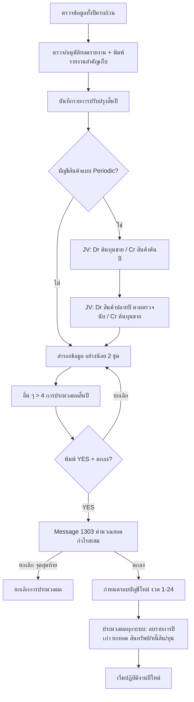

# บทที่ 22 ประมวลผลสิ้นปี
> อ้างอิงคู่มือ หน้า 351–354 (PDF p.367–370)

## ภาพรวม
- เมื่อครบรอบบัญชี (ปกติ 1 ม.ค. – 31 ธ.ค.) การปิดประมวลผลสิ้นปีจะหาผลการดำเนินงานและฐานะการเงินของปีที่ผ่านมา (หน้า 351)
- ลบรายการประจำวันของปีที่ผ่านมา (บิลซื้อ บิลขาย รายการในสมุดรายวัน) โดยยกไปเฉพาะยอดคงเหลือของ **สินทรัพย์ หนี้สิน และส่วนของเจ้าของ (ทุน)** ไปปีถัดไป ทำให้โปรแกรมทำงานเร็วขึ้น (หน้า 351)
- โปรแกรมคำนวณยอดกำไรสะสม (หน้า 353) และเลื่อนรอบบัญชีอัตโนมัติ (หน้า 354)
- ปิดประมวลผลทุกระบบ: ลูกหนี้ เจ้าหนี้ สินค้า และระบบอื่น ๆ (หน้า 354)

## หน้าจอ

### S-YE-01 สมุดรายวันทั่วไป (JV) — ปิดบัญชีสินค้าคงเหลือ (กรณี Periodic)
- เมนู: บัญชี > 1 ลงประจำวัน > สมุดรายวันทั่วไป [สันนิษฐาน]
- อ้างอิง: หน้า 351–353 (PDF p.367–369) — มีภาพหน้าจอ: ใช่ (รูปที่ 1, 2)
- ลักษณะ: header + แท็บ + ตารางรายการ + footer (หน้าจอเดียวกับบทที่ 18 S-ME-01)

| ส่วน/แท็บ | ฟิลด์ | ชนิดข้อมูล | บังคับ | ค่าเริ่มต้น/อ้างอิงจาก | คำอธิบาย/เงื่อนไข |
|---|---|---|---|---|---|
| Header | เลขที่ใบสำคัญ | text + lookup | ใช่ [สันนิษฐาน] | JV5123101 / JV5123102 | |
| Header | วันที่ | date | ใช่ [สันนิษฐาน] | 31/12/48 (วันสิ้นปี) | |
| Header | รายละเอียด | text + lookup | ไม่ | "ปิดบัญชีสินค้าคงเหลือต้นปี" / "ปิดบัญชีสินค้าคงเหลือปลายปี ยกไปปีหน้า" | |
| รายการที่เดบิท/เครดิต <Alt+E> | เลขที่บัญชี, แผนก, คำอธิบาย, เดบิท, เครดิต | lookup / lookup / text / money / money | | | |
| Footer | รวม | money | - | | |

กฎทางธุรกิจ/เงื่อนไข:
- ทำเฉพาะเมื่อเลือกวิธีบันทึกบัญชีสินค้าแบบ **Periodic** (หน้า 351)
- ยอดสินค้าต้นปีหาจากแยกประเภท (ระบบ Periodic บัญชีสินค้าไม่เคลื่อนไหวทั้งปี ยอดในแยกประเภทจึงเป็นยอดต้นปีเสมอ); ยอดปลายปีได้จากการตรวจนับ ณ วันสิ้นปี (หน้า 351, 353)
ผลทางบัญชี/สต๊อก (ตัวอย่างในภาพ):
- รายการที่ 1 ปิดสินค้าต้นปีเข้าต้นทุนขาย: Dr 5110-00 ต้นทุนสินค้าเพื่อขาย 10,000.00 / Cr 1140-02 สินค้าสำเร็จรูปคงเหลือ 10,000.00
- รายการที่ 2 ยกสินค้าปลายปี: Dr 1140-02 สินค้าสำเร็จรูปคงเหลือ 15,000.00 / Cr 5110-00 ต้นทุนสินค้าเพื่อขาย 15,000.00

### S-YE-02 ปิดประมวลผลสิ้นปี (ยืนยัน)
- เมนู: อื่น ๆ > 4 การประมวลผลสิ้นปี (ภาพเมนูหน้า 328/330; หน้า 353 เขียน "เมนูประมวลผลสิ้นปี")
- อ้างอิง: หน้า 353 (PDF p.369) — มีภาพหน้าจอ: ใช่ (รูปที่ 3)
- ลักษณะ: dialog คำเตือน + ช่องยืนยัน

| ส่วน/แท็บ | ฟิลด์ | ชนิดข้อมูล | บังคับ | ค่าเริ่มต้น/อ้างอิงจาก | คำอธิบาย/เงื่อนไข |
|---|---|---|---|---|---|
| คำเตือน | "*** คำเตือน *** คุณจะต้องสำรองข้อมูลเก็บไว้ ก่อนทำการประมวลผลสิ้นปี เพราะถ้ามีปัญหาเกิดขึ้นระหว่างการประมวลผล ก็สามารถนำข้อมูลก่อนประมวลผลกลับคืนมาประมวลใหม่ได้ ถ้าคุณยังไม่ได้สำรองข้อมูลไว้ ให้กด <ยกเลิก> เพื่อกลับไปสำรองข้อมูลก่อน" | text | - | | |
| ยืนยัน | ถ้าทำแล้ว ให้ป้อน YES เพื่อยืนยันให้ประมวลผลสิ้นปี | text | ใช่ | | ต้องพิมพ์ "YES" |

ปุ่ม/คำสั่ง: ตกลง, ยกเลิก

### S-YE-03 ยืนยันคำนวณยอดกำไรสะสม (Message# 1303)
- เมนู: แสดงหลัง S-YE-02
- อ้างอิง: หน้า 353 (PDF p.369) — มีภาพหน้าจอ: ใช่ (รูปที่ 4)
- ลักษณะ: dialog คำถาม

| ส่วน/แท็บ | ฟิลด์ | ชนิดข้อมูล | บังคับ | ค่าเริ่มต้น/อ้างอิงจาก | คำอธิบาย/เงื่อนไข |
|---|---|---|---|---|---|
| Message | "โปรแกรมจะทำการคำนวณยอดกำไรสะสม" | text | - | | Message# 1303 |

ปุ่ม/คำสั่ง: ตกลง, ยกเลิก
กฎทางธุรกิจ/เงื่อนไข: เป็น **ขั้นตอนสุดท้ายที่ยกเลิกการประมวลผลได้** (หน้า 353)
ผลทางบัญชี/สต๊อก: คำนวณยอดกำไรสะสม [สันนิษฐาน: ปิดบัญชีรายได้/ค่าใช้จ่ายเข้ากำไรสะสม — คู่มือไม่แสดงรายการบัญชี]

### S-YE-04 กำหนดรอบบัญชีใหม่
- เมนู: แสดงอัตโนมัติหลังตอบตกลงใน S-YE-03
- อ้างอิง: หน้า 354 (PDF p.370) — มีภาพหน้าจอ: ใช่ (รูปที่ 5)
- ลักษณะ: dialog + ตาราง 2 กลุ่ม (รอบบัญชีปีใหม่ งวด 1–12 / รอบบัญชีปีถัดไป งวด 13–24)

| ส่วน/แท็บ | ฟิลด์ | ชนิดข้อมูล | บังคับ | ค่าเริ่มต้น/อ้างอิงจาก | คำอธิบาย/เงื่อนไข |
|---|---|---|---|---|---|
| Header | รอบบัญชีปีที่จะปิด (จาก – ถึง) | date ×2 | - | 01/01/2556 – 31/12/2556 | แสดงรอบที่จะปิด |
| Header | รอบบัญชีปีใหม่เริ่มวันที่ | date | ใช่ | 01/01/2557 | |
| รอบบัญชีปีใหม่ | งวด (1–12) | number (แสดงอย่างเดียว) | - | | |
| รอบบัญชีปีใหม่ | วันสิ้นงวด | date (แก้ได้ [สันนิษฐาน]) | ใช่ | คำนวณอัตโนมัติสิ้นเดือน | |
| รอบบัญชีปีถัดไป | งวด (13–24) | number (แสดงอย่างเดียว) | - | | |
| รอบบัญชีปีถัดไป | วันสิ้นงวด | date | ใช่ | คำนวณอัตโนมัติ | หมายเหตุ: วันสิ้นงวดที่ 24 สามารถกำหนดให้เลยไปได้ไม่จำกัด |

ปุ่ม/คำสั่ง: ตกลง (บันทึกและเริ่มประมวลผล), ยกเลิก
กฎทางธุรกิจ/เงื่อนไข:
- ระยะเวลาประมวลผลขึ้นกับจำนวนรายการ; เสร็จแล้วกลับมาที่เมนูประมวลผลสิ้นปี และเริ่มปฏิบัติงานปีถัดไปได้ทันที (หน้า 354)
- ระบบเก็บข้อมูล 2 ปีต่อเนื่อง (งวด 1–24); หลังปิดปี ปีใหม่กลายเป็นงวด 1–12 และเพิ่มปีถัดไปเป็นงวด 13–24
ผลทางบัญชี/สต๊อก:
- ลบรายการประจำวันของปีที่ปิด (บิลซื้อ บิลขาย สมุดรายวัน)
- ยกยอดคงเหลือ สินทรัพย์ หนี้สิน ทุน ไปเป็นยอดยกมาปีใหม่
- ปิดประมวลผลระบบลูกหนี้ เจ้าหนี้ สินค้า และระบบอื่น ๆ (ยกยอดค้าง/ยอดคงเหลือ [สันนิษฐาน])

## ลำดับการใช้งาน
ก่อนปิดประมวลผล (หน้า 351):
1. ตรวจว่าข้อมูลทั้งปีป้อนครบถ้วน
2. ยอดในรายงาน (เจ้าหนี้-ลูกหนี้คงเหลือ, สินค้าคงเหลือ, งบการเงิน) ถูกต้องและได้รับอนุมัติ; พิมพ์รายงานสำคัญเก็บไว้ (สินค้าและวัตถุดิบ, งบดุล-งบกำไรขาดทุน, สถานะลูกหนี้-เจ้าหนี้)
3. บันทึกรายการปรับปรุงในสมุดรายวัน (ค่าใช้จ่ายค้างจ่าย, รายได้ค้างรับ, ตั้งภาษีเงินได้นิติบุคคลค้างจ่าย ฯลฯ)
4. (Periodic เท่านั้น) บันทึก JV ปิดสินค้าต้นปี และยกสินค้าปลายปี
5. สำรองข้อมูลอย่างน้อย 2 ชุด
ปิดประมวลผล (หน้า 353–354):
6. อื่น ๆ > 4 การประมวลผลสิ้นปี → พิมพ์ YES → ตกลง
7. Message 1303 คำนวณกำไรสะสม → ตกลง (จุดสุดท้ายที่ยกเลิกได้)
8. ตรวจ/แก้รอบบัญชีใหม่ → ตกลง
9. โปรแกรมปิดประมวลผลทุกระบบ → เริ่มปีใหม่

## ข้อมูลที่เกี่ยวข้อง
- AccountingCycle/FiscalYear (วันที่เริ่ม, วันที่สิ้นสุด) 1:n FiscalPeriod (งวด 1–24, วันสิ้นงวด, ล็อค — ดูบทที่ 18)
- ChartOfAccount (ประเภท: สินทรัพย์/หนี้สิน/ทุน ยกยอด; รายได้/ค่าใช้จ่าย ปิดเข้ากำไรสะสม) — ต้องกำหนดบัญชีกำไรสะสม [สันนิษฐาน]
- AccountBalance (ยอดยกมาปีใหม่)
- ทุก transaction ของปีที่ปิด (ซื้อ ขาย สมุดรายวัน) → ถูกลบ (purge)
- Subledger opening balances: ลูกหนี้, เจ้าหนี้, สินค้า (ยอดยกมารวม/คลัง/ล็อต — ดูบทที่ 21)
- Config: วิธีบันทึกบัญชีสินค้า (Perpetual/Periodic)

## ข้อสังเกต
- ภาพรูปที่ 5 แสดงวันสิ้นงวด 12 เป็น 31/12/2558 (น่าจะเป็นความผิดพลาดในภาพ ควรเป็น 31/12/2557) และงวด 13–24 เป็นปี 2559 (ข้ามปี 2558) — ตัวอย่างในภาพไม่สอดคล้อง
- คู่มือไม่แสดงรายการบัญชีปิดรายได้/ค่าใช้จ่ายเข้ากำไรสะสม และไม่ระบุบัญชีกำไรสะสมที่ใช้
- คู่มือไม่ระบุว่าเอกสารค้างชำระ (ลูกหนี้/เจ้าหนี้คงค้างรายบิล) ถูกยกไปอย่างไรหลังลบรายการ
- การลบรายการปีเก่าทำให้ย้อนดูรายละเอียดปีก่อนไม่ได้ (ต้องใช้ข้อมูลสำรอง) — สำหรับ ERP ใหม่ควรพิจารณาเก็บประวัติแทนการ purge
- ภาพตัวอย่างเป็นคนละชุดปี (JV ปี 48 / รอบบัญชี 2556–2557)
