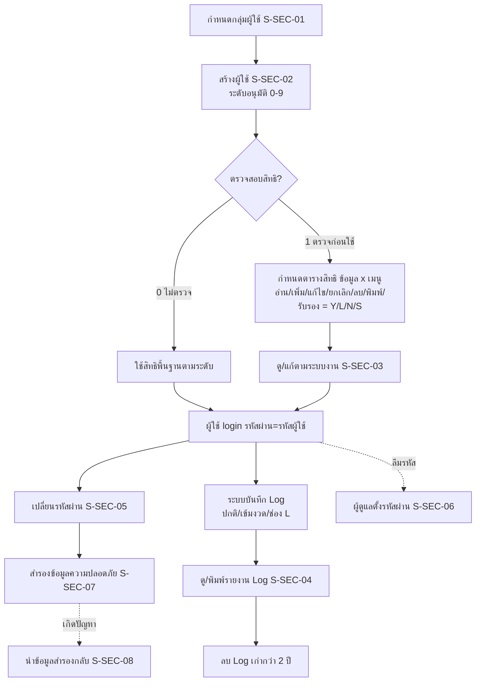

# บทที่ 23 การกำหนดระบบรักษาความปลอดภัย
> อ้างอิงคู่มือ หน้า 355–374 (PDF p.371–390)

## ภาพรวม
- ระบบความปลอดภัยใช้กำหนดสิทธิการใช้งานของผู้ใช้แต่ละคน ว่าเห็นข้อมูลบริษัทใดบ้าง (กรณีมีหลายบริษัท) และใช้เมนูใดได้บ้าง (หน้า 355)
- กำหนดสิทธิได้ 3 มุมมอง: ตามกลุ่มผู้ใช้ (แผนก), รายบุคคล, และตามระบบงาน/เมนู (หน้า 356, 361, 365–366)
- มี "ระดับอนุมัติ" (0–9) เป็นสิทธิพื้นฐานที่โปรแกรมกำหนดไว้ล่วงหน้าแก้ไม่ได้ และมีตารางสิทธิรายเมนู (อ่าน/เพิ่ม/แก้ไข/ยกเลิก/ลบ/พิมพ์/รับรอง) ซ้อนทับ (หน้า 359–360, 364)
- มีแฟ้มบันทึกเหตุการณ์ทำงาน (Log File / Audit Trail) พร้อมรายงานที่กรมสรรพากรกำหนดให้มี (หน้า 367–369)
- มีการเปลี่ยนรหัสผ่าน, ตั้งรหัสผ่านใหม่ (กรณีลืม), สำรอง/นำกลับข้อมูลระบบความปลอดภัย (หน้า 370–374)

เมนูหลัก (รูปที่ 1 หน้า 356 และรูปที่ 16 หน้า 372): **อื่น ๆ > 3. ระบบความปลอดภัย** มีเมนูย่อย
1. กลุ่มผู้ใช้งานระบบ 2. แฟ้มผู้ใช้งานระบบ 3. ระบบงานที่อนุญาตให้ใช้ 4. แฟ้มบันทึกเหตุการณ์ทำงาน 5. สำรองข้อมูลผู้ใช้งาน 6. นำข้อมูลที่สำรองไว้ ลงระบบผู้ใช้
และ **อื่น ๆ > 2. เปลี่ยนรหัสผ่าน**

ผู้ใช้ตั้งต้นของระบบ: BIT1 (ระดับพนักงาน), BIT5 (ระดับหัวหน้าแผนก), BIT9 (ผู้จัดการระบบ) (หน้า 358)

---

## หน้าจอ

### S-SEC-01 กลุ่มผู้ใช้งานระบบ
- เมนู: อื่น ๆ > 3. ระบบความปลอดภัย > 1. กลุ่มผู้ใช้งานระบบ (เรียกดูรายการกลุ่มทั้งหมดด้วย <Ctrl+L>)
- อ้างอิง: หน้า 356–357, 365 (PDF p.372–373, 381) — มีภาพหน้าจอ: ใช่ (รูปที่ 2, รูปที่ 9)
- ลักษณะ: form header (รหัสกลุ่ม/ชื่อกลุ่ม) + 2 แท็บ ตารางล่าง; มีหน้าต่างค้นหา/ลิสต์กลุ่ม (ปุ่ม ตกลง/ยกเลิก/ค้นหา)

| ส่วน/แท็บ | ฟิลด์ | ชนิดข้อมูล | บังคับ | ค่าเริ่มต้น/อ้างอิงจาก | คำอธิบาย/เงื่อนไข |
|---|---|---|---|---|---|
| Header | รหัสกลุ่ม | text [สันนิษฐาน ≤8 ตัวอักษร] | ใช่ [สันนิษฐาน] | ตัวอย่าง `********` | `********` = บุคคลทั่วไป |
| Header | ชื่อกลุ่ม | text | ใช่ [สันนิษฐาน] | | เช่น บุคคลทั่วไป, แผนกการเงิน |
| แท็บ "ข้อมูล และเมนูที่อนุญาตให้กลุ่มนี้ใช้ <F8>" | ข้อมูล | lookup | | ข้อมูลบริษัท (รหัสข้อมูล) | ว่าง = ไม่เจาะจงบริษัท; ตัวอย่าง DATAT |
| 〃 | เมนู | lookup | | รหัสเมนู/ระบบงาน | ตัวอย่าง ออกระบบ, อื่นๆ8, ทุกระบบ |
| 〃 | ชื่อเมนู | text (แสดง) | | จากเมนู | ตัวอย่าง เปลี่ยนบริษัท, ทุกระบบงาน |
| 〃 | เมนูย่อย [สันนิษฐาน] | text | | | |
| 〃 | อ่าน / เพิ่ม / แก้ไข / ยกเลิก / ลบ / พิมพ์ / รับรอง | select (Y/L/N/S) | | | ตัวอย่างแถว: Y Y Y Y Y Y N (รูปที่ 9) |
| แท็บ "ผู้ใช้ที่อยู่ในกลุ่มนี้ <F7>" | รายชื่อผู้ใช้ | list [สันนิษฐาน] | | แฟ้มผู้ใช้ | แสดงผู้ใช้ที่สังกัดกลุ่ม |

กลุ่มตั้งต้น (รูปที่ 2): `********` บุคคลทั่วไป, ผ-ก/ง แผนกการเงิน, ผ-ซื้อ แผนกซื้อ, ผ-บัญชี แผนกบัญชี, ผ-สโตร์ แผนกสโตร์

ปุ่ม/คำสั่ง: แถบเครื่องมือมาตรฐาน — เพิ่ม, แก้ไข, ลบ, ยกเลิก, บันทึก, ไปแรก/ก่อนหน้า/ถัดไป/สุดท้าย, ค้นหา, พิมพ์; หน้าต่างลิสต์: ตกลง, ยกเลิก, ค้นหา
กฎทางธุรกิจ/เงื่อนไข:
- ผู้ใช้ในกลุ่มเดียวกันได้สิทธิเท่ากัน; พนักงานใหม่เพียงระบุกลุ่มก็ได้สิทธิตามกลุ่มทันที (หน้า 356, 365)
- ผู้ใช้สามารถแก้ไข/เพิ่มกลุ่มให้ตรงกับแผนกจริงได้ (หน้า 356)
ผลทางบัญชี/สต๊อก: ไม่มี

### S-SEC-02 แฟ้มผู้ใช้งานระบบ
- เมนู: อื่น ๆ > 3. ระบบความปลอดภัย > 2. แฟ้มผู้ใช้งานระบบ (เพิ่มด้วยไอคอนเพิ่มข้อมูล หรือ <Alt+A>)
- อ้างอิง: หน้า 357–364, 371 (PDF p.373–380, 387) — มีภาพหน้าจอ: ใช่ (รูปที่ 3, 4, 5, 6, 7, 8)
- ลักษณะ: form header + 2 แท็บตารางสิทธิ; ในตารางมี lookup แบบหน้าต่างลิสต์ (ตกลง/ยกเลิก/ค้นหา)

| ส่วน/แท็บ | ฟิลด์ | ชนิดข้อมูล | บังคับ | ค่าเริ่มต้น/อ้างอิงจาก | คำอธิบาย/เงื่อนไข |
|---|---|---|---|---|---|
| Header | รหัสผู้ใช้ | text (≤8 ตัวอักษร) | ใช่ | | ภาษาอังกฤษหรือตัวเลข ไม่แนะนำอักษรไทย เช่น SOMCHAI (หน้า 359) |
| Header | (ชื่อผู้ใช้ — ช่องข้างรหัส) | text | [สันนิษฐาน] | | ตัวอย่าง "รหัสประจำตัวผู้ใช้ ระดับ 9.", "SOMCHAI" (ป้ายชื่อช่องไม่ปรากฏ) |
| Header | กลุ่มของผู้ใช้ | lookup | | กลุ่มผู้ใช้งานระบบ | แสดงชื่อกลุ่มข้างช่อง; `********` = บุคคลทั่วไป (ไม่แบ่งตามแผนก) |
| Header | ระดับอนุมัติ | number (0–9) | ใช่ [สันนิษฐาน] | | คำอธิบายบนจอ: [0=พนักงาน 5=หัวหน้าแผนก 9=ผู้จัดการระบบ] |
| Header | ตรวจสอบสิทธิ | select | | | ตัวเลือก: "ไม่ตรวจสอบสิทธิ" (0), "ตรวจสอบสิทธิก่อนใช้งาน" (1) |
| Header | สถานะผู้ใช้ | select | | ปกติ | ตัวเลือก: ห้ามใช้ / ตรวจสอบเข้มงวด / ปกติ; เว้นว่างได้ (หน้า 361) |
| Header | เครื่องพิมพ์ | lookup | | เมนูเริ่มระบบ ข้อ 6.2 กำหนดรหัสเครื่องพิมพ์ | ตัวอย่าง X = EPSON1170 |
| Header | เมนูเป็นภาษา | select [สันนิษฐาน] | | | มีเฉพาะ Express เวอร์ชั่นภาษาอังกฤษ (ไม่ปรากฏในภาพ) — เลือกเมนูไทย/อังกฤษรายผู้ใช้ |
| Header | วันที่ใช้ล่าสุด | date + time (อ่านอย่างเดียว) | | ระบบบันทึก | ตัวอย่าง 21/03/48 17:05:23 |
| แท็บ "ข้อมูล และเมนูที่อนุญาตให้ผู้ใช้รายนี้ <F8>" | ข้อมูล | lookup | | รหัสข้อมูลบริษัท (เริ่มระบบ ข้อ 8 กำหนดบริษัทใหม่) | ว่าง = ทุกบริษัท; รหัสข้อมูลซ้ำกันได้หลายบริษัท (เช่น DATAZ 2 บริษัท) เลือกแล้วมีผลทั้งหมด |
| 〃 | เมนู | lookup | | รายการเมนู/ระบบงาน | รหัสย่อ เช่น ก/ง1 = การเงิน ข้อ 1 รับเงิน, เริ่ม1 = เริ่มระบบ ข้อ 1; มีเมนูพิเศษ "ทุกระบบ" |
| 〃 | ชื่อเมนู | text (แสดง) | | จากเมนู | เช่น รับเงิน |
| 〃 | เมนูย่อย | text | | | ใช้กรณีเพิ่มเมนูย่อยเอง คู่มือให้กด <Enter> ผ่านไป |
| 〃 | อ่าน, เพิ่ม, แก้ไข, ยกเลิก, ลบ, พิมพ์, รับรอง | select Y/L/N/S | | | Y=ใช้ได้, L=ใช้ได้+บันทึกเหตุการณ์, N=ไม่ให้ใช้, S=(เฉพาะช่องพิมพ์) พิมพ์ออกจอเท่านั้น |
| แท็บ "ข้อมูล และเมนูที่อนุญาตให้กลุ่มของผู้ใช้ <F7>" | (ตารางเดียวกัน) | | | จากกลุ่มของผู้ใช้ | แสดงสิทธิที่ได้จากกลุ่ม [สันนิษฐาน: อ่านอย่างเดียว] |

ตัวอย่างข้อมูล (รูปที่ 8): DATAZ | ก/ง1 | รับเงิน | (ว่าง) | Y Y Y N N Y N
หน้าต่างลิสต์เมนู (รูปที่ 7) คอลัมน์: เมนู, ชื่อเมนู — ตัวอย่าง ก/ง การเงิน, ก/ง1 รับเงิน, ก/ง11 ใบวางบิล, ก/ง12 บันทึกวันนัดรับชำระเงิน, ก/ง13 ใบเพิ่มหนี้ (ลูกหนี้), ก/ง14 ใบลดหนี้/รับคืนสินค้า
หน้าต่างลิสต์ข้อมูล (รูปที่ 6) คอลัมน์: รหัสข้อมูล, ชื่อบริษัท, โฟลเดอร์ [สันนิษฐาน] — DATAT 9.ข้อมูลทดสอบเวอร์ชั่น 5 (TEST); DATAZ Z.ข้อมูลเปล่าของเวอร์ชั่น 5 (DAT)

ปุ่ม/คำสั่ง: เพิ่ม (<Alt+A>), แก้ไข, ลบ, ยกเลิก, บันทึก, เลื่อนระเบียน, ค้นหา, พิมพ์; คำสั่ง "ตั้งรหัสผ่าน" (รีเซ็ตรหัสผ่านเท่ากับรหัสผู้ใช้ หน้า 371); <F8>/<F7> สลับแท็บ
กฎทางธุรกิจ/เงื่อนไข:
- ระดับอนุมัติ (หน้า 359–360):
  - 0–4 พนักงาน: เพิ่ม/แก้ไขได้เท่านั้น ยกเลิก/ลบไม่ได้, ไม่มีสิทธิกำหนดค่าโปรแกรม (กำหนดค่าเริ่มต้น, รอบบัญชี)
  - 5–8 หัวหน้าแผนก: ยกเลิกเอกสารได้, กำหนดค่าเริ่มต้น/รอบบัญชี/เปิดแฟ้มข้อมูลใหม่ได้ แต่เข้าเมนูกำหนดระบบความปลอดภัยและแก้ไขแบบฟอร์มไม่ได้
  - 9 ผู้จัดการระบบ: ทำได้ทุกอย่าง
  - สิทธิพื้นฐานตามระดับแก้ไขไม่ได้ ถ้าต้องการให้ยกเลิกได้ต้องเลื่อนเป็นระดับ 5 ซึ่งได้สิทธิอื่นเพิ่มด้วย จึงต้องจำกัดด้วยตารางสิทธิรายเมนูอีกชั้น
  - เมื่อเข้าเมนูที่ต้องใช้ระดับสูงกว่า โปรแกรมจะแสดงหน้าจอให้ป้อนรหัสผู้อนุมัติตามระดับที่ต้องการ (หน้า 360 หมายเหตุ)
- ตรวจสอบสิทธิ = 0: ทุกคนได้สิทธิพื้นฐานตามระดับ; = 1: ตรวจตารางสิทธิเพิ่มก่อนใช้งาน (หน้า 360)
- สถานะผู้ใช้: ห้ามใช้ = ระงับรหัส (เช่นลาพัก); ตรวจสอบเข้มงวด = บันทึก Log ทุกการทำงาน (ระวังแฟ้มโต); ปกติ = ตรวจสอบตามปกติ; ถ้าต้องการ log เฉพาะบางเรื่องให้เว้นว่างและใช้ค่า L ในตารางสิทธิ (หน้า 360–361)
- ผู้ใช้ใหม่: รหัสผ่านเริ่มต้น = รหัสผู้ใช้ ผู้ใช้ต้องเปลี่ยนเอง (หน้า 361, 370)
- รหัสเมนูดูได้จากมุมขวาล่างของหน้าจอหลัก (ช่อง "รหัสเมนู") เช่น ขายเงินเชื่อ = "ขาย4" (หน้า 363)
ผลทางบัญชี/สต๊อก: ไม่มี

### S-SEC-03 ระบบงานที่อนุญาตให้ใช้
- เมนู: อื่น ๆ > 3. ระบบความปลอดภัย > 3. ระบบงานที่อนุญาตให้ใช้ (กด <Page Down> ไปยังเมนูที่ต้องการ)
- อ้างอิง: หน้า 365–366 (PDF p.381–382) — มีภาพหน้าจอ: ใช่ (รูปที่ 10)
- ลักษณะ: form header (เมนู) + ตาราง 1 แท็บ; แถบเครื่องมือไม่มีปุ่มเพิ่ม/ลบ (มีแก้ไข ยกเลิก บันทึก เลื่อนระเบียน ค้นหา พิมพ์) — เมนูเป็นรายการของระบบ

| ส่วน/แท็บ | ฟิลด์ | ชนิดข้อมูล | บังคับ | ค่าเริ่มต้น/อ้างอิงจาก | คำอธิบาย/เงื่อนไข |
|---|---|---|---|---|---|
| Header | เมนู | text (อ่านอย่างเดียว) [สันนิษฐาน] | | รายการเมนูของระบบ | เช่น ก/ง |
| Header | ชื่อเมนู | text | | | เช่น การเงิน |
| แท็บ "ผู้ใช้หรือกลุ่มของผู้ใช้ ที่อนุญาตให้เล่นเมนูนี้ได้ <F8>" | ผู้ใช้/กลุ่ม | lookup | | แฟ้มผู้ใช้/กลุ่ม | เช่น SOMCHAI |
| 〃 | ชื่อ | text (แสดง) | | | |
| 〃 | ข้อมูล | lookup | | รหัสข้อมูลบริษัท | เช่น DATAZ |
| 〃 | เมนูย่อย [สันนิษฐาน] | text | | | |
| 〃 | อ่าน…รับรอง (7 ช่อง) | select Y/L/N/S | | | ตัวอย่าง Y Y Y N N Y N |

กฎทางธุรกิจ/เงื่อนไข: เป็นมุมมองกลับด้านของตารางสิทธิเดียวกัน — ข้อมูลที่ป้อนในแฟ้มผู้ใช้จะปรากฏที่นี่ด้วย (หน้า 365–366)
ผลทางบัญชี/สต๊อก: ไม่มี

### S-SEC-04 แฟ้มบันทึกเหตุการณ์ทำงาน (Log File)
- เมนู: อื่น ๆ > 3. ระบบความปลอดภัย > 4. แฟ้มบันทึกเหตุการณ์ทำงาน
- อ้างอิง: หน้า 367–369 (PDF p.383–385) — มีภาพหน้าจอ: ใช่ (รูปที่ 11, 12, 13, 14)
- ลักษณะ: list (ตารางอ่านอย่างเดียว) + แถบเครื่องมือ (ลบ, เลื่อนระเบียน, พิมพ์ dropdown)

| ส่วน/แท็บ | ฟิลด์ (ชื่อฟิลด์) | ชนิดข้อมูล | บังคับ | ค่าเริ่มต้น/อ้างอิงจาก | คำอธิบาย/เงื่อนไข |
|---|---|---|---|---|---|
| Grid | วันที่ (TRNDATE) | date | | ระบบ | ตัวอย่าง 28/01/48 |
| Grid | เวลา (TRNTIME) | text hh:mm | | ระบบ | |
| Grid | รหัส (TRNCODE) | text 2 หลัก | | ระบบ | รหัสประเภทเหตุการณ์ เช่น 00, 30–36 (ความหมายแต่ละรหัสคู่มือไม่ระบุ) |
| Grid | ผู้ใช้ (USERID) | text | | ผู้ใช้ที่ทำรายการ | |
| Grid | ผู้อนุมัติ (AUTHID) | text | | | ผู้อนุมัติ (กรณีต้องใช้รหัสผู้อนุมัติ) |
| Grid | ข้อมูล (DATA) | text | | | รหัสข้อมูลบริษัท เช่น TEST |
| Grid | ระบบ (MODULE) | text | | | รหัสเมนู เช่น 'ขาย4', เริ่ม8 |
| Grid | เอกสาร (DOCNUM) | text | | | เลขที่เอกสาร เช่น 'IV' |
| Grid | คำอธิบาย [สันนิษฐาน] | text | | | ภาพแสดงคำว่า เปลี่ยน/ก๊อบ/สร้าง/ลบที่ |

คำสั่งพิมพ์ (dropdown ไอคอนพิมพ์ รูปที่ 12):
1. พิมพ์รายงานบันทึกการทำงานทั้งหมด <Alt+P>
2. พิมพ์รายงานการแก้ไขปรับปรุงรายการ (Audit Trail) <Alt+2>
3. พิมพ์รายงานบันทึกการใช้รหัสผ่าน (Password) <Alt+3>
4. พิมพ์รายงานการดึงข้อมูลสำรองมาใช้ (Decrypting) <Alt+4>
5. พิมพ์รายงานบันทึกการทำงานโดยกำหนดเงื่อนไข <Alt+5> → หน้าต่าง "เรียกดูข้อมูล โดยป้อนเงื่อนไข" ช่อง "นิพจน์เงื่อนไข" (เช่น `USERID='SOMCHAI'`); รองรับ .AND. .OR.; ดูค่าเงื่อนไขด้วย <F1>

ตัวอย่างนิพจน์ (หน้า 369): `DTOS(TRNDATE) >= '20001201' .AND. DTOS(TRNDATE) <= '20001231'`, `TRNTIME >= '10:00'`, `TRNCODE='00'`, `USERID='SOMCHAI'`, `AUTHID='BIT9'`, `DATA='TEST'`, `MODULE='ขาย4'`, `DOCNUM='IV'`

ปุ่ม/คำสั่ง: ลบ (= "ลบรายการในแฟ้มบันทึกเหตุการณ์ทำงาน"), ไปแรก/ก่อนหน้า/ถัดไป/สุดท้าย, พิมพ์ (5 แบบ), ค้นหาข้อมูลทางจอภาพโดยกำหนดเงื่อนไข
กฎทางธุรกิจ/เงื่อนไข:
- บันทึกโดยปริยาย (v1.5): เข้า/ออกโปรแกรม (LOG IN/LOG OUT), ดึงข้อมูลสำรองมาใช้, เปลี่ยนบริษัท, ป้อนรหัสผ่านผิด, แก้ไขข้อมูลที่ผ่านบัญชีแล้ว (หน้า 367)
- บันทึกเพิ่ม 2 วิธี: สถานะผู้ใช้ = ตรวจสอบเข้มงวด (ทุกอย่าง) หรือใส่ 'L' ในช่องสิทธิที่ต้องการ (หน้า 367)
- บันทึกเรียงตามวันเวลา ไม่แยกผู้ใช้ (หน้า 368)
- รายงาน 4 รายการแรกเป็นรายงานที่กรมสรรพากรบังคับให้มีไว้เรียกดูเมื่อมีการตรวจสอบ (หน้า 368)
- การลบ log: ยืนยันข้อความ "...ลบรายการในแฟ้มบันทึกเหตุการณ์ก่อนวันที่ 01/01/45 (กรมสรรพากรกำหนดให้เก็บไว้อย่างน้อย 2 ปี)" — ลบได้เฉพาะรายการเก่ากว่า 2 ปี [สันนิษฐานจากข้อความ] (หน้า 369)
ผลทางบัญชี/สต๊อก: ไม่มี

### S-SEC-05 เปลี่ยนรหัสผ่าน
- เมนู: อื่น ๆ > 2. เปลี่ยนรหัสผ่าน
- อ้างอิง: หน้า 370 (PDF p.386) — มีภาพหน้าจอ: ใช่ (รูปที่ 15)
- ลักษณะ: dialog

| ส่วน/แท็บ | ฟิลด์ | ชนิดข้อมูล | บังคับ | ค่าเริ่มต้น/อ้างอิงจาก | คำอธิบาย/เงื่อนไข |
|---|---|---|---|---|---|
| - | รหัสผู้ใช้ | text (อ่านอย่างเดียว) | | ผู้ใช้ที่ login | |
| - | รหัสผ่านเดิม | password | ใช่ | | แสดงเป็น * |
| - | รหัสผ่านใหม่ | password | ใช่ | | ภาษาอังกฤษหรือตัวเลข คาดเดายาก |
| - | ป้อนอีกครั้ง | password | ใช่ | | ต้องเหมือนรหัสผ่านใหม่ |

ปุ่ม/คำสั่ง: ตกลง, ยกเลิก
กฎทางธุรกิจ/เงื่อนไข: การเปลี่ยนรหัสผ่านไม่กระทบข้อมูลในโปรแกรม; ผู้ใช้ระดับสูงสุดยังตรวจสอบการใช้งานได้ตามปกติ (หน้า 370)

### S-SEC-06 ตั้งรหัสผ่าน (กรณีลืมรหัสผ่าน)
- เมนู: อื่น ๆ > 3.2 แฟ้มผู้ใช้งานระบบ > เลือกผู้ใช้ > เมนู "ตั้งรหัสผ่าน"
- อ้างอิง: หน้า 371 (PDF p.387) — มีภาพหน้าจอ: ไม่
- ลักษณะ: คำสั่งในหน้าจอแฟ้มผู้ใช้ (ไม่มีฟิลด์)
กฎทางธุรกิจ/เงื่อนไข:
- ผู้ดูแลระบบตั้งรหัสผ่านใหม่ให้ผู้ใช้อื่น โดยค่าใหม่ = รหัสผู้ใช้
- ถ้าผู้ดูแลระบบ (ระดับ 9) ลืมรหัสเอง จะเข้าเมนูความปลอดภัยไม่ได้ ต้องติดต่อผู้ผลิต; แนะนำสร้างรหัสสำรองระดับ 9 ไว้ 1 รหัส เปลี่ยนรหัสผ่าน และเก็บเป็นความลับ

### S-SEC-07 สำรองข้อมูลผู้ใช้งาน
- เมนู: อื่น ๆ > 3. ระบบความปลอดภัย > 5. สำรองข้อมูลผู้ใช้งาน
- อ้างอิง: หน้า 371–373 (PDF p.387–389) — มีภาพหน้าจอ: ใช่ (รูปที่ 16, 17)
- ลักษณะ: dialog

| ส่วน/แท็บ | ฟิลด์ | ชนิดข้อมูล | บังคับ | ค่าเริ่มต้น/อ้างอิงจาก | คำอธิบาย/เงื่อนไข |
|---|---|---|---|---|---|
| - | ที่เก็บต้นทาง | text (path) | | X:\Program Files\ExpressI\SECURE | |
| - | ที่เก็บปลายทาง | text (path) + ปุ่ม … + radio ไดรฟ์ | ใช่ | A:\ | |
| - | ชื่อแฟ้มข้อมูลสำรอง | text | | secure.5 | |
| - | จำนวนแผ่นที่ต้องใช้ | number (อ่านอย่างเดียว) [สันนิษฐาน] | | 1 แผ่น | |
| แฟ้มข้อมูล | รายการแฟ้ม | list | | | DBINF.DBF, ISLOG.DBF, SCACCLV.DBF, SCCOMP.DBF, SCMODUL.DBF, SCPRN.DBF, SCUSER.DBF; สรุป "7 แฟ้ม 51609 ไบท์" |

ปุ่ม/คำสั่ง: เริ่มสำรอง, ยกเลิก (+ ยืนยัน ตกลง 2 ครั้ง)
กฎทางธุรกิจ/เงื่อนไข: สำรองเฉพาะข้อมูลความปลอดภัย (แฟ้มผู้ใช้ สิทธิ) ไม่รวมข้อมูลรายการค้า; ควรสำรองทั้งก่อนและหลังกำหนดสิทธิ (หน้า 371, 373)

### S-SEC-08 นำข้อมูลที่สำรองไว้ ลงระบบผู้ใช้
- เมนู: อื่น ๆ > 3. ระบบความปลอดภัย > 6. นำข้อมูลที่สำรองไว้ ลงระบบผู้ใช้
- อ้างอิง: หน้า 373–374 (PDF p.389–390) — มีภาพหน้าจอ: ใช่ (รูปที่ 18, 19)
- ลักษณะ: dialog

| ส่วน/แท็บ | ฟิลด์ | ชนิดข้อมูล | บังคับ | ค่าเริ่มต้น/อ้างอิงจาก | คำอธิบาย/เงื่อนไข |
|---|---|---|---|---|---|
| - | แฟ้มข้อมูลสำรองผู้ใช้งาน | text (path) + ปุ่ม … | ใช่ | A:\secure.5 | |
| - | ที่เก็บข้อมูล | text (path) | | X:\PROGRAM FILES\EXPRESSI\SECURE | |
| แฟ้มข้อมูล | รายการแฟ้ม | list | | จากแฟ้มสำรอง | |

ปุ่ม/คำสั่ง: คลายข้อมูล, ยกเลิก (+ ยืนยัน ตกลง)
กฎทางธุรกิจ/เงื่อนไข: เขียนทับข้อมูลผู้ใช้ทันที; รหัสผ่านที่เปลี่ยนหลังวันสำรองจะกลับเป็นรหัสผ่านเดิม (หน้า 374); การดึงข้อมูลสำรองถูกบันทึกใน log (รายงาน Decrypting)

---

## ลำดับการใช้งาน
1. (ถ้าจัดตามแผนก) กำหนด/แก้ไขกลุ่มผู้ใช้ (S-SEC-01)
2. สร้างผู้ใช้ในแฟ้มผู้ใช้ (S-SEC-02): รหัส, กลุ่ม, ระดับอนุมัติ, ตรวจสอบสิทธิ, สถานะ, เครื่องพิมพ์
3. ถ้าตรวจสอบสิทธิ = 1 กำหนดตารางสิทธิรายข้อมูล×เมนู (รายบุคคล <F8> หรือรายกลุ่ม หรือรายระบบงาน S-SEC-03)
4. ผู้ใช้ login ด้วยรหัสผ่านเริ่มต้น (= รหัสผู้ใช้) แล้วเปลี่ยนรหัสผ่าน (S-SEC-05)
5. สำรองข้อมูลความปลอดภัย (S-SEC-07)
6. ตรวจสอบการใช้งานผ่าน Log/รายงาน (S-SEC-04); ลบ log เก่ากว่า 2 ปีได้
7. กรณีปัญหา: ตั้งรหัสผ่าน (S-SEC-06) หรือนำข้อมูลสำรองกลับ (S-SEC-08)

## ข้อมูลที่เกี่ยวข้อง
(ชื่อแฟ้มจากรูปที่ 17; การจับคู่แฟ้ม↔เนื้อหาเป็น [สันนิษฐาน])
- **UserGroup** (กลุ่มผู้ใช้): group_code, group_name → 1:n User
- **User** (SCUSER.DBF): user_code, user_name, group_code, approval_level (0–9), check_rights (0/1), status (ห้ามใช้/ตรวจสอบเข้มงวด/ปกติ), printer_code, menu_language, last_used_date, last_used_time, password (เข้ารหัส)
- **Permission** (SCACCLV.DBF [สันนิษฐาน]): subject (user หรือ group), data_code, menu_code, sub_menu, can_read, can_add, can_edit, can_cancel, can_delete, can_print, can_approve (ค่า Y/L/N/S)
- **Module/Menu** (SCMODUL.DBF): menu_code (เช่น ก/ง1, ขาย4, เริ่ม1, ทุกระบบ), menu_name
- **CompanyData** (SCCOMP.DBF): data_code, company_name, folder — data_code ใช้ร่วมได้หลายบริษัท
- **Printer** (SCPRN.DBF): printer_code, printer_name (กำหนดที่เริ่มระบบ 6.2)
- **ActivityLog** (ISLOG.DBF): TRNDATE, TRNTIME, TRNCODE, USERID, AUTHID, DATA, MODULE, DOCNUM, description
- DBINF.DBF — ไม่ทราบเนื้อหา [สันนิษฐาน: ข้อมูลฐานข้อมูล/บริษัท]

ความสัมพันธ์: UserGroup 1:n User; User/UserGroup 1:n Permission; Permission n:1 Module; Permission n:1 CompanyData; User n:1 Printer; User 1:n ActivityLog

## ข้อสังเกต
- หัวคอลัมน์ของตารางสิทธิในภาพหน้าจออ่านไม่ออก (พื้นดำ) — ลำดับคอลัมน์ ข้อมูล/เมนู/ชื่อเมนู/เมนูย่อย/อ่าน/เพิ่ม/แก้ไข/ยกเลิก/ลบ/พิมพ์/รับรอง อนุมานจากคำอธิบายหน้า 362–364 และจำนวนช่อง Y/N 7 ช่อง [สันนิษฐาน]
- หัวคอลัมน์ของตาราง Log อ่านไม่ออก ใช้ตารางชื่อฟิลด์หน้า 369 แทน; ความหมายของรหัส TRNCODE (00, 30–36) คู่มือไม่ได้อธิบาย
- คู่มือบอกว่าการสำรองข้อมูลผู้ใช้ "ยกเว้นแฟ้มบันทึกเหตุการณ์ทำงาน" (หน้า 371) แต่รายการแฟ้มในรูปที่ 17 มี ISLOG.DBF — ขัดแย้งกัน
- ลำดับความสำคัญระหว่างสิทธิรายบุคคลกับสิทธิของกลุ่ม (กรณีขัดกัน) คู่มือไม่ระบุ
- ระดับอนุมัติเป็นเกณฑ์สำหรับ "รหัสผู้อนุมัติ" (AUTHID) เมื่อทำรายการเกินสิทธิ — แนวคิดสำคัญสำหรับ ERP: override ด้วยรหัสหัวหน้าและบันทึกใน log
- ข้อกำหนดกรมสรรพากร: เก็บ log อย่างน้อย 2 ปี และต้องมีรายงาน 4 ประเภท (ทั้งหมด, Audit Trail, การใช้รหัสผ่าน, การดึงข้อมูลสำรอง) — ควรออกแบบเป็นข้อบังคับใน ERP
- เมนูภาพหน้าจอรูปที่ 1 กับรูปที่ 16 ต่างกันเล็กน้อย (รุ่นโปรแกรมต่างกัน: "8. เปลี่ยนบริษัท/9. คำสั่งพิเศษ" กับ "9. เครื่องคิดเลข/A. โอนข้อมูล")
