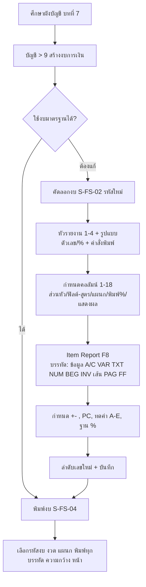

# บทที่ 24 การสร้างงบการเงิน
> อ้างอิงคู่มือ หน้า 375–394 (PDF p.391–410)

## ภาพรวม
- โปรแกรมเตรียมงบการเงินมาตรฐานไว้แล้ว ถ้าไม่เปลี่ยนผังบัญชีต้นฉบับพิมพ์ได้ทันที; ถ้าต้องการเปลี่ยนรูปแบบ หรือเปลี่ยนเลขที่บัญชี ต้องแก้ไขงบการเงินใหม่ (หน้า 375)
- เป็น "ตัวออกแบบงบการเงิน" (report writer) แบบบรรทัด: แต่ละบรรทัดมีประเภทข้อมูล (A/C, VAR, TXT, NUM, เส้น, BEG/INV, ขึ้นหน้าใหม่) + เงื่อนไขพิมพ์ + การสะสมค่าลงตัวแปร A–E และ % (หน้า 380–383)
- คอลัมน์ตัวเลขกำหนดได้ถึง 18 คอลัมน์ แต่ละคอลัมน์มีสูตร (เช่น BAL, BAL LY, (C1-C2)*100/C2) และแผนก (หน้า 379)
- รองรับการบันทึกสินค้าทั้งแบบ Perpetual และ Periodic, การคำนวณภาษีเงินได้นิติบุคคล และอัตราร้อยละเปรียบเทียบ (Common-size) (หน้า 383–392)
- ต้องเข้าใจโครงสร้างผังบัญชี (บทที่ 7) ก่อน (หน้า 375)

---

## หน้าจอ

### S-FS-01 สร้างงบการเงิน — หน้าแรก (หัวรายงานและคอลัมน์)
- เมนู: บัญชี > 9. สร้างงบการเงิน
- อ้างอิง: หน้า 376–380, 391 (PDF p.392–396, 407) — มีภาพหน้าจอ: ใช่ (รูปที่ 2, 5, 7, 19)
- ลักษณะ: header (รหัส + ชื่องบ) + แท็บ: "คอลัมน์ 1-4", "คอลัมน์ 5-12", "คอลัมน์ 13-18", "Item Report <F8>"; แท็บคอลัมน์ประกอบด้วยกล่องหัวรายงาน 4 บรรทัด, รูปแบบตัวเลข/%/คำสั่งพิมพ์ และตารางกำหนดคอลัมน์ (แถว × คอลัมน์)

| ส่วน/แท็บ | ฟิลด์ | ชนิดข้อมูล | บังคับ | ค่าเริ่มต้น/อ้างอิงจาก | คำอธิบาย/เงื่อนไข |
|---|---|---|---|---|---|
| Header | รหัส | text (≤8 ตัวอักษร อังกฤษ/ตัวเลข) | ใช่ | | แก้ไขไม่ได้ ต้องใช้การคัดลอกงบเพื่อเปลี่ยนรหัส เช่น BALSHT_1 (หน้า 377) |
| Header | (ชื่องบ) | text | [สันนิษฐาน] | | เช่น "งบดุล สำหรับการบันทึกแบบ Perpetual" |
| หัวรายงาน | บรรทัด 1–4 | text ×4 | | | รองรับตัวแปร \NAME (ชื่อบริษัท), \END_PRD (วันสิ้นงวดที่พิมพ์), \DEPT (แผนก กรณีพิมพ์แยกแผนก); ตัวอย่าง: \NAME / งบดุล / สิ้นสุด ณ วันที่ \END_PRD |
| แท็บคอลัมน์ | รูปแบบตัวเลข | text (mask) | | | เช่น 999,999,999.99 (ติดลบแสดง -123,000) หรือ (999,999,999.99) (ติดลบแสดง (123,000)) |
| แท็บคอลัมน์ | รูปแบบ % | text (mask) | | | จำนวนหลักของอัตราร้อยละ ใช้เมื่อพิมพ์คอลัมน์ % |
| แท็บคอลัมน์ | คำสั่งการพิมพ์ | text (escape code) | | | ขนาดตัวอักษร: 10 ตัว/นิ้ว \027\033\000; 12 → \027\033\001; 15 → \027\033\000\027\103; 17 → \027\033\004; 20 → \027\033\005 |
| ตารางคอลัมน์ (ต่อคอลัมน์ 1–18) | ส่วนหัว 1 | text | | | ข้อความหัวคอลัมน์ เช่น ปีปัจจุบัน / ปีที่แล้ว / %เปลี่ยนแปลง |
| 〃 | ส่วนหัว 2 | text | | | |
| 〃 | ฟิลด์/สูตร | lookup / expression | | รายการฟิลด์/สูตรที่โปรแกรมเตรียมไว้ (ไอคอนแว่นขยาย) | เช่น BAL, BAL LY, (C1-C2)*100/C2; ยอดสะสม, ประจำเดือน, ยอดปีที่แล้ว ฯลฯ |
| 〃 | แผนก | lookup | | แฟ้มแผนก | ให้คอลัมน์แสดงยอดเฉพาะแผนก |
| 〃 | พิมพ์ % | select Y/N [สันนิษฐาน] | | | Y = พิมพ์อัตราร้อยละเปรียบเทียบ (รูปที่ 19) |
| 〃 | แสดงผล | select Y/N [สันนิษฐาน] | | | N = คอลัมน์ใช้คำนวณเท่านั้น ไม่พิมพ์ |

ปุ่ม/คำสั่ง: เพิ่ม, แก้ไข, ลบ, ยกเลิก, บันทึก, ไปแรก/ก่อนหน้า/ถัดไป/สุดท้าย, ค้นหา, พิมพ์, **พิมพ์งบการเงิน** (<Alt+P>), **คัดลอกรายงาน**
กฎทางธุรกิจ/เงื่อนไข:
- ควรคัดลอกงบเดิมก่อนแก้ไข เพื่อเก็บต้นฉบับไว้เปรียบเทียบ (หน้า 376)
- คอลัมน์ 1–4 ใช้งบเปรียบเทียบ (ปีนี้/ปีที่แล้ว, เดือนนี้/เดือนก่อน, เดือน 1–4) รวมได้ถึง 18 คอลัมน์; สูตรอ้างคอลัมน์อื่นด้วย C1, C2… (หน้า 379)
ผลทางบัญชี/สต๊อก: ไม่มี (อ่านยอดบัญชีจากบัญชีแยกประเภท/ผังบัญชีเท่านั้น)

### S-FS-02 คัดลอกงบการเงิน
- เมนู: บัญชี > 9. สร้างงบการเงิน > ไอคอน "คัดลอกรายงาน"
- อ้างอิง: หน้า 376–377 (PDF p.392–393) — มีภาพหน้าจอ: ใช่ (รูปที่ 3, 4)
- ลักษณะ: dialog

| ส่วน/แท็บ | ฟิลด์ | ชนิดข้อมูล | บังคับ | ค่าเริ่มต้น/อ้างอิงจาก | คำอธิบาย/เงื่อนไข |
|---|---|---|---|---|---|
| - | รายงานต้นฉบับ | text (อ่านอย่างเดียว) [สันนิษฐาน] | | รหัสงบปัจจุบัน | เช่น BALSHT_1 |
| - | รหัสรายงานใหม่ | text ≤8 ตัวอักษร | ใช่ | | อังกฤษหรือตัวเลข เช่น BALBAK_1 |

ปุ่ม/คำสั่ง: คัดลอก, ยกเลิก
ผลทางบัญชี/สต๊อก: ไม่มี

### S-FS-03 Item Report — โครงสร้างบรรทัดงบการเงิน
- เมนู: บัญชี > 9. สร้างงบการเงิน > แท็บ Item Report (<F8>)
- อ้างอิง: หน้า 380–392 (PDF p.396–408) — มีภาพหน้าจอ: ใช่ (รูปที่ 9–17, 20)
- ลักษณะ: header (ปุ่มลำดับเลขใหม่ + รหัสบรรทัด) + grid บรรทัด

| ส่วน/แท็บ | ฟิลด์ | ชนิดข้อมูล | บังคับ | ค่าเริ่มต้น/อ้างอิงจาก | คำอธิบาย/เงื่อนไข |
|---|---|---|---|---|---|
| Header | รหัส | text | | รหัสงบ | |
| Header | รหัสบรรทัด | text | | = รหัสงบ | ชุดโครงสร้างบรรทัด ใช้ร่วม (เป็นแม่แบบ) ให้งบอื่นได้; แก้แม่แบบแล้วงบอื่นที่ใช้รหัสบรรทัดนี้เปลี่ยนตาม (หน้า 381) |
| Grid | ลำดับ | number 0001–9999 | ใช่ | | เรียงการแสดงผล เช่น 100, 110, 120 |
| Grid | ข้อมูล | select | ใช่ | | A/C, VAR, TXT, NUM, --- (เส้นเดี่ยว), === (เส้นคู่), BEG, INV, PAG, FF (ดูตารางด้านล่าง) |
| Grid | เลขที่บัญชีหรือตัวแปร | lookup / text | | ผังบัญชี / ตัวแปร A–E / ข้อความ / ค่าคงที่ | ต้องสัมพันธ์กับประเภท: A/C → เลขที่บัญชี; VAR → A ถึง E |
| Grid | แผนก | lookup | | แฟ้มแผนก | นำยอดเฉพาะบางแผนก |
| Grid | +- | select (+ / - / ว่าง) | | | นำมาเฉพาะยอดบวกหรือยอดลบ เช่นบัญชีกระแสรายวันยอดบวกแสดงในสินทรัพย์ ยอดลบ (OD) แสดงในหนี้สิน |
| Grid | คำอธิบาย | text | | ชื่อบัญชี (อัตโนมัติเมื่อเป็น A/C) | ประเภทอื่นต้องพิมพ์เอง |
| Grid | PC (Print Condition) | select | | ' ' | ' ' พิมพ์ไม่มีเงื่อนไข; N ไม่พิมพ์; Z ข้ามไปถ้ายอดเป็น 0; C พิมพ์ตรงกลาง (เฉพาะ TXT) |
| Grid | A, B, C, D, E | select operator | | | ทดค่าบรรทัดลงตัวแปร: ไม่ทำ, + - * /, 0 ล้างค่าตัวแปร, < ถ้าน้อยกว่า, > ถ้ามากกว่า |
| Grid | % | select [สันนิษฐาน "+"] | | | ใส่ + ที่บรรทัดที่เป็นฐาน 100% ของอัตราร้อยละ (เช่น รวมสินทรัพย์) (รูปที่ 20) |

ประเภทข้อมูล (หน้า 381):
| รหัส | ความหมาย |
|---|---|
| A/C บัญชี | เลขที่บัญชี ใช้คำนวณได้ |
| VAR ตัวแปร | สั่งให้รวมยอดในช่องตัวแปร (A–E) |
| TXT ข้อความ | ข้อความ/ตัวเลข/เครื่องหมาย แสดงอย่างเดียวไม่คำนวณ |
| NUM เลขคงที่ | ค่าคงที่ใช้คำนวณหรือแสดง |
| --- เส้นเดี่ยว | ขีดเส้นเดี่ยวแบ่งหมวด/ก่อนรวม |
| === เส้นคู่ | ขีดเส้นคู่หลังรวมตัวเลข |
| BEG สินค้าต้นงวด | ยอดสินค้าต้นงวด (Periodic) |
| INV สินค้าปลายงวด | ยอดสินค้าปลายงวด (Periodic) จากเมนูบัญชี ข้อ 5 บัญชีสินค้าคงเหลือ |
| PAG ขึ้นหน้าใหม่ | ขึ้นหน้าใหม่พร้อมพิมพ์ส่วนหัว |
| FF ขึ้นหน้าใหม่ | ขึ้นหน้าใหม่ไม่พิมพ์ส่วนหัว |

ตัวดำเนินการช่อง A–E (หน้า 382–383): ไม่ทำ (ไม่คำนวณ), + - * / (คำนวณระหว่างบรรทัด), 0 (ล้างค่าตัวแปรหลังใช้ มักใช้กับ VAR), < (ถ้าค่าคงที่น้อยกว่าค่าที่คำนวณได้ ให้ใช้ค่าคงที่แทน), > (ถ้าค่าคงที่มากกว่า ให้ใช้ค่าคงที่แทน) — เทียบได้กับปุ่ม M+ M- ของเครื่องคิดเลข

ปุ่ม/คำสั่ง: ลำดับเลขใหม่ (renumber), บันทึก, ยกเลิก ฯลฯ ตามแถบเครื่องมือ
กฎทางธุรกิจ/เงื่อนไข: ดูตัวอย่างโครงสร้างด้านล่าง
ผลทางบัญชี/สต๊อก: ไม่มี (คำนวณเพื่อการแสดงผล)

#### ตัวอย่างโครงสร้างงบดุลแบบ Perpetual (BALSHT_1) หน้า 383–388
| ลำดับ | ข้อมูล | บัญชี/ตัวแปร | +- | คำอธิบาย | PC | ทดค่า | ความหมาย |
|---|---|---|---|---|---|---|---|
| 100 | TXT | | | สินทรัพย์ | C | | พิมพ์กลางหน้า |
| 110 | TXT | | | ------ | C | | |
| 120 | TXT | | | สินทรัพย์หมุนเวียน: | | | ชิดซ้าย |
| 130 | A/C | 1111-00 | | เงินสด | Z | A+ | |
| 135–137 | A/C | 1112-01..03 | + | *เงินฝากกระแสรายวัน 999-9-99999-1..3 | N | C+ | เฉพาะยอดบวก ไม่แสดง เก็บที่ C |
| 140 | VAR | C | | *เงินฝากกระแสรายวัน (เฉพาะบัญชีที่มียอดบวก) | N | B+, C0 | รวม C ไป B แล้วล้าง C |
| 150 | A/C | 1113-00 | | *เงินฝากออมทรัพย์ | N | B+ | |
| 160 | A/C | 1114-00 | | *เงินฝากประจำ | N | B+ | |
| 170 | VAR | B | | เงินฝากธนาคาร | Z | A+, B0 | |
| 175–200 | A/C | 1120-00, 1130-00, 1140-00, 1150-00 | | เงินลงทุนระยะสั้น, ลูกหนี้และตั๋วเงินรับ, สินค้าคงเหลือ, สินทรัพย์หมุนเวียนอื่น ๆ | Z | A+ | |
| 210 | --- | | | | | | เส้นเดี่ยว |
| 220 | VAR | A | | รวมสินทรัพย์หมุนเวียน | | (A คงค่า) | แสดงเสมอ |
| 230–260 | A/C | 1200-00, 1300-00, 1400-00, 1500-00 | | ลูกหนี้และเงินให้กู้ยืมแก่กรรมการและลูกจ้าง, เงินลงทุนในบริษัทในเครือ, ที่ดิน อาคารและอุปกรณ์, สินทรัพย์อื่น ๆ | Z | A+ | |
| 270 | --- | | | | | | |
| 280 | VAR | A | | รวมสินทรัพย์ | | % = + (ฐาน) | |
| 290 | === | | | | | | เส้นคู่ |
| 300–320 | TXT | | | หนี้สินและส่วนของผู้ถือหุ้น / ---- / หนี้สินหมุนเวียน: | C/C/- | | |
| 330–350 | A/C | 1112-01..03 | - | เงินเบิกเกินบัญชี 999-9-99999-1..3 | Z | A+ | เฉพาะยอดลบ (OD) |
| 360–370 | A/C | 2120-00, 2130-00 | | เจ้าหนี้การค้าและตั๋วเงินจ่าย, หนี้สินหมุนเวียนอื่น ๆ | Z | A+ | |
| 380/390 | ---/VAR | A | | รวมหนี้สินหมุนเวียน | | | |
| 400 | TXT | | | (บรรทัดว่าง) | | | |
| 410 | A/C | 2300-00 | | หนี้สินอื่น ๆ | Z | A+ | |
| 420/430/440 | ---/VAR A/--- | | | รวมหนี้สิน | | | |
| 450 | TXT | | | ส่วนของผู้ถือหุ้น: | | | |
| 460–470 | A/C | 3100-00, 3200-00 | | ทุนเรือนหุ้น, กำไรสะสม | | B+ | แสดงเสมอ |
| 480 | A/C | 4000-00 | | (รายได้) | N | C+ | ไม่แสดง |
| 490 | A/C | 5000-00 | | (ค่าใช้จ่าย) | N | C- | ไม่แสดง |
| 500 | VAR | C | | กำไร (ขาดทุน) สุทธิ | | B+ | |
| 510/520/530 | ---/VAR B/--- | | | รวมส่วนของผู้ถือหุ้น | | A+ | |
| 540 | VAR | A | | รวมหนี้สินและส่วนของผู้ถือหุ้น | | | |
| 550 | === | | | | | | |
(ตำแหน่งคอลัมน์ทดค่า A–E ในภาพอ่านจากตำแหน่งช่อง — บางแถว [สันนิษฐาน])

#### ตัวอย่างงบดุลแบบ Periodic (BALS_P1) หน้า 388–389
- ส่วนสินทรัพย์: บรรทัดสินค้าคงเหลือใช้ประเภท INV ดึงยอดปลายงวดทุกบัญชีย่อย (1140-01 วัตถุดิบปลายงวด, 1140-02 สินค้าสำเร็จรูปปลายงวด, 1140-03 งานระหว่างทำปลายงวด) → รวมที่ VAR B "สินค้าคงเหลือ"
- ส่วนคำนวณกำไรขาดทุน (ไม่แสดง): 510 A/C 4000-00 รายได้ → C; 520–540 BEG 1140-01..03 สินค้าต้นงวด → D+; 550 A/C 5130-00 ซื้อ → D+; 560–580 INV 1140-01..03 ปลายงวด → D-; 590 VAR D ต้นทุนขาย → C- ; 600 A/C 5200-00 ค่าใช้จ่ายในการขาย → C-; 610 A/C 5300-00 ค่าใช้จ่ายในการบริหาร → C-; 620 VAR C กำไร (ขาดทุน) สุทธิ → B (บวกกับทุนและกำไรสะสม)

#### ตัวอย่างคำนวณภาษีเงินได้นิติบุคคลในงบกำไรขาดทุน หน้า 390
- 300 VAR B กำไร(ขาดทุน) → เก็บที่ C และ D; 301 NUM 0 ใช้ตัวดำเนินการ ">" ที่ C: ถ้าขาดทุน (C<0) ใช้ 0 แทน; 302 NUM .30 อัตราภาษี 30% → C *; 303 VAR C = ภาษี → D -; 304 เส้น; 310 VAR D กำไรหลังหักภาษี; 330 เส้นคู่

### S-FS-04 พิมพ์งบการเงิน (59. งบการเงิน)
- เมนู: รายงาน > 1. พิมพ์รายงาน > 5. รายงานบัญชี > 9. งบการเงิน (หรือไอคอนพิมพ์งบการเงิน/<Alt+P> ในหน้าสร้างงบการเงิน)
- อ้างอิง: หน้า 392–394 (PDF p.408–410) — มีภาพหน้าจอ: ใช่ (รูปที่ 21, 22, 23)
- ลักษณะ: report-options (ต้นไม้รายงานด้านซ้าย + ตัวเลือกด้านขวา 3 กล่อง)

| ส่วน/แท็บ | ฟิลด์ | ชนิดข้อมูล | บังคับ | ค่าเริ่มต้น/อ้างอิงจาก | คำอธิบาย/เงื่อนไข |
|---|---|---|---|---|---|
| ขอบเขต | รหัสงบ | lookup | ใช่ | แฟ้มงบการเงิน | ลิสต์ (รูปที่ 22): BALSHT_1 งบดุล สำหรับการบันทึกแบบ Perpetual; BALSHT_2 งบดุลเปรียบเทียบ; BALS_P1 งบดุล สำหรับการบันทึกแบบ Periodic; COGS_1 งบต้นทุนขาย; INCS_1 งบกำไรขาดทุน สำหรับการบันทึกแบบ Perpetual; INCS_2 งบกำไรขาดทุนเปรียบเทียบ ปีปัจจุบัน/ปีที่แล้ว; INCS_P1 งบกำไรขาดทุน สำหรับการบันทึกแบบ Periodic; RATIO 1 งบวิเคราะห์อัตราส่วนทางการเงิน |
| ขอบเขต | งวดบัญชี | number + date from–to (lookup) | ใช่ | | เช่น 18, 01/06/48 – 30/06/48; ใส่ 0 = เลือกช่วงวันที่เอง (รายวัน) |
| ขอบเขต | เลือกแผนก | text (pattern) | | * | * = ทุกแผนก; 'A*' = แผนกขึ้นต้น A; '?A*' = ตัวที่ 2 เป็น A |
| ตัวเลือก | พิมพ์ทุกบรรทัด | number/flag | | | (0=ทุกบรรทัดยกเว้นยอดเป็น 0) — พิมพ์ทุกบัญชีที่ประกอบยอด เพื่อใช้ตรวจสอบ |
| ตัวเลือก | คำอธิบายกว้าง | number | | 60 | ความกว้างช่องคำอธิบาย (ลดได้เพื่อพิมพ์หลายคอลัมน์) |
| หน้า | เริ่มพิมพ์หน้า … ถึง … | number | | 1 ถึง 9,999 | |
| หน้า | จำนวนบรรทัด | number | | 61 / 39 (ตามตัวอย่าง) | บรรทัดต่อหน้า |

ปุ่ม/คำสั่ง: ยกเลิก/ปิด, พิมพ์, (ไอคอนที่ 3 [สันนิษฐาน: ตัวอย่างก่อนพิมพ์/ส่งออก]); หน้าต่างลิสต์: ตกลง, ยกเลิก, ค้นหา
กฎทางธุรกิจ/เงื่อนไข: งวดบัญชีนับตามรอบบัญชี — ถ้าเริ่ม 1 ม.ค. งวด 1 = ม.ค.; ถ้าไม่ใช่ ต้องระบุงวดให้ตรงกับเดือน (หน้า 394)
ผลทางบัญชี/สต๊อก: ไม่มี

---

## ลำดับการใช้งาน
1. ศึกษาโครงสร้างผังบัญชี (บทที่ 7)
2. เข้าเมนู บัญชี > 9 สร้างงบการเงิน เลือกงบต้นแบบ (เช่น BALSHT_1)
3. คัดลอกงบเป็นรหัสใหม่ (S-FS-02)
4. กำหนดหัวรายงาน 4 บรรทัด, รูปแบบตัวเลข/%, คำสั่งพิมพ์
5. กำหนดคอลัมน์ (ส่วนหัว 1–2, ฟิลด์/สูตร, แผนก, พิมพ์ %, แสดงผล) สูงสุด 18 คอลัมน์
6. แท็บ Item Report: กำหนดบรรทัด (ลำดับ, ประเภทข้อมูล, บัญชี/ตัวแปร, แผนก, +-, คำอธิบาย, PC, ทดค่า A–E, %) → ลำดับเลขใหม่ → บันทึก
7. พิมพ์งบ (S-FS-04): เลือกรหัสงบ งวด แผนก ตัวเลือกการพิมพ์

## ข้อมูลที่เกี่ยวข้อง
- **FinancialStatement** (หัวงบ): fs_code (PK ≤8), fs_name, header_line1..4, number_format, percent_format, print_command, line_set_code (รหัสบรรทัด) → 1:n FSColumn; n:1 FSLineSet
- **FSColumn**: fs_code, column_no (1–18), heading1, heading2, field_formula (BAL, BAL LY, Cn expression), department, print_percent (Y/N), show (Y/N)
- **FSLineSet / FSLine** (Item Report): line_set_code, seq (0001–9999), data_type (A/C, VAR, TXT, NUM, ---, ===, BEG, INV, PAG, FF), account_or_var, department, sign_filter (+/-), description, print_condition (' ', N, Z, C), op_A..op_E (+ - * / 0 < >), percent_base
- **ChartOfAccount** (บทที่ 7): account_no, account_name, balance by period/department — อ่านยอด
- **InventoryBalance** (เมนูบัญชี ข้อ 5 บัญชีสินค้าคงเหลือ): ยอดต้น/ปลายงวด สำหรับ BEG/INV
- **Department** (แผนก): ใช้ในคอลัมน์ บรรทัด และตัวเลือกพิมพ์
- **FormulaField** (ฟิลด์/สูตรที่โปรแกรมเตรียมไว้): BAL, BAL LY, ยอดประจำเดือน, ยอดสะสม ฯลฯ — รายการครบคู่มือไม่ได้แสดง
- ความสัมพันธ์: FinancialStatement 1:n FSColumn; FinancialStatement n:1 FSLineSet (ใช้ร่วมหลายงบ); FSLineSet 1:n FSLine; FSLine n:1 ChartOfAccount (เมื่อ A/C/BEG/INV)

## ข้อสังเกต
- หัวคอลัมน์ของ grid Item Report ในภาพอ่านได้บางส่วน ("ลำดับ", "ข้อมูล", "เลขที่บัญชีหรือตัวแปร", "แผนก", "+-", "คำอธิบาย"); คอลัมน์ PC, A–E, % อนุมานจากคำอธิบายหน้า 382–383 และตำแหน่งค่าในภาพ [สันนิษฐาน]
- ชื่อป้ายแถวในตารางคอลัมน์ (ส่วนหัว 1, ส่วนหัว 2, ฟิลด์/สูตร, แผนก, พิมพ์ %, แสดงผล) อ่านจากรูปที่ 19
- รายการฟิลด์/สูตรสำเร็จรูปทั้งหมด (นอกจาก BAL, BAL LY) คู่มือไม่ได้แสดง — ต้องหาจากบทอื่นหรือ Help
- งบดุลไม่ได้ใช้บัญชีกำไรขาดทุนปิดยอด แต่คำนวณกำไรขาดทุนสุทธิสด ๆ จากบัญชีรายได้ (4000-00) หักค่าใช้จ่าย (5000-00) ในบรรทัดที่ไม่พิมพ์ (หน้า 388) — หมายความว่าบัญชีหมวด 4/5 ใช้บัญชีคุมระดับบน
- บรรทัดบัญชีคุม (เช่น 1111-00, 4000-00) ดึงยอดรวมบัญชีย่อยได้ [สันนิษฐาน ตามโครงสร้างผังบัญชีบทที่ 7]
- การแยกบัญชีกระแสรายวันยอดบวก/ลบ ไปฝั่งสินทรัพย์/หนี้สิน (OD) เป็นฟีเจอร์สำคัญที่ควรรองรับใน ERP
- ภาษาสูตรแบบ stack ตัวแปร A–E คล้ายเครื่องคิดเลข อาจออกแบบใหม่เป็น expression ต่อบรรทัดใน ERP แต่ต้องรองรับ: เงื่อนไขพิมพ์ (Z), กรองเครื่องหมาย, min/max (<, >) และฐาน %
