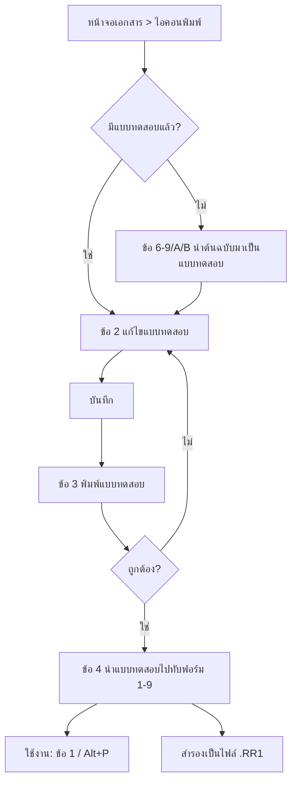
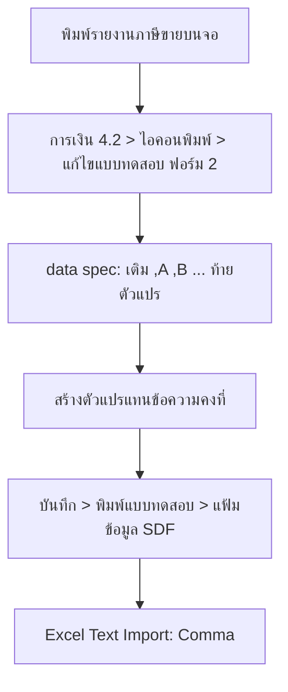

# บทที่ 25 การแก้ไขรายงาน/แบบฟอร์ม
> อ้างอิงคู่มือ หน้า 395–434 (PDF p.411–450)

## ภาพรวม
- Express แยกงานพิมพ์ออกเป็น 2 กลุ่ม: **แบบฟอร์ม** (เอกสารที่พิมพ์จากหน้าจอบันทึกรายวัน เช่น ใบสั่งซื้อ ใบกำกับสินค้า ใบเสร็จ จากหน้าจอซื้อสด ซื้อเชื่อ ขายสด ขายเชื่อ จ่ายชำระหนี้ รับชำระหนี้) และ **รายงาน** (ภาษีซื้อ ภาษีขาย สินค้าคงเหลือ วิเคราะห์การขาย ฯลฯ) (หน้า 395)
- ทั้งสองแบบเขียนด้วย "ภาษาคำสั่งรายงาน" แบบข้อความ (ไฟล์ .RR1 / .RL / .RN / .RWT) แก้ไขในหน้าต่างแก้ไขข้อความในตัวโปรแกรม ประกอบด้วย 4 ส่วน: `[report frame]`, `[print options]`, `[data file]`, `[data spec]` (หน้า 400)
- `[report frame]` แบ่งเป็นบรรทัดที่ขึ้นต้นด้วยรหัสส่วน (Ti, He, H1, Gh, Bo, Ih, Ib, If, Bt, Fo, Su, Gf) และอ้างตัวแปรที่ขึ้นต้นด้วย `~` และฟังก์ชันระบบที่ขึ้นต้นด้วย `\` (หน้า 400–407)
- `[data file]` ประกาศแฟ้มข้อมูล (DBF) และดัชนี (Tag) ที่ใช้ แบ่งเป็น master file / item file / relate file — **เผยโครงสร้างตารางจริงของ Express** เช่น ARTRN (หัวเอกสารขาย), STCRD (รายการสินค้าในเอกสาร), ARTRNRM (หมายเหตุรายการ), ARMAS (ลูกค้า), OESLM (พนักงานขาย) (หน้า 411–417)
- `[data spec]` ผูกตัวแปร `~XXX` กับฟิลด์ `ALIAS->FIELD`, ฟังก์ชันโปรแกรม (`p_addr()` ฯลฯ) หรือนิพจน์ (`IIF`, การต่อสตริงด้วย `-`) (หน้า 418–419)
- ระบบมี "แบบทดสอบ" (test slot) แยกจากแบบที่ใช้จริง 1–9 ช่อง และ "ต้นฉบับ" ที่แก้ไม่ได้; รายงานที่ผู้ใช้สร้างเองต้องคัดลอกจากรายงานต้นฉบับ (หน้า 397–398, 423–426)
- ส่งออกรายงานเป็นแฟ้มข้อมูลมาตรฐาน (SDF) แบบคั่นด้วยจุลภาคเพื่อเปิดใน Excel ได้ โดยกำหนดอักษรคอลัมน์ท้ายบรรทัดใน `[data spec]` (หน้า 426–434)

---

## หน้าจอ

### S-RD-01 เมนูพิมพ์เอกสาร (ดรอปดาวน์ไอคอนพิมพ์บนหน้าจอเอกสาร)
- เมนู: หน้าจอบันทึกเอกสารใด ๆ (ตัวอย่าง: ขาย > 4 ขายเงินเชื่อ) > ไอคอนพิมพ์เอกสาร (ลูกศรดรอปดาวน์)
- อ้างอิง: หน้า 397–398, 409 (PDF p.413–414, 425) — มีภาพหน้าจอ: ใช่ (IV-ขายเงินเชื่อ + เมนู)
- ลักษณะ: เมนูดรอปดาวน์ (popup menu) จากไอคอนพิมพ์

| ส่วน/แท็บ | ฟิลด์ | ชนิดข้อมูล | บังคับ | ค่าเริ่มต้น/อ้างอิงจาก | คำอธิบาย/เงื่อนไข |
|---|---|---|---|---|---|
| เมนู | 1. พิมพ์ใบกำกับสินค้า ▸ | submenu | – | ฟอร์ม 1–9 ที่บันทึกไว้ | เลือกฟอร์มที่จะพิมพ์ (ขายเงินเชื่อมี 9 ฟอร์ม เอกสารอื่นมี 3 ฟอร์ม) (หน้า 397, 400) |
| เมนู | 2. แก้ไขแบบทดสอบ | command | – | – | เปิดตัวแก้ไข (S-RD-02) ของแบบทดสอบ; ต้องนำต้นฉบับ (ข้อ 6 ขึ้นไป) มาเป็นแบบทดสอบก่อน มิฉะนั้นเกิด error (หน้า 397–398) |
| เมนู | 3. พิมพ์แบบทดสอบ | command | – | – | ทดลองพิมพ์แบบทดสอบ (ออกเครื่องพิมพ์/จอ/แฟ้ม) (หน้า 398, 409) |
| เมนู | 4. นำแบบทดสอบไปทับข้อ 1 | command | – | – | เลือกฟอร์ม 1–9 ปลายทาง แล้วยืนยัน "ใช่" (หน้า 398) |
| เมนู | 5. นำข้อ 1 มาเป็นแบบทดสอบ | command | – | – | ดึงฟอร์มที่ใช้งานกลับมาแก้ (หน้า 398) |
| ฟอร์ม 12 | 6. นำต้นฉบับมีเส้น มาเป็นแบบทดสอบ | command | – | ต้นฉบับ | ต้นฉบับพิมพ์บนกระดาษเปล่า มีเส้นตาราง, ตัวอักษร 12 cpi (หน้า 396, 409) |
| ฟอร์ม 12 | 7. นำต้นฉบับไม่มีเส้น มาเป็นแบบทดสอบ | command | – | ต้นฉบับ | สำหรับฟอร์มพิมพ์สำเร็จ (pre-printed) พิมพ์เฉพาะข้อมูล (หน้า 396) |
| ฟอร์ม 15 | 8. มีเส้น / 9. ไม่มีเส้น | command | – | ต้นฉบับ | 15 cpi มีคอลัมน์ "คลัง" และ "ส่วนลด" เพิ่ม (หน้า 399, 409) |
| อื่น | A. นำต้นฉบับพิมพ์ครึ่งหน้า มาเป็นแบบทดสอบ | command | – | ต้นฉบับ | (หน้า 409) |
| อื่น | B. นำต้นฉบับบิลเอ็กซ์เพรส มาเป็นแบบทดสอบ | command | – | ต้นฉบับ | (หน้า 409) |

ปุ่ม/คำสั่ง: ไอคอนพิมพ์หรือ `Alt+P` = พิมพ์ฟอร์ม 1 เท่านั้น (หน้า 409)
กฎทางธุรกิจ/เงื่อนไข:
- "ต้นฉบับ" แก้ไขไม่ได้โดยตรง ต้องคัดลอกมาเป็นแบบทดสอบ แก้ แล้ววางทับฟอร์ม 1–9 (หน้า 398)
- เมนูรายงานภาษีขาย (การเงิน 4.2) มีโครงเดียวกัน แต่ต้นฉบับเป็น: รายงานต้นฉบับมาตรฐาน / อัตราศูนย์ / แยกขายสด-เชื่อ / แบบแยก 10,7% / 10,7,0% ฯลฯ (หน้า 428; ภาพบางส่วนเบลอ [สันนิษฐาน])
ผลทางบัญชี/สต๊อก: ไม่มี (งานพิมพ์)

### S-RD-02 หน้าต่างแก้ไขแบบทดสอบ (ตัวแก้ไขภาษารายงาน)
- เมนู: S-RD-01 > 2. แก้ไขแบบทดสอบ; หรือ รายงาน > 1.9.2 แก้ไขรายงานที่สร้างด้วยตนเอง > ไอคอนคำสั่งแก้ไข (`Ctrl+E`)
- อ้างอิง: หน้า 399–420, 425, 429 (PDF p.415–436, 441, 445) — มีภาพหน้าจอ: ใช่
- ลักษณะ: text editor เต็มหน้าต่าง; แถบชื่อแสดง path ไฟล์ เช่น `C:\TEST6\TEST\ARIVCIV.RR1`, `...\SH_SLMNM.RWT`

| ส่วน/แท็บ | ฟิลด์ | ชนิดข้อมูล | บังคับ | ค่าเริ่มต้น/อ้างอิงจาก | คำอธิบาย/เงื่อนไข |
|---|---|---|---|---|---|
| Toolbar | Save, Print, Cut, Copy, Paste, Clear, Undo, Redo, Find, FR (ค้นหา/แทนที่ [สันนิษฐาน]) | button | – | – | (หน้า 399) |
| Toolbar | ฟอนต์ / ขนาด (14) | select | – | 14 | ขนาดตัวอักษรในตัวแก้ไข |
| เนื้อหา | ข้อความคำสั่งรายงาน | memo | ใช่ | คัดลอกจากต้นฉบับ | 4 ส่วน: [report frame], [print options], [data file], [data spec] |
| แถบสถานะ | Line, Col, Char, Len, Undo, Redo, CAP, NUM | display | – | – | ตำแหน่งเคอร์เซอร์ |

ปุ่ม/คำสั่ง: บันทึก = ไอคอน Save; `Esc`/ปิด → ถามยืนยัน ("No" = ไม่บันทึก) (หน้า 409); Select all `Ctrl+A`, คลิกขวา Copy/Paste ใช้สำรองฟอร์ม (หน้า 420)
กฎทางธุรกิจ/เงื่อนไข:
- บรรทัดที่ขึ้นต้นด้วย `*` คือหมายเหตุ (ไม่ทำงาน) — ใช้ "ปิด" บรรทัดเดิมแล้วเขียนบรรทัดใหม่แทน (หน้า 401, 425)
- เมื่อคำสั่งผิด โปรแกรมแจ้งเลขบรรทัดและสาเหตุ; แนะนำแก้ทีละขั้นแล้วทดลองพิมพ์ (หน้า 401)
- ใช้โหมดภาษาอังกฤษเมื่อจัดตำแหน่งด้วย Del/Space/Backspace (หน้า 402)
- ส่วนท้ายมีคำเตือน `*** คำสั่งต่อจากนี้ผู้ใช้ไม่ควรแก้ไข` (หน้า 410)

#### (ก) ส่วน `[report frame]` — รหัสส่วน (section prefix)
| รหัส | ชื่อ | พิมพ์เมื่อ | ตัวอย่าง/หมายเหตุ | หน้า |
|---|---|---|---|---|
| `*` | หมายเหตุ | ไม่พิมพ์ | `* ARIVC.RN - ใบกำกับสินค้า (INVOICE)` | 399, 401 |
| `**:` | บรรทัดไม้บรรทัด/picture | ไม่พิมพ์ [สันนิษฐาน] | `**:9,999 DD/MM/YY xxxxxxxxx…(999,999,999.99)` แสดงความกว้างคอลัมน์ | 425, 429 |
| `Ti:` / `Ti::` | Title | ครั้งเดียว (หน้าแรก) | `Ti::~INIT` ใช้ตั้งค่าตัวแปรเริ่มต้น | 402 |
| `He:` | Header | ทุกหน้า | `He:$Eวิเคราะห์ยอดขาย…$E` | 402–403 |
| `H1:` | Header เพิ่ม [สันนิษฐาน: หัวเงื่อนไข] | ทุกหน้า | `H1:รหัสลูกค้า ~FROMCUS ถึง ~TOCUS` | 425 |
| `Gh:` | Group header | เมื่อเริ่มกลุ่ม | `Gh:$B~CUSTOMER $B ; 1 CUSCOD` — `;1 CUSCOD` = จัดกลุ่มตามฟิลด์ | 415, 425, 429 |
| `Bo:` | Body | ทุกระเบียนของ master file | `Bo: ~DOCDAT ~F~DOCNUM ~SLMCOD…` | 404, 425 |
| `Ih:` / `Ih::` | Item header (ความสัมพันธ์ master→item) | ไม่พิมพ์ (นิยาม join) | `Ih:: ;1 stcrd->docnum artrn->docnum` — ไม่ควรแก้เว้นแต่ฝ่ายบริการแนะนำ | 404–405 |
| `Ib:` | Item body | ทุกระเบียน item ที่สัมพันธ์ | `Ib: ~N ~ARTICLE ~QTY ~TQUCOD ~UNITPR ~NETAMT_I ;1` — `;1` ผูกกับ Ih `;1`; ตัวแปร Ib ใช้ใน He/Su ไม่ได้ | 405 |
| `If:` | Item footer | ท้ายชุดรายการ | `If: ;1` | 425 |
| `Bt:` | Body template | ทุกบรรทัด Ib | ใช้วาดเส้นแนวตั้ง `|` ในตาราง | 406 |
| `Fo:` | Footer | ทุกหน้า | ยอดรวมต่อหน้า | 406 |
| `Gf:` | Group footer | ท้ายกลุ่ม | `Gf:~L \FEED ;1` | 415, 429 |
| `Su:` | Summary | หน้าสุดท้ายเท่านั้น | ยอดรวม VAT ยอดสุทธิ | 406–407 |

#### (ข) ฟังก์ชันระบบ (ขึ้นต้น `\`) (หน้า 400)
| ฟังก์ชัน | ความหมาย |
|---|---|
| `\NAME` | ชื่อบริษัท (จากเริ่มระบบ 1.1 รายละเอียดกิจการ) |
| `\DATE` / `\TIME` | วันที่ / เวลาปัจจุบัน |
| `\PAGE` | เลขหน้า 8 หลักชิดขวา |
| `\P` | เลขหน้า 3 หลักชิดขวา |
| `\TP` | จำนวนหน้าทั้งหมด |
| `\LINE` / `\DLINE` | เส้นเดี่ยว / เส้นคู่ |
| `\FEED` | ขึ้นหน้าใหม่ |
| `\FILE` | ชื่อแฟ้มข้อมูลของรายงาน |

#### (ค) รหัสจัดรูปแบบในบรรทัด (หน้า 404, 407–408, 425)
| รหัส | ผล |
|---|---|
| `$E…$E` | ตัวขยาย (expanded) |
| `$B…$B` | ตัวหนา |
| `$_…$_` | ขีดเส้นใต้ |
| `^…^` | จัดกึ่งกลาง (ใน He); `^` ในข้อความยังใช้แทนช่องว่าง/ตัวแบ่ง [สันนิษฐาน] |
| `` ` `` (backtick) | ปรากฏหน้า "หน้า"/"วันที่" ใน He — ชิดขวา [สันนิษฐาน] |
| `\027\074\<n>` | ป้อนกระดาษ n/180 นิ้ว (สูงสุด 180 = 1 นิ้ว) วางต้นบรรทัด; ไม่นับเป็นคอลัมน์ เช่น `He:\027\074\030 ~CUSCOD` = 30/180 นิ้ว |

#### (ง) ตัวแปรแบบฟอร์มใบกำกับสินค้า (ขายเงินเชื่อ)
| ส่วน | ตัวแปร | ความหมาย | หน้า |
|---|---|---|---|
| He | `~CUSCOD` | รหัสลูกค้า | 403 |
| He | `~CUSNAM` | ชื่อลูกค้า | 403 |
| He | `~ADDR01`–`~ADDR03` | ที่อยู่ 3 บรรทัด | 403 |
| He | `~TELNUM` | โทรศัพท์ | 403 |
| He | `~YOUREF` | อ้างอิง | 403 |
| He | `~DLVBY` | ขนส่งโดย | 403 |
| He | `~DOCNUM` / `~DOCDAT` | เลขที่ / วันที่ใบกำกับ | 403 |
| He | `~CR` / `~DUEDAT` | เครดิต (วัน) / ครบกำหนด | 403, 420 |
| He | `~SONUM` / `~SODAT` | เลขที่ / วันที่ใบสั่งขาย | 403, 420 |
| He | `~SLMCOD` | รหัสและชื่อพนักงานขาย | 403 |
| He | `~AREA` | เขตการขาย | 403 |
| He | `~ADDR`, `~TEL`, `~TAXID` | ที่อยู่/โทร/เลขผู้เสียภาษีของบริษัท (`p_addr()`, `p_telnum()`, `p_taxid()`) | 418, 420 |
| Ti | `~INIT` | ตั้งค่าเริ่ม `seq=0; sumamt0=0; sumamt1=0` | 418 |
| Ib | `~N` | ลำดับ | 405 |
| Ib | `~ARTICLE` | รหัสและชื่อสินค้า | 405 |
| Ib | `~QTY` / `~TQUCOD` | จำนวน / หน่วยนับ | 405 |
| Ib | `~UNITPR` | ราคาต่อหน่วย | 405 |
| Ib | `~DISC_I` / `~NETAMT_I` | ส่วนลด / จำนวนเงินรายการ | 399, 425 |
| Ib (;2/;3) | `~REMARK` | หมายเหตุรายการ (ARTRNRM) | 399, 405 |
| Su | `~AMOUNT` | มูลค่ารวมสินค้า/บริการ | 407 |
| Su | `~DISC` / `~DISCAMT` | ส่วนลดการค้า (ข้อความ เช่น %) / จำนวนเงินส่วนลด | 407 |
| Su | `~AFTDISC` | ยอดหลังหักส่วนลด | 407 |
| Su | `~ADVNUM` / `~ADVAMT` | เลขที่ใบรับเงินมัดจำที่อ้างถึง / จำนวนเงินมัดจำ | 407 |
| Su | `~TOTAL` | รวมมูลค่าสินค้า | 407 |
| Su | `~VAT` / `~VATAMT` | อัตรา VAT / จำนวน VAT | 407 |
| Su | `~CHKAMT` | มูลค่าขายสุทธิ | 407 |
| Su | `~HREM1`–`~HREM5` | หมายเหตุเอกสาร 5 บรรทัด (ป้อนด้วย `Alt+R` ที่หน้าเอกสาร) | 407 |
| Su | `~BAHT` | จำนวนเงินตัวอักษร (บาทถ้วน) | 407 |
| Su (ปิดไว้) | `~AMTRATZ`, `~AMTRATX`, `~NETAMT` | ยอดอัตราศูนย์/ยกเว้น [สันนิษฐาน], ยอดสุทธิ | 407 |
| Su (ปิดไว้) | `~PRNBY`, `~PRNDAT`, `~PRNTIM`, `~PRNCNT`, `~RECBY` | ผู้พิมพ์ วันที่/เวลาพิมพ์ ครั้งที่พิมพ์ ผู้บันทึก | 407 |

> ตัวแปรจะพิมพ์ก็ต่อเมื่อมีข้อมูลบันทึกไว้ (หน้า 403)

#### (จ) ส่วน `[print options]` (หน้า 410–411)
| ตัวเลือก | ค่าตัวอย่าง | ความหมาย |
|---|---|---|
| Top | 0 | เริ่มจากขอบบนของเครื่องพิมพ์ |
| Left | 0 | ขอบซ้าย |
| Tabs | 4 | [สันนิษฐาน] ระยะ tab |
| Right | 94 | คอลัมน์สุดท้าย |
| Lines | 36 | จำนวนบรรทัดต่อหน้าฟอร์ม |
| Output | Select, Printer, Screen, File | ปลายทาง (Select = เลือกตอนพิมพ์) |
| File Name | ARIVC.TXT | ชื่อแฟ้มเมื่อพิมพ์ออกแฟ้ม |
| Print Control | `\027\033\001` | รหัสขนาดอักษร: 10 cpi `\027\033\000`; 12 `\027\033\001`; 15 `\027\033\000\027\103`; 17 `\027\033\004`; 20 `\027\033\005` |
| Fix Summary Line | ON | [สันนิษฐาน] ตรึงบรรทัด Su ไว้ตำแหน่งเดิม |
| Select Scope | OFF | ให้เลือกช่วงเอกสาร เช่น ใบกำกับ 1–5 |
| Form | ON | ต้อง ON เสมอหาก Select Scope = ON |
| Select Page | OFF | เลือกหน้า |
| Condition | OFF | ให้เลือกเงื่อนไขตอนพิมพ์ |
| Copy | 2 | พิมพ์ 2 ชุด |
| Iteration | ON | พิมพ์ซ้ำต่อระเบียน (เช่น สติกเกอร์) |

#### (ฉ) ส่วน `[data file]` (หน้า 411–417)
```
[master file]
File=artrn   Alias=A  Tag=artrn1   System=DATA_PATH
[item file]
File=stcrd   Alias=B  Tag=stcrd5   System=DATA_PATH
File=artrnrm Alias=C  Tag=artrnrm1 System=DATA_PATH
[relate file]
File=armas   Alias=R  Tag=armas1   System=DATA_PATH  Master file=artrn  Master-Related Field=CUSCOD
File=oeslm   Alias=I  Tag=oeslm1   System=DATA_PATH  Master file=artrn  Master-Related Field=slmcod
```
- **master file**: ตารางหลัก ดึงเฉพาะช่วงที่ระบุ พิมพ์ใน `Bo:`; จัดกลุ่มด้วย `Gh:`/`Gf:` (หน้า 415)
- **item file**: ความสัมพันธ์ one-to-many (1 เอกสาร ARTRN → หลายบรรทัด STCRD); ระบุได้หลายไฟล์; Alias ห้ามซ้ำ; Tag `stcrd5` = ดัชนี `DOCNUM+SEQNUM` จำเป็นเพราะบรรทัดอาจถูกบันทึกไม่เรียงลำดับ (หน้า 414–416)
- **relate file**: one-to-one (เช่น ARTRN เก็บเฉพาะ SLMCOD → ดึงชื่อจาก OESLM); `Master file` ไม่จำเป็นต้องเป็น master file จริง อาจเป็น item/relate ก็ได้; `Master-Related Field` = ฟิลด์ชื่อเดียวกันทั้งสองแฟ้ม (หน้า 413, 416–417)
- `System=DATA_PATH` = ค้นในโฟลเดอร์ข้อมูลของบริษัท (หน้า 416)

#### (ช) ส่วน `[data spec]` (หน้า 418–419, 425, 430)
รูปแบบ: `~ตัวแปร: len, "pict", "data", "exp" [,คอลัมน์Excel]`
| คอลัมน์ | ความหมาย |
|---|---|
| `~dat` | ชื่อตัวแปร ต้องขึ้นต้น `~` |
| len | ใช้กับข้อมูลอักขระ: 0 = ไม่จำกัด, >0 = ตัด, <0 = ตัดขึ้นบรรทัดใหม่ |
| pict | รูปแบบ/ความยาวตัวเลข เช่น `"ZZZ"`, `"99,999,999.99"`, `"(999,999,999.99)"`, `qtyZ(9)`, `priZ` |
| data | `แฟ้ม->ฟิลด์` (เช่น `ARTRN->DOCNUM`, `A->CUSCOD`), ฟังก์ชันโปรแกรม (`p_addr()`), หรือชื่อตัวแปรที่คำนวณใน exp |
| exp | นิพจน์คำนวณ เช่น `slm = ARTRN->SLMCOD-'-'-OESLM->SLMNAM`, `cancel=IIF(A->DOCSTAT='C',' *',…)`, `seq=seq+1` |
| ,A–Z | (เพิ่มเอง) ตำแหน่งคอลัมน์ Excel เมื่อส่งออก SDF |

ตัวอย่างจากคู่มือ:
```
~DOCNUM:  0, "",    "ARTRN->DOCNUM", ""
~CUSNAM:  0, "",    "cus_nam", "cus_nam = ARMAS->PRENAM - '^' - ARMAS-…"
~SLMCOD: 27, "",    "slm",     "slm = ARTRN->SLMCOD-'-'-OESLM->SLMNAM"
~CR:      0, "ZZZ", "ARTRN->PAYTRM", ""
~F:       0, "",    "cancel",  "cancel=IIF(A->DOCSTAT='C',' *',IIF(A->DOCSTAT=…"
~AMT01:   0, "(999,999,999.99)", "amt_01", "amt_01 = IIF(A->RECTYP='5',…"
~DATMON:  0, "",    "DATMON",  "DATMON='วัน/เดือน/ปี '" ,B
```
- การต่อฟิลด์จาก 2 แฟ้มทำในคอลัมน์ data ไม่ได้ ต้องใช้ exp (หน้า 419)

### S-RD-03 สร้างและแก้ไขรายงานด้วยตัวเอง
- เมนู: รายงาน > 1 พิมพ์รายงาน > 9 สร้างรายงานด้วยตนเอง > 9.2 แก้ไขรายงานที่สร้างด้วยตนเอง
- อ้างอิง: หน้า 423–424 (PDF p.439–440) — มีภาพหน้าจอ: ใช่
- ลักษณะ: form + toolbar (ใหม่ แก้ไข คำสั่งแก้ไข ลบ | ปิด บันทึก | first prev next last | ค้นหา)

| ส่วน/แท็บ | ฟิลด์ | ชนิดข้อมูล | บังคับ | ค่าเริ่มต้น/อ้างอิงจาก | คำอธิบาย/เงื่อนไข |
|---|---|---|---|---|---|
| หลัก | รหัส | text | ใช่ | – | ≤8 ตัวอักษรภาษาอังกฤษ เช่น SH_SLMNM (หน้า 424) |
| หลัก | ชื่อรายงาน | text | ใช่ | ชื่อรายงานต้นฉบับ | เช่น "143 ขายเงินเชื่อ แยกตามลูกค้า" |
| หลัก | ต้นฉบับรายงาน | text (display) | – | จากรายงานต้นฉบับ | เช่น `ar_trn_c` |
| หลัก | ค่าพิเศษ | text | ไม่ | ว่าง | [สันนิษฐาน] พารามิเตอร์เพิ่ม |
| หลัก | ใช้เงื่อนไขมาตรฐาน | check (Y/N) | – | Y | ใช้หน้าจอเงื่อนไขของรายงานต้นฉบับ |

ปุ่ม/คำสั่ง: เพิ่ม `Alt+A`, คำสั่งแก้ไข `Ctrl+E` (เปิด S-RD-02 กับไฟล์ .RWT)
กฎทางธุรกิจ/เงื่อนไข: รายงานใหม่ไม่ทับต้นฉบับ และแก้ต้นฉบับไม่ได้; พิมพ์ผ่าน 9.1 พิมพ์รายงานที่สร้างด้วยตนเอง (หน้า 426)

### S-RD-04 Dialog สร้างรายงานใหม่
- เมนู: S-RD-03 > เพิ่ม (Alt+A)
- อ้างอิง: หน้า 424 (PDF p.440) — มีภาพหน้าจอ: ใช่
- ลักษณะ: dialog + หน้าต่างค้นหา (lookup list)

| ส่วน/แท็บ | ฟิลด์ | ชนิดข้อมูล | บังคับ | ค่าเริ่มต้น/อ้างอิงจาก | คำอธิบาย/เงื่อนไข |
|---|---|---|---|---|---|
| dialog | รายงานต้นฉบับ | lookup | ใช่ | รายการรายงานต้นฉบับ | เช่น 143 |
| dialog | รหัสรายงานใหม่ | text | ใช่ | – | ≤8 อักษรอังกฤษ |
| dialog | ชื่อรายงานใหม่ | text | ใช่ | – | |
| lookup | คอลัมน์: รหัสไฟล์, ชื่อรายงาน, template, ขนาด [สันนิษฐาน] | list | – | – | เช่น ARTRNIVC / 143 ขายเงินเชื่อ แยกตามลูกค้า / ar_trn_c / 33; ARTRNIVS 144 แยกตามพนักงานขาย ar_trn_s; ARTRNIVA 145; ARTRNIVB 146; ARIVDUEC 147 ar_ivcdue; ARIVDUES 148; ARIVDUED 149; ARSTATE 14A ใบยืนยันยอดลูกหนี้ |

ปุ่ม/คำสั่ง: ตกลง, ยกเลิก, ค้นหา, เรียงใหม่ `<Tab>`

### S-RD-05 หน้าจอเลือกรายงาน/เงื่อนไขรายงาน (ตัวอย่าง 143)
- เมนู: รายงาน > 1 รายงานลูกหนี้ > 4 ขายเงินเชื่อ (ใบกำกับสินค้า) > 3 แยกตามลูกค้า
- อ้างอิง: หน้า 422–423 (PDF p.438–439) — มีภาพหน้าจอ: ใช่
- ลักษณะ: tree เมนูรายงานด้านซ้าย + แผงเงื่อนไขด้านขวา (report-options)

| ส่วน/แท็บ | ฟิลด์ | ชนิดข้อมูล | บังคับ | ค่าเริ่มต้น/อ้างอิงจาก | คำอธิบาย/เงื่อนไข |
|---|---|---|---|---|---|
| เงื่อนไข | รหัสลูกค้า จาก/ถึง | lookup | ไม่ | ทั้งหมด | ARMAS |
| เงื่อนไข | วันที่ จาก/ถึง | date | ไม่ | | |
| เงื่อนไข | รหัสพนักงานขาย จาก/ถึง | lookup | ไม่ | | OESLM |
| เงื่อนไข | เลือกแผนก | lookup | ไม่ | `*` (ทุกแผนก) | |
| ตัวเลือก | พิมพ์รายละเอียด | check | ไม่ | ✓ | พิมพ์บรรทัดสินค้าด้วย |
| ตัวเลือก | เริ่มพิมพ์หน้า … ถึง … | number | ไม่ | 1 ถึง 9,999 | |
| ตัวเลือก | จำนวนบรรทัด | number | ไม่ | 61 บรรทัด/หน้า | |

Tree รายงานลูกหนี้ (หน้า 422): 1 รับเงินมัดจำ, 2 ขายเงินสด (บิลเงินสด), 3 ใบสั่งขาย, 4 ขายเงินเชื่อ (ใบกำกับสินค้า) [1 เรียงตามเลขที่, 2 เรียงตามวันที่, 3 แยกตามลูกค้า, 4 แยกตามพนักงานขาย, 5 แยกตามเขตการขาย/พนักงานขาย, 6 แยกตามเขตการขาย/ลูกค้า, 7–9 ถึงกำหนดเก็บเงิน (แยกลูกค้า/พนักงาน/เลขที่), A ใบยืนยันยอดลูกหนี้], 5 รายได้อื่น ๆ, 6 ใบวางบิล, 7 ใบเพิ่มหนี้, 8 ใบลดหนี้/รับคืนสินค้า, 9 การรับชำระหนี้, A ลูกหนี้คงค้าง ณ วันที่, B สถานะลูกหนี้, C วิเคราะห์อายุหนี้ (บิลค้างรับ), D รายการเคลื่อนไหวลูกหนี้, E ลูกหนี้เกินวงเงิน, F รายละเอียดลูกค้า, G ใบเสนอราคา
เมนูรายงานหลัก (หน้า 423): 1 ลูกหนี้, 2 เจ้าหนี้, 3 เกี่ยวกับเช็ค, 4 สินค้าคงคลัง, 5 บัญชี, 6 ภาษี, 7 วิเคราะห์การขาย, 8 วิเคราะห์การซื้อ, 9 สร้างรายงานด้วยตนเอง (9.1 พิมพ์, 9.2 แก้ไข)

ผลลัพธ์รายงาน 143 (หน้า 422): หัว — ชื่อบริษัท, ช่วงเงื่อนไข; คอลัมน์ วันที่, เลขที่, พนักงานขาย, V, ส่วนลด, มูลค่าสินค้า, VAT, รวมทั้งสิ้น, ครบกำหนด, ใบสั่งขาย, เก็บเงินจากใบ…; บรรทัดย่อย รายละเอียด จำนวน ราคาต่อหน่วย ส่วนลด จำนวนเงิน; กลุ่มตามลูกค้า; บรรทัด "ตัดใบรับมัดจำ# AI0000002 1,500.00"

### S-RD-06 Dialog รายละเอียดแฟ้มข้อมูล (กด Tab บนหน้าจอเอกสาร)
- เมนู: หน้าจอเอกสารใด ๆ > กด `<Tab>` (ส่วนหัว) หรือ `<F8>` แล้ว `<Tab>` (ส่วนตาราง)
- อ้างอิง: หน้า 412–413 (PDF p.428–429) — มีภาพหน้าจอ: ใช่
- ลักษณะ: dialog แสดงข้อมูลเทคนิคของระเบียนปัจจุบัน — **ใช้ดูชื่อแฟ้ม/ดัชนีสำหรับเขียน [data file]**

| ส่วน/แท็บ | ฟิลด์ | ชนิดข้อมูล | บังคับ | ค่าเริ่มต้น/อ้างอิงจาก | คำอธิบาย/เงื่อนไข |
|---|---|---|---|---|---|
| แฟ้ม | แฟ้มข้อมูล | display | – | ARTRN (หัว) / STCRD (ตาราง) | |
| แฟ้ม | แฟ้มดัชนี | display | – | ARTRN2 / STCRD5 | |
| แฟ้ม | นิพจน์ดัชนี | display | – | `RECTYP+DOCNUM` / `DOCNUM+SEQNUM` | |
| แฟ้ม | แฟ้มจอภาพ | display | – | ARIVC | ชื่อไฟล์นิยามหน้าจอ |
| สิทธิ | อ่านข้อมูล, เพิ่มข้อมูล, แก้ไข, ยกเลิก, ลบข้อมูล, พิมพ์รายงาน, รับรองเอกสาร | check (display) | – | ตามสิทธิผู้ใช้ | |
| Audit | ผู้บันทึก / วันที่ | display | – | BIT9 04/09/58 | |
| Audit | ผู้พิมพ์ / วันที่; พิมพ์ครั้งที่ / เวลา | display | – | | |
| Audit | รับรองโดย / วันที่ | display | – | | |
| ตำแหน่ง | ระเบียนที่ X ซึ่งมีทั้งหมด Y รายการ | display | – | 21/25; 81/84 | |

ปุ่ม/คำสั่ง: ตกลง

### S-RD-07 Dialog เลือกชนิดของแฟ้มข้อมูล (พิมพ์ออกแฟ้ม)
- เมนู: S-RD-01 > 3 พิมพ์แบบทดสอบ > ปลายทาง "แฟ้มข้อมูล"
- อ้างอิง: หน้า 430 (PDF p.446) — มีภาพหน้าจอ: ใช่

| ส่วน/แท็บ | ฟิลด์ | ชนิดข้อมูล | บังคับ | ค่าเริ่มต้น/อ้างอิงจาก | คำอธิบาย/เงื่อนไข |
|---|---|---|---|---|---|
| ชนิด | แฟ้มข้อมูลชนิดข้อความ (Text File) | radio | – | เลือก | |
| ชนิด | แฟ้มข้อมูลมาตรฐาน (SDF File) | radio | – | | ผลเป็นข้อความคั่นจุลภาคมีเครื่องหมายคำพูด เปิดใน Excel ด้วย Text Import Wizard (ตัวคั่น = Comma) (หน้า 431–432) |
| ชื่อ | ชื่อแฟ้ม | text | ใช่ | – | เช่น C:\SVATXLS.TXT |

ปุ่ม/คำสั่ง: OK, Cancel

---

## ลำดับการใช้งาน

### ก. แก้แบบฟอร์มเอกสาร (หน้า 397–409)
1. เปิดหน้าจอเอกสาร (เช่น ขายเงินเชื่อ) > ไอคอนพิมพ์ ▾
2. เลือกต้นฉบับ (ข้อ 6–9/A/B) → นำมาเป็นแบบทดสอบ
3. ข้อ 2 แก้ไขแบบทดสอบ → แก้ [report frame]/[print options]/[data spec] → บันทึก
4. ข้อ 3 พิมพ์แบบทดสอบ (บนฟอร์มจริง) วนแก้จนถูกต้อง
5. ข้อ 4 นำแบบทดสอบไปทับฟอร์ม 1–9 → ใช้งานด้วยไอคอนพิมพ์/Alt+P (ฟอร์ม 1)
6. สำรอง: Ctrl+A > Copy → วางในฟอร์มอื่น หรือ Notepad บันทึก `XXXXXXXX.RR1` (หน้า 420–421)



### ข. สร้างรายงานเองจากรายงานต้นฉบับ (หน้า 423–426)
1. รายงาน > 1.9.2 > Alt+A > เลือกรายงานต้นฉบับ (143) > ตั้งรหัส/ชื่อใหม่ > ตกลง
2. Ctrl+E เปิดตัวแก้ไข → ใส่ `*` หน้าบรรทัดเดิม, เพิ่มบรรทัดใหม่ (เช่น `~SLMCOD` ใช้ `OESLM->SLMNAM`) และเพิ่ม relate file OESLM
3. บันทึก → พิมพ์ผ่าน 1.9.1

### ค. ส่งออกรายงานภาษีขายไป Excel (หน้า 426–434)
1. พิมพ์รายงานภาษีขายดูบนจอ (เลือกคอลัมน์ที่ต้องการ)
2. การเงิน > 4.2 แฟ้มภาษีขาย > ไอคอนพิมพ์ > 2 แก้ไขแบบทดสอบ > **ฟอร์ม 2** (ไม่ใช้ฟอร์มที่พิมพ์ปกติ)
3. ระบุตัวแปรที่ต้องการ แล้วเติม `,A` `,B` … ท้ายบรรทัดใน [data spec]; ข้อความคงที่ต้องแปลงเป็นตัวแปร (เช่น `~DATMON`)
4. บันทึก > 3 พิมพ์แบบทดสอบ > แฟ้มข้อมูล > SDF > ชื่อไฟล์
5. Excel: เปิดไฟล์ > ตัวคั่น > Comma > เสร็จสิ้น > จัดรูปแบบ



---

## ข้อมูลที่เกี่ยวข้อง
แฟ้มข้อมูลของ Express ที่เปิดเผยในบทนี้ (ชื่อฟิลด์จากคู่มือ; ความหมายบางส่วน [สันนิษฐาน]):

| แฟ้ม (DBF) | บทบาท | ฟิลด์ที่ปรากฏ | ดัชนี |
|---|---|---|---|
| ARTRN | หัวเอกสารลูกหนี้/ขาย (IV, AI, DR ฯลฯ) | RECTYP, DOCNUM, DOCDAT, CUSCOD, SLMCOD, YOUREF, PAYTRM, DUEDAT, FLGVAT, DOCSTAT ('C'=ยกเลิก), AMOUNT, VATDAT, VATPRD, REFNUM, DESCRP | ARTRN1 [ไม่ระบุนิพจน์], ARTRN2 = RECTYP+DOCNUM |
| STCRD | บรรทัดสินค้าในเอกสาร (สต๊อกการ์ด) | DOCNUM, SEQNUM, STKCOD, RDOCNUM, PEOPLE, TRNVAL | STCRD5 = DOCNUM+SEQNUM |
| ARTRNRM | หมายเหตุรายการ (remark) ต่อบรรทัด | DOCNUM, SEQNUM | ARTRNRM1 |
| ARMAS | ข้อมูลลูกค้า | CUSCOD, PRENAM, CUSNAM, ADDR01–ADDR03, TELNUM | ARMAS1 |
| OESLM | พนักงานขาย | SLMCOD, SLMNAM | OESLM1 (ตาม SLMCOD) |
| (แฟ้มภาษีขาย) | รายงานภาษีขาย ISVATS.RL [ชื่อแฟ้มไม่ระบุ] | DOCDAT, VATDAT, DOCNUM, REFNUM, DESCRP, RECTYP ('5' = [สันนิษฐาน] ลดหนี้), DOCSTAT | – |

ความสัมพันธ์:
- ARTRN 1:n STCRD (DOCNUM) — item file
- STCRD 1:n ARTRNRM (`artrnrm->docnum+seqnum` ↔ `stcrd->rdocnum` หรือ `stcrd->docnum+seqnum`)
- ARTRN n:1 ARMAS (CUSCOD), ARTRN n:1 OESLM (SLMCOD) — relate file
- ไฟล์นิยาม: ARIVC (หน้าจอ), ARIVC.RN/.RL, ARIVCIV.RR1 (ฟอร์มทดสอบ), ARTRNIVC.RWT (รายงาน), ISVATS.RL

---

## ข้อสังเกต
- สถาปัตยกรรมรายงานเป็น "banded report" แบบ text ผูกกับ DBF + ดัชนี — ในระบบใหม่ควรออกแบบเป็น template engine ที่ใช้ dataset หัว/บรรทัด/ความสัมพันธ์ แทนการให้ผู้ใช้เขียน join เอง
- เลข 33 ในหน้าจอค้นหารายงานต้นฉบับไม่ได้อธิบาย [สันนิษฐาน: ความยาว/ขนาด]
- หน้า 430 ข้อความบอก ~DESCRP = คอลัมน์ D แต่ภาพแสดง `,C` ที่ ~DOCNUM และ `,D` ที่ ~REFNUM — ข้อมูลในคู่มือไม่ตรงกัน
- หน้า 428 เมนูต้นฉบับรายงานภาษีขายในภาพเบลอ อ่านได้ไม่ครบ
- `H1:` และ `**:` ไม่ได้อธิบายในคู่มือ ตีความจากตัวอย่าง [สันนิษฐาน]
- คำสั่งควบคุมเครื่องพิมพ์ (ESC/P) ผูกกับ dot-matrix; Graphic mode อยู่ในบทที่ 27
- สิทธิ "รับรองเอกสาร", audit (ผู้บันทึก/ผู้พิมพ์/ครั้งที่พิมพ์/รับรองโดย) ถูกเก็บในระเบียนเอกสาร — ควรมีในระบบใหม่
