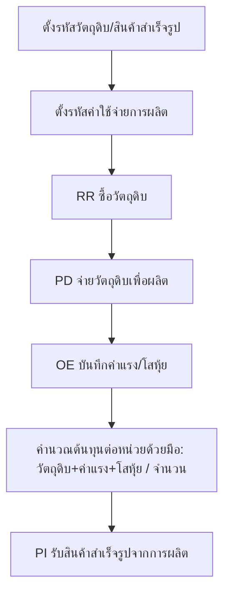
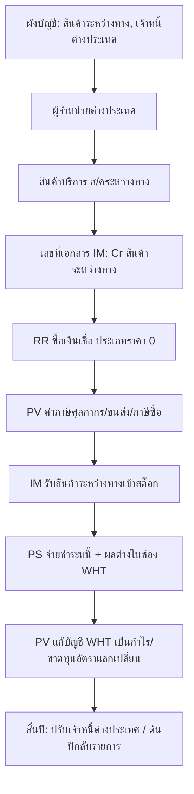

# บทที่ 26 การประยุกต์ใช้งานสำหรับธุรกิจประเภทต่าง ๆ
> อ้างอิงคู่มือ หน้า 435–446 (PDF p.451–462)

## ภาพรวม
- Express ออกแบบมาสำหรับธุรกิจซื้อมา-ขายไป แต่ประยุกต์ใช้กับธุรกิจอื่นได้โดยใช้ระบบงานที่มีอยู่แล้ว ไม่มีโมดูลเฉพาะ (หน้า 435)
- **ธุรกิจผลิต**: ซื้อวัตถุดิบ → เบิกวัตถุดิบไปผลิต → จ่ายค่าแรง/โสหุ้ย → รับสินค้าสำเร็จรูป; **โปรแกรมไม่คำนวณต้นทุนสินค้าสำเร็จรูปให้** ผู้ใช้ต้องรวมต้นทุนเองแล้วหารจำนวน (หน้า 435–439)
- **ธุรกิจนำเข้า**: ใช้บัญชี "สินค้าระหว่างทาง" + "เจ้าหนี้ต่างประเทศ", สินค้าบริการชื่อ "สินค้าระหว่างทาง", เอกสารใหม่ "รับสินค้าระหว่างทางเข้าสต๊อก" (IM), บันทึกค่าใช้จ่ายนำเข้าผ่านสมุดรายวันจ่าย และบันทึกกำไร/ขาดทุนอัตราแลกเปลี่ยนด้วยมือ (หน้า 439–446)
- ควรศึกษาการตั้งแฟ้มข้อมูลหลัก (สินค้า ลูกค้า ผู้จำหน่าย) และการบันทึกซื้อขายพื้นฐานก่อน (หน้า 435)

---

## หน้าจอ

### S-AP-01 รายละเอียดสินค้า (กำหนดวัตถุดิบ/สินค้าสำเร็จรูป)
- เมนู: สินค้า > 2 รายละเอียดสินค้า
- อ้างอิง: หน้า 435–436 (PDF p.451–452) — มีภาพหน้าจอ: ใช่ (รูปที่ 1)
- ลักษณะ: header (รหัส/ชื่อ) + แท็บ "รายละเอียด", "คลังสินค้า <F8>", "ล็อตสินค้ายกมา <F7>", "ฟิลด์เพิ่มเติม"; รายละเอียดเต็มอยู่บทที่ 13 [สันนิษฐาน]

| ส่วน/แท็บ | ฟิลด์ | ชนิดข้อมูล | บังคับ | ค่าเริ่มต้น/อ้างอิงจาก | คำอธิบาย/เงื่อนไข |
|---|---|---|---|---|---|
| หัว | รหัส | text | ใช่ | – | เช่น วัตถุดิบA |
| หัว | บาร์โค้ด | text | ไม่ | – | |
| หัว | ชื่อไทย / ชื่ออังกฤษ | text | ใช่/ไม่ | – | วัตถุดิบ ชนิด A / Raw Material 'A' |
| รายละเอียด | หมวด | lookup | [สันนิษฐาน] ใช่ | หมวดสินค้า | 01 ซีพียู |
| รายละเอียด | กลุ่มบัญชีสินค้า [ป้ายเบลอ] | lookup | ใช่ | กลุ่มบัญชีสินค้า | ST01 (F) สินค้าสำเร็จรูป FIFO — **กำหนดเลขที่บัญชีวัตถุดิบคงเหลือ / สินค้าสำเร็จรูปคงเหลือผ่านกลุ่มนี้** (หน้า 435) |
| รายละเอียด | หน่วย นับเป็น (4 แถว) [ป้ายแถวเบลอ] | lookup | ใช่ | หน่วยนับ | ตา(ตัว) |
| รายละเอียด | ตัวคูณให้เป็นหน่วยย่อย | number | ใช่ | 1.0 | |
| รายละเอียด | สินค้าทดแทน | lookup | ไม่ | สินค้า | |
| รายละเอียด | ส/คติดลบได้? | select | – | – | [Y, N, A] |
| รายละเอียด | ราคาขาย 1–5 | money | ไม่ | 0.000 | |
| รายละเอียด | [ป้ายเบลอ ×2] (+lookup) | text/lookup | ไม่ | – | [สันนิษฐาน] ผู้จำหน่าย/เลขที่ |
| รายละเอียด | ประเภท VAT | select | – | อัตราปกติ | |
| รายละเอียด | ราคาทุนมาตรฐาน | money | ไม่ | 0.000 | |
| รายละเอียด | หมายเหตุ | text | ไม่ | | |
| รายละเอียด | ยอดคงเหลือ / ราคาต่อหน่วย / มูลค่าคงเหลือ | number/money (display) | – | คำนวณ | |

ปุ่ม/คำสั่ง: ใหม่, แก้ไข, ลบ, ปิด, บันทึก, เลื่อนระเบียน 4 ปุ่ม, ค้นหา▾, พิมพ์▾, Note, CHECK B/L, REAL COST, OLD/NEW
กฎทางธุรกิจ/เงื่อนไข: วัตถุดิบทุกรหัสต้องผูกบัญชี "วัตถุดิบคงเหลือ"; สินค้าสำเร็จรูปผูกบัญชี "สินค้าสำเร็จรูปคงเหลือ" (หน้า 435)
ผลทางบัญชี/สต๊อก: ไม่มี (ข้อมูลหลัก)

### S-AP-02 รายละเอียดค่าใช้จ่ายอื่น ๆ (ค่าใช้จ่ายการผลิต)
- เมนู: ซื้อ > 7 รายละเอียดค่าใช้จ่าย
- อ้างอิง: หน้า 436 (PDF p.452) — มีภาพหน้าจอ: ใช่ (รูปที่ 2)
- ลักษณะ: form + แท็บ "รายละเอียด", "ฟิลด์เพิ่มเติม"

| ส่วน/แท็บ | ฟิลด์ | ชนิดข้อมูล | บังคับ | ค่าเริ่มต้น/อ้างอิงจาก | คำอธิบาย/เงื่อนไข |
|---|---|---|---|---|---|
| หัว | รหัสค่าใช้จ่าย | text | ใช่ | – | 97-7100-00 |
| หัว | บาร์โค้ด | text | ไม่ | | |
| หัว | ชื่อไทย / ชื่ออังกฤษ | text | ใช่/ไม่ | | ค่าแรงคนงานในโรงงาน |
| รายละเอียด | หมวดสินค้า | lookup | ใช่ [สันนิษฐาน] | หมวดสินค้า | คช ค่าใช้จ่ายอื่นๆ |
| รายละเอียด | หน่วยนับ | lookup | ใช่ [สันนิษฐาน] | หน่วยนับ | คง ครั้ง |
| รายละเอียด | ประเภท VAT | select | – | ไม่ระบุ | |
| รายละเอียด | จำนวนเงิน | money | ไม่ | 0.000 | ราคาตั้งต้น [สันนิษฐาน] |
| รายละเอียด | หมายเหตุ | text | ไม่ | | |
| รายละเอียด | บ/ช ค่าใช้จ่าย | lookup | ใช่ | ผังบัญชี | 7100-00 ค่าแรงคนงานในโรงงาน |

ปุ่ม/คำสั่ง: ใหม่, แก้ไข, ลบ, ปิด, บันทึก, เลื่อนระเบียน, ค้นหา, พิมพ์, Note, OLD/NEW
กฎทางธุรกิจ/เงื่อนไข: ใช้กำหนดค่าใช้จ่ายทุกรายการที่เป็นต้นทุนการผลิต (ค่าแรง ค่าน้ำ-ไฟโรงงาน ฯลฯ) (หน้า 436)

### S-AP-03 RR – ซื้อเงินเชื่อ (ใช้ซื้อวัตถุดิบ / ซื้อสินค้านำเข้า)
- เมนู: ซื้อ > 4 ซื้อเงินเชื่อ (หรือ ซื้อ > 2 ซื้อเงินสด)
- อ้างอิง: หน้า 437, 443–444 (PDF p.453, 459–460) — มีภาพหน้าจอ: ใช่ (รูปที่ 3, 13)
- ลักษณะ: header ซ้าย/ขวา + แท็บ "รายการสินค้า <F8>", "รายละเอียดอื่น <Ctrl+F8>", "รายการจ่ายชำระ <F7>", "รายการภาษีซื้อ <Ctrl+F7>", "รายการภาษีหัก ณ ที่จ่าย <Ctrl+F10>" + footer ยอดเงิน (รายละเอียดเต็มในบทที่ 11)

| ส่วน/แท็บ | ฟิลด์ | ชนิดข้อมูล | บังคับ | ค่าเริ่มต้น/อ้างอิงจาก | คำอธิบาย/เงื่อนไข |
|---|---|---|---|---|---|
| หัวซ้าย | ผู้จำหน่าย | lookup | ใช่ | ผู้จำหน่าย | RM-MAT / US-EXPORT (แสดงชื่อ ที่อยู่ รหัสไปรษณีย์ โทร.) |
| หัวซ้าย | Bill be | lookup | ไม่ | ผู้จำหน่าย | |
| หัวซ้าย | สาขา# | number | – | 0 | |
| หัวซ้าย | เลขที่บิล / ลวท. | text / date | ไม่ | วันที่เอกสาร | |
| หัวซ้าย | หมายเหตุ | lookup | ไม่ | | |
| หัวขวา | แผนก | lookup | ไม่ | | |
| หัวขวา | เลขที่ใบรับสินค้า | text | ใช่ | running RR | RR0000005 |
| หัวขวา | วันที่ | date | ใช่ | วันทำการ | |
| หัวขวา | อ้างถึงใบสั่งซื้อ | lookup | ไม่ | ใบสั่งซื้อ | ปุ่ม "หมายเหตุของใบสั่งซื้อ" |
| หัวขวา | เครดิต (วัน) / ครบกำหนด | number / date | – | จากผู้จำหน่าย | 45 วัน |
| หัวขวา | ขนส่งโดย | lookup | ไม่ | | |
| หัวขวา | ประเภทราคา | select | ใช่ | จากผู้จำหน่าย | 0-ไม่มี VAT, 1-รวม VAT (2-แยก VAT ในบทอื่น) |
| ตาราง | No., รหัส, รายละเอียด, คลัง, จำนวน, หน่วย, ราคาต่อหน่วย, ส่วนลด, F, จำนวนเงิน | grid | – | สินค้า | |
| ท้าย | จำนวนเงิน, หักส่วนลด, หักเงินมัดจำ (lookup), ภาษีมูลค่าเพิ่ม %, จำนวนเงินรวมทั้งสิ้น | money | – | คำนวณ | |

กฎทางธุรกิจ/เงื่อนไข:
- ผลิต: วิธีป้อนเหมือนซื้อปกติ แต่รหัสสินค้าเป็นวัตถุดิบ (หน้า 437)
- นำเข้า: ผู้จำหน่าย = เจ้าหนี้ต่างประเทศ, ประเภทราคา = 0 (ตั้งเฉพาะยอดหนี้ค่าสินค้า), รายการ = รหัสสินค้าบริการ "ส/คระหว่างทาง", จำนวนเงินแปลงเป็นบาทแล้ว (หน้า 443)
ผลทางบัญชี/สต๊อก:
- ซื้อวัตถุดิบ: Dr วัตถุดิบคงเหลือ (+ภาษีซื้อ) / Cr เจ้าหนี้ [สันนิษฐาน ตามการเชื่อมต่อบัญชีบทที่ 10]; รับเข้าสต๊อกวัตถุดิบ
- ซื้อนำเข้า: Dr สินค้าระหว่างทาง (1140-04 จากบัญชีรายได้ของสินค้าบริการ) / Cr เจ้าหนี้ต่างประเทศ (2120-03) [สันนิษฐาน]; ไม่เข้าสต๊อก (เป็นสินค้าบริการ)

### S-AP-04 PD – จ่ายวัตถุดิบเพื่อผลิต
- เมนู: สินค้า > 1 รายการประจำวันสินค้า > 1 จ่ายสินค้าภายใน > จ่ายวัตถุดิบเพื่อผลิต
- อ้างอิง: หน้า 437 (PDF p.453) — มีภาพหน้าจอ: ใช่ (รูปที่ 4)
- ลักษณะ: header + แท็บ "รายการสินค้า <F8>", "รายละเอียดรายการสินค้าเพิ่มเติม <Ctrl+F8>" + footer

| ส่วน/แท็บ | ฟิลด์ | ชนิดข้อมูล | บังคับ | ค่าเริ่มต้น/อ้างอิงจาก | คำอธิบาย/เงื่อนไข |
|---|---|---|---|---|---|
| หัว | สำหรับแผนก | lookup | ไม่ | แผนก | |
| หัว | หมายเหตุ | lookup/text | ไม่ | | "เบิกวัตถุดิบชนิด A และ B เพื่อผลิตสินค้า A" |
| หัว | เลขที่เอกสาร | text | ใช่ | running PD | PD0000001 |
| หัว | วันที่ | date | ใช่ | วันทำการ | |
| ตาราง | No., รหัส, รายละเอียด, คลัง, จำนวน, หน่วย, ราคาต่อหน่วย, จำนวนเงิน | grid | – | สินค้า | ราคาต่อหน่วย = ต้นทุนที่โปรแกรมคำนวณ (93.458, 46.730) |
| ท้าย | จำนวนเงิน | money | – | ผลรวม | 1,168.23 |

ผลทางบัญชี/สต๊อก: ตัดวัตถุดิบออกจากสต๊อก (หน้า 437); ลงบัญชีตามการเชื่อมต่อบัญชีของเอกสาร PD (Dr งานระหว่างทำ/ต้นทุน / Cr วัตถุดิบคงเหลือ) [สันนิษฐาน — บทนี้ไม่ระบุ]

### S-AP-05 OE – บันทึกค่าใช้จ่ายอื่น ๆ (ค่าแรง/โสหุ้ยการผลิต)
- เมนู: ซื้อ > 5 บันทึกค่าใช้จ่ายอื่น ๆ
- อ้างอิง: หน้า 438 (PDF p.454) — มีภาพหน้าจอ: ใช่ (รูปที่ 5)
- ลักษณะ: header + แท็บ "รายการสินค้า <F8>", "รายการภาษีซื้อ <Ctrl+F7>", "รายการภาษีหัก ณ ที่จ่าย <Ctrl+F10>" + footer ยอด + แผงการชำระ + ตาราง "ชำระโดยอื่นๆ <F7>"

| ส่วน/แท็บ | ฟิลด์ | ชนิดข้อมูล | บังคับ | ค่าเริ่มต้น/อ้างอิงจาก | คำอธิบาย/เงื่อนไข |
|---|---|---|---|---|---|
| หัวซ้าย | ผู้จำหน่าย / Bill be | lookup | ไม่ | ผู้จำหน่าย | (ว่างได้) |
| หัวซ้าย | สาขา# | number | – | 0 | |
| หัวซ้าย | เลขที่บิล / ลวท. | text / date | ไม่ | | |
| หัวซ้าย | คำอธิบาย | lookup/text | ไม่ | | |
| หัวขวา | แผนก | lookup | ไม่ | | |
| หัวขวา | เลขที่เอกสาร / วันที่ | text / date | ใช่ | running OE | OE0000002 |
| หัวขวา | ประเภทราคา | select | ใช่ | | 0 - ไม่มี VAT |
| ตาราง | No., รหัส, รายละเอียด, แผนก, จำนวนเงิน | grid | – | รหัสค่าใช้จ่าย (S-AP-02) | 97-7100-00 ค่าแรงคนงานในโรงงาน 30,000; 97-7200-00 ค่าซ่อมแซมและบำรุงรักษาเครื่องจักร 7,500 |
| ท้าย | จำนวนเงิน, ภาษีมูลค่าเพิ่ม %, จำนวนเงินรวมทั้งสิ้น | money | – | คำนวณ | |
| การชำระ | ดอกเบี้ยจ่าย, เงินสด, ชำระโดยอื่นๆ(ด้านล่าง), ส่วนลดเงินสด, ภาษีหัก ณ ที่จ่าย (ปุ่ม), ยอดจ่ายจริง | money | – | | |
| ตารางชำระ | ชำระโดยอื่นๆ, ลงวันที่, ธนาคาร, จำนวนเงิน, ยอดคงเหลือ, ยอดชำระ | grid | – | เช็ค/ธนาคาร | |

ผลทางบัญชี/สต๊อก: Dr บ/ช ค่าใช้จ่ายของแต่ละรหัส (เช่น 7100-00) / Cr เงินสด/ธนาคาร [สันนิษฐาน ตามบทที่ 11]

### S-AP-06 PI – รับสินค้าสำเร็จรูปจากการผลิต
- เมนู: สินค้า > 1 รายการประจำวันสินค้า > 3 ปรับปรุงยอดสินค้า > รับส/คสำเร็จรูปจากการผลิต
- อ้างอิง: หน้า 438–439 (PDF p.454–455) — มีภาพหน้าจอ: ใช่ (รูปที่ 6)
- ลักษณะ: header + แท็บ "รายการสินค้า <F8>", "รายละเอียดรายการสินค้าเพิ่มเติม <Ctrl+F8>" + footer

| ส่วน/แท็บ | ฟิลด์ | ชนิดข้อมูล | บังคับ | ค่าเริ่มต้น/อ้างอิงจาก | คำอธิบาย/เงื่อนไข |
|---|---|---|---|---|---|
| หัว | สำหรับแผนก | lookup | ไม่ | | |
| หัว | หมายเหตุ | lookup/text | ไม่ | | "รับสินค้าสำเร็จรูปจากการผลิตใน Job #1" |
| หัว | เลขที่เอกสาร / วันที่ | text / date | ใช่ | running PI | PI0000001, 30/09/58 |
| ตาราง | No., รหัส, รายละเอียด, คลัง, จำนวน, ราคาต่อหน่วย, จำนวนเงิน | grid | – | สินค้า | F/G-A 5.0 × 350.000 = 1,750.00 |
| ท้าย | ปรับต้นทุนโดยโปรแกรม | money (display) | – | 0.00 | |
| ท้าย | จำนวนเงิน | money | – | ผลรวม | |

กฎทางธุรกิจ/เงื่อนไข: **ผู้ใช้ต้องคำนวณต้นทุนต่อหน่วยเอง** = (วัตถุดิบ + ค่าแรง + โสหุ้ยการผลิต) ÷ จำนวนที่ผลิตได้ เช่น 1,750 ÷ 5 = 350 (หน้า 438)
ผลทางบัญชี/สต๊อก: รับสินค้าสำเร็จรูปเข้าสต๊อกตามต้นทุนที่ป้อน; บัญชีตามการเชื่อมต่อบัญชีของเอกสาร PI [สันนิษฐาน]

### S-AP-07 ผังบัญชี (เพิ่มสินค้าระหว่างทาง / เจ้าหนี้ต่างประเทศ)
- เมนู: บัญชี > 2 ผังบัญชี
- อ้างอิง: หน้า 439–440 (PDF p.455–456) — มีภาพหน้าจอ: ใช่ (รูปที่ 7)
- ลักษณะ: tree ผังบัญชีด้านซ้าย (ปุ่มเรียงตามเลขที่/ชื่อบัญชี) + ฟอร์มด้านขวา

| ส่วน/แท็บ | ฟิลด์ | ชนิดข้อมูล | บังคับ | ค่าเริ่มต้น/อ้างอิงจาก | คำอธิบาย/เงื่อนไข |
|---|---|---|---|---|---|
| ฟอร์ม | เลขที่บัญชี | text | ใช่ | | 1140-04 |
| ฟอร์ม | ชื่อไทย / ชื่ออังกฤษ | text | ใช่/ไม่ | | สินค้าระหว่างทาง / Work-In-Process (ตามภาพ) |
| ฟอร์ม | บัญชีคุม | lookup | ใช่ | ผังบัญชี | 1140-00 |
| ฟอร์ม | ระดับบัญชี | number | – | คำนวณ [สันนิษฐาน] | 4 |
| ฟอร์ม | หมวดบัญชี | select | ใช่ | | 1 - สินทรัพย์ |
| ฟอร์ม | ประเภท | select | ใช่ | | 0 - บัญชีย่อย |
| ฟอร์ม | แยกแผนก | check (Y/N) | – | N | |

ตัวอย่างผังบัญชีในภาพ: 1000-00 สินทรัพย์ › 1100-00 สินทรัพย์หมุนเวียน › 1110-00 เงินสดและเงินฝากธนาคาร, 1120-00 เงินลงทุนระยะสั้น, 1130-00 ลูกหนี้การค้าและตั๋วเงินรับ, 1140-00 สินค้าคงเหลือ (1140-01 วัตถุดิบคงเหลือ, 1140-02 สินค้าสำเร็จรูปคงเหลือ, 1140-03 งานระหว่างทำ, 1140-04 สินค้าระหว่างทาง), 1150-00 สินทรัพย์หมุนเวียนอื่น ๆ; 1200-00 ลูกหนี้เงินให้กู้ยืมแก่กรรมการและลูกจ้าง; 1300-00 เงินลงทุนในบริษัทในเครือ; 1400-00 ที่ดิน อาคารและอุปกรณ์สุทธิ; 1500-00 สินทรัพย์อื่น ๆ; 2003-00 หนี้สิน; 3000-00 ส่วนของผู้ถือหุ้น; 4000-00 รายได้; 5000-00 ค่าใช้จ่าย; 6000-00 ภาษีเงินได้นิติบุคคล; 9999-99 บัญชีพัก
ปุ่ม/คำสั่ง: ใหม่, แก้ไข, ลบ, ปิด, บันทึก, เลื่อนระเบียน, ขยาย/ยุบ tree [สันนิษฐาน], OLD/NEW

### S-AP-08 รายละเอียดผู้จำหน่าย (เจ้าหนี้ต่างประเทศ)
- เมนู: ซื้อ > 6 รายละเอียดผู้จำหน่าย
- อ้างอิง: หน้า 440 (PDF p.456) — มีภาพหน้าจอ: ใช่ (รูปที่ 8; ป้ายส่วนใหญ่ถูกพื้นหลังทับ)
- ลักษณะ: header + แท็บ "รายละเอียด", "ตารางสะสมยอดเงิน งวด 1-12", "ตารางสะสมยอดเงิน งวด 13-24", "รายการเช็คจ่ายที่ยังไม่ผ่านบัญชี", "รายการบิลที่ค้างชำระ" (รายละเอียดเต็มบทที่ 11)

| ส่วน/แท็บ | ฟิลด์ | ชนิดข้อมูล | บังคับ | ค่าเริ่มต้น/อ้างอิงจาก | คำอธิบาย/เงื่อนไข |
|---|---|---|---|---|---|
| หัว | รหัสผู้จำหน่าย | text | ใช่ | | US-EXPORT |
| หัว | คำนำหน้าชื่อ | lookup | ไม่ | | |
| หัว | ชื่อ | text | ใช่ | | US Export Corp. |
| รายละเอียด | ที่อยู่ (2 บรรทัด), รหัสไปรษณีย์, ผู้ติดต่อ ฯลฯ | text | ไม่ | | 234 New York / USA / 12345 / Mr.Robert (ป้ายอ่านไม่ชัด) |
| รายละเอียด | ประเภทผู้จำหน่าย [ป้ายเบลอ] | lookup | – | | 00 |
| รายละเอียด | **เลขที่บัญชี** | lookup | ใช่ | ผังบัญชี | 2120-03 = เจ้าหนี้ต่างประเทศ (หน้า 440) |
| รายละเอียด | ประเภทราคา | select | – | | 1 - รวม VAT |
| รายละเอียด | ภาษีมูลค่าเพิ่ม | number | – | 7.00 | |
| รายละเอียด | ขนส่งโดย | lookup | ไม่ | | |
| รายละเอียด | เครดิต [ป้ายเบลอ] | number | – | | 45 |
| รายละเอียด | วงเงิน/ยอดยกมา/ยอดคงเหลือ/วันที่ [ป้ายเบลอ] | money/date | – | 0.00 | [สันนิษฐาน] |

### S-AP-09 รายละเอียดสินค้าบริการ (สินค้าระหว่างทาง)
- เมนู: สินค้า > 4 รายละเอียดสินค้าบริการ
- อ้างอิง: หน้า 441 (PDF p.457) — มีภาพหน้าจอ: ใช่ (รูปที่ 9)
- ลักษณะ: form 4 กล่อง

| ส่วน/แท็บ | ฟิลด์ | ชนิดข้อมูล | บังคับ | ค่าเริ่มต้น/อ้างอิงจาก | คำอธิบาย/เงื่อนไข |
|---|---|---|---|---|---|
| หัว | รหัสสินค้า | text | ใช่ | | ส/คระหว่างทาง |
| หัว | บาร์โค้ด | text | ไม่ | | |
| หัว | ชื่อไทย / ชื่ออังกฤษ | text | ใช่/ไม่ | | สินค้าระหว่างทาง |
| ทั่วไป | หมวดสินค้า | lookup | ใช่ | | สร สินค้าระหว่างทาง |
| ทั่วไป | หน่วยนับ | lookup | ใช่ | | คง ครั้ง |
| ทั่วไป | หมายเหตุ | text | ไม่ | | |
| ทั่วไป | ประเภท VAT | select | – | ไม่ระบุ | |
| ราคา | ราคาขาย 1–5 | money | ไม่ | 0.000 | |
| บัญชี | บัญชีรายได้ | lookup | ใช่ | ผังบัญชี | **1140-04 สินค้าระหว่างทาง** (ใช้เป็นบัญชีลงเมื่อซื้อ) |
| บัญชี | บัญชีรับคืน | lookup | ไม่ | ผังบัญชี | 4100-03 รับคืนสินค้า |
| ต้นทุนบริการ | ต้นทุนบริการต่อหน่วย | money | ไม่ | 0.000 | 0 = ไม่บันทึกบัญชี |
| ต้นทุนบริการ | Dr.บ/ช ต้นทุนบริการ | lookup | ไม่ | ผังบัญชี | |
| ต้นทุนบริการ | Cr.บ/ช เงินเดือน/ค่าแรง | lookup | ไม่ | ผังบัญชี | |

ผลทางบัญชี/สต๊อก: เมื่อใช้ในเอกสาร โปรแกรมลงบัญชีด้วย "บัญชีรายได้" ของสินค้าบริการ; ถ้าตั้งต้นทุนบริการ > 0 จะลง Dr ต้นทุนบริการ / Cr เงินเดือน/ค่าแรง (หน้า 441 ข้อความบนหน้าจอ)

### S-AP-10 กำหนดเลขที่เอกสาร (เพิ่มเอกสาร IM)
- เมนู: เริ่มระบบ > 4 กำหนดเลขที่เอกสาร
- อ้างอิง: หน้า 441–443 (PDF p.457–459) — มีภาพหน้าจอ: ใช่ (รูปที่ 10–11)
- ลักษณะ: list (grid) ประเภทเอกสาร + dialog "รายละเอียดเพิ่มเติม"

ตาราง (คอลัมน์: หมวดเอกสาร, ชื่อเอกสาร, ชื่อภาษาอังกฤษ, อักษรนำหน้า, เลขที่ถัดไป):

| หมวด | ชื่อเอกสาร | English | นำหน้า | ถัดไป |
|---|---|---|---|---|
| HS | ขายเงินสด | Cash Sales | HS | 0000005 |
| IV | ขายเงินเชื่อ | Credit Sales | IV | 0000012 |
| JU | รับสินค้าระหว่างทางเข้าสต๊อก | Import | IM | 0000001 |
| JU | ปรับปรุงเพิ่ม/ลดสินค้า | Quantity Adjustment | JU | 0000002 |
| JU | รับส/คสำเร็จรูปจากการผลิต | Finished Goods from Process | PI | 0000002 |
| JU | ปรับปรุงจากการตรวจนับ | Physical Count Adjustment | TK | 0000006 |
| OE | บันทึกค่าใช้จ่ายอื่นๆ | Other Expense | OE | 0000003 |
| OI | บันทึกรายได้อื่นๆ | Other Income | OI | 0000002 |
| OU | จ่ายสินค้าใช้ภายใน | Internal Issue | OU | 0000002 |
| OU | จ่ายวัตถุดิบเพื่อผลิต | Material Issue for Processing | PD | 0000002 |
| OU | จ่ายสินค้าเป็นตัวอย่าง | Issue for Sample | XS | 0000001 |
| OU | ตัดสินค้าชำรุด | Defect Stock | ZZ | 0000001 |
| PO | ใบสั่งซื้อ | Purchase Orders | PO | 0000002 |
| PS | จ่ายชำระหนี้ | Payments | PS | 0000018 |
| QP | ถอนเงินสดด้วยเช็ค | Cheque Withdrawal | QP | 0000001 |
| QT | ใบเสนอราคา | Quote | QT | 0000002 |
| RE | รับชำระหนี้ | Receipt | RE | 0000008 |
| RL | โอนย้ายระหว่างคลัง | Relocate Stock | RL | 0000002 |
| RR | ซื้อเงินเชื่อ | Credit Purchase | RR | 0000007 |
| SO | ใบสั่งขาย | Sales Orders | SO | 0000006 |
| VR | เบิกชดเชยเงินสดย่อย | Reimburse Petty Cash | VR | 0000003 |

Dialog "รายละเอียดเพิ่มเติม" (กด Enter ผ่านช่องเลขที่ถัดไป):

| ส่วน/แท็บ | ฟิลด์ | ชนิดข้อมูล | บังคับ | ค่าเริ่มต้น/อ้างอิงจาก | คำอธิบาย/เงื่อนไข |
|---|---|---|---|---|---|
| dialog | ชื่อเอกสาร | text (display) | – | | รับสินค้าระหว่างทางเข้าสต๊อก |
| dialog | บันทึกบัญชี ลงสมุดรายวัน | lookup | ใช่ | สมุดรายวัน | 00 สมุดรายวันทั่วไป |
| dialog | แผนก | lookup | ไม่ | | ปล่อยว่าง (หน้า 443) |
| dialog | คำอธิบายในสมุดรายวัน | text | ไม่ | | "ปรับปรุงสินค้าระหว่างทางเข้าในสต็อก" |
| dialog | Dr. สินค้า | lookup | เงื่อนไข | ผังบัญชี | Perpetual: ห้ามป้อน (โปรแกรมใช้บัญชีสินค้าของแต่ละรายการ) |
| dialog | Cr. ต้นทุนขาย/ค่าใช้จ่าย | lookup | ใช่ | ผังบัญชี | 1140-04 สินค้าระหว่างทาง |
| dialog | รับรองเอกสาร ต้องขออนุมัติระดับ | number | – | | 0 = ไม่ต้องรับรองเอกสาร, หรือ 1–9 |
| dialog | วิธีการพิมพ์ หรือรับรองเอกสาร | number | – | | 1 = พิมพ์ก่อนรับรอง, 2 = รับรองก่อนพิมพ์ |
| dialog | พิมพ์เอกสารซ้ำ ต้องขออนุมัติระดับ | number | – | | 0 = ไม่ต้องขออนุมัติ, หรือ 1–9 |

ปุ่ม/คำสั่ง: เพิ่ม `Alt+A`, ตกลง, ยกเลิก
กฎทางธุรกิจ/เงื่อนไข (เงื่อนไขในการลงบัญชี บนหน้าจอ):
1. Periodic → โปรแกรมลงบัญชีเมื่อกำหนดเลขที่บัญชีทั้ง Dr และ Cr
2. Perpetual → กำหนดเฉพาะ Cr; โปรแกรม Dr บัญชีสินค้าเองจากรายละเอียดสินค้าแต่ละรายการ
3. ปรับยอดลด (จำนวนติดลบ) → โปรแกรมกลับด้าน Dr/Cr อัตโนมัติ
- อักษรนำหน้าเอกสาร 2 ตัว (หน้า 441); เอกสารใหม่จะปรากฏเป็นเมนูย่อยใน สินค้า > 1.3 ปรับปรุงยอดสินค้า (หน้า 443)
ผลทางบัญชี/สต๊อก (เอกสาร IM): Dr สินค้าคงเหลือ (บัญชีของรหัสสินค้า) / Cr สินค้าระหว่างทาง 1140-04; รับสินค้าเข้าสต๊อก (หน้า 443)

### S-AP-11 IM – รับสินค้าระหว่างทางเข้าสต๊อก
- เมนู: สินค้า > 1 รายการประจำวันสินค้า > 3 ปรับปรุงยอดสินค้า > รับสินค้าระหว่างทางเข้าสต๊อก
- อ้างอิง: หน้า 443 (PDF p.459) — มีภาพหน้าจอ: มีเฉพาะเมนู (รูปที่ 12); หน้าจอบันทึกไม่มีภาพ
- ลักษณะ: เหมือนหน้าจอปรับปรุงเพิ่ม/ลดสินค้า (header + ตารางสินค้า) [สันนิษฐาน]
ผลทางบัญชี/สต๊อก: ดู S-AP-10

### S-AP-12 PV – สมุดรายวันจ่าย (ค่าใช้จ่ายนำเข้า / ปรับบัญชีอัตราแลกเปลี่ยน)
- เมนู: บัญชี > 1 ลงประจำวัน > สมุดรายวันจ่าย
- อ้างอิง: หน้า 444, 446 (PDF p.460, 462) — มีภาพหน้าจอ: ใช่ (รูปที่ 14, 16)
- ลักษณะ: header + แท็บ "รายการที่เดบิท/เครดิต <Alt+E>", "เช็คจ่าย <F7>", "เช็ครับ <Ctrl+F7>", "ภาษีซื้อ <F8>", "ภาษีขาย <Ctrl+F8>", "ภาษีหัก ณ ที่จ่าย <Ctrl+F10>" + ยอดรวม

| ส่วน/แท็บ | ฟิลด์ | ชนิดข้อมูล | บังคับ | ค่าเริ่มต้น/อ้างอิงจาก | คำอธิบาย/เงื่อนไข |
|---|---|---|---|---|---|
| หัว | เลขที่ใบสำคัญ | lookup/text | ใช่ | | PV5033001 / PS0000005 |
| หัว | วันที่ | date | ใช่ | | |
| หัว | อ้างอิง | text | ไม่ | | |
| หัว | รายละเอียด | lookup/text | ไม่ | | "ชำระหนี้ให้ US Export Corp." |
| ตาราง | เลขที่บัญชี, แผนก, ชื่อบัญชี, คำอธิบาย, เดบิท, เครดิต | grid | – | ผังบัญชี | |
| ท้าย | รวม (เดบิท / เครดิต) | money | – | ต้องเท่ากัน [สันนิษฐาน] | |

ผลทางบัญชี (ตัวอย่างในคู่มือ):
- ค่าใช้จ่ายนำเข้า (หน้า 444): Dr 1154-00 ภาษีซื้อ 3,500; Dr 7200-00 ค่าภาษีศุลกากร 5,500; Dr 7300-00 ค่าขนส่งสินค้า 12,000 / Cr 2120-02 เช็คจ่ายล่วงหน้า 21,000
- จ่ายชำระหนี้ต่างประเทศ (แก้จากที่ PS สร้าง) (หน้า 446): Dr 2120-03 เจ้าหนี้ต่างประเทศ 50,000 / Cr 2120-02 เช็คจ่ายล่วงหน้า 48,000; Cr 4200-04 กำไรจากอัตราแลกเปลี่ยน 2,000

### S-AP-13 PS – จ่ายชำระหนี้ (เจ้าหนี้ต่างประเทศ มีผลต่างอัตราแลกเปลี่ยน)
- เมนู: การเงิน > 2.4 จ่ายชำระหนี้
- อ้างอิง: หน้า 445 (PDF p.461) — มีภาพหน้าจอ: ใช่ (รูปที่ 15)
- ลักษณะ: header + แท็บ "รายการบิลที่จ่ายชำระ <F8>", "รายละเอียดเช็คเพิ่มเติม <Ctrl+F8>", "รายการภาษีซื้อ <Ctrl+F7>", "รายการภาษีหัก ณ ที่จ่าย <Ctrl+F10>" + แผงการชำระ + ตาราง "ชำระโดยอื่นๆ <F7>"

| ส่วน/แท็บ | ฟิลด์ | ชนิดข้อมูล | บังคับ | ค่าเริ่มต้น/อ้างอิงจาก | คำอธิบาย/เงื่อนไข |
|---|---|---|---|---|---|
| หัวซ้าย | ผู้จำหน่าย / Bill be / สาขา# / หมายเหตุ | lookup/number | ใช่ (ผู้จำหน่าย) | | US-EXPORT, โทร 222-3333 |
| หัวขวา | แผนก | lookup | ไม่ | | |
| หัวขวา | เลขที่ใบจ่ายเงิน | text | ใช่ | running PS | PS0000005 |
| หัวขวา | วันที่ทำเอกสาร / วันที่จ่ายเงิน | date | ใช่ | | 05/04/58 |
| ตาราง | ใบรับสินค้า#, วันที่, ใบรับวางบิล#, เลขที่[ป้ายตัด], จำนวนเงิน, ยอดคงค้าง, ยอดจ่าย | grid | – | บิลค้างชำระ | RR0000007 23/03/58 50,000 |
| กลาง | VAT (กรณีจ่ายค่าบริการ) | money | ไม่ | 0.00 | |
| กลาง | ยอดชำระตามใบรับสินค้า | money | – | ผลรวม | 50,000 |
| กลาง | เลขที่บิล / ลวท. / ยื่นงวด | text/date/text | ไม่ | | |
| การชำระ | ดอกเบี้ยจ่าย, เงินสด, ชำระโดยอื่นๆ(ด้านล่าง), ส่วนลดเงินสดรับ, ภาษีหัก ณ ที่จ่าย (ปุ่ม), ยอดจ่ายจริง | money | – | | 0 / 0 / 48,000 / – / 2,000 / 50,000 |
| ตารางชำระ | ชำระโดยอื่นๆ (เลขเช็ค), ลงวันที่, ธนาคาร (รหัส+ชื่อ), จำนวนเงิน, ยอดคงเหลือ, ยอดชำระ | grid | – | เช็ค | QP33333333 05/04/58 C1 กBBLราชทวี 52,000 / 4,000 / 48,000 |

กฎทางธุรกิจ/เงื่อนไข (เทคนิคตามคู่มือ): ไม่มีช่องผลต่างอัตราแลกเปลี่ยน — **ขาดทุน** ให้ป้อนเป็นยอดติดลบในช่องภาษีหัก ณ ที่จ่าย, **กำไร** ป้อนเป็นยอดบวก; จากนั้นไปแก้เลขที่บัญชีภาษีเงินได้หัก ณ ที่จ่ายในสมุดรายวันจ่ายเป็นบัญชีกำไร/ขาดทุนจากอัตราแลกเปลี่ยน (หน้า 445)
ผลทางบัญชี/สต๊อก: ดู S-AP-12

---

## ลำดับการใช้งาน

### ก. ธุรกิจผลิต (หน้า 435–439)
1. ตั้งรหัสวัตถุดิบและสินค้าสำเร็จรูป (S-AP-01) ผูกบัญชีวัตถุดิบ/สินค้าสำเร็จรูปคงเหลือ
2. ตั้งรหัสค่าใช้จ่ายการผลิต (S-AP-02)
3. ซื้อวัตถุดิบ (S-AP-03)
4. เบิกวัตถุดิบไปผลิต (S-AP-04 PD)
5. บันทึกค่าแรง/โสหุ้ย (S-AP-05 OE)
6. รวมต้นทุนเอง ÷ จำนวนผลิตได้ → รับสินค้าสำเร็จรูป (S-AP-06 PI)

### ข. ธุรกิจนำเข้า (หน้า 439–446)
1. ผังบัญชี: เพิ่ม สินค้าระหว่างทาง (สินทรัพย์) และ เจ้าหนี้ต่างประเทศ (หนี้สิน)
2. ผู้จำหน่ายต่างประเทศ เลขที่บัญชี = เจ้าหนี้ต่างประเทศ
3. สินค้าบริการ "ส/คระหว่างทาง" บัญชีรายได้ = สินค้าระหว่างทาง
4. เพิ่มเอกสาร IM ในหมวด JU (Cr สินค้าระหว่างทาง)
5. ซื้อเงินเชื่อ (ประเภทราคา 0, รหัสสินค้าบริการ, ยอดเป็นบาท)
6. ค่าใช้จ่ายนำเข้า → สมุดรายวันจ่าย
7. รับสินค้าระหว่างทางเข้าสต๊อก (IM) [ขั้นตอนป้อนไม่ได้แสดง]
8. จ่ายชำระหนี้ (ผลต่างอัตราแลกเปลี่ยนผ่านช่อง WHT) → แก้บัญชีในสมุดรายวันจ่าย
9. สิ้นปี: ปรับยอดเจ้าหนี้ต่างประเทศด้วยอัตรา ณ วันสิ้นงวด (สมุดรายวันทั่วไป) และกลับรายการต้นปีถัดไป

ปรับปรุงสิ้นปี (หน้า 446):
| กรณี | เดบิต | เครดิต |
|---|---|---|
| ขาดทุนจากอัตราแลกเปลี่ยน | กำไรขาดทุนจากอัตราแลกเปลี่ยน | เจ้าหนี้ต่างประเทศ |
| กำไรจากอัตราแลกเปลี่ยน | เจ้าหนี้ต่างประเทศ | กำไรขาดทุนจากอัตราแลกเปลี่ยน |

---

## ข้อมูลที่เกี่ยวข้อง
- **สินค้า (Product)**: รหัส, ชื่อ, หมวด, กลุ่มบัญชีสินค้า (→ บัญชีสินค้าคงเหลือ, วิธีต้นทุน FIFO/Average), หน่วยนับ 4 แบบ + ตัวคูณ, ราคาขาย 1–5, ประเภท VAT, ราคาทุนมาตรฐาน, ยอด/มูลค่าคงเหลือ
- **สินค้าบริการ (ServiceItem)**: รหัส, หมวด, หน่วย, ประเภท VAT, ราคาขาย 1–5, บัญชีรายได้, บัญชีรับคืน, ต้นทุนบริการต่อหน่วย, Dr ต้นทุนบริการ, Cr เงินเดือน/ค่าแรง
- **ค่าใช้จ่ายอื่น (ExpenseItem)**: รหัส, หมวด, หน่วย, ประเภท VAT, จำนวนเงิน, บ/ช ค่าใช้จ่าย
- **ผังบัญชี (Account)**: เลขที่, ชื่อไทย/อังกฤษ, บัญชีคุม, ระดับ, หมวด, ประเภท (คุม/ย่อย), แยกแผนก
- **ผู้จำหน่าย (Vendor)**: รหัส, ชื่อ, ที่อยู่, เลขที่บัญชี (เจ้าหนี้), ประเภทราคา, VAT, เครดิต
- **ประเภทเอกสาร (DocType)**: หมวด (HS, IV, JU, OE, OI, OU, PO, PS, QP, QT, RE, RL, RR, SO, VR …), ชื่อ, ชื่ออังกฤษ, อักษรนำหน้า, เลขที่ถัดไป, สมุดรายวัน, แผนก, คำอธิบาย, Dr/Cr บัญชี, ระดับรับรอง, ลำดับพิมพ์/รับรอง, ระดับอนุมัติพิมพ์ซ้ำ — **หลาย DocType อยู่ใต้หมวดเดียวกัน (เช่น JU มี IM, JU, PI, TK) และแต่ละตัวกำหนดบัญชีของตัวเอง**
- **เอกสารสต๊อก (PD/PI/IM)**: หัว (แผนก, หมายเหตุ, เลขที่, วันที่) + บรรทัด (สินค้า, คลัง, จำนวน, ราคาต่อหน่วย, จำนวนเงิน)
- **สมุดรายวัน (PV)**: หัว + บรรทัด (บัญชี, แผนก, คำอธิบาย, Dr, Cr) + แท็บเช็ค/ภาษี
ความสัมพันธ์: Product n:1 กลุ่มบัญชีสินค้า n:1 Account; ServiceItem n:1 Account (รายได้/รับคืน/ต้นทุน); Vendor n:1 Account; DocType n:1 สมุดรายวัน, n:1 Account (Dr/Cr); PS 1:n บิลค้างชำระ (RR); PS 1:n เช็ค (QP)

---

## ข้อสังเกต
- ไม่มีระบบ BOM, ใบสั่งผลิต, หรือคำนวณต้นทุนการผลิต — ต้นทุนสินค้าสำเร็จรูปคำนวณด้วยมือ (ช่องโอกาสสำหรับ ERP ใหม่)
- ไม่มีสกุลเงินต่างประเทศ/อัตราแลกเปลี่ยนในเอกสาร — ป้อนเป็นบาทแล้ว และใช้ "ช่องภาษีหัก ณ ที่จ่าย" แทนผลต่างอัตราแลกเปลี่ยน (workaround) ซึ่งเสี่ยงต่อรายงาน ภ.ง.ด. [สันนิษฐาน]
- ชื่ออังกฤษของบัญชี 1140-04 ในภาพเป็น "Work-In-Process" ทั้งที่ชื่อไทย "สินค้าระหว่างทาง" (น่าจะผิดในข้อมูลตัวอย่าง)
- ภาพรายละเอียดผู้จำหน่าย (รูปที่ 8) และรายละเอียดสินค้า (รูปที่ 1) ป้ายฟิลด์ถูกพื้นหลังทับ อ่านไม่ได้หลายช่อง — ดูบทที่ 11/13
- ใน RR รูปที่ 3 ประเภทราคา "1-รวม VAT" ยอดรวมทั้งสิ้น = 25,000 และ VAT 1,635.51 ถูกถอดจากยอด; ราคาต่อหน่วยที่เบิก (93.458) = 100/1.07 แสดงว่าต้นทุนสต๊อกไม่รวม VAT
- ยอดตัวอย่างไม่สอดคล้องกัน (เบิก 1,168.23 + ค่าใช้จ่าย 37,500 ≠ 1,750) — เป็นตัวอย่างประกอบเท่านั้น
- หน้าจอ IM (รับสินค้าระหว่างทางเข้าสต๊อก) ไม่มีภาพตัวอย่างการป้อน
