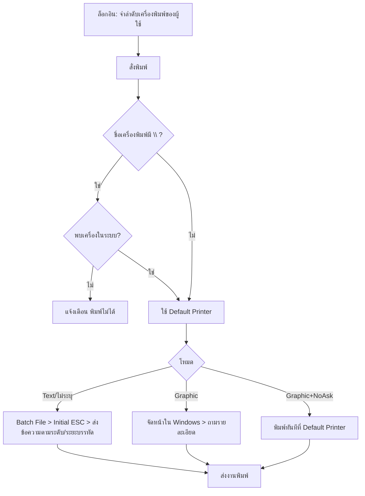

# บทที่ 27 การติดตั้งเครื่องพิมพ์
> อ้างอิงคู่มือ หน้า 447–453 (PDF p.463–469; หน้า 454/PDF 470 ว่าง)

## ภาพรวม
- เครื่องพิมพ์หัวเข็ม (Dot Matrix) นิยมเพราะพิมพ์สำเนาหลายชั้นได้ในครั้งเดียว; เลเซอร์/อิงค์เจ็ทเร็วกว่าแต่ต้องพิมพ์หลายรอบ (หน้า 447)
- ปัญหาหลักของหัวเข็มคือรหัสภาษาไทยต่างกันตามยี่ห้อ/รุ่น → ต้องพิมพ์ตารางรหัสเทียบกับภาคผนวก ค (หน้า 447–448)
- กำหนดเครื่องพิมพ์ได้หลายเครื่อง (ลำดับที่) และผูกเครื่องพิมพ์กับผู้ใช้ผ่านระบบรักษาความปลอดภัย (บทที่ 23); ถ้าไม่ได้ตั้งระบบความปลอดภัยและเข้าด้วย BIT9 จะใช้เครื่องลำดับที่ 0 เสมอ (หน้า 449)
- โหมดการพิมพ์ 4 ตัวเลือก (2 โหมดหลัก Text/Graphic) (หน้า 449–450)

## หน้าจอ

### S-PR-01 เมนูติดตั้งเครื่องพิมพ์
- เมนู: เริ่มระบบ > 6 ติดตั้งเครื่องพิมพ์ > 1 พิมพ์ตารางรหัสเครื่องพิมพ์ / 2 กำหนดรหัสเครื่องพิมพ์
- อ้างอิง: หน้า 447 (PDF p.463) — มีภาพหน้าจอ: ใช่ (รูปที่ 1)
- ลักษณะ: เมนู; เมนูเริ่มระบบทั้งหมด: 1 กำหนดค่าเริ่มต้นต่าง ๆ ▸, 2 กำหนดตารางข้อมูล ▸, 3 กำหนดรอบบัญชี, 4 กำหนดเลขที่เอกสาร, 5 กำหนดการเชื่อมต่อบัญชี ▸, 6 ติดตั้งเครื่องพิมพ์ ▸, 7 กำหนดแผนก, 8 กำหนดบริษัทใหม่, 9 รายการข้อความ ▸, A ล็อคงวด; แถบเมนูหลัก: ซื้อ ขาย การเงิน สินค้า บัญชี รายงาน เริ่มระบบ อื่น ๆ
- "พิมพ์ตารางรหัสเครื่องพิมพ์" พิมพ์ตาราง hex (แถว 0–F × คอลัมน์ 2–F) ให้เทียบกับตารางท้ายเล่ม แล้วจดเลขตาราง (หน้า 448)

### S-PR-02 ติดตั้งเครื่องพิมพ์ (กำหนดรหัสเครื่องพิมพ์)
- เมนู: เริ่มระบบ > 6.2 กำหนดรหัสเครื่องพิมพ์
- อ้างอิง: หน้า 448–452 (PDF p.464–468) — มีภาพหน้าจอ: ใช่ (รูปที่ 3, 5)
- ลักษณะ: form (ส่วนบน + กล่อง "ส่วนนี้สำหรับโหมดการพิมพ์แบบ Text Mode เท่านั้น")

| ส่วน/แท็บ | ฟิลด์ | ชนิดข้อมูล | บังคับ | ค่าเริ่มต้น/อ้างอิงจาก | คำอธิบาย/เงื่อนไข |
|---|---|---|---|---|---|
| ทั่วไป | ลำดับที่ | number | ใช่ | 0 | ห้ามซ้ำ (เครื่องหลัก = 0) (หน้า 449) |
| ทั่วไป | ชื่อเครื่องพิมพ์ | text | ใช่ | EPSON | ยี่ห้อ/รุ่น หรือ `\\Computer\PrinterName` สำหรับเครื่องแชร์ เช่น `\\ESG\LQ1170` |
| ทั่วไป | โหมดการพิมพ์ | select | ใช่ | ไม่ได้ระบุ (Text Mode) | Text Mode / Graphic Mode / Graphic+NoAsk / ไม่ได้ระบุ (Text Mode) |
| ทั่วไป | จำนวนบรรทัด | number | ใช่ | 39 | บรรทัด/หน้ากระดาษ (A4 = 39) |
| Text Mode | รหัสภาษาไทย | select | – | 42=เกษตรสหวิริยา | เลขตารางจากภาคผนวก ค |
| Text Mode | พิมพ์กรอบตารางได้ | check | – | Y | [Y/N]; N = ใช้เส้นประแทน |
| Text Mode | ระดับการพิมพ์ | select | – | ภาษาไทย 3 ระดับ | ปกติค่า 8 [สันนิษฐาน: รหัสตัวเลือก] |
| Text Mode | ระยะบรรทัดบน | number | – | 19 | n/180 นิ้ว (สระบน/วรรณยุกต์ ↔ พยัญชนะ) |
| Text Mode | ระยะบรรทัดกลาง | number | – | 19 | n/180 นิ้ว (พยัญชนะ ↔ สระล่าง) |
| Text Mode | ระยะบรรทัดล่าง | number | – | 7 | n/180 นิ้ว (สระล่าง ↔ สระบนบรรทัดถัดไป) |
| Text Mode | ชื่อ Batch File | text | ไม่ | ว่าง | ใช้เรียกเครื่องพิมพ์บนแลน |
| Text Mode | Initial ESC Sequence | text | ไม่ | ว่าง | คำสั่งเริ่มต้นเฉพาะรุ่น |
| Text Mode | Computer PORT | text | ไม่ | LPT1 | เช่น LPT2 บนแลน |

ปุ่ม/คำสั่ง: ใหม่, แก้ไข, ลบ, ปิด, บันทึก, เลื่อนระเบียน, ค้นหา, พิมพ์; `F7` พิมพ์ทดสอบ (ข้อความไทย + กรอบตาราง); `Ctrl+F7` พิมพ์ข้อความทดสอบของทุกรหัสภาษาไทยพร้อมเลขตาราง (หน้า 451–452); `Shift+F5` สลับลำดับเครื่องพิมพ์ (หน้า 452)
กฎทางธุรกิจ/เงื่อนไข:
- รายงานยาว (บัญชีแยกประเภท ภาษีซื้อ-ขาย) อาจสร้างเครื่องพิมพ์ลำดับใหม่ที่ระยะบรรทัดน้อยลง เช่น 16,16,0 เพื่อเพิ่มบรรทัดต่อหน้า (หน้า 452)
- Graphic Mode ไม่สนค่าในกล่อง Text Mode (หน้า 453)
ผลทางบัญชี/สต๊อก: ไม่มี

## ลำดับการใช้งาน
ตั้งค่า: (หัวเข็ม) 6.1 พิมพ์ตารางรหัส → เทียบภาคผนวก ค → 6.2 กรอกค่า → F7 / Ctrl+F7 ทดสอบ
การทำงานเมื่อสั่งพิมพ์ (หน้า 452–453):
1. ตอนล็อกอิน โปรแกรมจำ "ลำดับเครื่องพิมพ์" ของผู้ใช้ (จากรายละเอียดผู้ใช้ในระบบความปลอดภัย)
2. ตอนพิมพ์ ตรวจชื่อเครื่องพิมพ์: ถ้าเป็นแบบ URL (`\\...`) ตรวจว่ามีอยู่ — ไม่พบจะแจ้งและพิมพ์ไม่ได้; ถ้าไม่มี `\` ใช้ Default Printer ของ Windows
3. ตามโหมด: Text/ไม่ได้ระบุ → รัน Batch File (ถ้ามี) → ส่ง Initial ESC → ส่งข้อความพร้อมระดับ/ระยะบรรทัด; Graphic → จัดหน้าในหน่วยความจำผ่าน Windows และถามเครื่องพิมพ์/ช่วงหน้า/จำนวนชุดทุกครั้ง; Graphic+NoAsk → พิมพ์ทันทีที่ Default Printer
4. ส่งงานพิมพ์

## ข้อมูลที่เกี่ยวข้อง
- **Printer**: ลำดับที่ (PK), ชื่อเครื่องพิมพ์, โหมดการพิมพ์, จำนวนบรรทัด, รหัสภาษาไทย, พิมพ์กรอบตาราง, ระดับการพิมพ์, ระยะบรรทัดบน/กลาง/ล่าง, Batch File, Initial ESC, Port
- **User** (บทที่ 23) n:1 Printer (ลำดับเครื่องพิมพ์ของผู้ใช้)
- **ThaiCodeTable** (ภาคผนวก ค): เลขตาราง + ชื่อมาตรฐาน

## ข้อสังเกต
- เป็นเรื่องฮาร์ดแวร์ยุค dot-matrix/LPT; ในระบบใหม่เหลือเพียงแนวคิด "printer profile ต่อผู้ใช้", "จำนวนบรรทัดต่อหน้า", และ "ถาม/ไม่ถามก่อนพิมพ์"
- ตัวเลือกระดับการพิมพ์ "ค่า 8" ในข้อความไม่ได้อธิบายความหมายของตัวเลข
