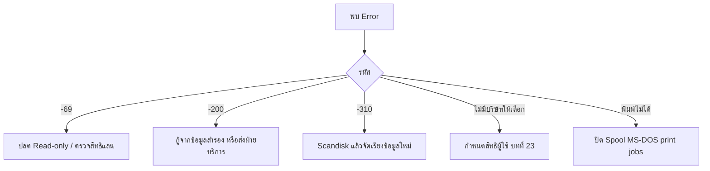

# ภาคผนวก ก/ข/ค และดัชนี
> อ้างอิงคู่มือ หน้า 455–479 (PDF p.471–495; หน้า 460/PDF 476 และ PDF 496 ว่าง)

## ภาพรวม
- **ภาคผนวก ก** การแก้ไขข้อผิดพลาดจากการใช้งาน: รหัส error ของแฟ้มข้อมูล DBF/ดัชนี และปัญหาสิทธิ/การพิมพ์ (หน้า 455–459)
- **ภาคผนวก ข** ปุ่มคำสั่งพิเศษ (Hot Key) ใช้ได้ทุกหน้าจอ: เครื่องคิดเลข, เปลี่ยนวันทำการ, สอบถามยอดสินค้าคงเหลือ, เลือกเครื่องพิมพ์, ตั้งชื่อแฟ้มรายงาน, ฟอร์มตัวอย่าง, แสดงระบบคอมพิวเตอร์ (หน้า 461–466)
- **ภาคผนวก ค** ตารางรหัสภาษาไทยของเครื่องพิมพ์ (หน้า 467–474)
- **ดัชนี** (หน้า 475–479)
- สาเหตุ error ส่วนใหญ่: ปิด-เปิดเครื่องขณะอยู่ในโปรแกรม, ไฟตก/ไฟดับ/ไฟกระชาก, ฮาร์ดดิสก์หรืออุปกรณ์แลนเสีย (หน้า 455)

---

## ภาคผนวก ก — ข้อผิดพลาด

| Error | ข้อความ | สาเหตุ | วิธีแก้ | หน้า |
|---|---|---|---|---|
| -69 (84307) | Duplicate Instance Found Error Opening File C:\PROGRAM FILES\EXPRESSI\TEST\ARTRN | แฟ้มถูกจำกัดสิทธิ (สิทธิแลน หรือ Attrib ของ DOS) | Stand alone: หาไฟล์ ARTRN.DBF > Properties > เอา Read-only ออก; LAN: ติดต่อผู้ดูแลแลน | 455–456 |
| -200 (83805) | File is not a Data File …\ARTRN.DBF | แฟ้มเสีย (Bookkeeping information หรือ File Structure ผิด) | ดึงข้อมูลสำรองล่าสุดแล้วป้อนเพิ่ม; ไม่มีสำรอง → ส่งให้ฝ่ายบริการลูกค้ากู้ (อาจไม่ครบ) | 456–457 |
| -310 (84907) | Not a Correct Index File | แฟ้มดัชนีเสีย | Scandisk (บทที่ 2) แล้วจัดเรียงข้อมูลใหม่ (ทั้งหมด หรือเฉพาะแฟ้มที่แจ้ง เช่น ARTRN) | 457 |
| – | เข้าโปรแกรมแล้วไม่มีบริษัทที่ต้องการให้เลือก (เห็นเฉพาะ "Z ข้อมูลเปล่าของเวอร์ชั่น 5 / DATAZ") | ผู้ใช้ไม่ได้รับสิทธิในข้อมูลนั้น | กำหนดสิทธิการใช้งานบริษัทให้ผู้ใช้ (บทที่ 23) | 457–458 |
| – | พิมพ์เอกสารจากโปรแกรมไม่ได้ | Windows จัดคิวงานพิมพ์ DOS | Control Panel > Printers > Properties > Details > Port Settings > เอา ✓ "Spool MS-DOS print jobs" ออก | 458–459 |

### S-AX-01 Dialog แจ้ง Error
- อ้างอิง: หน้า 455–457 (PDF p.471–473) — มีภาพหน้าจอ: ใช่
- ลักษณะ: dialog หัวเรื่อง "Error No : <รหัส> (<รหัสภายใน>)" + ข้อความ + path ไฟล์ + ปุ่ม OK

### S-AX-02 รายการบริษัทตอนเข้าโปรแกรม
- อ้างอิง: หน้า 458 (PDF p.474) — มีภาพหน้าจอ: ใช่ (รูปที่ 5)
- ลักษณะ: list คอลัมน์ ชื่อข้อมูล / โฟลเดอร์ (DATAZ) / [คอลัมน์ที่ 3: DAT — สันนิษฐาน ชนิด] + ปุ่ม ตกลง, ยกเลิก, ค้นหา
- กฎ: แสดงเฉพาะบริษัทที่ผู้ใช้มีสิทธิ

---

## ภาคผนวก ข — ปุ่มคำสั่งพิเศษ (หน้า 461)

| Hot Key | คำสั่ง | หมายเหตุ |
|---|---|---|
| Shift+F2 | เครื่องคิดเลขของโปรแกรม | |
| Shift+F3 | เปลี่ยนวันทำการ | |
| Shift+F4 | สอบถามยอดสินค้าคงเหลือ | |
| Shift+F5 | เลือกเครื่องพิมพ์ | เนื้อหาหน้า 463 เขียน `Alt+F5` |
| Shift+F6 | ตั้งชื่อแฟ้มรายงาน | |
| Shift+F7 | รายงานหรือฟอร์มตัวอย่าง | เนื้อหาหน้า 464–465 เขียน `Alt+F7` |
| Shift+F10 | แสดงระบบคอมพิวเตอร์ | |

### S-AX-03 เครื่องคิดเลข (Calc)
- เมนู: Shift+F2 (ทุกหน้าจอ)
- อ้างอิง: หน้า 461–462 (PDF p.477–478) — มีภาพหน้าจอ: ใช่
- ลักษณะ: dialog เครื่องคิดเลขแบบมีกระดาษ (tape) เลื่อนดูผลก่อนหน้าได้

| ส่วน | ฟิลด์ | ชนิดข้อมูล | บังคับ | ค่าเริ่มต้น | คำอธิบาย |
|---|---|---|---|---|---|
| tape | ประวัติการคำนวณ | memo (display) | – | | เช่น 10.00 / 20.00 + / 30.00 = |
| ตั้งค่า | จำนวนตำแหน่งทศนิยม (ปุ่มลูกศรขึ้นลง) | number | – | 2 | 3 → แสดง 1,234.567 |
| แสดงผล | ผลลัพธ์ | number | – | | |

ปุ่ม: MC, MR, M-, M+, Copy, %, CE, AC, 0–9, ., DEL, /, ^, *, +/-, -, +, =
การใช้: เช่น คำนวณเงินมัดจำ 10% ของมูลค่าสินค้าขณะอยู่ในช่องจำนวนเงิน (หน้า 461); มีปุ่ม Copy [สันนิษฐาน: คัดลอกผลไปวางในช่อง]

### S-AX-04 เปลี่ยนวันทำการ
- เมนู: Shift+F3
- อ้างอิง: หน้า 462 (PDF p.478) — มีภาพหน้าจอ: ใช่ (รูปที่ 2)

| ส่วน | ฟิลด์ | ชนิดข้อมูล | บังคับ | ค่าเริ่มต้น | คำอธิบาย |
|---|---|---|---|---|---|
| dialog | วันทำการ | date (lookup ปฏิทิน) | ใช่ | วันที่ป้อนตอนเข้าโปรแกรม | 07/06/2548 (พ.ศ.) |

ปุ่ม: ตกลง (Enter บันทึก), Esc ออกโดยไม่แก้
กฎ: วันทำการเป็นค่าเริ่มต้นของวันที่เอกสารทุกหน้าจอ (ซื้อ ขาย ฯลฯ) — ใช้เมื่อต้องป้อนเอกสารหลายใบที่วันเดียวกันซึ่งไม่ใช่วันทำการเดิม (หน้า 462)

### S-AX-05 สอบถามยอดสินค้าคงเหลือ
- เมนู: Shift+F4
- อ้างอิง: หน้า 463 (PDF p.479) — มีภาพหน้าจอ: ใช่ (รูปที่ 3)

| ส่วน | ฟิลด์ | ชนิดข้อมูล | บังคับ | ค่าเริ่มต้น | คำอธิบาย |
|---|---|---|---|---|---|
| form | รหัสสินค้า | lookup | ใช่ | สินค้า | 01-INTL-CL-600 |
| form | คลังสินค้า | lookup | ใช่ | คลัง | 01 |
| form | จำนวน | number(4) | ไม่ | 0.0000 | ใช้เมื่อซื้อ/ขายสินค้าชุด |
| form | ราคาซื้อ | money(4) | ไม่ | 0.0000 | ใช้กับสินค้าชุด: โปรแกรมคำนวณราคาซื้อของส่วนประกอบ |
| form | ราคาขาย | money(4) | ไม่ | 0.0000 | ใช้กับสินค้าชุด: คำนวณราคาขายของส่วนประกอบ |
| form | วันที่ | date | ใช่ | วันทำการ | ยอด ณ วันที่ |

ปุ่ม: ไอคอนพิมพ์รายงาน → แสดงยอดคงเหลือทันที

### S-AX-06 เลือกเครื่องพิมพ์
- เมนู: Shift+F5 (ตารางหน้า 461) / Alt+F5 (ข้อความหน้า 463)
- อ้างอิง: หน้า 463–464 (PDF p.479–480) — มีภาพหน้าจอ: ใช่ (รูปที่ 4)
- ลักษณะ: list คอลัมน์ ลำดับ, ชื่อเครื่องพิมพ์, รหัสภาษาไทย — ตัวอย่าง: 0 EPSON 42; L HP LASERJET 4P 17; X For print Report 42; Y For print Report on EPSON2170i 42
- ปุ่ม: ตกลง, ยกเลิก, ค้นหา
- ข้อสังเกต: ลำดับเครื่องพิมพ์เป็นตัวอักษรได้ (L, X, Y)

### S-AX-07 ตั้งชื่อแฟ้มรายงาน
- เมนู: Shift+F6
- อ้างอิง: หน้า 464 (PDF p.480) — มีภาพหน้าจอ: ใช่ (รูปที่ 5)

| ส่วน | ฟิลด์ | ชนิดข้อมูล | บังคับ | ค่าเริ่มต้น | คำอธิบาย |
|---|---|---|---|---|---|
| dialog | ชื่อแฟ้มรายงาน | text | ใช่ | | เช่น a:report.txt; ชื่อภาษาอังกฤษ ≤8 ตัว นามสกุล ≤3 ตัว |

ปุ่ม: ตกลง (Enter)
กฎ: ใช้เป็นค่าเริ่มต้นเมื่อพิมพ์รายงานออกแฟ้ม (ปลายทาง Screen/Printer/File)

### S-AX-08 รายงานหรือฟอร์มตัวอย่าง
- เมนู: Shift+F7 (ตาราง) / Alt+F7 (ข้อความ)
- อ้างอิง: หน้า 464–465 (PDF p.480–481) — มีภาพหน้าจอ: ใช่ (รูปที่ 6–8)
- ลักษณะ: confirm dialog "เปลี่ยนรายงานหรือแบบฟอร์มเป็นแบบตัวอย่าง" ปุ่ม ตกลง/ยกเลิก (toggle)
- กฎ: เมื่อเปิด แล้วไปหน้าจอเอกสาร (เช่น ขายเงินเชื่อ) กด Alt+P → ฟอร์มพิมพ์ตัวยึดตำแหน่ง `XXX` (อักขระ) / `999` (ตัวเลข) ยาวตามขนาดฟิลด์ (เช่น รหัสลูกค้า 10 ตัว = XXXXXXXXXX) เพื่อส่งโรงพิมพ์ออกแบบฟอร์ม pre-printed; กด Alt+F7 อีกครั้งเพื่อกลับเป็นปกติ

### S-AX-09 แสดงระบบคอมพิวเตอร์
- เมนู: Shift+F10
- อ้างอิง: หน้า 465–466 (PDF p.481–482) — มีภาพหน้าจอ: ใช่ (รูปที่ 9)

| ส่วน | ฟิลด์ | ชนิดข้อมูล | ค่าตัวอย่าง |
|---|---|---|---|
| กิจการ | 1. ชื่อกิจการ (ไทย/อังกฤษ 2 บรรทัด) | text | บริษัท เอ็กซ์เพรสซอฟท์แวร์กรุ๊ป จำกัด / Express Software Group Co.,Ltd. |
| กิจการ | 2. ที่เก็บข้อมูล | text | X:\Program Files\ExpressI\TEST |
| กิจการ | 3. เวอร์ชั่น / S/N | text | 1.0 (Internal) |
| พิมพ์ | 4. ชื่อเครื่องพิมพ์ | text | |
| พิมพ์ | 5. ชื่อแฟ้มรายงาน | text | |
| พิมพ์ | 6. ลักษณะรายงาน | text | แบบปกติ (หรือแบบตัวอย่าง [สันนิษฐาน]) |
| ผู้ใช้ | 7. รหัสผู้ใช้ | text | BIT9 |
| ผู้ใช้ | 8. ระดับทำงาน | text | 9,ไม่ตรวจสอบสิทธิการทำงาน |
| ผู้ใช้ | 9. เชื่อมต่อบัญชี | text | Y,PERPETUAL |
| โปรแกรม | 10. ที่เก็บโปรแกรม | text | X:\Program Files\ExpressI |
| โปรแกรม | 11. วันที่โปรแกรม | date | 02/06/2005 |
| งวด | 12. วันที่ทำการ | date | 07/06/2548 |
| งวด | 13. รอบบัญชี (จาก–ถึง) | date | 01/01/2547 ถึง 31/12/2548 |

ปุ่ม: ตกลง (แสดงผลอย่างเดียว)

---

## ภาคผนวก ค — ตารางรหัสภาษาไทยของเครื่องพิมพ์ (หน้า 467–474)
ตาราง hex 16×14 (แถว 0–F, คอลัมน์ 2–F) แสดงอักขระของแต่ละรหัส ใช้เทียบกับผลพิมพ์จากเริ่มระบบ 6.1 แล้วนำเลขตารางไปกรอกช่อง "รหัสภาษาไทย" (บทที่ 27)

| ตาราง | มาตรฐาน | หน้า |
|---|---|---|
| 11 | สมอ.988 ต่อหัว | 467 |
| 12 | สมอ.988 ไม่ต่อหัว | 467 |
| 13 | สมอ. ไอบีเอ็ม | 468 |
| 14 | NEC TIS-08 | 468 |
| 15 | NEC TIS-12 | 469 |
| 16 | สหวิริยาเก่า | 469 |
| 17 | สหวิริยาใหม่ | 470 |
| 18 | สมอ.ทั่วไป ไม่ต่อหัว | 470 |
| 19 | เอสซีที | 471 |
| 20 | ไมโครวิช | 471 |
| 21 | โอลิมเปีย ISO1 | 472 |
| 22 | โอลิมเปีย ISO2 | 472 |
| 40 | NEC KU-STD | 473 |
| 41 | NEC KU-15 | 473 |
| 42 | เกษตรสหวิริยา (ค่าเริ่มต้นในตัวอย่าง) | 474 |
| 43 | เกษตรโอลิมเปีย | 474 |

> หมายเหตุ: รายการเลือกเครื่องพิมพ์ (หน้า 464) มีรหัส 17 สำหรับ HP LASERJET 4P

---

## ดัชนี (หน้า 475–479)
ดัชนีคำศัพท์ภาษาไทย/อังกฤษ → เลขหน้า (ไม่มีหน้าจอ) รายการที่ชี้มายังช่วงนี้: Item File 404, 417; Master file 416, 417; Relate File 404, 416, 417, 426; Perpetual … 443; การพิมพ์ … 410, 426; กั้นหน้า-กั้นหลัง 410; ความยาวกระดาษ 410; คัดลอกแบบฟอร์ม 420; คำสั่งของเครื่องพิมพ์ 407, 411; คำอธิบายในสมุดรายวัน 443; คีย์ลัด 463; เครื่องคำนวณเลข 461, 462; จำนวนบรรทัด 410, 450; เจ้าหนี้ต่างประเทศ 439, 440, 443, 446; ชนิดของแบบฟอร์ม 397; ตัวแปร 401–418; ตารางรหัสเครื่องพิมพ์ 447, 448, 450; ธุรกิจนำเข้า 435, 439; ธุรกิจผลิต 388, 435; ประยุกต์ใช้งาน 435, 447; พอร์ต 451; พิมพ์เอกสารซ้ำ 443; เปลี่ยนวันทำการ 462; ยอดคงเหลือสินค้า 463; รหัสภาษาไทย 450; ระยะบรรทัด 407, 408, 450; รับรองเอกสาร 443; รายงานต้นฉบับ 421; สำรองแบบฟอร์ม 421; สินค้าบริการ 441; สินค้าระหว่างทาง 439; หัวข้อการทำงานพิเศษ 463; อัตราแลกเปลี่ยน 445, 446

---

## ลำดับการใช้งาน

## ข้อมูลที่เกี่ยวข้อง
- **Session/WorkingContext**: ผู้ใช้, ระดับทำงาน, วันทำการ, รอบบัญชี, ที่เก็บข้อมูล (บริษัท), เครื่องพิมพ์ที่เลือก, ชื่อแฟ้มรายงาน, ลักษณะรายงาน (ปกติ/ตัวอย่าง), วิธีเชื่อมต่อบัญชี (Y, PERPETUAL)
- **Company** (ที่เก็บข้อมูล/โฟลเดอร์ DATA) n:m **User** (สิทธิ)
- **Printer** (ลำดับเป็นตัวเลขหรือตัวอักษร), **ThaiCodeTable**
- แฟ้ม DBF + ดัชนีแยก (ARTRN.DBF) — โครงสร้างแบบ xBase

## ข้อสังเกต
- Hot key ในตาราง (Shift+F5/F7) ไม่ตรงกับเนื้อหา (Alt+F5/Alt+F7) — ต้องตรวจกับโปรแกรมจริง
- ข้อมูลระบบ (S-AX-09) สรุปบริบทการทำงานที่ ERP ใหม่ควรมี: วันทำการแยกจากวันที่จริง, รอบบัญชี, ระดับผู้ใช้, วิธีบันทึกสินค้า (Perpetual/Periodic)
- ฟีเจอร์ "ฟอร์มตัวอย่าง XXX/999" ช่วยออกแบบฟอร์มพิมพ์สำเร็จ — ในระบบใหม่อาจแทนด้วย preview ของ template
- Error -200/-310 สะท้อนความเปราะบางของ DBF; ระบบใหม่ควรใช้ฐานข้อมูลที่มี transaction
