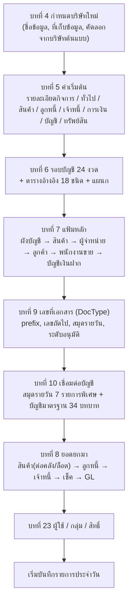
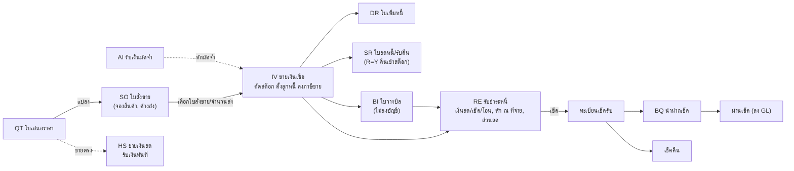
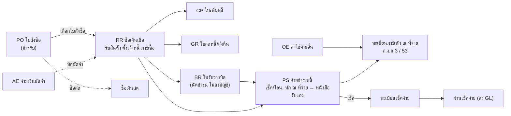
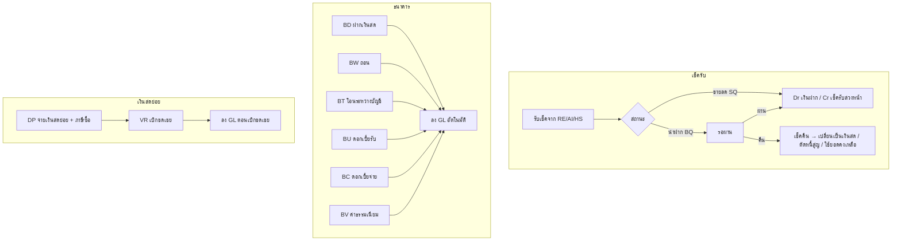
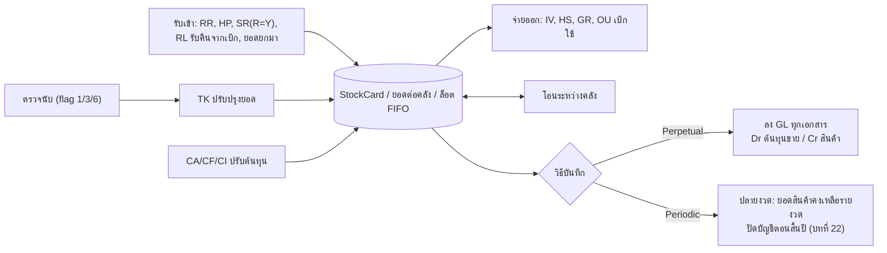
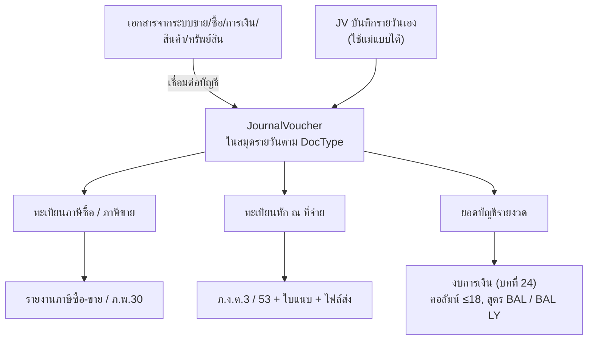
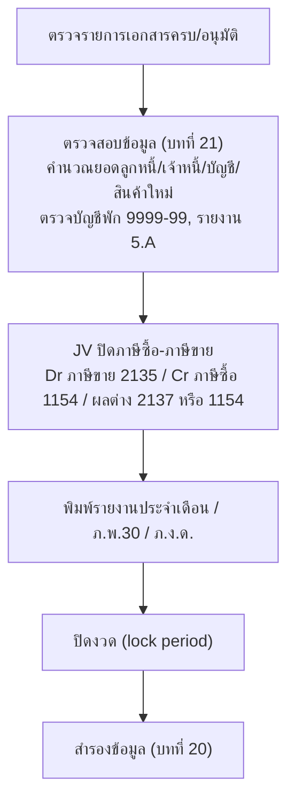
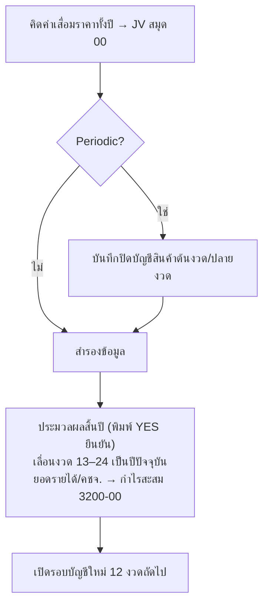

# ลำดับการทำงานภาพรวม (Process Flows)
> สังเคราะห์จากคู่มือ Express บทที่ 3–27 — รายละเอียดแต่ละหน้าจอดูใน `01_หน้าจอ/chXX_*.md`
> รหัสเอกสาร (prefix) ตามภาพหน้าจอคู่มือบทที่ 9 / 11 / 12 / 13 / 14

---

## 1. การเริ่มระบบ (ทำครั้งเดียวต่อบริษัท)

**ข้อบังคับที่คู่มือเน้น**
- ห้ามเปลี่ยนรอบบัญชีหลังมีรายการ (ยอดสะสมรายงวดจะไม่ย้ายตาม) — บทที่ 6
- ต้องสร้าง **บัญชีพัก 9999-99** ในผังบัญชีก่อนเปิดเชื่อมต่อบัญชี — บทที่ 10
- ยอดยกมา GL ต้องเท่ากับผลรวมยอดยกมาของลูกหนี้/เจ้าหนี้/สินค้า (ไม่ได้ลง GL ซ้ำ) [สันนิษฐาน] — บทที่ 8

---

## 2. วงจรขายและลูกหนี้ (บทที่ 12)

**กฎสำคัญ**: ตรวจวงเงินเครดิต (อนุมัติตาม CreditLimitTier 1–5) · ราคาตาม price_type 0/1/2 (แยก/รวม/ไม่มี VAT) และ price_table 1–5 · เตือนขายต่ำกว่าทุน · ขายบริการเลือกเกณฑ์ภาษี (สิทธิ/เงินสด → ภาษีขาย-รอเรียกเก็บ 2136-00)

---

## 3. วงจรซื้อและเจ้าหนี้ (บทที่ 11)

---

## 4. การเงิน / ธนาคาร / เงินสดย่อย (บทที่ 13, 15)

---

## 5. สินค้าคงคลัง (บทที่ 5, 8, 14)

ต้นทุน: FIFO หรือ ถัวเฉลี่ย (กำหนดที่กลุ่มบัญชีสินค้า) · คิดต้นทุนแยกคลังได้ · ติดลบได้หรือไม่ (Y/N/A + ระดับอนุมัติ)

---

## 6. บัญชีแยกประเภทและภาษี (บทที่ 15, 16)

---

## 7. สิ้นเดือน (บทที่ 18, 21)

## 8. สิ้นปี (บทที่ 19, 22)

---

## 9. แนวปฏิบัติร่วมของทุกหน้าจอ (บทที่ 3)
- โครงหน้าจอเอกสาร: **หัวเอกสาร → ตารางรายการ → ท้ายเอกสาร (ยอดรวม/ภาษี/วิธีชำระ)**
- เลขที่เอกสารอัตโนมัติ `IV**NEW**` → ได้เลขจริงเมื่อบันทึก
- แถบเครื่องมือ 19 คำสั่ง + คีย์ลัด (F-keys, Alt+?) และหน้าต่างค้นหา (prefix search, เรียงตามรหัส/ชื่อ)
- สถานะเอกสาร: ปกติ / ยกเลิก (เก็บเลขไว้) / ลบ (นำเลขกลับมาใช้) · อนุมัติรายใบหรือช่วง
- พิมพ์ฟอร์ม 9 ช่องต่อเอกสาร (ต้นฉบับ/ทดสอบ) ออกจอ/เครื่องพิมพ์/ไฟล์
- ข้อมูลประวัติเอกสาร: ผู้บันทึก/วันเวลา, ผู้พิมพ์/จำนวนครั้ง, ผู้อนุมัติ
