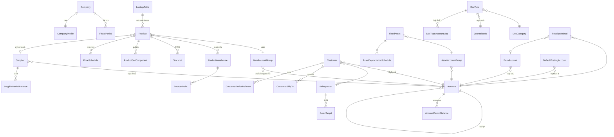
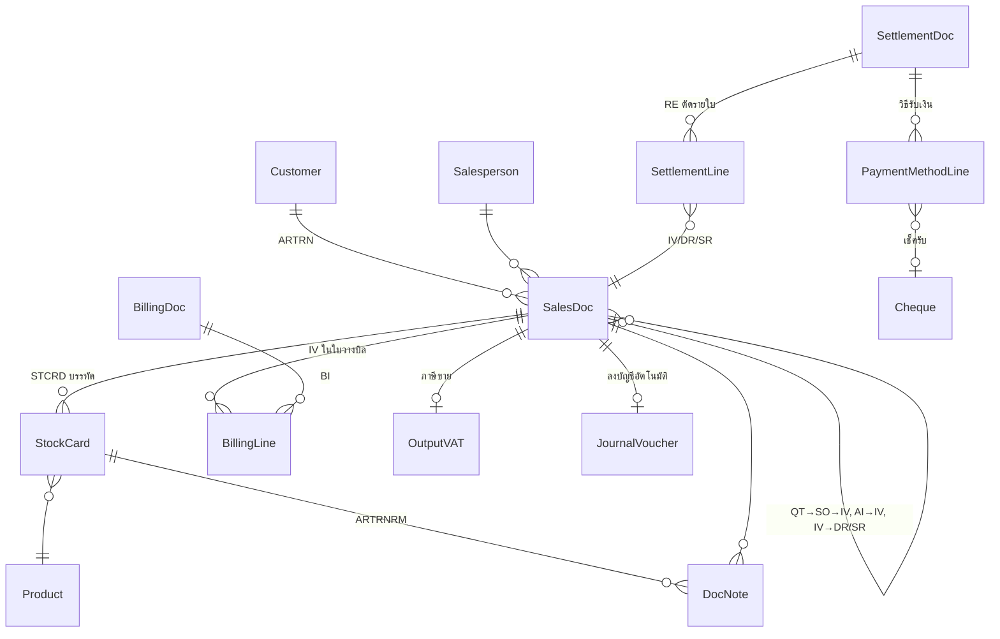
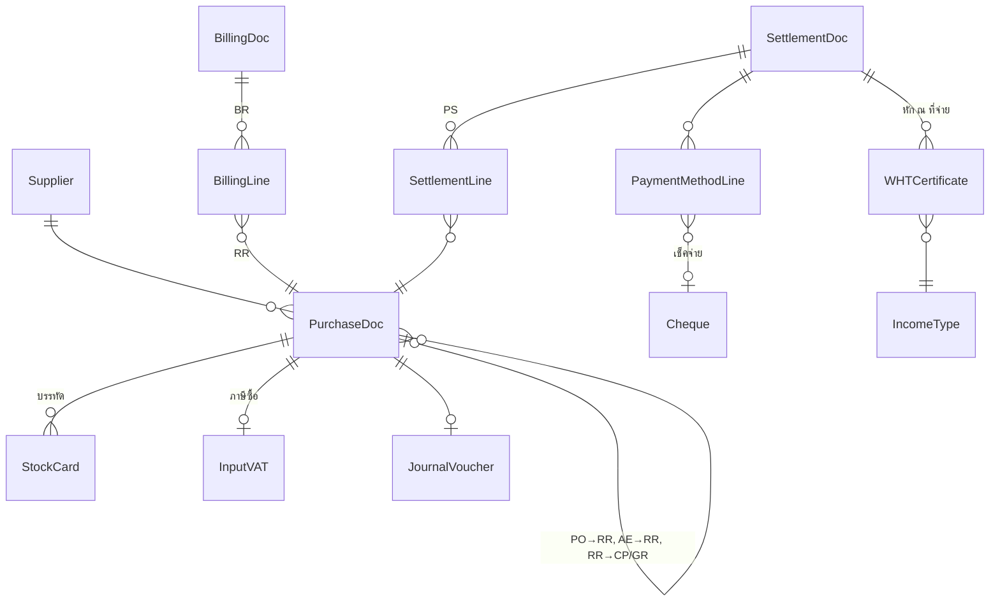
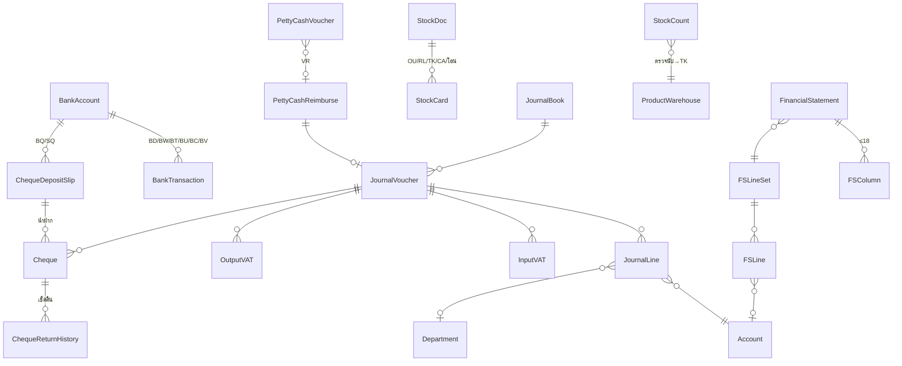
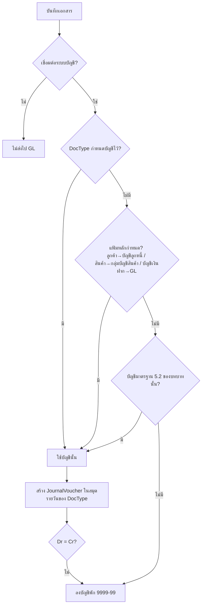

# โครงสร้างข้อมูลรวม (Consolidated Data Model)
> สังเคราะห์จากการวิเคราะห์คู่มือ Express for Windows v.1 บทที่ 3–27 (ไฟล์ใน `01_หน้าจอ/` และ `_data/`)
> ชื่อตารางที่เป็น **ตัวพิมพ์ใหญ่** (เช่น `ARTRN`, `STCRD`, `ARMAS`) คือชื่อแฟ้มจริงของ Express ที่ปรากฏในคู่มือ (บทที่ 3, 20, 23, 25)
> ชื่อแบบ CamelCase เป็นชื่อที่ตั้งขึ้นเพื่อการออกแบบ ส่วนที่ไม่มีในคู่มือโดยตรงทำเครื่องหมาย [สันนิษฐาน]

---

## 1. หลักการออกแบบที่อ่านได้จากคู่มือ

| # | หลักการ | หลักฐานในคู่มือ |
|---|---|---|
| 1 | **หลายบริษัทในโปรแกรมเดียว** — แต่ละบริษัทเป็นชุดข้อมูลแยก (data path) และมีทะเบียนบริษัทกลาง | บทที่ 4 |
| 2 | **รอบบัญชี 24 งวด** (ปีปัจจุบัน 12 + ปีถัดไป 12) — ยอดสะสมรายงวดเก็บไว้ในแฟ้มหลัก (ลูกค้า ผู้จำหน่าย ผังบัญชี พนักงานขาย) | บทที่ 6, 22 |
| 3 | **เอกสารแยกประเภทด้วย RECTYP + DOCNUM** — เอกสารขายทุกชนิดอยู่ในแฟ้มหัวเดียว (`ARTRN`) แยกด้วยประเภท | บทที่ 3, 25 |
| 4 | **บรรทัดสินค้าของทุกเอกสารรวมอยู่ใน Stock Card (`STCRD`)** — ใช้ทั้งคำนวณสต๊อก ต้นทุน และพิมพ์ฟอร์ม | บทที่ 25 |
| 5 | **ประเภทเอกสาร (DocType) เป็นตัวกำหนดพฤติกรรม** — prefix, เลขถัดไป, สมุดรายวัน, ระดับอนุมัติ, คลัง default, บัญชีที่ใช้ลง GL | บทที่ 9 |
| 6 | **ลงบัญชีอัตโนมัติ (GL link) หาบัญชีตามลำดับ 3 ชั้น**: DocType → แฟ้มหลัก (ลูกค้า/กลุ่มบัญชีสินค้า/บัญชีเงินฝาก) → บัญชีมาตรฐาน 34 บทบาท (เริ่มระบบ 5.2) → หาไม่ได้ลง **บัญชีพัก 9999-99** | บทที่ 10 |
| 7 | **ยอดคงเหลือทุกชนิดคำนวณใหม่ได้** จากรายการ (recalc ลูกหนี้/เจ้าหนี้/ผังบัญชี/สินค้า) และลงบัญชีใหม่ได้ (Alt+J) | บทที่ 21 |
| 8 | **ผูกเอกสารต่อเนื่อง**: QT→SO→IV, PO→RR, AI→IV (หักมัดจำ), IV→DR/SR, IV→BI→RE, RR→BR→PS | บทที่ 11, 12 |
| 9 | **ภาษีเป็นทะเบียนแยก** (ภาษีซื้อ/ภาษีขาย/หัก ณ ที่จ่าย) ที่ชี้กลับเอกสารต้นทาง แก้ไขในระบบภาษีได้ | บทที่ 15, 16 |
| 10 | **Audit**: ทุกเอกสารเก็บผู้บันทึก/พิมพ์/อนุมัติ/จำนวนครั้งที่พิมพ์ + Log file แยก (กรมสรรพากรกำหนดเก็บ ≥ 2 ปี) | บทที่ 3, 23 |
| 11 | **สิทธิ์ 7 ชนิด** (อ่าน/เพิ่ม/แก้ไข/ยกเลิก/ลบ/พิมพ์/อนุมัติ) ต่อ ข้อมูลบริษัท × เมนู และระดับอนุมัติ 0–9 | บทที่ 23 |

---

## 2. รายการตาราง แยกตามกลุ่ม

### 2.1 ระบบ / ความปลอดภัย (บทที่ 4, 20, 23)
| ตาราง | ฟิลด์สำคัญ | ความสัมพันธ์ |
|---|---|---|
| Company | code, name, group_code, data_path, created_date | → CompanyGroup |
| CompanyGroup | group_code | ↔ User (ผ่าน UserCompanyGroupAccess) |
| UserGroup | group_code, group_name | 1:n User, Permission |
| User | user_code, user_name, group_code, approval_level(0–9), check_rights, status, printer_code, menu_language, last_used, password_hash | → UserGroup, Printer |
| Permission | subject_type(user/group), subject_code, company_code, menu_code, can_read, can_add, can_edit, can_cancel, can_delete, can_print, can_approve (ค่า Y/L/N/S) | → Module, Company |
| Module (Menu) | menu_code, menu_name, parent | |
| ActivityLog | TRNDATE, TRNTIME, TRNCODE, USERID, AUTHID(ผู้อนุมัติแทน), DATA, MODULE, DOCNUM, description | → User |
| Printer | printer_code, printer_name | |
| BackupSet | file_name, destination, file_count, bytes, date, operator | → Company |

### 2.2 การตั้งค่า (บทที่ 5, 6, 9, 10)
| ตาราง | ฟิลด์สำคัญ | หมายเหตุ |
|---|---|---|
| CompanyProfile | name_th/en, address_th1-2, address_en1-2, phone, business_type, tax_id, branch_no, trade_reg_no | 1 แถว/บริษัท |
| Settings_General | year_system(พ.ศ./ค.ศ.), vat_rate, price_type(0/1/2), avg_input_vat, approve_level, reprint_level, vat_type_per_line | |
| Settings_IC | item_code_mask, posting_method(**Perpetual/Periodic**), price_dec, qty_dec, allow_negative, cost_by_warehouse, main_warehouse, aging_days_1-3, use_barcode | |
| Settings_AR / Settings_AP | search_by, allow_rename_item, edit_price, warn_below_cost, credit_note_method, aging buckets, lock_so_over_limit, service_vat_basis | |
| CreditLimitTier | tier(1–5), max_amount, approve_level | อนุมัติขายเกินวงเงิน |
| Settings_FN | clear_cheque_immediately, default_deposit_bank, wht_min_amount, social_security_no | |
| Settings_GL | account_code_mask, voucher_numbering, petty_cash_col1-4 | |
| Settings_FA | asset_code_mask, depreciate_on_entry, depreciation_frequency | |
| FiscalCycle | start_date | |
| FiscalPeriod | period_no(1–24), end_date, **is_locked** | ปิดงวดแล้วห้ามบันทึก (บทที่ 18) |
| DocCategory | code, name (หมวดเอกสาร เช่น CN, DN, BS, BQ) | |
| **DocType** | code(prefix เช่น IV), category, name_th/en, next_no(7 หลัก), journal_code, department, journal_desc_expr, price_type, vat_rate, vat_basis, approve_level, reprint_level, warehouse_code | หัวใจของพฤติกรรมเอกสาร |
| DocTypeAccountMap | doc_type, role, dr_cr, account_no | ชั้นที่ 1 ของการหาบัญชี |
| GLLinkSetting | link_enabled + สมุดรายวันของ 7 รายการพิเศษ (ผ่านเช็ครับ/จ่าย, ตัดเช็คเกิน, หนี้สูญ, เบิกชดเชยเงินสดย่อย, ค่าเสื่อม) | |
| DefaultPostingAccount | role(34 บทบาท), account_no | ชั้นที่ 3 — ดู §4 |
| ItemAccountGroup | code, cost_method(FIFO/Average), inventory_acct, cogs_acct, sales_acct, sales_return_acct, purchase_acct, purchase_return_acct | ชั้นที่ 2 สำหรับสินค้า |
| AssetAccountGroup | code, asset_acct, depr_expense_acct, accum_depr_acct | |
| ReceiptMethod / PaymentMethod | code, desc_th/en, is_cheque, bank_account_code, gl_account | วิธีรับ/จ่ายเงิน → บัญชี GL |

### 2.3 ตารางอ้างอิง (บทที่ 6)
| ตาราง | ฟิลด์ | ใช้กับ |
|---|---|---|
| **LookupTable** (ตารางกลาง 18 ชนิด รหัส 01–61) | table_code, code, short_th, short_en, full_th, full_en, rate | หน่วยนับ(+อัตรา), คลัง(21), หมวดสินค้า(22), ระดับสินค้า(23), เขตการขาย(40), ขนส่งโดย(41), ประเภทลูกค้า(45), ประเภทผู้จำหน่าย(46), ประเภทพนักงานขาย(47), หมวดภาษีหัก ณ ที่จ่าย(55), เหตุผลยกเลิก, ธนาคาร ฯลฯ |
| Department | code, short_th/en, full_th/en | เอกสารทุกชนิด, JournalLine (ถ้าบัญชีนั้น "แยกแผนก = Y") |
| IncomeType (ประเภทเงินได้) | code, description, form_type(t), condition(c), rate(r) | ภาษีหัก ณ ที่จ่าย |

### 2.4 แฟ้มข้อมูลหลัก (บทที่ 7, 8, 14, 19)
| ตาราง | ฟิลด์สำคัญ | ความสัมพันธ์ |
|---|---|---|
| **Account** (ผังบัญชี) | account_no(PK, ตาม mask), name_th, name_en, parent_account, level, category(1–5), type(คุม/ย่อย), split_by_dept(Y/N) | self-ref; 1:n AccountPeriodBalance |
| AccountPeriodBalance | account_no, department, period(1–24), debit, credit | recalc ได้ |
| GLOpeningBalance / PriorYearBalance / Budget | account_no, department, amount / period_1..12 | |
| **Product** (สินค้า/บริการ/ชุด/คชจ.อื่น/รายได้อื่น) | code, item_type [สันนิษฐาน], barcode, name_th(50), name_en(50), category, item_account_group, unit_small, unit_big+factor, unit_buy+factor, unit_sell+factor, substitute_product, allow_negative(Y/N/A), price_1..5, supplier_code, vat_type, std_cost, remarks(10) | — |
| ProductWarehouse | product, warehouse, opening_qty/value, balance_qty, unit_cost, balance_value, last_buy_date/price/disc, last_sell_date/price/disc, on_order_qty, on_so_qty, shelf | ยอดคงเหลือต่อคลัง |
| StockLot (FIFO) | product, warehouse, date, doc_no, qty_orig, value_orig, qty_adj, value_adj | ต้นทุนแบบ FIFO |
| ProductSetComponent | set_product, seq(≤999), component_product, qty, unit, cost, price | สินค้าชุด (ธรรมดา/พิเศษ) |
| ServiceAccounting | product, revenue_acct, return_acct, unit_cost, dr_cost_acct, cr_wage_acct, expense_acct | บริการ/คชจ.อื่น/รายได้อื่น |
| PriceSchedule | product, min_qty, unit, factor, is_percent, price_1..5, start_date, end_date | ตารางราคาตามปริมาณ/ช่วงเวลา |
| ReorderPoint | product, warehouse, shelf, start_month_day, reorder_qty, max_qty, order_qty | |
| **Customer** (`ARMAS`) | code, prefix, name(60), addr1-3, zip, phone, contact, status, tax_id(13), branch_no, cust_type, ar_account, salesperson, sales_area, ship_via, credit_days, payment_terms, price_table(1–5), discount, credit_limit, *balance, *cheque_on_hand | |
| CustomerShipTo | customer, ship_code, address, phone, contact | |
| CustomerPeriodBalance | customer, period(1–24), cash_sales, credit_sales, debit_notes, credit_notes, receipts | |
| **Supplier** (Vendor) | code, prefix, name(60), addr1-3, zip, phone, contact, tax_id, branch_no, income_type, wht_rate, wht_category, wht_condition, supplier_type, ap_account, price_type, vat_pct, ship_via, credit_days, payment_terms, discount, credit_limit, *balance, *cheque_issued | |
| SupplierPeriodBalance | supplier, period(1–24), cash_purchases, credit_purchases, debit_notes, credit_notes, payments | |
| **Salesperson** (`OESLM`) | code, name(45), position, type, sales_area, commission_pct, address, tax_id, social_security_no | 1:24 SalesTarget |
| **BankAccount** | code, name, branch, passbook_no, short_name, gl_account | |
| **FixedAsset** | code, name_th/en, category, asset_account_group, serial_no, department, depreciate(Y/N), purchase_date, cost, salvage_value, method(เส้นตรง/ลดลง), start_use_date, useful_life_years, rate_pct, depr_frequency, accum_depr_bf, sold_date, sold_price, gain_loss | 1:n AssetDepreciationSchedule |
| SerialRegister | serial_no, machine_no, product_category, sale_date, warranty_end, customer, salesperson | 1:n SerialServiceHistory |

### 2.5 เอกสาร/รายการประจำวัน (บทที่ 11–16)
| ตาราง | ครอบคลุมเอกสาร | ฟิลด์หัวเอกสารสำคัญ |
|---|---|---|
| **SalesDoc** (`ARTRN`) | QT ใบเสนอราคา, SO ใบสั่งขาย, AI รับมัดจำ, IV ขายเชื่อ, HS/CS ขายสด, DR เพิ่มหนี้, SR ลดหนี้/รับคืน, OI รายได้อื่น | RECTYP, DOCNUM, DOCDAT, CUSCOD, bill_to, branch_no, department, SLMCOD, sales_area, ship_via, price_type, credit_days, DUEDAT, ref_doc(SO/IV/AI), discount, vat_rate, amount, vat_amount, total, tax_basis(สิทธิ/เงินสด), VATDAT, VATPRD, DOCSTAT, outstanding, paid_flag |
| **PurchaseDoc** (`APTRN` [สันนิษฐาน]) | PO ใบสั่งซื้อ, AE จ่ายมัดจำ, RR ซื้อเชื่อ, HP ซื้อสด, CP เพิ่มหนี้, GR ลดหนี้/ส่งคืน, OE ค่าใช้จ่ายอื่น | doc_type, doc_no, date, supplier, bill_be, tax_invoice_no/date, department, ref_doc(PO/RR/AE), credit_days, due_date, price_type, discount, vat, total, tax_basis, outstanding, paid_flag |
| **StockCard** (`STCRD`) — บรรทัดสินค้าของทุกเอกสาร | ใช้ร่วม SalesDoc/PurchaseDoc/StockDoc | DOCNUM, SEQNUM, STKCOD, warehouse, qty, unit, factor, unit_price, discount, TRNVAL, free_flag, return_flag, line_ship_date, outstanding_qty, cancel_qty/date/reason, RDOCNUM(อ้างบรรทัดเอกสารต้นทาง), lot_ref |
| DocNote (`ARTRNRM`) | หมายเหตุเอกสาร/บรรทัด (10 บรรทัด) | doc_no, line_no(null=ระดับเอกสาร), seq, text |
| **StockDoc** | OU เบิกใช้, RL รับคืนจากเบิก, TK ปรับปรุงยอด(ตรวจนับ), CA/CF/CI ปรับต้นทุน, โอนคลัง | doc_type, doc_no, date, department, from_wh, to_wh, total |
| StockCount | ผลตรวจนับ | warehouse, product, count_date, qty_big, qty_small, flag(1/3/6) |
| BillingDoc | BI ใบวางบิล (ลูกหนี้), BR ใบรับวางบิล (เจ้าหนี้) — **ไม่ลงบัญชี** | doc_no, date, party, payment_terms, appointment_date, total; lines → invoice_no, amount, balance |
| **SettlementDoc** | RE รับชำระ, PS จ่ายชำระ | doc_no, doc_date, pay_date, party, department, total_by_invoice, interest, cash, other_payment, wht, cash_discount, net |
| SettlementLine | ตัดชำระรายใบ | doc_no, invoice_no, billing_no, amount, balance, applied, vat_cash_basis |
| PaymentMethodLine | วิธีชำระของ AI/HS/OI/RE/AE/PS/OE | doc_no, method_code, cheque_no, cheque_date, bank, amount, remaining, applied |
| **Cheque** | เช็ครับ / เช็คจ่าย | direction, cheque_no, cheque_date, bank, branch, party, amount, remaining_balance, status(00/01/02/05/10/20/21), deposit_slip, deposit_account, pass_date |
| ChequeReturnHistory | เช็คคืน | cheque_id, return_date, reason |
| ChequeDepositSlip | BQ ใบนำฝากเช็ค, SQ ขายลดเช็ค | doc_no, deposit_date, pass_date, bank_account, fee, fee_vat, wht, net |
| BankTransaction | BD ฝาก, BW ถอน, BT โอน, BU ดอกเบี้ยรับ, BC ดอกเบี้ยจ่าย, BV ค่าธรรมเนียม | doc_type, doc_no, date, from_account, to_account, amount, fee |
| PettyCashVoucher / PettyCashReimburse | DP จ่ายเงินสดย่อย, VR เบิกชดเชย | doc_no, date, lines(account, dept, amount), reimburse_doc |
| **JournalBook** | สมุดรายวัน 00 ทั่วไป, 01 จ่าย, 02 รับ, 03 ขาย … | code, name, prefix, template, approve_level |
| **JournalVoucher / JournalLine** | JV + รายการที่ส่งมาจากระบบอื่น | book, voucher_no, date, description, reference, source_doc_type, source_doc_no, posted_flag; line: account_no, department, description, debit, credit, edit_flag(E) |
| JournalTemplate / TemplateLine | แม่แบบรายการบัญชี | account, dept, dr_cr, amount |
| **InputVAT / OutputVAT** | ทะเบียนภาษีซื้อ/ภาษีขาย | filing_period, tax_invoice_no/date, internal_doc_no/date, department, base, vat, nonclaimable_base/vat, zero_rate_base, additional_filing, party_name, tax_id, branch_no |
| **WHTCertificate** | หนังสือรับรองหัก ณ ที่จ่าย (ภ.ง.ด.3/53) | book_no, issue_date, filing_period, payee, tax_id, income_type_1-2, base, rate, wht, condition(1/2/3), form_type(S03/S53/Z03/Z53) |

### 2.6 รายงาน / งบการเงิน / ฟอร์ม (บทที่ 17, 24, 25)
| ตาราง | ฟิลด์ |
|---|---|
| ReportDefinition | menu_code, name, group, parent, source_report, data_files, filter_spec |
| FinancialStatement | fs_code, name, header_line1-4, number_format, line_set_code |
| FSColumn | fs_code, column_no(1–18), heading1-2, formula(BAL, BAL LY, …), department, print_percent |
| FSLine | line_set_code, seq, data_type, account_or_var, department, sign_filter, description, op_A..E, percent_base |
| FormSlot | doc_type, slot(1–9), is_test, template(มีเส้น/ไม่มีเส้น/12cpi/15cpi/ครึ่งหน้า) |

---

## 3. ER Diagram

### 3.1 แฟ้มหลักและการตั้งค่า

### 3.2 ระบบขายและลูกหนี้

### 3.3 ระบบซื้อและเจ้าหนี้

### 3.4 การเงิน สินค้า และบัญชีแยกประเภท

---

## 4. ลำดับการหาบัญชีเมื่อลงบัญชีอัตโนมัติ (บทที่ 10)

บัญชีมาตรฐาน 34 บทบาท (ค่าในภาพหน้าจอคู่มือ หน้า 157) สรุปไว้ใน `01_หน้าจอ/ch10_เชื่อมต่อบัญชี.md`; ตารางคู่ Dr/Cr ของเอกสารทุกประเภทอยู่ในไฟล์เดียวกัน (ส่วนที่คู่มือไม่ได้ระบุทำเครื่องหมาย [สันนิษฐาน])

---

## 5. ข้อเสนอสำหรับระบบ ERP ใหม่ (แยกจากสิ่งที่คู่มือบอก)
> ส่วนนี้เป็นความเห็นของผู้วิเคราะห์ ไม่ใช่เนื้อหาคู่มือ

1. **รวมเอกสารเป็น DocHeader/DocLine เดียว** ตามแนว ARTRN/STCRD แต่ใช้ `doc_type` เป็น FK ไป DocType — ลดจำนวนตารางและทำให้การผูกเอกสาร (ref_doc_id) ทำได้ทั่วไป
2. **ไม่เก็บยอดคงเหลือแบบ 24 งวดในแฟ้มหลัก** — ใช้ ledger (StockCard, AR/AP subledger, JournalLine) แล้วทำ materialized view/summary table แทน เพื่อตัดปัญหาที่ต้อง recalc (บทที่ 21) และข้อจำกัดเรื่องเปลี่ยนรอบบัญชีไม่ได้ (บทที่ 6)
3. **คงหลักการหาบัญชี 3 ชั้น + บัญชีพัก** เพราะยืดหยุ่นและตรวจปัญหาได้ง่าย
4. **ทะเบียนภาษีแยกตาราง** (InputVAT/OutputVAT/WHT) ชี้กลับเอกสาร — สอดคล้องรายงานภาษีซื้อ-ขาย และ ภ.ง.ด. ของกรมสรรพากร
5. **Audit log แบบ append-only** พร้อม approver override (AUTHID) และเก็บ ≥ 2 ปี ตามที่คู่มืออ้างข้อกำหนดกรมสรรพากร
6. **รองรับหลายสาขา** (branch_no มีอยู่แล้วในลูกค้า/ผู้จำหน่าย/ใบกำกับ) — ขยายเป็น Branch entity ที่ผูกกับ DocType numbering และ PMS โรงแรมได้
